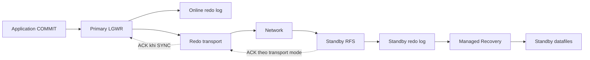

# Synchronous/asynchronous transport và đánh đổi độ trễ với mức bảo vệ

Trong Oracle Data Guard, primary database tạo redo khi transaction thay đổi dữ liệu. Redo transport services chuyển redo từ primary tới một hoặc nhiều standby database để standby có thể áp dụng thay đổi và phục vụ role transition hoặc disaster recovery.

Hai kiểu vận chuyển quan trọng là **synchronous transport (SYNC)** và **asynchronous transport (ASYNC)**:

- Với **SYNC**, primary chờ acknowledgment từ standby theo điều kiện được cấu hình trước khi hoàn tất commit. Điều này giảm hoặc loại bỏ khoảng redo chưa được bảo vệ ở standby, đổi lại commit latency chịu ảnh hưởng của mạng và thao tác ghi redo phía standby.
- Với **ASYNC**, primary không chờ acknowledgment của standby cho từng commit. Ứng dụng thường có commit latency thấp hơn, nhưng khi primary gặp sự cố đột ngột có thể mất phần redo chưa kịp tới standby.

SYNC và ASYNC là thuộc tính transport. AFFIRM và NOAFFIRM xác định acknowledgment được gửi sau khi redo được ghi vào standby redo log hay ngay khi redo đã được nhận vào bộ nhớ của tiến trình nhận. Các thuộc tính này kết hợp với protection mode để tạo ra mức bảo vệ dữ liệu và hành vi khi standby không sẵn sàng.

Không có một lựa chọn tối ưu cho mọi hệ thống. Giao dịch tài chính có RPO gần bằng zero và mạng có độ trễ thấp có thể ưu tiên synchronous transport. Hệ thống phân tích hoặc DR ở xa có thể chọn asynchronous transport để tránh đưa WAN round-trip vào đường commit. DBA cần đánh giá cùng lúc RPO, commit latency, network bandwidth, standby I/O, khả năng chịu lỗi và thời gian phục hồi.

## 1. Redo transport trong Data Guard

### 1.1. Redo được tạo ở đâu?

Khi transaction thay đổi block, Oracle tạo redo records mô tả thay đổi cần thiết để phục hồi. Redo được ghi vào redo log buffer trong SGA, sau đó LGWR ghi redo xuống online redo log theo các điều kiện commit và cơ chế log writing.

Primary database có thể gửi redo tới standby qua Oracle Net. Ở standby, tiến trình nhận redo (RFS) nhận dữ liệu và ghi vào standby redo log (SRL) khi cấu hình phù hợp. Managed recovery process sau đó áp dụng redo để đưa standby tiến gần trạng thái primary.

### 1.2. Các thành phần chính

| Thành phần | Vai trò |
|---|---|
| Primary database | Database đang nhận transaction và tạo redo |
| LGWR | Ghi redo từ log buffer xuống online redo log; tham gia synchronous transport |
| LNS | Tiến trình vận chuyển redo từ primary tới standby trong kiến trúc transport tương ứng |
| Oracle Net | Kết nối mạng truyền redo và acknowledgment |
| RFS | Tiến trình ở standby nhận redo từ primary |
| Standby redo log | Nơi ghi redo nhận được trước khi apply |
| MRP | Managed Recovery Process áp dụng redo trên physical standby |
| ARCn | Archive process tạo và vận chuyển archived redo logs trong các luồng phù hợp |

Tên tiến trình và chi tiết phối hợp có thể thay đổi theo release, transport mode và cấu hình. Khi điều tra, dùng Data Guard views và process views của chính phiên bản đang chạy.

### 1.3. Dòng dữ liệu khái quát



Sơ đồ thể hiện luồng logic. Thứ tự chính xác giữa local redo write, gửi redo và acknowledgment phụ thuộc cơ chế LGWR/transport của release; điểm cốt lõi là SYNC đặt acknowledgment của standby vào điều kiện hoàn tất commit, còn ASYNC không chờ acknowledgment đó.

### 1.4. Transport khác apply

Redo transport đưa redo tới standby. Redo apply đọc redo đã nhận và áp dụng vào standby datafiles. Hai công việc liên quan nhưng không giống nhau:

- **Transport lag:** redo được tạo ở primary nhưng standby chưa nhận đủ.
- **Apply lag:** redo đã nhận nhưng standby chưa áp dụng kịp.

Transport lag liên quan trực tiếp tới redo có thể bị mất khi primary hỏng trong chế độ asynchronous. Apply lag thường ảnh hưởng độ mới của dữ liệu đọc trên standby và thời gian cần để standby bắt kịp trước/sau role transition.

## 2. SYNC và ASYNC

### 2.1. Synchronous transport (SYNC)

SYNC yêu cầu primary nhận acknowledgment từ standby trước khi hoàn tất commit theo semantics của transport mode. Vì acknowledgment đi qua mạng và có thể chờ thao tác ghi SRL, thời gian commit có thể tăng.

Đổi lại, redo của transaction đã commit được chuyển tới standby theo mức bảo vệ được cấu hình. Với SYNC AFFIRM, acknowledgment chỉ được gửi sau khi redo được ghi bền vững vào standby redo log. Đây là cơ sở cho cấu hình bảo vệ không mất dữ liệu khi thỏa các điều kiện của Maximum Protection hoặc Maximum Availability.

### 2.2. Asynchronous transport (ASYNC)

ASYNC gửi redo tới standby mà không bắt primary chờ acknowledgment của standby cho từng commit. Primary có thể xác nhận commit sau khi redo được ghi local theo quy tắc database, trong khi redo transport tiếp tục ở nền.

Ưu điểm:

- Tránh thêm network round-trip vào mỗi commit.
- Phù hợp standby ở xa hoặc WAN có latency cao.
- Giảm tác động trực tiếp của standby I/O chậm lên response time OLTP.
- Có thể hỗ trợ khoảng cách địa lý lớn hơn cho DR.

Đánh đổi:

- Standby có thể chậm hơn primary một khoảng redo.
- Khi primary mất đột ngột, phần redo chưa tới standby có thể bị mất.
- Khi network không đủ bandwidth, transport lag có thể tăng.
- Khi kết nối gián đoạn, redo gap phải được xử lý trước khi standby bắt kịp.

### 2.3. So sánh nhanh

| Tiêu chí | SYNC | ASYNC |
|---|---|---|
| Primary chờ ACK standby cho commit | Có | Không |
| Commit latency phụ thuộc network RTT | Có | Không theo từng commit |
| Ảnh hưởng standby I/O tới commit | Có nếu AFFIRM | Không chờ I/O standby theo từng commit |
| Bảo vệ redo đã commit | Có thể đạt zero data loss với mode/điều kiện phù hợp | Có thể còn redo chưa chuyển |
| Phù hợp | RPO rất thấp, mạng latency thấp | DR xa, throughput và latency primary ưu tiên |
| Rủi ro chính | Commit chậm hoặc ảnh hưởng khi standby/network lỗi | Mất phần redo chưa vận chuyển khi primary fail |

SYNC không tự động đồng nghĩa zero data loss trong mọi cấu hình. Cần xét AFFIRM/NOAFFIRM, protection mode, trạng thái synchronized standby và điều kiện lỗi. ASYNC cũng không có nghĩa standby luôn trễ; khi mạng và apply đủ nhanh, standby có thể gần như theo kịp primary.

## 3. AFFIRM và NOAFFIRM

### 3.1. AFFIRM

AFFIRM yêu cầu standby xác nhận sau khi redo được ghi vào standby redo log. Primary phải chờ acknowledgment này trong synchronous transport. Việc chờ write bền vững làm tăng độ tin cậy của acknowledgment, nhưng thêm thời gian I/O phía standby vào đường commit.

### 3.2. NOAFFIRM

NOAFFIRM cho phép standby gửi acknowledgment khi redo đã được nhận vào bộ nhớ của tiến trình nhận, trước khi việc ghi SRL hoàn tất. Cách này giảm thời gian chờ remote disk write, nhưng acknowledgment không chứng minh redo đã bền vững trên storage của standby tại thời điểm đó.

Nếu standby hoặc hạ tầng standby gặp lỗi sau acknowledgment nhưng trước khi redo được ghi bền vững, redo vừa được xác nhận có thể chưa còn khả dụng ở standby. Khi primary cũng hỏng trong cùng khoảng rủi ro, có thể xảy ra mất dữ liệu.

### 3.3. FASTSYNC

Trong các phiên bản hỗ trợ, FASTSYNC là chế độ synchronous transport không chờ xác nhận ghi redo xuống standby redo log; về bản chất tương ứng với SYNC NOAFFIRM. FASTSYNC có thể giảm commit latency so với SYNC AFFIRM, nhưng tạo thêm rủi ro nếu primary và standby cùng gặp lỗi trước khi redo được ghi bền vững.

Khả năng sử dụng FASTSYNC và các điều kiện protection mode phụ thuộc Oracle release. Xác nhận tài liệu phiên bản và cấu hình Data Guard Broker trước khi áp dụng.

### 3.4. So sánh acknowledgment

| Transport | Khi standby gửi ACK | Điều primary đã biết |
|---|---|---|
| SYNC AFFIRM | Sau khi redo được ghi vào SRL | Redo đã được nhận và ghi bền vững theo cơ chế standby |
| SYNC NOAFFIRM / FASTSYNC | Sau khi redo được nhận vào memory, trước khi SRL write hoàn tất | Redo đã tới tiến trình nhận; chưa khẳng định remote disk write hoàn tất |
| ASYNC | ACK không nằm trên đường hoàn tất từng commit | Primary không chờ xác nhận standby cho commit đó |

### 3.5. Khi nào chọn AFFIRM?

Chọn SYNC AFFIRM khi yêu cầu bảo vệ dữ liệu cao hơn quan trọng hơn phần commit latency tăng thêm. Đây là cấu hình truyền thống cho zero-data-loss synchronous transport.

### 3.6. Khi nào cân nhắc NOAFFIRM/FASTSYNC?

Có thể cân nhắc khi:

- RPO cần rất thấp và muốn giảm remote disk write latency.
- Standby đặt gần primary với network RTT thấp.
- Tổ chức chấp nhận phần rủi ro đồng thời primary/standby failure được mô tả rõ.
- Protection mode và release hỗ trợ cấu hình này.

Không dùng FASTSYNC chỉ vì benchmark cho thấy commit nhanh hơn; cần ghi rõ failure model và mức mất dữ liệu có thể chấp nhận.

## 4. Protection modes của Data Guard

Protection mode xác định mức bảo vệ dữ liệu mà primary cố gắng duy trì và hành vi khi standby không thể nhận redo theo yêu cầu.

### 4.1. Maximum Protection

Maximum Protection được thiết kế để bảo đảm không mất dữ liệu đã commit trong failure model được hỗ trợ. Primary yêu cầu synchronous transport với acknowledgment bảo vệ phù hợp; nếu không còn standby synchronized nào đáp ứng điều kiện, primary sẽ dừng/shutdown thay vì tiếp tục nhận transaction mà không có mức bảo vệ yêu cầu.

Đặc điểm:

- Mức bảo vệ dữ liệu cao nhất trong ba protection modes.
- Cần ít nhất một standby đáp ứng cấu hình synchronous và durable acknowledgment theo yêu cầu của mode.
- Primary có thể shutdown nếu không thể duy trì mức bảo vệ.
- Yêu cầu standby và network có độ sẵn sàng cao.
- Không phù hợp nếu ưu tiên availability của primary hơn việc dừng ghi để bảo vệ zero data loss.

### 4.2. Maximum Availability

Maximum Availability cố gắng cung cấp mức bảo vệ gần với Maximum Protection mà vẫn giữ primary hoạt động khi standby tạm thời không sẵn sàng.

Khi standby synchronous bị lỗi hoặc mất kết nối, primary có thể tiếp tục xử lý theo behavior giảm mức bảo vệ, thường tương đương hoạt động ở Maximum Performance cho đến khi synchronous destination được khôi phục và đồng bộ lại. Trong khoảng đó, nếu primary cũng gặp lỗi, có thể mất redo chưa được bảo vệ.

Đặc điểm:

- Dùng synchronous transport.
- Khi standby synchronized và điều kiện được đáp ứng, commit được bảo vệ theo mode.
- Primary không shutdown ngay khi synchronous standby tạm thời không sẵn sàng.
- Có thể giảm protection level trong giai đoạn mất kết nối.
- Có thể dùng FASTSYNC ở các release hỗ trợ, với trade-off về durable acknowledgment.

### 4.3. Maximum Performance

Maximum Performance ưu tiên hiệu năng và availability của primary. Thông thường dùng asynchronous redo transport để primary không chờ standby cho mỗi commit.

Đặc điểm:

- Commit latency primary ít phụ thuộc network round-trip tới standby.
- Phù hợp standby xa hoặc network latency cao.
- Standby có thể có transport lag.
- Khi primary fail, redo chưa tới standby có thể bị mất.
- RPO phụ thuộc lượng redo chưa được vận chuyển tại thời điểm sự cố và khả năng khôi phục.

### 4.4. Bảng so sánh protection mode

| Thuộc tính | Maximum Protection | Maximum Availability | Maximum Performance |
|---|---|---|---|
| Mục tiêu | Không mất dữ liệu theo failure model | Bảo vệ cao nhưng ưu tiên primary tiếp tục hoạt động khi standby lỗi | Hiệu năng và availability primary |
| Transport điển hình | SYNC AFFIRM | SYNC AFFIRM hoặc FASTSYNC nếu hỗ trợ | ASYNC |
| Primary chờ standby | Có | Có khi synchronous destination sẵn sàng | Không chờ từng commit |
| Khi standby mất kết nối | Primary dừng nếu không còn standby đáp ứng | Primary tiếp tục với protection level giảm | Primary tiếp tục |
| Commit latency | Cao hơn do network và remote write | Cao hơn khi sync; thấp hơn nếu FASTSYNC | Thấp hơn, không chờ ACK từng commit |
| Data loss exposure | Không mất redo đã commit trong mode được duy trì | Không mất khi mode synchronized đáp ứng; có rủi ro nếu primary fail trong lúc protection giảm hoặc với FASTSYNC failure case | Có thể mất redo chưa vận chuyển |

Các mode không phải là một lời hứa độc lập với hạ tầng. Cần bảo đảm standby, SRL, network, storage và role transition được cấu hình/kiểm thử đúng.

### 4.5. Protection mode và protection level

Phân biệt:

- PROTECTION_MODE: mode được cấu hình cho database.
- PROTECTION_LEVEL: mức bảo vệ thực tế hiện tại theo trạng thái destination và transport.

Hai giá trị có thể khác nhau trong lúc synchronous destination không đáp ứng. Ví dụ database được cấu hình Maximum Availability nhưng hiện tại protection level giảm do standby mất kết nối.

Kiểm tra:

```sql
SELECT protection_mode,
       protection_level,
       database_role,
       switchover_status
FROM v$database;
```

Đây là một trong các kiểm tra đầu tiên khi xác nhận Data Guard protection đang ở mức mong đợi.

## 5. Commit latency và đường đi của acknowledgment

### 5.1. Thành phần latency trong SYNC AFFIRM

Commit latency trong synchronous transport có thể chịu ảnh hưởng bởi:

- Local redo write trên primary.
- Thời gian LGWR/LNS đưa redo lên transport.
- Network round-trip time và jitter.
- Thời gian RFS nhận redo.
- Remote write latency để ghi standby redo log khi AFFIRM.
- Scheduling/CPU contention ở primary và standby.
- Queueing do network congestion hoặc I/O saturation.

Vì vậy, SYNC AFFIRM thường có commit latency cao hơn ASYNC. Mức tăng phụ thuộc khoảng cách mạng, chất lượng network, tốc độ storage và workload.

### 5.2. Network round-trip

Trong SYNC, acknowledgment phải quay về primary trước khi commit được hoàn tất. Độ trễ truyền đi và về thường tạo một thành phần gần với network RTT trong đường commit. Tăng khoảng cách địa lý hoặc đi qua WAN có thể làm RTT tăng đáng kể.

Bandwidth và latency là hai đại lượng khác nhau:

- Bandwidth quyết định lượng redo có thể vận chuyển mỗi giây.
- Latency ảnh hưởng thời gian một lần gửi/acknowledgment hoàn tất.

Một link có bandwidth cao nhưng RTT lớn vẫn có thể làm synchronous commit chậm.

### 5.3. Remote I/O

Với AFFIRM, standby phải ghi redo vào SRL trước khi xác nhận. Storage latency, write queue, controller cache behavior và contention trên standby có thể đi vào commit path.

Với NOAFFIRM/FASTSYNC, acknowledgment không chờ SRL write hoàn tất nên có thể giảm phần latency remote I/O. Đổi lại, acknowledgment phản ánh redo đã nhận vào memory chứ chưa khẳng định đã durable trên standby storage.

### 5.4. ASYNC và tác động gián tiếp

ASYNC không chờ acknowledgment cho từng commit, nhưng transport vẫn tiêu thụ CPU, network bandwidth và tài nguyên process. Nếu mạng bị nghẽn hoặc redo generation vượt bandwidth, transport lag sẽ tăng. Do đó ASYNC giảm ảnh hưởng trực tiếp lên commit latency, không có nghĩa transport hoàn toàn miễn phí.

### 5.5. Độ biến thiên quan trọng như trung bình

Khi đánh giá synchronous transport, không chỉ đo average latency. P95/P99 commit latency, jitter và các spike trong giờ cao điểm có thể ảnh hưởng trải nghiệm người dùng nhiều hơn trung bình.

Đo cùng workload và thời gian đại diện:

- Median, P95, P99 commit response time.
- Log file sync và các wait liên quan transport.
- Network RTT, retransmit, packet loss.
- Standby SRL write latency.
- CPU/network queue ở hai phía.

## 6. RPO, RTO và data loss exposure

### 6.1. RPO

Recovery Point Objective (RPO) là lượng dữ liệu tối đa tổ chức chấp nhận mất khi khôi phục sau sự cố. Trong Data Guard:

- Synchronous durable transport có thể đạt RPO bằng zero cho transaction đã commit khi protection mode và điều kiện được duy trì.
- ASYNC có RPO phụ thuộc redo chưa tới standby tại thời điểm primary failure.
- FASTSYNC giảm commit latency nhưng cần hiểu rủi ro đồng thời primary/standby failure trước khi redo được ghi bền vững.

### 6.2. RTO

Recovery Time Objective (RTO) là thời gian mục tiêu để dịch vụ hoạt động lại. SYNC/ASYNC không tự quyết định toàn bộ RTO. RTO còn phụ thuộc:

- Thời gian phát hiện primary failure.
- Quy trình failover và quyết định role transition.
- Standby đã apply redo tới đâu.
- Thời gian mở standby thành primary.
- DNS/service/client reconnection.
- Kiểm tra ứng dụng và dữ liệu sau failover.

### 6.3. Transport lag và apply lag

Transport lag phản ánh redo primary chưa được standby nhận kịp. Apply lag phản ánh redo đã nhận nhưng chưa được apply. Hai lag cần được giám sát riêng.

Ví dụ:

- Transport lag 0 giây, apply lag 15 phút: redo đã tới standby nhưng standby chưa áp dụng kịp; dữ liệu standby đọc có thể cũ và failover có thể cần thời gian apply thêm.
- Transport lag 2 phút, apply lag 0 giây: standby apply hết redo đã nhận nhưng vẫn chưa nhận redo mới nhất; có thể mất phần redo chưa truyền nếu primary fail.

### 6.4. RPO của ASYNC không phải con số cố định

Không thể khẳng định ASYNC luôn mất tối đa một giây hoặc một phút nếu chưa có giới hạn vận hành và đo lag. RPO thực tế phụ thuộc redo generation rate, network throughput, queueing, disconnect duration và vị trí lỗi.

Đặt ngưỡng cảnh báo lag không tự biến ASYNC thành zero-data-loss. Nó chỉ giúp phát hiện khi exposure vượt mức chấp nhận để vận hành có thể can thiệp.

## 7. Cấu hình LOG_ARCHIVE_DEST_n

### 7.1. Khai báo standby destination

Một destination Data Guard thường được cấu hình qua LOG_ARCHIVE_DEST_n. Ví dụ minh họa SYNC AFFIRM:

```sql
ALTER SYSTEM SET LOG_ARCHIVE_DEST_2 =
  'SERVICE=STBY1
   SYNC AFFIRM
   NET_TIMEOUT=10
   REOPEN=60
   VALID_FOR=(ONLINE_LOGFILES,PRIMARY_ROLE)
   DB_UNIQUE_NAME=STBY1'
  SCOPE=BOTH;
```

Ví dụ minh họa ASYNC:

```sql
ALTER SYSTEM SET LOG_ARCHIVE_DEST_3 =
  'SERVICE=STBY_DR
   ASYNC NOAFFIRM
   VALID_FOR=(ONLINE_LOGFILES,PRIMARY_ROLE)
   DB_UNIQUE_NAME=STBY_DR'
  SCOPE=BOTH;
```

Tên service, DB_UNIQUE_NAME, destination number, timeout và các thuộc tính phải khớp cấu hình thật. Cú pháp có thể được nhập trên một dòng trong SQL client.

### 7.2. Các thuộc tính quan trọng

| Thuộc tính | Ý nghĩa |
|---|---|
| SERVICE | Oracle Net service của standby |
| SYNC | Synchronous redo transport |
| ASYNC | Asynchronous redo transport |
| AFFIRM | Chờ redo được ghi vào standby redo log trước ACK |
| NOAFFIRM | ACK trước khi standby redo log write hoàn tất |
| FASTSYNC | Synchronous transport không chờ remote SRL write trong release hỗ trợ |
| NET_TIMEOUT | Thời gian chờ phản hồi transport trước khi báo lỗi, áp dụng cho synchronous transport |
| REOPEN | Khoảng chờ trước khi thử mở lại destination sau lỗi |
| MAX_FAILURE | Ngưỡng số lần thử thất bại theo cấu hình |
| VALID_FOR | Chỉ định loại log và role mà destination hợp lệ |
| DB_UNIQUE_NAME | Định danh database đích |
| MANDATORY/OPTIONAL | Chính sách yêu cầu destination cho archive behavior; không đồng nghĩa AFFIRM |

### 7.3. LOG_ARCHIVE_DEST_STATE_n

Destination có thể được enable/disable bằng LOG_ARCHIVE_DEST_STATE_n:

```sql
ALTER SYSTEM SET LOG_ARCHIVE_DEST_STATE_2 = ENABLE SCOPE=BOTH;
```

Giá trị DISABLE/DEFER có thể dùng trong tình huống bảo trì hoặc điều tra theo kế hoạch. Không disable synchronous destination một cách tùy tiện trong Maximum Protection/Availability vì có thể làm protection level giảm hoặc primary shutdown theo mode.

### 7.4. VALID_FOR

VALID_FOR xác định destination áp dụng cho loại log và database role nào. Cấu hình thường dùng cho redo từ online redo logs khi database ở primary role:

```text
VALID_FOR=(ONLINE_LOGFILES,PRIMARY_ROLE)
```

Trong cấu hình role transition, cần định nghĩa destination trên các database sao cho sau switchover/failover, redo có thể tiếp tục được vận chuyển theo thiết kế.

### 7.5. NET_TIMEOUT

NET_TIMEOUT quy định khoảng thời gian LGWR chờ phản hồi từ synchronous destination trước khi xem kết nối bị timeout. Giá trị quá thấp có thể gây lỗi khi network jitter; quá cao có thể kéo dài thời gian phát hiện lỗi và ảnh hưởng commit khi standby không phản hồi.

Chọn timeout dựa trên RTT bình thường, jitter, thời gian remote write và failure detection objective. Không đặt cực thấp chỉ để phát hiện nhanh mà không kiểm tra false timeout.

### 7.6. REOPEN và MAX_FAILURE

REOPEN điều khiển thời gian chờ trước khi Oracle thử lại destination bị lỗi. MAX_FAILURE có thể giới hạn số lần thử liên tiếp trước khi xử lý destination theo policy. Các thuộc tính này không thay thế monitoring và runbook khôi phục transport.

### 7.7. LOG_ARCHIVE_DEST_n không phải chỉ có một giá trị cho mọi standby

Primary có thể gửi redo tới nhiều standby với mode khác nhau. Ví dụ một standby đồng bộ gần primary để bảo vệ commit và một standby DR ở xa dùng ASYNC. Mỗi destination có thể có SERVICE, mode, VALID_FOR và DB_UNIQUE_NAME riêng.

## 8. Standby redo logs và real-time apply

### 8.1. Vai trò của SRL

Standby redo logs là nơi standby ghi redo nhận được từ primary trước khi archived và apply. SRL cho phép standby nhận redo liên tục và hỗ trợ real-time apply, giúp giảm khoảng trễ so với chờ archived log hoàn chỉnh.

### 8.2. Số lượng và kích thước

Thiết kế SRL cần xét:

- Số redo log groups của từng thread trên primary.
- Kích thước lớn nhất của online redo log.
- Số thread trong RAC.
- Số standby redo log groups cần cho từng thread.

Hướng dẫn phổ biến là tạo ít nhất một SRL group nhiều hơn số online redo log groups cho mỗi thread, với kích thước không nhỏ hơn online redo log lớn nhất của thread tương ứng. Kiểm tra Oracle documentation của release và cấu hình RAC cụ thể trước khi triển khai.

### 8.3. Kiểm tra SRL

```sql
SELECT group#,
       thread#,
       sequence#,
       bytes,
       status
FROM v$standby_log
ORDER BY thread#, group#;
```

So sánh với online redo logs:

```sql
SELECT thread#,
       group#,
       bytes,
       status
FROM v$log
ORDER BY thread#, group#;
```

### 8.4. Real-time apply

Khi SRL được cấu hình và managed recovery chạy phù hợp, physical standby có thể apply redo khi redo vẫn đang được ghi vào standby redo log. Điều này giảm apply lag so với đợi archive log hoàn chỉnh.

Ví dụ khởi động managed recovery trong physical standby:

```sql
ALTER DATABASE RECOVER MANAGED STANDBY DATABASE DISCONNECT FROM SESSION;
```

Chi tiết cú pháp và tùy chọn phụ thuộc release. Không chạy lệnh recovery tùy tiện trên database không ở đúng role/trạng thái.

### 8.5. Transport thành công nhưng apply chậm

Nếu redo đã tới standby nhưng MRP không apply kịp, transport lag có thể thấp trong khi apply lag tăng. Kiểm tra MRP, I/O standby, recovery waits, archive gap và workload trên standby.

## 9. Chọn mode theo topology và khoảng cách mạng

### 9.1. Standby cùng data center

Nếu primary và standby ở cùng data center, network RTT thấp và storage standby có latency tốt, SYNC AFFIRM có thể phù hợp để đạt zero-data-loss protection. Cần benchmark dưới tải production-like, không chỉ ping network.

### 9.2. Standby ở data center gần

Nếu RTT vừa phải, Maximum Availability với SYNC AFFIRM có thể là lựa chọn cân bằng. Cần kiểm tra P95/P99 commit latency và hành vi khi link bị gián đoạn.

### 9.3. Standby ở xa qua WAN

WAN có RTT cao thường khiến synchronous commit latency tăng đáng kể. ASYNC thường phù hợp hơn để bảo vệ DR xa mà không đưa WAN RTT vào đường commit. Đổi lại, cần đặt RPO target và cảnh báo transport lag.

### 9.4. Far Sync

Far Sync instance là thành phần Data Guard có thể nhận redo đồng bộ gần primary rồi chuyển tiếp bất đồng bộ tới remote standby. Mô hình này giúp đưa synchronous acknowledgment tới một điểm gần primary, trong khi remote standby ở xa tiếp tục nhận redo qua ASYNC.


Far Sync không phải một standby database có datafiles để mở phục vụ đọc như physical standby. Nó là thành phần nhận và chuyển tiếp redo. Thiết kế cần thêm consideration về availability của Far Sync, network leg thứ hai và failover topology.

### 9.5. Nhiều standby

Một topology có thể gồm:

- Standby local dùng SYNC AFFIRM cho bảo vệ commit.
- Standby DR xa dùng ASYNC.
- Một standby reporting/read-only có apply policy riêng.

Không nên đặt mọi destination thành SYNC chỉ vì muốn bảo vệ dữ liệu tối đa; mỗi synchronous destination có thể tác động commit path và availability. Thiết kế destination bắt buộc/không bắt buộc và role transition rõ ràng.

## 10. Đánh đổi hiệu năng và bảo vệ

### 10.1. Bảng trade-off

| Yếu tố | SYNC AFFIRM | SYNC NOAFFIRM / FASTSYNC | ASYNC |
|---|---|---|---|
| Commit latency | Cao nhất trong ba cách điển hình | Thấp hơn AFFIRM | Ít phụ thuộc RTT standby |
| Durable ACK trên standby | Có | Chưa chờ SRL write | Không chờ ACK từng commit |
| Rủi ro data loss khi lỗi đồng thời | Thấp nhất theo mode được duy trì | Có cửa sổ rủi ro nếu standby mất redo chưa ghi và primary cũng hỏng | Có redo chưa vận chuyển |
| Phụ thuộc network | Cao trên đường commit | Cao trên đường commit nhưng giảm remote write wait | Không chờ từng commit |
| Phù hợp | Zero data loss và network/storage tốt | Giảm latency với failure trade-off đã chấp nhận | DR xa và hiệu năng primary |

### 10.2. Workload OLTP

OLTP có nhiều transaction ngắn và commit thường xuyên. Mỗi millisecond thêm vào commit có thể ảnh hưởng throughput và tail latency. Với SYNC, cần đo số commit/giây, log file sync waits và network RTT.

### 10.3. Batch workload

Batch có transaction dài hoặc commit theo lô. Synchronous transport vẫn ảnh hưởng commit points, nhưng số commit có thể thấp hơn OLTP. Điều chỉnh batch size có thể giảm tần suất commit nhưng phải cân bằng undo, lock, recovery và transaction duration.

### 10.4. Standby reporting

Nếu standby phục vụ reporting, apply lag quan trọng vì dữ liệu đọc có thể cũ. Chọn ASYNC/SYNC dựa trên cả RPO và độ mới dữ liệu; không chỉ nhìn commit latency.

### 10.5. Storage và network bottleneck

SYNC AFFIRM có thể bị giới hạn bởi standby SRL write latency. ASYNC có thể bị giới hạn bởi network throughput hoặc transport process. Phải đo đúng bottleneck thay vì chỉ thay SYNC thành ASYNC khi commit chậm.

## 11. Theo dõi transport và apply

### 11.1. V$ARCHIVE_DEST

View này cung cấp trạng thái các archive destinations:

```sql
SELECT dest_id,
       status,
       target,
       destination,
       binding,
       error,
       transmit_mode,
       affirm,
       net_timeout
FROM v$archive_dest
WHERE dest_id BETWEEN 1 AND 10
ORDER BY dest_id;
```

Cột có thể khác theo release. Dùng DESC V$ARCHIVE_DEST để xác nhận schema.

### 11.2. V$ARCHIVE_DEST_STATUS

```sql
SELECT dest_id,
       status,
       type,
       database_mode,
       recovery_mode,
       synchronization_status,
       gap_status,
       error
FROM v$archive_dest_status
WHERE dest_id > 0
ORDER BY dest_id;
```

View này hữu ích để xem trạng thái destination, synchronization và gap. Không phải cột nào cũng có trong mọi phiên bản.

### 11.3. V$DATAGUARD_STATS

Trên standby, xem lag:

```sql
SELECT name,
       value,
       unit,
       time_computed,
       datum_time
FROM v$dataguard_stats
WHERE name IN ('transport lag', 'apply lag', 'apply finish time');
```

Transport lag và apply lag thường được biểu diễn dạng interval. Theo dõi time_computed và datum_time để biết metric có mới không; giá trị cũ có thể khiến monitoring báo tình trạng không còn hiện tại.

### 11.4. V$DATABASE

```sql
SELECT database_role,
       protection_mode,
       protection_level,
       switchover_status,
       open_mode
FROM v$database;
```

Đây là kiểm tra quan trọng để xác nhận role và mức bảo vệ hiện tại.

### 11.5. V$DATAGUARD_PROCESS

View này giúp quan sát các Data Guard processes đang chạy:

```sql
SELECT name,
       role,
       action,
       thread#,
       sequence#,
       block#
FROM v$dataguard_process
ORDER BY name;
```

Cột cụ thể tùy release. Có thể dùng để kiểm tra RFS, MRP và transport-related processes.

### 11.6. V$STANDBY_LOG

Kiểm tra SRL groups, thread, sequence và trạng thái. Nếu SRL thiếu, sai kích thước hoặc không đủ groups, real-time transport/apply có thể không hoạt động theo kỳ vọng.

### 11.7. Broker

Nếu dùng Data Guard Broker, các lệnh thường dùng:

```text
DGMGRL> SHOW CONFIGURATION;
DGMGRL> SHOW DATABASE VERBOSE 'STBY1';
DGMGRL> VALIDATE DATABASE 'STBY1';
```

Broker có thể báo transport lag, apply lag, protection mode/level và warning. Cú pháp validate cụ thể phụ thuộc release.

## 12. Wait events và chẩn đoán latency

### 12.1. Log file sync

Ứng dụng thường chờ LGWR hoàn tất commit qua wait event log file sync. Với synchronous Data Guard, transport latency có thể góp phần vào thời gian commit. Tuy nhiên, log file sync cao cũng có thể do local redo I/O, commit frequency, CPU scheduling hoặc contention khác.

Không kết luận mọi log file sync cao đều do Data Guard. Đối chiếu transport waits, destination status, network và standby I/O.

### 12.2. Waits liên quan Data Guard

Các wait event và tên cụ thể thay đổi theo release. Có thể gặp các nhóm liên quan:

- LGWR chờ gửi/nhận redo transport.
- Network send/receive waits.
- Redo transport destination waits.
- Standby redo log I/O.
- Archive gap hoặc recovery waits.

Dùng V$SYSTEM_EVENT, V$SESSION_EVENT, ASH/AWR nếu được cấp phép và các view Data Guard để xác định bottleneck.

### 12.3. Kiểm tra event theo session

```sql
SELECT sid,
       event,
       total_waits,
       time_waited
FROM v$session_event
WHERE event LIKE '%redo%'
   OR event LIKE '%Data Guard%'
ORDER BY time_waited DESC;
```

Tên event cụ thể phụ thuộc phiên bản; truy vấn LIKE chỉ là bước khám phá, không phải danh sách đầy đủ.

### 12.4. Network measurements

Đo RTT giữa primary và standby từ đúng host/network path của database, kiểm tra packet loss, retransmit, throughput và congestion. Ping đơn lẻ không đủ để chứng minh transport path khỏe vì Oracle Net sử dụng TCP/session và network route riêng.

### 12.5. Standby I/O

Với AFFIRM, xem write latency của SRL và storage path. Kiểm tra disk group/filesystem, ASM latency, controller queue, multipath và I/O saturation. Nếu standby storage chậm, nâng cấp network không nhất thiết giải quyết commit latency.

## 13. Transport lag, apply lag và redo gap

### 13.1. Transport lag tăng

Nguyên nhân có thể:

- Network bandwidth không đủ so với redo generation.
- Network interruption hoặc packet loss.
- LNS/transport process bị thiếu CPU.
- Standby RFS không nhận kịp.
- Destination bị error/deferred.
- Primary tạo redo tăng đột biến.

### 13.2. Apply lag tăng

Nguyên nhân có thể:

- MRP thiếu CPU/I/O.
- Standby có workload reporting cạnh tranh.
- Recovery apply bị pause hoặc stopped.
- SRL/archive gap.
- Một số thao tác recovery/DDL hoặc workload đặc biệt.

### 13.3. Redo gap

Redo gap xảy ra khi standby thiếu một hoặc nhiều archived redo log sequences. Data Guard có thể tự động gap resolution nếu archive logs cần thiết còn khả dụng ở primary hoặc nơi lưu trữ. Nếu log đã bị xóa khỏi mọi nguồn, DBA có thể cần khôi phục/copy log hoặc tái tạo standby theo quy trình phù hợp.

### 13.4. Không nhầm lag với data loss

Apply lag không nhất thiết là data loss; redo có thể đã an toàn ở standby nhưng chưa apply. Transport lag trong ASYNC thể hiện redo chưa nhận và là exposure quan trọng nếu primary fail. Trong SYNC, cần xem protection level và destination synchronization thay vì chỉ một số lag.

## 14. Failure scenarios

### 14.1. Network mất trong SYNC AFFIRM

Nếu primary không nhận acknowledgment trong NET_TIMEOUT:

- Destination có thể chuyển sang trạng thái error.
- Commit có thể bị chậm trong thời gian chờ.
- Maximum Availability có thể tiếp tục với protection level giảm theo policy.
- Maximum Protection có thể shutdown primary nếu không còn standby synchronized đáp ứng.

Kiểm tra alert log, destination error, protection level và network trước khi thay đổi mode.

### 14.2. Network mất trong ASYNC

Primary có thể tiếp tục commit, nhưng transport lag tăng và redo tích lũy ở phía primary/transport. Khi kết nối phục hồi, Data Guard tiếp tục chuyển redo nếu dữ liệu cần thiết còn sẵn sàng. Nếu primary fail trước khi gửi hết, phần redo chưa nhận có thể mất khi failover.

### 14.3. Standby storage chậm trong AFFIRM

RFS ghi SRL chậm làm acknowledgment chậm. Synchronous commit latency trên primary có thể tăng. Kiểm tra SRL I/O, storage queue và các wait liên quan.

### 14.4. Standby apply dừng nhưng transport vẫn chạy

Redo có thể tiếp tục được ghi vào SRL trong khi MRP không apply. Transport lag có thể thấp, apply lag tăng. Kiểm tra MRP state, recovery errors và SRL/archive capacity.

### 14.5. Primary fail

Khả năng mất redo phụ thuộc protection mode, transport mode, acknowledgment semantics và trạng thái đồng bộ tại thời điểm lỗi. Trước failover, xác định standby nhận được sequence nào, có gap không và có cần apply thêm archived logs hay không.

### 14.6. Standby fail

Primary có thể tiếp tục theo behavior của protection mode. Sau khi standby phục hồi, kiểm tra destination status, transport restart, gap resolution và synchronization trước khi xem protection level đã trở lại bình thường.

### 14.7. Đồng thời primary và standby failure

Đây là failure case quan trọng khi đánh giá FASTSYNC/NOAFFIRM và ASYNC. Với NOAFFIRM, redo có thể đã được nhận vào memory nhưng chưa ghi SRL; nếu standby mất nguồn trước khi ghi và primary cũng hỏng, redo đó có thể không còn ở standby. Với ASYNC, redo chưa tới standby có thể bị mất. Failure model phải bao gồm mất điện, host, storage, network và site.

## 15. Cấu hình protection mode

### 15.1. Xác nhận điều kiện trước khi đổi mode

Trước khi nâng mức bảo vệ:

1. Xác nhận standby đúng role và đang nhận redo.
2. Tạo đủ standby redo logs cho từng thread.
3. Kiểm tra transport destination và trạng thái synchronization.
4. Kiểm tra network RTT/bandwidth và standby I/O.
5. Xác nhận broker configuration nếu dùng Broker.
6. Đảm bảo có runbook khi standby mất kết nối.

### 15.2. Câu lệnh thay đổi mode

Oracle cung cấp cú pháp:

```sql
ALTER DATABASE SET STANDBY DATABASE TO MAXIMIZE PROTECTION;
ALTER DATABASE SET STANDBY DATABASE TO MAXIMIZE AVAILABILITY;
ALTER DATABASE SET STANDBY DATABASE TO MAXIMIZE PERFORMANCE;
```

Chỉ chạy một câu phù hợp với mode mục tiêu sau khi đáp ứng preconditions của release và topology. Một số thay đổi có điều kiện yêu cầu database role/state cụ thể; nếu dùng Data Guard Broker, nên thay đổi qua Broker theo quy trình quản trị nhất quán.

### 15.3. Chuyển sang Maximum Protection

Phải xác nhận ít nhất một standby đồng bộ đáp ứng synchronous durable transport. Nếu không, việc chuyển mode có thể thất bại hoặc primary có nguy cơ shutdown khi không duy trì được protection. Lập kế hoạch thay đổi trong cửa sổ được kiểm soát.

### 15.4. Hạ mode

Hạ từ Maximum Protection/Availability xuống Maximum Performance có thể thay đổi RPO. Cần change approval, ghi lại thời điểm bắt đầu chấp nhận data-loss exposure và cảnh báo monitoring tương ứng.

### 15.5. Xác minh sau đổi mode

Kiểm tra V$DATABASE.PROTECTION_MODE/PROTECTION_LEVEL, V$ARCHIVE_DEST_STATUS và Data Guard Broker. Xác nhận transport destination synchronized và metric lag cập nhật.

## 16. Data Guard Broker

### 16.1. Vai trò

Data Guard Broker quản lý cấu hình Data Guard tập trung, hỗ trợ monitoring, switchover, failover và thay đổi một số thuộc tính cấu hình. Broker có thể giúp giảm sai sót do quản trị từng tham số rời rạc, nhưng vẫn cần hiểu redo transport và protection semantics.

### 16.2. Xem cấu hình

```text
DGMGRL> SHOW CONFIGURATION;
DGMGRL> SHOW DATABASE VERBOSE 'PRIMARY_DB';
DGMGRL> SHOW DATABASE VERBOSE 'STBY1';
```

### 16.3. Xem transport/apply lag

Broker có thể hiển thị transport lag, apply lag, warnings và trạng thái database. Đối chiếu với V$DATAGUARD_STATS và destination views khi cần chẩn đoán sâu.

### 16.4. Cấu hình transport mode

Các thuộc tính Broker như LogXptMode và protection mode có thể được quản lý bằng DGMGRL. Tên giá trị, khả năng FASTSYNC và cú pháp thay đổi phụ thuộc release. Không đồng thời sửa Broker property và LOG_ARCHIVE_DEST_n bằng hai quy trình không phối hợp.

### 16.5. Validate

Dùng lệnh validate phù hợp để kiểm tra database, network và role transition readiness. Validate giúp phát hiện một số vấn đề cấu hình nhưng không thay thế diễn tập failover/switchover thực tế.

## 17. Quy trình chọn SYNC hay ASYNC

### Bước 1 — Xác định RPO

Hỏi nghiệp vụ có thể chấp nhận mất bao nhiêu dữ liệu khi primary mất hoàn toàn. Nếu RPO bằng zero là bắt buộc, cần synchronous durable transport và protection mode tương ứng.

### Bước 2 — Xác định RTO

Xác định thời gian tối đa để standby tiếp quản. Kiểm tra apply lag, failover automation, service relocation và client reconnection.

### Bước 3 — Đo network

Đo RTT, jitter, packet loss và throughput trên đường thực tế giữa primary và standby. Dùng dữ liệu trong giờ cao điểm.

### Bước 4 — Đo redo generation

Ước lượng redo bytes/second ở workload peak. Network capacity phải đủ để transport duy trì lag trong giới hạn mong muốn.

### Bước 5 — Đo standby I/O

Nếu dùng AFFIRM, đo SRL write latency và storage saturation. Kiểm tra CPU/RFS và MRP.

### Bước 6 — Benchmark commit

Chạy workload đại diện và đo P50/P95/P99 commit latency, transaction throughput, log file sync và transport waits.

### Bước 7 — Chọn transport và protection mode

Chọn SYNC AFFIRM, SYNC NOAFFIRM/FASTSYNC nếu được hỗ trợ và chấp nhận rủi ro, hoặc ASYNC. Chọn protection mode theo hành vi khi standby không sẵn sàng.

### Bước 8 — Xác định failure behavior

Ghi rõ primary sẽ tiếp tục, giảm protection hay shutdown trong từng trường hợp. Đưa vào runbook và đào tạo đội vận hành.

### Bước 9 — Thiết lập monitoring

Đặt cảnh báo cho transport lag, apply lag, destination error, protection level, SRL status và disk/network capacity.

### Bước 10 — Diễn tập

Thực hiện switchover/failover test, network interruption test và standby recovery test trong môi trường phù hợp. Xác nhận RPO/RTO thực tế bằng dữ liệu đo.

## 18. Ví dụ lựa chọn theo tình huống

| Tình huống | Lựa chọn thường cân nhắc | Lý do và điều kiện |
|---|---|---|
| Core banking, standby cùng site, yêu cầu zero data loss | Maximum Protection hoặc Maximum Availability với SYNC AFFIRM | Cần network/storage latency thấp và chấp nhận behavior khi standby lỗi |
| OLTP quan trọng, cần primary tiếp tục khi standby tạm mất | Maximum Availability với SYNC AFFIRM | Khi synchronized có bảo vệ cao; khi standby lỗi primary có thể tiếp tục với protection giảm |
| Commit latency nhạy cảm, site gần, chấp nhận failure trade-off FASTSYNC | Maximum Availability với SYNC NOAFFIRM/FASTSYNC nếu release hỗ trợ | Giảm remote write wait nhưng phải chấp nhận failure model |
| DR site cách xa qua WAN | Maximum Performance với ASYNC | Tránh WAN RTT trong đường commit, theo dõi RPO exposure |
| Một standby local và một standby remote | Local SYNC, remote ASYNC | Cân bằng zero-data-loss gần primary với DR địa lý |
| Standby chỉ phục vụ báo cáo | ASYNC hoặc mode phù hợp SLA dữ liệu | Cần quản lý apply lag để bảo đảm độ mới dữ liệu |

Đây là định hướng thiết kế, không phải cấu hình mặc định. Quyết định cuối cùng phải dựa trên RPO/RTO được nghiệp vụ phê duyệt, release, topology và đo đạc.

## 19. Lab: quan sát transport và protection

Thực hiện trên hai database lab có Data Guard được cấu hình sẵn. Không thay đổi protection mode production để thử nghiệm.

### Bước 1 — Xác định role và protection

Chạy trên primary:

```sql
SELECT database_role,
       protection_mode,
       protection_level,
       open_mode
FROM v$database;
```

Ghi lại kết quả trước thử nghiệm.

### Bước 2 — Xem destination

```sql
SELECT dest_id,
       status,
       destination,
       transmit_mode,
       affirm,
       net_timeout,
       error
FROM v$archive_dest
WHERE dest_id > 0
ORDER BY dest_id;
```

Xác nhận destination đúng standby và transport attribute.

### Bước 3 — Kiểm tra standby redo logs

Trên standby:

```sql
SELECT group#, thread#, sequence#, bytes, status
FROM v$standby_log
ORDER BY thread#, group#;
```

So sánh số lượng/kích thước với online redo log groups.

### Bước 4 — Đo transport/apply lag

Trên standby:

```sql
SELECT name, value, unit, time_computed, datum_time
FROM v$dataguard_stats
WHERE name IN ('transport lag', 'apply lag');
```

Lấy nhiều mẫu theo thời gian thay vì kết luận từ một snapshot.

### Bước 5 — Chạy workload commit

Trong schema lab, chạy workload transaction có commit thường xuyên. Ghi P50/P95/P99 response time, transaction throughput và wait events. Không chạy DML lớn trên schema ứng dụng thật.

### Bước 6 — So sánh SYNC AFFIRM và ASYNC

Trong môi trường được phép, chuyển transport mode theo runbook. Giữ nguyên workload và thời gian đo. So sánh commit latency, network traffic, transport lag và standby apply lag.

### Bước 7 — Thử network interruption có kiểm soát

Chỉ trong lab, mô phỏng mất kết nối transport. Quan sát destination status, alert log, protection level và behavior của primary. Khôi phục network rồi kiểm tra gap resolution và synchronization.

### Bước 8 — Thử apply pause

Trong lab, dừng/khởi động managed recovery theo quy trình để quan sát transport lag và apply lag khác nhau như thế nào. Không để standby mất đồng bộ kéo dài ngoài thời gian thử nghiệm.

### Bước 9 — Ghi kết quả

| Mode | Commit P95 | Commit P99 | Transport lag | Apply lag | Protection level | Ghi chú |
|---|---:|---:|---:|---:|---|---|
| SYNC AFFIRM | | | | | | |
| SYNC NOAFFIRM/FASTSYNC | | | | | | |
| ASYNC | | | | | | |

Điền số liệu thật từ lab. Không dùng giá trị minh họa hoặc giả định để tuyên bố hiệu năng.

## 20. Những hiểu nhầm thường gặp

### 20.1. SYNC luôn có nghĩa zero data loss

SYNC phải đi cùng acknowledgment semantics và protection mode phù hợp. SYNC NOAFFIRM có thể ACK trước khi SRL write hoàn tất. Xem AFFIRM/NOAFFIRM, FASTSYNC và protection level.

### 20.2. ASYNC luôn có lag lớn

Nếu network đủ nhanh và MRP apply kịp, ASYNC có thể duy trì lag rất thấp. Rủi ro là redo chưa tới standby tại thời điểm primary fail, không phải standby luôn chậm.

### 20.3. Transport lag bằng apply lag

Hai metric phản ánh hai giai đoạn khác nhau. Transport lag đo redo chưa nhận; apply lag đo redo đã nhận nhưng chưa apply.

### 20.4. Maximum Availability luôn zero data loss

Khi synchronous standby synchronized và điều kiện bảo vệ được duy trì, mode có thể bảo vệ transaction đã commit. Khi standby mất kết nối, primary có thể tiếp tục với protection level giảm; nếu primary fail trong khoảng này có thể có data loss exposure. FASTSYNC cũng có failure trade-off riêng.

### 20.5. Maximum Protection tự động làm standby luôn khỏe

Mode có thể shutdown primary nếu không còn standby đáp ứng, nhưng không chữa network, storage hoặc cấu hình standby. Cần monitoring và recovery plan.

### 20.6. AFFIRM chỉ là một tùy chọn hiệu năng

AFFIRM thay đổi thời điểm acknowledgment và durability guarantee. Đây là quyết định bảo vệ dữ liệu, không chỉ là một tuning switch.

### 20.7. Ping thấp nghĩa commit latency thấp

Ping không đo remote SRL write, Oracle Net scheduling, LGWR/LNS contention hay I/O. Benchmark commit end-to-end mới phản ánh tác động thật.

### 20.8. Standby đã nhận redo nghĩa là đã apply

Redo có thể nằm trong SRL nhưng MRP chưa apply. Xác nhận transport và apply riêng.

### 20.9. Hạ protection mode là thao tác không ảnh hưởng nghiệp vụ

Hạ mode có thể làm thay đổi RPO. Đây là thay đổi kiến trúc bảo vệ dữ liệu, cần change approval và cập nhật monitoring.

## 21. Checklist thiết kế và vận hành

- [ ] Đã xác định RPO và RTO được nghiệp vụ phê duyệt.
- [ ] Đã chọn Data Guard protection mode phù hợp.
- [ ] Đã phân biệt SYNC/ASYNC với AFFIRM/NOAFFIRM.
- [ ] Đã hiểu FASTSYNC và failure trade-off nếu sử dụng.
- [ ] Đã kiểm tra transport destination và DB_UNIQUE_NAME.
- [ ] Đã cấu hình VALID_FOR phù hợp với role transition.
- [ ] Đã kiểm tra NET_TIMEOUT, REOPEN và destination state.
- [ ] Đã tạo đủ standby redo logs cho từng thread.
- [ ] SRL size không nhỏ hơn online redo log tương ứng.
- [ ] Real-time apply được cấu hình và MRP đang chạy khi cần.
- [ ] Đã đo RTT, jitter, packet loss và network throughput.
- [ ] Đã đo standby SRL write latency nếu dùng AFFIRM.
- [ ] Đã đo P95/P99 commit latency dưới tải đại diện.
- [ ] Đã theo dõi transport lag và apply lag riêng biệt.
- [ ] Đã theo dõi PROTECTION_MODE và PROTECTION_LEVEL.
- [ ] Đã có cảnh báo khi destination error hoặc protection level giảm.
- [ ] Đã kiểm tra redo gap và quy trình gap resolution.
- [ ] Đã kiểm tra Broker configuration nếu sử dụng.
- [ ] Đã diễn tập standby failure, network failure và role transition.
- [ ] Đã ghi rõ behavior khi primary tiếp tục hoặc shutdown.
- [ ] Có runbook khôi phục transport và tái đồng bộ.

## 22. Câu hỏi tự kiểm tra

1. Redo transport khác redo apply như thế nào?
2. LGWR, LNS, RFS, SRL và MRP có vai trò gì?
3. SYNC làm thay đổi điều kiện hoàn tất commit ra sao?
4. ASYNC giảm tác động nào lên primary commit?
5. Vì sao ASYNC vẫn có thể làm transport lag tăng?
6. AFFIRM xác nhận điều gì trước khi gửi acknowledgment?
7. NOAFFIRM gửi acknowledgment ở thời điểm nào?
8. FASTSYNC liên quan SYNC NOAFFIRM như thế nào?
9. Vì sao SYNC không tự động có nghĩa zero data loss?
10. Maximum Protection xử lý thế nào khi không còn standby synchronized?
11. Maximum Availability khác Maximum Protection ở behavior nào khi standby lỗi?
12. Maximum Performance ưu tiên điều gì?
13. PROTECTION_MODE khác PROTECTION_LEVEL ra sao?
14. Những thành phần nào tạo nên commit latency của SYNC AFFIRM?
15. Vì sao network RTT quan trọng hơn bandwidth đối với từng synchronous commit?
16. Standby I/O ảnh hưởng AFFIRM như thế nào?
17. RPO và RTO khác nhau ra sao?
18. Transport lag và apply lag biểu thị điều gì?
19. Vì sao apply lag cao không nhất thiết đồng nghĩa redo bị mất?
20. LOG_ARCHIVE_DEST_n có các thuộc tính quan trọng nào?
21. NET_TIMEOUT và REOPEN điều khiển điều gì?
22. VALID_FOR giúp cấu hình destination khi role thay đổi ra sao?
23. Standby redo logs có vai trò gì trong real-time apply?
24. Cách tính số lượng/kích thước SRL cần xem xét những yếu tố nào?
25. Vì sao Far Sync hữu ích với standby ở xa?
26. Khi nào chọn SYNC AFFIRM, FASTSYNC hoặc ASYNC?
27. Làm thế nào giám sát transport/apply lag?
28. Vì sao không thể dùng ping để kết luận commit latency?
29. Khi network mất trong Maximum Availability, primary có thể hoạt động thế nào?
30. Cần diễn tập những failure scenarios nào trước khi đưa Data Guard vào production?

**Nguyên tắc cần nhớ:** SYNC đặt acknowledgment của standby vào đường commit; ASYNC cho phép primary commit mà không chờ ACK từng transaction. AFFIRM đợi redo được ghi vào SRL, còn NOAFFIRM/FASTSYNC ACK sớm hơn và có failure trade-off. Maximum Protection ưu tiên không mất dữ liệu và có thể dừng primary khi mất standby đồng bộ; Maximum Availability ưu tiên primary tiếp tục hoạt động khi standby lỗi tạm thời; Maximum Performance ưu tiên hiệu năng với redo transport bất đồng bộ. Chọn mode theo RPO/RTO, đo RTT và SRL I/O, giám sát transport lag khác apply lag, và diễn tập lỗi trước khi triển khai.
