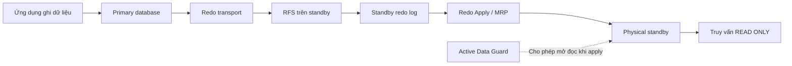

# Active Data Guard và phân biệt với chức năng Data Guard cơ bản

Oracle Data Guard duy trì một hoặc nhiều cơ sở dữ liệu dự phòng (standby database) đồng bộ với database chính (primary database) bằng cách vận chuyển và áp dụng redo. Mục tiêu chính là bảo vệ dữ liệu và duy trì khả năng chuyển đổi vai trò khi primary gặp sự cố hoặc cần bảo trì.

Active Data Guard (ADG) mở rộng mô hình Data Guard bằng cách cho phép một physical standby được mở ở chế độ chỉ đọc trong khi vẫn tiếp tục áp dụng redo từ primary. Nhờ đó, tổ chức có thể dùng standby để chạy báo cáo, truy vấn và một số tác vụ đọc mà vẫn duy trì quá trình cập nhật dữ liệu dự phòng. Đây là điểm phân biệt quan trọng nhất giữa Active Data Guard và khả năng Data Guard cơ bản.

Data Guard cơ bản vẫn có thể vận chuyển redo, áp dụng redo, chuyển đổi vai trò primary/standby và duy trì standby ở trạng thái MOUNT. Một physical standby cũng có thể được mở READ ONLY trong một số phiên bản và cấu hình, nhưng khi Redo Apply dừng thì dữ liệu trên standby không tiếp tục tiến gần primary. Active Data Guard cho phép kết hợp truy vấn chỉ đọc với Redo Apply đang chạy.

## 1. Kiến trúc Data Guard

### Primary, standby và redo

Một cấu hình Data Guard gồm database primary và ít nhất một standby database. Primary tiếp nhận các giao dịch ứng dụng và tạo redo mô tả những thay đổi dữ liệu. Redo được truyền qua mạng đến standby, sau đó được áp dụng để tái tạo các thay đổi trên database dự phòng.

Các thành phần chính trong luồng redo:

- **Primary database:** database đang giữ vai trò chính và thường tiếp nhận các giao dịch ghi.
- **Redo transport:** chuyển redo từ primary đến standby qua Oracle Net. Có thể dùng truyền đồng bộ hoặc bất đồng bộ tùy yêu cầu bảo vệ dữ liệu và độ trễ.
- **Standby redo log (SRL):** nhận redo từ primary trên standby. SRL hỗ trợ real-time apply, tức standby có thể áp dụng redo ngay khi redo được ghi vào standby redo log thay vì phải chờ archive log hoàn tất.
- **Remote File Server (RFS):** tiến trình nhận redo trên standby và ghi vào standby redo log hoặc archived log.
- **Redo Apply:** áp dụng redo lên physical standby để giữ các block dữ liệu tương ứng với primary.
- **SQL Apply:** chuyển thông tin redo thành các câu lệnh SQL và áp dụng lên logical standby.

Luồng xử lý tổng quát:



Khi cấu hình Data Guard cơ bản, physical standby thường được giữ ở trạng thái MOUNT trong lúc Redo Apply hoạt động. Với Active Data Guard, physical standby có thể ở trạng thái READ ONLY WITH APPLY: người dùng chạy truy vấn chỉ đọc trong khi tiến trình apply tiếp tục cập nhật các block từ redo nhận được.

### Các loại standby database

| Loại standby | Cách duy trì dữ liệu | Khả năng mở và sử dụng |
|---|---|---|
| Physical standby | Áp dụng redo ở mức block bằng Redo Apply | Thường MOUNT khi apply; có thể READ ONLY khi dừng apply. Active Data Guard cho phép READ ONLY WITH APPLY |
| Logical standby | Chuyển redo thành SQL và áp dụng bằng SQL Apply | Có thể mở READ WRITE để phục vụ một số truy vấn và hoạt động được hỗ trợ; cần hiểu rõ các đối tượng được duy trì bởi SQL Apply |
| Snapshot standby | Tạm chuyển từ physical standby sang trạng thái có thể ghi để kiểm thử | Mở READ WRITE trong thời gian thử nghiệm; redo từ primary được giữ lại để áp dụng sau khi chuyển lại physical standby |

**Physical standby** giữ cấu trúc dữ liệu gần như giống primary và là loại thường được dùng cho Active Data Guard real-time query. Redo Apply cập nhật standby theo các thay đổi phát sinh ở primary.

**Logical standby** dùng SQL Apply nên có thể hỗ trợ một số hoạt động đọc/ghi và cấu trúc khác biệt được tài liệu Oracle cho phép. Tuy nhiên, không phải mọi kiểu dữ liệu, bảng hoặc thao tác DDL đều được SQL Apply hỗ trợ. Cần kiểm tra danh sách giới hạn theo phiên bản trước khi chọn logical standby.

**Snapshot standby** là physical standby được tạm mở READ WRITE để kiểm thử ứng dụng, nâng cấp hoặc thay đổi. Trong thời gian snapshot, Redo Apply không chạy; redo từ primary tiếp tục được nhận và lưu lại. Khi chuyển về physical standby, các thay đổi cục bộ trên snapshot standby bị loại bỏ theo cơ chế flashback và redo đã nhận được áp dụng để bắt kịp primary. Vì vậy, snapshot standby không phải cách thay thế Active Data Guard cho báo cáo liên tục.

## 2. Data Guard cơ bản cung cấp những gì?

Data Guard cơ bản cung cấp các cơ chế bảo vệ và sẵn sàng cao cốt lõi:

1. Tạo và duy trì standby database từ primary.
2. Vận chuyển redo qua mạng bằng redo transport.
3. Áp dụng redo trên physical hoặc logical standby.
4. Theo dõi và xử lý khoảng trống archived redo log (archive gap).
5. Chuyển vai trò bằng switchover hoặc failover.
6. Chọn chế độ bảo vệ dữ liệu phù hợp với yêu cầu mất dữ liệu và độ trễ.
7. Quản lý cấu hình bằng Data Guard Broker nếu môi trường sử dụng Broker.
8. Sử dụng snapshot standby để thử nghiệm trong một khoảng thời gian, theo các điều kiện của tính năng.

### Switchover và failover

**Switchover** là chuyển đổi vai trò có kế hoạch. Primary hiện tại trở thành standby và một standby được chọn trở thành primary. Thao tác này thường dùng khi bảo trì, nâng cấp hoặc diễn tập DR. Mục tiêu là chuyển đổi có kiểm soát và không mất dữ liệu đã được đồng bộ theo điều kiện của cấu hình.

**Failover** là chuyển standby thành primary khi primary hiện tại không thể tiếp tục phục vụ. Failover có thể dẫn đến mất một phần redo chưa được truyền hoặc áp dụng, tùy redo transport, protection mode và trạng thái standby tại thời điểm sự cố.

Hai thao tác này thuộc nền tảng Data Guard, không phải chỉ Active Data Guard mới có. Active Data Guard bổ sung khả năng sử dụng physical standby để truy vấn trong lúc apply; nó không thay thế thiết kế switchover/failover hay quy trình DR.

### Các chế độ bảo vệ dữ liệu

Data Guard có ba protection mode chính:

| Protection mode | Đặc điểm | Đánh đổi |
|---|---|---|
| Maximum Protection | Bảo đảm không mất dữ liệu giao dịch đã commit trong phạm vi cấu hình; primary có thể dừng nếu không thể ghi redo an toàn đến standby cần thiết | Mức bảo vệ cao, ảnh hưởng mạnh đến khả năng tiếp tục ghi khi standby hoặc mạng gặp sự cố |
| Maximum Availability | Ưu tiên không mất dữ liệu khi có thể đồng bộ; khi standby đồng bộ không khả dụng, primary có thể tiếp tục sau khi chuyển sang cơ chế phù hợp | Cân bằng giữa bảo vệ dữ liệu và tính sẵn sàng |
| Maximum Performance | Ưu tiên hiệu năng primary; redo thường được truyền bất đồng bộ | Có thể mất các giao dịch gần nhất nếu primary gặp sự cố trước khi redo được truyền và áp dụng |

Protection mode và transport mode là các khái niệm liên quan nhưng khác nhau. Maximum Availability thường dùng redo transport đồng bộ khi standby có thể đáp ứng; Maximum Performance thường dùng bất đồng bộ. Việc chọn chế độ cần xét khoảng cách mạng, độ trễ, băng thông, tải ghi, yêu cầu RPO và hành vi mong muốn khi standby mất kết nối.

## 3. Active Data Guard bổ sung điều gì?

### Real-Time Query: đọc trong khi Redo Apply tiếp tục chạy

Tính năng nổi bật của Active Data Guard là **real-time query** trên physical standby. Standby được mở READ ONLY trong khi Redo Apply vẫn hoạt động. Các ứng dụng báo cáo có thể truy vấn dữ liệu dự phòng, trong khi MRP (Managed Recovery Process) tiếp tục áp dụng redo.

Trạng thái database thường hiển thị:

- Primary: `DATABASE_ROLE = PRIMARY`.
- Standby: `DATABASE_ROLE = PHYSICAL STANDBY`.
- Physical standby có Active Data Guard real-time query: `OPEN_MODE = READ ONLY WITH APPLY`.

Lệnh mở physical standby ở chế độ chỉ đọc và bắt đầu apply có thể được thực hiện theo quy trình và cú pháp phù hợp với phiên bản Oracle:

```sql
-- Trên physical standby, đưa database đến trạng thái phù hợp
-- theo quy trình vận hành của phiên bản đang sử dụng.
ALTER DATABASE OPEN READ ONLY;

-- Bắt đầu Redo Apply khi standby đang mở READ ONLY.
ALTER DATABASE RECOVER MANAGED STANDBY DATABASE
  DISCONNECT FROM SESSION;
```

Sau đó kiểm tra:

```sql
SELECT database_role,
       open_mode,
       protection_mode,
       switchover_status
FROM v$database;
```

Khi được cấu hình đúng và có quyền sử dụng Active Data Guard, `OPEN_MODE` có thể hiển thị `READ ONLY WITH APPLY`. Cú pháp, trình tự chuyển trạng thái và điều kiện mở database có thể khác theo phiên bản, cấu hình Broker và môi trường RAC. Hãy dùng runbook tương ứng với phiên bản thực tế.

Nếu cần dừng apply:

```sql
ALTER DATABASE RECOVER MANAGED STANDBY DATABASE CANCEL;
```

Khi Redo Apply dừng, truy vấn trên standby vẫn có thể thực hiện nếu database đang mở READ ONLY, nhưng dữ liệu không tiếp tục được cập nhật theo redo mới. Độ cũ của dữ liệu sẽ tăng dần theo thời gian.

### So sánh ba trạng thái sử dụng physical standby

| Trạng thái | Database mở thế nào? | Redo Apply | Có thể truy vấn? |
|---|---|---|---|
| Physical standby cơ bản đang apply | MOUNTED | Có | Không chạy truy vấn ứng dụng trực tiếp trên database đang MOUNT |
| Physical standby mở chỉ đọc, apply dừng | READ ONLY | Không | Có, nhưng dữ liệu đứng tại thời điểm apply dừng |
| Active Data Guard real-time query | READ ONLY WITH APPLY | Có | Có, truy vấn chỉ đọc trong khi dữ liệu tiếp tục được cập nhật |

Điểm cần nhớ: một standby đang nhận redo hoặc đang apply redo không tự động có nghĩa là Active Data Guard. Data Guard cơ bản vốn đã có thể vận chuyển và áp dụng redo trên standby ở trạng thái MOUNT. Active Data Guard nói đến khả năng bổ sung, đặc biệt là mở physical standby để truy vấn đồng thời với Redo Apply.

### Các khả năng mở rộng khác

Tùy phiên bản Oracle, cấu hình và quyền sử dụng, Active Data Guard còn có thể cung cấp các khả năng như:

- **Automatic Block Media Recovery:** hỗ trợ tự động sửa một số block bị hỏng bằng cách lấy block tốt từ database còn lại trong cấu hình Data Guard, khi các điều kiện cần thiết được đáp ứng.
- **Far Sync:** dùng một instance trung gian để nhận và chuyển tiếp redo, giúp mở rộng khoảng cách địa lý trong thiết kế bảo vệ dữ liệu mà không cần đặt một database standby đầy đủ tại vị trí trung gian.
- **Một số khả năng mở rộng cho workload và vận hành standby:** phạm vi cụ thể thay đổi theo phiên bản và bộ tính năng được cấp phép.

Không nên suy luận quyền sử dụng chỉ từ việc một lệnh hoặc view xuất hiện trong database. Tính năng, điều kiện triển khai và yêu cầu license có thể thay đổi theo phiên bản Oracle Database, nền tảng và hợp đồng. Trước khi bật hoặc khai thác một tính năng Active Data Guard, hãy đối chiếu Oracle Licensing Guide đúng phiên bản và thỏa thuận license của tổ chức.

## 4. Phân biệt Data Guard cơ bản và Active Data Guard

Bảng sau tóm tắt khác biệt ở góc độ kiến trúc và vận hành:

| Tiêu chí | Data Guard cơ bản | Active Data Guard |
|---|---|---|
| Mục tiêu chính | DR, HA và duy trì standby | DR/HA đồng thời khai thác standby cho workload đọc |
| Redo transport | Có | Có |
| Redo Apply trên physical standby | Có, thường khi database MOUNT | Có |
| SQL Apply trên logical standby | Có, theo giới hạn hỗ trợ | Không phải điểm khác biệt chính của ADG |
| Physical standby READ ONLY khi apply đang chạy | Không có khả năng real-time query này | Có |
| Physical standby READ ONLY khi apply dừng | Có thể, tùy phiên bản và cấu hình | Có |
| Switchover và failover | Có | Có |
| Snapshot standby | Có, theo điều kiện hỗ trợ | Vẫn là một khả năng của Data Guard; không đồng nghĩa với real-time query |
| Automatic Block Media Recovery | Phụ thuộc quyền sử dụng và phiên bản; thường thuộc bộ tính năng Active Data Guard | Có khi được hỗ trợ và cấu hình phù hợp |
| Khai thác báo cáo trên physical standby với dữ liệu liên tục được apply | Không đáp ứng theo cách real-time query | Là trường hợp sử dụng tiêu biểu |

Có thể hiểu theo hai lớp:

- Data Guard cơ bản duy trì một bản dự phòng để khôi phục dịch vụ khi primary gặp sự cố.
- Active Data Guard bổ sung khả năng khai thác physical standby cho các truy vấn chỉ đọc trong khi standby tiếp tục theo sát primary bằng Redo Apply.

Active Data Guard vẫn dựa trên kiến trúc Data Guard. Khi triển khai ADG, DBA vẫn phải thiết kế redo transport, standby redo log, protection mode, giám sát lag, quy trình role transition, backup và kiểm thử DR.

## 5. Độ trễ dữ liệu và tính nhất quán khi truy vấn

### Transport lag và apply lag

Khi dùng standby cho báo cáo, cần phân biệt hai loại độ trễ:

- **Transport lag:** độ trễ giữa thời điểm redo được tạo trên primary và thời điểm redo tương ứng được truyền/nhận ở standby.
- **Apply lag:** độ trễ giữa trạng thái redo đã nhận và trạng thái redo đã được áp dụng trên standby.

Một standby có thể nhận redo nhanh nhưng apply chậm nếu MRP không theo kịp tải. Ngược lại, apply lag thấp không có nghĩa transport lag luôn bằng 0. Cần theo dõi cả hai chỉ số và xác định ngưỡng phù hợp với nghiệp vụ.

Ví dụ, báo cáo doanh thu theo phút có thể chấp nhận dữ liệu trễ vài chục giây, trong khi một ứng dụng đối soát giao dịch có thể yêu cầu độ trễ thấp hơn hoặc cần cơ chế đồng bộ đọc sau ghi. Không nên quảng bá Active Data Guard là bản sao luôn đồng bộ tuyệt đối trong mọi điều kiện.

### Cân bằng tải truy vấn và apply

Active Data Guard cho phép chuyển workload đọc sang standby, nhưng standby vẫn dùng CPU, bộ nhớ và I/O để áp dụng redo. Truy vấn báo cáo nặng có thể cạnh tranh tài nguyên với Redo Apply, làm tăng apply lag. Ngược lại, tải ghi cao ở primary làm tăng lượng redo cần truyền và áp dụng.

Khi thiết kế, cần:

- Đánh giá workload đọc thực tế, thời lượng truy vấn, mức sử dụng PGA/SGA và I/O.
- Bảo đảm standby có đủ CPU, bộ nhớ và throughput lưu trữ cho cả query lẫn apply.
- Theo dõi transport lag và apply lag trong giờ cao điểm.
- Dùng Resource Manager hoặc cơ chế quản trị workload phù hợp nếu cần giới hạn truy vấn báo cáo.
- Đặt ngưỡng cảnh báo và phương án chuyển truy vấn về primary hoặc nguồn dữ liệu khác khi standby bị lag quá mức.
- Kiểm tra hành vi của truy vấn dài khi apply tiếp tục chạy, nhất là với báo cáo yêu cầu một mốc dữ liệu nhất quán.

Truy vấn trên physical standby của Active Data Guard là truy vấn chỉ đọc. Các lệnh ghi dữ liệu ứng dụng không được thực hiện trực tiếp trên physical standby đang phục vụ real-time query. Một số tính năng theo phiên bản có thể hỗ trợ chuyển hướng DML đến primary, nhưng đây là cơ chế riêng, cần kiểm tra điều kiện và license; không nên nhầm với quyền ghi trực tiếp lên physical standby.

## 6. Cấu hình và vận hành ở mức tổng quan

### Điều kiện nền tảng

Trước khi triển khai Data Guard hoặc Active Data Guard, DBA cần xác định:

1. Phiên bản, edition, platform và patch level của primary/standby.
2. Cấu hình primary và standby, bao gồm DB_NAME, DB_UNIQUE_NAME, role và Oracle Net connectivity.
3. ARCHIVELOG, FORCE LOGGING và các điều kiện tạo standby phù hợp.
4. Redo transport mode, protection mode và yêu cầu RPO/RTO.
5. Standby redo log đủ số lượng, kích thước và thread tương ứng với online redo log, đặc biệt trong môi trường RAC.
6. FRA và dung lượng lưu archived redo log, flashback log nếu dùng Flashback Database hoặc snapshot standby.
7. Đồng bộ thời gian, DNS/network, chứng thư hoặc mã hóa kết nối theo chính sách bảo mật.
8. Quy trình backup, giám sát, switchover, failover và diễn tập DR.
9. Quyền sử dụng Active Data Guard nếu cần real-time query hoặc tính năng thuộc option này.

### Bật Redo Apply trên physical standby

Trên physical standby ở trạng thái MOUNT, có thể bắt đầu managed recovery:

```sql
ALTER DATABASE RECOVER MANAGED STANDBY DATABASE
  DISCONNECT FROM SESSION;
```

Oracle tạo hoặc sử dụng các tiến trình recovery phù hợp để áp dụng redo. Với standby có SRL và cấu hình phù hợp, real-time apply có thể áp dụng redo đang được ghi vào standby redo log. Cách bật real-time apply và các tùy chọn cú pháp phụ thuộc phiên bản; các phiên bản mới thường tự sử dụng SRL khi điều kiện phù hợp, trong khi cú pháp cũ có thể thấy `USING CURRENT LOGFILE`.

Trên physical standby cơ bản, database có thể được giữ MOUNT trong lúc apply. Nếu cần mở READ ONLY để chạy truy vấn, phải dừng Redo Apply trước khi mở, do đó dữ liệu sẽ ngừng cập nhật trong thời gian truy vấn. Với Active Data Guard, quy trình cho phép mở READ ONLY và tiếp tục Redo Apply đồng thời.

### Dùng Data Guard Broker

Data Guard Broker là công cụ quản lý cấu hình Data Guard, có thể đơn giản hóa giám sát và role transition. Broker không đồng nghĩa với Active Data Guard; nó quản lý cấu hình Data Guard và có thể được dùng trong môi trường có hoặc không có ADG.

Một số lệnh DGMGRL thường dùng:

```text
DGMGRL> SHOW CONFIGURATION;
DGMGRL> SHOW DATABASE VERBOSE 'standby_db';
DGMGRL> EDIT DATABASE 'standby_db' SET STATE='APPLY-ON';
DGMGRL> EDIT DATABASE 'standby_db' SET STATE='APPLY-OFF';
```

Tên database trong ví dụ phải thay bằng tên database thực tế trong Broker configuration. Trước khi đổi trạng thái apply hoặc role, hãy kiểm tra trạng thái toàn cấu hình và lỗi transport/apply.

## 7. Giám sát Data Guard và Active Data Guard

### Kiểm tra role và open mode

Chạy trên từng database:

```sql
SELECT name,
       database_role,
       open_mode,
       protection_mode,
       switchover_status
FROM v$database;
```

Các trường cần chú ý:

- `DATABASE_ROLE`: xác định database đang là PRIMARY, PHYSICAL STANDBY hoặc LOGICAL STANDBY.
- `OPEN_MODE`: cho biết database đang MOUNTED, READ ONLY, READ WRITE hoặc READ ONLY WITH APPLY.
- `PROTECTION_MODE`: chế độ bảo vệ dữ liệu đang có hiệu lực.
- `SWITCHOVER_STATUS`: trạng thái liên quan đến khả năng chuyển đổi vai trò.

### Kiểm tra transport lag và apply lag

```sql
SELECT name,
       value,
       unit,
       time_computed,
       datum_time
FROM v$dataguard_stats
WHERE name IN ('transport lag', 'apply lag');
```

Đọc cả `TIME_COMPUTED` và `DATUM_TIME` để hiểu độ mới của số liệu. Một giá trị lag nhỏ nhưng dữ liệu thống kê không được cập nhật gần đây có thể không phản ánh trạng thái hiện tại.

### Kiểm tra tiến trình Data Guard

```sql
SELECT name,
       role,
       thread#,
       sequence#,
       action
FROM v$dataguard_process
ORDER BY name;
```

View `V$DATAGUARD_PROCESS` cung cấp thông tin về các tiến trình Data Guard trong những phiên bản hỗ trợ. Ở phiên bản cũ, DBA có thể gặp các view hoặc cột khác, chẳng hạn `V$MANAGED_STANDBY`; cần dùng view phù hợp với release đang chạy.

### Kiểm tra trạng thái archive destination

```sql
SELECT dest_id,
       status,
       type,
       database_mode,
       recovery_mode,
       error
FROM v$archive_dest_status
WHERE status <> 'INACTIVE'
ORDER BY dest_id;
```

Nếu có lỗi ở destination, cần kiểm tra Oracle Net, trạng thái dịch vụ, quyền ghi, dung lượng lưu trữ và các tham số redo transport. Không nên chỉ dựa vào một chỉ số lag để kết luận cấu hình đang khỏe.

### Kiểm tra archive gap

```sql
SELECT thread#,
       low_sequence#,
       high_sequence#
FROM v$archive_gap;
```

View này hiển thị khoảng trống archived redo log được phát hiện trên standby. Nếu có gap, cần xác định log còn tồn tại ở primary hoặc backup hay không và để Data Guard/FAL xử lý theo cấu hình. Nếu cần đăng ký log thủ công, phải xác định đúng file và quy trình recovery của phiên bản; không tự ý xóa hoặc bỏ qua sequence còn thiếu.

## 8. Tình huống sử dụng và lựa chọn kiến trúc

### Dùng Data Guard cơ bản khi nào?

Data Guard cơ bản phù hợp khi yêu cầu chính là:

- Có standby sẵn sàng tiếp quản khi primary gặp sự cố.
- Duy trì bản sao dữ liệu ở site DR.
- Đáp ứng RPO/RTO theo protection mode và hạ tầng mạng.
- Chạy standby ở trạng thái MOUNT để ưu tiên apply và khả năng khôi phục.
- Diễn tập switchover/failover định kỳ mà không cần truy vấn báo cáo liên tục trên physical standby.

Ví dụ, hệ thống nghiệp vụ chỉ cần một bản dự phòng ở trung tâm dữ liệu thứ hai. Standby được MOUNT và Redo Apply liên tục; đội vận hành theo dõi lag và kiểm tra khả năng chuyển đổi định kỳ. Nếu không có yêu cầu khai thác truy vấn trên standby, Data Guard cơ bản có thể đáp ứng mục tiêu.

### Dùng Active Data Guard khi nào?

Active Data Guard phù hợp khi ngoài DR/HA còn có nhu cầu khai thác dữ liệu trên physical standby:

- Chuyển báo cáo và truy vấn chỉ đọc sang standby.
- Giảm tải truy vấn lên primary.
- Phục vụ truy vấn dữ liệu gần thời gian thực cho BI hoặc ứng dụng đọc.
- Hỗ trợ một số khả năng phục hồi block tự động theo phiên bản và cấu hình.
- Xây dựng kiến trúc đọc phân tán nhưng vẫn duy trì Redo Apply trên standby.

Ví dụ, hệ thống bán hàng ghi giao dịch trên primary, còn hệ thống BI chạy truy vấn tổng hợp trên physical standby. Redo Apply tiếp tục cập nhật standby; BI đọc dữ liệu ở mức độ mới nhất mà transport/apply lag cho phép. Đội vận hành giám sát lag và giới hạn workload để truy vấn BI không làm chậm quá trình apply.

### Các câu hỏi trước khi quyết định

| Câu hỏi | Ý nghĩa đối với lựa chọn |
|---|---|
| Có cần chạy báo cáo trên standby trong lúc apply không? | Nếu có, cần đánh giá Active Data Guard real-time query |
| Chấp nhận dữ liệu trễ bao lâu? | Quyết định transport mode, apply capacity và ngưỡng lag |
| Workload đọc nặng đến mức nào? | Xác định CPU, memory, I/O và resource management trên standby |
| Cần standby chỉ để DR hay cần khai thác thường xuyên? | Phân biệt đầu tư cho Data Guard cơ bản và ADG |
| Có cần sửa block tự động hoặc Far Sync? | Kiểm tra tính năng, phiên bản và license tương ứng |
| Ứng dụng có chấp nhận truy vấn chỉ đọc không? | Physical standby real-time query không cho ghi trực tiếp |
| Đã có quy trình switchover/failover và backup chưa? | ADG không thay thế các quy trình DR nền tảng |

## 9. Những hiểu nhầm thường gặp

**“Data Guard cơ bản không thể áp dụng redo liên tục.”**  
Không đúng. Redo transport và Redo Apply là chức năng cốt lõi của Data Guard. Điểm khác biệt của Active Data Guard là khả năng mở physical standby READ ONLY trong khi apply vẫn chạy.

**“Chỉ cần mở standby READ ONLY là đã có Active Data Guard.”**  
Không đúng. READ ONLY có thể là trạng thái standby khi Redo Apply đã dừng. Cần phân biệt READ ONLY với READ ONLY WITH APPLY và xác định quyền sử dụng Active Data Guard.

**“Active Data Guard thay thế Data Guard.”**  
Không đúng. ADG mở rộng kiến trúc Data Guard. Redo transport, apply, protection mode, switchover, failover, backup và giám sát vẫn là nền tảng cần thiết.

**“Dùng Active Data Guard thì không còn apply lag.”**  
Không đúng. Transport lag và apply lag vẫn có thể xuất hiện do mạng, tải ghi, I/O hoặc truy vấn cạnh tranh tài nguyên. ADG cho phép đọc đồng thời với apply, không bảo đảm mọi truy vấn luôn thấy giao dịch vừa commit trên primary.

**“Data Guard Broker chính là Active Data Guard.”**  
Không đúng. Broker là công cụ quản lý cấu hình và role transition. Active Data Guard là option/tập tính năng mở rộng khả năng sử dụng standby.

**“Standby có thể dùng như một primary thứ hai để ghi.”**  
Không đúng với physical standby real-time query. Database được mở READ ONLY. Logical standby hoặc các cơ chế DML redirection có quy tắc riêng và không biến physical standby thành một database ghi độc lập.

## 10. Checklist triển khai và vận hành

- [ ] Xác định rõ mục tiêu RPO, RTO và nhu cầu truy vấn trên standby.
- [ ] Xác nhận phiên bản, edition, platform, patch và license của các database.
- [ ] Thiết kế primary/standby, redo transport, protection mode và network.
- [ ] Cấu hình standby redo log đúng thread và kích thước.
- [ ] Bật các thiết lập cần thiết như ARCHIVELOG và FORCE LOGGING theo thiết kế.
- [ ] Kiểm tra redo transport và Redo Apply trước khi đưa ứng dụng vào sử dụng.
- [ ] Nếu dùng Active Data Guard, xác nhận physical standby có thể đạt READ ONLY WITH APPLY.
- [ ] Kiểm tra truy vấn trên standby là read-only và ứng dụng xử lý độ trễ dữ liệu phù hợp.
- [ ] Giám sát transport lag, apply lag, archive destination, archive gap và dung lượng lưu trữ.
- [ ] Đánh giá tác động của báo cáo nặng lên tài nguyên standby và tốc độ apply.
- [ ] Thiết lập cảnh báo, runbook xử lý lỗi và kế hoạch chuyển workload khi standby lag.
- [ ] Diễn tập switchover, failover, khôi phục và kiểm tra tính nhất quán ứng dụng.
- [ ] Duy trì backup độc lập và kiểm tra khả năng restore; standby không thay thế backup.

Data Guard cơ bản đáp ứng nhu cầu duy trì standby và chuyển đổi vai trò để bảo vệ dịch vụ. Active Data Guard bổ sung khả năng khai thác physical standby cho truy vấn chỉ đọc trong lúc Redo Apply tiếp tục, qua đó kết hợp bảo vệ dữ liệu với giảm tải đọc cho primary. Quyết định sử dụng ADG cần dựa trên workload, độ trễ chấp nhận được, năng lực hạ tầng, phiên bản Oracle và quyền sử dụng tính năng.

