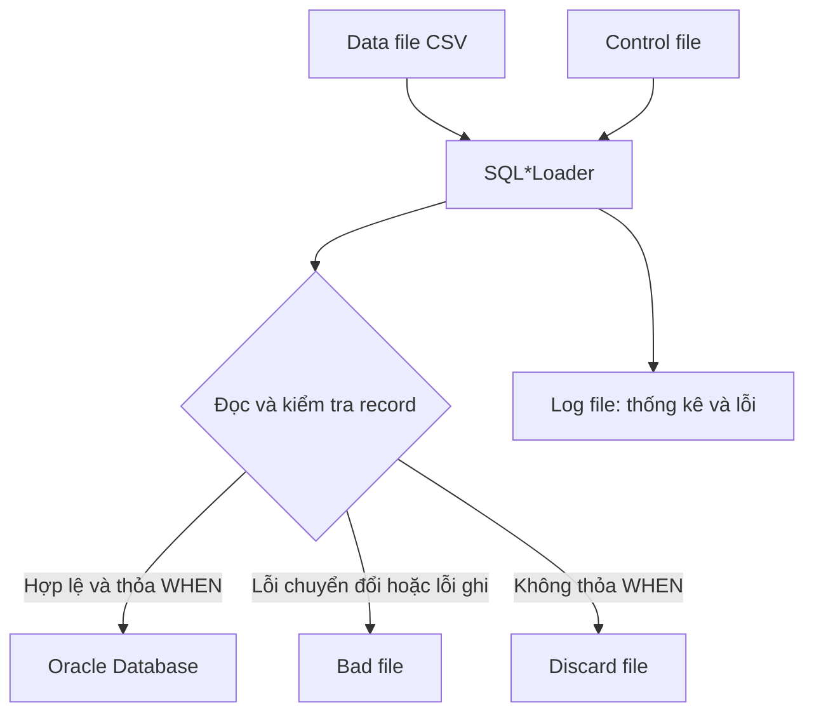

# SQL*Loader: control file, bad file, discard file và nạp CSV

SQL*Loader là tiện ích dòng lệnh của Oracle Database dùng để nạp dữ liệu từ các file bên ngoài vào bảng. Công cụ này thường được dùng khi nhập dữ liệu CSV, dữ liệu trích xuất từ hệ thống khác hoặc các tập tin dạng bản ghi có cấu trúc cố định. SQL*Loader đọc mô tả trong control file, phân tích từng record, chuyển đổi các trường sang kiểu dữ liệu của Oracle rồi ghi dữ liệu vào bảng.

Một lượt nạp thường có bốn loại file cần phân biệt:

- **Data file:** chứa dữ liệu nguồn, ví dụ file CSV.
- **Control file:** mô tả cách đọc data file, cách tách trường, kiểu dữ liệu, bảng đích và điều kiện nạp.
- **Bad file:** lưu các record bị từ chối vì lỗi khi đọc/chuyển đổi dữ liệu hoặc lỗi khi ghi vào bảng.
- **Discard file:** lưu các record được đọc nhưng không thỏa điều kiện chọn nạp, thường là điều kiện `WHEN` trong control file.

SQL*Loader còn tạo **log file** để ghi lại thông tin của lần chạy, số dòng đã đọc, đã nạp, bị loại, lỗi và thông báo của Oracle. Log file là nguồn quan trọng để xác định kết quả thực tế của một lần import.

## 1. SQL*Loader hoạt động như thế nào?

SQL*Loader chạy ở phía client. Người vận hành gọi chương trình `sqlldr` với thông tin kết nối và control file. Control file chỉ dẫn SQL*Loader mở data file, đọc record, ánh xạ các trường nguồn sang cột của bảng và thực hiện nạp.

Luồng tổng quát:



Ví dụ, file `employees.csv` có các cột mã nhân viên, họ tên, ngày vào làm và lương. Control file xác định dấu phẩy là dấu phân cách, dấu ngoặc kép bao quanh chuỗi, cột ngày theo định dạng `YYYY-MM-DD`, và bảng nhận dữ liệu là `EMPLOYEES`.

SQL*Loader có hai phương thức nạp chính:

- **Conventional path load:** SQL*Loader chuyển dữ liệu thành các thao tác insert thông thường. Cách này phù hợp với nhiều tình huống nạp dữ liệu, có thể sử dụng các cơ chế SQL thông thường và thường dễ tích hợp với xử lý hiện hữu.
- **Direct path load:** SQL*Loader định dạng các block dữ liệu và ghi theo đường nạp trực tiếp, giảm một số chi phí xử lý so với insert thông thường. Cách này thường phù hợp với khối lượng lớn, nhưng có các giới hạn và hành vi khác về trigger, constraint, index, logging, transaction và khả năng đồng thời.

Có thể chọn phương thức bằng tham số dòng lệnh, chẳng hạn `direct=true`. Không nên bật direct path chỉ vì file lớn: trước hết cần kiểm tra các đối tượng và tính năng của bảng đích, yêu cầu toàn vẹn dữ liệu, khả năng rollback, thời gian khóa và quy trình vận hành. Hành vi chi tiết phụ thuộc phiên bản Oracle và cấu hình bảng.

## 2. Các thành phần của một lần nạp

| Thành phần | Vai trò | Ví dụ tên file |
|---|---|---|
| Data file | Dữ liệu nguồn cần nhập | `employees.csv` |
| Control file | Cấu hình cách đọc và ánh xạ dữ liệu | `employees.ctl` |
| Log file | Nhật ký và thống kê lần chạy | `employees.log` |
| Bad file | Record bị từ chối do lỗi | `employees.bad` |
| Discard file | Record không thỏa điều kiện chọn nạp | `employees.dsc` |

Các file này có mục đích riêng. Không dùng bad file hoặc discard file thay cho log file: hai file đầu chứa record nguồn bị loại, còn log file giải thích quá trình xử lý và tổng hợp số liệu.

### Data file

Data file chứa các record cần nạp. SQL*Loader có thể đọc nhiều dạng dữ liệu tùy cách khai báo trong control file, ví dụ:

- Delimited data: các trường được ngăn cách bằng dấu phẩy, tab hoặc ký tự khác.
- Fixed-position data: mỗi trường chiếm một vị trí hoặc độ dài cố định.
- Stream hoặc record có cấu trúc khác theo định dạng được hỗ trợ.

Trong bài này, ví dụ tập trung vào CSV. Nên xác định trước encoding, dấu phân cách, ký tự bao chuỗi, định dạng ngày, quy tắc biểu diễn số thập phân, giá trị rỗng và quy tắc kết thúc dòng.

### Control file

Control file là file văn bản chứa chỉ dẫn cho SQL*Loader. Nó mô tả data file, bảng đích, phương thức thêm hoặc thay dữ liệu, quy tắc phân tách record và danh sách trường được ánh xạ.

Một control file thường có cấu trúc:

```text
LOAD DATA
INFILE 'employees.csv'
BADFILE 'employees.bad'
DISCARDFILE 'employees.dsc'
APPEND
INTO TABLE employees
FIELDS TERMINATED BY ',' OPTIONALLY ENCLOSED BY '"'
TRAILING NULLCOLS
(
  employee_id INTEGER EXTERNAL,
  first_name  CHAR(50),
  last_name   CHAR(50),
  hire_date   DATE "YYYY-MM-DD",
  salary      DECIMAL EXTERNAL
)
```

Ý nghĩa từng phần:

- `LOAD DATA`: bắt đầu khai báo một tác vụ nạp dữ liệu.
- `INFILE`: chỉ ra data file cần đọc.
- `BADFILE`: đặt tên file lưu record bị từ chối.
- `DISCARDFILE`: đặt tên file lưu record không thỏa điều kiện nạp.
- `APPEND`: thêm record vào bảng hiện có.
- `INTO TABLE employees`: xác định bảng đích.
- `FIELDS TERMINATED BY ','`: các trường được phân cách bằng dấu phẩy.
- `OPTIONALLY ENCLOSED BY '"'`: trường có thể được bao bởi dấu ngoặc kép.
- `TRAILING NULLCOLS`: cho phép các trường cuối không xuất hiện trong record được xem là NULL.
- Phần trong ngoặc liệt kê các cột và cách diễn giải dữ liệu đầu vào.

Tên file trong control file cần trỏ đến đúng vị trí khi tiến trình SQL*Loader chạy. Với môi trường vận hành, nên dùng đường dẫn rõ ràng hoặc chạy từ working directory đã quy định để tránh đọc nhầm file cùng tên.

### Log file

Log file ghi nhận:

- Phiên bản SQL*Loader và thông tin lần chạy.
- Tên control file và data file được sử dụng.
- Các bảng được nạp và cấu hình chính.
- Số record đọc, nạp thành công, bị từ chối và bị loại.
- Thông báo lỗi SQL*Loader hoặc Oracle.
- Kết quả cuối cùng của lần chạy.

Luôn lưu log file cùng mã lần chạy, thời gian chạy và tên data file. Khi đối soát, số lượng record trong log là căn cứ đầu tiên để xác định file đã được xử lý đến đâu.

## 3. Phân biệt bad file và discard file

Hai file này đều chứa record không được nạp vào bảng, nhưng lý do bị loại hoàn toàn khác nhau.

### Bad file: record bị từ chối vì lỗi

Bad file chứa các record SQL*Loader không thể nạp thành công. Các nguyên nhân thường gặp:

- Giá trị không chuyển đổi được sang kiểu dữ liệu đích, ví dụ chuỗi `abc` được đưa vào cột số.
- Giá trị ngày không khớp format mask đã khai báo.
- Record không phù hợp với cấu trúc trường hoặc có dữ liệu sai định dạng.
- Oracle từ chối insert do vi phạm constraint, chẳng hạn khóa chính trùng, khóa ngoại không hợp lệ hoặc cột NOT NULL nhận giá trị không phù hợp.
- Lỗi phát sinh trong quá trình ghi record vào bảng.

Ví dụ, cột `employee_id` yêu cầu số nhưng record có giá trị `A102`. Hoặc `hire_date` được khai báo theo `YYYY-MM-DD` nhưng nguồn cung cấp `31/12/2025`. Record có thể bị từ chối và được ghi vào bad file; log file cho biết nguyên nhân cụ thể.

Bad file giữ record nguồn để DBA hoặc nhóm dữ liệu có thể kiểm tra và xử lý. Không nên sửa dữ liệu trong bad file một cách máy móc rồi nạp lại mà chưa hiểu nguyên nhân. Cần xác định lỗi do dữ liệu nguồn, mapping, format mask hay cấu trúc bảng.

### Discard file: record không thỏa điều kiện nạp

Discard file chứa các record được đọc nhưng không đáp ứng điều kiện lựa chọn trong control file. Trường hợp phổ biến là điều kiện `WHEN`.

Ví dụ, chỉ nạp nhân viên thuộc phòng ban 10:

```text
LOAD DATA
INFILE 'employees.csv'
BADFILE 'employees.bad'
DISCARDFILE 'employees.dsc'
APPEND
INTO TABLE employees
WHEN (department_id = '10')
FIELDS TERMINATED BY ',' OPTIONALLY ENCLOSED BY '"'
TRAILING NULLCOLS
(
  employee_id   INTEGER EXTERNAL,
  first_name    CHAR(50),
  last_name     CHAR(50),
  department_id INTEGER EXTERNAL
)
```

Record có `department_id = 20` được đọc nhưng không được chọn để nạp. Nếu discard file được cấu hình, record này được ghi vào `employees.dsc`. Đây không phải lỗi dữ liệu; record chỉ không thuộc tập dữ liệu cần nạp trong lần chạy đó.

Điều kiện `WHEN` được đánh giá dựa trên dữ liệu đầu vào theo cách SQL*Loader diễn giải record và trường. Hãy dùng đúng tên trường hoặc vị trí trường theo control file, và thử với một tập dữ liệu nhỏ trước khi chạy trên file lớn.

### Bảng so sánh

| Tiêu chí | Bad file | Discard file |
|---|---|---|
| Lý do xuất hiện | Record bị từ chối do lỗi đọc, chuyển đổi hoặc ghi dữ liệu | Record không thỏa điều kiện chọn nạp |
| Ví dụ | Ngày sai format, số không hợp lệ, vi phạm constraint | Chỉ nạp phòng ban 10 nhưng record thuộc phòng ban 20 |
| Có phải dữ liệu lỗi? | Thường cần điều tra và sửa hoặc xử lý | Không nhất thiết; có thể hoàn toàn hợp lệ |
| Cần xem log? | Có, để tìm nguyên nhân từ chối | Có, để đối chiếu số record bị loại và điều kiện lọc |
| Xử lý tiếp | Sửa dữ liệu hoặc mapping, rồi nạp lại record phù hợp | Xác nhận việc loại record là đúng yêu cầu nghiệp vụ |

Một record không thỏa `WHEN` không được xem là record lỗi chỉ vì nó không vào bảng. Ngược lại, record thỏa điều kiện nạp nhưng không thể chuyển đổi hoặc bị Oracle từ chối sẽ thuộc nhóm bad.

## 4. Nạp một file CSV đơn giản

Giả sử bảng đích được tạo như sau:

```sql
CREATE TABLE employees (
    employee_id   NUMBER(10)    NOT NULL,
    first_name    VARCHAR2(50),
    last_name     VARCHAR2(50),
    hire_date     DATE,
    salary        NUMBER(12,2),
    department_id NUMBER(6)
);
```

File `employees.csv`:

```csv
employee_id,first_name,last_name,hire_date,salary,department_id
1001,An,Nguyen,2024-01-15,1800.50,10
1002,Binh,Tran,2023-11-02,2200.00,20
1003,"Chi, Thi",Le,2025-03-18,1950.75,10
1004,Dung,Pham,2022-08-09,1750.00,30
```

Tạo file `employees.ctl`:

```text
OPTIONS (SKIP=1)
LOAD DATA
CHARACTERSET AL32UTF8
INFILE 'employees.csv'
BADFILE 'employees.bad'
DISCARDFILE 'employees.dsc'
APPEND
INTO TABLE employees
FIELDS TERMINATED BY ',' OPTIONALLY ENCLOSED BY '"'
TRAILING NULLCOLS
(
  employee_id   INTEGER EXTERNAL,
  first_name    CHAR(50),
  last_name     CHAR(50),
  hire_date     DATE "YYYY-MM-DD",
  salary        DECIMAL EXTERNAL,
  department_id INTEGER EXTERNAL
)
```

Giải thích:

- `OPTIONS (SKIP=1)` bỏ qua record đầu tiên, ở đây là dòng tiêu đề CSV.
- `CHARACTERSET AL32UTF8` khai báo encoding của dữ liệu nguồn là AL32UTF8. Cần chọn đúng encoding thực tế của file.
- `FIELDS TERMINATED BY ','` tách trường theo dấu phẩy.
- `OPTIONALLY ENCLOSED BY '"'` cho phép trường chuỗi được bao trong dấu ngoặc kép; ví dụ `"Chi, Thi"` vẫn được đọc như một trường.
- `INTEGER EXTERNAL` đọc số nguyên từ biểu diễn ký tự bên ngoài.
- `DECIMAL EXTERNAL` đọc số thập phân từ chuỗi ký tự.
- `DATE "YYYY-MM-DD"` chuyển chuỗi ngày sang kiểu DATE bằng format mask đã chỉ định.
- `APPEND` thêm dữ liệu vào bảng đã có.
- `TRAILING NULLCOLS` xử lý trường hợp các cột cuối bị thiếu trong record.

Trong ví dụ này, record của nhân viên 1003 có dấu phẩy bên trong tên nhưng được bao bởi dấu ngoặc kép, nên dấu phẩy đó không đóng vai trò phân cách cột.

Chạy SQL*Loader:

```bash
sqlldr userid=app_user@orclpdb \
  control=employees.ctl \
  log=employees.log
```

SQL*Loader sẽ yêu cầu mật khẩu nếu cần xác thực bằng mật khẩu và mật khẩu không được cung cấp trong tham số. Không nên ghi mật khẩu trực tiếp vào command line hoặc script được chia sẻ, vì thông tin đó có thể xuất hiện trong lịch sử lệnh hoặc danh sách tiến trình. Hãy dùng cơ chế xác thực và quản lý bí mật phù hợp với môi trường.

Có thể chỉ định thêm tên bad file và discard file ngay trên command line bằng các tham số tương ứng, nhưng nên chọn một nơi quản lý cấu hình rõ ràng để người vận hành biết chính xác file đầu ra của từng lần chạy.

## 5. Cách ánh xạ và chuyển đổi trường CSV

### Khai báo kiểu dữ liệu

SQL*Loader cần biết cách diễn giải mỗi trường trước khi đưa vào cột đích. Một số kiểu khai báo thường gặp:

| Khai báo trong control file | Ý nghĩa |
|---|---|
| `CHAR(n)` | Trường ký tự với giới hạn độ dài được khai báo |
| `INTEGER EXTERNAL` | Số nguyên được biểu diễn bằng ký tự trong file |
| `DECIMAL EXTERNAL` | Số thập phân được biểu diễn bằng ký tự |
| `DATE "format"` | Chuỗi ngày được chuyển theo format mask |
| `FILLER` | Đọc một trường đầu vào nhưng không nạp vào cột bảng |

Tên và kiểu trường trong control file cần khớp với thứ tự hoặc vị trí dữ liệu nguồn. Nếu file có cột mới được thêm vào nhưng control file chưa cập nhật, các trường phía sau có thể bị ánh xạ sai hoặc phát sinh lỗi.

### Định dạng ngày

Không nên phụ thuộc vào định dạng ngày mặc định của session hoặc NLS. Hãy chỉ rõ format mask:

```text
hire_date DATE "YYYY-MM-DD"
```

Nếu nguồn có ngày dạng `18/03/2025`, format mask tương ứng phải là `DD/MM/YYYY`. Format mask mô tả thứ tự ngày, tháng và năm trong chuỗi nguồn; nó không làm thay đổi nội dung file.

### Số thập phân và NLS

Cần thống nhất dấu thập phân và dấu phân nhóm hàng nghìn. Ví dụ `1950.75` và `1.950,75` là hai cách biểu diễn khác nhau. Nếu nguồn sử dụng quy tắc khác với mặc định của môi trường Oracle, phải khai báo cách chuyển đổi phù hợp và kiểm thử bằng dữ liệu thật.

Không nên tự xóa dấu chấm hoặc dấu phẩy trong dữ liệu tiền tệ bằng thao tác thay thế văn bản khi chưa xác định rõ quy ước nguồn, vì có thể làm thay đổi giá trị.

### Giá trị rỗng và trường cuối bị thiếu

CSV có thể biểu diễn giá trị trống bằng hai dấu phân cách liên tiếp, ví dụ:

```csv
1005,Ha,Do,,1800.00,10
```

Trường `hire_date` đang rỗng. Cần xác định cột đó có cho phép NULL hay không và cách SQL*Loader xử lý giá trị trống theo kiểu trường được khai báo.

`TRAILING NULLCOLS` đặc biệt hữu ích khi record thiếu các trường cuối. Ví dụ, nếu record chỉ có năm trường trong khi control file khai báo sáu trường, tùy cấu trúc và quy tắc record, trường cuối có thể được xem là NULL thay vì khiến record bị từ chối vì thiếu dữ liệu. Tùy chọn này không có nghĩa mọi dữ liệu sai định dạng đều tự động được chuyển thành NULL.

Có thể dùng các điều kiện như `NULLIF` hoặc `DEFAULTIF` trong field clause để điều khiển cách xử lý một số giá trị đầu vào. Ví dụ về ý tưởng khai báo:

```text
salary DECIMAL EXTERNAL NULLIF salary=BLANKS
```

Cần kiểm tra cú pháp chính xác theo vị trí trường và phiên bản SQL*Loader đang dùng. Nếu cột đích có ràng buộc NOT NULL, việc chuyển giá trị trống thành NULL vẫn có thể khiến record bị từ chối.

### Trường nguồn không cần lưu

Có thể dùng `FILLER` cho một trường cần đọc để phân tích record nhưng không cần ghi vào bảng. Ví dụ file nguồn có thêm cột ghi chú nhưng bảng đích không có cột tương ứng:

```text
(
  employee_id INTEGER EXTERNAL,
  first_name  CHAR(50),
  last_name   CHAR(50),
  source_note FILLER CHAR(200)
)
```

FILLER giúp control file vẫn tiêu thụ đúng trường trong record mà không yêu cầu bảng đích có cột `source_note`.

## 6. Lọc dữ liệu với WHEN và ghi discard file

Điều kiện `WHEN` cho phép SQL*Loader chọn record cần nạp. Record không thỏa điều kiện được xem là discard. Điều này hữu ích khi một file chứa dữ liệu của nhiều nhóm nhưng lần nạp hiện tại chỉ lấy một nhóm.

Ví dụ chỉ nạp các nhân viên có mã phòng ban 10:

```text
LOAD DATA
INFILE 'employees.csv'
BADFILE 'employees.bad'
DISCARDFILE 'employees.dsc'
APPEND
INTO TABLE employees
WHEN (department_id = '10')
FIELDS TERMINATED BY ',' OPTIONALLY ENCLOSED BY '"'
TRAILING NULLCOLS
(
  employee_id   INTEGER EXTERNAL,
  first_name    CHAR(50),
  last_name     CHAR(50),
  hire_date     DATE "YYYY-MM-DD",
  salary        DECIMAL EXTERNAL,
  department_id INTEGER EXTERNAL
)
```

Trong ví dụ, SQL*Loader chỉ nạp record thỏa điều kiện. Record thuộc phòng ban khác được ghi vào discard file. Nếu không khai báo discard file, các record bị loại vẫn không được nạp nhưng không có file riêng để lưu lại chúng.

Trước khi dùng `WHEN` trên dữ liệu lớn, nên kiểm thử một mẫu nhỏ và đối chiếu số lượng record được chọn với kết quả mong đợi. Điều kiện lọc không thay thế kiểm tra chất lượng dữ liệu: record thỏa điều kiện vẫn có thể bị từ chối do lỗi kiểu dữ liệu hoặc constraint.

Có thể đặt giới hạn số record discard bằng tham số `DISCARDMAX` khi cần dừng tác vụ nếu số record không được chọn vượt ngưỡng. Tương tự, tham số `ERRORS` giới hạn số lỗi được phép xảy ra trước khi SQL*Loader dừng nạp. Chọn giới hạn theo quy trình vận hành; giới hạn quá thấp có thể làm tác vụ dừng sớm, còn giới hạn quá cao có thể khiến một file chất lượng kém tiếp tục được xử lý lâu.

## 7. Các chế độ xử lý dữ liệu trong bảng đích

Control file xác định cách xử lý dữ liệu hiện có bằng một trong các tùy chọn sau:

| Tùy chọn | Hành vi |
|---|---|
| `INSERT` | Chỉ nạp khi bảng đang rỗng |
| `APPEND` | Thêm record mới vào dữ liệu hiện có |
| `REPLACE` | Xóa dữ liệu hiện có trong bảng rồi nạp dữ liệu mới |
| `TRUNCATE` | Truncate bảng rồi nạp dữ liệu mới |

Ví dụ:

```text
LOAD DATA
INFILE 'employees.csv'
APPEND
INTO TABLE employees
...
```

`APPEND` thường phù hợp với luồng nạp bổ sung theo ngày hoặc theo batch. Tuy nhiên, nếu chạy lại cùng một file mà không có cơ chế nhận diện batch hoặc kiểm tra khóa trùng, có thể tạo bản ghi lặp.

`REPLACE` và `TRUNCATE` có tác động lớn vì xóa dữ liệu đang có trước khi nạp. Trước khi sử dụng, cần xác nhận đúng bảng, phạm vi dữ liệu và khả năng phục hồi. Không dùng hai tùy chọn này như cách sửa lỗi import khi chưa xác định rõ dữ liệu hiện hữu có cần giữ hay không.

## 8. Chạy SQL*Loader và các tham số thường dùng

Cú pháp tổng quát:

```text
sqlldr userid=<connection> control=<control_file> [parameter=value ...]
```

Một số tham số thường gặp:

| Tham số | Mục đích |
|---|---|
| `userid` | Thông tin kết nối database |
| `control` | Đường dẫn control file |
| `data` | Chỉ định hoặc ghi đè data file được dùng |
| `log` | Đặt tên log file |
| `bad` | Đặt tên bad file |
| `discard` | Đặt tên discard file |
| `discardmax` | Giới hạn số record bị discard trước khi dừng |
| `errors` | Giới hạn số lỗi cho phép |
| `skip` | Bỏ qua số record đầu vào được chỉ định |
| `rows` | Điều khiển số record trong các batch/đơn vị xử lý tùy phương thức nạp |
| `direct` | Chọn direct path load khi đặt `true` |

Ví dụ conventional path với các file đầu ra được đặt tên rõ ràng:

```bash
sqlldr userid=app_user@orclpdb \
  control=employees.ctl \
  log=employees_20261114.log \
  bad=employees_20261114.bad \
  discard=employees_20261114.dsc \
  errors=100
```

Ví dụ direct path:

```bash
sqlldr userid=app_user@orclpdb \
  control=employees.ctl \
  log=employees_direct.log \
  direct=true
```

Các ví dụ dùng cú pháp shell kiểu Unix; trên Windows có thể cần điều chỉnh cách xuống dòng và dấu nháy theo PowerShell hoặc Command Prompt. Tên tham số và cách viết giá trị phải tuân theo phiên bản SQL*Loader được cài đặt.

Có thể xem trợ giúp của chương trình bằng:

```bash
sqlldr help=true
```

Trước khi chạy, xác nhận:

- Client SQL*Loader được cài đặt và có thể tìm thấy qua PATH.
- Client tương thích với database và cấu hình kết nối.
- Tài khoản có quyền insert vào bảng đích và quyền cần thiết cho phương thức nạp.
- Data file và control file có thể đọc được.
- Thư mục chứa log, bad và discard file có quyền ghi.
- Bảng đích và cấu trúc cột đúng với mapping.
- Đã chọn đúng chế độ INSERT, APPEND, REPLACE hoặc TRUNCATE.

## 9. Đọc log và xử lý lỗi

Sau khi chạy, đọc log file trước khi kết luận tác vụ thành công. Log thường có phần tóm tắt số record:

- Records read: số record SQL*Loader đọc.
- Records loaded: số record được nạp.
- Records rejected: số record bị từ chối và có thể được ghi vào bad file.
- Records discarded: số record bị loại bởi điều kiện chọn nạp.

Các con số cần được đối chiếu với tổng record nguồn, có xét header hoặc record bị bỏ qua. Không nên chỉ dựa vào exit code hoặc thông báo cuối cùng mà bỏ qua thống kê.

### Một số lỗi thường gặp

| Triệu chứng | Nguyên nhân có thể | Hướng xử lý |
|---|---|---|
| Không tìm thấy control file hoặc data file | Đường dẫn sai, working directory khác dự kiến hoặc thiếu quyền đọc | Dùng đường dẫn rõ ràng và kiểm tra quyền truy cập |
| Lỗi chuyển đổi ngày | Format mask không khớp dữ liệu nguồn | Xác nhận format thực tế và sửa khai báo DATE |
| Lỗi chuyển đổi số | Có ký tự lạ, dấu thập phân khác hoặc khoảng trắng | Kiểm tra dữ liệu nguồn và quy ước số |
| ORA-00001 | Vi phạm unique constraint hoặc khóa chính trùng | Kiểm tra dữ liệu trùng và chiến lược nạp lại |
| ORA-01400 | Cột NOT NULL nhận NULL | Bổ sung dữ liệu hoặc điều chỉnh mapping/điều kiện |
| Record vào discard file nhiều hơn dự kiến | Điều kiện WHEN sai hoặc dữ liệu không đúng vị trí mong đợi | Kiểm tra thứ tự trường, điều kiện và một mẫu CSV |
| Record vào bad file nhiều hơn dự kiến | Mapping, datatype, độ dài hoặc constraint không phù hợp | Đối chiếu log với record nguồn và cấu trúc bảng |
| Không ghi được log/bad/discard | Thư mục đầu ra không tồn tại hoặc thiếu quyền ghi | Kiểm tra thư mục và quyền của tài khoản chạy SQL*Loader |

### Quy trình xử lý bad file

1. Lưu lại log file và bad file của đúng lần chạy.
2. Đếm số record bị từ chối và đối chiếu với thống kê trong log.
3. Xem thông báo lỗi SQL*Loader hoặc ORA để phân loại nguyên nhân.
4. Lấy một vài record đại diện từ bad file để tái hiện lỗi trên môi trường thử nghiệm.
5. Xác định lỗi nằm ở dữ liệu nguồn, control file hay bảng đích.
6. Sửa nguồn hoặc mapping theo quy tắc nghiệp vụ, sau đó nạp lại đúng tập record cần xử lý.
7. Đối soát khóa, số lượng và các giá trị quan trọng sau khi nạp lại.

Không nên nạp lại toàn bộ data file bằng `APPEND` nếu một phần record đã được nạp thành công ở lần chạy trước. Cách làm đó có thể tạo dữ liệu trùng. Hãy xác định rõ batch nào đã nạp, chọn chiến lược thay thế hoặc nạp phần còn thiếu và có cơ chế idempotent nếu quy trình cần chạy lại.

### Quy trình xử lý discard file

1. Xác nhận điều kiện `WHEN` có đúng yêu cầu nghiệp vụ không.
2. Đối chiếu số record discard với số record dự kiến nằm ngoài phạm vi.
3. Kiểm tra một số record trong discard file để xác nhận chúng bị loại vì đúng lý do.
4. Nếu điều kiện sai, sửa control file và chạy lại trên tập dữ liệu được kiểm soát.
5. Nếu điều kiện đúng, lưu discard file như bằng chứng đối soát hoặc chuyển cho bước xử lý khác.

Discard không đồng nghĩa với xóa dữ liệu khỏi nguồn. Nó chỉ cho biết record không được chọn để nạp trong lần chạy hiện tại.

## 10. Những lưu ý khi nạp CSV trong môi trường thực tế

### Encoding và ký tự tiếng Việt

Encoding của file phải được khai báo hoặc xử lý phù hợp với dữ liệu nguồn. Nếu file UTF-8 nhưng SQL*Loader diễn giải theo character set khác, tên có dấu có thể bị lỗi hoặc biến dạng. Hãy xác định encoding ngay từ hệ thống xuất file và khai báo `CHARACTERSET` tương ứng.

Ngoài encoding, cần kiểm tra độ dài cột theo byte/ký tự và giới hạn của kiểu dữ liệu đích. Tên tiếng Việt có dấu có thể chiếm nhiều byte trong UTF-8 hơn số ký tự nhìn thấy.

### Dấu phân cách và ký tự bao chuỗi

CSV có thể sử dụng dấu phẩy, dấu chấm phẩy hoặc tab. Control file phải khớp chính xác với delimiter thực tế. Nếu dữ liệu có delimiter bên trong giá trị, nguồn cần bao trường bằng ký tự enclosure và SQL*Loader phải được cấu hình tương ứng.

Các file CSV phức tạp có thể chứa dấu ngoặc kép được escape, xuống dòng bên trong một trường, hoặc nhiều quy tắc quoting. Không nên giả định cấu hình `FIELDS TERMINATED BY ',' OPTIONALLY ENCLOSED BY '"'` xử lý mọi biến thể CSV. Hãy kiểm thử theo đúng phiên bản SQL*Loader và định dạng do hệ thống nguồn tạo ra. Với CSV có newline nằm trong quoted field hoặc quy tắc escape phức tạp, cần dùng cú pháp CSV hỗ trợ của phiên bản nếu có hoặc chuẩn hóa dữ liệu trước khi nạp.

### Header và dòng trống

Nếu file có header, dùng `SKIP` hoặc `OPTIONS (SKIP=...)` phù hợp để bỏ qua record tiêu đề. Kiểm tra file có bao nhiêu dòng tiêu đề và có record metadata nào ở đầu file hay không. Dòng trống, dòng chỉ có delimiter hoặc record không đủ trường cần được thử nghiệm trước để biết cách SQL*Loader diễn giải.

### Nạp theo batch và chạy lại an toàn

Với dữ liệu lớn, chia batch theo ngày, khoảng khóa hoặc mã lô giúp kiểm soát lỗi và dễ đối soát. Mỗi batch nên có:

- Mã batch duy nhất.
- Tên data file và control file đã sử dụng.
- Log, bad file và discard file riêng.
- Thời điểm bắt đầu/kết thúc và tài khoản chạy.
- Số record nguồn, số record loaded, rejected và discarded.
- Kết quả đối soát sau nạp.

Nếu phải chạy lại, cần biết chính xác batch đã ghi dữ liệu đến đâu. Có thể dùng bảng staging, cột batch ID, unique key hoặc quy trình merge/kiểm tra trùng tùy kiến trúc. Không nên coi SQL*Loader tự động bảo đảm một lần nạp có thể chạy lặp mà không tạo bản ghi trùng.

### Quyền và bảo mật

SQL*Loader chạy bằng tài khoản database được cung cấp trong kết nối. Chỉ cấp quyền cần thiết trên bảng đích và các đối tượng liên quan. Tránh lưu mật khẩu trong control file, script hoặc command line được ghi log. Các file nguồn, bad và discard có thể chứa dữ liệu cá nhân hoặc dữ liệu nhạy cảm; cần giới hạn quyền đọc, thời gian lưu và cách chuyển giao.

## 11. Khi nào nên dùng SQL*Loader và khi nào nên cân nhắc cách khác?

SQL*Loader phù hợp khi cần nạp dữ liệu từ file vào Oracle theo một mapping có thể mô tả bằng control file, cần kiểm soát bad/discard record và muốn tự động hóa tác vụ import.

Có thể cân nhắc các lựa chọn khác trong một số trường hợp:

- **External tables:** phù hợp khi muốn truy vấn file ngoài như một bảng trong Oracle, kết hợp SQL để kiểm tra hoặc chuyển dữ liệu vào bảng thật. Cách này hữu ích cho pipeline staging và xử lý dữ liệu bằng SQL.
- **INSERT hoặc MERGE:** phù hợp khi dữ liệu đã ở trong database và cần kiểm soát logic cập nhật, loại trùng hoặc đồng bộ.
- **Data Pump:** phù hợp cho di chuyển schema, object và dữ liệu giữa các database Oracle; không phải công cụ thay thế trực tiếp cho việc đọc CSV tùy ý.
- **ETL/ELT platform:** phù hợp khi cần tích hợp nhiều nguồn, biến đổi phức tạp, lịch chạy, lineage và giám sát tập trung.

Lựa chọn dựa trên định dạng nguồn, khối lượng, yêu cầu biến đổi, khả năng chạy lại, kiểm soát lỗi và kiến trúc vận hành. SQL*Loader giải quyết tốt khâu nạp file có cấu trúc, nhưng không thay thế toàn bộ quy trình làm sạch và quản trị dữ liệu.

## 12. Checklist vận hành một lần nạp CSV

Trước khi chạy:

- [ ] Xác nhận file CSV đúng phiên bản, delimiter, enclosure và encoding.
- [ ] Kiểm tra header, số cột, thứ tự trường, kiểu dữ liệu và định dạng ngày/số.
- [ ] Đối chiếu control file với cấu trúc bảng đích.
- [ ] Xác định rõ dùng INSERT, APPEND, REPLACE hay TRUNCATE.
- [ ] Khai báo đường dẫn log, bad và discard file riêng cho lần chạy.
- [ ] Kiểm tra quyền đọc data/control file và quyền ghi thư mục đầu ra.
- [ ] Thử với tập dữ liệu nhỏ gồm cả record hợp lệ, record sai và record bị lọc.
- [ ] Xác nhận điều kiện WHEN và số record discard dự kiến.
- [ ] Xác định cách xử lý khi đạt ngưỡng ERRORS hoặc DISCARDMAX.

Sau khi chạy:

- [ ] Đọc log và kiểm tra kết quả cuối cùng.
- [ ] Đối chiếu records read, loaded, rejected và discarded với dữ liệu nguồn.
- [ ] Kiểm tra bad file và phân loại nguyên nhân từng nhóm lỗi.
- [ ] Kiểm tra discard file để xác nhận điều kiện lọc hoạt động đúng.
- [ ] Đối soát số lượng, khóa, ngày và tổng giá trị quan trọng trong bảng đích.
- [ ] Lưu log và các file lỗi theo chính sách lưu trữ.
- [ ] Chỉ nạp lại phần dữ liệu cần thiết sau khi đã xác định batch nào thành công.

SQL*Loader giúp nạp CSV và các file có cấu trúc vào Oracle theo quy tắc được mô tả trong control file. Control file quyết định cách đọc và ánh xạ dữ liệu; bad file giữ record bị từ chối vì lỗi; discard file giữ record không thỏa điều kiện chọn nạp; log file cung cấp bằng chứng về kết quả thực thi. Khi hiểu rõ vai trò của từng file, kiểm soát định dạng nguồn và đối soát số liệu sau nạp, DBA có thể xây dựng quy trình import dễ theo dõi, xử lý lỗi và chạy lại an toàn.

