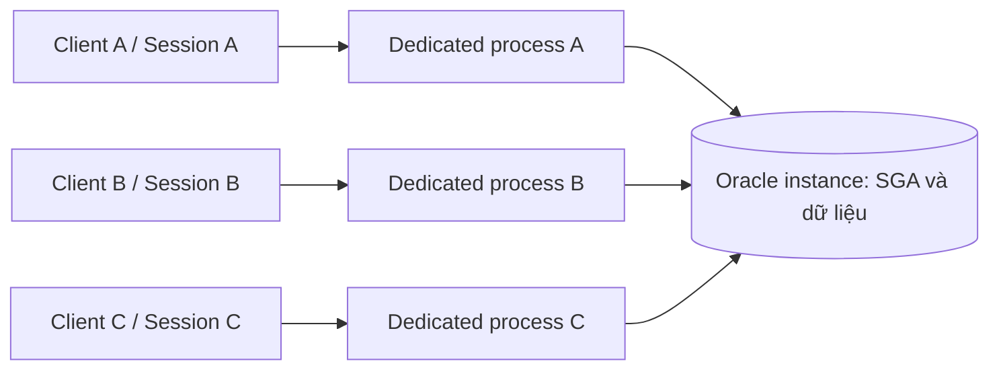
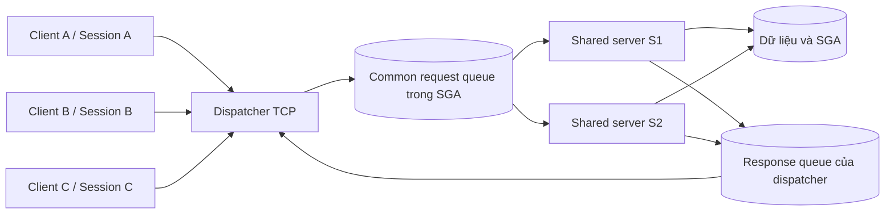

# Dedicated server, shared server và mô hình phục vụ phiên trong Oracle Database

Một ứng dụng có thể mở hàng chục, hàng trăm hoặc hàng nghìn kết nối tới Oracle Database. Câu hỏi kiến trúc quan trọng là: **mỗi kết nối cần một tiến trình server riêng, hay nhiều session có thể cùng sử dụng một nhóm tiến trình server?** Oracle giải quyết bài toán này chủ yếu bằng hai mô hình **dedicated server** và **shared server**. Chúng khác nhau ở cách phân phối tiến trình thực thi yêu cầu SQL, cách giữ trạng thái phiên và cách sử dụng tài nguyên khi lượng client tăng.

Hiểu hai mô hình giúp phân tích đúng các tình huống như: rất nhiều kết nối đang ở trạng thái nhàn rỗi nhưng database vẫn thiếu tài nguyên; một truy vấn chậm khiến các yêu cầu khác phải chờ; cấu hình `(SERVER=SHARED)` thất bại dù database vẫn hoạt động; hoặc ứng dụng Java đã có connection pool nhưng DBA vẫn đề xuất shared server.

## 1. Đặt các khái niệm vào đúng vị trí

Một người dùng đăng nhập từ SQL Developer hay một request HTTP chạy qua Java đều có thể dẫn đến việc database tạo hoặc sử dụng một **session**. Tuy nhiên, session, kết nối mạng và tiến trình server là ba thực thể khác nhau.

| Khái niệm | Ý nghĩa | Cần ghi nhớ |
|---|---|---|
| **Client/user process** | Tiến trình hoặc ứng dụng ở phía người dùng gửi yêu cầu SQL | Có thể là SQL*Plus, ứng dụng Java, công cụ ETL |
| **Connection** | Kênh giao tiếp client–Oracle Net, thường qua TCP/TCPS | Có vòng đời kết nối mạng; không đồng nghĩa bản thân một giao dịch |
| **Session** | Ngữ cảnh đăng nhập trong Oracle, chứa trạng thái phiên và định danh bảo mật | Có thông tin user, thuộc tính session, transaction và các trạng thái liên quan |
| **Server process** | Tiến trình Oracle thực thi yêu cầu thay mặt session | Dedicated gắn với một kết nối; shared được phân phối giữa nhiều session |
| **Listener** | Thành phần Oracle Net tiếp nhận kết nối ban đầu và định tuyến theo service | Listener **không** phải tiến trình chạy toàn bộ SQL của ứng dụng |
| **Dispatcher** | Tiến trình giao tiếp mạng trong kiến trúc shared server | Nhận/yêu cầu và gửi kết quả giữa client với các shared server |
| **SGA** | Vùng nhớ dùng chung của instance Oracle | Chứa shared pool, buffer cache và các vùng cần thiết khác |
| **PGA** | Vùng nhớ riêng của một server/background process | Chứa dữ liệu làm việc riêng của process |
| **UGA** | Bộ nhớ lưu trạng thái của một session | Thường nằm trong PGA với dedicated; trong SGA với shared |
| **Request** | Một lượt xử lý từ session, ví dụ thực thi một câu SQL hoặc một lời gọi PL/SQL | Trong shared server, các request của nhiều session đi qua hàng đợi |

Trong các ví dụ dưới đây, ta giả định một client connection đơn giản duy trì một session database. Các thư viện và cơ chế pooling có thể tái sử dụng kết nối vật lý, tạo hoặc quản lý session theo cách phức tạp hơn. **Số người dùng ứng dụng, số connection, số session và số server process không mặc nhiên bằng nhau**.

### 1.1. Session tồn tại để giữ điều gì?

Session là ngữ cảnh để Oracle biết ai đang làm việc và phải tiếp tục như thế nào khi client gửi câu lệnh kế tiếp. Các trạng thái quan trọng có thể gồm:

- User đã xác thực, quyền đang có hiệu lực và các thuộc tính phiên.
- Cấu hình phiên như NLS, current schema hoặc optimizer environment được thay đổi bằng `ALTER SESSION`.
- Ngữ cảnh transaction, các thay đổi chưa commit, savepoint và thông tin liên quan đến khóa dữ liệu.
- Trạng thái cursor, biến của package PL/SQL và các vùng nhớ riêng cho session khi cần.

Một client có thể gửi `SELECT`, dừng vài giây, rồi gửi `UPDATE`. Oracle phải giữ được trạng thái phiên giữa hai yêu cầu. Điểm khác biệt của dedicated và shared nằm ở chỗ **server process nào phục vụ những yêu cầu đó**, chứ không phải có hay không có session.

## 2. Dedicated server: tiến trình riêng phục vụ kết nối

Ở mô hình **dedicated server**, một kết nối client thông thường được phục vụ bởi một server process riêng trong suốt vòng đời kết nối. Khi client gửi SQL, process này thực thi công việc thay cho session; khi client không gửi SQL, process vẫn được dành riêng cho kết nối đó cho tới khi kết nối kết thúc hoặc được đóng.



### 2.1. Luồng thiết lập và sử dụng kết nối

1. Client gửi yêu cầu Oracle Net tới listener và nêu service cần truy cập.
2. Listener chuyển/handoff kết nối tới cơ chế phục vụ dedicated phù hợp với nền tảng và cấu hình.
3. Dedicated server process phục vụ yêu cầu của kết nối đó.
4. Client gửi SQL/PLSQL qua kết nối; dedicated process phân tích, thực thi và trả kết quả.
5. Khi client tạm dừng, process không chuyển sang phục vụ session khác theo cơ chế shared server.
6. Khi kết nối/session kết thúc, database giải phóng tài nguyên tương ứng theo vòng đời thực tế.

Không nên hiểu listener là một SQL executor hay mỗi lần chạy SQL đều phải tạo server process mới. Trong dedicated mode thông thường, kết nối đã được thiết lập tiếp tục dùng process của nó.

### 2.2. Lợi ích và chi phí

**Ưu điểm:**

- Luồng kết nối–process đơn giản, dễ hình dung, dễ theo dõi khi chẩn đoán một session đang chạy.
- Một phiên có đường phục vụ riêng, không phải chờ đến lượt shared server nhận request từ hàng đợi chung.
- Phù hợp với nhiều ứng dụng sử dụng connection pool giới hạn kích thước, công việc có truy vấn kéo dài, batch, xử lý phân tích hoặc thao tác quản trị cần dedicated connection.

**Chi phí:**

- Khi số **kết nối vật lý** tăng lớn, số dedicated server process cũng tăng, dù nhiều client chỉ đang nhàn rỗi.
- Mỗi process cần tài nguyên hệ điều hành và PGA; số process/OS thread, memory và giới hạn instance có thể trở thành nút thắt.
- Tăng số kết nối không tự làm Oracle có thêm CPU, I/O hay khả năng thực thi SQL. Quá nhiều process cạnh tranh cùng tài nguyên có thể khiến hiệu năng xấu đi.

Ví dụ: một dịch vụ ứng dụng mở 300 kết nối vật lý và giữ tất cả trong pool. Trong dedicated mode, Oracle thông thường phải duy trì số lượng dedicated process tương ứng với các kết nối đó, ngay cả khi chỉ một phần nhỏ đang chạy SQL. Giải pháp đầu tiên không nhất thiết là đổi sang shared server; đôi khi **giảm và cấu hình đúng kích thước pool ở ứng dụng** đã xử lý được vấn đề.

## 3. Shared server: nhiều session dùng chung nhóm server process

Ở mô hình **shared server**, Oracle tạo một nhóm **shared server process** để xử lý request của nhiều session thay vì dành một process cố định cho mỗi kết nối. Thành phần **dispatcher** giữ vai trò giao tiếp với client; request được đưa vào hàng đợi để một shared server có thể nhận và thực thi.



Đường dữ liệu thực tế có thêm thông tin định tuyến theo virtual circuit; sơ đồ chỉ thể hiện các thành phần chính để giải thích luồng request/response.

### 3.1. Một request được phục vụ như thế nào?

1. Client kết nối tới listener, yêu cầu service cho phép shared server.
2. Listener định tuyến/handoff client tới một dispatcher phù hợp.
3. Dispatcher duy trì giao tiếp mạng với client. Khi client gửi một request, dispatcher đặt yêu cầu vào **common request queue**.
4. Một shared server process rảnh lấy yêu cầu từ hàng đợi, sử dụng thông tin session/circuit và thực thi SQL hoặc PL/SQL.
5. Kết quả được đưa tới **response queue** gắn với dispatcher thích hợp.
6. Dispatcher gửi dữ liệu phản hồi về client.
7. Shared server vừa xử lý xong có thể phục vụ request của **session khác**; yêu cầu tiếp theo của session ban đầu có thể do shared server khác thực hiện.

Trong shared server, mỗi server process vẫn thực thi một request tại một thời điểm theo mô hình xử lý thông thường, nhưng tổng số process không phải bằng tổng số session. **Nhiều session chia sẻ khả năng xử lý qua thời gian**, không phải một request SQL tự động được chia cho mọi shared server để chạy song song. Parallel Query là một cơ chế khác.

### 3.2. Dispatcher, queue và virtual circuit khác nhau ở đâu?

| Thành phần | Nhiệm vụ |
|---|---|
| **Dispatcher** | Quản lý kênh Oracle Net tới nhiều client, tiếp nhận request và chuyển response |
| **Common request queue** | Nơi các request chờ shared server process lấy ra xử lý |
| **Shared server process** | Worker thực sự thực thi SQL/PLSQL thay mặt session |
| **Response queue** | Nơi chứa phản hồi cần dispatcher gửi lại client |
| **Virtual circuit** | Ngữ cảnh định tuyến gắn client/session với dispatcher và các request/response tương ứng |
| **UGA trong SGA** | Giữ dữ liệu trạng thái session để các shared server khác nhau vẫn phục vụ được cùng session |

Một ví dụ trực giác: có 800 session kết nối, nhưng tại một thời điểm chỉ khoảng vài chục session phát sinh request ngắn. Một nhóm shared server process có thể xử lý các yêu cầu nối tiếp nhau. Các session nhàn rỗi không cần một process riêng chỉ để chờ, dù session vẫn sử dụng bộ nhớ và các tài nguyên khác.

Đừng suy ra “có 800 session thì chỉ cần 10 shared server” là công thức cố định: số request đồng thời, thời gian mỗi request chiếm process, CPU, I/O, queue wait và giới hạn kết nối của dispatcher đều quyết định khả năng phục vụ.

### 3.3. Trạng thái session vẫn được bảo toàn

Shared server có thể luân phiên tiến trình thực thi giữa các request, nhưng **session không được tạo lại sau mỗi câu SQL**. Nếu client thay đổi tham số session hoặc mở một transaction chưa commit, Oracle vẫn phải duy trì ngữ cảnh của session đó qua các lượt xử lý.

Ví dụ một kết nối gửi:

```sql
ALTER SESSION SET NLS_DATE_FORMAT = 'YYYY-MM-DD';

SELECT SYSDATE FROM dual;

SELECT SYS_CONTEXT('USERENV', 'SESSION_USER') AS login_user,
       SYS_CONTEXT('USERENV', 'SESSIONID') AS audit_session_id
FROM dual;
```

Trạng thái NLS và thông tin session thuộc cùng một phiên; chúng không biến mất vì request thứ hai có thể được xử lý bởi shared server process khác. Việc một truy vấn chạy thành công không cho biết process ID xử lý nó có giống process xử lý truy vấn trước hay không.

**Transaction không trở thành stateless chỉ vì dùng shared server.** Nếu client mở transaction rồi giữ kết nối nhàn rỗi trong thời gian dài, các lock và tài nguyên liên quan có thể tiếp tục tồn tại. Shared server giúp giảm việc dành riêng process cho kết nối idle, nhưng không tự giải quyết lỗi “idle in transaction”.

### 3.4. Giới hạn quan trọng của shared server

Shared server hoạt động tốt khi nhiều client phát sinh các request tương đối ngắn, có khoảng nghỉ giữa các lần gọi. Nó có thể **kém phù hợp** khi phần lớn request chạy rất lâu, truy vấn nặng chiếm process nhiều thời gian hoặc có tác vụ quản trị yêu cầu kết nối dedicated.

Nếu một request đang chạy lâu, shared server process phục vụ request đó chưa thể lấy request mới từ hàng đợi. Khi số request đến nhanh hơn tốc độ xử lý, queue wait tăng. Thêm dispatcher không tự giải quyết thiếu shared server/CPU, còn tăng shared server quá mức không tự mở rộng năng lực CPU hoặc I/O.

## 4. SGA, PGA và UGA: tại sao cách dùng bộ nhớ khác nhau?

Hiểu vị trí bộ nhớ giúp lý giải vì sao Oracle có thể phục vụ nhiều session bằng ít process hơn, và vì sao shared server vẫn tiêu thụ tài nguyên đáng kể.

### 4.1. Dedicated server

Ở dedicated mode thông thường, **UGA của session nằm trong PGA của dedicated server process**. PGA còn chứa thông tin process và các vùng làm việc thích hợp. SGA vẫn chứa vùng nhớ dùng chung của instance.

```text
Client A ── Dedicated process A
             └─ PGA A
                ├─ UGA / trạng thái session A
                └─ vùng làm việc riêng của process

Client B ── Dedicated process B
             └─ PGA B
                ├─ UGA / trạng thái session B
                └─ vùng làm việc riêng của process

Oracle instance ── SGA (shared pool, buffer cache, ...)
```

### 4.2. Shared server

Vì request của cùng session có thể chạy trên các shared server khác nhau, **UGA cần nằm ở vùng nhớ mà các process đó đều truy cập được**, tức là trong **SGA**. Oracle ưu tiên sử dụng **large pool** cho UGA khi được cấu hình phù hợp; nếu không có vùng large pool đáp ứng, các cấu trúc tương ứng có thể sử dụng shared pool theo kiến trúc và cấu hình của instance.

```text
Client A ─┐
Client B ─┤── Dispatcher ── Request queue ─┬─ Shared process 1 / PGA 1
Client C ─┘                                └─ Shared process 2 / PGA 2

Oracle instance ── SGA
                   ├─ UGA / trạng thái session A
                   ├─ UGA / trạng thái session B
                   ├─ UGA / trạng thái session C
                   ├─ queues và virtual circuits
                   ├─ shared pool / large pool
                   └─ buffer cache và các vùng khác
```

Các process shared vẫn có **PGA riêng** để thực hiện công việc, nhưng UGA của session cần được chia sẻ qua SGA. Việc chuyển UGA sang SGA làm thay đổi bài toán lập kế hoạch bộ nhớ: giảm số dedicated process có thể tiết kiệm tài nguyên process/PGA, nhưng tổng UGA cho các session đang tồn tại vẫn cần được cấp phát. Nếu large pool/shared pool thiếu dung lượng hoặc shared server request queue quá tải, hệ thống vẫn có thể gặp vấn đề hiệu năng.

### 4.3. Bảng đối chiếu nhanh

| Câu hỏi | Dedicated server | Shared server |
|---|---|---|
| Mối quan hệ client–process | Thông thường một process riêng cho một kết nối | Nhiều session dùng chung một nhóm process |
| Ai trao đổi mạng với client? | Dedicated process sau handoff phù hợp | Dispatcher |
| Process có dành riêng khi client idle không? | Có, trong vòng đời kết nối thông thường | Không; shared process có thể phục vụ session khác |
| UGA ở đâu? | Thường trong PGA của dedicated process | Trong SGA, thường ưu tiên large pool |
| Có hàng đợi shared server request không? | Không theo luồng dispatcher/shared server | Có |
| Trạng thái session có được giữ lại không? | Có | Có |
| SQL dài ảnh hưởng thế nào? | Chiếm dedicated process của kết nối đó và tài nguyên chung | Chiếm shared process trong suốt thời gian xử lý, có thể tăng thời gian chờ của session khác |
| Có thể song song tồn tại trong một instance không? | Có | Có |
| Một transaction chưa commit có tự kết thúc khi request SQL xong không? | Không | Không |

## 5. Quyết định mode xảy ra lúc nào?

Oracle chọn cách phục vụ kết nối dựa trên **cấu hình database, dịch vụ, listener/dispatcher và connect descriptor của client**. Cùng một instance có thể phục vụ kết nối dedicated và shared đồng thời. Một client yêu cầu shared không có nghĩa Oracle sẽ tự tạo hạ tầng dispatcher phù hợp nếu database chưa cấu hình shared server.

### 5.1. Kết nối dedicated bằng connect descriptor

Ví dụ một alias `LAB_DEDICATED` trong `tnsnames.ora`:

```text
LAB_DEDICATED =
  (DESCRIPTION =
    (ADDRESS = (PROTOCOL = TCP)
               (HOST = db-lab.example.test)
               (PORT = 1521))
    (CONNECT_DATA =
      (SERVICE_NAME = LABPDB)
      (SERVER = DEDICATED)
    )
  )
```

`SERVER=DEDICATED` yêu cầu đường phục vụ dedicated cho kết nối đó. Nếu không ghi `SERVER`, mode được chọn theo dịch vụ và cấu hình liên quan; không nên suy luận chỉ từ việc bỏ trống trường này.

### 5.2. Yêu cầu kết nối shared server

```text
LAB_SHARED =
  (DESCRIPTION =
    (ADDRESS = (PROTOCOL = TCP)
               (HOST = db-lab.example.test)
               (PORT = 1521))
    (CONNECT_DATA =
      (SERVICE_NAME = LABPDB)
      (SERVER = SHARED)
    )
  )
```

Hai alias cùng tới một host/port/service nhưng **yêu cầu mode khác nhau**. Muốn `LAB_SHARED` hoạt động, instance phải có các dispatcher/shared server phù hợp và listener phải nhận được đăng ký handler tương ứng. `LABPDB` và hostname ở đây là dữ liệu minh họa, phải thay bằng service thực tế của hệ thống.

SQL*Plus hoặc SQLcl có thể dùng:

```text
sqlplus /nolog

SQL> CONNECT lab_app@LAB_DEDICATED
SQL> DISCONNECT
SQL> CONNECT lab_app@LAB_SHARED
```

Mỗi lệnh `CONNECT` yêu cầu nhập mật khẩu theo cách được cấu hình; không nên đặt mật khẩu thẳng trong dòng lệnh. Máy client cần được cấu hình phân giải alias từ `tnsnames.ora`.

Trong Oracle JDBC Thin, có thể truyền descriptor trực tiếp:

```java
String jdbcUrl =
    "jdbc:oracle:thin:@(DESCRIPTION=" +
    "(ADDRESS=(PROTOCOL=TCP)(HOST=db-lab.example.test)(PORT=1521))" +
    "(CONNECT_DATA=(SERVICE_NAME=LABPDB)(SERVER=SHARED)))";
```

Đây là ví dụ cấu trúc kết nối; ứng dụng Java còn cần Oracle JDBC driver, thông tin xác thực, kết nối mạng và hỗ trợ shared server ở phía database.

### 5.3. Listener tham gia như thế nào?

Listener nhận thông tin **service/handler** do instance và các dispatcher đăng ký, sau đó chọn đường phục vụ phù hợp với yêu cầu kết nối. Với dedicated, client được phục vụ bởi dedicated process; với shared, dispatcher duy trì giao tiếp mạng và chuyển các request cho nhóm shared server.

Một lỗi kiểu `ORA-12520` có thể xuất hiện khi listener không tìm thấy handler khả dụng cho **server type** được yêu cầu. Nếu client yêu cầu `SERVER=SHARED` nhưng database chưa có shared handler thích hợp, cần kiểm tra đăng ký dispatcher và cấu hình instance trước khi sửa mật khẩu hoặc SQL.

## 6. Thành phần cấu hình shared server cần biết

Cấu hình shared server thuộc phạm vi **DBA/kiến trúc cơ sở dữ liệu**, không phải điều một tài khoản ứng dụng thông thường cần tự thay đổi. Các tham số quan trọng gồm:

| Tham số | Vai trò | Lưu ý |
|---|---|---|
| `SHARED_SERVERS` | Số shared server process mục tiêu/khởi điểm theo cấu hình instance | Giá trị lớn hơn 0 dùng để bật khả năng shared server trong cấu hình phù hợp |
| `MAX_SHARED_SERVERS` | Giới hạn số shared server process có thể mở rộng | Cần tính theo workload và tài nguyên thật |
| `DISPATCHERS` | Định nghĩa dispatcher, giao thức, số lượng hoặc các thuộc tính mạng | Phải phù hợp listener/service và protocol client |
| `MAX_DISPATCHERS` | Giới hạn số dispatcher process | Không tự đồng nghĩa tăng số SQL xử lý đồng thời |
| `LARGE_POOL_SIZE` | Kích thước large pool do instance sử dụng cho các mục đích gồm UGA shared server | Không thay thế kế hoạch SGA tổng thể |
| `CIRCUITS` | Giới hạn số virtual circuits theo cấu hình nếu cần | Chỉ điều chỉnh khi có số liệu và lý do cụ thể |
| `PROCESSES` / `SESSIONS` | Giới hạn tài nguyên/process và session của instance | Vẫn có liên quan ngay cả khi dùng shared server |

Ví dụ **chỉ để minh họa thao tác DBA trên một lab cô lập**, giả sử hệ thống/phiên bản cho phép chỉnh động trong phạm vi instance:

```sql
-- Thực hiện bằng tài khoản quản trị theo quy trình được phép;
-- không chạy trực tiếp trên database dùng chung hoặc production.
ALTER SYSTEM SET SHARED_SERVERS = 4 SCOPE=MEMORY;

ALTER SYSTEM SET DISPATCHERS = '(PROTOCOL=TCP)(DISPATCHERS=2)'
  SCOPE=MEMORY;
```

`SCOPE=MEMORY` minh họa thay đổi trạng thái hoạt động mà không yêu cầu lưu bền cấu hình vào SPFILE. Khả năng thay đổi, phạm vi CDB/PDB, tham số tối thiểu/tối đa và hành vi khi restart phụ thuộc phiên bản/kiến trúc triển khai; DBA cần áp dụng thông số được phê duyệt, có bước xác nhận và kế hoạch đưa lab về trạng thái ban đầu. Không có một giá trị `SHARED_SERVERS=4` phù hợp cho mọi hệ thống.

Sau khi cấu hình, kiểm tra service/dispatcher đã được đăng ký với listener. Trên máy database, người quản trị có thể dùng:

```text
lsnrctl services
```

Lệnh này quan sát handler mà listener biết tới; nó không thay thế việc kết nối và thực thi SQL thật bằng client.

## 7. Quan sát session và các tiến trình phục vụ

Để hiểu mô hình đang chạy, cần bằng chứng từ **session thực tế** và các view động của Oracle. Những view `V$` thường đòi quyền quan sát phù hợp; tài khoản ứng dụng không nên được cấp quyền quản trị chỉ để thực hành.

### 7.1. Xem session đang dùng kiểu server nào

DBA hoặc tài khoản được cấp quyền có thể chạy:

```sql
SELECT sid,
       serial#,
       username,
       status,
       server,
       service_name
FROM v$session
WHERE username = 'LAB_APP'
ORDER BY sid;
```

Cột `SERVER` liên quan tới mode/kiểu phục vụ session, với các giá trị như `DEDICATED`, `SHARED`, `PSEUDO` hoặc giá trị khác tùy trạng thái và phương thức kết nối. **Không ép kết luận chỉ từ một snapshot**: session shared đang nhàn rỗi có thể biểu hiện khác lúc đang có request. Kết hợp quan sát `V$SESSION` với dispatcher, shared server và cấu hình đã gửi từ client.

Để tự kiểm tra service và container từ chính session mà không cần đọc `V$SESSION`:

```sql
SELECT SYS_CONTEXT('USERENV', 'SESSION_USER') AS session_user,
       SYS_CONTEXT('USERENV', 'SERVICE_NAME') AS service_name,
       SYS_CONTEXT('USERENV', 'CON_NAME') AS container_name
FROM dual;
```

Truy vấn này **không xác nhận mode dedicated/shared**; nó xác nhận session đã vào đúng user/service/PDB.

### 7.2. Xem dispatcher, shared server và hàng đợi

Ví dụ truy vấn quan sát dành cho người có quyền:

```sql
-- Các dispatcher hiện có.
SELECT name, status, messages
FROM v$dispatcher
ORDER BY name;

-- Các shared server process hiện có.
SELECT name, status, requests
FROM v$shared_server
ORDER BY name;

-- Thống kê các queue phục vụ dispatcher/shared server.
SELECT type, queued, totalq
FROM v$queue
ORDER BY type;
```

Các bộ đếm và trạng thái cần được diễn giải trong bối cảnh **nhiều lần lấy mẫu theo thời gian**; chênh lệch giữa các lần đo mới giúp thấy tải đang tăng hay giảm. Cột/khả năng truy cập có thể thay đổi theo phiên bản Oracle, privilege và kiến trúc CDB/PDB; nếu không có quyền, phối hợp DBA thay vì đoán.

Những dấu hiệu hữu ích khi tìm nút thắt:

- **Số session kết nối** lớn nhưng SQL thực thi đồng thời ít: xem kích thước client pool, số dispatcher và lợi ích tiềm năng của shared server.
- **Request queue chờ lâu** hoặc liên tục tăng khi tải đến: xem shared server đang bận, SQL thực thi dài, CPU/I/O và năng lực phục vụ.
- **Dispatcher quá tải**: xem lưu lượng kết nối/trao đổi mạng, cấu hình dispatcher và network wait.
- **UGA/SGA thiếu tài nguyên**: xem large pool, shared pool và tổng số session; giảm process không làm biến mất nhu cầu lưu trạng thái session.
- **Lỗi process/session limit**: xem `PROCESSES`, `SESSIONS`, các process thực tế và rò rỉ connection của ứng dụng.

Đừng vội tăng `SHARED_SERVERS` chỉ vì số session đang cao. Nếu câu SQL chậm do truy cập đĩa, lock hoặc plan không phù hợp, nhiều shared server hơn có thể chỉ tạo thêm cạnh tranh tài nguyên.

## 8. Shared server so với connection pool và Database Resident Connection Pooling

Ba cơ chế thường được nhắc cùng nhau nhưng hoạt động ở **các tầng khác nhau**:

| Cơ chế | Nằm ở đâu? | Tài nguyên được tái sử dụng | Phù hợp khi nào? |
|---|---|---|---|
| **Application connection pool** (ví dụ HikariCP) | Trong tiến trình ứng dụng | Các kết nối vật lý đã mở đến database | Tránh chi phí thiết lập kết nối lại trên mỗi request HTTP |
| **Oracle shared server** | Trong kiến trúc phục vụ session của database | Nhóm server process giữa nhiều session | Nhiều session kết nối, phần lớn request ngắn/nhàn rỗi |
| **Oracle DRCP** (Database Resident Connection Pooling) | Pool phía database | Các pooled server/session resource được quản lý theo cơ chế DRCP | Nhiều client/process cần mở kết nối ngắn, hoặc phía ứng dụng khó giữ pool hiệu quả |

DRCP là cơ chế riêng, thường được yêu cầu bằng `SERVER=POOLED` trong connect descriptor khi nền tảng, service và client được cấu hình hỗ trợ. **Không xem `SERVER=POOLED` là bí danh của `SERVER=SHARED`.** DRCP có cách checkout/checkin, connection class và quy tắc quản lý trạng thái riêng.

### 8.1. Ví dụ ứng dụng Java web

Giả sử có 1.000 người dùng đang đăng nhập website. Một ứng dụng Spring Boot có thể chỉ duy trì pool 30 kết nối vật lý. Khi request HTTP cần SQL, thread lấy một connection trong pool, thực thi, rồi trả về pool. Database **không cần tạo 1.000 session chỉ vì có 1.000 tài khoản đang đăng nhập website**.

Với pool 30 kết nối:

- Chạy dedicated: thường có khoảng 30 dedicated server process gắn với các kết nối pool đã mở (tùy số connection đang hoạt động/thực tế của pool).
- Chạy shared: 30 session có thể gửi request qua dispatcher và nhóm shared server.
- Nếu câu SQL cần thời gian dài, pool vẫn có thể hết kết nối để phát cho thread mới, bất kể database chọn dedicated hay shared.

Do đó phải phân biệt **pool wait ở ứng dụng** với **shared server request queue wait ở database**. Chúng khác vị trí và cần dữ liệu quan sát khác nhau.

### 8.2. Không nhầm “giảm process” với “tăng throughput”

Throughput phụ thuộc CPU, bộ nhớ, I/O, lock contention, chất lượng SQL, thời gian mạng, connection pool và cả cách ứng dụng xử lý transaction. Shared server giúp sử dụng hiệu quả server process trong các kiểu workload phù hợp, nhưng tạo thêm dispatcher/queue/UGA trong SGA. Với workload có nhiều SQL dài, dedicated có thể thuận tiện và hiệu quả hơn.

Không có nguyên tắc “shared luôn nhanh hơn” hay “dedicated luôn tốn quá nhiều tài nguyên”. Chọn mode bằng số liệu của hệ thống đang vận hành.

## 9. Cách chọn mô hình cho từng workload

| Workload | Cân nhắc ban đầu | Giải thích |
|---|---|---|
| Ứng dụng dịch vụ có connection pool nhỏ và ổn định | Dedicated thường là lựa chọn đơn giản | Số kết nối được kiểm soát, hoạt động dễ theo dõi |
| Nhiều client trực tiếp kết nối nhưng đa phần idle | Xem xét shared server | Tránh dành process riêng cho mọi session idle |
| Query analytics lâu, batch có khối lượng lớn | Thường cân nhắc dedicated | Không chiếm shared server pool trong thời gian dài |
| Môi trường chạy công cụ DBA, backup/recovery | Sử dụng dedicated theo yêu cầu tác vụ | Một số thao tác quản trị không phù hợp hoặc yêu cầu dedicated |
| Nhiều ứng dụng/process tạo kết nối ngắn | Đánh giá client pooling và DRCP | DRCP giải quyết bài toán tái sử dụng tài nguyên kết nối ở DB theo cơ chế riêng |
| Ứng dụng báo quá nhiều connection | Đo lại application pool trước | Số session thực tế có thể giảm mà không đổi server mode |
| CPU/I/O/lock đang là nút thắt | Tối ưu workload và SQL trước | Thay đổi server mode không sửa được gốc vấn đề |

Với ứng dụng hệ thống nghiệp vụ quan trọng, nên thử nghiệm trên workload đại diện và cùng một mức tài nguyên, đo cả latency (p50/p95/p99), throughput, memory, connection count, queue wait và số lỗi. Một cấu hình tốt với 100 phiên đồng thời chưa chắc tốt với 5.000 phiên.

## 10. Tình huống thực tế: nhiều session idle, ít request active

Giả sử một hệ thống nhập liệu nội bộ có 1.500 người dùng thường xuyên mở màn hình cả ngày. Client giữ session trong khi nhân viên đọc hoặc điền biểu mẫu; mỗi người chỉ gửi một vài câu SQL ngắn khi bấm tìm kiếm hoặc lưu.

**Với dedicated server**, số connection vật lý lớn có thể kéo theo rất nhiều dedicated process đang idle. Hệ điều hành và PGA phải cấp tài nguyên cho các process đó, trong khi CPU không hề xử lý SQL tương ứng liên tục.

**Với shared server**, listener có thể định tuyến các connection đến dispatcher; một nhóm shared server xử lý nhiều request ngắn khi chúng đến. Trong khoảng nghỉ, session vẫn được giữ nhưng không giữ độc quyền shared server process. Điều này có thể giảm áp lực số process.

Tuy nhiên, giả sử một báo cáo bất ngờ chạy truy vấn 40 giây và rất nhiều người cùng thực hiện. Những shared server process xử lý các truy vấn ấy sẽ bận lâu, khiến các thao tác tra cứu đơn giản xếp hàng. Cần đo mức độ phù hợp của pool, tách workload hoặc điều chỉnh kiến trúc/SQL trước khi chỉ tăng số shared server.

Đối với ứng dụng web thông thường đã có connection pool hợp lý, phần lớn người dùng website không giữ database session riêng liên tục. Trong trường hợp đó, dedicated server với pool nhỏ vẫn có thể là lựa chọn tốt.

## 11. Thực hành trên môi trường Oracle lab

Mục tiêu là chứng minh **session và process có quan hệ khác nhau** giữa dedicated và shared, không chỉ sửa tên alias.

### Bước 1 — Chuẩn bị quyền và môi trường

Cần một Oracle instance/PDB thực hành, Oracle Net listener, client SQL*Plus hoặc SQLcl, một user ứng dụng và quyền đọc các view quản trị khi muốn quan sát. Các thao tác thay đổi shared server parameter chỉ dành cho DBA trên **môi trường lab riêng**.

Ghi lại tên thực tế của service (ví dụ `FREEPDB1`), hostname và port. Không dùng alias ví dụ `LABPDB` nếu listener không cung cấp service đó.

### Bước 2 — Kết nối dedicated có chủ đích

Tạo alias `LAB_DEDICATED` như mục 5 và chạy:

```sql
SELECT SYS_CONTEXT('USERENV', 'SESSION_USER') AS login_user,
       SYS_CONTEXT('USERENV', 'SERVICE_NAME') AS service_name
FROM dual;
```

Trong khi session còn mở, nhờ DBA quan sát:

```sql
SELECT sid, serial#, username, status, server
FROM v$session
WHERE username = 'LAB_APP'
ORDER BY sid;
```

Mở vài kết nối dedicated riêng biệt và quan sát số session cùng tài nguyên server process tương ứng. Nếu có nhiều user chung, lọc theo service/session cụ thể để tránh nhầm phiên của người khác.

### Bước 3 — Kích hoạt shared server trong lab

DBA thiết lập các shared server và dispatcher theo cấu hình phù hợp, xem trạng thái đăng ký trên listener rồi cung cấp alias `LAB_SHARED`. Sau đó mở nhiều client session bằng alias này và chạy vài truy vấn ngắn.

Quan sát từ phía DBA:

```sql
SELECT name, status, messages
FROM v$dispatcher
ORDER BY name;

SELECT name, status, requests
FROM v$shared_server
ORDER BY name;
```

So sánh số session với số shared server process. Không cần mong đợi hai con số bằng nhau. Quan sát theo nhiều mốc thời gian để thấy request được xử lý khi có hoạt động.

### Bước 4 — Chứng minh session state được giữ

Trên một session shared:

```sql
ALTER SESSION SET NLS_DATE_FORMAT = 'YYYY-MM-DD';

SELECT SYSDATE FROM dual;

SELECT SYS_CONTEXT('USERENV', 'SESSIONID') AS session_id
FROM dual;
```

Lặp lại câu `SELECT` và nhận xét: state của session không biến mất giữa các SQL request. Các câu trên **không chứng minh hai request đã chạy trên hai process khác nhau**; muốn phân tích đường phục vụ phải dùng thêm view và tracing do DBA thực hiện.

### Bước 5 — So sánh dưới tải hợp lý

Tạo tập request có hai dạng:

1. Nhiều session nhàn rỗi xen kẽ các câu `SELECT` ngắn.
2. Một số request đủ dài để giữ shared server process bận.

Với cùng số session, ghi lại thời gian phản hồi, trạng thái dispatcher/shared server, queue và sử dụng tài nguyên theo mỗi kịch bản. Nếu lab không cho cấu hình/quan sát tải, mô phỏng luồng bằng sơ đồ và phân tích kết quả kỳ vọng, không thực hiện load test trên hệ thống dùng chung.

### Bước 6 — Đưa cấu hình về trạng thái ban đầu

DBA khôi phục thông số từ bản ghi cấu hình trước bài thử và xác nhận service vận hành bình thường. Vì thay đổi `ALTER SYSTEM` có thể ảnh hưởng các client đang kết nối, không tự thử bật/tắt shared server ở production.

## 12. Các lỗi và hiểu lầm thường gặp

### 12.1. Các nhóm lỗi kết nối

| Hiện tượng | Cần kiểm tra |
|---|---|
| `ORA-12520` khi client yêu cầu `SERVER=SHARED` | Listener có shared handler tương thích không; dispatcher đã đăng ký chưa; service có đúng không |
| `ORA-12516` hoặc `ORA-12519` liên quan handler | Khả năng cấp handler, giới hạn tài nguyên, trạng thái service và log listener |
| `ORA-12514` | Listener có biết service mà client yêu cầu không |
| `ORA-12154` | Client có phân giải được alias/descriptor không |
| `ORA-00018` hoặc `ORA-00020` | Giới hạn session/process, số sử dụng hiện tại và connection leak |
| SQL chậm khi shared server được bật | Queue wait, shared server bận, SQL/lock/I/O/CPU, bộ nhớ SGA và ứng dụng |

Mỗi mã lỗi cần xác nhận theo tình huống thực tế; ví dụ `ORA-12520` cũng có thể do handler tạm thời không khả dụng chứ không chỉ vì chưa cấu hình dispatcher.

### 12.2. Những khẳng định cần tránh

- **“Shared server = một connection duy nhất cho mọi client.”** Sai. Các client vẫn có connection/session; phần được chia sẻ chủ yếu là nhóm server process thực thi request.
- **“Shared server làm session stateless.”** Sai. Oracle phải giữ ngữ cảnh session giữa các request.
- **“Một SQL sẽ được mọi shared server chạy song song.”** Sai. Shared server là mô hình phân phối request giữa các process, khác Parallel Query.
- **“Bật shared server sẽ loại bỏ hết PGA.”** Sai. Mỗi process vẫn có PGA; UGA session chuyển sang vùng dùng chung của SGA theo mô hình này.
- **“Có shared server thì không cần connection pool.”** Không có quan hệ thay thế trực tiếp. Pool của ứng dụng giải quyết việc tạo và tái sử dụng kết nối ở tầng client.
- **“Đã có connection pool thì không được dùng shared server.”** Cũng không đúng. Hai tầng có thể kết hợp, nhưng cần bằng chứng workload để quyết định.
- **“Có dispatcher sẽ không bao giờ bị lock.”** Sai. Lock/transaction thuộc ngữ nghĩa cơ sở dữ liệu và tiếp tục tồn tại.
- **“Request nào cũng cần đi lại qua listener.”** Không. Listener chủ yếu tham gia thiết lập kết nối, còn xử lý SQL sau đó đi theo kết nối và mode tương ứng.

## 13. Câu hỏi tự kiểm tra kiến thức

1. Phân biệt **session**, **connection**, **dedicated server process** và **dispatcher** bằng một ví dụ ứng dụng Java.
2. Một session shared chạy hai câu SQL liên tiếp. Tại sao Oracle có thể dùng hai shared server process khác nhau mà vẫn giữ được `ALTER SESSION`?
3. Trong shared mode, request chờ ở đâu và dispatcher có tự thực thi SQL không?
4. UGA được đặt ở đâu trong dedicated và shared? Việc chuyển UGA có nghĩa Oracle không cần bộ nhớ cho từng session nữa không?
5. Vì sao 2.000 người dùng website không nhất thiết tương ứng với 2.000 database session?
6. Tại sao rất nhiều truy vấn kéo dài có thể làm shared server request queue tăng?
7. `(SERVER=DEDICATED)`, `(SERVER=SHARED)` và `(SERVER=POOLED)` khác nhau như thế nào?
8. Nếu một alias có `SERVER=SHARED` báo lỗi handler, cần kiểm tra những thành phần nào ở client, listener và database?
9. Vì sao phải đo workload, pool wait, queue wait và memory trước khi tăng `SHARED_SERVERS`?
10. Lệnh SQL nào giúp quan sát mode của session? Tại sao một snapshot đơn lẻ vẫn chưa đủ để đánh giá toàn bộ hành vi phục vụ phiên?

Khi hiểu các câu trả lời, người học có thể giải thích rõ **dedicated server dành riêng process cho kết nối**, còn **shared server sử dụng dispatcher và hàng đợi để phân phối các request của nhiều session cho nhóm process**, trong khi trạng thái phiên vẫn được duy trì. Đây là nền tảng để đọc cấu hình Oracle Net, xử lý giới hạn kết nối, thiết kế connection pool Java và trao đổi với DBA về tài nguyên hệ thống.
