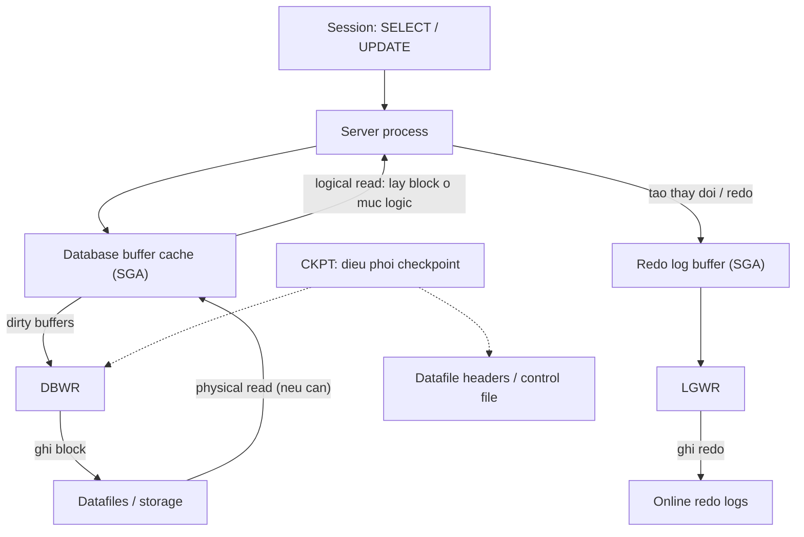
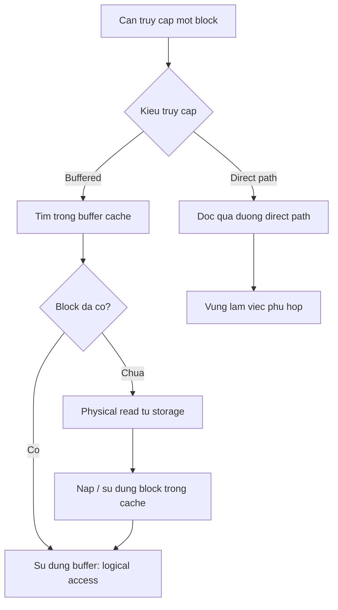
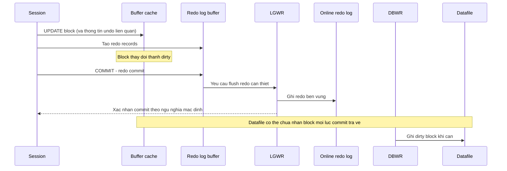

# Logical read, physical read, dirty buffer và cơ chế ghi dữ liệu trong Oracle

Khi thực thi một câu SQL trên Oracle Database, ứng dụng có thể nhận kết quả rất nhanh dù dữ liệu nằm trong datafile lớn trên ổ đĩa. Cũng có lúc một câu `SELECT` đọc đúng một hàng nhưng phải chờ I/O, hoặc một lệnh `COMMIT` hoàn tất trước khi Oracle ghi block dữ liệu đã sửa xuống datafile. Để hiểu những hiện tượng này, cần phân biệt **đọc block ở mức logic**, **đọc block ở mức vật lý**, **buffer đã bị sửa (dirty buffer)** và **quy trình ghi redo/datafile**.

Bài học thuộc phần **Kiến trúc** của *Database Engine Relational Oracle*. Mục tiêu là hiểu đường đi của dữ liệu giữa SQL, bộ nhớ và lưu trữ; giải thích được vì sao `COMMIT` không đồng nghĩa với ghi ngay mọi data block; và biết dùng số liệu của Oracle để tìm nguyên nhân một truy vấn chậm.

## 1. Bức tranh tổng thể: từ truy vấn đến bộ nhớ và datafile

Oracle lưu nội dung bảng, index và nhiều đối tượng khác thành các **database block** nằm trong **datafile**. Khi xử lý SQL, Oracle thường làm việc với block trong **database buffer cache** thuộc System Global Area (SGA). Các thành phần quan trọng gồm:

| Thành phần | Vai trò |
| --- | --- |
| **Database block** | Đơn vị lưu trữ logic trong datafile, chứa dữ liệu hàng, thông tin quản lý block, index entry... |
| **Database buffer cache** | Vùng SGA chứa bản sao block để đọc/ghi mà không phải yêu cầu lưu trữ cho mọi lần truy cập. |
| **Server process** | Thực thi SQL; tìm, đọc, sửa buffer và phối hợp khóa/đọc nhất quán. |
| **Datafile** | Tệp lưu các database block bền vững của tablespace. |
| **Redo log buffer** | Vùng bộ nhớ giữ các redo record mô tả những thay đổi cần thiết cho phục hồi. |
| **Online redo log** | Tệp lưu redo do tiến trình LGWR ghi. |
| **Undo** | Thông tin dùng để hoàn tác giao dịch và dựng phiên bản dữ liệu phù hợp cho đọc nhất quán. |
| **DBWR** (*Database Writer*) | Tiến trình nền ghi các dirty buffer từ buffer cache xuống datafile khi cần. |
| **LGWR** (*Log Writer*) | Tiến trình nền ghi redo từ redo log buffer ra online redo log. |
| **CKPT** (*Checkpoint*) | Phối hợp checkpoint, thông báo cho DBWR và cập nhật thông tin checkpoint; không phải tiến trình tự ghi các block dữ liệu. |



Sơ đồ là mô hình khái niệm. Trong Oracle thực tế có nhiều buffer, nhiều datafile, các quá trình I/O và biến thể đọc trực tiếp (*direct path*). Một số thao tác đọc có thể đi qua vùng PGA hoặc cơ chế riêng thay vì nạp toàn bộ block vào buffer cache.

**Điểm quan trọng nhất:** `SELECT` quan tâm đến phiên bản dữ liệu mà transaction được phép nhìn thấy. Nó không yêu cầu Oracle luôn đọc trực tiếp từ ổ đĩa. `UPDATE` thường sửa bản block trong cache và tạo redo/undo trước khi thay đổi được ghi vào datafile.

## 2. Logical read là gì?

**Logical read** (*đọc logic*, thường gọi *buffer get*) là lần Oracle yêu cầu/truy cập một database block để thực hiện công việc SQL ở mức logic. Block đó có thể đã ở trong cache; nếu không, Oracle có thể cần đọc nó từ lưu trữ. Vì vậy:

> **Logical read không đồng nghĩa với I/O đĩa.** Một logical read có thể được đáp ứng bằng block đã nằm trong buffer cache.

Trong thống kê Oracle, hai nhóm logical get thường gặp là:

- **Consistent gets:** Truy cập dữ liệu theo **consistent-read (CR)**, tức phiên bản block phù hợp với thời điểm đọc mà Oracle phải cung cấp cho câu SQL/transaction. Nếu dữ liệu hiện tại chứa thay đổi mới hơn snapshot yêu cầu, Oracle có thể dùng thông tin undo để dựng phiên bản block nhất quán.
- **DB block gets:** Truy cập block ở **current mode**, khi thao tác cần phiên bản hiện hành, thường gặp trong một số bước sửa dữ liệu và xử lý nội bộ.

Trong nhiều cách giải thích thống kê hiệu năng, tổng *logical reads* được xem gần với **`consistent gets + db block gets`**; hai bộ đếm là chỉ số số lần Oracle làm việc với block, không phải số hàng trả về.

Ví dụ, bảng `ORDERS` có 100.000 đơn hàng, index theo `order_id`. Câu SQL:

```sql
SELECT order_id, status
FROM orders
WHERE order_id = 1001;
```

Nếu dùng index, Oracle có thể phải lấy các block index và một block bảng. Truy vấn trả **một hàng**, nhưng logical reads có thể lớn hơn một vì công việc diễn ra theo **block**, không theo hàng. Nếu chọn full table scan, Oracle có thể truy cập nhiều block hơn dù vẫn trả về một hàng.

### Consistent read và undo

Ở mức cô lập mặc định `READ COMMITTED`, Oracle thường cung cấp ảnh dữ liệu đã commit nhất quán theo thời điểm bắt đầu **mỗi câu lệnh**. Giả sử:

1. Phiên A chạy `SELECT balance FROM accounts WHERE account_id = 1`.
2. Phiên B cập nhật cùng hàng nhưng **chưa `COMMIT`**.
3. Phiên A không được thấy giá trị chưa commit của B.

Oracle có thể dùng undo để dựng một **CR copy** của block phù hợp với snapshot A đang đọc. Đọc phiên bản cũ này vẫn được tính vào các hoạt động đọc logic; việc lấy undo block cũng có thể phát sinh additional logical/physical I/O.

Không nên hiểu “đọc nhất quán” là Oracle chép toàn bộ cơ sở dữ liệu ở mỗi câu `SELECT`. Oracle quản lý các phiên bản block và dùng **SCN** (*System Change Number*) cùng undo để cung cấp góc nhìn đúng khi cần.

### Logical read cao có phải luôn xấu?

Không. Một phép tổng hợp nhiều triệu dòng thường cần đọc nhiều block; index lookup chạy lặp lại hàng nghìn lần cũng tạo tổng logical reads lớn. Số logical reads trở nên hữu ích khi đặt trong ngữ cảnh **khối lượng dữ liệu xử lý, số lần thực thi, số hàng trả về và thời gian chạy**.

Ví dụ hai câu truy vấn cùng trả 10 hàng:

| Truy vấn | Logical reads | Cách diễn giải ban đầu |
| --- | ---: | --- |
| A | 15 | Có thể đang truy cập theo index chọn lọc. |
| B | 25.000 | Có thể quét nhiều block hoặc dùng kế hoạch truy vấn kém chọn lọc. |

Đây chỉ là ví dụ giả định. Chỉ dựa vào số logical reads chưa đủ kết luận câu B sai; có thể truy vấn B đồng thời làm kiểm tra/tổng hợp phức tạp hơn.

## 3. Physical read là gì?

**Physical read** là hoạt động Oracle phải lấy block dữ liệu từ lớp lưu trữ thay vì chỉ sử dụng bản block đã sẵn có trong vùng bộ nhớ phù hợp. Nó thường xảy ra khi cần block chưa có trong buffer cache, nhưng **không phải mọi physical read đều thông qua buffer cache**.

Hai đường đi thường gặp:

1. **Buffered read:** Server process tìm block trong buffer cache. Nếu chưa có, Oracle đọc block từ datafile/lớp lưu trữ vào buffer rồi sử dụng nó.
2. **Direct path read:** Với một số thao tác như scan lớn hoặc thao tác song song, Oracle có thể đọc block theo đường trực tiếp vào vùng làm việc thích hợp, không sử dụng buffer cache theo cách thông thường.



**Một physical read không nhất thiết là một lần truy cập đĩa vật lý đang quay.** Hệ điều hành, storage controller, SAN/ASM hay hệ thống lưu trữ đám mây có thể có cache. Trong các view Oracle, “physical reads” nói đến những block đọc ở tầng I/O của database; độ trễ thực tế phụ thuộc nhiều lớp bên dưới.

Số physical reads cũng **không nhất thiết bằng số lệnh I/O**. Oracle có thể đọc nhiều block trong một yêu cầu I/O (*multiblock read*), và một số thống kê còn đếm I/O request riêng. Để đánh giá hệ thống, cần xem thêm số byte, số request, độ trễ và wait event.

### Ví dụ hai lần `SELECT`

Giả sử block của bảng `PRODUCTS` chưa ở trong buffer cache:

```text
Lần 1: SELECT -> tra cache -> thiếu block -> physical read -> xử lý block
Lần 2: SELECT -> tra cache -> có block         -> xử lý block
```

Lần 2 có thể ít physical reads hơn lần 1 nhưng **vẫn tạo logical reads**. Tuy nhiên, đây không phải cam kết rằng lần đọc thứ hai luôn có 0 physical reads: buffer có thể đã bị thay thế, câu SQL có thể đổi execution plan, có workload đồng thời, hoặc Oracle chọn direct path.

Cache hit tốt thường giúp giảm truy cập storage, nhưng tỷ lệ hit cao không tự động đồng nghĩa truy vấn nhanh. Một SQL có thể đọc 1.000.000 block đã cache rất nhanh so với disk nhưng vẫn tiêu tốn CPU và làm tăng tải hệ thống.

## 4. Database buffer cache: clean, dirty, free và pinned buffer

Mỗi buffer giữ một bản database block cùng metadata để Oracle quản lý việc sử dụng. Trong quá trình làm việc, cần phân biệt:

| Trạng thái/thuộc tính | Ý nghĩa |
| --- | --- |
| **Clean buffer** | Nội dung block trong cache không có thay đổi chưa được ghi ra datafile so với trạng thái tương ứng trên đĩa. Có thể được tái sử dụng theo chính sách cache. |
| **Dirty buffer** | Nội dung block trong cache đã thay đổi và những thay đổi cần được DBWR ghi ra datafile. |
| **Free/reusable buffer** | Buffer có thể dùng để nạp block khác khi Oracle cần chỗ; khái niệm này không đồng nhất tuyệt đối với trạng thái clean. |
| **Pinned buffer** | Buffer đang được một hoạt động sử dụng/bảo vệ trong thời gian ngắn; nó có thể là clean hoặc dirty. “Pinned” không phải đồng nghĩa với “dirty”. |

Khi một phiên cập nhật một hàng:

1. Oracle lấy các block cần thiết vào bộ nhớ theo cơ chế phù hợp, đồng thời kiểm tra quyền truy cập và khóa.
2. Oracle tạo thông tin **undo** cần thiết cho rollback/read consistency, đồng thời sinh **redo** bảo vệ các thay đổi có liên quan.
3. Bản block đã sửa trong buffer cache trở thành **dirty**.
4. Oracle chưa cần lập tức ghi toàn bộ block này vào datafile chỉ vì câu `UPDATE` vừa chạy.
5. DBWR sẽ ghi các dirty buffer khi cần, chẳng hạn do nhu cầu buffer trống, checkpoint hoặc những điều kiện quản lý cache/ghi nền khác.

Chỉ một block có thể chứa nhiều hàng. Nếu nhiều lần `UPDATE` cùng sửa các hàng trong một block trước khi DBWR ghi, Oracle có thể gộp các thay đổi đó trong lần ghi block sau cùng. Do đó không tồn tại phép quy đổi “một UPDATE = một datafile write”.

**Dirty không đồng nghĩa với chưa commit.** Một block có thể vẫn dirty **sau** khi transaction đã commit, vì redo của commit đã được ghi bền vững nhưng DBWR chưa ghi block. Ngược lại, DBWR có thể ghi một block mang thay đổi **chưa commit** trước khi transaction kết thúc; Oracle dùng undo/redo và cơ chế phục hồi để đảm bảo tính đúng đắn. Không được suy ra “đã ghi datafile” nghĩa là transaction đã commit.

Oracle không chọn nạn nhân cache chỉ bằng một quy tắc FIFO/LRU đơn giản; chính sách quản lý buffer còn xét mức độ sử dụng, các hàng đợi và workload. Đối với lập trình viên SQL, điều thực tiễn là những block dùng lại thường có cơ hội ở cache, còn scan lớn, áp lực bộ nhớ và workload khác có thể thay đổi mức reuse.

## 5. Đường ghi dữ liệu: UPDATE, REDO, COMMIT và DBWR

Cần tách hai đường ghi có mục đích khác nhau:

- **Đường redo:** các thay đổi tạo **redo record** trong redo log buffer; **LGWR** ghi các redo record cần thiết vào **online redo log** để hỗ trợ độ bền và phục hồi.
- **Đường datafile:** các block dữ liệu được sửa trong **buffer cache**; **DBWR** ghi bản block dirty xuống datafile theo lịch hoạt động của database.



Ở chế độ commit bền vững thông thường, khi ứng dụng nhận xác nhận `COMMIT` thành công, Oracle đã bảo đảm redo cần thiết (bao gồm thông tin commit) được ghi theo cơ chế bảo đảm của hệ thống. **Oracle không chờ DBWR ghi mọi data block đã thay đổi xuống datafile trước khi trả lời commit.**

Vì sao cách làm này hợp lý? Ghi **redo tuần tự** thường hiệu quả hơn việc buộc phải ghi ngay nhiều block phân tán ở nhiều datafile cho từng transaction. Oracle có thể gom nhiều commit trong cơ chế ghi redo thích hợp (*group commit*), trong khi DBWR tối ưu việc ghi block dirty riêng.

### Write-ahead logging và khôi phục sau sự cố

Oracle dựa vào nguyên tắc tương tự **write-ahead logging**: redo cần thiết để phục hồi một thay đổi phải được ghi vào redo log trước khi block có thay đổi tương ứng được ghi bền vững vào datafile. Nhờ vậy:

- Nếu hệ thống gặp sự cố sau khi transaction đã commit nhưng **trước khi DBWR ghi block mới**, quá trình phục hồi có thể áp dụng redo để tái hiện thay đổi đã xác nhận.
- Nếu tại thời điểm sự cố còn transaction **chưa commit**, quá trình recovery kết hợp redo/undo để đưa database về trạng thái hợp lệ, loại bỏ tác động cuối cùng của các transaction chưa hoàn thành.

Các chi tiết phục hồi phụ thuộc chế độ vận hành và loại sự cố. Không nên hiểu redo là bản sao nguyên vẹn từng datafile; redo mô tả thông tin thay đổi phục vụ recovery. **Undo và redo bổ sung cho nhau:** undo hỗ trợ rollback và đọc nhất quán, redo hỗ trợ tái áp dụng thay đổi trong phục hồi.

Một ví dụ theo thời gian:

| Mốc | Sự kiện | Hệ quả |
| --- | --- | --- |
| T0 | Datafile đang chứa giá trị cũ, buffer cache có block tương ứng | Trạng thái ban đầu. |
| T1 | `UPDATE` đổi giá trị; buffer trở thành dirty, sinh undo/redo | Transaction chưa chắc đã commit. |
| T2 | `COMMIT`; LGWR ghi redo theo cơ chế commit | Giao dịch đã xác nhận dù datafile có thể còn giá trị cũ. |
| T3 | DBWR ghi dirty block vào datafile | Nội dung block trong datafile được cập nhật. |
| T4 | Nếu crash xảy ra giữa T2 và T3 | Oracle sử dụng redo trong instance recovery để không mất giao dịch đã commit. |

Khi ứng dụng yêu cầu durability, tránh tự ý thay đổi chế độ commit theo hướng bất đồng bộ chỉ nhằm giảm độ trễ. Một số lựa chọn commit chuyên biệt có đánh đổi về thời điểm redo được ghi; cần hiểu rõ rủi ro trước khi dùng.

## 6. Checkpoint và lý do DBWR ghi trước hoặc sau commit

**Checkpoint** giúp tiến độ ghi dirty buffer và thông tin phục hồi được cập nhật để giảm khối lượng recovery cần thiết sau sự cố. Trong cơ chế này:

1. Oracle xác định yêu cầu checkpoint ở phạm vi phù hợp.
2. **CKPT** phối hợp với DBWR và cập nhật các thông tin checkpoint liên quan (chẳng hạn trong control file/datafile header).
3. **DBWR** ghi những buffer cần thiết theo tiến độ checkpoint; bản thân CKPT không trực tiếp thực hiện toàn bộ I/O ghi block dữ liệu.

Checkpoint có thể liên quan tới log switch, điều hành tiến độ recovery hay các hoạt động quản trị khác. **Không đồng nhất `COMMIT` với checkpoint**: hàng nghìn transaction có thể commit trong khi nhiều dirty buffer vẫn chờ được ghi. Tương tự, không nên coi một lần checkpoint là lệnh ép toàn bộ mọi dirty block trong toàn hệ thống phải sạch ngay lập tức ở mọi kiểu checkpoint.

Với **ARCHIVELOG** được cấu hình, các online redo log đầy đủ có thể được tiến trình archiver sao lưu sang archived redo logs để phục hồi dữ liệu theo mục tiêu vận hành. **ARCn không nằm trên đường ghi mỗi `COMMIT` giống LGWR**.

## 7. Hiểu các chỉ số hiệu năng liên quan

Khi phân tích SQL, hãy phân biệt **block get**, **I/O block**, **I/O request**, **bytes** và **wait time**. Các chỉ số phổ biến:

| Chỉ số hoặc nhóm thống kê | Diễn giải thực hành |
| --- | --- |
| `consistent gets` | Số lượt truy cập block theo cơ chế consistent read. |
| `db block gets` | Số lượt truy cập block ở current mode. |
| `physical reads` | Số block được đọc qua đường physical read Oracle ghi nhận, gồm nhiều kiểu I/O. |
| `physical reads direct` | Phần đọc vật lý theo direct path (khi hệ thống báo cáo thống kê này). |
| `physical writes` | Số block ghi vật lý được Oracle ghi nhận; có thể bao gồm hoạt động khác ngoài một câu DML người dùng. |
| `redo size` | Lượng byte redo được tạo trong khoảng quan sát. |
| `db block changes` | Số lần thay đổi block được ghi nhận ở mức thống kê Oracle. |

Các tên chỉ số trên thường xuất hiện trong các view động của Oracle. Chúng phản ánh hoạt động ở mức database, **không trực tiếp trả lời “query này đã chạy bao nhiêu mili giây”**. Hơn nữa, khi dùng thống kê toàn instance sẽ có nhiễu từ các phiên khác.

### Xem thống kê phiên hiện tại

Ví dụ dưới đây cần tài khoản có quyền đọc `V$SESSTAT` và `V$STATNAME`, thường do DBA cấp trong môi trường học tập có kiểm soát. **Không cần cấp quyền DBA hoặc quyền truy cập toàn database cho ứng dụng thông thường** chỉ để chạy SQL nghiệp vụ.

```sql
SELECT n.name AS statistic_name,
       s.value AS statistic_value
FROM v$sesstat s
JOIN v$statname n
  ON n.statistic# = s.statistic#
WHERE s.sid = TO_NUMBER(SYS_CONTEXT('USERENV', 'SID'))
  AND n.name IN (
      'consistent gets',
      'db block gets',
      'physical reads',
      'physical reads direct',
      'physical writes',
      'redo size',
      'db block changes'
  )
ORDER BY n.name;
```

Vì đây là **bộ đếm tích lũy trong phiên**, hãy:

1. Chụp kết quả **trước** khi chạy câu SQL cần nghiên cứu.
2. Thực hiện SQL với khối lượng dữ liệu/tập điều kiện đã biết.
3. Chụp kết quả **sau**, tính `delta = value_sau - value_truoc` cho từng thống kê.

Câu truy vấn lấy thống kê cũng tạo thêm một lượng work/gets nhỏ, và hoạt động của phiên giữa hai lần chụp cũng cộng vào bộ đếm. Vì vậy không diễn giải delta như đo lường tuyệt đối chính xác của một câu SQL khi có nhiều thao tác xen giữa; muốn phân tích sâu, sử dụng công cụ theo dõi SQL phù hợp.

Nếu đã được cấp quyền xem thống kê toàn instance, có thể xem số liệu ở `V$SYSSTAT`:

```sql
SELECT name, value
FROM v$sysstat
WHERE name IN (
    'consistent gets',
    'db block gets',
    'physical reads',
    'physical writes',
    'redo size'
)
ORDER BY name;
```

Số liệu toàn instance tăng do **mọi phiên**, kể cả background process và workload khác. Nó phù hợp đánh giá tải trong một khoảng thời gian hơn là phân tích riêng một lần bấm nút của ứng dụng.

### Quan sát bằng AUTOTRACE

Trong SQL*Plus hoặc SQLcl, khi môi trường đã thiết lập quyền và cơ sở hỗ trợ AUTOTRACE, có thể dùng:

```sql
SET AUTOTRACE TRACEONLY STATISTICS

SELECT COUNT(*)
FROM user_objects;

SET AUTOTRACE OFF
```

`TRACEONLY STATISTICS` yêu cầu công cụ hiển thị thống kê thực thi, chẳng hạn consistent gets, db block gets, physical reads và redo size, thay vì in toàn bộ kết quả query. `SET AUTOTRACE` là **lệnh client**, không phải SQL gửi qua JDBC. Nếu công cụ báo thiếu quyền hoặc chưa cài đặt hỗ trợ AUTOTRACE, cần nhờ quản trị viên cấu hình theo chính sách của hệ thống; không tự cấp quyền rộng chỉ để xem thống kê.

Để xác định **thời gian chờ ở đâu**, cần xem thêm execution plan thực tế, số hàng thực tế, thời gian và wait event. Ví dụ:

- `db file sequential read` thường gắn với một kiểu I/O block đơn (có thể liên quan index lookup), nhưng **không phải mọi lần gặp event này đều kết luận index đang sai**.
- `db file scattered read` thường gắn với multiblock buffered read, chẳng hạn một số full scan.
- `direct path read` hoặc các biến thể tương ứng cho thấy đường đọc trực tiếp.
- `log file sync` thường liên quan phiên commit đang chờ xác nhận redo; cũng có thể chịu tác động của tần suất commit và latency I/O redo.

Tên wait event cung cấp manh mối, không phải bản chẩn đoán đầy đủ. Bản Oracle, cấu hình I/O và execution plan ảnh hưởng cách một câu SQL thực hiện đọc/ghi.

## 8. Bài thực hành: quan sát reads, dirty buffer và commit

Chạy trong **schema thực hành riêng** với quyền `CREATE TABLE` và quota tablespace phù hợp. Bài này dùng SQL thuần; phần đọc thống kê hệ thống chỉ thực hiện nếu tài khoản có quyền.

### Bước 1: chuẩn bị dữ liệu

```sql
CREATE TABLE lab_io_blocks AS
SELECT LEVEL AS id,
       RPAD('X', 180, 'X') AS payload
FROM dual
CONNECT BY LEVEL <= 2000;

ALTER TABLE lab_io_blocks
ADD CONSTRAINT pk_lab_io_blocks PRIMARY KEY (id);

COMMIT;
```

`CREATE TABLE` và `ALTER TABLE` là DDL, dẫn đến **implicit commit** theo cơ chế Oracle. Thực hiện chúng trước khi bắt đầu thử nghiệm transaction để không làm thay đổi ranh giới rollback của bước sau.

### Bước 2: đọc hai lần

Nếu dùng SQL*Plus/SQLcl và đã có AUTOTRACE:

```sql
SET AUTOTRACE TRACEONLY STATISTICS

SELECT id, payload
FROM lab_io_blocks
WHERE id = 100;

SELECT id, payload
FROM lab_io_blocks
WHERE id = 100;

SET AUTOTRACE OFF
```

Trong lần thực thi, quan sát số **consistent gets** và **physical reads**. Hai lần truy vấn có thể có cùng logical gets nhưng khác số physical reads nếu block được cache lại; cũng có thể cùng số physical reads bằng 0 nếu block đã có trong cache từ trước. **Không dùng `ALTER SYSTEM FLUSH BUFFER_CACHE` trên môi trường dùng chung** chỉ để ép ra một kết quả trình diễn.

### Bước 3: thay đổi block và rollback

Trong SQL*Plus/SQLcl, chủ động tắt tự commit:

```sql
SET AUTOCOMMIT OFF

UPDATE lab_io_blocks
SET payload = RPAD('Y', 180, 'Y')
WHERE id = 100;

SELECT id, SUBSTR(payload, 1, 8) AS sample_text
FROM lab_io_blocks
WHERE id = 100;

ROLLBACK;

SELECT id, SUBSTR(payload, 1, 8) AS sample_text
FROM lab_io_blocks
WHERE id = 100;
```

Trong transaction chưa commit, phiên hiện tại thấy giá trị bắt đầu bằng `Y`. Sau `ROLLBACK`, giá trị trở lại `X`. Lệnh `UPDATE` có thể đã làm dirty một số buffer và tạo redo/undo ngay cả khi transaction cuối cùng rollback. Đây là lý do thống kê `redo size` có thể tăng dù người dùng không commit kết quả thay đổi.

### Bước 4: commit rồi kiểm tra từ phiên khác

```sql
SET AUTOCOMMIT OFF

UPDATE lab_io_blocks
SET payload = RPAD('Z', 180, 'Z')
WHERE id = 100;

COMMIT;

SELECT id, SUBSTR(payload, 1, 8) AS sample_text
FROM lab_io_blocks
WHERE id = 100;
```

Mở **một session khác** cùng schema/PDB và `SELECT` hàng `id = 100`: phiên thứ hai sẽ thấy `Z` sau khi commit. Tuy nhiên, chỉ nhìn thấy giá trị `Z` từ phiên khác **không chứng minh** DBWR đã ghi block này xuống datafile; Oracle có thể phục vụ bản đã commit trong buffer cache.

Không có lệnh SQL nghiệp vụ đơn giản nào đảm bảo quan sát đúng thời điểm một dirty buffer cụ thể trở thành clean, vì DBWR hoạt động bất đồng bộ. Các công cụ DBA như dynamic performance views và trace có thể cung cấp thông tin chuyên sâu hơn nhưng không nên dùng thao tác ảnh hưởng toàn hệ thống trong bài học cơ bản.

### Bước 5: dọn bảng mẫu khi đã kết thúc

```sql
DROP TABLE lab_io_blocks PURGE;
```

Đây là DDL xóa bảng thử nghiệm và không thể rollback như một câu `DELETE` chưa commit. Chỉ chạy khi không cần giữ dữ liệu bài tập; `PURGE` bỏ qua Recycle Bin cho đối tượng được xóa.

## 9. Đọc và ghi ảnh hưởng việc tối ưu SQL như thế nào?

Một truy vấn chậm có thể do nhiều nguyên nhân đồng thời: SQL phải truy cập quá nhiều block, buffer cache không đủ cho working set, I/O storage có độ trễ cao, hay có contention/CPU bottleneck. Không nên tối ưu bằng một chỉ số duy nhất.

| Quan sát | Cách đặt câu hỏi hữu ích |
| --- | --- |
| Logical reads trên mỗi lần chạy rất cao | Query đang đọc nhiều block vì điều kiện lọc, JOIN, kế hoạch truy vấn hay thực thi lặp lại? |
| Physical reads tăng mạnh ở giờ cao điểm | Working set có vượt cache? Có full scan lớn, direct path read, hoặc áp lực bộ nhớ? |
| Physical read latency cao | Storage, I/O queue, cấu hình file/ASM và pattern truy cập có đang gặp vấn đề? |
| Nhiều `log file sync` | Có commit quá thường xuyên (ví dụ từng hàng) hoặc redo I/O chậm không? |
| Redo size tăng mạnh khi import/update | Có khối lượng thay đổi lớn, index/undo overhead hoặc DML chạy lặp kém hiệu quả không? |
| Nhiều dirty buffer đang được ghi | Đây là ghi nền bình thường hay hệ thống đang bị áp lực buffer/DBWR và giới hạn throughput? |

Các hướng cải thiện thường bắt đầu từ **execution plan, số hàng đọc so với số hàng trả về, predicate/selectivity, index phù hợp và cách ứng dụng gom transaction**. Ví dụ:

```sql
-- Nếu thường xuyên tìm chính xác theo khóa:
SELECT product_id, product_name
FROM products
WHERE product_id = :id;

-- Nếu truy vấn thực tế cần toàn bộ dữ liệu:
SELECT SUM(amount)
FROM sales;
```

Truy vấn đầu có thể tận dụng unique index/primary key để giảm block được truy cập. Truy vấn thứ hai có thể cần quét nhiều block; full scan và direct path **không mặc nhiên là sai**, đặc biệt với tổng hợp lượng dữ liệu lớn.

### Vì sao không dùng cache hit ratio làm mục tiêu duy nhất?

Một tỷ lệ thường được nhắc đến là `1 - physical_reads / logical_reads`. Tuy nhiên, cách tính sơ lược này có giới hạn:

- Các direct path read và kiểu thống kê khác không luôn tương ứng 1:1 với buffer cache miss.
- Tỷ lệ rất cao vẫn có thể đi kèm lượng logical reads khổng lồ gây tốn CPU.
- Query cần đọc dữ liệu mới tự nhiên có physical reads; tăng cache vô hạn không phải giải pháp.
- Một thời điểm đo ngắn hoặc việc cộng chỉ số của nhiều workload có thể che khuất vấn đề của SQL cụ thể.

Thay vì chạy theo mục tiêu “99% cache hit”, hãy xác định SQL chậm, đo tài nguyên theo **lần thực thi**, xem execution plan và wait time, rồi thử thay đổi có kiểm chứng trên workload đại diện.

## 10. Những nhầm lẫn cần tránh

**“Logical read là đọc RAM, physical read là đọc HDD.”** Logical read là thao tác lấy block ở mức logic; physical read là đường đọc từ lớp lưu trữ theo cách Oracle thống kê, có thể qua cache của storage/OS và có thể là direct path. Cách phân biệt chỉ theo “RAM so với đĩa quay” là quá đơn giản.

**“Một SELECT trả một hàng thì phải có một logical read.”** Oracle làm việc theo block: index traversal, table access, undo và công việc nội bộ có thể tạo nhiều gets.

**“Một UPDATE ghi ngay datafile.”** Thường Oracle sửa buffer cache thành dirty, sinh redo/undo; DBWR ghi dữ liệu về datafile sau đó theo cơ chế nền.

**“COMMIT thành công nghĩa là không còn dirty buffer.”** Sai. Điều cốt lõi của commit bền vững theo mặc định là redo được ghi đúng yêu cầu; block có thể còn dirty trong cache.

**“DBWR chỉ ghi dữ liệu đã commit.”** Sai. DBWR có thể ghi block chứa thay đổi chưa commit; phục hồi sử dụng redo và undo để xử lý kết quả transaction.

**“Redo log và datafile là hai bản sao giống nhau.”** Sai. Redo chứa các record phục vụ phục hồi thay đổi; datafile chứa cấu trúc các database block.

**“Checkpoint ghi mọi block do CKPT tự làm.”** Sai. CKPT điều phối và cập nhật metadata checkpoint; DBWR đảm nhiệm ghi dirty data block.

**“Physical reads cao chứng tỏ cần thêm index.”** Chưa chắc. Full scan có thể tối ưu cho truy vấn trả phần lớn bảng; phải xem plan, số hàng, latency và mục tiêu nghiệp vụ.

## 11. Câu hỏi tự kiểm tra

1. **Khác nhau giữa logical read và physical read?** Logical read đếm hoạt động truy cập block ở mức logic, còn physical read đếm việc phải lấy block theo đường I/O của Oracle; một lần logical access có thể dùng block đã cache.
2. **Vì sao hai lần chạy cùng một SELECT có physical reads khác nhau?** Vì block có thể được nạp vào cache sau lần đầu, hoặc cache/đường đọc/kế hoạch thực thi thay đổi. Logical reads không bắt buộc giảm tương ứng.
3. **Consistent gets liên quan gì đến undo?** Oracle có thể dùng undo để dựng phiên bản block nhất quán với snapshot đọc, giúp truy vấn không nhìn thấy thay đổi chưa commit.
4. **Dirty buffer nghĩa là transaction chưa commit?** Không. Dirty chỉ nói buffer đã thay đổi và cần ghi ra datafile; transaction có thể đã commit hoặc chưa.
5. **LGWR khác DBWR thế nào?** LGWR ghi redo vào online redo log; DBWR ghi dirty data block xuống datafile.
6. **Vì sao có thể commit thành công mà datafile chưa chứa block mới nhất?** Oracle đã bảo vệ giao dịch bằng redo bền vững; khi cần phục hồi có thể tái áp dụng redo, còn DBWR ghi datafile theo cơ chế riêng.
7. **Nếu DBWR đã ghi block chứa thay đổi chưa commit rồi database crash, có bị coi là commit không?** Không. Trạng thái transaction được xác định bởi cơ chế redo/undo và recovery, không dựa đơn thuần vào việc block từng được ghi xuống datafile.
8. **Nên làm gì khi buffer cache hit ratio rất cao nhưng truy vấn vẫn chậm?** Xem logical reads theo mỗi lần chạy, execution plan, CPU, row counts và wait events thay vì tăng bộ nhớ một cách máy móc.

Khi phân tích Oracle, hãy theo dõi chuỗi **SQL truy cập block → buffer cache → physical I/O khi cần → thay đổi tạo dirty buffer và redo → LGWR bảo đảm redo khi commit → DBWR ghi block vào datafile theo cơ chế nền**. Hiểu rõ từng ranh giới giúp giải thích đúng hành vi transaction, tính bền vững và nhiều tình huống hiệu năng trong hệ quản trị cơ sở dữ liệu quan hệ.
