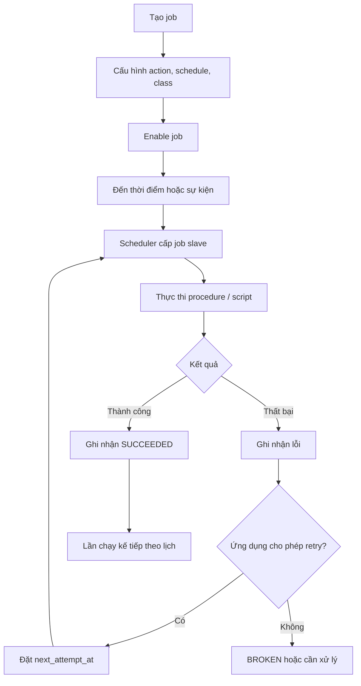
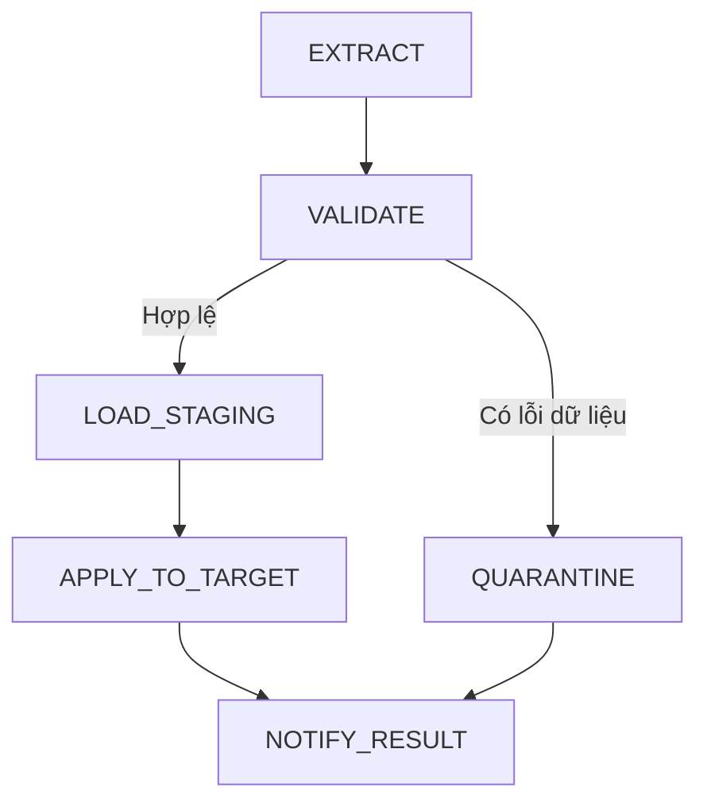
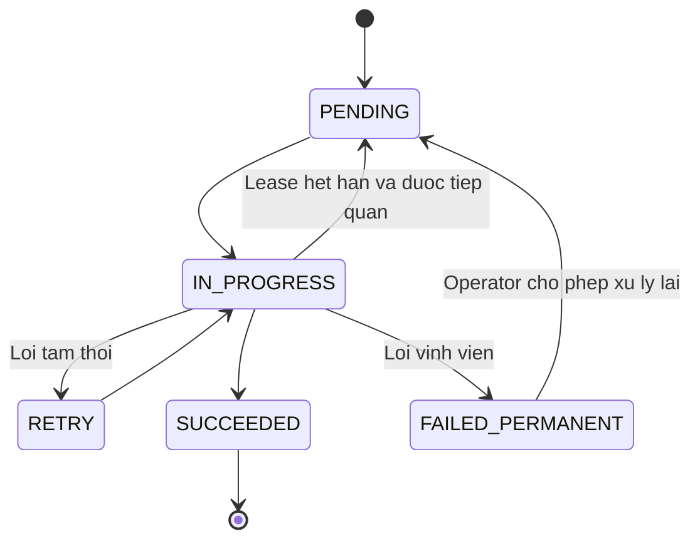

# DBMS_SCHEDULER cho công việc tích hợp nền và kiểm soát thực hiện lại

Oracle Scheduler là bộ lập lịch và điều phối công việc tích hợp trong Oracle Database. Gói `DBMS_SCHEDULER` cho phép định nghĩa các công việc chạy nền, lập lịch theo thời gian, kích hoạt theo sự kiện, phối hợp nhiều bước và theo dõi kết quả thực thi.

Trong các hệ thống tích hợp phân tán, Scheduler thường được dùng để đồng bộ dữ liệu định kỳ, đọc và xử lý batch, gọi package tích hợp, tạo báo cáo, kiểm tra trạng thái hệ thống bên ngoài hoặc điều phối các bước trao đổi dữ liệu. Cơ chế chạy nền giúp ứng dụng không phải giữ một phiên người dùng mở để chờ tác vụ hoàn tất.

Một thiết kế tích hợp cần giải quyết đồng thời ba vấn đề:

- **Lập lịch và điều phối:** công việc chạy khi nào, theo thứ tự nào và sử dụng tài nguyên nào.
- **Kiểm soát lỗi và thực hiện lại:** lỗi nào được thử lại, thử lại bao nhiêu lần, cách ly dữ liệu lỗi ra sao và khi nào cần can thiệp.
- **Đảm bảo tính đúng đắn:** nếu job chạy lại sau khi đã thực hiện một phần công việc, hệ thống không được tạo giao dịch trùng hoặc bỏ sót dữ liệu.

DBMS_SCHEDULER cung cấp cơ chế lập lịch, ghi nhận lịch sử, quản lý ngưỡng thất bại và restart trong các tình huống được hỗ trợ. Tính đúng đắn của một luồng tích hợp còn phụ thuộc vào thiết kế giao dịch, khóa nghiệp vụ, checkpoint và khả năng xử lý lặp an toàn trong package thực thi.

## 1. Thành phần và mô hình hoạt động

### Job

Job là đơn vị công việc mà Scheduler thực thi. Một job xác định loại công việc, hành động cần chạy, thời điểm bắt đầu, lịch lặp, lớp tài nguyên và các thuộc tính vận hành.

Một job có thể chạy:

- Một PL/SQL block.
- Một stored procedure hoặc package procedure.
- Một chương trình bên ngoài database nếu môi trường đã cấu hình external job phù hợp.
- Một script hoặc loại tác vụ khác được hỗ trợ bởi phiên bản Oracle đang dùng.

Ví dụ, job `JOB_SYNC_ORDERS` có thể gọi procedure `INTEGRATION_PKG.SYNC_ORDERS` mỗi 15 phút. Procedure chịu trách nhiệm đọc các đơn hàng chưa đồng bộ, gửi dữ liệu sang hệ thống đích và ghi nhận trạng thái từng batch.

### Program

Program mô tả hành động có thể tái sử dụng, tách khỏi lịch chạy. Nhiều job có thể tham chiếu cùng một program nhưng sử dụng lịch, job class hoặc tham số khác nhau.

Program xác định `program_type`, `program_action` và các argument nếu có. Ví dụ một program gọi `INTEGRATION_PKG.SYNC_CUSTOMERS`; các job riêng có thể chạy cho từng đơn vị hoặc khung giờ khác nhau.

### Schedule

Schedule mô tả thời điểm chạy. Schedule có thể là một thời điểm duy nhất hoặc một biểu thức lặp theo cú pháp lịch của Oracle. Tách schedule khỏi job giúp nhiều job dùng chung một lịch và thay đổi lịch tập trung.

### Chain

Chain là một quy trình gồm nhiều bước (step) và các quy tắc chuyển tiếp (rule). Chain phù hợp khi một luồng tích hợp có các giai đoạn phụ thuộc nhau, ví dụ:

1. Trích xuất dữ liệu từ nguồn.
2. Kiểm tra cấu trúc và tính hợp lệ.
3. Nạp vào staging.
4. Đồng bộ sang bảng đích.
5. Gửi thông báo hoặc ghi nhận kết quả.

Một step chỉ chạy khi rule tương ứng được thỏa mãn. Có thể định nghĩa nhánh xử lý khi bước trước thành công hoặc thất bại.

### Job class, window và destination

- **Job class:** gom nhóm job để áp dụng thuộc tính quản trị, dịch vụ và chính sách tài nguyên.
- **Window:** xác định khoảng thời gian mà một nhóm tài nguyên hoặc kế hoạch Resource Manager được ưu tiên. Window có thể ảnh hưởng đến job class gắn với nó.
- **Destination:** xác định nơi thực thi đối với các loại job hỗ trợ remote destination. Remote database job và external job có yêu cầu cấu hình khác nhau.
- **Credential:** lưu thông tin xác thực được Scheduler sử dụng cho tác vụ cần đăng nhập vào hệ điều hành hoặc hệ thống từ xa.

Các đối tượng này giúp tách cấu hình tác vụ khỏi cách phân bổ tài nguyên và vị trí thực thi. Khả năng hỗ trợ và cú pháp chi tiết phụ thuộc phiên bản, loại job và cấu hình Oracle Scheduler Agent.

## 2. Vòng đời của một job

Một job thường đi qua các bước:

1. DBA hoặc ứng dụng tạo job bằng `DBMS_SCHEDULER.CREATE_JOB`.
2. Cấu hình job action, lịch, job class, credential hoặc các thuộc tính kiểm soát.
3. Bật job bằng `DBMS_SCHEDULER.ENABLE`.
4. Scheduler xác định thời điểm chạy và đưa job vào hàng đợi.
5. Một job slave thực thi công việc khi có tài nguyên.
6. Scheduler ghi nhận trạng thái, thời gian, lỗi và kết quả.
7. Nếu job thất bại, Scheduler ghi nhận kết quả và failure count; restart có thể được áp dụng khi job bị gián đoạn trong tình huống được hỗ trợ. Retry theo nghiệp vụ thường do package tích hợp điều khiển.
8. Job tiếp tục chạy theo lịch, được disable, stop hoặc drop theo nhu cầu quản trị.

Sơ đồ khái quát:



Trạng thái thực tế còn phụ thuộc vào loại job, lịch, phiên bản và sự kiện hệ thống. Không nên giả định mọi lỗi đều được Scheduler tự động retry hoặc mọi job thất bại đều được đánh dấu BROKEN ngay lập tức.

## 3. Tạo job chạy procedure theo lịch

Giả sử có package procedure dùng để đồng bộ đơn hàng:

```sql
CREATE OR REPLACE PROCEDURE integration_pkg.sync_orders AS
BEGIN
    -- Đọc batch đơn hàng đang chờ đồng bộ.
    -- Gửi hoặc chuyển dữ liệu theo thiết kế tích hợp.
    -- Ghi trạng thái và kết quả xử lý của từng batch.
    NULL;
END;
/
```

Tạo job chạy mỗi 15 phút:

```sql
BEGIN
    DBMS_SCHEDULER.CREATE_JOB(
        job_name        => 'JOB_SYNC_ORDERS',
        job_type        => 'STORED_PROCEDURE',
        job_action      => 'INTEGRATION_PKG.SYNC_ORDERS',
        start_date      => SYSTIMESTAMP,
        repeat_interval => 'FREQ=MINUTELY;INTERVAL=15',
        enabled         => FALSE,
        auto_drop       => FALSE,
        comments        => 'Dong bo don hang theo batch'
    );

    DBMS_SCHEDULER.ENABLE('JOB_SYNC_ORDERS');
END;
/
```

Các tham số đáng chú ý:

- `job_name`: tên job trong schema.
- `job_type`: loại hành động; ví dụ `STORED_PROCEDURE`.
- `job_action`: tên procedure được gọi.
- `start_date`: thời điểm bắt đầu có hiệu lực.
- `repeat_interval`: biểu thức lặp.
- `enabled`: cho phép job được lên lịch ngay khi tạo.
- `auto_drop`: quy định Scheduler có tự xóa job sau khi hoàn tất theo điều kiện áp dụng hay không. Với job tích hợp dài hạn, thường cần giữ đối tượng để quản trị và theo dõi.

Tạo job ở trạng thái chưa bật giúp DBA hoàn tất cấu hình trước khi Scheduler có thể chạy. Sau khi kiểm tra lịch, quyền, credential và tham số, mới gọi `ENABLE`.

Nếu procedure nhận tham số, có thể khai báo argument của job hoặc program rồi gán giá trị bằng `SET_JOB_ARGUMENT_VALUE` hay `SET_JOB_ANYDATA_VALUE` phù hợp kiểu dữ liệu. Nên dùng argument để truyền tham số cấu hình như mã nguồn, mã đơn vị hoặc phạm vi batch; không dùng để truyền mật khẩu dạng văn bản trong lịch sử lệnh.

### Chạy một lần để kiểm thử

Có thể yêu cầu Scheduler chạy job ngay:

```sql
BEGIN
    DBMS_SCHEDULER.RUN_JOB(
        job_name            => 'JOB_SYNC_ORDERS',
        use_current_session => FALSE
    );
END;
/
```

Với `use_current_session => FALSE`, Scheduler thực thi job như một job nền. Nếu đặt `TRUE`, công việc chạy trong session hiện tại và lời gọi chờ cho đến khi hoàn tất; cách này hữu ích khi kiểm thử và muốn nhận lỗi trực tiếp trong session.

Chạy thủ công không thay thế việc kiểm tra lịch thực tế, quyền của job owner, môi trường job slave và khả năng chạy đồng thời với các batch khác. Sau kiểm thử, hãy xem log và trạng thái job.

## 4. Biểu thức lập lịch

Scheduler hỗ trợ cú pháp calendaring để mô tả lịch lặp. Một số ví dụ:

| Yêu cầu | `repeat_interval` |
|---|---|
| Mỗi 15 phút | `FREQ=MINUTELY;INTERVAL=15` |
| Mỗi giờ | `FREQ=HOURLY;INTERVAL=1` |
| Mỗi ngày lúc 02:00 | `FREQ=DAILY;BYHOUR=2;BYMINUTE=0;BYSECOND=0` |
| Mỗi thứ Hai lúc 06:30 | `FREQ=WEEKLY;BYDAY=MON;BYHOUR=6;BYMINUTE=30;BYSECOND=0` |
| Ngày đầu mỗi tháng lúc 01:00 | `FREQ=MONTHLY;BYMONTHDAY=1;BYHOUR=1;BYMINUTE=0;BYSECOND=0` |

Lịch là một phần của logic vận hành. Cần xem xét múi giờ, giờ mùa hè (daylight saving time), ngày nghỉ, thời điểm chốt batch và khả năng job trước chưa kết thúc khi đến lịch chạy tiếp theo.

Tạo schedule dùng chung:

```sql
BEGIN
    DBMS_SCHEDULER.CREATE_SCHEDULE(
        schedule_name   => 'SCH_EVERY_15_MIN',
        start_date      => SYSTIMESTAMP,
        repeat_interval => 'FREQ=MINUTELY;INTERVAL=15',
        comments        => 'Lich dong bo moi 15 phut'
    );
END;
/
```

Sau đó tạo job tham chiếu schedule:

```sql
BEGIN
    DBMS_SCHEDULER.CREATE_JOB(
        job_name      => 'JOB_SYNC_CUSTOMERS',
        program_name  => 'PRG_SYNC_CUSTOMERS',
        schedule_name => 'SCH_EVERY_15_MIN',
        enabled       => TRUE,
        auto_drop     => FALSE
    );
END;
/
```

Trong ví dụ này, program `PRG_SYNC_CUSTOMERS` phải được tạo và bật trước khi job sử dụng. Có thể thay `schedule_name` bằng `repeat_interval` trực tiếp nếu lịch chỉ được dùng bởi một job.

Đối với lịch theo giờ địa phương, hãy xác định rõ timezone trong `start_date` và kiểm thử các thời điểm chuyển đổi giờ mùa hè nếu khu vực triển khai có áp dụng. Không nên giả định mọi lịch chạy lúc 02:00 đều xuất hiện đúng một lần trong ngày chuyển đổi đồng hồ.

## 5. Tách program khỏi job để tái sử dụng

Tạo program cho procedure đồng bộ khách hàng:

```sql
BEGIN
    DBMS_SCHEDULER.CREATE_PROGRAM(
        program_name        => 'PRG_SYNC_CUSTOMERS',
        program_type        => 'STORED_PROCEDURE',
        program_action      => 'INTEGRATION_PKG.SYNC_CUSTOMERS',
        number_of_arguments => 0,
        enabled             => TRUE,
        comments            => 'Chuong trinh dong bo khach hang'
    );
END;
/
```

Sau khi program được tạo, có thể tạo nhiều job dùng chung program:

- Job chạy theo lịch ban đêm.
- Job chạy theo lịch ngắn hơn cho một nhóm dữ liệu.
- Job chạy theo sự kiện sau khi một batch được chuẩn bị.

Việc tái sử dụng program giúp giữ logic nghiệp vụ ở một nơi, còn job giữ cấu hình vận hành riêng. Nếu procedure thay đổi, cần đánh giá ảnh hưởng đến tất cả job đang tham chiếu program đó.

## 6. Chain cho quy trình tích hợp nhiều bước

Khi tích hợp có nhiều giai đoạn phụ thuộc nhau, một procedure lớn có thể khó theo dõi và khó chạy lại một bước riêng. Scheduler Chain cho phép chia quy trình thành các step và rule.

Ví dụ một luồng đồng bộ:



Tạo chain:

```sql
BEGIN
    DBMS_SCHEDULER.CREATE_CHAIN(
        chain_name => 'CHAIN_ORDER_SYNC',
        rule_set_name => NULL,
        evaluation_interval => NULL,
        comments => 'Quy trinh dong bo don hang'
    );
END;
/
```

Các step tham chiếu program đã được tạo:

```sql
BEGIN
    DBMS_SCHEDULER.DEFINE_CHAIN_STEP(
        chain_name   => 'CHAIN_ORDER_SYNC',
        step_name    => 'EXTRACT',
        program_name => 'PRG_EXTRACT_ORDERS'
    );

    DBMS_SCHEDULER.DEFINE_CHAIN_STEP(
        chain_name   => 'CHAIN_ORDER_SYNC',
        step_name    => 'VALIDATE',
        program_name => 'PRG_VALIDATE_ORDERS'
    );

    DBMS_SCHEDULER.DEFINE_CHAIN_STEP(
        chain_name   => 'CHAIN_ORDER_SYNC',
        step_name    => 'LOAD_STAGING',
        program_name => 'PRG_LOAD_ORDER_STAGE'
    );

    DBMS_SCHEDULER.DEFINE_CHAIN_STEP(
        chain_name   => 'CHAIN_ORDER_SYNC',
        step_name    => 'APPLY_TO_TARGET',
        program_name => 'PRG_APPLY_ORDERS'
    );

    DBMS_SCHEDULER.DEFINE_CHAIN_STEP(
        chain_name   => 'CHAIN_ORDER_SYNC',
        step_name    => 'NOTIFY_RESULT',
        program_name => 'PRG_NOTIFY_ORDER_SYNC'
    );
END;
/
```

Định nghĩa rule khởi đầu và các chuyển tiếp. Tên step phải khớp chính xác với step đã khai báo:

```sql
BEGIN
    DBMS_SCHEDULER.DEFINE_CHAIN_RULE(
        chain_name => 'CHAIN_ORDER_SYNC',
        condition  => 'TRUE',
        action     => 'START "EXTRACT"',
        rule_name  => 'RULE_START'
    );

    DBMS_SCHEDULER.DEFINE_CHAIN_RULE(
        chain_name => 'CHAIN_ORDER_SYNC',
        condition  => '"EXTRACT" COMPLETED',
        action     => 'START "VALIDATE"',
        rule_name  => 'RULE_EXTRACT_DONE'
    );

    DBMS_SCHEDULER.DEFINE_CHAIN_RULE(
        chain_name => 'CHAIN_ORDER_SYNC',
        condition  => '"VALIDATE" COMPLETED',
        action     => 'START "LOAD_STAGING"',
        rule_name  => 'RULE_VALIDATE_DONE'
    );

    DBMS_SCHEDULER.DEFINE_CHAIN_RULE(
        chain_name => 'CHAIN_ORDER_SYNC',
        condition  => '"LOAD_STAGING" COMPLETED',
        action     => 'START "APPLY_TO_TARGET"',
        rule_name  => 'RULE_LOAD_DONE'
    );

    DBMS_SCHEDULER.DEFINE_CHAIN_RULE(
        chain_name => 'CHAIN_ORDER_SYNC',
        condition  => '"APPLY_TO_TARGET" COMPLETED',
        action     => 'START "NOTIFY_RESULT"',
        rule_name  => 'RULE_APPLY_DONE'
    );

    DBMS_SCHEDULER.DEFINE_CHAIN_RULE(
        chain_name => 'CHAIN_ORDER_SYNC',
        condition  => '"NOTIFY_RESULT" COMPLETED',
        action     => 'END',
        rule_name  => 'RULE_END'
    );

    DBMS_SCHEDULER.ENABLE('CHAIN_ORDER_SYNC');
END;
/
```

Sau khi chain được định nghĩa, tạo job có `job_type => 'CHAIN'` và `job_action => 'CHAIN_ORDER_SYNC'` để lập lịch chạy chain. Tùy phiên bản, chain có thể cần thêm rule xử lý lỗi và các điều kiện khởi chạy step cụ thể. Hãy kiểm tra cú pháp Chain Rules của release đang dùng trước khi đưa vào vận hành.

Chain giúp theo dõi bước nào hoàn tất hoặc thất bại, nhưng không tự bảo đảm dữ liệu đã ghi ở các step trước sẽ được rollback khi step sau lỗi. Mỗi step cần xác định transaction boundary, checkpoint và khả năng chạy lại độc lập.

## 7. Kiểm soát retry và restart

Trong tích hợp nền, lỗi có thể đến từ nhiều nguyên nhân:

- Hệ thống đích tạm thời không truy cập được.
- Timeout hoặc lỗi mạng.
- Dịch vụ từ xa giới hạn tốc độ (rate limit).
- Deadlock hoặc lock contention trong database.
- Dữ liệu không hợp lệ hoặc vi phạm quy tắc nghiệp vụ.
- Job slave hoặc instance bị dừng đột ngột.

Không phải lỗi nào cũng nên được thử lại. Lỗi mạng tạm thời thường có thể phục hồi sau một khoảng chờ; lỗi định dạng dữ liệu hoặc vi phạm khóa duy nhất thường không tự hết nếu chạy lại cùng dữ liệu.

### Max failures và ngưỡng thất bại

Scheduler có thuộc tính `max_failures` để giới hạn số lần job thất bại liên tiếp trước khi Scheduler đánh dấu job là `BROKEN`. Ví dụ:

```sql
BEGIN
    DBMS_SCHEDULER.SET_ATTRIBUTE(
        name      => 'JOB_SYNC_ORDERS',
        attribute => 'max_failures',
        value     => 5
    );
END;
/
```

`max_failures` là ngưỡng bảo vệ trạng thái job, không phải một chính sách backoff theo từng record. Với job lặp theo lịch, Scheduler tiếp tục ghi nhận các lần chạy và failure count; khi đạt ngưỡng cấu hình, job có thể chuyển sang `BROKEN` và cần DBA xử lý. Hành vi cụ thể cần được xác nhận theo phiên bản và loại job. Không nên giả định Scheduler cung cấp một khoảng chờ retry nghiệp vụ tùy biến cho mọi lỗi.

Nếu cần quyết định thời điểm thử lại sau timeout hoặc lỗi dịch vụ từ xa, nên quản lý `next_attempt_at`, `attempt_count` và `last_error` trong bảng điều phối của ứng dụng. Job Scheduler định kỳ chọn các record đã đến hạn. Cách này cho phép đặt backoff riêng cho từng batch, phân biệt lỗi tạm thời với lỗi vĩnh viễn và kiểm soát số lần gọi hệ thống đích.

Scheduler ghi nhận kết quả của lần thực thi job, nhưng không hiểu lỗi nghiệp vụ bên trong một batch nếu package bắt lỗi rồi kết thúc bình thường. Nếu package bắt exception và không phát sinh lại, Scheduler có thể xem lần chạy là thành công dù một số record đã thất bại. Vì vậy, package phải ghi nhận trạng thái từng record và chỉ kết thúc thành công khi kết quả đáp ứng tiêu chí của luồng tích hợp.

### Restartable

Thuộc tính `restartable` điều khiển khả năng Scheduler tự khởi động lại job trong một số tình huống job bị gián đoạn do lỗi hệ thống hoặc instance. Đây là cơ chế khôi phục thực thi khi có sự cố hạ tầng, khác với logic retry nghiệp vụ sau khi procedure trả về lỗi.

Ví dụ:

```sql
BEGIN
    DBMS_SCHEDULER.SET_ATTRIBUTE(
        name      => 'JOB_SYNC_ORDERS',
        attribute => 'restartable',
        value     => TRUE
    );
END;
/
```

Không nên xem `restartable = TRUE` là cam kết job tiếp tục đúng từ câu lệnh SQL cuối cùng. Một job được khởi động lại có thể chạy lại từ đầu hoặc theo hành vi phục hồi được hỗ trợ, nên tác vụ phải chịu được việc thực hiện lặp. Đối với tác vụ tích hợp, hãy thiết kế checkpoint và khóa nghiệp vụ trước khi bật restart.

### Phân biệt retry và restart

| Cơ chế | Tình huống | Mục tiêu |
|---|---|---|
| Lần chạy theo lịch tiếp theo | Job lặp vẫn được enable và chưa bị đánh dấu BROKEN | Scheduler bắt đầu một lần chạy mới theo repeat interval đã cấu hình |
| Restartable | Job bị gián đoạn do lỗi instance hoặc hệ thống trong tình huống được hỗ trợ | Cho phép Scheduler khởi động lại job sau khi phục hồi |
| Application retry | Package phát hiện lỗi tạm thời khi gọi dịch vụ hoặc xử lý record | Thử lại một thao tác hoặc record theo chính sách nghiệp vụ và next_attempt_at |
| Manual rerun | DBA hoặc operator chạy lại sau khi điều tra | Khôi phục có kiểm soát khi retry tự động không còn phù hợp |

Các cơ chế này có thể cùng tồn tại. Lần chạy tiếp theo theo lịch là một lần thực thi mới; nó không tự động có nghĩa là Scheduler sẽ tiếp tục đúng batch bị lỗi. Cần giới hạn tổng số lần thử ở từng tầng để tránh nhân số lần gọi ngoài dự kiến. Ví dụ package tự thử nhiều lần trong một lần chạy, sau đó job lại chạy theo lịch, có thể tạo nhiều lần gọi dịch vụ hơn dự tính.

## 8. Thiết kế backoff và phân loại lỗi

Một chính sách retry cố định mỗi phút ở tầng ứng dụng phù hợp với một số tác vụ, nhưng không phải lúc nào cũng tốt cho hệ thống phân tán. Nếu dịch vụ đích đang quá tải, nhiều worker cùng retry sau một khoảng cố định có thể tạo đợt tải dồn (retry storm).

Một chính sách ứng dụng thường dùng là exponential backoff:

\[
delay_n = \min(delay_{max}, delay_{base} \times 2^{n-1})
\]

Có thể cộng thêm jitter ngẫu nhiên để các worker không đồng loạt thử lại cùng thời điểm. Ví dụ khoảng chờ tăng 30 giây, 60 giây, 120 giây, 240 giây và dừng ở giới hạn 15 phút.

`repeat_interval` quyết định lần chạy định kỳ tiếp theo của job, không phải backoff riêng cho từng record. Nếu cần backoff theo từng record hoặc từng batch, hãy quản lý `next_attempt_at`, `attempt_count` và `last_error` trong bảng điều phối tích hợp. Một job chạy định kỳ chỉ chọn các record đến hạn thử lại.

Phân loại lỗi:

| Nhóm lỗi | Ví dụ | Cách xử lý gợi ý |
|---|---|---|
| Transient | Timeout, HTTP 503, kết nối database tạm thời lỗi | Retry có backoff và giới hạn |
| Throttling | HTTP 429 hoặc dịch vụ yêu cầu giảm tốc độ | Tôn trọng Retry-After nếu có, giảm concurrency |
| Permanent data error | Ngày sai, mã khách hàng không tồn tại, dữ liệu thiếu trường bắt buộc | Đưa vào vùng cách ly, không retry vô hạn |
| Business conflict | Đơn hàng đã được xử lý, trạng thái không cho phép chuyển tiếp | Đọc trạng thái hiện tại và quyết định idempotent hoặc xử lý thủ công |
| Configuration/security | Credential hết hạn, quyền bị thu hồi, endpoint sai | Dừng retry dồn dập, cảnh báo và sửa cấu hình |
| Infrastructure interruption | Instance restart, job slave bị dừng | Dựa vào restart/recovery, sau đó kiểm tra checkpoint |

Không nên dùng `WHEN OTHERS THEN NULL` trong procedure tích hợp. Cách này che giấu lỗi và khiến Scheduler ghi nhận job thành công. Nếu cần bắt lỗi để ghi log, hãy ghi đủ thông tin rồi phát sinh lại exception khi toàn bộ job phải được đánh dấu thất bại.

Ví dụ:

```sql
CREATE OR REPLACE PROCEDURE integration_pkg.sync_orders AS
BEGIN
    -- Thực hiện đồng bộ theo batch.
    -- Chỉ đánh dấu batch hoàn tất khi đã xác nhận kết quả.
    NULL;
EXCEPTION
    WHEN OTHERS THEN
        -- Ghi log lỗi với mã batch và SQLCODE/SQLERRM.
        -- Bảo đảm thao tác ghi log không che mất lỗi gốc.
        RAISE;
END;
/
```

Nếu lỗi chỉ ảnh hưởng một record và quy trình cho phép tiếp tục các record còn lại, hãy ghi record đó vào bảng lỗi/quarantine, tăng bộ đếm lỗi và xác định tiêu chí kết thúc job. Đừng biến lỗi dữ liệu vĩnh viễn thành retry toàn bộ batch.

## 9. Bảo đảm thực hiện lặp an toàn trong tích hợp phân tán

Job có thể được thực thi lại ở lần chạy theo lịch tiếp theo hoặc được restart sau sự cố nếu cấu hình hỗ trợ. Vì vậy, một yêu cầu quan trọng là **idempotency**: thực hiện cùng một yêu cầu nhiều lần không tạo ra tác động nghiệp vụ trùng lặp.

Ví dụ, nếu job gửi đơn hàng `ORD-1001` sang hệ thống đích, lần chạy đầu có thể đã gửi thành công nhưng kết nối bị đứt trước khi nhận phản hồi. Job không biết chắc hệ thống đích đã xử lý hay chưa. Nếu gửi lại mà hệ thống đích tạo đơn hàng mới lần nữa, dữ liệu sẽ bị trùng.

Các cách thiết kế:

- Dùng business key ổn định như `order_id`, `event_id` hoặc `batch_id`.
- Tạo unique constraint trên khóa tích hợp ở hệ thống nhận hoặc bảng inbox.
- Gửi idempotency key trong API request nếu dịch vụ đích hỗ trợ.
- Lưu trạng thái từng batch/record: `PENDING`, `IN_PROGRESS`, `SUCCEEDED`, `RETRY`, `FAILED_PERMANENT`.
- Ghi nhận số lần thử, thời điểm thử gần nhất, thời điểm thử kế tiếp và mã lỗi.
- Khi nhận phản hồi không rõ kết quả, truy vấn trạng thái theo idempotency key trước khi tạo yêu cầu mới.
- Chỉ đánh dấu hoàn tất sau khi nhận được xác nhận theo hợp đồng tích hợp.

### Bảng điều phối batch

Một bảng điều phối có thể có cấu trúc minh họa:

```sql
CREATE TABLE integration_batch (
    batch_id          NUMBER GENERATED BY DEFAULT AS IDENTITY PRIMARY KEY,
    source_system     VARCHAR2(50) NOT NULL,
    business_key      VARCHAR2(100) NOT NULL,
    status            VARCHAR2(30) NOT NULL,
    attempt_count     NUMBER DEFAULT 0 NOT NULL,
    next_attempt_at   TIMESTAMP WITH TIME ZONE,
    started_at        TIMESTAMP WITH TIME ZONE,
    completed_at      TIMESTAMP WITH TIME ZONE,
    last_error_code   VARCHAR2(100),
    last_error_text   VARCHAR2(2000),
    CONSTRAINT uq_integration_batch
        UNIQUE (source_system, business_key)
);
```

Đây là ví dụ tối giản. Trong môi trường thực tế có thể cần thêm lease owner, lease expiry, correlation ID, payload reference, checksum và thông tin phiên bản dữ liệu.

Khi lấy việc, worker cần chiếm quyền xử lý theo cách nguyên tử. Một cách phổ biến là dùng `SELECT ... FOR UPDATE SKIP LOCKED` để nhiều worker lấy các batch khác nhau mà không chờ nhau. Việc cập nhật trạng thái `IN_PROGRESS` và commit cần được thiết kế để tránh giữ lock trong lúc gọi mạng lâu.

Không nên giữ transaction database mở trong suốt một cuộc gọi HTTP hoặc dịch vụ từ xa. Hãy lấy batch và ghi nhận lease/checkpoint trong một transaction ngắn, commit, thực hiện trao đổi mạng, rồi mở transaction khác để ghi kết quả. Nếu worker chết giữa hai bước, lease hết hạn cho phép một worker khác tiếp quản theo quy tắc idempotency.

### Ví dụ chọn batch đến hạn

Ví dụ minh họa cách chọn một nhóm record chưa hoàn tất:

```sql
SELECT batch_id, business_key
FROM integration_batch
WHERE status IN ('PENDING', 'RETRY')
  AND (next_attempt_at IS NULL OR next_attempt_at <= SYSTIMESTAMP)
ORDER BY batch_id
FOR UPDATE SKIP LOCKED;
```

Trong package thực tế, cần giới hạn số dòng mỗi batch, cập nhật trạng thái và commit theo chiến lược đã thiết kế. Không nên để cursor giữ lock trong khi gọi API bên ngoài.

### Transactional outbox và inbox

Nếu ứng dụng cần bảo đảm thay đổi dữ liệu nghiệp vụ và sự kiện tích hợp được ghi nhận cùng nhau, có thể dùng transactional outbox:

1. Transaction nghiệp vụ cập nhật bảng đơn hàng và ghi một outbox event trong cùng transaction.
2. Scheduler chạy job đọc các outbox event chưa gửi.
3. Worker gửi event đến hệ thống đích bằng event ID ổn định.
4. Sau khi nhận xác nhận, worker đánh dấu event đã gửi.
5. Nếu job chạy lại, hệ thống nhận dùng inbox hoặc idempotency key để loại bỏ event trùng.

Cách này giảm nguy cơ cập nhật đơn hàng thành công nhưng sự kiện tích hợp bị mất vì lỗi giữa hai thao tác. Nó không biến HTTP và Oracle thành một distributed transaction; thay vào đó, nó làm cho việc giao nhận có thể retry và đối soát.

## 10. Chạy công việc ở môi trường từ xa

Trong kiến trúc tích hợp phân tán, một job có thể cần thực thi trên host hoặc database khác. Oracle Scheduler hỗ trợ các mô hình remote job theo loại destination và cấu hình tương ứng.

Cần phân biệt:

- **Database job trong cùng database:** chạy PL/SQL hoặc stored procedure trong database sở hữu job.
- **Remote database job:** thực thi job tại database đích thông qua database destination và cấu hình xác thực phù hợp.
- **External job:** chạy chương trình ở hệ điều hành; thường cần Scheduler Agent, credential và quyền thực thi được cấu hình.
- **Remote external job:** chạy chương trình ở host khác thông qua agent/destination đã đăng ký.

Không phải cứ đặt tên host trong `job_action` là Scheduler tự động chạy trên host đó. Cần cấu hình destination, agent, credential, quyền và kết nối theo tài liệu Oracle của phiên bản.

### Credential và quyền

Credential chứa thông tin xác thực cần thiết cho Scheduler. Một số lưu ý:

- Dùng tài khoản dịch vụ có quyền tối thiểu.
- Không ghi password vào source code, control file hoặc tham số dòng lệnh.
- Giới hạn người được phép tạo và sử dụng credential.
- Luân chuyển credential theo chính sách bảo mật.
- Kiểm tra quyền thực thi của external job trên host và quyền truy cập file.
- Ghi nhận destination và credential được dùng cho từng job.

External job có thể có rủi ro lớn hơn database job vì chương trình được thực thi ở hệ điều hành. Chỉ cho phép các chương trình và đường dẫn đã kiểm soát, giới hạn quyền của OS account và ghi log đầu ra phù hợp.

### Xử lý timeout và lỗi dịch vụ từ xa

Scheduler có thể giám sát thời lượng job, nhưng timeout của một API hoặc kết nối từ xa cần được cấu hình ở tầng client/package. Không nên để một job treo vô thời hạn chỉ vì lời gọi mạng không có timeout.

Thiết kế nên có:

- Connect timeout và read timeout phù hợp.
- Giới hạn tổng thời gian xử lý một batch.
- Cơ chế hủy hoặc đánh dấu lease hết hạn.
- Correlation ID xuyên suốt database, job và dịch vụ đích.
- Quy trình đối soát khi kết quả request không rõ ràng.
- Cảnh báo khi job chạy quá lâu hoặc backlog tăng.

Thuộc tính `max_run_duration` có thể giúp Scheduler phát sự kiện khi job vượt thời lượng dự kiến, nhưng không nên xem đây là cơ chế tự động rollback mọi thao tác hoặc thay thế timeout ở tầng ứng dụng. Cần xây dựng subscriber/event handler hoặc giám sát phù hợp để xử lý cảnh báo.

## 11. Job class, resource management và concurrency

Khi nhiều job chạy đồng thời, chúng cạnh tranh CPU, I/O, session, kết nối mạng và tài nguyên của hệ thống đích. Job class cho phép gom job theo mức ưu tiên và chính sách quản trị.

Ví dụ tạo job class:

```sql
BEGIN
    DBMS_SCHEDULER.CREATE_JOB_CLASS(
        job_class_name => 'INTEGRATION_BATCH_CLASS',
        resource_consumer_group => 'BATCH_GROUP',
        comments => 'Cac job tich hop batch'
    );
END;
/
```

Sau đó gán job vào class khi tạo hoặc sửa thuộc tính job class theo quyền và cấu hình Resource Manager của môi trường.

Cần kiểm soát concurrency ở cả hai phía:

- Trong Oracle: số job slave, CPU, I/O, session, resource consumer group và lịch chạy.
- Ở hệ thống đích: giới hạn request đồng thời, rate limit, quota, số kết nối và khả năng xử lý batch.
- Trong ứng dụng: số worker, kích thước batch, lease và khóa nghiệp vụ.

Tham số `JOB_QUEUE_PROCESSES` điều khiển số lượng job slave mà instance có thể sử dụng cho Scheduler và các job nền liên quan. Nếu đặt bằng 0, các job Scheduler không được thực thi. Giá trị cần được chọn theo tài nguyên và tải thực tế; tăng quá cao không tự động làm tích hợp nhanh hơn.

Trong Oracle RAC, Scheduler có thể phân phối công việc theo cấu hình và service. Nếu cần job chạy trên instance hoặc service cụ thể, phải cấu hình thuộc tính tương ứng và kiểm tra hành vi failover. Không nên gắn cứng instance nếu yêu cầu sẵn sàng cao đòi hỏi job có thể chạy ở instance khác.

## 12. Logging và giám sát job

DBMS_SCHEDULER cung cấp các view để theo dõi cấu hình, lịch sử và các job đang chạy.

| View | Nội dung |
|---|---|
| `USER_SCHEDULER_JOBS` | Job trong schema hiện tại, lịch, trạng thái và các thuộc tính chính |
| `USER_SCHEDULER_JOB_LOG` | Nhật ký sự kiện của job |
| `USER_SCHEDULER_JOB_RUN_DETAILS` | Chi tiết từng lần chạy, thời gian, trạng thái và thông tin lỗi |
| `USER_SCHEDULER_RUNNING_JOBS` | Các job đang chạy |
| `USER_SCHEDULER_PROGRAMS` | Các program đã định nghĩa |
| `USER_SCHEDULER_SCHEDULES` | Các schedule đã định nghĩa |
| `USER_SCHEDULER_CHAIN_STEPS` | Các step trong chain |
| `USER_SCHEDULER_CHAIN_RULES` | Các rule điều khiển chain |

DBA có thể dùng các view `DBA_` hoặc `ALL_` tương ứng nếu có quyền. Tên cột và khả năng hiển thị có thể khác theo phiên bản và quyền truy cập.

### Kiểm tra trạng thái job

```sql
SELECT job_name,
       enabled,
       state,
       job_type,
       job_action,
       repeat_interval,
       failure_count,
       run_count,
       last_start_date,
       last_run_duration,
       next_run_date
FROM user_scheduler_jobs
ORDER BY job_name;
```

Các cột cho biết job có được bật không, trạng thái hiện tại, số lần chạy, số lần lỗi, lần chạy gần nhất và lịch tiếp theo. Cần chú ý các job bị disable hoặc BROKEN vì chúng có thể khiến batch ngừng chạy mà không có dữ liệu mới.

### Xem lịch sử chạy

```sql
SELECT log_id,
       job_name,
       status,
       actual_start_date,
       run_duration,
       error#,
       additional_info
FROM user_scheduler_job_run_details
WHERE job_name = 'JOB_SYNC_ORDERS'
ORDER BY log_id DESC
FETCH FIRST 20 ROWS ONLY;
```

Nếu phiên bản database chưa hỗ trợ cú pháp `FETCH FIRST`, có thể dùng truy vấn tương đương với `ROWNUM`. `ERROR#` và `ADDITIONAL_INFO` giúp điều tra lỗi; không nên chỉ đọc `STATUS` mà bỏ qua thông tin bổ sung.

### Xem job đang chạy

```sql
SELECT job_name,
       session_id,
       running_instance,
       elapsed_time,
       cpu_used
FROM user_scheduler_running_jobs
ORDER BY job_name;
```

View này hữu ích khi job chạy lâu hoặc có dấu hiệu treo. Có thể kết hợp với `V$SESSION`, SQL monitoring hoặc log của ứng dụng để xác định công đoạn đang chờ.

### Bật logging

Có thể đặt mức logging cho job:

```sql
BEGIN
    DBMS_SCHEDULER.SET_ATTRIBUTE(
        name      => 'JOB_SYNC_ORDERS',
        attribute => 'logging_level',
        value     => DBMS_SCHEDULER.LOGGING_FULL
    );
END;
/
```

Các mức logging thường dùng gồm `LOGGING_OFF`, `LOGGING_FAILED_RUNS`, `LOGGING_RUNS` và `LOGGING_FULL`. Mức log cao giúp điều tra chi tiết hơn nhưng làm tăng lượng dữ liệu lịch sử. Chọn mức theo độ quan trọng của job và chính sách lưu trữ log.

Scheduler logging không thay thế application log. Package tích hợp vẫn nên ghi correlation ID, batch ID, business key, endpoint, mã phản hồi, thời gian xử lý và kết quả nghiệp vụ theo chính sách bảo mật.

## 13. Quản trị job: enable, disable, stop và drop

Bật job:

```sql
BEGIN
    DBMS_SCHEDULER.ENABLE('JOB_SYNC_ORDERS');
END;
/
```

Tạm dừng lập lịch:

```sql
BEGIN
    DBMS_SCHEDULER.DISABLE(
        name  => 'JOB_SYNC_ORDERS',
        force => FALSE
    );
END;
/
```

`DISABLE` ngăn job được lên lịch cho các lần chạy tiếp theo. Tham số `force` và hành vi với job đang chạy cần được hiểu đúng theo tài liệu phiên bản; disable không phải lúc nào cũng đồng nghĩa với dừng ngay tiến trình hiện tại.

Dừng job đang chạy:

```sql
BEGIN
    DBMS_SCHEDULER.STOP_JOB(
        job_name => 'JOB_SYNC_ORDERS',
        force    => FALSE
    );
END;
/
```

Chỉ dùng `force => TRUE` khi đã đánh giá tác động và quy trình cho phép chấm dứt cưỡng bức. Dừng job có thể khiến một batch dở dang; ứng dụng cần có cơ chế phục hồi và idempotency.

Xóa job:

```sql
BEGIN
    DBMS_SCHEDULER.DROP_JOB(
        job_name => 'JOB_SYNC_ORDERS',
        force    => FALSE
    );
END;
/
```

Trước khi drop, hãy xác nhận job không còn được chain, hệ thống giám sát hoặc runbook tham chiếu. Với job quan trọng, nên disable và lưu cấu hình/log cần thiết trước khi xóa.

## 14. Xây dựng quy trình retry an toàn

Một quy trình vận hành có thể tổ chức theo các bước:

1. **Nhận batch:** xác định tập dữ liệu mới bằng watermark, sequence hoặc business key.
2. **Đăng ký batch:** ghi batch ID và trạng thái `PENDING` trong database.
3. **Chiếm batch:** worker cập nhật trạng thái và lease bằng transaction ngắn.
4. **Thực hiện:** gọi dịch vụ đích hoặc xử lý dữ liệu, gửi idempotency key.
5. **Xác nhận:** ghi response ID và trạng thái `SUCCEEDED` khi đã có xác nhận.
6. **Retry:** nếu lỗi tạm thời, tăng `attempt_count`, tính `next_attempt_at` và chuyển trạng thái `RETRY`.
7. **Cách ly:** nếu lỗi vĩnh viễn hoặc vượt ngưỡng, chuyển `FAILED_PERMANENT` và lưu lý do.
8. **Đối soát:** so sánh số bản ghi nguồn, số đã gửi, số được xác nhận và số lỗi.
9. **Cảnh báo:** thông báo khi backlog, lag, số lần retry hoặc tỷ lệ lỗi vượt ngưỡng.

Một bảng trạng thái cần có chuyển tiếp hợp lệ. Ví dụ:



Chuyển trạng thái phải được thực hiện nguyên tử và có điều kiện. Ví dụ chỉ cập nhật từ `PENDING` sang `IN_PROGRESS` khi record vẫn ở `PENDING`, tránh hai worker cùng chiếm một batch. Nếu dùng lease, phải xác định thời hạn và cơ chế gia hạn trong tác vụ dài.

Không nên tự động chuyển mọi `FAILED_PERMANENT` về `PENDING`. Chỉ operator hoặc quy trình sửa dữ liệu mới nên đưa một batch lỗi vĩnh viễn trở lại hàng đợi.

## 15. Xử lý sự cố thường gặp

| Triệu chứng | Nguyên nhân có thể | Hướng kiểm tra |
|---|---|---|
| Job không chạy đúng giờ | Job chưa enable, lịch sai timezone, Scheduler bị giới hạn hoặc job queue process bằng 0 | Kiểm tra `USER_SCHEDULER_JOBS`, lịch và `JOB_QUEUE_PROCESSES` |
| Job ở trạng thái BROKEN | Vượt ngưỡng failure hoặc lỗi lặp kéo dài | Xem run details, phân loại lỗi, sửa nguyên nhân rồi enable lại theo quy trình |
| Job chạy nhưng không có dữ liệu mới | Package lọc sai watermark, lỗi nghiệp vụ bị nuốt hoặc nguồn không có dữ liệu | Kiểm tra application log, batch table và checkpoint |
| Job bị chạy trùng | Nhiều worker chiếm cùng batch hoặc retry sau khi dịch vụ đích đã xử lý | Kiểm tra idempotency key, unique constraint, lease và trạng thái inbox/outbox |
| Job chạy quá lâu | Gọi mạng không timeout, batch quá lớn hoặc truy vấn chậm | Xem running jobs, session, wait event và timeout tầng client |
| Job thất bại khi gọi remote | Credential, destination, agent, mạng hoặc quyền bị sai | Kiểm tra cấu hình remote, log agent và quyền |
| Retry liên tục gây tải cao | Backoff quá ngắn hoặc nhiều worker đồng loạt thử lại | Áp dụng backoff, jitter, rate limit và giới hạn concurrency |
| Job dừng sau restart instance | Cấu hình restart chưa phù hợp hoặc package không chịu được chạy lại | Kiểm tra restartable, log và checkpoint |
| Job bị disable ngoài dự kiến | Người vận hành hoặc chính sách quản trị đã disable | Xem job log, audit và quy trình thay đổi |

### Runbook khi job thất bại

- Xác định đúng job, batch ID và lần chạy trong `USER_SCHEDULER_JOB_RUN_DETAILS`.
- Lưu log Scheduler và application log trước khi thay đổi trạng thái.
- Kiểm tra batch đã tạo tác động ở hệ thống đích chưa.
- Phân loại lỗi transient, permanent, configuration hoặc infrastructure.
- Nếu có thể đã xử lý một phần, truy vấn theo idempotency key hoặc business key để đối soát.
- Chỉ retry sau khi xác nhận tác vụ có thể chạy lại an toàn.
- Nếu cần sửa dữ liệu, chuyển batch sang trạng thái cách ly và ghi nhận người phê duyệt.
- Sau khi xử lý, chạy lại batch mục tiêu và xác nhận kết quả.
- Theo dõi các lần chạy kế tiếp để bảo đảm backlog giảm và không phát sinh trùng lặp.

## 16. Quyền và bảo mật

Một số quyền quản trị Scheduler có phạm vi rộng. Nên phân tách:

- Schema sở hữu package tích hợp và bảng điều phối.
- Schema sở hữu job nếu khác với schema nghiệp vụ.
- Tài khoản giám sát chỉ đọc các view cần thiết.
- Tài khoản vận hành có quyền enable/disable/run các job được giao quản lý.
- Tài khoản quản trị Scheduler có quyền tạo job, credential, program, schedule hoặc destination theo trách nhiệm.

Các quyền như `CREATE JOB`, `CREATE ANY JOB`, `MANAGE SCHEDULER` và quyền quản lý credential có phạm vi khác nhau. Chỉ cấp quyền cần thiết và tránh cấp quyền ANY hoặc quyền quản trị toàn hệ thống cho tài khoản ứng dụng.

Đối với job external hoặc remote, giới hạn OS account, thư mục làm việc, executable được phép và credential. Không đưa token, password hoặc dữ liệu nhạy cảm vào `comments`, job argument, log hoặc `additional_info`.

## 17. Checklist thiết kế và vận hành

Trước khi triển khai:

- [ ] Xác định mục tiêu job, owner, tần suất và SLA.
- [ ] Chọn job type phù hợp: PL/SQL block, stored procedure hoặc external job.
- [ ] Tách program/schedule nếu cần tái sử dụng.
- [ ] Xác định timezone và kiểm thử lịch qua ngày nghỉ, tháng và chuyển đổi giờ.
- [ ] Thiết kế batch ID, watermark, business key và checkpoint.
- [ ] Xác định lỗi transient và permanent.
- [ ] Chọn ngưỡng `max_failures` và `restartable` phù hợp với phiên bản; thiết kế backoff ở tầng ứng dụng.
- [ ] Thiết kế idempotency để job có thể chạy lại an toàn.
- [ ] Đặt timeout cho các kết nối và API từ xa.
- [ ] Cấu hình credential, destination và quyền tối thiểu.
- [ ] Xác định job class, Resource Manager và concurrency limit.
- [ ] Bật logging phù hợp và có application log riêng.

Sau khi triển khai:

- [ ] Kiểm tra job được enable và next run date hợp lý.
- [ ] Chạy thử có kiểm soát và xem log.
- [ ] Mô phỏng lỗi mạng, timeout và lỗi dữ liệu.
- [ ] Xác nhận retry không tạo giao dịch trùng.
- [ ] Kiểm tra hành vi khi instance hoặc job slave bị gián đoạn.
- [ ] Theo dõi run count, failure count, run duration và backlog.
- [ ] Cảnh báo job BROKEN, job chạy quá lâu và batch quá hạn.
- [ ] Đối soát số bản ghi nguồn, đã gửi, đã xác nhận và lỗi.
- [ ] Lưu runbook cho disable, stop, retry và xử lý batch lỗi.
- [ ] Định kỳ rà soát credential, quyền, log retention và job không còn sử dụng.

DBMS_SCHEDULER là nền tảng hữu ích để điều phối tác vụ tích hợp nền trong Oracle. Job, program, schedule và chain giúp mô tả công việc từ đơn giản đến nhiều bước; retry, restartable và logging hỗ trợ khôi phục và giám sát. Để hệ thống phân tán không tạo dữ liệu trùng hoặc bỏ sót khi chạy lại, package tích hợp vẫn phải quản lý batch, checkpoint, idempotency, timeout và trạng thái nghiệp vụ một cách rõ ràng.

