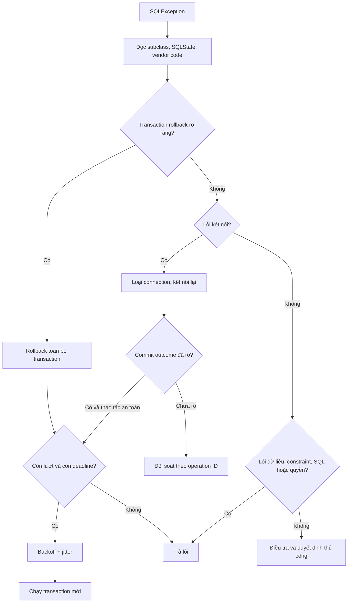

# SQLState, vendor error code và phân loại lỗi có thể thử lại

Khi ứng dụng Java kết nối Oracle Database bằng JDBC, lỗi thường được trả về dưới dạng `SQLException`. Để quyết định có nên thử lại một thao tác hay không, ứng dụng cần đọc ít nhất ba thông tin: SQLState, vendor error code và loại exception cụ thể. Với Oracle JDBC, vendor error code thường giúp nhận diện lỗi Oracle như deadlock, vi phạm constraint hoặc lỗi kết nối; SQLState cung cấp một nhóm lỗi tổng quát theo quy ước JDBC/SQL.

Không nên coi mọi lỗi SQL là có thể retry. Lỗi timeout hoặc mất kết nối có thể chỉ là tạm thời, trong khi lỗi sai dữ liệu, thiếu quyền, câu SQL sai hoặc vi phạm khóa duy nhất thường không tự biến mất khi chạy lại. Ngay cả khi lỗi có vẻ tạm thời, retry cũng phải được thực hiện ở đúng ranh giới giao dịch và phải bảo đảm không tạo dữ liệu trùng.

Bài học này tập trung vào cách đọc thông tin lỗi từ JDBC, hiểu nhóm SQLState, sử dụng mã lỗi Oracle, phân loại lỗi tạm thời và vĩnh viễn, cũng như thiết kế retry an toàn cho transaction và các luồng tích hợp.

## 1. SQLException và các thông tin chẩn đoán

Các phương thức quan trọng của `SQLException` gồm:

| Phương thức | Giá trị trả về | Ý nghĩa |
|---|---|---|
| `getMessage()` | Chuỗi | Nội dung lỗi để con người đọc; có thể chứa thông báo Oracle như ORA-00060 |
| `getSQLState()` | Chuỗi hoặc `null` | Mã trạng thái theo quy ước SQL/JDBC, thường gồm 5 ký tự |
| `getErrorCode()` | Số nguyên | Mã lỗi riêng của nhà cung cấp JDBC; với Oracle thường là mã lỗi Oracle dạng số, hoặc 0 nếu driver không cung cấp mã riêng |
| `getNextException()` | `SQLException` hoặc `null` | Exception tiếp theo trong chuỗi lỗi JDBC |
| `getCause()` | `Throwable` hoặc `null` | Nguyên nhân lồng bên trong exception theo cơ chế Java |

Ví dụ bắt lỗi và in thông tin cơ bản:

```java
try (Connection connection = dataSource.getConnection();
     PreparedStatement statement =
         connection.prepareStatement(
             "INSERT INTO employees(employee_id, last_name) VALUES (?, ?)")) {

    statement.setLong(1, 1001L);
    statement.setString(2, "Nguyen");
    statement.executeUpdate();

} catch (SQLException e) {
    System.err.println("Message: " + e.getMessage());
    System.err.println("SQLState: " + e.getSQLState());
    System.err.println("Vendor code: " + e.getErrorCode());
    throw new RuntimeException("Database operation failed", e);
}
```

Với Oracle JDBC, `getErrorCode()` thường trả về phần số của mã ORA. Ví dụ ORA-00060 thường có vendor code `60`, ORA-00001 có code `1`. Khi ghi log có thể định dạng thêm tiền tố ORA và đủ số chữ số để con người dễ nhận diện, nhưng trong chương trình nên so sánh số nguyên hoặc hằng số được quản lý tập trung.

Không nên chỉ phân tích chuỗi `getMessage()` để xác định lỗi. Nội dung thông báo có thể thay đổi theo ngôn ngữ, phiên bản, driver hoặc ngữ cảnh. SQLState và vendor code là dữ liệu có cấu trúc hơn; vẫn cần kết hợp với loại exception, transaction state và nghiệp vụ.

### Một SQLException có thể chứa nhiều lỗi

JDBC cho phép driver gắn nhiều exception trong một chuỗi. Vì vậy, kiểm tra riêng exception đầu tiên có thể bỏ qua lỗi quan trọng nằm ở `getNextException()`.

Ví dụ duyệt chuỗi exception:

```java
static void logSqlExceptionChain(SQLException exception) {
    int index = 0;

    for (SQLException current = exception;
         current != null;
         current = current.getNextException()) {

        System.err.println("SQL exception #" + index);
        System.err.println("  message = " + current.getMessage());
        System.err.println("  SQLState = " + current.getSQLState());
        System.err.println("  vendorCode = " + current.getErrorCode());

        index++;
    }
}
```

Một số driver còn đặt nguyên nhân ở `getCause()`. Khi điều tra lỗi kết nối, có thể cần xem cả chuỗi SQLException lẫn cause chain để tìm lỗi I/O hoặc lỗi mạng ban đầu. Không ghi toàn bộ payload, mật khẩu, token hoặc dữ liệu cá nhân vào log chỉ để phục vụ chẩn đoán.

## 2. SQLState là gì?

SQLState là mã trạng thái có cấu trúc được JDBC sử dụng để mô tả nhóm lỗi theo quy ước SQL. Mã thường có năm ký tự:

- Hai ký tự đầu là **class**, cho biết nhóm lỗi tổng quát.
- Ba ký tự tiếp theo là **subclass**, mô tả loại lỗi cụ thể hơn trong nhóm đó.

Ví dụ, SQLState bắt đầu bằng `23` thường biểu thị lỗi toàn vẹn dữ liệu (integrity constraint violation). SQLState bắt đầu bằng `08` thuộc nhóm lỗi kết nối. SQLState bắt đầu bằng `40` thuộc nhóm transaction rollback.

SQLState có ích khi viết logic có thể dùng với nhiều database hoặc nhiều JDBC driver. Tuy nhiên, driver có thể ánh xạ lỗi riêng của database sang SQLState theo cách khác nhau; một số lỗi riêng không có ánh xạ chuẩn hoặc có thể trả về `null`. Vì vậy, không được giả định mọi mã ORA đều có một SQLState duy nhất, giống nhau ở mọi phiên bản driver.

### Các class SQLState thường gặp

| Class | Nhóm lỗi | Cách hiểu khi xử lý |
|---|---|---|
| `00` | Thành công | Không phải lỗi; thường không xuất hiện như SQLException |
| `01` | Cảnh báo | Kiểm tra SQLWarning nếu cần; không nhất thiết là thao tác thất bại |
| `02` | Không tìm thấy dữ liệu | Tùy thao tác và nghiệp vụ; không mặc định retry |
| `08` | Lỗi kết nối | Có thể cần bỏ connection hiện tại và kết nối lại; kiểm tra kết quả giao dịch |
| `0A` | Tính năng không được hỗ trợ | Thường là lỗi cấu hình hoặc khả năng driver/database, không retry ngay |
| `22` | Lỗi dữ liệu | Thường do giá trị hoặc chuyển đổi dữ liệu; cần sửa nguồn hoặc mapping |
| `23` | Vi phạm integrity constraint | Thường không tự hết khi retry; kiểm tra khóa và quy tắc dữ liệu |
| `24` | Trạng thái cursor không hợp lệ | Kiểm tra vòng đời ResultSet/cursor và cách sử dụng statement |
| `25` | Trạng thái transaction không hợp lệ | Kiểm tra ranh giới transaction và trạng thái connection |
| `28` | Lỗi xác thực | Kiểm tra credential, tài khoản và quyền; không retry liên tục |
| `40` | Transaction rollback | Có thể cần chạy lại toàn bộ transaction nếu lỗi được xác định là tạm thời |
| `42` | Lỗi cú pháp hoặc quyền truy cập | Sửa SQL, object hoặc quyền; thường không retry |
| `HY` | Nhóm lỗi chung theo quy ước driver | Cần xem subclass, vendor code và thông tin cụ thể của driver |

Các class trên là cách phân nhóm tổng quát. Một ứng dụng thực tế nên kiểm tra tài liệu JDBC driver đang sử dụng và log lỗi thực tế của Oracle Database. Không nên dựa vào một mã subclass lấy từ hệ quản trị khác rồi áp dụng nguyên xi cho Oracle.

### Ví dụ kiểm tra SQLState theo class

```java
static String sqlStateClass(SQLException exception) {
    String state = exception.getSQLState();

    if (state == null || state.length() < 2) {
        return "UNKNOWN";
    }

    return state.substring(0, 2);
}

static boolean isConnectionClass(SQLException exception) {
    return "08".equals(sqlStateClass(exception));
}

static boolean isTransactionRollbackClass(SQLException exception) {
    return "40".equals(sqlStateClass(exception));
}
```

Kiểm tra class giúp tạo chính sách chung, nhưng chưa đủ để kết luận retry. Ví dụ, lỗi kết nối xảy ra trước khi gửi lệnh khác với lỗi kết nối xảy ra đúng lúc `COMMIT` đang được gửi. Trường hợp thứ hai có thể khiến ứng dụng không biết transaction đã commit hay chưa.

## 3. Vendor error code của Oracle

Vendor error code là mã lỗi riêng của database hoặc driver. Với Oracle JDBC, phương thức `getErrorCode()` thường trả về mã số Oracle tương ứng với lỗi ORA. Mã này giúp ứng dụng nhận diện những lỗi đặc thù mà SQLState tổng quát không mô tả đủ.

Ví dụ:

| Thông báo Oracle | Vendor code thường gặp | Ý nghĩa |
|---|---:|---|
| ORA-00001 | 1 | Vi phạm unique constraint |
| ORA-00054 | 54 | Không lấy được resource vì resource đang bận theo NOWAIT/timeout |
| ORA-00060 | 60 | Deadlock khi chờ resource |
| ORA-01013 | 1013 | Người dùng hoặc client yêu cầu hủy thao tác hiện tại |
| ORA-01017 | 1017 | Username/password không hợp lệ |
| ORA-01400 | 1400 | Không thể chèn NULL vào cột NOT NULL |
| ORA-01722 | 1722 | Số không hợp lệ |
| ORA-00942 | 942 | Không tìm thấy table hoặc view, hoặc không đủ quyền truy cập |
| ORA-08177 | 8177 | Không thể serialize access cho transaction |
| ORA-12541 | 12541 | Không có listener ở endpoint được chỉ định |
| ORA-12170 | 12170 | Timeout kết nối |
| ORA-03113 | 3113 | Kênh liên lạc bị đóng bất thường |
| ORA-03114 | 3114 | Không còn kết nối với Oracle |
| ORA-01555 | 1555 | Snapshot quá cũ do không đủ undo cần thiết |

Bảng này dùng để định hướng điều tra. Ý nghĩa và hành vi có thể phụ thuộc vào phiên bản Oracle, driver, cấu hình và thời điểm lỗi. Một mã lỗi không tự quyết định được có retry hay không; cần xác định lỗi xảy ra ở giai đoạn nào và transaction đã tạo tác động gì.

### SQLState và vendor code bổ sung cho nhau

Giả sử ứng dụng gặp ORA-00060:

- Vendor code `60` chỉ ra lỗi deadlock cụ thể của Oracle.
- SQLState, nếu driver ánh xạ, cung cấp nhóm transaction rollback tổng quát.
- Loại exception có thể là `SQLTransactionRollbackException` hoặc một `SQLException` thông thường tùy driver.
- Nghiệp vụ quyết định transaction có thể được chạy lại hay không và phải chạy lại từ đầu ở ranh giới nào.

Nếu ứng dụng chỉ dùng SQLState, có thể mất thông tin Oracle-specific cần cho chẩn đoán. Nếu chỉ dùng vendor code, logic có thể phụ thuộc chặt vào Oracle và khó tái sử dụng với database khác. Thường nên kết hợp cả hai: SQLState và exception subclass cho phân loại tổng quát, vendor code cho các ngoại lệ đặc thù của Oracle.

## 4. Các lớp SQLException trong JDBC

JDBC định nghĩa nhiều lớp exception con để mô tả tính chất của lỗi. Driver có thể sử dụng các lớp này để cung cấp thêm tín hiệu cho ứng dụng.

| Lớp exception | Ý nghĩa | Hướng xử lý thường gặp |
|---|---|---|
| `SQLTransientException` | Lỗi tạm thời; thao tác có thể thành công nếu thử lại mà không thay đổi đầu vào | Xem transaction và thử lại có giới hạn |
| `SQLTransientConnectionException` | Lỗi kết nối có tính tạm thời | Lấy connection mới, rồi chỉ retry khi an toàn |
| `SQLNonTransientException` | Lỗi không được coi là tự hết khi thử lại | Sửa dữ liệu, SQL hoặc cấu hình |
| `SQLNonTransientConnectionException` | Lỗi kết nối không được driver xem là tạm thời | Loại bỏ connection lỗi, điều tra nguyên nhân; không retry mù |
| `SQLRecoverableException` | Lỗi có thể phục hồi bằng cách đóng connection hiện tại, lấy connection mới và thử lại transaction phù hợp | Tạo connection mới và thực hiện lại transaction an toàn |
| `SQLTransactionRollbackException` | Transaction bị rollback do lỗi xử lý transaction | Có thể retry toàn bộ transaction |
| `SQLTimeoutException` | Thao tác vượt quá thời hạn | Kiểm tra kết quả và tính an toàn trước khi retry |
| `SQLIntegrityConstraintViolationException` | Vi phạm constraint | Kiểm tra dữ liệu và trạng thái nghiệp vụ |
| `SQLDataException` | Lỗi chuyển đổi hoặc giá trị dữ liệu | Sửa dữ liệu hoặc mapping |
| `SQLSyntaxErrorException` | Lỗi cú pháp hoặc truy cập SQL | Sửa câu SQL, object hoặc quyền |
| `SQLInvalidAuthorizationSpecException` | Lỗi xác thực | Sửa credential hoặc cấu hình bảo mật |

Các lớp này là tín hiệu phân loại của JDBC. Không phải mọi phiên bản Oracle JDBC đều ánh xạ mọi lỗi ORA vào đúng một lớp exception cụ thể. Ứng dụng nên có nhánh dự phòng dựa trên SQLState và vendor code, đồng thời ghi nhận exception thực tế trong log.

### Ví dụ kiểm tra kiểu exception

```java
if (exception instanceof SQLTransactionRollbackException) {
    // Transaction đã bị rollback; xem xét retry toàn bộ transaction.
} else if (exception instanceof SQLRecoverableException) {
    // Đóng connection hiện tại, lấy connection mới,
    // rồi chỉ retry nếu thao tác có thể thực hiện an toàn.
} else if (exception instanceof SQLIntegrityConstraintViolationException) {
    // Điều tra dữ liệu hoặc trạng thái nghiệp vụ.
} else {
    // Dựa thêm vào SQLState, vendor code và ngữ cảnh.
}
```

Thứ tự kiểm tra rất quan trọng vì một số lớp là lớp con của lớp khác. Ví dụ `SQLTransientConnectionException` là một loại `SQLTransientException`; nếu cần hành vi riêng cho lỗi kết nối, hãy kiểm tra lớp cụ thể trước lớp tổng quát.

## 5. Phân loại lỗi có thể thử lại

Trong thực tế, nên chia lỗi thành các nhóm hành động thay vì chỉ dùng hai trạng thái retry và không retry.

### Lỗi có thể retry transaction

Đây là lỗi mà database đã từ chối hoặc rollback transaction, và việc thực hiện lại toàn bộ transaction có thể thành công khi tranh chấp tạm thời biến mất.

Ví dụ:

- ORA-00060: deadlock detected.
- ORA-08177: cannot serialize access for this transaction.
- Một số lỗi lock hoặc resource busy như ORA-00054, nếu nghiệp vụ cho phép chờ và thử lại.

Với các lỗi này, ứng dụng thường cần rollback transaction hiện tại, chờ theo backoff và chạy lại toàn bộ đơn vị nghiệp vụ. Không nên chỉ chạy lại câu SQL cuối cùng nếu transaction trước đó đã đọc hoặc cập nhật nhiều bảng liên quan.

### Lỗi cần kết nối lại

Lỗi kết nối có thể xuất hiện khi database listener không sẵn sàng, mạng bị gián đoạn, socket bị đóng hoặc session bị mất.

Ví dụ:

- ORA-12541: không có listener ở endpoint.
- ORA-12170: timeout kết nối.
- ORA-03113 hoặc ORA-03114: kênh liên lạc hoặc session bị mất.
- Một số lỗi I/O từ Oracle JDBC ở tầng driver.

Hành động thường cần thực hiện:

1. Đánh dấu connection hiện tại là không còn tin cậy.
2. Đóng connection để connection pool loại bỏ hoặc kiểm tra lại theo cơ chế của pool.
3. Lấy connection mới sau khi dịch vụ database có thể truy cập.
4. Kiểm tra transaction trước đó đã tạo tác động hay chưa nếu lỗi xảy ra giữa lúc gửi lệnh hoặc commit.
5. Chỉ chạy lại thao tác khi đã xác định được tính an toàn.

Không phải mọi lỗi kết nối đều là lỗi tạm thời. Listener bị dừng, hostname sai, port sai hoặc firewall chặn kết nối có thể kéo dài cho đến khi cấu hình được sửa. Retry liên tục chỉ làm tăng tải và log nhiễu.

### Lỗi không nên tự động retry

Các lỗi dưới đây thường yêu cầu sửa đầu vào, câu SQL, quyền hoặc trạng thái nghiệp vụ:

- ORA-00001: khóa duy nhất bị trùng.
- ORA-01400: cột NOT NULL nhận NULL.
- ORA-01722: chuỗi không chuyển được thành số.
- ORA-00942: object không tồn tại hoặc không đủ quyền.
- ORA-01017: thông tin đăng nhập không hợp lệ.
- Lỗi SQL syntax hoặc object name sai.
- Vi phạm quy tắc nghiệp vụ, ví dụ chuyển một đơn hàng đã hủy sang trạng thái giao hàng.

Một trường hợp đặc biệt là duplicate key. Nếu request dùng idempotency key và bản ghi hiện có chính là kết quả của lần gửi trước, ứng dụng có thể xác minh và coi thao tác là đã hoàn tất. Nếu khóa trùng thuộc một nghiệp vụ khác, đó là conflict cần xử lý. Không nên bắt ORA-00001 rồi bỏ qua mà không kiểm tra bản ghi hiện có.

### Lỗi cần điều tra trước khi retry

Một số lỗi có thể phục hồi trong điều kiện nhất định nhưng không nên được retry tự động một cách máy móc:

- ORA-01555: có thể truy vấn lại nếu điều kiện undo khác đi, nhưng cần xử lý nguyên nhân về thời lượng query và undo retention.
- ORA-01013: có thể do người dùng hủy, query timeout hoặc ứng dụng yêu cầu cancel; không nên tự chạy lại nếu thao tác đã bị chủ động hủy.
- ORA-00028: session bị DBA hoặc hệ thống kết thúc; cần tạo session mới và xác định lý do.
- Lỗi timeout khi commit: kết quả commit có thể chưa rõ, cần đối soát trạng thái trước khi gửi lại.

## 6. Bảng quyết định retry cho một số lỗi Oracle

| Lỗi | Phân loại gợi ý | Có nên retry? | Điều kiện |
|---|---|---|---|
| ORA-00060 | Deadlock | Có, ở cấp transaction | Rollback và chạy lại toàn bộ transaction với backoff |
| ORA-08177 | Serialization conflict | Có, ở cấp transaction | Bắt đầu transaction mới và đọc lại dữ liệu |
| ORA-00054 | Resource busy | Có điều kiện | Chỉ retry khi lock có thể được giải phóng và có giới hạn |
| ORA-00001 | Unique constraint | Thường không | Chỉ coi là thành công nếu xác minh đúng idempotency key và kết quả đã tồn tại |
| ORA-01400 | NOT NULL violation | Không | Bổ sung hoặc sửa dữ liệu |
| ORA-01722 | Invalid number | Không | Sửa dữ liệu hoặc conversion |
| ORA-00942 | Table/view không tìm thấy hoặc thiếu quyền | Không | Kiểm tra schema, object và grant |
| ORA-01017 | Sai thông tin xác thực | Không | Sửa credential; không lặp đăng nhập liên tục |
| ORA-12541 | Listener không sẵn sàng | Có điều kiện | Retry giới hạn sau khi xác nhận endpoint đúng và dịch vụ có khả năng phục hồi |
| ORA-12170 | Connect timeout | Có điều kiện | Kiểm tra mạng, listener và timeout; dùng backoff |
| ORA-03113/03114 | Mất session/kênh kết nối | Có điều kiện | Lấy connection mới và đối soát trạng thái transaction |
| ORA-01013 | Thao tác bị hủy | Thường không | Xác định ai yêu cầu hủy và lý do |
| ORA-01555 | Snapshot too old | Không retry mù | Điều tra undo, thời lượng query và khả năng chạy lại truy vấn |

Bảng là hướng dẫn vận hành, không phải danh sách luật tuyệt đối. Một lỗi kết nối có thể xảy ra trước khi request được gửi hoặc sau khi database đã commit. Hai tình huống đó có quyết định retry khác nhau dù vendor code giống nhau.

## 7. Quy tắc quan trọng: retry ở ranh giới transaction

Giả sử một transaction thực hiện:

1. Đọc số dư tài khoản.
2. Kiểm tra điều kiện chuyển tiền.
3. Trừ tiền ở tài khoản nguồn.
4. Cộng tiền ở tài khoản đích.
5. Ghi lịch sử giao dịch.
6. Commit.

Nếu bước 4 gặp deadlock, chỉ chạy lại câu SQL cộng tiền có thể làm dữ liệu mất cân bằng. Phải rollback transaction và chạy lại toàn bộ quy trình từ đầu để các điều kiện được đọc lại trên trạng thái mới.

Ví dụ cấu trúc transaction:

```java
try (Connection connection = dataSource.getConnection()) {
    connection.setAutoCommit(false);

    try {
        debitSourceAccount(connection, sourceAccount, amount);
        creditTargetAccount(connection, targetAccount, amount);
        insertTransferHistory(connection, transferId, amount);

        connection.commit();
    } catch (SQLException e) {
        try {
            connection.rollback();
        } catch (SQLException rollbackError) {
            e.addSuppressed(rollbackError);
        }
        throw e;
    }
}
```

Ví dụ trên thể hiện transaction boundary. Trong code retry thực tế, mỗi lần thử cần dùng transaction mới và phải phân biệt lỗi đã rollback chắc chắn với lỗi làm mất kết nối khi kết quả commit chưa rõ.

### Deadlock và serialization conflict

Khi gặp ORA-00060 hoặc ORA-08177, ứng dụng thường nên:

- Rollback toàn bộ transaction.
- Chờ một khoảng ngắn có jitter.
- Mở transaction mới.
- Đọc lại dữ liệu và kiểm tra điều kiện nghiệp vụ.
- Thực hiện lại các thao tác từ đầu.
- Dừng sau số lần thử tối đa hoặc deadline.

Không giữ nguyên giá trị đã đọc trước transaction cũ nếu điều kiện nghiệp vụ phụ thuộc dữ liệu có thể thay đổi. Transaction mới phải đánh giá lại trạng thái hiện tại.

### Connection failure và commit outcome không rõ

Đây là tình huống nguy hiểm nhất khi retry. Ứng dụng gửi `COMMIT`, nhưng mạng bị ngắt trước khi nhận phản hồi. Có hai khả năng:

- Database chưa commit; transaction sẽ rollback khi session kết thúc.
- Database đã commit, nhưng phản hồi commit không đến được ứng dụng.

Ứng dụng không thể kết luận chỉ từ lỗi socket rằng transaction đã rollback. Nếu gửi lại một lệnh tạo đơn hàng hoặc chuyển tiền, có thể tạo tác động hai lần.

Cách giải quyết là dùng một operation ID hoặc idempotency key duy nhất. Trước khi thực hiện, ghi nhận yêu cầu theo khóa này; sau khi kết nối lại, truy vấn trạng thái bằng khóa đó. Nếu kết quả đã commit, trả lại kết quả cũ; nếu chưa thực hiện, mới tiếp tục. Với nghiệp vụ tài chính, cần có bảng ledger hoặc cơ chế đối soát tương ứng.

## 8. Exponential backoff, jitter và giới hạn retry

Retry quá nhanh có thể làm database hoặc dịch vụ đích quá tải hơn. Khi nhiều ứng dụng cùng retry theo chu kỳ giống nhau, chúng có thể tạo retry storm.

Exponential backoff tăng khoảng chờ theo số lần thử:

\[
delay_n = \min(delay_{max}, delay_{base} \times 2^{n-1})
\]

Ví dụ với khoảng cơ sở 200 ms và giới hạn 5 giây:

| Lần thử tiếp theo | Khoảng chờ cơ sở |
|---:|---:|
| 1 | 200 ms |
| 2 | 400 ms |
| 3 | 800 ms |
| 4 | 1.600 ms |
| 5 | 3.200 ms |
| 6 trở đi | Tối đa 5.000 ms |

Jitter thêm biến thiên ngẫu nhiên để các client không đồng loạt gửi lại cùng lúc. Có thể dùng full jitter:

\[
delay = random(0, calculatedBackoff)
\]

Một chính sách retry cần có:

- Số lần thử tối đa.
- Tổng thời gian tối đa (deadline).
- Khoảng chờ tối thiểu và tối đa.
- Jitter.
- Phân loại lỗi được phép retry.
- Cơ chế dừng hoặc circuit breaker khi dịch vụ không khả dụng kéo dài.
- Ghi nhận số lần thử và lý do retry.

Không retry vô hạn. Không retry lỗi dữ liệu hoặc lỗi xác thực chỉ vì đã hết một khoảng chờ. Với dịch vụ có trả `Retry-After`, cần tôn trọng hướng dẫn đó nếu phù hợp với deadline của ứng dụng.

## 9. Ví dụ Java phân loại lỗi

Có thể xây dựng một enum mô tả hành động ở mức ứng dụng:

```java
enum RetryDecision {
    RETRY_TRANSACTION,
    RECONNECT_AND_CHECK,
    DO_NOT_RETRY,
    REVIEW
}
```

Hàm dưới đây minh họa cách kết hợp exception subclass, SQLState class và một số vendor code Oracle thường gặp:

```java
import java.sql.SQLException;
import java.sql.SQLDataException;
import java.sql.SQLIntegrityConstraintViolationException;
import java.sql.SQLRecoverableException;
import java.sql.SQLSyntaxErrorException;
import java.sql.SQLTransactionRollbackException;
import java.sql.SQLTimeoutException;
import java.sql.SQLTransientConnectionException;
import java.sql.SQLTransientException;

static RetryDecision classify(SQLException exception) {
    for (SQLException current = exception;
         current != null;
         current = current.getNextException()) {

        int code = current.getErrorCode();
        String state = current.getSQLState();

        // Deadlock và serialization conflict:
        // rollback rồi thử lại toàn bộ transaction.
        if (current instanceof SQLTransactionRollbackException
                || code == 60
                || code == 8177
                || (state != null && state.startsWith("40"))) {
            return RetryDecision.RETRY_TRANSACTION;
        }

        // Lỗi cần thay connection trước khi xem xét thao tác tiếp.
        if (current instanceof SQLRecoverableException
                || current instanceof SQLTransientConnectionException
                || (state != null && state.startsWith("08"))) {
            return RetryDecision.RECONNECT_AND_CHECK;
        }

        // Timeout không cho biết chắc thao tác đã được database thực hiện
        // hay chưa, nhất là khi timeout xảy ra trong lúc commit.
        if (current instanceof SQLTimeoutException) {
            return RetryDecision.REVIEW;
        }

        // Lỗi dữ liệu, constraint hoặc cú pháp thường không tự hết.
        if (current instanceof SQLIntegrityConstraintViolationException
                || current instanceof SQLDataException
                || current instanceof SQLSyntaxErrorException
                || code == 1
                || code == 1400
                || code == 1722
                || code == 942
                || (state != null && (
                    state.startsWith("22")
                    || state.startsWith("23")
                    || state.startsWith("42")))) {
            return RetryDecision.DO_NOT_RETRY;
        }

        // Một lỗi transient khác có thể retry nếu transaction
        // và trạng thái nghiệp vụ cho phép.
        if (current instanceof SQLTransientException) {
            return RetryDecision.RETRY_TRANSACTION;
        }
    }

    return RetryDecision.REVIEW;
}
```

Đây là khung minh họa, không phải bộ phân loại hoàn chỉnh cho mọi Oracle release. Trước khi dùng trong production, cần bổ sung mã lỗi theo hệ thống thực tế, kiểm thử với đúng Oracle JDBC driver và phân biệt lỗi timeout/connection ở thời điểm commit. Không nên đặt mọi lỗi `08` vào nhóm tự động retry mà không kiểm tra transaction outcome.

Hàm phân loại cũng không nên tự thực hiện retry. Tách quyết định phân loại khỏi cơ chế chạy lại giúp code dễ kiểm thử, log rõ ràng và tránh việc một exception bị retry ở nhiều tầng.

## 10. Ví dụ vòng lặp retry transaction có giới hạn

Với lỗi transaction rollback đã xác định, có thể chạy lại toàn bộ transaction. Ví dụ sau minh họa cấu trúc; `TransferWork` là interface ứng dụng tự định nghĩa:

```java
@FunctionalInterface
interface TransferWork<T> {
    T execute(Connection connection) throws SQLException;
}

static <T> T executeWithTransactionRetry(
        DataSource dataSource,
        TransferWork<T> work,
        int maxAttempts) throws SQLException {

    SQLException lastError = null;

    for (int attempt = 1; attempt <= maxAttempts; attempt++) {
        try (Connection connection = dataSource.getConnection()) {
            connection.setAutoCommit(false);

            try {
                T result = work.execute(connection);
                connection.commit();
                return result;

            } catch (SQLException e) {
                try {
                    connection.rollback();
                } catch (SQLException rollbackError) {
                    e.addSuppressed(rollbackError);
                }
                throw e;
            }

        } catch (SQLException e) {
            lastError = e;
            RetryDecision decision = classify(e);

            if (decision != RetryDecision.RETRY_TRANSACTION
                    || attempt == maxAttempts) {
                throw e;
            }

            sleepWithBackoff(attempt);
        }
    }

    throw lastError;
}
```

Hàm `sleepWithBackoff` cần xử lý interrupt đúng cách và nên thêm jitter. Ví dụ:

```java
static void sleepWithBackoff(int attempt) throws SQLException {
    long baseMillis = 200L;
    long maxMillis = 5000L;

    int exponent = Math.min(attempt - 1, 10);
    long calculated = Math.min(
        maxMillis,
        baseMillis * (1L << exponent)
    );

    long delay = java.util.concurrent.ThreadLocalRandom
        .current()
        .nextLong(calculated + 1);

    try {
        Thread.sleep(delay);
    } catch (InterruptedException e) {
        Thread.currentThread().interrupt();
        throw new SQLException("Retry interrupted", e);
    }
}
```

Ví dụ này chỉ retry nhóm `RETRY_TRANSACTION`. Nếu `commit()` ném lỗi kết nối, không được mặc định coi đó là lỗi transaction rollback. Kết quả commit có thể không rõ; cần trả về quyết định `RECONNECT_AND_CHECK`, lấy connection mới và đối soát theo operation ID trước khi chạy lại.

Trong code thực tế cũng cần deadline tổng, giới hạn thời gian chờ lấy connection từ pool, telemetry cho từng lần retry và chính sách hủy khi thread bị interrupt.

## 11. BatchUpdateException và xử lý batch JDBC

Khi dùng JDBC batch, lỗi có thể xảy ra sau khi một phần câu lệnh đã được thực thi. `BatchUpdateException` cung cấp `getUpdateCounts()` để ứng dụng xem số lượng cập nhật mà driver báo cáo.

Các giá trị thường gặp:

- Số không âm: số dòng được cập nhật bởi câu lệnh tương ứng.
- `Statement.SUCCESS_NO_INFO` (`-2`): câu lệnh thành công nhưng driver không cung cấp số dòng cụ thể.
- `Statement.EXECUTE_FAILED` (`-3`): câu lệnh thất bại trong batch khi driver tiếp tục xử lý các phần tử sau lỗi.

Ví dụ:

```java
try {
    int[] counts = statement.executeBatch();

    for (int i = 0; i < counts.length; i++) {
        System.out.println("Item " + i + ": " + counts[i]);
    }

} catch (BatchUpdateException e) {
    int[] counts = e.getUpdateCounts();

    for (int i = 0; i < counts.length; i++) {
        System.err.println("Item " + i + ": " + counts[i]);
    }

    SQLException next = e.getNextException();
    while (next != null) {
        System.err.println(
            next.getErrorCode() + " / " + next.getSQLState()
            + " / " + next.getMessage()
        );
        next = next.getNextException();
    }

    throw e;
}
```

Driver có thể dừng batch tại lỗi đầu tiên hoặc tiếp tục tùy hành vi và cấu hình. Vì vậy, không giả định mảng update counts luôn chứa đủ một phần tử cho mọi lệnh đã addBatch. Khi transaction đang tắt auto-commit, ứng dụng có thể rollback cả batch để bảo đảm tính nguyên tử. Nếu thiết kế chấp nhận commit từng phần, cần lưu trạng thái từng record và có khả năng chạy lại riêng các phần tử thất bại.

Không retry nguyên batch theo kiểu mù nếu một số phần tử đã được commit. Hãy xác định batch đang chạy trong transaction nào, kết quả update counts và chính sách idempotency của từng record.

## 12. Connection pool và lỗi kết nối

Ứng dụng Java thường lấy connection qua connection pool như UCP hoặc một pool phổ biến khác. Khi một lỗi I/O làm connection không còn sử dụng được, ứng dụng phải để pool loại bỏ hoặc kiểm tra connection đó theo cơ chế của pool.

Một số nguyên tắc:

- Không tiếp tục dùng connection sau lỗi kết nối nghiêm trọng.
- Đóng connection trong `finally` hoặc try-with-resources để trả lại pool.
- Cấu hình validation phù hợp, nhưng không xem validation là bảo đảm connection sẽ không đứt ngay sau đó.
- Đặt connect timeout, socket/read timeout và thời gian chờ lấy connection.
- Giám sát số connection active, idle, waiters và lỗi tạo connection.
- Tránh tạo pool mới cho mỗi lần retry; dùng pool do ứng dụng quản lý.
- Khi database bảo trì hoặc failover, dùng cơ chế retry có giới hạn và circuit breaker để tránh dồn request.

`SQLRecoverableException` là tín hiệu hữu ích: JDBC mô tả rằng cần đóng connection hiện tại, lấy connection mới và thử lại transaction phù hợp. Tuy nhiên, nếu lỗi xảy ra ở commit, vẫn cần xử lý khả năng commit đã thành công trước khi kết nối bị mất.

## 13. Logging và observability

Một bản ghi lỗi JDBC hữu ích nên có:

- Tên ứng dụng, service, module và phiên bản driver.
- Thời điểm xảy ra lỗi và correlation ID.
- Tên thao tác hoặc repository method.
- SQLState, vendor error code, exception class.
- ORA code hoặc message đã được lọc thông tin nhạy cảm.
- Số lần retry, khoảng chờ và quyết định phân loại.
- Transaction phase: trước execute, trong execute, trước commit hay trong commit.
- Business key hoặc batch ID đã được mã hóa/ẩn theo chính sách dữ liệu.
- Database service và trạng thái connection pool nếu có.

Không nên ghi password, access token, connection URL chứa secret, toàn bộ bind values nhạy cảm hoặc dữ liệu cá nhân vào log.

Ví dụ log có cấu trúc:

```text
event=jdbc_failure
operation=transfer
correlation_id=9d5...
sql_state=40001
vendor_code=8177
exception=SQLTransactionRollbackException
phase=EXECUTE
attempt=2
decision=RETRY_TRANSACTION
delay_ms=430
```

Cần theo dõi tỷ lệ lỗi theo vendor code và SQLState, tỷ lệ retry thành công, số lần retry trung bình, thời gian chờ retry, lỗi vượt ngưỡng và số thao tác có kết quả commit chưa xác định. Một hệ thống retry thành công nhưng phải thử lại quá nhiều lần vẫn là hệ thống có vấn đề về contention hoặc hạ tầng.

## 14. Những sai lầm thường gặp

**Retry mọi SQLException.**  
Lỗi cú pháp, dữ liệu, quyền và constraint không tự hết. Retry mù có thể tạo tải, kéo dài sự cố và làm dữ liệu trùng.

**Chỉ kiểm tra getMessage().**  
Thông báo có thể thay đổi. Hãy dùng SQLState, vendor code, exception subclass và exception chain.

**Chỉ xem exception đầu tiên.**  
Driver có thể cung cấp nhiều exception liên kết qua `getNextException()`. Hãy duyệt toàn bộ chuỗi khi điều tra.

**Chỉ retry câu lệnh thất bại.**  
Với deadlock hoặc serialization conflict, transaction có thể cần rollback và chạy lại từ đầu để đọc lại dữ liệu và kiểm tra điều kiện.

**Retry lỗi kết nối ngay sau commit mà không đối soát.**  
Database có thể đã commit nhưng client không nhận được phản hồi. Hãy dùng operation ID hoặc idempotency key để xác định kết quả.

**Bắt lỗi rồi bỏ qua.**  
Nếu catch SQLException nhưng không phát sinh lại hoặc không ghi trạng thái thất bại, tầng gọi có thể tưởng tác vụ đã thành công.

**Không giới hạn số lần retry.**  
Retry vô hạn có thể làm cạn connection pool, tăng tải database và trì hoãn phát hiện lỗi cấu hình.

**Dùng vendor code như một tiêu chuẩn chung cho mọi database.**  
Vendor code có ý nghĩa riêng theo driver. Khi hỗ trợ nhiều hệ quản trị, hãy dùng SQLState và abstraction của ứng dụng, đồng thời giữ adapter riêng cho mã lỗi từng nhà cung cấp.

## 15. Quy trình quyết định có retry hay không

Khi bắt được SQLException, có thể thực hiện theo trình tự:

1. Duyệt exception chain và cause để thu thập toàn bộ thông tin.
2. Đọc exception subclass, SQLState và vendor code.
3. Xác định giai đoạn lỗi: lấy connection, execute, fetch, commit hay rollback.
4. Phân loại lỗi là transaction rollback, connection failure, dữ liệu/constraint, cú pháp/quyền hay chưa rõ.
5. Nếu là transaction rollback đã xác định, rollback và retry toàn bộ transaction trong giới hạn.
6. Nếu connection hỏng, bỏ connection và lấy connection mới; nếu commit outcome chưa rõ, đối soát trước.
7. Nếu là lỗi dữ liệu, constraint, cú pháp hoặc xác thực, dừng retry tự động và sửa nguyên nhân.
8. Áp dụng backoff, jitter, max attempts và deadline cho các lỗi được phép retry.
9. Ghi log quyết định, số lần thử và kết quả cuối.
10. Kiểm tra idempotency để bảo đảm thao tác chạy lại không tạo tác động trùng.

Có thể mô tả bằng sơ đồ:



## 16. Checklist triển khai retry trong Oracle JDBC

- [ ] Log cả SQLState, vendor error code, exception class và message đã lọc dữ liệu nhạy cảm.
- [ ] Duyệt `getNextException()` và cause chain khi điều tra.
- [ ] Không giả định Oracle JDBC luôn ánh xạ mọi ORA code thành SQLState hoặc exception subclass giống nhau.
- [ ] Xây dựng bảng phân loại vendor code phù hợp với phiên bản Oracle và driver thực tế.
- [ ] Phân biệt lỗi transaction rollback với lỗi connection.
- [ ] Retry toàn bộ transaction đối với deadlock hoặc serialization conflict khi nghiệp vụ cho phép.
- [ ] Bỏ connection hỏng và lấy connection mới sau lỗi kết nối.
- [ ] Đối soát kết quả khi lỗi xảy ra trong hoặc ngay sau commit.
- [ ] Không retry tự động lỗi dữ liệu, constraint, cú pháp hoặc xác thực.
- [ ] Dùng idempotency key, business key hoặc operation ID cho thao tác có thể chạy lại.
- [ ] Giới hạn số lần thử, tổng thời gian, backoff và jitter.
- [ ] Theo dõi tỷ lệ retry thành công, lỗi lặp và connection pool.
- [ ] Kiểm thử lỗi deadlock, timeout, mất kết nối, duplicate key và commit outcome không rõ trong môi trường thử nghiệm.
- [ ] Có runbook cho lỗi vượt ngưỡng và thao tác cần đối soát thủ công.

SQLState cho biết nhóm lỗi theo quy ước SQL/JDBC, vendor error code nhận diện lỗi riêng của Oracle, còn exception subclass bổ sung tín hiệu về tính chất tạm thời hoặc khả năng phục hồi. Ba nguồn thông tin này cần được đọc cùng transaction phase và trạng thái nghiệp vụ. Retry an toàn không chỉ là chạy lại khi gặp lỗi: ứng dụng phải rollback đúng ranh giới, tạo connection mới khi cần, kiểm tra kết quả commit chưa rõ, dùng idempotency và giới hạn số lần thử để bảo vệ dữ liệu cũng như hệ thống.

