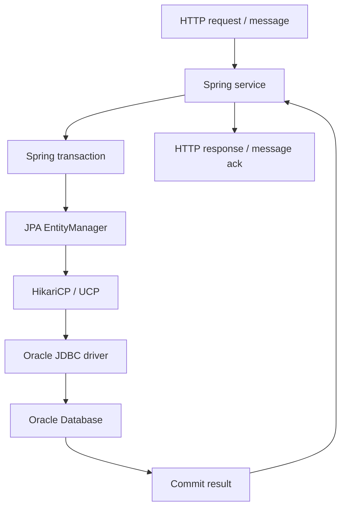
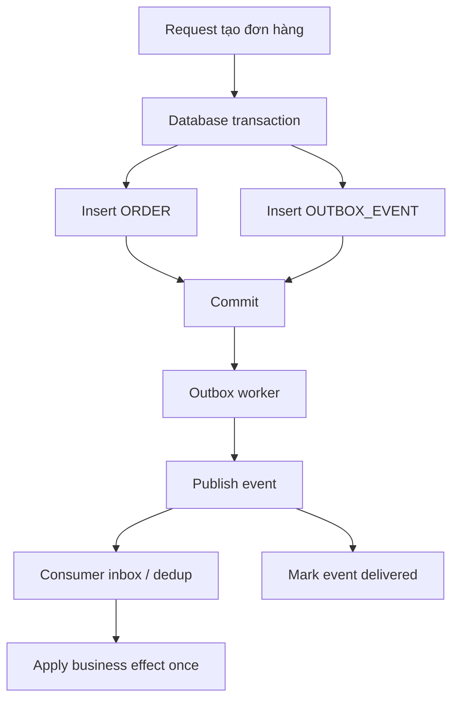

# Khôi phục kết nối sau sự cố và tránh thực hiện lặp giao dịch nghiệp vụ

Trong ứng dụng Spring Boot sử dụng JPA để làm việc với Oracle Database, sự cố kết nối có thể xuất hiện khi database restart hoặc failover, listener tạm ngừng, mạng bị gián đoạn, connection trong pool đã hết hạn hoặc một truy vấn vượt quá thời gian chờ. Khi đó, ứng dụng cần phục hồi khả năng truy cập database mà vẫn bảo đảm giao dịch nghiệp vụ không bị thực hiện hai lần.

Hai mục tiêu này liên quan chặt chẽ nhưng khác nhau:

- **Khôi phục kết nối:** loại bỏ connection hỏng, lấy connection mới khi database sẵn sàng và xử lý transaction đang dang dở đúng cách.
- **Tránh lặp nghiệp vụ:** nhận diện một yêu cầu đã được xử lý hay chưa, để retry không tạo thêm đơn hàng, khoản thanh toán, lần trừ tồn kho hoặc sự kiện trùng.

Connection pool có thể tạo connection mới, Spring có thể phân loại exception và retry một transaction, nhưng các cơ chế đó không tự bảo đảm tính đúng đắn nghiệp vụ. Ứng dụng cần thiết kế transaction boundary, idempotency key, trạng thái xử lý và cơ chế đối soát cho các tình huống kết quả commit chưa rõ.

## 1. Những điểm có thể hỏng trong đường đi của một request

Một request từ ứng dụng đến Oracle thường đi qua nhiều lớp:

1. Controller hoặc message listener nhận yêu cầu nghiệp vụ.
2. Service kiểm tra quy tắc và gọi repository.
3. Spring transaction manager mở hoặc tham gia transaction.
4. JPA/Hibernate lấy JDBC connection từ DataSource.
5. Connection pool cấp connection.
6. JDBC driver gửi SQL đến Oracle qua Oracle Net.
7. Oracle thực hiện câu lệnh và ghi nhận transaction.
8. Ứng dụng commit, nhận kết quả và trả response.

Sơ đồ tổng quát:



Sự cố có thể xảy ra ở bất kỳ đoạn nào. Connection có thể bị ngắt khi ứng dụng đang thực hiện SELECT, UPDATE hoặc ngay lúc gửi COMMIT. Mỗi thời điểm có ý nghĩa khác nhau:

| Thời điểm xảy ra lỗi | Điều ứng dụng có thể biết | Hành động cần cân nhắc |
|---|---|---|
| Trước khi lấy được connection | Chưa gửi SQL trong transaction đó | Có thể thử lấy connection lại với giới hạn |
| Khi đang đọc dữ liệu | Truy vấn hiện tại thất bại; transaction có thể không còn dùng được | Loại connection lỗi và thực hiện lại đơn vị đọc nếu phù hợp |
| Khi đang ghi dữ liệu trước commit | Kết quả transaction có thể chưa hoàn tất | Rollback nếu còn kết nối; nếu mất session, xác định trạng thái trước khi gửi lại |
| Trong lúc commit | Ứng dụng có thể không biết database đã commit hay chưa | Đối soát bằng operation ID hoặc idempotency key |
| Sau khi commit nhưng trước khi trả response | Database đã hoàn tất nhưng client có thể nghĩ request thất bại | Request gửi lại phải trả về kết quả đã lưu, không tạo nghiệp vụ mới |

Điểm khó nhất là lỗi xảy ra trong lúc commit hoặc sau commit nhưng trước khi client nhận được phản hồi. Đây là khoảng thời gian mà ứng dụng có thể mất thông tin về kết quả thực tế.

## 2. Connection pool và khả năng phục hồi kết nối

### Connection pool làm gì?

Spring Boot thường cấu hình một DataSource có connection pool. HikariCP là lựa chọn mặc định phổ biến trong nhiều ứng dụng Spring Boot nếu không thay bằng pool khác. Với Oracle, ứng dụng cũng có thể dùng Oracle Universal Connection Pool (UCP) khi cần các khả năng tích hợp đặc thù.

Pool giữ một số JDBC connection để tái sử dụng. Khi service cần transaction, Hibernate/JPA yêu cầu connection từ DataSource; pool cấp một connection đang rảnh hoặc chờ tạo/cấp connection theo giới hạn cấu hình.

Pool giúp:

- Tránh tạo kết nối vật lý cho mỗi câu SQL.
- Giới hạn số session đồng thời đến database.
- Phát hiện một số connection không còn hợp lệ.
- Quản lý thời gian chờ lấy connection.
- Thu hồi connection khi ứng dụng đóng hoặc transaction kết thúc.

Pool không thể bảo đảm một connection vẫn sống sau khi đã được cấp. Mạng có thể đứt ngay sau bước kiểm tra; database có thể restart trong lúc câu SQL đang chạy. Vì vậy, ứng dụng vẫn cần xử lý lỗi ở thời điểm sử dụng connection.

### Cấu hình HikariCP trong Spring Boot

Ví dụ cấu hình cơ bản trong `application.yml`:

```yaml
spring:
  datasource:
    url: jdbc:oracle:thin:@//dbhost.example.com:1521/ORCLPDB1
    username: app_user
    password: SECRET_INJECTED_AT_RUNTIME
    hikari:
      pool-name: OracleAppPool
      maximum-pool-size: 20
      minimum-idle: 5
      connection-timeout: 30000
      validation-timeout: 5000
      idle-timeout: 600000
      max-lifetime: 1700000
      keepalive-time: 300000
```

Các tham số cần hiểu:

| Thuộc tính | Ý nghĩa | Lưu ý vận hành |
|---|---|---|
| `maximum-pool-size` | Số connection tối đa trong pool | Phải phù hợp giới hạn session của Oracle và số instance ứng dụng |
| `minimum-idle` | Số connection nhàn rỗi tối thiểu mà pool cố duy trì | Tăng quá cao có thể giữ nhiều session không cần thiết |
| `connection-timeout` | Thời gian chờ tối đa để lấy connection từ pool | Hết thời gian sẽ phát sinh lỗi lấy connection; đây không phải SQL timeout |
| `validation-timeout` | Thời gian tối đa cho kiểm tra connection | Phải nhỏ hơn connection timeout |
| `idle-timeout` | Thời gian connection nhàn rỗi có thể được loại bỏ khi pool có nhiều hơn minimum idle | Không có tác dụng như thời gian timeout của query |
| `max-lifetime` | Tuổi thọ tối đa của connection trong pool | Nên thấp hơn giới hạn tuổi thọ do database, proxy hoặc network áp dụng |
| `keepalive-time` | Chu kỳ kiểm tra/giữ sống connection nhàn rỗi | Chỉ áp dụng với connection idle và phải nhỏ hơn max lifetime |

Các giá trị trong ví dụ chỉ để minh họa. Cần điều chỉnh theo giới hạn session, thời gian timeout của firewall/load balancer, cấu hình Oracle Net, thời gian failover và tải thực tế.

HikariCP dùng JDBC4 `Connection.isValid()` để kiểm tra connection trong trường hợp phù hợp. Không nên tự đặt `connectionTestQuery` nếu driver hoạt động tốt với JDBC4; chỉ dùng khi có lý do tương thích rõ ràng.

`max-lifetime` không phải thời hạn bảo đảm connection luôn hoạt động. Nếu firewall đóng connection sau 30 phút không hoạt động, pool nên loại connection trước mốc đó theo cấu hình phù hợp. `keepalive-time` có thể giúp phát hiện connection idle bị ngắt, nhưng không bảo vệ connection đang được sử dụng khi sự cố xảy ra.

### Kiểm tra connection không đồng nghĩa với bảo đảm kết nối

Một connection có thể vượt qua validation rồi bị ngắt ngay sau đó. Vì vậy:

- Validation giúp giảm xác suất cấp connection đã hỏng.
- Pool timeout giới hạn thời gian chờ connection.
- JDBC exception cho biết thao tác thất bại.
- Retry ở tầng ứng dụng quyết định có thể thực hiện lại hay không.
- Idempotency bảo vệ tác động nghiệp vụ khi kết quả lần trước chưa rõ.

Không dùng một truy vấn health check như bằng chứng rằng request tiếp theo chắc chắn thành công.

## 3. Điều gì xảy ra với JPA transaction khi mất kết nối?

### EntityManager và persistence context

JPA `EntityManager` quản lý persistence context, tức tập entity đang được theo dõi trong một đơn vị làm việc. Trong Spring, EntityManager thường được quản lý theo transaction và gắn với thread hiện tại thông qua transaction manager.

Không nên:

- Lưu EntityManager vào biến static hoặc singleton để tái sử dụng giữa các request.
- Dùng cùng EntityManager đồng thời từ nhiều thread.
- Tiếp tục dùng persistence context sau khi transaction đã rollback hoặc bị đánh dấu rollback-only.
- Giữ entity đã load trong một transaction lỗi rồi giả định trạng thái đó phản ánh database sau khi kết nối lại.

Sau lỗi database nghiêm trọng, transaction hiện tại thường không thể tiếp tục như chưa có chuyện gì. Hibernate có thể đánh dấu transaction rollback-only hoặc persistence context trở nên không còn đáng tin cậy. Cần để transaction kết thúc, đóng/giải phóng tài nguyên và bắt đầu transaction mới với persistence context mới.

### Transaction bị rollback-only

Khi một lỗi persistence xảy ra, transaction manager hoặc provider có thể đánh dấu transaction là rollback-only. Dù ứng dụng bắt exception bên trong method và tiếp tục, lúc commit có thể phát sinh lỗi như `UnexpectedRollbackException` hoặc lỗi persistence khác.

Ví dụ không nên làm:

```java
@Transactional
public void processOrder(Long orderId) {
    try {
        orderRepository.updateStatus(orderId, "PAID");
    } catch (DataAccessException ex) {
        // Nuốt lỗi rồi tiếp tục dùng cùng transaction.
        log.warn("Update failed", ex);
    }

    // Transaction có thể đã bị đánh dấu rollback-only.
    invoiceRepository.createFor(orderId);
}
```

Nếu update là bắt buộc, hãy để lỗi thoát khỏi transaction và xử lý retry ở lớp bên ngoài. Nếu lỗi chỉ thuộc một record và nghiệp vụ cho phép tiếp tục, hãy tách record đó sang transaction riêng, lưu trạng thái thất bại và xác định tiêu chí kết thúc batch.

### Không chỉ chạy lại repository method

Một transaction nghiệp vụ thường gồm nhiều thao tác có quan hệ. Nếu chỉ retry một câu SQL bị lỗi, có thể tạo trạng thái không nhất quán.

Ví dụ thanh toán một đơn hàng có thể gồm:

1. Kiểm tra đơn hàng còn ở trạng thái chờ thanh toán.
2. Ghi nhận payment.
3. Cập nhật trạng thái đơn hàng.
4. Ghi ledger hoặc lịch sử giao dịch.
5. Commit.

Nếu bước 3 gặp lỗi serialization, cần rollback và chạy lại transaction theo quy tắc nghiệp vụ. Chỉ chạy lại bước cập nhật trạng thái có thể bỏ qua kiểm tra và dữ liệu đã thay đổi ở bước đầu.

## 4. Phân biệt lỗi kết nối, lỗi transaction và lỗi nghiệp vụ

Spring thường dịch một số lỗi JDBC/JPA thành các lớp trong `DataAccessException`. Nhờ đó service có thể xử lý lỗi ở mức trừu tượng hơn, thay vì chỉ bắt SQLException. Tuy nhiên, loại exception thực tế còn phụ thuộc vào Hibernate, Oracle JDBC driver và cách lỗi được truyền qua các lớp.

| Nhóm | Ví dụ thường gặp | Hành động |
|---|---|---|
| Không lấy được connection | `CannotGetJdbcConnectionException`, `DataAccessResourceFailureException` | Kiểm tra database/pool; retry có giới hạn nếu dịch vụ có khả năng phục hồi |
| Lỗi kết nối trong lúc thao tác | `DataAccessResourceFailureException`, `RecoverableDataAccessException` hoặc exception provider cụ thể | Bỏ connection lỗi; xác định transaction outcome trước khi chạy lại |
| Transaction rollback do tranh chấp | `PessimisticLockingFailureException`, `CannotAcquireLockException`, `CannotSerializeTransactionException` tùy provider | Rollback và cân nhắc retry toàn bộ transaction |
| Vi phạm dữ liệu | `DataIntegrityViolationException` | Sửa dữ liệu hoặc xử lý conflict; không retry mù |
| Sai cú pháp hoặc mapping | `InvalidDataAccessResourceUsageException`, lỗi mapping Hibernate | Sửa SQL, JPQL, schema hoặc mapping |
| Timeout | `QueryTimeoutException`, `TransactionTimedOutException` hoặc lỗi driver | Xác định thao tác đã được thực hiện đến đâu; không mặc định retry |
| Lỗi lập trình hoặc trạng thái | `IllegalArgumentException`, `EntityNotFoundException` tùy ngữ cảnh | Sửa code hoặc dữ liệu; không retry tự động |

Một số lớp có thể được lồng bên trong `JpaSystemException` hoặc `DataAccessException`. Khi phân loại, cần xem cause chain và thông tin SQLState/vendor code của SQLException gốc.

### Các lỗi thường có thể thử lại

Có thể xem xét retry khi đã xác định transaction bị rollback hoặc thao tác chưa tạo tác động:

- Deadlock, ví dụ Oracle ORA-00060.
- Serialization conflict, ví dụ ORA-08177 ở isolation level phù hợp.
- Một số lock timeout/resource busy, nếu nghiệp vụ chấp nhận chờ và chạy lại.
- Lỗi lấy connection trước khi transaction bắt đầu, khi database đang phục hồi và endpoint đúng.

### Các lỗi thường không nên tự động retry

- Vi phạm unique constraint do dữ liệu trùng.
- Cột NOT NULL nhận NULL.
- Sai kiểu dữ liệu, ngày hoặc số.
- Thiếu bảng, view, sequence hoặc quyền.
- Sai username/password.
- Vi phạm trạng thái nghiệp vụ.
- Lỗi validation của request.

Một duplicate key đôi khi có nghĩa request trước đã được xử lý. Khi đó cần truy vấn bản ghi theo idempotency key để xác minh, rồi trả lại kết quả đã lưu. Không nên chỉ bắt `DataIntegrityViolationException` và coi mọi trường hợp là thành công.

### Lỗi có kết quả chưa xác định

Mất kết nối trong lúc commit là tình huống đặc biệt. Ứng dụng có thể không nhận được phản hồi dù Oracle đã commit thành công. Vì vậy, không thể chỉ nhìn `DataAccessResourceFailureException` rồi quyết định tạo lại đơn hàng.

Cần dùng operation ID hoặc idempotency key để đối soát. Nếu không có khóa nhận diện ổn định, ứng dụng không thể phân biệt chắc chắn một request mới với lần gửi lại của request cũ.

## 5. Đặt retry ở bên ngoài transaction

Một nguyên tắc quan trọng là mỗi lần retry phải có một transaction mới. Khi transaction cũ đã lỗi hoặc rollback-only, không tiếp tục dùng nó.

Có thể dùng một service facade không mở transaction, gọi một bean khác có `@Transactional`. Mỗi lần gọi bean transactional sẽ đi qua Spring proxy và mở một transaction riêng.

Ví dụ:

```java
@Service
public class OrderRetryFacade {

    private final OrderTransactionService transactionService;

    public OrderRetryFacade(OrderTransactionService transactionService) {
        this.transactionService = transactionService;
    }

    public OrderResult payOrder(PayOrderCommand command) {
        int maxAttempts = 3;

        for (int attempt = 1; attempt <= maxAttempts; attempt++) {
            try {
                return transactionService.payOrder(command);
            } catch (TransientDataAccessException ex) {
                if (attempt == maxAttempts) {
                    throw ex;
                }

                sleepWithBackoff(attempt);
            }
        }

        throw new IllegalStateException("Unreachable");
    }

    private void sleepWithBackoff(int attempt) {
        // Minh họa: nên thêm jitter và deadline trong code thực tế.
    }
}
```

Bean thực hiện transaction:

```java
@Service
public class OrderTransactionService {

    private final OrderRepository orderRepository;
    private final PaymentRepository paymentRepository;

    public OrderTransactionService(
            OrderRepository orderRepository,
            PaymentRepository paymentRepository) {
        this.orderRepository = orderRepository;
        this.paymentRepository = paymentRepository;
    }

    @Transactional
    public OrderResult payOrder(PayOrderCommand command) {
        Order order = orderRepository.findById(command.orderId())
            .orElseThrow(() -> new OrderNotFoundException(command.orderId()));

        // Kiểm tra trạng thái và áp dụng thay đổi trong transaction.
        // Payment cần có unique business key/idempotency key.
        Payment payment = paymentRepository.createIfAbsent(
            command.idempotencyKey(),
            order,
            command.amount()
        );

        order.markPaid(payment.getId());
        return OrderResult.from(order, payment);
    }
}
```

Ở ví dụ này, facade và transaction service là hai bean khác nhau. Facade cần được gọi từ một điểm không có transaction bao ngoài; lời gọi qua Spring proxy khi đó giúp mỗi lần `payOrder` mở một transaction mới. Nếu caller đã có transaction, propagation mặc định `REQUIRED` có thể khiến worker tham gia transaction đó. Khi cần tách transaction độc lập, hãy cân nhắc `REQUIRES_NEW` theo đúng semantics nghiệp vụ. Nếu đặt vòng lặp retry bên trong cùng một method `@Transactional`, các lần thử có thể dùng chung transaction đã rollback-only; đó là cấu trúc không an toàn.

`TransientDataAccessException` chỉ là ví dụ phân loại. Không phải mọi lỗi kết nối đều được Spring bọc trong lớp này, và không phải mọi lỗi transient đều an toàn để retry. Trong production cần có bộ phân loại rõ ràng, kiểm tra cause chain, SQLState, vendor code và transaction phase.

### Self-invocation và proxy

Spring thường áp dụng `@Transactional` thông qua proxy. Nếu một method trong cùng class gọi method khác của chính object đó, lời gọi nội bộ (self-invocation) có thể không đi qua proxy; annotation trên method được gọi có thể không được áp dụng như mong muốn.

Vì vậy:

- Đặt transaction worker trong bean riêng.
- Hoặc dùng `TransactionTemplate` để điều khiển transaction tường minh.
- Không dựa vào một method private có `@Transactional` để tạo transaction mới.
- Xác định rõ propagation và transaction manager khi có nhiều DataSource.

## 6. Dùng RetryTemplate kết hợp TransactionTemplate

Với luồng cần kiểm soát rõ mỗi lần thử là một transaction mới, có thể dùng Spring Retry và `TransactionTemplate`. RetryTemplate bọc bên ngoài; mỗi lần callback chạy sẽ mở một transaction mới.

Ví dụ cấu hình:

```java
@Configuration
public class RetryConfiguration {

    @Bean
    RetryTemplate databaseRetryTemplate() {
        return RetryTemplate.builder()
            .maxAttempts(3)
            .exponentialBackoff(200, 2.0, 2000)
            .retryOn(TransientDataAccessException.class)
            .build();
    }
}
```

Service dùng hai template:

```java
import org.springframework.transaction.TransactionDefinition;

@Service
public class RetryingOrderService {

    private final RetryTemplate retryTemplate;
    private final TransactionTemplate transactionTemplate;
    private final OrderRepository orderRepository;

    public RetryingOrderService(
            RetryTemplate retryTemplate,
            PlatformTransactionManager transactionManager,
            OrderRepository orderRepository) {
        this.retryTemplate = retryTemplate;
        this.transactionTemplate =
            new TransactionTemplate(transactionManager);
        this.transactionTemplate.setPropagationBehavior(
            TransactionDefinition.PROPAGATION_REQUIRES_NEW
        );
        this.orderRepository = orderRepository;
    }

    public OrderResult updateOrder(UpdateOrderCommand command) {
        return retryTemplate.execute(context ->
            transactionTemplate.execute(status -> {
                Order order = orderRepository.findById(command.orderId())
                    .orElseThrow();

                order.apply(command);
                return OrderResult.from(order);
            })
        );
    }
}
```

Trong cấu trúc này, `RetryTemplate.execute` bao ngoài `TransactionTemplate.execute`. Khi transaction callback ném exception, TransactionTemplate rollback và ném lỗi ra ngoài. RetryTemplate mới quyết định có thử lại hay không. `PROPAGATION_REQUIRES_NEW` bảo đảm mỗi callback dùng transaction độc lập, kể cả khi caller có transaction đang hoạt động; transaction ngoài sẽ bị suspend trong lúc callback chạy. Chỉ dùng lựa chọn này khi việc commit độc lập với transaction ngoài là đúng yêu cầu nghiệp vụ.

Đây là ví dụ cấu trúc; dependency và API builder cần khớp phiên bản Spring Retry mà dự án sử dụng. Nếu dùng Spring Retry annotation, cần cấu hình `@EnableRetry` và kiểm tra thứ tự advisor giữa retry và transaction. Cách tách bean hoặc dùng template giúp ranh giới transaction dễ nhìn thấy hơn.

Không nên chỉ retry mọi `RuntimeException`. Những exception do validation, dữ liệu sai hoặc lỗi lập trình không tự hết khi chờ.

## 7. Idempotency key để chống tạo giao dịch trùng

### Khái niệm

Idempotency là thuộc tính mà việc gửi cùng một yêu cầu nhiều lần không tạo ra nhiều tác động nghiệp vụ. Với một yêu cầu thanh toán, client tạo một idempotency key duy nhất và gửi key đó trong mỗi lần retry.

Ví dụ:

- Request lần đầu: key `pay-2026-000123`.
- Server ghi nhận key cùng kết quả giao dịch trong database.
- Kết nối bị đứt trước khi client nhận response.
- Client gửi lại cùng key.
- Server tìm thấy yêu cầu đã xử lý và trả lại kết quả cũ.

Nếu client gửi key mới, server có thể hiểu đó là một yêu cầu thanh toán mới. Vì vậy client phải giữ nguyên key cho cùng một thao tác logic.

### Bảng lưu idempotency

Một bảng đơn giản:

```sql
CREATE TABLE idempotency_record (
    idempotency_key VARCHAR2(100) PRIMARY KEY,
    request_hash    VARCHAR2(128) NOT NULL,
    status          VARCHAR2(20) NOT NULL,
    response_code   NUMBER,
    response_body   CLOB,
    created_at      TIMESTAMP WITH TIME ZONE DEFAULT SYSTIMESTAMP,
    completed_at    TIMESTAMP WITH TIME ZONE
);
```

`request_hash` giúp phát hiện trường hợp cùng key nhưng payload khác. Nếu cùng key mà nội dung request khác, server nên trả conflict thay vì trả nhầm response của một yêu cầu khác.

Trong cùng transaction nghiệp vụ, cần:

1. Đăng ký idempotency key.
2. Kiểm tra key đã tồn tại chưa.
3. Nếu đã hoàn tất và request hash giống nhau, trả lại kết quả đã lưu.
4. Nếu key đang được xử lý, áp dụng chính sách chờ hoặc trả trạng thái đang xử lý.
5. Nếu key mới, thực hiện thay đổi nghiệp vụ.
6. Lưu kết quả response và đánh dấu hoàn tất.
7. Commit thay đổi nghiệp vụ và idempotency record cùng nhau.

Unique constraint trên key là hàng rào chống hai request đồng thời cùng tạo bản ghi. Khi xảy ra race condition, một request có thể gặp unique violation; cần đọc lại record đã tồn tại bằng transaction/connection phù hợp và trả kết quả tương ứng.

### Không tạo key mới khi retry

Idempotency chỉ có tác dụng nếu cùng một thao tác dùng cùng một key. Nếu ứng dụng tạo key mới ở mỗi lần retry, server không thể nhận ra đó là cùng request.

Key nên được tạo ở ranh giới nhận yêu cầu hoặc bởi client theo hợp đồng API. Đối với message consumer, có thể dùng message ID hoặc event ID ổn định.

## 8. Ví dụ xử lý idempotency trong Spring Data JPA

Entity minh họa:

```java
@Entity
@Table(name = "IDEMPOTENCY_RECORD")
public class IdempotencyRecord {

    @Id
    @Column(name = "IDEMPOTENCY_KEY", length = 100)
    private String key;

    @Column(name = "REQUEST_HASH", nullable = false, length = 128)
    private String requestHash;

    @Column(name = "STATUS", nullable = false, length = 20)
    private String status;

    @Lob
    @Column(name = "RESPONSE_BODY")
    private String responseBody;

    protected IdempotencyRecord() {
    }

    public static IdempotencyRecord processing(
            String key, String requestHash) {
        IdempotencyRecord record = new IdempotencyRecord();
        record.key = key;
        record.requestHash = requestHash;
        record.status = "PROCESSING";
        return record;
    }

    public void complete(String responseBody) {
        this.responseBody = responseBody;
        this.status = "COMPLETED";
    }

    public boolean hasSameRequest(String hash) {
        return requestHash.equals(hash);
    }

    public boolean isCompleted() {
        return "COMPLETED".equals(status);
    }

    public String getResponseBody() {
        return responseBody;
    }
}
```

Service cần thực hiện việc đăng ký key và thay đổi nghiệp vụ trong cùng transaction:

```java
@Service
public class PaymentTransactionService {

    private final IdempotencyRepository idempotencyRepository;
    private final PaymentRepository paymentRepository;

    public PaymentTransactionService(
            IdempotencyRepository idempotencyRepository,
            PaymentRepository paymentRepository) {
        this.idempotencyRepository = idempotencyRepository;
        this.paymentRepository = paymentRepository;
    }

    @Transactional
    public PaymentResponse pay(PaymentCommand command) {
        var existing = idempotencyRepository.findById(
            command.idempotencyKey()
        );

        if (existing.isPresent()) {
            IdempotencyRecord record = existing.get();

            if (!record.hasSameRequest(command.requestHash())) {
                throw new IdempotencyConflictException();
            }

            if (record.isCompleted()) {
                return PaymentResponse.fromJson(record.getResponseBody());
            }

            throw new RequestAlreadyProcessingException();
        }

        IdempotencyRecord record = IdempotencyRecord.processing(
            command.idempotencyKey(),
            command.requestHash()
        );
        idempotencyRepository.saveAndFlush(record);

        Payment payment = paymentRepository.createPayment(command);
        PaymentResponse response = PaymentResponse.from(payment);

        record.complete(response.toJson());
        return response;
    }
}
```

Đoạn code minh họa luồng xử lý nhưng cần xử lý race condition khi hai request cùng key đến gần như đồng thời. `findById` rồi `save` riêng lẻ không ngăn tuyệt đối hai transaction cùng thấy key chưa tồn tại. Unique primary key trong database sẽ ngăn bản ghi trùng; ứng dụng cần bắt conflict ở transaction boundary, mở transaction mới, đọc lại kết quả đã lưu và quyết định trả response hay conflict.

Không nên bắt lỗi unique constraint bên trong transaction đã bị đánh dấu rollback-only rồi tiếp tục dùng EntityManager đó. Hãy để transaction kết thúc, sau đó đọc lại bằng một transaction mới.

Nếu trạng thái `PROCESSING` được commit riêng trước khi xử lý nghiệp vụ, cần thêm lease/expiry và cơ chế tiếp quản khi worker chết. Nếu key, thay đổi nghiệp vụ và response được ghi trong cùng transaction, trạng thái PROCESSING thường không cần lộ ra ngoài transaction trước khi hoàn tất; thiết kế này đơn giản hơn cho thao tác ngắn hoàn toàn trong database.

## 9. Tránh side effect bên ngoài transaction database

Một transaction Oracle chỉ quản lý thay đổi trong phạm vi database connection. Nó không tự rollback được một email đã gửi, một HTTP request đã tới payment gateway hoặc một message đã publish đến broker.

Ví dụ không an toàn:

```java
@Transactional
public void placeOrder(OrderCommand command) {
    Order order = orderRepository.save(new Order(command));

    paymentClient.charge(command.paymentDetails());

    notificationClient.sendOrderConfirmation(order.getId());
}
```

Nếu payment gateway đã thu tiền nhưng transaction Oracle rollback, database và hệ thống thanh toán sẽ không nhất quán. Nếu retry toàn bộ method, payment gateway có thể thu tiền lần nữa.

Cần tách side effect ngoài database khỏi transaction hoặc dùng giao thức tích hợp có idempotency.

### Transactional outbox

Transactional outbox ghi sự kiện cần gửi vào bảng outbox trong cùng transaction với thay đổi nghiệp vụ:

1. Transaction tạo đơn hàng và ghi outbox event.
2. Commit cả hai thay đổi cùng nhau.
3. Một worker nền đọc các event chưa gửi.
4. Worker gửi event sang hệ thống đích bằng event ID ổn định.
5. Sau khi có xác nhận, worker đánh dấu event đã gửi.
6. Nếu worker gửi lại do timeout, hệ thống nhận dùng inbox/idempotency để loại event trùng.

Sơ đồ:



Outbox không tạo ra exactly-once delivery xuyên qua mạng. Nó thường cung cấp khả năng giao ít nhất một lần (at-least-once); hệ thống nhận cần idempotent để tác động nghiệp vụ chỉ xảy ra một lần.

### Inbox ở phía nhận

Consumer có thể lưu event ID trong bảng inbox với unique constraint. Trong cùng transaction xử lý event:

1. Insert event ID vào inbox.
2. Nếu key đã tồn tại, coi event là bản gửi lại và không áp dụng tác động lần nữa.
3. Nếu key mới, thực hiện thay đổi nghiệp vụ.
4. Commit inbox record và thay đổi nghiệp vụ cùng nhau.

Nếu consumer chết trước commit, cả hai thay đổi rollback và event có thể được xử lý lại. Nếu commit thành công nhưng ACK bị mất, lần gửi lại gặp duplicate event ID và được bỏ qua an toàn.

## 10. Optimistic locking và pessimistic locking

Retry không thay thế cơ chế đồng bộ truy cập dữ liệu. Khi nhiều request cập nhật cùng một entity, cần kiểm soát xung đột.

### Optimistic locking với @Version

JPA hỗ trợ optimistic locking bằng trường version:

```java
@Entity
@Table(name = "ORDERS")
public class Order {

    @Id
    private Long id;

    @Version
    private Long version;

    @Column(name = "STATUS")
    private String status;

    public void markPaid() {
        this.status = "PAID";
    }
}
```

Khi cập nhật, provider dùng version để phát hiện một transaction khác đã thay đổi entity. Nếu version không còn khớp, JPA có thể ném `OptimisticLockException` hoặc exception được Spring dịch tương ứng.

Có thể retry nếu nghiệp vụ cho phép đọc trạng thái mới và tính lại thay đổi. Không nên chỉ chạy lại lệnh UPDATE với version cũ. Transaction mới phải load entity mới, kiểm tra lại điều kiện và quyết định có còn được phép cập nhật hay không.

### Pessimistic locking

Có thể dùng `@Lock` để yêu cầu khóa hàng trong lúc transaction:

```java
public interface OrderRepository extends JpaRepository<Order, Long> {

    @Lock(LockModeType.PESSIMISTIC_WRITE)
    @Query("select o from Order o where o.id = :id")
    Optional<Order> findByIdForUpdate(@Param("id") Long id);
}
```

Pessimistic locking có thể giảm một số xung đột ghi nhưng tăng thời gian giữ lock và nguy cơ timeout/deadlock. Transaction phải ngắn; tránh gọi HTTP hoặc chờ người dùng trong khi đang giữ row lock.

## 11. Phục hồi sau database restart hoặc failover

Khi Oracle restart, failover hoặc chuyển dịch vụ, một số connection đang nằm trong pool có thể bị đóng. Ứng dụng nên:

- Để pool phát hiện và loại connection hỏng theo cơ chế của nó.
- Dùng timeout hợp lý cho việc lấy connection và câu SQL.
- Retry có giới hạn các thao tác được phân loại là an toàn.
- Theo dõi lỗi kết nối, pool exhaustion và thời gian phục hồi.
- Không tạo hàng loạt pool mới hoặc mở connection không giới hạn trong lúc database đang phục hồi.
- Bảo đảm health/readiness phản ánh khả năng phục vụ hiện tại, nhưng không dùng health check thay cho xử lý lỗi runtime.

Nếu triển khai Oracle RAC hoặc Data Guard, việc chuyển service có thể cần thời gian để client nhận biết và kết nối lại. Oracle UCP cùng Fast Connection Failover/ONS có thể hỗ trợ phát hiện sự kiện và xử lý connection trong cấu hình phù hợp. Với HikariCP, cần kiểm tra cấu hình timeout, validation và cách driver nhận biết connection đã đóng; không giả định mọi tính năng của UCP đều có trong HikariCP.

### Readiness và liveness

- **Liveness:** ứng dụng còn sống và có thể tiếp tục chạy; không nhất thiết phải restart ứng dụng chỉ vì database tạm thời mất kết nối.
- **Readiness:** ứng dụng có thể nhận request mới hay không. Nếu nghiệp vụ bắt buộc database, readiness có thể phản ánh trạng thái phụ thuộc database.
- **Health check:** là phép đo tại một thời điểm. Một lần health check thành công không đảm bảo kết nối sẽ còn sống khi request tiếp theo chạy.

Tránh cấu hình liveness phụ thuộc trực tiếp vào database theo cách khiến Kubernetes liên tục restart toàn bộ pod khi database bảo trì. Việc restart pod có thể làm tăng tải kết nối và kéo dài sự cố.

## 12. Timeout ở các tầng khác nhau

Timeout có thể được cấu hình ở nhiều nơi và chúng không thay thế nhau:

| Tầng | Ví dụ | Điều gì bị giới hạn |
|---|---|---|
| Connection pool | Hikari `connection-timeout` | Thời gian chờ lấy connection từ pool |
| JDBC connection | Connect timeout | Thời gian thiết lập kết nối vật lý |
| JDBC statement | Query timeout | Thời gian chờ thực thi câu SQL |
| JPA query | `jakarta.persistence.query.timeout` hint | Thời gian truy vấn theo hỗ trợ provider |
| Transaction | Spring transaction timeout | Thời gian cho phép của transaction theo transaction manager/provider |
| HTTP client | Connect/read/call timeout | Thời gian trao đổi với dịch vụ ngoài |
| Request | Gateway/client deadline | Tổng thời gian mà request được phép xử lý |

Đặt timeout quá ngắn có thể làm các thao tác hợp lệ bị hủy. Đặt quá dài có thể khiến thread và connection bị giữ quá lâu. Cần đo thời gian thực tế, xác định SLA và giữ tổng deadline nhất quán giữa các tầng.

Timeout không có nghĩa database chắc chắn rollback. Nếu timeout xảy ra trong khi commit hoặc sau khi server đã xử lý request, ứng dụng phải đối soát trước khi retry.

## 13. Circuit breaker và giới hạn tải khi database mất kết nối

Khi database không khả dụng, retry ngay trên mọi request có thể làm thread pool, connection pool và database bị quá tải thêm. Circuit breaker giúp tạm ngừng gọi một dependency khi tỷ lệ lỗi vượt ngưỡng.

Các trạng thái thường gặp:

- **Closed:** request được phép đi qua; thống kê lỗi và thành công.
- **Open:** tạm chặn request trong thời gian chờ.
- **Half-open:** cho phép một số request thử để xác định dependency đã phục hồi chưa.

Circuit breaker không thay thế retry. Retry xử lý lỗi tạm thời trong một request; circuit breaker ngăn nhiều request liên tục đánh vào dependency đang hỏng. Có thể kết hợp bulkhead để giới hạn số request đồng thời và fallback phù hợp cho nghiệp vụ.

Không dùng fallback giả thành công cho thao tác ghi. Ví dụ không được trả “đã thanh toán” khi database hoặc payment service chưa xác nhận. Nếu không thể ghi nhận kết quả, hãy trả trạng thái chờ hoặc lỗi có thể retry theo hợp đồng API.

## 14. Thiết kế luồng xử lý có thể chạy lại

Một luồng ghi nghiệp vụ nên có các thành phần:

- Request ID hoặc idempotency key ổn định.
- Bảng trạng thái request/batch.
- Unique constraint để ngăn hai request đồng thời tạo cùng nghiệp vụ.
- Transaction chứa các thay đổi database cần nguyên tử.
- Outbox cho side effect cần phát ra ngoài transaction.
- Retry policy chỉ áp dụng cho lỗi được phân loại.
- Cơ chế đối soát kết quả commit chưa rõ.
- Log và metric để điều tra.

Trạng thái mẫu:

| Trạng thái | Ý nghĩa | Chuyển tiếp thường gặp |
|---|---|---|
| `RECEIVED` | Đã nhận request | `PROCESSING` |
| `PROCESSING` | Đang thực hiện trong phạm vi lease/transaction | `SUCCEEDED`, `RETRY_PENDING`, `FAILED` |
| `RETRY_PENDING` | Lỗi tạm thời, chờ đến thời điểm thử lại | `PROCESSING` |
| `SUCCEEDED` | Đã hoàn tất và lưu kết quả | Trạng thái cuối |
| `FAILED` | Lỗi vĩnh viễn hoặc cần can thiệp | Operator có thể mở lại sau khi sửa |
| `UNKNOWN` | Không xác định được kết quả sau lỗi kết nối/commit | Đối soát trước khi chạy lại |

`UNKNOWN` là trạng thái hữu ích trong các luồng tích hợp có side effect. Thay vì đoán commit thành công hay thất bại, hệ thống giữ request ở trạng thái cần đối soát theo idempotency key hoặc truy vấn hệ thống đích.

## 15. Xử lý lỗi ở tầng Spring một cách có chủ đích

Spring exception translation giúp ứng dụng không phụ thuộc hoàn toàn vào SQLException. Tuy nhiên, không nên chỉ dựa vào tên exception cấp cao.

Một cách triển khai thực tế:

1. Bắt `DataAccessException` tại ranh giới service hoặc retry facade.
2. Duyệt cause chain để tìm SQLException, SQLState và vendor code.
3. Phân loại thành lỗi transaction rollback, lỗi kết nối, lỗi dữ liệu, lỗi cấu hình hoặc chưa rõ.
4. Với deadlock/serialization conflict, rollback và thử lại transaction mới nếu thao tác idempotent.
5. Với lỗi kết nối, bỏ connection hỏng; nếu transaction outcome chưa rõ, đối soát bằng key.
6. Với lỗi dữ liệu, quyền hoặc cú pháp, dừng retry và trả lỗi phù hợp.
7. Ghi nhận attempt count, deadline, correlation ID và quyết định xử lý.

Không bắt `Exception` rồi retry tất cả. Không bắt `DataAccessException` trong repository rồi tiếp tục dùng EntityManager của transaction đã lỗi. Xử lý retry ở tầng điều phối cao hơn, nơi hiểu đầy đủ một thao tác nghiệp vụ gồm những bước nào.

## 16. Kiểm thử tình huống sự cố

Kiểm thử chỉ với một lỗi SQLException giả lập là chưa đủ. Cần thử các tình huống liên quan đến connection pool, transaction và kết quả nghiệp vụ:

| Tình huống | Điều cần xác nhận |
|---|---|
| Database tạm ngừng trước khi lấy connection | Request thất bại có kiểm soát; pool không tạo kết nối vô hạn |
| Connection bị đóng khi query | Connection lỗi được loại; transaction cũ không tiếp tục |
| Deadlock trong transaction | Rollback toàn bộ và retry transaction mới trong giới hạn |
| Serialization conflict | Transaction mới đọc lại trạng thái mới nhất |
| Mất kết nối ngay lúc commit | Không tạo giao dịch trùng; request được đối soát theo idempotency key |
| Client timeout rồi gửi lại request | Server trả kết quả cũ hoặc trạng thái đang xử lý |
| Hai request cùng idempotency key đến đồng thời | Unique constraint và logic xử lý race chỉ cho một tác động nghiệp vụ |
| Worker chết sau khi gửi event nhưng trước khi đánh dấu outbox | Event có thể gửi lại nhưng consumer không áp dụng tác động hai lần |
| Database failover | Pool và driver phục hồi theo timeout; request không vượt deadline |
| Connection pool cạn | Hệ thống giới hạn tải và phát cảnh báo thay vì treo vô hạn |

Có thể dùng integration test với Oracle test instance/container phù hợp hoặc môi trường staging để kiểm thử các mã lỗi và hành vi driver thực tế. Không nên giả định H2 hoặc database thay thế mô phỏng đúng Oracle JDBC, Oracle Net, failover hoặc vendor error code.

## 17. Runbook khi ứng dụng mất kết nối Oracle

Khi sự cố xảy ra:

1. Xác định phạm vi: một pod, một instance ứng dụng, toàn bộ service hay database.
2. Kiểm tra Oracle listener, database role/open mode, service name và trạng thái mạng.
3. Xem log ứng dụng để lấy SQLState, vendor code, exception class, thời điểm và transaction phase.
4. Kiểm tra Hikari/UCP metrics: active, idle, pending, timeout và connection creation failures.
5. Xác định các transaction đang chạy có bị rollback, timeout hay có commit outcome chưa rõ.
6. Dừng hoặc giảm tải các tác vụ ghi nếu cần để tránh retry storm.
7. Khi database phục hồi, để pool loại connection hỏng và cấp connection mới.
8. Đối soát các request ở trạng thái UNKNOWN bằng idempotency key hoặc business key.
9. Chỉ retry các thao tác đủ điều kiện và còn trong deadline.
10. Theo dõi tỷ lệ lỗi, số lần retry, pool waiters và backlog cho đến khi ổn định.

Không xóa hoặc tạo lại dữ liệu chỉ dựa trên việc client không nhận được response. Cần truy vấn trạng thái giao dịch theo khóa nhận diện hoặc đối soát với hệ thống đích.

## 18. Checklist triển khai

- [ ] Cấu hình connection pool theo giới hạn session và timeout của hạ tầng.
- [ ] Đặt max lifetime phù hợp với firewall, proxy và chính sách connection của database.
- [ ] Dùng validation theo khả năng JDBC driver; không xem validation là bảo đảm tuyệt đối.
- [ ] Không chia sẻ EntityManager giữa thread hoặc giữ persistence context sau transaction lỗi.
- [ ] Đặt retry ở ngoài transaction để mỗi lần thử có transaction/persistence context mới.
- [ ] Chỉ retry lỗi tạm thời đã phân loại; không retry mọi RuntimeException hoặc SQLException.
- [ ] Retry toàn bộ đơn vị nghiệp vụ khi transaction bị rollback do deadlock/serialization conflict.
- [ ] Đối soát khi mất kết nối trong lúc commit.
- [ ] Dùng idempotency key ổn định cho request có thể được gửi lại.
- [ ] Bảo đảm idempotency record và thay đổi nghiệp vụ được commit nguyên tử.
- [ ] Dùng outbox/inbox cho side effect và message delivery.
- [ ] Không gọi dịch vụ ngoài hoặc gửi email trực tiếp trong transaction database dài.
- [ ] Đặt deadline, backoff, jitter, max attempts và circuit breaker.
- [ ] Theo dõi connection pool, transaction failures, retry count và trạng thái request.
- [ ] Kiểm thử failover, mất kết nối, deadlock, commit ambiguity và request đồng thời.
- [ ] Có runbook đối soát request UNKNOWN và xử lý batch lỗi.

Khôi phục kết nối chỉ giúp ứng dụng tiếp tục giao tiếp với Oracle. Để bảo vệ nghiệp vụ, cần biết transaction cũ đã hoàn tất hay chưa, tạo transaction mới khi retry, và dùng khóa idempotency để nhận diện cùng một yêu cầu qua nhiều lần gửi. Kết hợp connection pool được cấu hình hợp lý, transaction boundary rõ ràng, outbox/inbox và đối soát commit sẽ giúp ứng dụng Spring Boot/JPA phục hồi sau sự cố mà không tạo giao dịch trùng hoặc mất dữ liệu.

