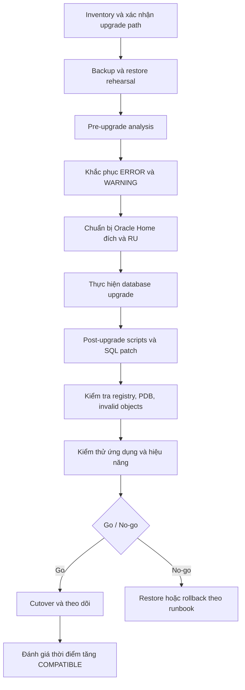

# Nâng cấp database, COMPATIBLE và kiểm tra tính năng bị loại bỏ

Nâng cấp Oracle Database là một thay đổi có ảnh hưởng đến data dictionary, binary, cấu trúc lưu trữ, SQL/PLSQL behavior, optimizer và các thành phần kết nối ứng dụng. Một kế hoạch nâng cấp tốt phải trả lời được ba câu hỏi:

1. **Database sẽ được chuyển lên phiên bản nào và bằng phương pháp nào?** Cần xác nhận đường nâng cấp được hỗ trợ, platform, edition, kiến trúc CDB/PDB, patch level và thời gian dừng dịch vụ.
2. **Khi nào được tăng tham số COMPATIBLE?** Tham số này ảnh hưởng đến khả năng tương thích của cấu trúc database trên đĩa và có thể làm mất khả năng downgrade nếu tăng quá sớm.
3. **Những tính năng nào đã deprecated hoặc desupported?** Phải tìm các tính năng ứng dụng và vận hành đang sử dụng trước khi nâng cấp, sau đó thay thế hoặc loại bỏ các phụ thuộc không còn được hỗ trợ.

Nâng cấp thành công về mặt kỹ thuật chưa đủ để đưa hệ thống trở lại production. Cần kiểm tra component registry, SQL patch, invalid objects, PDB, timezone, backup, ứng dụng và hiệu năng sau nâng cấp. Các lệnh và công cụ cụ thể phải được đối chiếu với Oracle Database Upgrade Guide đúng phiên bản đích; không có một đường nâng cấp hay một danh sách tính năng bị loại bỏ dùng chung cho mọi release.

## 1. Phân biệt upgrade, patch và migration

Các thay đổi Oracle thường được chia thành một số nhóm. Phân biệt đúng giúp chọn công cụ, kế hoạch downtime và phương án quay lui.

| Loại thay đổi | Phạm vi | Ví dụ |
|---|---|---|
| Release upgrade | Chuyển database từ release chính hoặc release update được hỗ trợ sang release mới | Nâng từ một release Oracle Database lên release kế tiếp được hỗ trợ |
| Release Update (RU) / Release Update Revision (RUR) nếu áp dụng | Cập nhật binary và các SQL changes theo chu kỳ phát hành của release | Áp dụng RU cho Oracle Home |
| One-off patch | Sửa một lỗi cụ thể hoặc đáp ứng yêu cầu hỗ trợ | Patch theo mã bug do Oracle Support cung cấp |
| Database migration | Di chuyển dữ liệu và workload sang database hoặc nền tảng khác | Di chuyển sang host mới, Exadata, cloud service hoặc kiến trúc khác |
| Upgrade kiến trúc | Thay đổi mô hình database hoặc cách triển khai | Non-CDB sang PDB, thay đổi character set theo quy trình hỗ trợ, thay đổi platform |

**Upgrade** thường thay đổi phần mềm database và data dictionary để database hoạt động với release mới. **Patch** cập nhật phần mềm trong cùng release family theo chính sách phát hành. **Migration** chuyển dữ liệu hoặc workload sang môi trường khác; migration có thể kết hợp với upgrade nhưng là một bài toán riêng.

Ví dụ, thay Oracle Home trên cùng máy chủ không đồng nghĩa database đã được nâng cấp hoàn chỉnh. Data dictionary phải được cập nhật theo quy trình upgrade. Ngược lại, Data Pump sang một database mới có thể là migration mà không phải in-place upgrade của database nguồn.

### In-place upgrade và migration sang database mới

| Tiêu chí | In-place upgrade | Migration sang database mới |
|---|---|---|
| Database đích | Nâng chính database hiện có | Tạo database đích rồi chuyển dữ liệu/workload |
| Công cụ thường dùng | AutoUpgrade, DBUA hoặc quy trình manual được hỗ trợ | Data Pump, Transportable Tablespaces, replication hoặc công cụ migration phù hợp |
| Downtime | Phụ thuộc phương pháp upgrade và kích thước data dictionary/database | Có thể giảm bằng đồng bộ trước, sau đó cutover |
| Khả năng quay lui | Phụ thuộc backup, flashback, downgrade support và COMPATIBLE | Có thể giữ nguồn cũ trong thời gian cutover nếu kiến trúc cho phép |
| Rủi ro chính | Thay đổi trực tiếp database đang dùng | Đồng bộ dữ liệu, cutover, quyền, object và khác biệt môi trường |

Không chọn migration chỉ để né một bước upgrade. Cần đánh giá dữ liệu, object, database link, external table, directory, job, credential, network ACL, encryption, backup và các phụ thuộc bên ngoài. Migration có thể đòi hỏi tái tạo nhiều cấu hình không nằm trong data file.

## 2. Lập kế hoạch đường nâng cấp

### Xác định release nguồn và release đích

Trước khi chạy công cụ, thu thập:

- Oracle Database release hiện tại và patch level.
- Release đích, RU cần cài và các one-off patch bắt buộc.
- Operating system, architecture, endian format và platform support.
- Edition, option và pack đang sử dụng.
- Database character set và national character set.
- Database role: primary, physical standby, logical standby hoặc snapshot standby.
- Kiến trúc: non-CDB, CDB/PDB, RAC, single instance, ASM hay filesystem.
- Kích thước database, số lượng PDB, số object, invalid objects và thời gian xử lý.
- Thời gian downtime cho phép, RTO/RPO và phương án rollback.

Kiểm tra đường nâng cấp trong tài liệu *Oracle Database Upgrade Guide* của release đích. Một số release chỉ cho phép nâng trực tiếp từ một tập release nguồn nhất định; release cũ hơn có thể phải nâng qua một release trung gian. Quy tắc này thay đổi theo phiên bản và nền tảng.

Không suy luận đường nâng cấp chỉ từ số phiên bản gần nhau. Cũng cần kiểm tra giới hạn của edition, platform, endian conversion, character set, timezone file và các option đang bật.

### Xác định trạng thái database nguồn

Một số truy vấn giúp thu thập thông tin:

```sql
SELECT banner_full
FROM v$version
WHERE banner_full LIKE 'Oracle Database%';

SELECT name,
       dbid,
       open_mode,
       database_role,
       log_mode,
       cdb
FROM v$database;

SELECT comp_id,
       comp_name,
       version,
       status
FROM dba_registry
ORDER BY comp_id;

SELECT patch_id,
       patch_type,
       action,
       status,
       action_time,
       description
FROM dba_registry_sqlpatch
ORDER BY action_time;
```

V$VERSION cho biết phiên bản phần mềm database đang chạy. V$DATABASE cho biết trạng thái và role. DBA_REGISTRY liệt kê các component trong data dictionary; DBA_REGISTRY_SQLPATCH ghi nhận SQL patch đã áp dụng vào database. Các view có thể khác theo release hoặc quyền truy cập.

Lưu kết quả vào hồ sơ trước upgrade để so sánh sau upgrade. Nếu component có trạng thái INVALID, LOADING, UPGRADING hoặc trạng thái bất thường, cần xác định nguyên nhân và xử lý theo tài liệu trước khi bắt đầu.

### Xác định downtime và phương án chuyển đổi

Một kế hoạch cần nêu rõ:

- Thời điểm đóng kết nối ghi và dừng batch.
- Cách drain connection pool và dừng scheduler/job/application worker.
- Thời điểm tạo backup hoặc restore point.
- Thời gian chạy pre-upgrade checks, upgrade và post-upgrade steps.
- Cách kiểm tra ứng dụng trước khi mở traffic.
- Điều kiện go/no-go và người có quyền quyết định.
- Phương án khôi phục nếu upgrade hoặc kiểm thử sau upgrade thất bại.

Với hệ thống có yêu cầu sẵn sàng cao, có thể xem xét phương pháp giảm downtime như standby-based upgrade, logical replication hoặc migration song song nếu release, license và kiến trúc hỗ trợ. Những phương án này cần runbook riêng và kiểm thử failover/cutover đầy đủ.

## 3. Các công cụ nâng cấp Oracle

### AutoUpgrade

AutoUpgrade là công cụ được Oracle phát triển để tự động hóa nhiều bước nâng cấp, bao gồm phân tích trước nâng cấp, thực hiện fixup được hỗ trợ, nâng cấp database và một số tác vụ hậu nâng cấp. Công cụ có thể quản lý nhiều database trong một cấu hình.

Quy trình khái quát:

1. Tạo file cấu hình AutoUpgrade.
2. Chạy chế độ analyze để phân tích và tạo báo cáo.
3. Xử lý các lỗi và cảnh báo trong pre-upgrade report.
4. Chạy fixups phù hợp sau khi xem xét nội dung script.
5. Chuẩn bị Oracle Home đích và patch level.
6. Chạy deploy theo runbook đã thử nghiệm.
7. Theo dõi log và trạng thái từng job/database.
8. Hoàn tất các bước post-upgrade và kiểm tra ứng dụng.

Ví dụ lệnh tổng quát:

```bash
java -jar autoupgrade.jar -config upgrade.cfg -mode analyze

java -jar autoupgrade.jar -config upgrade.cfg -mode deploy
```

Tên file, vị trí AutoUpgrade, cấu hình và các tùy chọn phụ thuộc release. Hãy lấy bản AutoUpgrade được khuyến nghị cho release đích từ Oracle và dùng tài liệu tương ứng. Không dùng một file cấu hình mẫu mà chưa kiểm tra các tham số database name, Oracle Home, service, PDB và phương thức triển khai.

AutoUpgrade có thể tạo các fixup script như pre-upgrade và post-upgrade fixups. DBA phải đọc log, xác nhận tác động và điều kiện thực thi; không nên chạy script sửa đổi database một cách mù quáng chỉ vì công cụ sinh ra.

### Preupgrade Information Tool

Preupgrade Information Tool phân tích database nguồn để tìm các điều kiện cần xử lý trước khi nâng cấp. Tùy release, công cụ có thể được gọi thông qua preupgrade.jar trong Oracle Home đích.

Ví dụ cách chạy thường gặp trong môi trường Java:

```bash
java -jar $ORACLE_HOME/rdbms/admin/preupgrade.jar FILE TEXT
```

Đường dẫn và cú pháp chính xác cần đối chiếu với Upgrade Guide của release đang triển khai. Không sao chép đường dẫn Oracle Home nguồn nếu công cụ yêu cầu file từ Oracle Home đích.

Báo cáo thường có các nhóm:

- **ERROR:** điều kiện có thể ngăn upgrade hoặc gây lỗi nếu không xử lý.
- **WARNING:** điều kiện cần DBA xem xét; không nhất thiết chặn upgrade.
- **INFORMATIONAL:** thông tin để lập kế hoạch hoặc ghi nhận.
- **Fixup:** script hoặc hành động được công cụ đề xuất để xử lý một số vấn đề.

Preupgrade tool không thay thế việc kiểm tra ứng dụng. Nó phân tích database và cấu hình mà công cụ nhận biết; các dependency nằm trong source code, script vận hành hoặc hệ thống bên ngoài vẫn cần inventory riêng.

### Database Upgrade Assistant (DBUA)

DBUA là công cụ giao diện hỗ trợ nâng cấp database theo quy trình có hướng dẫn. Công cụ kiểm tra một số điều kiện, thực hiện các bước upgrade và hiển thị trạng thái.

DBUA có thể phù hợp với môi trường mà phiên bản và kiến trúc hỗ trợ. Trước khi chọn, cần kiểm tra release đích, loại database, RAC, CDB/PDB và các giới hạn được nêu trong tài liệu. Trong môi trường tự động hóa hoặc nhiều database, AutoUpgrade thường thuận tiện hơn để quản lý cấu hình và log tập trung.

### Manual upgrade

Manual upgrade thực hiện các bước bằng lệnh và script theo Upgrade Guide. DBA phải tự quản lý nhiều chi tiết như startup mode, catctl, script upgrade, thời gian chạy, log và post-upgrade actions.

Công cụ manual có thể phù hợp khi có yêu cầu kỹ thuật đặc biệt hoặc quy trình nội bộ đã được chuẩn hóa. Tuy nhiên, không tự kết hợp lệnh từ nhiều release khác nhau. Tên script, tham số và thứ tự chạy có thể thay đổi giữa các phiên bản.

### Chọn công cụ

| Công cụ | Điểm phù hợp | Điều cần lưu ý |
|---|---|---|
| AutoUpgrade | Tự động hóa, quản lý nhiều database, phân tích và theo dõi job | Phải dùng phiên bản công cụ/config phù hợp với release |
| Preupgrade tool | Phân tích điều kiện trước upgrade | Không thực hiện thay cho toàn bộ quy trình upgrade |
| DBUA | Nâng cấp theo giao diện có hướng dẫn | Phụ thuộc release và cấu hình được hỗ trợ |
| Manual upgrade | Kiểm soát chi tiết theo runbook | DBA chịu trách nhiệm chính về thứ tự và kiểm tra từng bước |

Dù chọn công cụ nào, phải thử quy trình trên bản sao có dữ liệu và cấu hình gần production. Thời gian upgrade thực tế, lỗi ứng dụng và hành vi workload chỉ có thể được xác nhận bằng kiểm thử.

## 4. Kiểm tra trước nâng cấp

### Kiểm tra pre-upgrade report

Đọc toàn bộ báo cáo, phân loại vấn đề theo mức độ:

- Điều kiện chặn upgrade phải được xử lý trước.
- Cảnh báo về component, object hoặc tham số cần DBA quyết định.
- Những mục có thể được xử lý tự động phải được kiểm tra nội dung fixup.
- Những mục cần thay đổi ứng dụng phải giao cho nhóm phát triển và kiểm thử.

Không chỉ nhìn dòng cuối cùng của báo cáo. Cần lưu báo cáo, log và kết quả fixup để làm bằng chứng cho lần triển khai.

### Kiểm tra component và registry

Các component như Catalog, Packages, JVM, XML DB, Spatial, Text, OLAP hoặc component tùy chọn có thể ảnh hưởng đến upgrade. Tên và trạng thái component phụ thuộc phiên bản/option đã cài.

Truy vấn:

```sql
SELECT comp_id,
       comp_name,
       version,
       status
FROM dba_registry
ORDER BY comp_id;
```

Kiểm tra component INVALID trước khi upgrade. Không xóa component chỉ vì thấy nó không được ứng dụng sử dụng; cần xác nhận cách gỡ bỏ được Oracle hỗ trợ và các dependency còn lại.

### Kiểm tra invalid objects

```sql
SELECT owner,
       object_type,
       COUNT(*) AS invalid_count
FROM dba_objects
WHERE status = 'INVALID'
GROUP BY owner, object_type
ORDER BY owner, object_type;
```

Invalid objects có thể tồn tại từ trước do thay đổi schema, dependency hoặc patch. Cần lưu danh sách baseline và phân biệt lỗi cũ với lỗi phát sinh sau upgrade. Không nên yêu cầu số invalid luôn bằng 0 nếu database có component hoặc object vốn được Oracle đánh dấu invalid theo điều kiện riêng; phải hiểu từng trường hợp.

### Kiểm tra tablespace, space và filesystem

Upgrade có thể cần thêm dung lượng cho SYSTEM, SYSAUX, TEMP, UNDO, redo, archive log và thư mục Oracle Home. Tăng dung lượng data file mà không kiểm tra filesystem hoặc ASM free space có thể khiến upgrade dừng giữa chừng.

Một số truy vấn:

```sql
SELECT tablespace_name,
       ROUND(SUM(bytes) / 1024 / 1024) AS allocated_mb
FROM dba_data_files
GROUP BY tablespace_name
ORDER BY tablespace_name;

SELECT tablespace_name,
       ROUND(SUM(bytes) / 1024 / 1024) AS free_mb
FROM dba_free_space
GROUP BY tablespace_name
ORDER BY tablespace_name;
```

Các truy vấn trên cho biết dung lượng đã cấp và dung lượng free trong data file; chúng không cho biết đầy đủ dung lượng còn trống trên filesystem hoặc ASM. Cần kiểm tra cả hai lớp.

### Kiểm tra backup và khả năng restore

Trước upgrade:

- Tạo backup theo chiến lược RMAN được phê duyệt.
- Kiểm tra backup hoàn tất và có thể đọc.
- Xác nhận backup bao gồm control file, SPFILE, data file và archive log theo yêu cầu phục hồi.
- Ghi nhận DBID, incarnation, cấu hình FRA và vị trí backup.
- Nếu dùng restore point, kiểm tra điều kiện Flashback Database, dung lượng FRA và thời gian lưu.
- Thực hiện thử restore/recovery trên môi trường phù hợp.

Một backup được đánh dấu completed chưa chắc đã đủ để phục hồi theo RTO. Cần có bài kiểm thử restore hoặc bằng chứng phục hồi gần đây.

### Kiểm tra application và integration

Lập danh sách:

- JDBC driver và connection pool.
- Application server, framework, ORM và client library.
- Database link, external procedure, Java stored procedure và external table.
- Scheduler job, chain, credential, external job và chương trình gọi từ OS.
- SQL/PLSQL package, trigger, view, materialized view và type.
- Database Vault, TDE, wallet, network ACL, TLS và authentication.
- BI/reporting, ETL, backup agent, monitoring agent và công cụ quản trị.
- Các script sử dụng tham số khởi động, data dictionary view hoặc SQL syntax cũ.

Đối chiếu compatibility matrix và certification của ứng dụng với release Oracle đích. Một database upgrade thành công nhưng JDBC driver hoặc framework chưa được chứng nhận có thể gây lỗi sau khi mở traffic.

## 5. COMPATIBLE là gì?

COMPATIBLE là initialization parameter xác định mức tương thích mà Oracle Database sử dụng khi ghi và diễn giải một số cấu trúc dữ liệu trên đĩa. Tham số này cho phép database mới hoạt động trong một khoảng thời gian với mức tương thích cấu trúc cũ, tạo điều kiện cho kế hoạch nâng cấp và downgrade khi được hỗ trợ.

Ví dụ giá trị có dạng release:

```sql
SHOW PARAMETER compatible;

SELECT name, value
FROM v$parameter
WHERE name = 'compatible';
```

COMPATIBLE khác với phiên bản Oracle Home. Một database có thể chạy binary của release mới nhưng vẫn giữ COMPATIBLE ở mức cũ trong giai đoạn xác nhận sau upgrade.

### COMPATIBLE không có nghĩa gì?

Không nên hiểu COMPATIBLE là:

- Phiên bản JDBC driver mà ứng dụng phải dùng.
- Mức tương thích của SQL syntax giữa client và server.
- Cơ chế giữ nguyên toàn bộ hành vi optimizer của release cũ.
- Công tắc bật tất cả tính năng mới của release.
- Một tham số có thể tăng giảm tùy ý sau mỗi lần khởi động.

Nó chủ yếu kiểm soát khả năng sử dụng các định dạng và tính năng có thể làm thay đổi cấu trúc lưu trữ hoặc metadata theo mức release. Các thay đổi về SQL behavior, optimizer, authentication, network protocol và API còn phụ thuộc những cơ chế tương thích khác.

### COMPATIBLE và khả năng downgrade

Tăng COMPATIBLE có thể cho phép Oracle sử dụng cấu trúc mới mà release cũ không đọc được. Sau khi database đã ghi các cấu trúc này, hạ COMPATIBLE xuống giá trị cũ không thể biến những cấu trúc mới thành cấu trúc cũ.

Vì vậy:

- Giữ COMPATIBLE ở mức hiện tại trong giai đoạn nâng cấp và kiểm chứng ban đầu, theo hướng dẫn của release đích.
- Chỉ tăng khi đã xác nhận ứng dụng, backup, restore, standby và các thành phần liên quan hoạt động đúng.
- Trước khi tăng, xác định rõ thời điểm kết thúc cửa sổ downgrade được hỗ trợ.
- Sau khi tăng, không giả định có thể hạ xuống để quay lại release trước.
- Nếu cần quay lui sau khi vượt ngưỡng tương thích, thường phải restore database từ backup hoặc dùng một phương án migration/rollback đã được thiết kế riêng.

Việc có thể downgrade database còn phụ thuộc release nguồn/đích, các feature đã sử dụng, data dictionary, platform và điều kiện Oracle hỗ trợ. Giữ COMPATIBLE ở mức cũ không tự động bảo đảm mọi downgrade đều được hỗ trợ.

### Thời điểm tăng COMPATIBLE

Quy trình phổ biến là không tăng COMPATIBLE trước khi bắt đầu upgrade nếu Upgrade Guide không yêu cầu. Sau khi nâng cấp thành công, database chạy ổn định và đã qua các kiểm tra cần thiết, DBA mới cân nhắc tăng theo mức khuyến nghị của release đích.

Ví dụ thao tác thay đổi SPFILE:

```sql
ALTER SYSTEM SET compatible = '19.0.0'
  SCOPE = SPFILE;
```

Giá trị trong ví dụ chỉ minh họa định dạng. Phải thay bằng giá trị được hỗ trợ cho release đích và xác nhận trong Upgrade Guide. Thay đổi SCOPE=SPFILE thường cần restart để có hiệu lực; trong RAC cần xem xét SPFILE và cấu hình instance phù hợp.

Trước khi thay đổi:

1. Xác nhận database đã nâng cấp hoàn chỉnh.
2. Kiểm tra tất cả PDB và component ở trạng thái hợp lệ.
3. Hoàn tất SQL patch và post-upgrade actions.
4. Xác nhận ứng dụng và workload đã qua kiểm thử.
5. Xác nhận backup/restore và chiến lược DR đáp ứng release mới.
6. Xác định downgrade window đã kết thúc hay chưa.
7. Ghi lại giá trị cũ, giá trị mới, thời điểm và người thực hiện.

Không tăng COMPATIBLE chỉ để hết cảnh báo hoặc để bật một tính năng mà chưa đánh giá tác động lưu trữ. Tài liệu của từng feature và release phải xác nhận giá trị tối thiểu cần thiết.

### Kiểm tra giá trị trên tất cả instance

Trong RAC, có thể kiểm tra tham số theo instance:

```sql
SELECT inst_id,
       name,
       value,
       isdefault,
       issys_modifiable,
       ispdb_modifiable
FROM gv$parameter
WHERE name = 'compatible'
ORDER BY inst_id;
```

Cần bảo đảm cấu hình SPFILE và giá trị đang chạy nhất quán theo thiết kế. Trong CDB/PDB, kiểm tra phạm vi tham số phù hợp; COMPATIBLE là tham số ở cấp database/CDB theo quy tắc Oracle, không phải một thiết lập riêng tùy ý cho từng PDB.

## 6. Deprecated và desupported: hai trạng thái khác nhau

Oracle có thể thông báo một tính năng, tham số, package, view, API hoặc hành vi sẽ thay đổi trong các release tiếp theo.

### Deprecated

Một tính năng **deprecated** vẫn có thể còn hoạt động trong release hiện tại, nhưng Oracle khuyến nghị ngừng sử dụng và chuyển sang phương án thay thế. Tính năng có thể bị loại bỏ trong release tương lai.

Ví dụ tổng quát:

- Một initialization parameter cũ có tham số thay thế.
- Một API hoặc package được khuyến nghị chuyển sang API mới.
- Một cú pháp hoặc tính năng quản trị có phương án hiện đại hơn.
- Một cơ chế authentication hoặc network configuration đang được thay thế.

Deprecated không có nghĩa tính năng sẽ lập tức ngừng chạy sau upgrade. Tuy nhiên, tiếp tục phụ thuộc vào nó làm tăng rủi ro ở lần nâng cấp kế tiếp và có thể khiến hệ thống không nhận được hỗ trợ cho một số trường hợp.

### Desupported

Một tính năng **desupported** đã bị loại khỏi release tương ứng hoặc không còn được hỗ trợ. Tùy trường hợp, câu lệnh cũ có thể báo lỗi, tham số bị bỏ qua, package không còn tồn tại hoặc hành vi trước đây không còn được bảo đảm.

Không thể xử lý một tính năng desupported bằng cách chỉ ghi nhận cảnh báo. Cần thay thế, chuyển đổi dữ liệu hoặc thay đổi cấu hình trước khi ứng dụng phụ thuộc vào release mới.

### Phân biệt

| Trạng thái | Tình trạng trong release hiện tại | Việc cần làm |
|---|---|---|
| Supported | Được hỗ trợ theo tài liệu | Tiếp tục dùng theo giới hạn đã công bố |
| Deprecated | Còn tồn tại nhưng được khuyến nghị thay thế | Lập kế hoạch chuyển đổi và loại bỏ dependency |
| Desupported | Đã bị loại bỏ hoặc không còn được hỗ trợ | Thay thế trước upgrade hoặc sửa ứng dụng/cấu hình ngay |
| Obsolete/unused | Không còn được dùng trong môi trường cụ thể | Xác minh bằng inventory; không tự suy luận chỉ từ tên |

Tên gọi và phạm vi thông báo phụ thuộc tài liệu release. Một tính năng có thể deprecated ở release này rồi desupported ở release sau. Luôn đọc mục Deprecated Features và Desupported Features trong tài liệu của release đích và các release trung gian có liên quan.

## 7. Cách tìm tính năng bị deprecated hoặc desupported

Không có một view duy nhất liệt kê mọi tính năng sẽ bị loại bỏ. Cần kết hợp tài liệu Oracle, metadata database, source code và kiểm thử.

### Đọc tài liệu release đích

Các tài liệu cần tra cứu:

- Oracle Database Upgrade Guide.
- Oracle Database New Features Guide.
- Oracle Database Reference.
- Oracle Database Administrator's Guide.
- Oracle Database Security Guide.
- Oracle Database Net Services Administrator's Guide.
- Oracle Database Licensing Information User Manual.
- Release Notes và README của RU/patch đang áp dụng.

Tập trung vào các mục:

- Deprecated Features.
- Desupported Features.
- Behavior Changes.
- Initialization Parameters.
- Deprecated/Desupported Initialization Parameters.
- Deprecated/Desupported SQL Features.
- Deprecated/Desupported PL/SQL Packages and Types.
- Changes to Data Dictionary Views.
- Security and Authentication Changes.
- Upgrade and Downgrade Restrictions.

Đọc tài liệu theo đúng release đích và các release trung gian mà đường nâng cấp yêu cầu. Không dùng tài liệu của một release khác chỉ vì tên tính năng giống nhau.

### Kiểm tra tham số khởi tạo

Liệt kê các tham số đang được đặt khác mặc định hoặc tham số có khả năng đã deprecated:

```sql
SELECT name,
       value,
       isdefault,
       issys_modifiable,
       ispdb_modifiable
FROM v$parameter
WHERE isdefault = 'FALSE'
ORDER BY name;
```

Có thể đối chiếu với SPFILE:

```sql
SELECT sid,
       name,
       value,
       isspecified
FROM v$spparameter
WHERE isspecified = 'TRUE'
ORDER BY name, sid;
```

Danh sách này chỉ giúp inventory cấu hình thực tế; nó không tự đánh dấu tham số nào deprecated hoặc desupported. Đối chiếu từng tham số với Database Reference và Upgrade Guide của release đích. Đặc biệt chú ý tham số đã bị thay thế, tham số có default thay đổi và tham số không còn được nhận diện.

### Kiểm tra feature usage

DBA_FEATURE_USAGE_STATISTICS cung cấp thông tin về việc database đã ghi nhận sử dụng một số feature:

```sql
SELECT name,
       detected_usages,
       total_samples,
       currently_used,
       first_usage_date,
       last_usage_date
FROM dba_feature_usage_statistics
ORDER BY name;
```

View này hữu ích để tìm một số feature đã được phát hiện, nhưng không phải bằng chứng đầy đủ rằng feature chưa xuất hiện trong view là không được dùng. Việc phát hiện phụ thuộc cơ chế sampling, thời gian hoạt động, phiên bản và cách feature được kích hoạt.

Cần kết hợp:

- Feature usage statistics.
- AWR/ASH hoặc SQL monitoring nếu hệ thống có quyền sử dụng phù hợp.
- Audit và application logs.
- Source code Java, PL/SQL, SQL script và job.
- Cấu hình vận hành, backup, monitoring và integration.
- Trao đổi với owner của từng ứng dụng.

Nếu sử dụng các tính năng Diagnostics Pack hoặc Tuning Pack, hãy xác nhận license của môi trường trước khi khai thác các view/công cụ tương ứng.

### Tìm dependency trong source code và script

Tìm kiếm các đối tượng và cú pháp liên quan đến tính năng cũ:

- Package, procedure, function, type và view.
- Initialization parameter được hard-code trong script.
- SQL hint hoặc cú pháp cũ.
- JDBC URL, driver class, authentication mode và protocol.
- Script backup/restore, import/export, monitoring và scheduler.
- External job, shell script và chương trình gọi từ database.
- Database link, network ACL, wallet và certificate.

Có thể dùng DBA_DEPENDENCIES để tìm dependency giữa các object database:

```sql
SELECT owner,
       name,
       type,
       referenced_owner,
       referenced_name,
       referenced_type
FROM dba_dependencies
WHERE referenced_owner = 'SYS'
ORDER BY owner, name;
```

Truy vấn trên chỉ là điểm bắt đầu. Không phải mọi dependency đến object SYS đều là vấn đề, và dynamic SQL hoặc tên object được ghép lúc runtime có thể không xuất hiện trong DBA_DEPENDENCIES. Phải lọc theo object cụ thể và đối chiếu tài liệu.

## 8. Những nhóm tính năng cần rà soát trước upgrade

### Initialization parameters

Một số tham số có thể bị deprecated, desupported, đổi default hoặc đổi cách diễn giải. Kiểm tra:

- Tham số liên quan optimizer.
- Tham số memory management.
- Tham số process/session và parallel execution.
- Tham số audit, security và authentication.
- Tham số archive, recovery và Data Guard.
- Tham số liên quan RAC, ASM và service.
- Tham số cũ được giữ trong SPFILE dù không còn tác dụng.

Không copy toàn bộ PFILE/SPFILE cũ sang release mới mà không xem xét. Cấu hình cũ có thể chứa tham số không còn được hỗ trợ hoặc giá trị không phù hợp với memory/CPU mới.

### SQL và PL/SQL

Rà soát:

- SQL syntax và function đã deprecated.
- Package hoặc type có trạng thái deprecated/desupported.
- Hành vi implicit conversion và NLS.
- Trigger, stored procedure, Java stored procedure và external procedure.
- Dynamic SQL, optimizer hint và query plan.
- Data dictionary view/cột đã đổi.
- Các câu lệnh phụ thuộc vào hành vi undocumented.

Các câu SQL từng chạy được ở release cũ có thể vẫn parse nhưng cho plan khác do optimizer thay đổi. Vì vậy, kiểm thử kết quả và hiệu năng, không chỉ kiểm tra compile.

### Security và authentication

Release mới có thể thay đổi chính sách password verifier, authentication protocol, TLS, wallet, cipher, certificate hoặc cấu hình network. Cần kiểm tra:

- JDBC driver có hỗ trợ cơ chế authentication mới không.
- Client/server có tương thích TLS và cipher không.
- Password version của user có đáp ứng chính sách mới không.
- Wallet, TDE keystore và certificate có thể mở sau upgrade không.
- Database link và external integration có xác thực lại được không.
- Network ACL và quyền gọi UTL_HTTP/SMTP có còn phù hợp không.

Không hạ thấp cấu hình bảo mật toàn hệ thống để làm client cũ kết nối được. Hãy nâng driver/client hoặc thay đổi cấu hình theo chính sách bảo mật được hỗ trợ.

### Component và option

Một số component hoặc option có thể thay đổi cách cài đặt, trạng thái, license hoặc khả năng tương thích. Kiểm tra DBA_REGISTRY, Oracle Home inventory, V$OPTION và tài liệu licensing. Không suy luận rằng component đã cài đồng nghĩa tổ chức có quyền sử dụng mọi option liên quan.

### Data type, character set và timezone

Rà soát:

- Character set và national character set.
- Timestamp/time zone data.
- Các datatype hoặc storage format đã thay đổi.
- XML, JSON, Spatial, LOB và các kiểu dữ liệu chuyên biệt.
- Các ứng dụng phụ thuộc NLS_DATE_FORMAT, NLS_NUMERIC_CHARACTERS hoặc session timezone.

Timezone file upgrade có thể là một bước riêng, đặc biệt nếu release đích có timezone version mới và ứng dụng lưu dữ liệu TIMESTAMP WITH TIME ZONE. Không tự nâng timezone file chỉ vì database upgrade xong; đánh giá ảnh hưởng và dùng quy trình DBMS_DST phù hợp.

## 9. Thực hiện upgrade theo các giai đoạn

Một runbook tổng quát có thể chia thành các giai đoạn:



### Giai đoạn 1: Inventory và xác nhận phạm vi

Ghi lại release nguồn/đích, Oracle Home, patch level, database role, CDB/PDB, component, option, parameter và application dependency. Chốt người chịu trách nhiệm cho database, OS, network, security, application và business validation.

### Giai đoạn 2: Backup và diễn tập restore

Tạo backup có thể phục hồi, lưu log RMAN, kiểm tra archive log và control file. Thực hiện restore rehearsal trên môi trường độc lập nếu điều kiện cho phép. Ghi lại thời gian phục hồi thực tế và các bước cần thiết.

### Giai đoạn 3: Pre-upgrade analysis

Chạy AutoUpgrade analyze hoặc Preupgrade Information Tool theo tài liệu release. Lưu báo cáo, xử lý các lỗi chặn và đánh giá cảnh báo. Không bắt đầu production upgrade nếu còn lỗi chưa được giải quyết hoặc có quyết định chấp nhận rủi ro chưa được phê duyệt.

### Giai đoạn 4: Chuẩn bị Oracle Home đích

Cài đặt Oracle Home mới và áp dụng RU/one-off patch theo kế hoạch. Kiểm tra inventory, OPatch version, filesystem, quyền owner/group, environment variables, listener và network configuration.

Không xóa Oracle Home nguồn trước khi kết thúc thời gian rollback được phê duyệt. Giữ đủ binary và file cấu hình cần thiết để thực hiện phương án quay lui đã chọn.

### Giai đoạn 5: Dừng workload và thực hiện upgrade

Theo runbook:

- Thông báo downtime và dừng ứng dụng ghi.
- Dừng batch, Scheduler job, ETL và các integration worker.
- Drain connection pool hoặc dừng application instance theo thứ tự.
- Kiểm tra không còn session nghiệp vụ gây cản trở.
- Thực hiện upgrade bằng công cụ đã chọn.
- Theo dõi log, tiến trình và trạng thái từng bước.
- Không tự ý kill tiến trình upgrade chỉ vì log chưa cập nhật trong một khoảng thời gian; xác định trạng thái thực tế trước khi can thiệp.

Với CDB, thực hiện quy trình upgrade root, seed và PDB theo công cụ/guide của release. Kiểm tra toàn bộ PDB đã mở và upgrade hoàn tất. Không chỉ xác nhận CDB$ROOT rồi kết luận toàn bộ CDB đã sẵn sàng.

### Giai đoạn 6: Post-upgrade actions

Các bước hậu nâng cấp có thể gồm:

- Chạy fixup script do công cụ đề xuất sau khi xem xét.
- Recompile invalid objects bằng script được Oracle cung cấp.
- Cập nhật SQL patch metadata bằng datapatch khi cần theo patch plan.
- Kiểm tra component registry và PDB.
- Xem lại timezone file và các bước DBMS_DST nếu có kế hoạch.
- Kiểm tra optimizer statistics theo khuyến nghị release.
- Kiểm tra backup, archive, FRA, listener, service và job.
- Xác nhận Data Guard/RAC/ASM hoạt động đúng.

Không chạy mọi script trong thư mục rdbms/admin theo thứ tự tùy ý. Chỉ chạy script mà Upgrade Guide, AutoUpgrade hoặc patch README yêu cầu.

## 10. Recompile object và kiểm tra component sau upgrade

### Recompile invalid objects

Sau upgrade, một số object có thể trở thành invalid do dependency hoặc thay đổi dictionary. Oracle cung cấp script utlrp.sql để compile lại invalid PL/SQL objects theo cơ chế của release.

Ví dụ:

```sql
@?/rdbms/admin/utlrp.sql
```

Dùng Oracle Home đã upgrade và kết nối theo yêu cầu của script. Trong CDB, cần làm theo hướng dẫn cho root và PDB; không giả định một lần chạy ở root sẽ xử lý tất cả PDB trong mọi cấu hình.

Kiểm tra lại:

```sql
SELECT owner,
       object_type,
       COUNT(*) AS invalid_count
FROM dba_objects
WHERE status = 'INVALID'
GROUP BY owner, object_type
ORDER BY owner, object_type;
```

Với từng object còn invalid, xem lỗi compile:

```sql
SELECT owner,
       name,
       type,
       line,
       position,
       text
FROM dba_errors
ORDER BY owner, name, sequence;
```

Không chỉ chạy utlrp.sql lặp đi lặp lại nếu lỗi gốc là thiếu dependency, quyền hoặc object đã bị loại bỏ. Sửa nguyên nhân rồi compile lại theo quy trình.

### Kiểm tra registry

```sql
SELECT comp_id,
       comp_name,
       version,
       status
FROM dba_registry
ORDER BY comp_id;
```

Component cần ở trạng thái hợp lệ theo yêu cầu của release và option đã cài. Một component INVALID có thể khiến một số tính năng không hoạt động dù database OPEN.

### Kiểm tra SQL patch

```sql
SELECT patch_id,
       patch_uid,
       patch_type,
       action,
       status,
       action_time,
       description
FROM dba_registry_sqlpatch
ORDER BY action_time DESC;
```

datapatch cập nhật phần SQL của patch vào database sau khi binary patch được áp dụng theo patch plan. Ví dụ chạy:

```bash
$ORACLE_HOME/OPatch/datapatch -verbose
```

Đường dẫn và yêu cầu chạy datapatch phụ thuộc patch README và release. Kiểm tra trạng thái trong DBA_REGISTRY_SQLPATCH; không coi việc OPatch báo thành công là bằng chứng SQL patch đã được áp dụng hoàn chỉnh vào database.

## 11. Kiểm tra CDB và PDB

Trong môi trường multitenant, upgrade cần được kiểm tra ở cả container root, seed và từng PDB.

Kiểm tra PDB:

```sql
SELECT con_id,
       name,
       open_mode,
       restricted
FROM v$pdbs
ORDER BY con_id;
```

Kiểm tra registry theo container:

```sql
SELECT con_id,
       comp_id,
       comp_name,
       version,
       status
FROM cdb_registry
ORDER BY con_id, comp_id;
```

Kiểm tra plugin violations:

```sql
SELECT time,
       name,
       cause,
       type,
       status,
       message
FROM pdb_plug_in_violations
ORDER BY time;
```

Các PDB có thể ở trạng thái cần upgrade, restricted hoặc có violation do khác biệt component/option. Xử lý theo thông báo cụ thể và Upgrade Guide. Không mở traffic cho PDB chỉ vì CDB$ROOT đã mở READ WRITE.

Đối với application container, PDB refreshable hoặc các cấu hình multitenant đặc biệt, cần áp dụng quy trình tương ứng. Một số thao tác cần được thực hiện từ root hoặc container cụ thể với quyền phù hợp.

## 12. Timezone file và dữ liệu thời gian

Oracle lưu timezone data trong database và client. Release mới có thể cung cấp timezone file version mới. Nâng database release không đồng nghĩa mọi dữ liệu timezone đã tự động được chuyển sang version mới.

Nếu ứng dụng sử dụng TIMESTAMP WITH TIME ZONE, lịch sự kiện theo timezone hoặc dữ liệu lịch sử có vùng địa lý, cần:

1. Kiểm tra timezone file version hiện tại và version được hỗ trợ ở release đích.
2. Đánh giá thay đổi quy tắc DST (daylight saving time) có thể ảnh hưởng dữ liệu.
3. Kiểm tra ứng dụng và client driver.
4. Lập kế hoạch nâng timezone file riêng nếu cần.
5. Dùng quy trình DBMS_DST theo tài liệu Oracle, bao gồm prepare, upgrade và kiểm tra kết quả.
6. Kiểm thử truy vấn thời gian, báo cáo, lịch và phép chuyển đổi timezone.

Kiểm tra version:

```sql
SELECT filename, version
FROM v$timezone_file;

SELECT property_name, property_value
FROM database_properties
WHERE property_name LIKE 'DST_%'
ORDER BY property_name;
```

Không tự thay timezone file hoặc chạy thủ tục DBMS_DST chỉ để đồng bộ số version. Việc nâng timezone có thể thay đổi cách diễn giải một số timestamp theo quy tắc timezone mới.

## 13. Kiểm tra optimizer và hiệu năng sau upgrade

Optimizer có thể thay đổi execution plan do phiên bản mới, statistics, parameter default, cardinality estimation, adaptive behavior hoặc patch. Một câu SQL trả kết quả đúng vẫn có thể chậm hơn đáng kể.

### Lưu baseline trước upgrade

Thu thập:

- Các SQL quan trọng theo business flow.
- Execution plan và thời gian chạy.
- Logical reads, physical reads, CPU và wait events.
- Thời gian batch và báo cáo.
- Tỷ lệ parse, hard parse và connection pool usage.
- Statistics của schema và các bảng quan trọng.
- SQL Plan Baseline hoặc SQL Tuning Set nếu có quy trình và quyền sử dụng phù hợp.

Nếu dùng AWR, ASH, SQL Tuning Advisor hoặc SQL Performance Analyzer, cần xác nhận quyền sử dụng Diagnostics/Tuning Pack theo license và phiên bản. Không bật hoặc sử dụng tính năng chỉ dựa trên việc view có tồn tại.

### So sánh sau upgrade

Chạy lại workload đại diện với dữ liệu và bind values tương tự. So sánh:

- Kết quả nghiệp vụ.
- Execution plan.
- Thời gian trung vị và percentile cao.
- Logical/physical I/O.
- CPU, memory, temp usage.
- Lock contention và wait events.
- Batch completion time và backlog.

Không chỉ so sánh thời gian trung bình. Một số truy vấn có thể nhanh hơn nhưng các truy vấn quan trọng khác lại chậm đi. Cần kiểm tra theo workload và mức tải tương đương.

### SQL Plan Management

SQL Plan Management có thể giúp quản lý và kiểm soát một số thay đổi execution plan. SQL Plan Baseline không phải công cụ bảo đảm mọi câu SQL giữ nguyên plan trong mọi tình huống; cần đánh giá plan được chấp nhận, evolve và cách áp dụng theo release.

Không capture hoặc force toàn bộ plan cũ mà không xem xét. Plan cũ có thể không còn tối ưu với dữ liệu, statistics hoặc phần cứng mới.

## 14. Kiểm tra ứng dụng và dịch vụ kết nối

Sau khi database sẵn sàng, kiểm tra từ phía client:

- JDBC driver và connection URL.
- Kết nối service name, PDB service và listener.
- TLS, wallet, certificate và authentication.
- Schema, role, grant và synonym.
- Sequence, trigger, stored procedure và package.
- Database link và external service.
- Hibernate/JPA dialect, schema validation và generated SQL.
- Batch, Scheduler, job chain và các tác vụ nền.
- Transaction commit/rollback và connection pool recovery.

Nên có smoke test bao gồm đọc, ghi, rollback, sequence generation, LOB, date/time, stored procedure, transaction isolation và các luồng tích hợp. Kiểm tra thêm các câu SQL có sử dụng hint, analytic function, JSON/XML hoặc tính năng đặc thù của Oracle.

Nếu application dùng schema validation lúc startup, một khác biệt nhỏ về metadata có thể khiến ứng dụng không khởi động. Không tắt validation để che lỗi; xác định mapping hoặc schema cần cập nhật.

## 15. Chiến lược rollback và giới hạn downgrade

### Downgrade không giống restore

Downgrade là đưa database về release trước bằng quy trình Oracle hỗ trợ trong một số điều kiện. Restore là khôi phục database từ backup hoặc bản sao ở thời điểm trước upgrade.

Downgrade có giới hạn về release, feature, component, platform và trạng thái database. Không phải mọi release upgrade đều hỗ trợ downgrade, và một số feature hoặc thay đổi sau upgrade có thể làm mất khả năng này.

Restore từ backup thường là phương án rõ ràng hơn khi:

- Release đích không hỗ trợ downgrade cho nguồn/đích đã chọn.
- Database đã sử dụng feature không tương thích với release cũ.
- COMPATIBLE đã tăng vượt mức cho phép.
- Upgrade hoặc patch làm thay đổi cấu trúc không thể downgrade.
- Ứng dụng đã ghi dữ liệu mới trong khi phương án quay lui cần phục hồi thời điểm cũ.

### Các câu hỏi phải trả lời trước khi bắt đầu

- Có downgrade path được Oracle hỗ trợ cho đúng cặp release không?
- Những component và feature đã dùng có nằm trong giới hạn downgrade không?
- COMPATIBLE hiện tại và giá trị dự kiến sau upgrade là gì?
- Có sử dụng các feature mới trước khi chốt nâng COMPATIBLE không?
- Nếu restore, RPO có cho phép mất các giao dịch phát sinh sau backup không?
- Có thể giữ database nguồn hoặc standby để đối soát dữ liệu sau cutover không?
- Có backup control file, SPFILE, password file, wallet và cấu hình bên ngoài không?
- Đã thử restore và kiểm tra ứng dụng chưa?

### Restore point và Flashback Database

Restore point hoặc guaranteed restore point có thể hỗ trợ quay lại một mốc trong các tình huống được Oracle hỗ trợ. Tuy nhiên, cần hiểu điều kiện Flashback Database, dung lượng FRA, thời gian giữ và giới hạn khi thay đổi database.

Restore point không thay thế backup độc lập. Nếu storage hoặc database bị hỏng ngoài phạm vi flashback log, vẫn cần backup/restore theo chiến lược DR. Trước upgrade, hãy xác nhận restore point được tạo đúng database, đúng thời điểm và có đủ không gian để duy trì.

## 16. Các kịch bản upgrade đặc biệt

### Oracle RAC

Với RAC, cần xem xét:

- Clusterware và Grid Infrastructure compatibility.
- Oracle Home cho từng node.
- ASM và disk group.
- Service placement, preferred/available instances.
- Listener, SCAN và network.
- Patch level đồng nhất.
- Job placement và instance affinity.
- Quy trình rolling upgrade nếu release và phương pháp hỗ trợ.

Không tự áp dụng rolling upgrade cho mọi database. Khả năng rolling phụ thuộc release, patch, kiến trúc, feature và phương thức triển khai.

### Data Guard

Với Data Guard:

- Xác định primary/standby role và protection mode.
- Kiểm tra redo transport, apply lag và archive gap.
- Kiểm tra phiên bản và patch compatibility giữa primary/standby.
- Xác định thứ tự nâng cấp theo phương án được Oracle hỗ trợ.
- Kiểm thử switchover/failover sau upgrade.
- Kiểm tra broker configuration, database service và backup.
- Đánh giá phương pháp standby-first hoặc rolling upgrade nếu được hỗ trợ cho release và feature đang dùng.

Không nâng primary và standby theo thứ tự tự chọn. Một số phương pháp cho phép standby được nâng trước để giảm downtime, nhưng yêu cầu phiên bản, Data Guard configuration và quy trình riêng.

### Non-CDB sang PDB

Chuyển non-CDB sang PDB là thay đổi kiến trúc, không chỉ là đổi tham số. Cần kiểm tra:

- Release hỗ trợ conversion.
- Character set và national character set.
- Component và option.
- Database link, directory, external object.
- Service và application connection.
- PDB plug-in violations.
- Backup/restore và kế hoạch chuyển đổi.
- Quyền, common/local user và cấu hình CDB.

Có thể dùng phương pháp plug/unplug hoặc công cụ chuyển đổi được hỗ trợ. Kiểm tra hướng dẫn của release đích và thử nghiệm với bản sao trước khi thực hiện production.

## 17. Ví dụ runbook kiểm tra trước và sau upgrade

### Trước upgrade

Lưu phiên bản và role:

```sql
SELECT banner_full
FROM v$version
WHERE banner_full LIKE 'Oracle Database%';

SELECT name, dbid, open_mode, database_role, cdb
FROM v$database;
```

Lưu component:

```sql
SELECT comp_id, comp_name, version, status
FROM dba_registry
ORDER BY comp_id;
```

Lưu invalid objects:

```sql
SELECT owner, object_type, COUNT(*) AS invalid_count
FROM dba_objects
WHERE status = 'INVALID'
GROUP BY owner, object_type
ORDER BY owner, object_type;
```

Lưu COMPATIBLE:

```sql
SELECT name, value
FROM v$parameter
WHERE name = 'compatible';
```

Lưu timezone file:

```sql
SELECT filename, version
FROM v$timezone_file;
```

### Sau upgrade

Xác nhận version, role và open mode:

```sql
SELECT banner_full
FROM v$version
WHERE banner_full LIKE 'Oracle Database%';

SELECT name, open_mode, database_role, cdb
FROM v$database;
```

Xác nhận component và SQL patch:

```sql
SELECT comp_id, comp_name, version, status
FROM dba_registry
ORDER BY comp_id;

SELECT patch_id, patch_type, action, status, action_time, description
FROM dba_registry_sqlpatch
ORDER BY action_time DESC;
```

Xác nhận PDB và violations nếu là CDB:

```sql
SELECT con_id, name, open_mode, restricted
FROM v$pdbs
ORDER BY con_id;

SELECT time, name, cause, type, status, message
FROM pdb_plug_in_violations
ORDER BY time;
```

Xác nhận invalid objects:

```sql
SELECT owner, object_type, COUNT(*) AS invalid_count
FROM dba_objects
WHERE status = 'INVALID'
GROUP BY owner, object_type
ORDER BY owner, object_type;
```

So sánh các kết quả trước/sau. Điều tra mọi component thay đổi trạng thái, patch không thành công, PDB chưa mở đúng mode và invalid object mới phát sinh.

## 18. Các sai lầm thường gặp

**Tăng COMPATIBLE trước khi hoàn tất kiểm thử.**  
Có thể làm mất đường downgrade hoặc buộc phải restore khi cần quay lui. Hãy tăng theo giai đoạn và điều kiện được tài liệu release quy định.

**Cho rằng giữ COMPATIBLE cũ nghĩa là downgrade luôn được.**  
Downgrade còn phụ thuộc feature, component, release path và các thay đổi đã thực hiện. COMPATIBLE chỉ là một điều kiện quan trọng.

**Chỉ chạy pre-upgrade report một lần rồi bỏ qua.**  
Sau khi sửa cấu hình hoặc object, cần chạy lại phân tích để xác nhận các điều kiện đã được giải quyết.

**Chỉ kiểm tra CDB$ROOT.**  
PDB có thể chưa upgrade hoặc có plugin violation riêng. Phải kiểm tra từng PDB theo quy trình.

**Chỉ nhìn OPatch thành công.**  
Binary patch và SQL patch là hai phần liên quan nhưng khác nhau. Kiểm tra DBA_REGISTRY_SQLPATCH và log datapatch.

**Chạy utlrp.sql nhưng không xem lỗi compile.**  
Object có thể vẫn invalid do dependency, quyền hoặc tính năng đã bị loại bỏ. Phải đọc DBA_ERRORS.

**Cho rằng feature không xuất hiện trong DBA_FEATURE_USAGE_STATISTICS nghĩa là không dùng.**  
View này không bao phủ mọi dependency. Cần source code, logs, scripts và xác nhận từ owner.

**Copy toàn bộ SPFILE cũ sang Oracle Home mới.**  
Có thể giữ tham số deprecated/desupported hoặc giá trị không phù hợp. Hãy inventory và rà soát từng tham số.

**Mở ứng dụng ngay sau khi database OPEN.**  
Cần hoàn tất component, PDB, SQL patch, invalid objects, backup, network, smoke test và hiệu năng trước cutover.

## 19. Checklist nâng cấp database

### Trước upgrade

- [ ] Xác nhận release nguồn, release đích và upgrade path được hỗ trợ.
- [ ] Kiểm tra edition, platform, architecture, RU và one-off patches.
- [ ] Ghi nhận database role, CDB/PDB, RAC, ASM và Data Guard.
- [ ] Lưu COMPATIBLE, SPFILE, component registry, SQL patch và timezone version.
- [ ] Kiểm tra invalid objects, tablespace, FRA, archive và filesystem/ASM capacity.
- [ ] Chạy AutoUpgrade analyze hoặc Preupgrade Information Tool.
- [ ] Xử lý lỗi chặn và đánh giá mọi warning.
- [ ] Inventory deprecated/desupported parameters, SQL, PL/SQL, packages và security settings.
- [ ] Kiểm tra JDBC driver, application framework và các integration client.
- [ ] Tạo backup và diễn tập restore.
- [ ] Thử upgrade trên bản sao production và đo thời gian.
- [ ] Chốt downtime, RTO/RPO, go/no-go và rollback plan.

### Trong upgrade

- [ ] Dừng ứng dụng ghi, batch, ETL và Scheduler job theo runbook.
- [ ] Drain connection pool và kiểm tra session.
- [ ] Sử dụng Oracle Home và công cụ đúng release.
- [ ] Theo dõi log và xử lý lỗi theo tài liệu.
- [ ] Kiểm tra CDB root, seed và tất cả PDB theo quy trình.
- [ ] Không tăng COMPATIBLE ngoài kế hoạch đã phê duyệt.
- [ ] Giữ lại Oracle Home nguồn và backup cần thiết cho rollback window.

### Sau upgrade

- [ ] Xác nhận version, role, open mode và trạng thái database.
- [ ] Kiểm tra DBA_REGISTRY và DBA_REGISTRY_SQLPATCH.
- [ ] Chạy post-upgrade fixups và datapatch theo yêu cầu.
- [ ] Recompile invalid objects và đọc DBA_ERRORS.
- [ ] Kiểm tra từng PDB và PDB_PLUG_IN_VIOLATIONS.
- [ ] Kiểm tra timezone file và thực hiện DBMS_DST nếu có kế hoạch.
- [ ] Kiểm tra listener, service, database link, wallet, TLS và authentication.
- [ ] Chạy smoke test đọc/ghi/rollback và kiểm thử transaction.
- [ ] So sánh execution plan, workload và thời gian batch.
- [ ] Kiểm tra backup mới và khả năng restore.
- [ ] Chỉ tăng COMPATIBLE khi đã đáp ứng điều kiện và chấp nhận kết thúc downgrade window.
- [ ] Theo dõi alert log, application log, wait events và backlog sau cutover.

Nâng cấp Oracle Database cần được quản lý như một thay đổi có vòng đời: xác định đường nâng cấp, phân tích trước, xử lý feature không còn được hỗ trợ, thực hiện upgrade, xác nhận component và ứng dụng, rồi mới chốt mức COMPATIBLE. COMPATIBLE có ảnh hưởng đến khả năng đọc cấu trúc dữ liệu và downgrade; deprecated là lời cảnh báo cần chuyển đổi, còn desupported là tính năng đã bị loại bỏ. Khi kết hợp tài liệu đúng release, inventory thực tế, backup có thể restore và kiểm thử production-like, DBA có thể nâng cấp có kiểm soát và tránh để một dependency cũ trở thành sự cố sau cutover.

