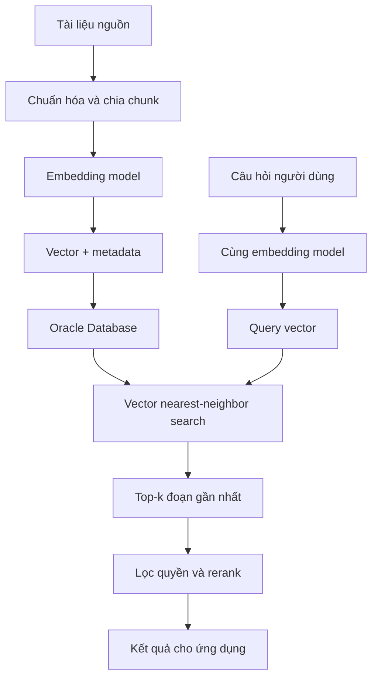
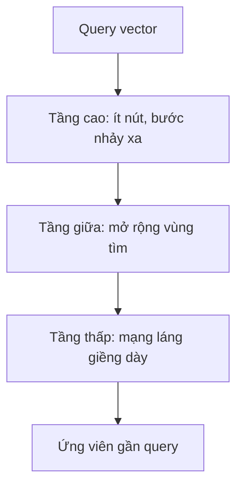
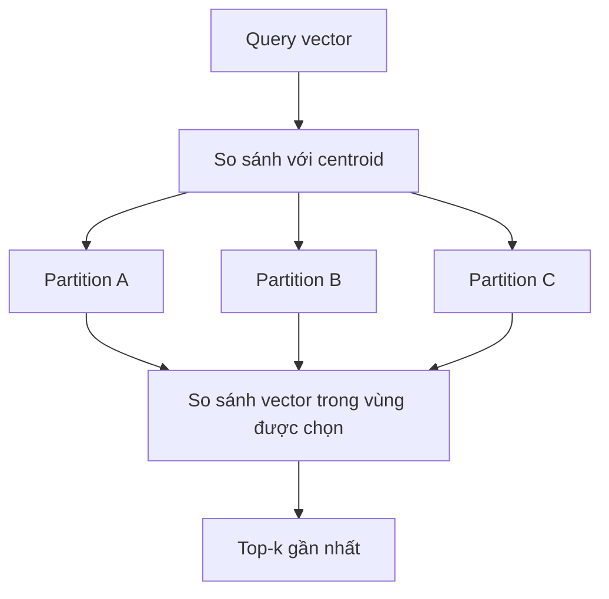

# AI Vector Search: kiểu VECTOR, độ tương đồng và loại chỉ mục

AI Vector Search trong Oracle Database cho phép lưu các vector biểu diễn dữ liệu, so sánh độ gần nhau giữa vector và tìm các bản ghi gần nhất trực tiếp bằng SQL. Vector thường được tạo từ mô hình embedding cho văn bản, hình ảnh, âm thanh hoặc dữ liệu khác. Khi có truy vấn, ứng dụng chuyển nội dung truy vấn thành vector rồi tìm các vector gần nhất trong database.

Ba thành phần cần hiểu cùng nhau:

- **Kiểu dữ liệu VECTOR:** lưu một dãy số có thứ tự, số chiều và định dạng phần tử xác định.
- **Độ tương đồng/khoảng cách:** quy tắc toán học dùng để xếp hạng vector gần nhau.
- **Vector index:** cấu trúc hỗ trợ tìm kiếm láng giềng gần nhất nhanh hơn khi tập dữ liệu lớn.

Vector Search bổ sung cho SQL quan hệ. Database vẫn lưu khóa chính, metadata, quyền truy cập, trạng thái nghiệp vụ và các điều kiện lọc như bình thường. Vector giúp tìm kiếm theo ngữ nghĩa hoặc đặc trưng, sau đó SQL kết hợp kết quả với dữ liệu quan hệ.

Các ví dụ trong bài minh họa AI Vector Search của Oracle Database 23ai và các release tiếp theo. Cú pháp, metric và tùy chọn index phụ thuộc release/RU; trước khi triển khai cần đối chiếu Oracle Database SQL Language Reference và Vector Search User's Guide của đúng release đang chạy.

## 1. Vector và embedding

### Vector là gì?

Vector là một dãy số có thứ tự. Ví dụ:

\[
v = [0.12,\ -0.45,\ 0.81,\ 0.07]
\]

Vector trên có bốn chiều (dimension). Mỗi phần tử là một tọa độ trong không gian nhiều chiều.

Trong AI, embedding model chuyển dữ liệu đầu vào thành vector sao cho dữ liệu có đặc trưng hoặc ý nghĩa gần nhau thường nằm gần nhau trong không gian vector. Ví dụ, một mô hình embedding văn bản có thể tạo vector cho các câu:

- "Cách đặt lại mật khẩu tài khoản"
- "Tôi quên password, làm sao đăng nhập?"
- "Giờ mở cửa của cửa hàng"

Hai câu đầu có thể có vector gần nhau vì cùng nói về việc truy cập tài khoản; câu thứ ba thường ở xa hơn. Đây là xu hướng do mô hình học được, không phải quy tắc toán học bảo đảm cho mọi câu.

### Embedding được tạo như thế nào?

Một pipeline semantic search thường có các bước:

1. Thu thập tài liệu hoặc bản ghi nguồn.
2. Chuẩn hóa nội dung và chia tài liệu dài thành các đoạn (chunk).
3. Dùng embedding model tạo vector cho từng đoạn.
4. Lưu vector cùng ID, nội dung, nguồn, quyền truy cập và metadata.
5. Khi có truy vấn, dùng mô hình tương thích để tạo query embedding.
6. Tìm các vector gần query vector.
7. Áp dụng điều kiện nghiệp vụ, xếp hạng bổ sung hoặc rerank nếu cần.
8. Trả nội dung phù hợp cho ứng dụng.

Sơ đồ:



Chất lượng tìm kiếm phụ thuộc nhiều vào mô hình embedding, cách chia chunk, ngôn ngữ, nội dung và preprocessing. Một index nhanh không thể sửa một embedding model tạo ra vector không phù hợp với nghiệp vụ.

### Vì sao lưu vector trong database?

Lưu vector ngay trong Oracle giúp kết hợp tìm kiếm ngữ nghĩa với dữ liệu quan hệ:

- Lọc theo tenant, trạng thái, loại tài liệu hoặc ngày tạo.
- Kiểm tra quyền truy cập theo user/role.
- Join kết quả vector với bảng nghiệp vụ.
- Quản lý transaction và vòng đời dữ liệu trong cùng database.
- Dùng SQL, backup, bảo mật và công cụ quản trị Oracle hiện có.

Ví dụ, hệ thống hỗ trợ khách hàng có thể tìm đoạn hướng dẫn gần câu hỏi rồi join sang bảng tài liệu để lấy tiêu đề, ngôn ngữ, trạng thái phát hành và quyền xem.

## 2. Kiểu dữ liệu VECTOR trong Oracle

Oracle Database 23ai giới thiệu kiểu dữ liệu SQL `VECTOR` cho dữ liệu vector. Kiểu này lưu các phần tử số theo thứ tự và hỗ trợ thao tác vector search mà không cần biến vector thành chuỗi JSON hoặc một bảng con gồm hàng trăm cột số.

### Khai báo cột VECTOR

Một cột có thể khai báo số chiều và định dạng phần tử:

```sql
CREATE TABLE document_embeddings (
    document_id NUMBER PRIMARY KEY,
    title        VARCHAR2(500),
    embedding    VECTOR(768, FLOAT32)
);
```

Trong ví dụ:

- `768` là số chiều của vector.
- `FLOAT32` là định dạng phần tử 32-bit floating point.
- Mỗi vector được lưu trong cột `embedding`.
- `document_id` và `title` là metadata quan hệ đi kèm.

Số chiều phải khớp với đầu ra của embedding model. Nếu model tạo vector 768 chiều, không thể ghi vector 384 chiều vào cột khai báo 768 chiều. Cũng không nên lấy vector từ một model khác chỉ vì chúng có cùng số chiều; cùng dimension không có nghĩa là cùng không gian embedding.

Có thể khai báo vector với số chiều linh hoạt bằng dấu `*` ở vị trí dimension theo cú pháp được release hỗ trợ, ví dụ `VECTOR(*, FLOAT32)`. Cách khai báo linh hoạt hữu ích khi schema cần chứa vector có dimension khác nhau, nhưng ứng dụng vẫn phải bảo đảm các vector được so sánh có cùng số chiều và cùng quy ước embedding. Với một tập dữ liệu dùng một model cố định, khai báo dimension cụ thể thường giúp phát hiện dữ liệu sai sớm hơn.

### Định dạng phần tử

Các định dạng phần tử thường gặp trong Oracle Vector gồm:

| Định dạng | Đặc điểm | Khi cân nhắc |
|---|---|---|
| `FLOAT32` | Số thực dấu phẩy động 32-bit | Lựa chọn phổ biến cho embedding; cân bằng dung lượng và độ chính xác |
| `FLOAT64` | Số thực dấu phẩy động 64-bit | Khi cần độ chính xác số cao hơn và chấp nhận dung lượng lớn hơn |
| `INT8` | Số nguyên có dấu 8-bit | Vector đã lượng tử hóa (quantized) theo quy trình phù hợp |
| `BINARY` | Các bit được đóng gói | Biểu diễn vector nhị phân hoặc mã hóa nhị phân mà model hỗ trợ |

Dung lượng phần tử thô phụ thuộc định dạng: FLOAT32 dùng khoảng 4 byte mỗi chiều, FLOAT64 khoảng 8 byte, INT8 khoảng 1 byte và BINARY dùng một bit cho mỗi chiều. Đây là ước lượng payload, chưa tính metadata, alignment, index và overhead lưu trữ.

Không nên tự ép FLOAT32 thành INT8 chỉ để giảm dung lượng. Lượng tử hóa phải phù hợp với mô hình và quy trình sinh embedding; nếu chuyển đổi không đúng, chất lượng tìm kiếm có thể giảm. Với BINARY, phải dùng metric và biểu diễn mà mô hình nhị phân hỗ trợ.

### Tạo bảng và chèn vector minh họa

Ví dụ nhỏ với vector ba chiều:

```sql
CREATE TABLE demo_vectors (
    item_id   NUMBER PRIMARY KEY,
    item_name VARCHAR2(100),
    embedding VECTOR(3, FLOAT32)
);

INSERT INTO demo_vectors(item_id, item_name, embedding)
VALUES (1, 'A', TO_VECTOR('[1, 0, 0]', 3, FLOAT32));

INSERT INTO demo_vectors(item_id, item_name, embedding)
VALUES (2, 'B', TO_VECTOR('[0.9, 0.1, 0]', 3, FLOAT32));

INSERT INTO demo_vectors(item_id, item_name, embedding)
VALUES (3, 'C', TO_VECTOR('[0, 1, 0]', 3, FLOAT32));

INSERT INTO demo_vectors(item_id, item_name, embedding)
VALUES (4, 'D', TO_VECTOR('[0, 0, 1]', 3, FLOAT32));

COMMIT;
```

`TO_VECTOR` chuyển biểu diễn vector thành giá trị kiểu VECTOR. Cú pháp có thể nhận dimension và format để kiểm tra/chuyển đổi dữ liệu. Có thể dùng vector literal theo cú pháp được hỗ trợ ở release hiện tại. Trong ứng dụng, nên bind giá trị vector hoặc dùng API/driver hỗ trợ kiểu vector thay vì nối chuỗi SQL trực tiếp.

Ví dụ kiểm tra vector:

```sql
SELECT item_id,
       item_name,
       VECTOR_SERIALIZE(embedding) AS embedding_text
FROM demo_vectors
ORDER BY item_id;
```

`VECTOR_SERIALIZE` có thể giúp hiển thị biểu diễn vector dạng văn bản khi kiểm tra. Không nên dùng việc serialize thành chuỗi làm định dạng trao đổi nội bộ mặc định nếu driver đã hỗ trợ kiểu vector; chuyển đổi qua chuỗi có thể tốn CPU và dung lượng.

### Dimension và format phải nhất quán

Một số lỗi thiết kế thường gặp:

- Khai báo dimension khác đầu ra model.
- Ghép vector từ hai model khác nhau dù cùng số chiều.
- Dùng query vector có format không phù hợp với dữ liệu/index mà không hiểu quy tắc chuyển đổi.
- Trộn vector văn bản và vector hình ảnh từ hai embedding space không tương thích.
- Cập nhật model nhưng không tái tạo embedding cũ.
- Lưu vector rỗng hoặc dữ liệu placeholder như thể đó là embedding hợp lệ.

Nên lưu metadata về model name, model version, dimension, preprocessing version và thời điểm sinh embedding. Khi thay model, cần có kế hoạch tái tạo vector hoặc phân tách không gian embedding cũ/mới.

## 3. Các phép đo khoảng cách và độ tương đồng

Vector search cần một hàm đo khoảng cách để xếp hạng kết quả. Hai vector gần nhau theo metric đang chọn được xem là tương đồng hơn. Tuy nhiên, metric khác nhau có thể tạo thứ tự kết quả khác nhau.

Oracle cung cấp hàm `VECTOR_DISTANCE` để tính khoảng cách giữa hai vector theo metric được chỉ định hoặc theo mặc định của hệ thống/cột/index. Khi viết truy vấn, nên chỉ rõ metric để logic dễ đọc và nhất quán với vector index.

### Cosine distance

Cosine đo góc giữa hai vector, tập trung vào hướng hơn là độ lớn.

\[
\operatorname{cosine\_similarity}(A,B)
= \frac{A \cdot B}{\|A\|\|B\|}
\]

Cosine distance thường được định nghĩa là:

\[
\operatorname{cosine\_distance}(A,B)
= 1-\operatorname{cosine\_similarity}(A,B)
\]

Với cách định nghĩa này, khoảng cách càng nhỏ thì hai vector càng gần theo hướng. Cosine thường phù hợp với embedding văn bản khi hướng vector chứa thông tin ngữ nghĩa và độ lớn không phải yếu tố chính.

Hai vector cùng hướng nhưng có độ lớn khác nhau có cosine similarity bằng nhau. Vì vậy cosine không phản ánh chênh lệch magnitude.

### Euclidean distance

Euclidean distance là khoảng cách đường thẳng trong không gian nhiều chiều:

\[
d(A,B)=\sqrt{\sum_{i=1}^{n}(A_i-B_i)^2}
\]

Khoảng cách càng nhỏ thì vector càng gần. Metric này nhạy với cả hướng và độ lớn. Nếu magnitude có ý nghĩa trong embedding model hoặc bài toán đo lường, Euclidean có thể phù hợp.

### Dot product

Dot product (inner product) là tổng tích các thành phần tương ứng:

\[
A \cdot B = \sum_{i=1}^{n} A_iB_i
\]

Dot product thường được dùng để xếp hạng embedding. Khi vector đã được chuẩn hóa độ dài, thứ tự theo dot product có quan hệ chặt với cosine similarity. Nếu vector chưa chuẩn hóa, magnitude có thể ảnh hưởng mạnh đến thứ hạng.

Trong Oracle, metric `DOT` được dùng như một phép đo vector distance theo quy ước của Oracle. Hãy dùng cùng metric ở truy vấn và vector index; đừng tự coi giá trị trả về là cosine similarity.

### So sánh metric

| Metric | Đặc điểm | Khi thường cân nhắc |
|---|---|---|
| `COSINE` | So sánh hướng vector, ít nhạy với magnitude | Embedding văn bản và nhiều mô hình semantic search |
| `EUCLIDEAN` | Đo khoảng cách hình học, tính cả độ lớn | Khi khoảng cách tuyệt đối có ý nghĩa trong không gian embedding |
| `DOT` | Dựa trên inner product theo quy ước distance của Oracle | Model được huấn luyện để xếp hạng bằng dot product |
| `MANHATTAN` | Tổng trị tuyệt đối chênh lệch theo từng chiều | Bài toán mà L1 distance là metric mong muốn |
| `HAMMING` | Đếm số bit khác nhau | Vector nhị phân |
| `JACCARD` | Đo khác biệt giữa các tập/bitset theo giao và hợp | Biểu diễn nhị phân dạng tập hợp khi phù hợp |

Không phải mọi metric đều áp dụng cho mọi định dạng vector hoặc mọi loại index. Các metric được hỗ trợ và điều kiện sử dụng phụ thuộc release. Kiểm tra tài liệu Oracle của phiên bản triển khai, đặc biệt với vector BINARY, INT8 và các index approximate.

### Không nhầm distance với similarity score

`VECTOR_DISTANCE` trả về khoảng cách theo metric. Với các metric distance thông dụng, giá trị nhỏ hơn thường biểu thị gần hơn. Nếu ứng dụng muốn hiển thị similarity score theo thang điểm riêng, cần định nghĩa phép chuyển đổi rõ ràng theo metric và mô hình.

Không nên đặt tên cột kết quả là `similarity` khi giá trị thực tế là distance mà không chuyển đổi. Điều đó dễ khiến tầng ứng dụng sắp xếp ngược hoặc đặt ngưỡng sai.

## 4. Tính khoảng cách bằng SQL

### Truy vấn exact nearest neighbors

Với bảng demo:

```sql
SELECT item_id,
       item_name,
       VECTOR_DISTANCE(
           embedding,
           TO_VECTOR('[0.95, 0.05, 0]', 3, FLOAT32),
           COSINE
       ) AS distance
FROM demo_vectors
ORDER BY distance
FETCH FIRST 3 ROWS ONLY;
```

Truy vấn này tính khoảng cách cosine từ mỗi vector đến query vector, sắp xếp từ gần nhất đến xa nhất và lấy ba hàng đầu. Đây là cách tìm nearest neighbors chính xác (exact search) khi database đánh giá toàn bộ tập ứng viên cần thiết.

Exact search phù hợp khi:

- Bảng còn nhỏ.
- Cần kết quả tham chiếu để đánh giá index approximate.
- Yêu cầu recall chính xác cao.
- Bộ lọc quan hệ đã thu hẹp tập dữ liệu đáng kể.
- Workload không cần tối ưu latency ở quy mô lớn.

### Query vector nên được bind

Trong ứng dụng, không nối trực tiếp vector do người dùng gửi vào SQL. Hãy dùng bind parameter và API vector của driver phù hợp. Ví dụ minh họa khi biểu diễn query vector bằng chuỗi:

```sql
SELECT item_id,
       item_name,
       VECTOR_DISTANCE(
           embedding,
           TO_VECTOR(:query_vector, 3, FLOAT32),
           COSINE
       ) AS distance
FROM demo_vectors
ORDER BY distance
FETCH FIRST :top_k ROWS ONLY;
```

`:query_vector` và `:top_k` là bind variables. Kiểm tra cách bind số lượng hàng và vector với JDBC driver/version thực tế; một số API có thể yêu cầu kiểu bind hoặc cách truyền vector riêng. Giới hạn `top_k` ở tầng ứng dụng để tránh request tùy ý yêu cầu quá nhiều hàng.

### Lọc theo metadata

Vector search thường được kết hợp với điều kiện SQL:

```sql
SELECT document_id,
       title,
       VECTOR_DISTANCE(embedding, :query_vector, COSINE) AS distance
FROM document_embeddings
WHERE tenant_id = :tenant_id
  AND status = 'PUBLISHED'
  AND language_code = :language_code
ORDER BY distance
FETCH FIRST 10 ROWS ONLY;
```

Điều kiện tenant, trạng thái và ngôn ngữ giúp thu hẹp tập dữ liệu theo nghiệp vụ. Đặc biệt, điều kiện quyền truy cập phải được áp dụng ở database hoặc tầng tin cậy trước khi trả nội dung; không được lấy top-k toàn hệ thống rồi để client tự lọc tenant.

Cần kiểm tra execution plan để hiểu optimizer thực hiện filter và vector search theo cách nào. Selectivity của điều kiện WHERE có thể ảnh hưởng khả năng dùng vector index và chất lượng/chi phí tìm kiếm.

## 5. Exact search và approximate search

### Exact nearest-neighbor search

Exact search tìm các hàng có khoảng cách nhỏ nhất theo metric đã chọn trong toàn bộ tập ứng viên. Kết quả là ground truth cho truy vấn đó, nhưng chi phí có thể tăng theo số lượng vector và dimension.

Nếu có một triệu vector, database phải thực hiện đủ công việc để xác định top-k chính xác; index quan hệ thông thường không thể thay thế vector index cho mọi phép đo khoảng cách.

### Approximate nearest-neighbor search

Approximate search dùng cấu trúc index để khảo sát một phần không gian vector và trả về các láng giềng gần nhất ước lượng. Mục tiêu là giảm latency và chi phí so với exact search, đổi lại có thể bỏ sót một số kết quả thực sự gần nhất.

Trong Oracle, truy vấn có thể yêu cầu approximate top-k bằng cú pháp:

```sql
SELECT item_id,
       item_name,
       VECTOR_DISTANCE(embedding, :query_vector, COSINE) AS distance
FROM demo_vectors
ORDER BY distance
FETCH APPROXIMATE FIRST 3 ROWS ONLY;
```

Đây là cú pháp minh họa cho approximate row limiting. Khả năng sử dụng index và các tùy chọn accuracy phụ thuộc release, loại index và hình dạng truy vấn. Kiểm tra execution plan thay vì suy luận chỉ từ việc câu SQL có vector distance.

### Recall và accuracy

Một chỉ số quan trọng để đánh giá approximate search là recall@k:

\[
\operatorname{recall@k}
= \frac{|\operatorname{ApproxTopK}\cap\operatorname{ExactTopK}|}{k}
\]

Nếu exact search trả về 10 kết quả chuẩn và approximate search tìm được 9 kết quả trong số đó, recall@10 là 0.9 (90%).

Recall đo mức độ approximate search tìm lại được các láng giềng đúng theo exact search. Nó không đo việc embedding model có hiểu đúng ngữ nghĩa hay không. Một index có recall 99% vẫn có thể trả về kết quả ngữ nghĩa kém nếu embedding model hoặc dữ liệu nguồn không tốt.

### Chọn exact hay approximate

| Tình huống | Hướng lựa chọn |
|---|---|
| Dataset nhỏ, latency chấp nhận được | Bắt đầu với exact search |
| Cần benchmark chất lượng index | Exact search làm ground truth |
| Dataset lớn, truy vấn top-k thường xuyên | Đánh giá approximate index |
| Yêu cầu không bỏ sót láng giềng gần nhất | Exact search hoặc kiểm soát recall theo yêu cầu |
| WHERE filter rất chọn lọc | So sánh exact sau filter với approximate index |
| Hệ thống cần latency thấp và có thể chấp nhận recall dưới 100% | Approximate search với target accuracy được kiểm thử |

Không chọn approximate chỉ vì bảng có nhiều hàng. Cần đo latency, throughput, recall, memory, thời gian build index và chi phí DML bằng workload gần production.

## 6. Vector index trong Oracle

Vector index giúp tăng tốc nearest-neighbor search trên tập vector lớn. Oracle AI Vector Search cung cấp các tổ chức index approximate phổ biến:

- **In-Memory Neighbor Graph:** cấu trúc đồ thị láng giềng, tương ứng họ thuật toán HNSW.
- **Neighbor Partitions:** chia không gian vector thành các partition/cluster để tìm kiếm trong các vùng được chọn, tương ứng họ thuật toán IVF.

Tên cú pháp và tham số chi tiết có thể thay đổi theo release. Hãy kiểm tra SQL Language Reference của đúng phiên bản trước khi tạo index.

### Khi nào cần vector index?

Có thể chưa cần index khi:

- Bảng chỉ có vài nghìn vector.
- Truy vấn hiếm và thời gian full scan chấp nhận được.
- Điều kiện SQL lọc xuống rất ít hàng.
- Đang kiểm thử chất lượng embedding và muốn kết quả exact.

Vector index có lợi khi workload thường xuyên tìm top-k trên tập vector lớn và chi phí exact search đã vượt SLA.

Index cũng có chi phí:

- Dung lượng lưu trữ hoặc memory.
- Thời gian build.
- Chi phí cập nhật khi thêm/xóa/sửa vector.
- Công việc rebuild hoặc tối ưu sau thay đổi dữ liệu lớn.
- Tham số vận hành và giám sát riêng.

Không tạo vector index cho mọi cột VECTOR theo mặc định. Xác định truy vấn chính, metric, số lượng vector, tốc độ DML, yêu cầu recall và ngân sách memory trước.

## 7. In-Memory Neighbor Graph (HNSW)

### Cách hoạt động

HNSW (Hierarchical Navigable Small World) xây dựng đồ thị nhiều tầng. Mỗi vector là một nút; các nút liên kết với một số láng giềng. Những tầng trên có ít nút hơn và giúp tìm vùng gần đúng nhanh; tầng dưới chứa mạng lưới dày hơn để tinh chỉnh kết quả.

Khi tìm kiếm:

1. Bắt đầu từ một entry point ở tầng cao.
2. Di chuyển qua các nút có khoảng cách giảm dần.
3. Đi xuống tầng thấp hơn để tìm kiếm chi tiết.
4. Trả về các láng giềng gần nhất đã khám phá.

Sơ đồ khái niệm:



Hình này mô tả ý tưởng phân tầng; đồ thị thực tế có nhiều liên kết và quy tắc xây dựng phức tạp hơn.

### Đặc điểm

HNSW thường phù hợp khi cần latency thấp và recall cao, đồng thời hệ thống có đủ memory để giữ cấu trúc đồ thị. Các trade-off chính:

- Cấu trúc đồ thị cần memory.
- Build index có thể tốn thời gian và tài nguyên.
- Thêm/xóa vector có thể phát sinh chi phí duy trì graph.
- Tuning tham số ảnh hưởng đến thời gian tìm kiếm, memory và recall.
- Phù hợp với workload truy vấn nearest neighbors thường xuyên.

Trong Oracle, loại tổ chức này được khai báo bằng `ORGANIZATION INMEMORY NEIGHBOR GRAPH`.

Ví dụ:

```sql
CREATE VECTOR INDEX demo_hnsw_idx
ON demo_vectors (embedding)
ORGANIZATION INMEMORY NEIGHBOR GRAPH
DISTANCE COSINE
WITH TARGET ACCURACY 95;
```

Ví dụ dùng cosine distance và target accuracy 95. Giá trị target accuracy là mục tiêu chất lượng tìm kiếm approximate, không phải cam kết embedding có độ chính xác ngữ nghĩa 95%. Khả năng hỗ trợ tham số và mặc định phụ thuộc release.

HNSW dùng memory dành cho vector index theo cơ chế của Oracle. DBA cần xem xét tham số và vùng memory liên quan, bao gồm `VECTOR_MEMORY_SIZE` ở các release hỗ trợ, trước khi build index. Không đặt giá trị tham số chỉ dựa vào kích thước vector; cần tính đến số lượng vector, dimension, cấu trúc graph và các workload cùng chia sẻ memory.

## 8. Neighbor Partitions (IVF)

### Cách hoạt động

IVF (Inverted File Index) chia vector thành các vùng/partition dựa trên centroid hoặc đại diện cụm. Khi truy vấn, hệ thống xác định một số vùng gần query vector và tìm kiếm trong các vùng đó thay vì khảo sát toàn bộ dữ liệu.

Quy trình khái quát:

1. Phân cụm các vector thành nhiều partition.
2. Lưu thông tin centroid và ánh xạ vector vào partition.
3. Khi có query vector, xác định partition gần nhất.
4. Chỉ khảo sát một số partition được chọn.
5. Xếp hạng ứng viên theo metric và trả top-k.

Sơ đồ:



### Đặc điểm

IVF thường được cân nhắc khi:

- Tập vector lớn.
- Muốn giảm memory so với một đồ thị HNSW lớn.
- Workload có thể chấp nhận khảo sát một số partition.
- Cần điều chỉnh số vùng được thăm để cân bằng latency và recall.

Nếu truy vấn chỉ khảo sát ít partition, latency có thể thấp nhưng có nguy cơ bỏ sót vector ở vùng khác. Nếu khảo sát nhiều partition hơn, recall thường tăng nhưng chi phí cũng tăng.

Trong Oracle, loại tổ chức này được khai báo bằng `ORGANIZATION NEIGHBOR PARTITIONS`.

Ví dụ:

```sql
CREATE VECTOR INDEX demo_ivf_idx
ON demo_vectors (embedding)
ORGANIZATION NEIGHBOR PARTITIONS
DISTANCE COSINE
WITH TARGET ACCURACY 95;
```

Ví dụ trên minh họa dạng DDL. Các tham số partitioning, cách build, điều kiện dữ liệu và tùy chọn accuracy cần được xác nhận theo release. Không nên sao chép nguyên xi cú pháp HNSW parameters sang IVF; hai tổ chức có cơ chế và tham số tuning khác nhau.

## 9. So sánh HNSW và IVF

| Tiêu chí | In-Memory Neighbor Graph (HNSW) | Neighbor Partitions (IVF) |
|---|---|---|
| Cấu trúc | Đồ thị láng giềng nhiều tầng | Các vùng/partition vector |
| Cách tìm | Duyệt graph để tiến gần query | Chọn partition gần query rồi tìm trong vùng |
| Memory | Thường cần nhiều memory cho graph | Có thể phù hợp hơn khi ngân sách memory hạn chế |
| Build | Có thể tốn tài nguyên để xây graph | Cần tạo/phân cụm partition |
| Latency | Thường thấp với workload phù hợp | Phụ thuộc số partition được khảo sát |
| Recall | Có thể cao khi cấu hình/tuning phù hợp | Phụ thuộc số vùng được tìm và phân bố vector |
| DML | Cần duy trì cấu trúc graph | Cần duy trì mapping/partition |
| Khi cân nhắc | Truy vấn nhiều, ưu tiên latency và có memory | Dataset lớn, muốn kiểm soát phạm vi tìm kiếm và tài nguyên |

Không có index type tốt nhất cho mọi workload. Cần benchmark trên dữ liệu thật vì phân bố vector, dimension, metric, số lượng hàng, bộ lọc SQL và tỷ lệ ghi đều ảnh hưởng kết quả.

### Cách chọn ban đầu

- Bắt đầu bằng exact search để có baseline.
- Tạo HNSW nếu ưu tiên latency và có ngân sách memory.
- Thử IVF nếu muốn giảm memory hoặc workload phù hợp với tìm kiếm theo partition.
- So sánh recall@k, p50/p95/p99 latency, throughput, build time và DML overhead.
- Kiểm tra execution plan để xác nhận Oracle dùng index đúng như dự kiến.
- Chỉ giữ index khi lợi ích đo được lớn hơn chi phí vận hành.

## 10. Tạo và sử dụng vector index trong một bảng tài liệu

Giả sử bảng lưu tài liệu có metadata và embedding:

```sql
CREATE TABLE knowledge_chunks (
    chunk_id       NUMBER GENERATED BY DEFAULT AS IDENTITY PRIMARY KEY,
    document_id    NUMBER NOT NULL,
    tenant_id      NUMBER NOT NULL,
    language_code  VARCHAR2(10),
    chunk_text     CLOB,
    model_version  VARCHAR2(100) NOT NULL,
    embedding      VECTOR(768, FLOAT32) NOT NULL,
    created_at     TIMESTAMP DEFAULT SYSTIMESTAMP
);
```

Tạo index HNSW theo cosine:

```sql
CREATE VECTOR INDEX knowledge_chunks_vec_hnsw
ON knowledge_chunks (embedding)
ORGANIZATION INMEMORY NEIGHBOR GRAPH
DISTANCE COSINE
WITH TARGET ACCURACY 95;
```

Truy vấn top-k:

```sql
SELECT chunk_id,
       document_id,
       chunk_text,
       VECTOR_DISTANCE(embedding, :query_vector, COSINE) AS distance
FROM knowledge_chunks
WHERE tenant_id = :tenant_id
  AND language_code = :language_code
ORDER BY distance
FETCH APPROXIMATE FIRST 10 ROWS ONLY;
```

Ở đây, vector index tăng tốc bước tìm kiếm lân cận. Điều kiện `tenant_id` và `language_code` giới hạn phạm vi nghiệp vụ. Cần kiểm tra execution plan và kết quả khi có filter; không giả định mọi filter đều được áp dụng trước vector search theo cùng một cách.

### Xác minh execution plan

Dùng `EXPLAIN PLAN` hoặc công cụ xem cursor plan phù hợp với quyền và môi trường:

```sql
EXPLAIN PLAN FOR
SELECT chunk_id,
       VECTOR_DISTANCE(
           embedding,
           TO_VECTOR('[0.1, 0.2, 0.3]', 768, FLOAT32),
           COSINE
       ) AS distance
FROM knowledge_chunks
ORDER BY distance
FETCH APPROXIMATE FIRST 10 ROWS ONLY;

SELECT *
FROM TABLE(DBMS_XPLAN.DISPLAY);
```

Vector literal trong ví dụ chỉ là minh họa và có ba giá trị trong khi cột ví dụ khai báo 768 chiều; khi chạy thật phải bind một vector đủ 768 chiều do đúng embedding model tạo ra. Dùng `DBMS_XPLAN` để kiểm tra plan, nhưng cần xem cursor plan thực tế khi truy vấn đã chạy và có bind values nếu muốn xác nhận chính xác hành vi production.

Không kết luận index được dùng chỉ vì DDL tạo thành công. Cấu trúc truy vấn, metric, kiểu vector, row limiting và release có thể ảnh hưởng lựa chọn của optimizer.

## 11. Target accuracy và tuning

Một vector index approximate thường cho phép đặt mục tiêu accuracy/recall hoặc điều chỉnh mức độ tìm kiếm. Oracle có thể cung cấp `WITH TARGET ACCURACY` trong DDL của vector index; một số release còn hỗ trợ tùy chọn ở câu truy vấn. Cú pháp chính xác và phạm vi áp dụng phải kiểm tra theo release.

Ví dụ:

```sql
CREATE VECTOR INDEX knowledge_chunks_vec_idx
ON knowledge_chunks (embedding)
ORGANIZATION INMEMORY NEIGHBOR GRAPH
DISTANCE COSINE
WITH TARGET ACCURACY 95;
```

Target accuracy là một mục tiêu cho chất lượng tìm kiếm approximate so với exact search theo định nghĩa của Oracle. Nó không phải:

- Độ tin cậy của embedding model.
- Phần trăm nội dung đúng về mặt sự thật.
- Tỷ lệ câu trả lời đúng của ứng dụng AI.
- Cam kết rằng mọi truy vấn đều trả đúng cùng một top-k.

Tăng mục tiêu accuracy có thể làm tăng công việc tìm kiếm hoặc memory/CPU tùy index và release. Mức tối ưu cần đo bằng dữ liệu thật.

### Thiết kế benchmark

Một benchmark hữu ích nên:

1. Chọn tập query đại diện cho ngôn ngữ và nghiệp vụ.
2. Chạy exact search để lưu top-k tham chiếu.
3. Chạy approximate search với từng index và cấu hình.
4. Tính recall@k.
5. Đo p50, p95, p99 latency và throughput.
6. Đo thời gian build/rebuild và dung lượng index.
7. Đo tác động của insert/update/delete.
8. Thử các bộ lọc tenant, trạng thái, ngày và ngôn ngữ.
9. Lặp lại dưới concurrency gần production.
10. Lưu cấu hình và phiên bản model để có thể tái lập kết quả.

Không chỉ đo một query đơn lẻ. Vector search trong production thường có nhiều phân bố query, filter và tải đồng thời.

## 12. Kết hợp vector search với lọc quan hệ và quyền truy cập

Vector search trả về các ứng viên gần nhau về mặt toán học. Nó không tự hiểu tenant, quyền xem tài liệu, trạng thái phát hành hoặc chính sách dữ liệu.

Ví dụ, bảng có các cột:

- `tenant_id`: khách hàng sở hữu dữ liệu.
- `visibility`: mức hiển thị.
- `status`: trạng thái tài liệu.
- `language_code`: ngôn ngữ.
- `embedding`: vector.

Truy vấn phải giới hạn dữ liệu theo user/tenant và policy:

```sql
SELECT chunk_id,
       document_id,
       chunk_text,
       VECTOR_DISTANCE(embedding, :query_vector, COSINE) AS distance
FROM knowledge_chunks
WHERE tenant_id = :tenant_id
  AND status = 'PUBLISHED'
  AND visibility IN ('PUBLIC', 'TENANT')
ORDER BY distance
FETCH APPROXIMATE FIRST 10 ROWS ONLY;
```

Điều kiện trên chỉ là ví dụ. Trong hệ thống thực tế, quyền có thể cần kiểm tra theo user, group, document ACL hoặc row-level security. Không đưa nội dung không được phép xem vào kết quả chỉ vì vector gần query.

Nếu filter rất chọn lọc, exact search trên tập nhỏ sau filter có thể nhanh và chính xác hơn approximate search. Hãy benchmark cả hai cách.

### Hybrid search

Vector search tìm tương đồng ngữ nghĩa, còn full-text search tìm từ khóa hoặc cụm từ xuất hiện trong nội dung. Hai cách bổ sung cho nhau:

- Vector search có thể tìm câu diễn đạt khác từ khóa trong query.
- Full-text search có thể tìm chính xác mã sản phẩm, số hợp đồng, tên riêng hoặc cụm từ.
- SQL filter áp dụng tenant, trạng thái và quyền.
- Reranking có thể kết hợp điểm vector, điểm lexical và tín hiệu nghiệp vụ.

Không dùng vector search một mình cho truy vấn cần exact identifier như mã đơn hàng, số tài khoản hoặc mã lỗi. Với loại dữ liệu đó, dùng index quan hệ hoặc full-text theo nhu cầu; có thể kết hợp vector để tìm ngữ cảnh.

## 13. Vòng đời dữ liệu và index

Vector index cần được quản lý cùng dữ liệu embedding.

### Insert và update

Khi thêm chunk mới, cần lưu embedding được tạo từ model/version đã chọn. Nếu nội dung thay đổi, embedding cũ có thể không còn đại diện cho nội dung mới. Cần cập nhật chunk và vector theo cùng một transaction hoặc pipeline có trạng thái rõ ràng.

### Delete và thay đổi quyền

Khi tài liệu bị xóa, thu hồi hoặc đổi quyền, vector và metadata phải được cập nhật nhất quán. Không để vector index tiếp tục trả một chunk đã bị xóa hoặc không còn được phép truy cập. Nếu dùng soft delete, truy vấn phải luôn lọc trạng thái phù hợp.

### Thay đổi embedding model

Hai model có thể tạo vector trong hai không gian khác nhau dù dimension giống nhau. Khi thay model:

- Ghi rõ model/version trong metadata.
- Không trộn vector cũ và mới vào cùng một truy vấn nếu chúng không tương thích.
- Tái tạo embedding cho dữ liệu cũ theo kế hoạch.
- Có thể dùng cột/bảng hoặc partition riêng trong giai đoạn chuyển đổi.
- Tạo index tương ứng và kiểm thử recall.
- Chuyển truy vấn sang model mới sau khi dữ liệu đã sẵn sàng.

### Rebuild và bảo trì

Tần suất rebuild phụ thuộc lượng DML, index type và đặc tính release. Theo dõi:

- Số lượng vector trong bảng và index.
- Thời gian truy vấn và recall.
- Memory sử dụng cho graph/index.
- DML throughput.
- Trạng thái index và lỗi build.
- Dung lượng index và thời gian bảo trì.

Không rebuild định kỳ chỉ theo thói quen. Đặt ngưỡng dựa trên số liệu và kiểm thử trước khi áp dụng vào production.

## 14. Những lỗi thường gặp khi dùng VECTOR và vector index

| Triệu chứng | Nguyên nhân có thể | Cách xử lý |
|---|---|---|
| Insert vector thất bại | Sai dimension hoặc format | Kiểm tra output model và khai báo cột |
| Query vector không so sánh được | Query và stored vector khác dimension/format hoặc metric không phù hợp | Chuẩn hóa model, dimension, format và metric |
| Kết quả semantic kém | Model hoặc chunking không phù hợp | Đánh giá embedding model, preprocessing và dữ liệu |
| Top-k thay đổi khi đổi metric | Cosine, Euclidean và dot product xếp hạng khác nhau | Chọn metric theo model và benchmark |
| Approximate search bỏ sót kết quả | Recall chưa đạt hoặc index/config chưa phù hợp | So sánh exact top-k, điều chỉnh accuracy và index |
| Vector index không được dùng | Query shape, metric, datatype hoặc release không đáp ứng điều kiện | Kiểm tra SQL plan và tài liệu release |
| Build HNSW thiếu memory | Vector memory pool hoặc cấu hình tài nguyên không đủ | Ước lượng memory, điều chỉnh cấu hình theo hướng dẫn |
| Search chậm sau khi thêm filter | Filter selectivity và chiến lược thực thi không phù hợp | So sánh exact sau filter và approximate, kiểm tra plan |
| Kết quả chứa tài liệu không còn quyền | Thiếu filter hoặc policy ở tầng truy vấn | Áp dụng tenant/ACL/security predicate bắt buộc |
| Model mới cho kết quả lạ | Trộn vector từ hai embedding space | Phân version và tái tạo vector nhất quán |

Một số lỗi có thể xuất hiện dưới dạng lỗi SQL/DDL cụ thể tùy release. Khi điều tra, lưu error code, SQL statement, kiểu vector, dimension, metric, index organization và phiên bản Oracle.

## 15. Bảo mật và vận hành

Vector có thể mã hóa thông tin đặc trưng của dữ liệu nguồn. Không nên mặc định vector là dữ liệu vô hại chỉ vì không đọc được như văn bản.

Áp dụng các nguyên tắc:

- Giữ quyền truy cập theo tenant và owner của tài liệu.
- Bảo vệ cả nội dung gốc lẫn embedding.
- Áp dụng encryption, backup và retention theo chính sách dữ liệu.
- Không đưa vector hoặc metadata nhạy cảm vào log không được bảo vệ.
- Xóa hoặc cập nhật vector khi dữ liệu nguồn bị xóa theo chính sách.
- Giới hạn ai được tạo index, truy vấn và thay đổi model metadata.
- Kiểm tra licensing và quyền sử dụng các tính năng Oracle liên quan.

Theo dõi các metric vận hành:

- Số vector được lưu và tốc độ tăng.
- Số truy vấn vector mỗi giây.
- p50/p95/p99 latency.
- Tỷ lệ lỗi dimension/format.
- Recall@k theo tập benchmark.
- Memory và dung lượng index.
- Index build/rebuild duration.
- DML overhead.
- Tỷ lệ query không dùng index khi kỳ vọng dùng.
- Tỷ lệ kết quả bị loại bởi filter quyền.

## 16. Quy trình triển khai AI Vector Search

Một quy trình thực tế có thể chia thành các bước:

1. **Xác định bài toán:** semantic search, recommendation, duplicate detection hay retrieval cho ứng dụng AI.
2. **Chọn embedding model:** xác định ngôn ngữ, dimension, format và chính sách version.
3. **Thiết kế schema:** lưu VECTOR cùng khóa, tenant, source, metadata và model version.
4. **Nạp dữ liệu:** tạo chunk và embedding, kiểm tra dimension/format trước khi insert.
5. **Chọn metric:** theo hướng dẫn model; cosine là điểm bắt đầu phổ biến cho semantic text search.
6. **Tạo baseline exact:** đo chất lượng và latency trước khi tối ưu.
7. **Thử index:** so sánh HNSW và IVF theo memory, recall, latency và DML.
8. **Tích hợp filter:** tenant, ACL, trạng thái, ngày và ngôn ngữ.
9. **Kiểm thử hybrid/reranking:** nếu truy vấn cần từ khóa chính xác hoặc tín hiệu nghiệp vụ.
10. **Triển khai giám sát:** theo dõi index, query, recall và model version.
11. **Lập kế hoạch thay model:** tái tạo embedding và chuyển đổi index có kiểm soát.

## 17. Checklist thiết kế

### Dữ liệu và model

- [ ] Xác định embedding model và version.
- [ ] Xác định dimension và element format.
- [ ] Lưu model/version cùng dữ liệu.
- [ ] Không trộn vector từ embedding space không tương thích.
- [ ] Kiểm tra dimension, format và giá trị đầu vào trước khi insert.
- [ ] Có quy trình cập nhật hoặc xóa embedding khi nội dung thay đổi.

### Metric và truy vấn

- [ ] Chọn cosine, Euclidean, dot product hoặc metric phù hợp với model.
- [ ] Hiểu VECTOR_DISTANCE trả về distance và cách sắp xếp.
- [ ] Dùng cùng metric cho query và vector index.
- [ ] Giới hạn top-k và dùng bind variables.
- [ ] Áp dụng tenant, ACL và trạng thái ở truy vấn đáng tin cậy.
- [ ] Dùng exact search làm baseline.
- [ ] Đánh giá hybrid search nếu cần exact keyword/identifier.

### Index và vận hành

- [ ] Đo latency và recall trước khi chọn index.
- [ ] So sánh HNSW và IVF trên dữ liệu thật.
- [ ] Ước lượng memory, storage và chi phí DML.
- [ ] Kiểm tra target accuracy và execution plan.
- [ ] Theo dõi index build/rebuild và tình trạng index.
- [ ] Kiểm thử insert/update/delete sau khi tạo index.
- [ ] Lưu benchmark để so sánh sau khi thay model hoặc RU.
- [ ] Xác nhận cú pháp và tính năng được hỗ trợ ở đúng Oracle release.

AI Vector Search đưa embedding vào cùng môi trường SQL và quản trị của Oracle Database. Kiểu VECTOR xác định cách lưu vector; metric xác định cách đo độ gần; HNSW và IVF cung cấp hai cách tổ chức index approximate với trade-off khác nhau. Để chọn đúng, cần bắt đầu từ embedding model và yêu cầu nghiệp vụ, tạo baseline exact, đo recall/latency trên dữ liệu thật, rồi mới quyết định metric, index và cấu hình vận hành.

