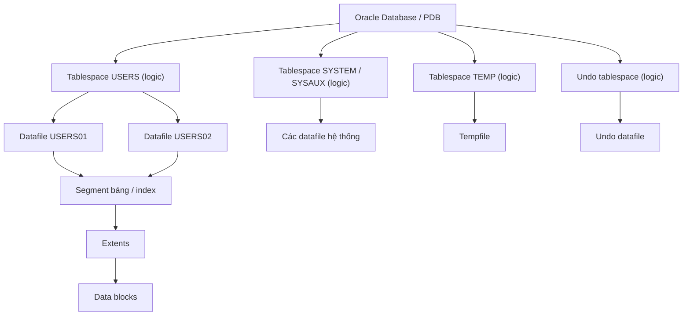
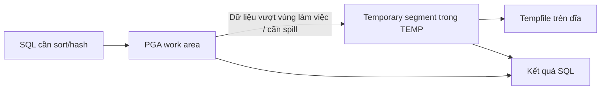
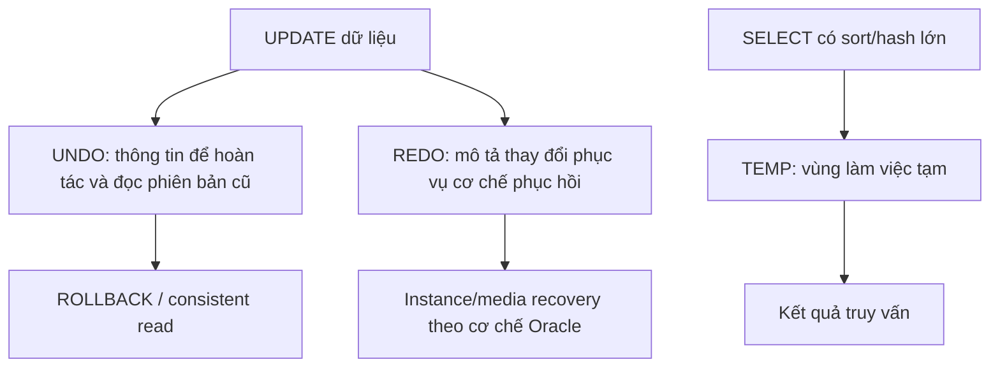
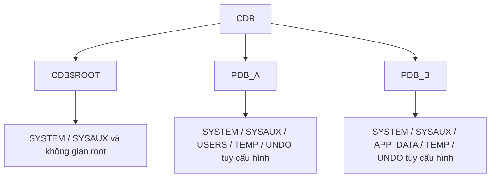

# Tablespace SYSTEM, SYSAUX, USERS, TEMP và UNDO trong Oracle Database

Khi học lưu trữ Oracle Database, một trong những nhầm lẫn phổ biến nhất là xem database như một thư mục chứa các file bảng: tạo bảng nào thì sẽ có một file vật lý riêng cho bảng đó. Oracle tổ chức lưu trữ theo một mô hình khác: **tablespace** là đơn vị quản lý không gian logic; **datafile/tempfile** là nơi cấp phát không gian vật lý; còn dữ liệu của bảng và index được quản lý thành **segment**, **extent** và **block**.

Trong một Oracle Database thông thường, năm tên tablespace rất hay gặp là **SYSTEM**, **SYSAUX**, **USERS**, **TEMP** và **UNDO** (tablespace undo thực tế có thể mang tên khác như `UNDOTBS1`). Chúng không chỉ khác tên: mỗi loại có vai trò, cơ chế cấp phát và yêu cầu vận hành riêng. Phân biệt đúng giúp người phát triển ứng dụng biết nên đặt bảng ở đâu, hiểu vì sao một câu `ORDER BY` có thể dùng nhiều đĩa, lý giải lỗi rollback/đọc nhất quán và tránh can thiệp nhầm vào không gian hệ thống.

Bài viết tập trung vào cách **hiểu, quan sát và thực hành an toàn**. Các lệnh quản trị minh họa chỉ nên chạy bởi DBA trên môi trường lab riêng; người học thông thường có thể kiểm tra những đối tượng thuộc schema của mình mà không cần quyền hệ thống.

## 1. Mô hình lưu trữ: từ database tới block

### 1.1. Các tầng logic và vật lý



Sơ đồ biểu diễn quan hệ quản lý logic: segment của một đối tượng thông thường thuộc một tablespace và gồm các extent, mỗi extent gồm các block. Các extent của một segment có thể nằm trong các datafile khác nhau của cùng tablespace. Với tablespace thuộc nhóm bigfile, cấu trúc số lượng file khác với smallfile tablespace; sơ đồ hai file nhằm minh họa dạng smallfile.

| Khái niệm | Bản chất | Ví dụ / ý nghĩa |
|---|---|---|
| **Database block** | Đơn vị lưu trữ/đọc ghi logic nhỏ của Oracle ở tầng database | Thường có kích thước 8 KB ở nhiều cài đặt, nhưng phải kiểm tra cấu hình thực |
| **Extent** | Một nhóm các block liên tiếp được cấp cho segment | Segment có thể mở rộng bằng cách nhận extent mới |
| **Segment** | Tập extent lưu một đối tượng hoặc một phần đối tượng cụ thể | Table segment, index segment, LOB segment, partition |
| **Tablespace** | Đơn vị logic chứa và quản lý các segment/không gian | `USERS`, `SYSTEM`, `TEMP`, một tablespace tự tạo |
| **Datafile** | File vật lý cung cấp không gian cho permanent/undo tablespace | Có thể dùng Oracle Managed Files (OMF) |
| **Tempfile** | File vật lý cung cấp không gian cho temporary tablespace | Chứa vùng làm việc tạm của SQL |

Một câu `CREATE TABLE` không đồng nghĩa tạo một datafile mới. Khi bảng có dữ liệu, Oracle cấp phát segment/extent từ tablespace được chỉ định hoặc tablespace mặc định của user. **Datafile** thuộc tablespace, trong khi **table segment** được lưu trong không gian do tablespace quản lý.

### 1.2. Tablespace không phải schema

Hai câu hỏi thường bị trộn lẫn:

- **“Bảng này thuộc ai?”** → Schema owner, ví dụ `SALES_APP.ORDERS`.
- **“Segment của bảng này nằm ở đâu?”** → Tablespace, ví dụ `APP_DATA` hoặc `USERS`.

Một schema có thể sở hữu nhiều đối tượng nằm ở nhiều tablespace; một tablespace có thể chứa segment của nhiều schema. Tên schema `USERS` không có quan hệ bắt buộc với tablespace `USERS`. Một user tên `LAB_APP` vẫn có thể sử dụng tablespace `USERS` nếu được cấp quota phù hợp.

### 1.3. Những file không phải tablespace

**Redo log**, **control file**, **SPFILE/PFILE** và **archived redo log** đóng vai trò khác trong kiến trúc Oracle. Chúng không phải datafile của tablespace `USERS` hay `UNDO`. Đặc biệt, **undo không thay thế redo**: undo giúp hoàn tác và dựng ảnh nhất quán của dữ liệu, còn redo ghi lại thay đổi cần thiết cho cơ chế phục hồi của database.

## 2. Năm tablespace cần nhớ ngay

| Tablespace | Loại `CONTENTS` thường gặp | Mục đích chính | Có nên đặt bảng nghiệp vụ vào đây? |
|---|---|---|---|
| **SYSTEM** | `PERMANENT` | Metadata cốt lõi của data dictionary và các đối tượng hệ thống thiết yếu | **Không** |
| **SYSAUX** | `PERMANENT` | Không gian bổ trợ cho các thành phần/cơ chế hệ thống Oracle | **Không** |
| **USERS** | `PERMANENT` | Không gian mặc định phổ biến cho đối tượng người dùng ở môi trường đơn giản | **Có thể**, nếu chính sách và quota cho phép |
| **TEMP** | `TEMPORARY` | Vùng làm việc tạm thời cho sort, hash và một số thao tác SQL/đối tượng tạm | **Không**: không phải nơi chứa bảng nghiệp vụ vĩnh viễn |
| **UNDO** | `UNDO` | Thông tin undo phục vụ rollback, đọc nhất quán và các chức năng liên quan | **Không** |

Tên **`SYSTEM`** và **`SYSAUX`** thể hiện các tablespace hệ thống quen thuộc. `USERS` và `TEMP` là tên mặc định thường gặp, nhưng môi trường thật có thể sử dụng tên tùy chỉnh hoặc thêm các tablespace khác. Undo tablespace thường mang tên như `UNDOTBS1`, `UNDOTBS2`; không mặc định có tablespace tên chính xác là `UNDO`. Cần hỏi Oracle dictionary để biết tên thực tế và undo tablespace nào đang được instance sử dụng.

Một cách ghi nhớ theo chức năng:

```text
SYSTEM  → lõi từ điển dữ liệu của Oracle
SYSAUX  → các thành phần hỗ trợ nội bộ Oracle
USERS   → segment dữ liệu ứng dụng trong mô hình đơn giản
TEMP    → không gian làm việc tạm của SQL/session
UNDO    → phiên bản cũ/thông tin hoàn tác để bảo vệ giao dịch và đọc nhất quán
```

## 3. SYSTEM — tablespace cốt lõi của database

### 3.1. SYSTEM chứa gì?

`SYSTEM` là tablespace thiết yếu, được tạo cùng database. Nó lưu các phần rất quan trọng của **data dictionary** (từ điển dữ liệu): metadata giúp Oracle biết database có những user, object, column, privilege và cấu trúc nào. Nhiều cấu trúc nội bộ do Oracle quản lý phụ thuộc vào tablespace này.

Khi bạn chạy:

```sql
SELECT table_name FROM user_tables ORDER BY table_name;
```

Oracle cần tra cứu metadata của các đối tượng. Điều đó không có nghĩa dữ liệu của tất cả bảng ứng dụng nằm trong SYSTEM; metadata và segment lưu nội dung bảng là hai loại thông tin khác nhau.

### 3.2. Vì sao không đặt bảng ứng dụng trong SYSTEM?

- SYSTEM là tài nguyên nền tảng, độ sẵn sàng và tính toàn vẹn của nó ảnh hưởng mạnh tới hoạt động database.
- Dữ liệu tăng không kiểm soát của ứng dụng có thể gây áp lực dung lượng, gây khó khăn cho bảo trì và làm tăng nguy cơ ảnh hưởng metadata.
- Quản lý quota, phân quyền, mở rộng dung lượng và theo dõi ứng dụng nên đặt tại tablespace riêng hoặc tablespace người dùng được quản trị.
- Việc xóa/move segment hệ thống hoặc “dọn file” bằng công cụ hệ điều hành có thể gây hậu quả nghiêm trọng.

**Quy tắc vận hành:** không dùng `SYSTEM` làm default tablespace của tài khoản ứng dụng mới; không tự thêm, xóa hoặc chỉnh sửa các đối tượng nội bộ trong SYSTEM. Nếu SYSTEM tăng nhanh hoặc gần đầy, DBA phải xác định nguyên nhân qua metadata và công cụ Oracle thay vì xóa thủ công file dữ liệu.

### 3.3. Ví dụ nhận diện

DBA có thể tra cứu loại và trạng thái tablespace:

```sql
SELECT tablespace_name,
       contents,
       status,
       extent_management,
       segment_space_management
FROM dba_tablespaces
WHERE tablespace_name = 'SYSTEM';
```

Thông thường `CONTENTS` là `PERMANENT`. Dù là “permanent tablespace”, không có nghĩa nó dành cho dữ liệu nghiệp vụ. Vai trò hệ thống quan trọng hơn nhãn phân loại `PERMANENT`.

## 4. SYSAUX — không gian bổ trợ cho các thành phần Oracle

### 4.1. Vì sao cần SYSAUX?

Oracle dùng `SYSAUX` như một **auxiliary tablespace** để chứa nhiều dữ liệu thuộc các thành phần hệ thống thay vì tập trung tất cả vào `SYSTEM`. Những occupant cụ thể phụ thuộc phiên bản, tính năng cài đặt và cấu hình database. Có thể gồm các đối tượng phục vụ metadata, repository hoặc thống kê nội bộ của các thành phần Oracle.

Một số môi trường có dữ liệu phục vụ Automatic Workload Repository (AWR) và các tiện ích liên quan trong SYSAUX; việc sử dụng những tính năng giám sát nâng cao phải tuân theo **quyền sử dụng/license** áp dụng cho hệ thống. Không suy ra rằng mọi thành phần đều hiện diện hoặc được phép dùng trên mọi edition.

### 4.2. SYSAUX khác SYSTEM như thế nào?

| Khía cạnh | SYSTEM | SYSAUX |
|---|---|---|
| Vai trò | Hạt nhân data dictionary và các đối tượng thiết yếu | Các thành phần hỗ trợ của Oracle |
| Tính cần thiết | Bắt buộc, rất nhạy cảm | Là một phần quan trọng của nhiều cài đặt Oracle hiện đại |
| Dữ liệu ứng dụng | Không nên lưu | Không nên lưu |
| Khi tăng dung lượng | DBA điều tra các đối tượng hệ thống và sức khỏe database | DBA điều tra **occupant** nào đang tăng, retention/chính sách của thành phần tương ứng |
| Biện pháp | Theo quy trình vận hành Oracle | Theo quy trình của từng thành phần, không xóa object nội bộ tùy ý |

### 4.3. Xem thành phần nào dùng SYSAUX

Với quyền đọc view động thích hợp, DBA có thể truy vấn:

```sql
SELECT occupant_name,
       schema_name,
       ROUND(space_usage_kbytes / 1024, 2) AS space_mb
FROM v$sysaux_occupants
ORDER BY space_usage_kbytes DESC;
```

Kết quả giúp xác định nhóm dữ liệu đang chiếm dung lượng. Đây là điểm khởi đầu điều tra: **không xóa bảng, truncate hoặc drop segment trong SYSAUX chỉ vì một occupant có kích thước lớn**. Cần dùng cơ chế quản lý/retention riêng của thành phần do Oracle hỗ trợ.

## 5. USERS — nơi lưu dữ liệu ứng dụng trong môi trường cơ bản

### 5.1. USERS thường được dùng ra sao?

`USERS` thường là một **permanent tablespace** có sẵn để chứa segment của các user trong hệ thống thực hành. Khi tạo bảng, nếu không chỉ định `TABLESPACE`, Oracle thường dùng **default permanent tablespace của user**. Nếu user có quota và quyền tạo đối tượng thích hợp, dữ liệu của bảng có thể được cấp phát vào `USERS`.

Nhưng cần tránh hai giả định:

1. Không phải database nào cũng có `USERS` hoặc chọn `USERS` làm default permanent tablespace.
2. Không phải mọi bảng của mọi user đều nằm trong `USERS`; có thể có tablespace riêng cho ứng dụng, index, partition hoặc LOB.

Trong môi trường doanh nghiệp, DBA thường tạo tablespace như `APP_DATA`, `APP_INDEX` hoặc tên theo tenant/workload để quản trị dung lượng và phân chia trách nhiệm. Điều này là lựa chọn thiết kế/vận hành, không phải yêu cầu mọi dự án phải tách file theo bảng.

### 5.2. Default tablespace và quota

Ví dụ do DBA thực hiện trong một **PDB lab** có tablespace `USERS` và `TEMP`:

```sql
CREATE USER lab_store IDENTIFIED BY "UseOwnLabPassword123"
  DEFAULT TABLESPACE users
  TEMPORARY TABLESPACE temp
  QUOTA 50M ON users;

GRANT CREATE SESSION, CREATE TABLE TO lab_store;
```

Các thuộc tính có ý nghĩa khác nhau:

- `DEFAULT TABLESPACE users`: nếu không chỉ định nơi khác, segment vĩnh viễn được đặt theo tablespace mặc định của user.
- `TEMPORARY TABLESPACE temp`: xác định nơi dùng không gian tạm khi cần.
- `QUOTA 50M ON users`: giới hạn dung lượng segment mà user có thể sử dụng trong tablespace `USERS` theo cơ chế quota.
- `GRANT CREATE TABLE`: cấp quyền tạo bảng. **Quyền tạo bảng và quota lưu trữ là hai điều kiện khác nhau**.

Không sử dụng `GRANT DBA`, `UNLIMITED TABLESPACE` hoặc tài khoản `SYS` cho ứng dụng chỉ để tránh lỗi quota. Việc cấp quyền rộng có thể vượt xa nhu cầu thực tế.

> **Đặc điểm multitenant:** trong CDB/PDB hiện đại, user ứng dụng thường được tạo trong **PDB**, không phải CDB root. Nếu tạo local user ở sai container, có thể gặp lỗi về quy tắc đặt tên common user hoặc dùng nhầm tablespace. Luôn xác nhận container trước khi chạy lệnh DBA.

### 5.3. Tạo và quan sát một table segment

Kết nối bằng `LAB_STORE` được cấp ở ví dụ trên:

```sql
CREATE TABLE purchase_notes (
    note_id NUMBER(10) CONSTRAINT pk_purchase_notes PRIMARY KEY,
    note_text VARCHAR2(200 CHAR) NOT NULL
) TABLESPACE users;

INSERT INTO purchase_notes (note_id, note_text)
VALUES (1, 'First lab note');

COMMIT;
```

Kiểm tra nơi lưu các segment đã được cấp phát:

```sql
SELECT segment_name,
       segment_type,
       tablespace_name,
       ROUND(bytes / 1024 / 1024, 2) AS allocated_mb
FROM user_segments
WHERE segment_name LIKE 'PURCHASE_NOTES%'
   OR segment_name = 'PK_PURCHASE_NOTES'
ORDER BY segment_name;
```

Với bảng có primary key, ngoài table segment còn có thể có index segment hỗ trợ constraint. Tên index tự tạo phụ thuộc cách khai báo; ở ví dụ constraint tên `PK_PURCHASE_NOTES` thường được dùng làm tên index hỗ trợ khi hệ thống tạo index tương ứng.

**Deferred segment creation** có thể khiến một bảng mới tạo nhưng chưa có dữ liệu chưa xuất hiện trong `USER_SEGMENTS`. Vì vậy ví dụ chèn một dòng trước khi kiểm tra. Kích thước `BYTES` thể hiện dung lượng **đã cấp phát cho segment**, không đồng nhất với tổng kích thước dữ liệu hữu ích hoặc kích thước file trên hệ điều hành.

Nếu user muốn kiểm tra quota:

```sql
SELECT tablespace_name,
       bytes,
       max_bytes
FROM user_ts_quotas
ORDER BY tablespace_name;
```

`BYTES` biểu thị quota đang dùng theo view, còn `MAX_BYTES` là giới hạn tương ứng; giá trị đặc biệt hoặc quyền `UNLIMITED TABLESPACE` có thể làm cách diễn giải khác với “50 MB tròn”. Tránh dùng con số quota đơn lẻ làm chỉ báo toàn bộ dung lượng tablespace.

## 6. TEMP — không gian làm việc tạm khi SQL cần thêm bộ nhớ

### 6.1. TEMP chứa gì?

Temporary tablespace như `TEMP` cung cấp không gian làm việc cho các thao tác SQL và đối tượng tạm, đặc biệt khi công việc không thể hoàn thành hoàn toàn trong bộ nhớ làm việc:

- Sort cho một số câu `ORDER BY`, `GROUP BY`, `DISTINCT`, window function hoặc hoạt động sắp xếp khác.
- Một số hash join/hash aggregation khi phải spill từ PGA ra đĩa.
- Các bước trung gian trong kế hoạch thực thi SQL, tạo index và các thao tác khác cần temporary segments.
- Dữ liệu của global temporary table và các loại đối tượng tạm khác theo cơ chế tương ứng của Oracle.

**Không phải cứ có `ORDER BY` là TEMP chắc chắn tăng.** Nếu optimizer dùng index trả kết quả theo thứ tự phù hợp, hoặc dữ liệu được xử lý đủ trong PGA, truy vấn có thể không cần cấp phát temp segment đáng kể. Muốn biết truy vấn thật sự dùng TEMP bao nhiêu cần quan sát plan/thống kê và runtime.

### 6.2. TEMP dùng tempfile, khác datafile thông thường

Permanent tablespace như `USERS` sử dụng **datafile**, còn temporary tablespace sử dụng **tempfile**. Không gian TEMP là tạm theo nghĩa phục vụ các phiên/yêu cầu SQL, **không có nghĩa tempfile sẽ tự biến mất khỏi ổ đĩa sau khi truy vấn xong**. File được giữ lại để tái sử dụng không gian; dung lượng đã cấp phát, dung lượng đang sử dụng và dung lượng hệ điều hành đang chiếm là các chỉ số khác nhau.



Một bảng lưu doanh số lâu dài **không được tạo trong TEMP** theo cách tạo permanent table segment. TEMP phục vụ không gian tạm, không phải vùng lưu dữ liệu nghiệp vụ để backup như bảng thường.

### 6.3. TEMP khác UNDO

Một phép `ORDER BY` lớn có thể cần TEMP để chứa dữ liệu trung gian, còn một transaction `UPDATE` cần UNDO để có thể rollback và hỗ trợ đọc nhất quán. Cùng là vùng hỗ trợ xử lý SQL nhưng nội dung, vòng đời và cơ chế bảo vệ khác nhau:

| Vấn đề | TEMP | UNDO |
|---|---|---|
| Phục vụ | Work area/spill, thao tác tạm | Lịch sử thay đổi cần thiết cho rollback, đọc nhất quán |
| File vật lý | Tempfile | Datafile của undo tablespace |
| Nội dung ứng dụng có chủ đích lưu lâu dài? | Không | Không |
| Ràng buộc transaction | Không phải nơi lưu undo của DML | Gắn trực tiếp với thay đổi transaction |
| Hết không gian thường gây | Lỗi không cấp thêm temporary extent, SQL không hoàn thành | Lỗi cấp phát undo hoặc vấn đề read consistency/rollback |
| Giải pháp | Kiểm tra SQL, workarea, concurrent sessions, tempfile/capacity | Kiểm tra transaction, undo generation/retention, khả năng mở rộng undo |

### 6.4. Cách quan sát TEMP

DBA có thể xem tempfile:

```sql
SELECT tablespace_name,
       file_name,
       ROUND(bytes / 1024 / 1024, 2) AS size_mb,
       autoextensible,
       ROUND(maxbytes / 1024 / 1024, 2) AS max_mb
FROM dba_temp_files
ORDER BY tablespace_name, file_name;
```

Với quyền đọc dynamic performance views, có thể xem trạng thái cấp phát trong TEMP theo file:

```sql
SELECT tablespace_name,
       ROUND(SUM(bytes_used) / 1024 / 1024, 2) AS used_mb,
       ROUND(SUM(bytes_free) / 1024 / 1024, 2) AS free_mb
FROM v$temp_space_header
GROUP BY tablespace_name
ORDER BY tablespace_name;
```

Để xem session đang giữ temp segment:

```sql
SELECT username,
       tablespace,
       segtype,
       sql_id,
       blocks
FROM v$tempseg_usage
ORDER BY blocks DESC;
```

`BLOCKS` cần nhân kích thước block tương ứng nếu muốn ước tính byte; đừng mặc định mọi môi trường đều dùng 8 KB. Các view về TEMP có cách phản ánh không gian đã cấp phát/tái sử dụng khác nhau; nên đo ở nhiều thời điểm và theo cùng một nguồn khi chẩn đoán.

## 7. UNDO — nền tảng rollback và consistent read

### 7.1. Dữ liệu undo là gì?

Khi một transaction thay đổi dữ liệu, Oracle tạo thông tin **undo** mô tả trạng thái cần thiết để có thể hoàn tác thay đổi và dựng lại phiên bản dữ liệu nhất quán cho người đọc phù hợp. Undo được lưu trong **undo segments** thuộc undo tablespace, được Oracle quản lý tự động ở chế độ Automatic Undo Management phổ biến.

Ví dụ có bảng:

```sql
CREATE TABLE account_lab (
    account_id NUMBER(10) PRIMARY KEY,
    balance NUMBER(12, 2) NOT NULL
);

INSERT INTO account_lab (account_id, balance)
VALUES (1, 1000);

COMMIT;
```

Giả sử Session A cập nhật nhưng chưa commit:

```sql
UPDATE account_lab
SET balance = 700
WHERE account_id = 1;

-- Chưa COMMIT
```

Session B đang đọc theo mức cô lập thông thường `READ COMMITTED` sẽ không tự nhiên thấy giá trị chưa commit của Session A. Oracle dùng cơ chế **multiversion read consistency** với undo để cung cấp phiên bản dữ liệu phù hợp với snapshot của câu lệnh. Nếu Session A chạy:

```sql
ROLLBACK;
```

Thay đổi 700 được hoàn tác; giá trị trước cập nhật được khôi phục về 1000 theo giao dịch của ví dụ.

Điểm chính: **UNDO phục vụ rollback và dữ liệu đọc nhất quán**, không phải một bảng lịch sử nghiệp vụ người dùng có thể tùy ý query để “khôi phục mọi thời điểm”.

### 7.2. Những chức năng chính của undo

1. **Rollback transaction:** khôi phục dữ liệu khi ứng dụng thực hiện `ROLLBACK` hoặc giao dịch thất bại.
2. **Read consistency:** cung cấp ảnh dữ liệu nhất quán cho query trong khi transaction khác đang sửa dữ liệu.
3. **Transaction recovery:** hỗ trợ database xử lý những transaction chưa commit trong các tình huống recovery theo cơ chế Oracle.
4. **Một số chức năng Flashback:** sử dụng dữ liệu undo còn khả dụng để xem/khôi phục trạng thái quá khứ trong phạm vi tính năng, quyền và giới hạn retention tương ứng.

Không suy ra undo có thể thay thế backup. Undo không đảm bảo giữ mọi lịch sử vô thời hạn; muốn khôi phục sau mất file, lỗi hạ tầng hoặc thảm họa vẫn phải có chiến lược backup/recovery riêng.

### 7.3. Undo extent theo trạng thái

DBA có thể xem các extent trong undo tablespace:

```sql
SELECT tablespace_name,
       status,
       ROUND(SUM(bytes) / 1024 / 1024, 2) AS allocated_mb
FROM dba_undo_extents
GROUP BY tablespace_name, status
ORDER BY tablespace_name, status;
```

Những trạng thái quan trọng thường gặp:

| Trạng thái | Ý nghĩa |
|---|---|
| `ACTIVE` | Undo vẫn liên quan đến transaction chưa kết thúc; không thể coi là có thể ghi đè |
| `UNEXPIRED` | Undo của transaction đã kết thúc nhưng vẫn trong khoảng được ưu tiên giữ cho nhu cầu nhất quán/retention |
| `EXPIRED` | Undo đã vượt nhu cầu retention tương ứng và có thể được tái sử dụng theo cơ chế quản lý |

Không có nghĩa rằng tổng `ACTIVE + UNEXPIRED` là “dữ liệu bị kẹt”. Undo được thiết kế để tái sử dụng; lượng undo phụ thuộc tải cập nhật, thời gian giữ transaction, thời gian chạy truy vấn và chính sách retention.

### 7.4. UNDO_RETENTION và lỗi “snapshot too old”

Tham số `UNDO_RETENTION` thể hiện mục tiêu tối thiểu về thời gian giữ undo đã commit trong những điều kiện nhất định. **Giá trị đặt ở tham số không tự tạo bảo đảm tuyệt đối** rằng mọi query dài đều đọc được dữ liệu quá khứ: phụ thuộc dung lượng undo, autoextend, thời gian query, tốc độ phát sinh undo, chế độ retention guarantee và khả năng tự điều chỉnh retention của Oracle.

Ví dụ:

- Session A chạy một báo cáo lâu, cần nhìn dữ liệu nhất quán ở thời điểm bắt đầu câu lệnh.
- Nhiều session khác liên tục cập nhật dữ liệu, sinh lượng undo lớn.
- Nếu undo chứa phiên bản dữ liệu mà báo cáo còn cần đã bị ghi đè do áp lực không gian/retention, truy vấn có thể gặp **`ORA-01555: snapshot too old`**.

Không giải quyết `ORA-01555` chỉ bằng cách nâng một tham số ngẫu nhiên. Cần xem thời gian query, tần suất commit, khối lượng cập nhật, plan, undo usage, kích thước tablespace và retention thực tế. Một số nguyên nhân phụ thuộc mô hình xử lý/cursor của ứng dụng và phải được kiểm tra theo tình huống.

Oracle có chế độ **retention guarantee** trên undo tablespace trong cấu hình phù hợp. Chế độ này ưu tiên giữ undo theo retention đã đặt nhưng có thể khiến DML thất bại vì không còn không gian cấp phát; chỉ DBA quyết định sau khi đánh giá đánh đổi, không dùng như “nút sửa lỗi” mặc định.

### 7.5. UNDO khác REDO và TEMP



Redo cũng có thể ghi nhận thay đổi liên quan đến undo để đáp ứng cơ chế phục hồi; sơ đồ chỉ tách **mục đích chính** của ba cơ chế. Transaction lớn có thể dùng undo đáng kể ngay cả khi truy vấn không dùng TEMP.

### 7.6. Quan sát undo và retention

DBA có thể xem undo tablespace hiện được cấu hình cho instance:

```sql
SELECT name, value
FROM v$parameter
WHERE name IN ('undo_management', 'undo_tablespace', 'undo_retention')
ORDER BY name;
```

Để xem một phần xu hướng lịch sử undo và dấu hiệu thiếu snapshot:

```sql
SELECT begin_time,
       end_time,
       undoblks,
       txncount,
       maxquerylen,
       ssolderrcnt,
       nospaceerrcnt,
       tuned_undoretention
FROM v$undostat
ORDER BY begin_time DESC
FETCH FIRST 12 ROWS ONLY;
```

`SSOLDERRCNT` liên quan số lần “snapshot too old” trong giai đoạn thống kê, `NOSPACEERRCNT` phản ánh vấn đề không đủ undo space theo thống kê, `MAXQUERYLEN` và `TUNED_UNDORETENTION` giúp xem thời gian query và retention đang theo dõi. Các giá trị phải được phân tích theo khoảng thời gian tương ứng và kiến trúc instance/PDB; một hàng có lỗi không đủ để khẳng định một câu SQL cụ thể là nguyên nhân.

### 7.7. UNDO trong CDB/PDB

Trong kiến trúc multitenant, cần phân biệt **CDB root** và **PDB**. Nhiều bản phát hành Oracle hiện đại sử dụng **local undo mode**, trong đó mỗi PDB có undo tablespace phục vụ transaction của PDB đó, bên cạnh undo của root theo kiến trúc tương ứng. Một số cấu hình/phiên bản legacy có khái niệm **shared undo mode**.

Vì vậy, không suy ra toàn bộ CDB chỉ có một undo tablespace duy nhất hoặc tên undo luôn là `UNDOTBS1`. Khi xem kết quả từ các view `DBA_*`, `CDB_*` hay `V$`, hãy xác nhận container đang kết nối, instance liên quan và quyền được cấp. Thay đổi undo mode/tablespace thuộc quy trình DBA và có ràng buộc riêng.

## 8. Quan sát cấu hình tablespace thực tế

Các ví dụ sau chỉ nên chạy khi tài khoản có quyền đọc data dictionary hoặc view động phù hợp. **Không cấp `SELECT ANY DICTIONARY` hay role DBA cho tài khoản ứng dụng chỉ để chạy bài học**.

### 8.1. Xác định đang ở đúng container

```sql
SELECT USER AS connected_user,
       SYS_CONTEXT('USERENV', 'CON_NAME') AS container_name,
       SYS_CONTEXT('USERENV', 'SERVICE_NAME') AS service_name
FROM dual;
```

Kết nối đến một service PDB và chạy truy vấn này trước khi diễn giải tên tablespace. Cùng tên `USERS` có thể xuất hiện ở nhiều PDB khác nhau mà không phải cùng một đối tượng lưu trữ.

### 8.2. Xem danh sách, loại và trạng thái tablespace

```sql
SELECT tablespace_name,
       contents,
       status,
       extent_management,
       allocation_type,
       segment_space_management
FROM dba_tablespaces
ORDER BY tablespace_name;
```

Giải thích:

- `CONTENTS` cho biết loại như `PERMANENT`, `TEMPORARY` hay `UNDO`.
- `STATUS` phản ánh trạng thái tablespace.
- `EXTENT_MANAGEMENT` và `ALLOCATION_TYPE` liên quan cách Oracle quản lý extent.
- `SEGMENT_SPACE_MANAGEMENT` liên quan cơ chế quản lý khoảng trống trong segment khi áp dụng.

Không cần ghi nhớ mọi cột ngay; bước đầu là xác định **vai trò, tên thực tế và tình trạng hiện tại** của mỗi tablespace.

### 8.3. Xem datafile và tempfile

Đối với datafile của permanent/undo tablespace:

```sql
SELECT tablespace_name,
       file_name,
       ROUND(bytes / 1024 / 1024, 2) AS current_mb,
       autoextensible,
       ROUND(maxbytes / 1024 / 1024, 2) AS max_mb
FROM dba_data_files
ORDER BY tablespace_name, file_name;
```

Đối với temporary tablespace:

```sql
SELECT tablespace_name,
       file_name,
       ROUND(bytes / 1024 / 1024, 2) AS current_mb,
       autoextensible,
       ROUND(maxbytes / 1024 / 1024, 2) AS max_mb
FROM dba_temp_files
ORDER BY tablespace_name, file_name;
```

Hai view khác nhau là một điểm học quan trọng. `AUTOEXTENSIBLE=YES` chỉ cho biết file được cấu hình có thể mở rộng tới giới hạn tương ứng, **không bảo đảm storage vật lý còn đủ chỗ** hoặc policy/quota cho phép một thao tác cấp phát cụ thể thành công.

### 8.4. Xem default permanent/temporary tablespace

Với quyền tra cứu metadata database:

```sql
SELECT property_name, property_value
FROM database_properties
WHERE property_name IN (
    'DEFAULT_PERMANENT_TABLESPACE',
    'DEFAULT_TEMP_TABLESPACE'
)
ORDER BY property_name;
```

Xem default và temporary tablespace của các user theo quyền được cấp:

```sql
SELECT username,
       default_tablespace,
       temporary_tablespace
FROM dba_users
WHERE username IN ('LAB_STORE', 'LAB_APP')
ORDER BY username;
```

Nếu không có quyền đọc `DBA_USERS` hoặc `DATABASE_PROPERTIES`, cần lấy thông tin từ DBA; ứng dụng không cần tự cấp quyền rộng.

### 8.5. Xem segment lớn trong tablespace

DBA có thể kiểm tra phân bố segment ứng dụng:

```sql
SELECT owner,
       segment_name,
       segment_type,
       tablespace_name,
       ROUND(bytes / 1024 / 1024, 2) AS allocated_mb
FROM dba_segments
WHERE tablespace_name = 'USERS'
ORDER BY bytes DESC
FETCH FIRST 20 ROWS ONLY;
```

`ALLOCATED_MB` không phải “số byte dữ liệu logic” mà ứng dụng đang sử dụng. Extent đã cấp phát có thể bao gồm free space bên trong segment; index, LOB và partition có thể chiếm segment riêng. Với PDB khác nhau, phải quan sát đúng container và không cộng nhầm dữ liệu qua các view container.

## 9. Theo dõi dung lượng: capacity không chỉ là số file

Oracle quản lý không gian ở nhiều lớp:

```text
Số segment / extent đã cấp phát
        ↓
Không gian còn khả dụng trong tablespace
        ↓
Kích thước datafile / tempfile hiện tại
        ↓
MAXSIZE / AUTOEXTEND của từng file
        ↓
Dung lượng thật của ASM diskgroup / filesystem / storage
```

Một tablespace có thể báo gần đầy ở kích thước file hiện tại nhưng còn chỗ autoextend; ngược lại, file được phép autoextend nhưng hệ điều hành/ASM sắp hết dung lượng khiến tăng file thất bại. Cần xét tất cả các lớp thay vì chỉ xem một tỷ lệ phần trăm.

### 9.1. Xem mức sử dụng theo tablespace

Ví dụ DBA có thể tham khảo metric Oracle cung cấp:

```sql
SELECT tablespace_name,
       used_percent
FROM dba_tablespace_usage_metrics
ORDER BY used_percent DESC;
```

`USED_PERCENT` từ view này có cách tính riêng của Oracle theo dữ liệu và giới hạn tablespace; cần hiểu liệu các giới hạn tự mở rộng hoặc storage bên dưới đã được phản ánh ra sao trong phiên bản đang dùng. Không diễn giải mọi con số này như phần trăm đĩa hệ điều hành đã dùng.

Nếu chỉ cần xem không gian extent trống của **permanent tablespace**:

```sql
SELECT tablespace_name,
       ROUND(SUM(bytes) / 1024 / 1024, 2) AS free_extents_mb
FROM dba_free_space
GROUP BY tablespace_name
ORDER BY tablespace_name;
```

`DBA_FREE_SPACE` phản ánh free extents trong phạm vi tablespace theo cơ chế phù hợp; nó không phải thước đo chuẩn cho **TEMP** đang sử dụng hay mục tiêu retention của **UNDO**, và không bao gồm giả định “file sẽ còn tăng được đến MAXSIZE”. Khi cần phân tích capacity thực tế, phải kết hợp file, metric, quota, space management và OS/ASM.

### 9.2. Autoextend là công cụ, không phải chiến lược capacity

Giả sử `USERS` có datafile hiện tại 1 GB, `AUTOEXTEND ON` với giới hạn 8 GB. Điều đó không có nghĩa storage đã được dự trữ sẵn 8 GB. Trong thiết kế vận hành cần:

- Cảnh báo dung lượng khi file/tablespace gần chạm giới hạn có hiệu lực.
- Theo dõi dung lượng thật của filesystem/ASM và khả năng mở rộng.
- Tính tốc độ tăng dữ liệu và lưu lượng ghi, đặc biệt cho bảng LOB hoặc index lớn.
- Có quy trình mở rộng file, thêm datafile hoặc di chuyển segment theo chính sách đã phê duyệt.
- Phân biệt **quota user bị hết** với **tablespace/file thật sự bị hết**.

Không dùng `AUTOEXTEND UNLIMITED` như một cách thay cho giám sát dung lượng: nó có thể chuyển vấn đề từ tablespace sang đầy đĩa dùng chung.

## 10. Dấu hiệu và hướng xử lý sự cố theo từng tablespace

| Mã lỗi / tình huống | Vùng liên quan thường gặp | Hướng chẩn đoán |
|---|---|---|
| `ORA-01536: space quota exceeded` | Quota user trên permanent tablespace | Kiểm tra `USER_TS_QUOTAS`/quota trong `DBA_TS_QUOTAS` và bảng/index đang tăng |
| `ORA-01653: unable to extend table` | Segment bảng trong permanent tablespace | Kiểm tra extent, datafile, autoextend, OS/ASM và segment growth |
| `ORA-01654: unable to extend index` | Index trong permanent tablespace | Xem tablespace của index, mức tăng và chiến lược space |
| `ORA-01652: unable to extend temp segment` | Thường liên quan TEMP; thông điệp cụ thể xác định tablespace | Xem SQL dùng sort/hash, session TEMP usage, tempfile và workload đồng thời |
| `ORA-30036: unable to extend segment ... in undo tablespace` | UNDO | Kiểm tra active undo, transaction lớn/chạy lâu, undo size và retention |
| `ORA-01555: snapshot too old` | Khả năng cung cấp phiên bản dữ liệu cũ từ undo | Xem báo cáo dài, tốc độ phát sinh undo, retention, SQL và thời gian truy vấn |
| SYSAUX tăng nhanh | SYSAUX occupants | Xác định thành phần chiếm chỗ, retention và cơ chế dọn dữ liệu được Oracle hỗ trợ |
| SYSTEM gần đầy | SYSTEM/data dictionary | Phân tích bằng công cụ quản trị; tránh xóa thủ công đối tượng hệ thống |

**Lưu ý khi điều tra:** mã lỗi hoặc bảng metric là điểm khởi đầu, không phải kết luận. Ví dụ `ORA-01652` có thể phát sinh từ thao tác tạo segment tạm trong tình huống phức tạp; cần đọc đầy đủ thông báo và tablespace trong lỗi. Một query chạy chậm cũng không đương nhiên do TEMP hoặc UNDO quá nhỏ — có thể do plan, lock, CPU, I/O hoặc mạng.

### 10.1. Nếu ứng dụng báo “hết USERS”

Trình tự hợp lý:

1. Xác định user/schema và đối tượng gây tăng.
2. Phân biệt lỗi **quota** với lỗi **tablespace/file**.
3. Kiểm tra kích thước/autoextend của datafile và dung lượng storage bên dưới.
4. Nếu dữ liệu tăng hợp lệ, DBA quyết định bổ sung dung lượng hoặc điều chỉnh quota theo chính sách.
5. Nếu dữ liệu tăng bất thường, điều tra SQL, retention nghiệp vụ, index/LOB/partition và tiến trình ghi lặp.

Không mặc định di chuyển bảng vào SYSTEM/SYSAUX để “có thêm chỗ”.

### 10.2. Nếu một báo cáo báo hết TEMP

Trình tự hợp lý:

1. Xác định `SQL_ID`/session liên quan và thời gian báo cáo chạy.
2. Xem execution plan có sort/hash, join khối lượng lớn hoặc thao tác trung gian hay không.
3. Kiểm tra PGA workarea, số query tương tự chạy đồng thời, mức dùng/tempfile autoextend.
4. Điều chỉnh query, index, điều kiện lọc, giới hạn dữ liệu và concurrency khi phù hợp.
5. Chỉ sau khi hiểu workload mới quyết định tăng/tempfile hoặc tham số làm việc theo quy trình DBA.

Không coi việc thêm TEMP là cách sửa tất cả báo cáo chậm; một truy vấn thiếu điều kiện lọc có thể tiếp tục tăng nhu cầu dữ liệu tạm theo thời gian.

### 10.3. Nếu transaction báo thiếu UNDO

Trình tự hợp lý:

1. Xác định transaction nào đang tạo nhiều undo hoặc giữ transaction mở quá lâu.
2. Kiểm tra các chỉ số `V$UNDOSTAT` và dung lượng undo file/tablespace.
3. Xem tốc độ DML, thời gian cần rollback, độ dài query và retention.
4. Với workload hợp lệ, điều chỉnh kích thước/autoextend hoặc kế hoạch DML/SQL theo đánh giá DBA.
5. Kiểm tra lỗi có biến mất và khả năng đọc nhất quán còn đáp ứng yêu cầu.

Tự động commit thật nhiều lần để “giảm undo” không phải giải pháp an toàn mặc định. Commit dở một nghiệp vụ có thể làm mất tính nguyên tử của transaction và khiến quy trình khôi phục nghiệp vụ khó hơn.

## 11. Tablespace trong mô hình CDB/PDB

Oracle multitenant đưa thêm khái niệm **container**: CDB root và các PDB có metadata/đối tượng và không gian phù hợp với phạm vi của chúng. Tên tablespace `SYSTEM`, `SYSAUX`, `USERS` hay `TEMP` có thể xuất hiện trong nhiều container khác nhau.



Đây là sơ đồ khái niệm, không phải danh sách chính xác tablespace có mặt trên mọi phiên bản. Một số chế độ TEMP/UNDO có cách dùng chung hoặc riêng theo cấu hình multitenant. Khi quản trị cần phân biệt:

- **Kết nối tới service của PDB nào?** Cùng một username hiển thị có thể khác container.
- **Lệnh quản trị áp dụng ở root hay PDB?** Phạm vi và quyền ảnh hưởng tài nguyên khác nhau.
- **Undo mode là local hay shared?** Đặc biệt quan trọng khi diễn giải undo usage theo PDB.
- **Đang truy vấn `DBA_*` hay `CDB_*`?** View container rộng hơn có thể trả về nhiều container và có cột `CON_ID` khi thích hợp.

Một câu kiểm tra đơn giản phải thành thói quen trước mọi thao tác:

```sql
SELECT SYS_CONTEXT('USERENV', 'CON_NAME') AS current_container
FROM dual;
```

Không áp dụng các ví dụ cấp phát quota, thay đổi undo hay tempfile trực tiếp tại CDB root chỉ vì kết nối mặc định mở vào root.

## 12. Bài thực hành: quan sát năm tablespace trong một PDB lab

### Chuẩn bị

Cần một Oracle Database/PDB thực hành có các tablespace tương ứng, SQL*Plus/SQLcl hoặc SQL Developer, user ứng dụng được cấp quyền tạo bảng và quota trên permanent tablespace phù hợp. Các view `DBA_*`/`V$*` chỉ thực hiện khi DBA cấp quyền quan sát; nếu không có, thực hiện phần `USER_*` và ghi nhận các thông tin cần DBA cung cấp.

### Bài 1 — Phân loại tablespace hiện có

Trong phiên DBA của **đúng PDB**:

```sql
SELECT tablespace_name, contents, status
FROM dba_tablespaces
ORDER BY tablespace_name;
```

Ghi lại:

- Tên của SYSTEM và SYSAUX.
- Permanent tablespace dùng cho user, có thể là USERS hoặc một tên riêng.
- Temporary tablespace hiện có và tên default.
- Undo tablespace và chế độ undo tương ứng với PDB/instance.

Không điền cố định tên `UNDOTBS1` nếu hệ thống đang dùng tên khác.

### Bài 2 — Chứng minh schema khác tablespace

DBA tạo user lab như mục 5 hoặc dùng user đã được cấp. Kết nối bằng user đó, tạo bảng và chèn một dòng:

```sql
CREATE TABLE lab_storage_notes (
    id NUMBER(10) PRIMARY KEY,
    message VARCHAR2(100 CHAR) NOT NULL
) TABLESPACE users;

INSERT INTO lab_storage_notes (id, message)
VALUES (1, 'Oracle tablespace lab');

COMMIT;

SELECT segment_name, segment_type, tablespace_name, bytes
FROM user_segments
WHERE segment_name LIKE 'LAB_STORAGE_NOTES%'
ORDER BY segment_name;
```

Đổi `USERS` thành permanent tablespace đã được cấp quota nếu lab sử dụng tên khác. Lưu ý `CREATE TABLE` là DDL và thường có implicit commit; `ROLLBACK` không hoàn tác việc tạo bảng theo cách hoàn tác lệnh `INSERT`.

### Bài 3 — So sánh datafile với tempfile

DBA chạy `DBA_DATA_FILES` và `DBA_TEMP_FILES` như mục 8. Ghi lại tên tablespace, loại file, kích thước hiện tại và cấu hình autoextend. Thảo luận vì sao TEMP nằm trong `DBA_TEMP_FILES` còn USERS và undo datafile nằm trong `DBA_DATA_FILES`.

### Bài 4 — Quan sát TEMP thay đổi khi có SQL

Trên dữ liệu lab đủ lớn hoặc với workload được chuẩn bị trước, chạy một truy vấn có sort/hash đáng kể và quan sát `V$TEMPSEG_USAGE` hoặc `V$TEMP_SPACE_HEADER` trong cùng khoảng thời gian. So sánh trước, trong và sau khi truy vấn kết thúc.

Không đảm bảo truy vấn nhỏ sẽ dùng tempfile, và không chạy câu SQL cố ý tạo tải nặng trên database dùng chung. Nếu không đủ dữ liệu để phát sinh spill, giải thích lý do thay vì kết luận TEMP “không hoạt động”.

### Bài 5 — Chứng minh rollback cần undo

Tạo bảng nhỏ trong schema lab, chèn dữ liệu và `COMMIT`. Mở hai session:

1. Session A cập nhật một dòng nhưng chưa commit.
2. Session B đọc cùng dòng và ghi lại giá trị nhìn thấy.
3. Session A `ROLLBACK`.
4. Session B đọc lại, so sánh và giải thích nhất quán đọc.

Đây là bài minh họa ý nghĩa undo. Không cần mở session nặng hoặc cố làm đầy undo tablespace để học cơ chế.

### Bài 6 — Lập bản đồ vận hành

Hoàn thiện bảng:

| Tình huống | Tablespace/cơ chế cần xem trước | View hoặc bằng chứng |
|---|---|---|
| Ứng dụng không tạo được bảng do quota | Permanent tablespace + user quota | `USER_TS_QUOTAS`, `DBA_TS_QUOTAS` |
| Bảng tăng mạnh qua nhiều ngày | Permanent segment/datafile | `DBA_SEGMENTS`, `DBA_DATA_FILES`, capacity metric |
| Báo cáo sort lớn thất bại | TEMP | `V$TEMPSEG_USAGE`, `DBA_TEMP_FILES` |
| Truy vấn dài báo snapshot too old | UNDO/retention | `V$UNDOSTAT`, undo extent và SQL runtime |
| Repository hệ thống tăng nhanh | SYSAUX | `V$SYSAUX_OCCUPANTS` |
| Metadata/data dictionary gặp vấn đề không gian | SYSTEM | `DBA_TABLESPACES`, datafile và đánh giá DBA |

Kết quả của bài thực hành nên là một bản ghi gồm: **container hiện tại, tên tablespace thực tế, vị trí file, segment ứng dụng, quota, bằng chứng TEMP/UNDO và ranh giới quyền quản trị**.

## 13. Câu hỏi tự kiểm tra

1. Tablespace, datafile, segment, extent và block khác nhau thế nào? Tại sao tạo thêm một bảng không nhất thiết tạo thêm một file vật lý?
2. Metadata của bảng và dữ liệu trong bảng có phải luôn nằm cùng tablespace không?
3. Vì sao bảng nghiệp vụ không nên nằm trong SYSTEM hoặc SYSAUX?
4. `USERS` có phải luôn là default permanent tablespace của mọi user không? Quota và quyền `CREATE TABLE` có quan hệ gì?
5. Khi nào một câu SQL cần dùng TEMP, và vì sao `ORDER BY` không phải lúc nào cũng dùng tempfile?
6. Undo phục vụ điều gì khi một session `UPDATE` chưa commit còn session khác đang `SELECT`?
7. `UNDO_RETENTION` có đảm bảo mọi query lâu đều tránh được `ORA-01555` không? Những yếu tố khác cần xem xét là gì?
8. Vì sao TEMP, UNDO và REDO không thể thay thế chức năng cho nhau?
9. Khác nhau thế nào giữa “tablespace còn free extents”, “datafile được autoextend” và “filesystem/ASM còn dung lượng”?
10. Khi làm việc với PDB, vì sao phải xác định container trước khi đọc tên tablespace hoặc thay đổi cấu hình?

Khi nắm chắc năm nhóm tablespace này, người học đã có nền tảng để tiếp tục với quản lý datafile/tempfile, quota, index/LOB segment, capacity planning, tối ưu truy vấn dùng TEMP, giám sát undo và quy trình vận hành Oracle Database. **SYSTEM/SYSAUX** bảo vệ hạ tầng metadata, **USERS** đại diện không gian ứng dụng đơn giản, **TEMP** hỗ trợ công việc trung gian, còn **UNDO** bảo đảm khả năng hoàn tác và đọc nhất quán. Mỗi nhóm cần cách quan sát và xử lý sự cố riêng.
