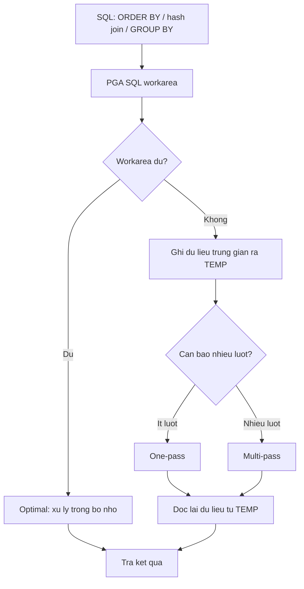
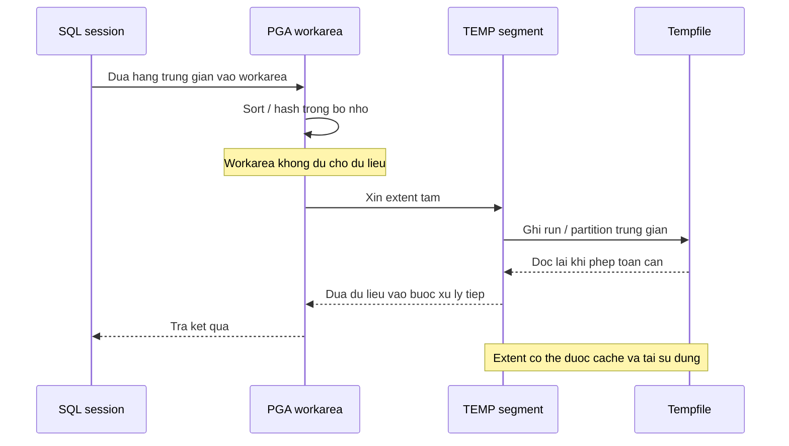

# Temporary segment, sort spill và quản lý dung lượng TEMP trong Oracle

Một câu truy vấn Oracle có thể đọc bảng rất nhanh nhưng chậm hẳn khi thêm `ORDER BY`, `GROUP BY` hoặc phép nối lớn. Nguyên nhân đôi khi không nằm ở số hàng trả về mà ở **bộ nhớ trung gian cần thiết để sắp xếp hoặc thực hiện hash join**. Khi vùng nhớ làm việc không đủ, Oracle có thể ghi dữ liệu trung gian xuống **temporary tablespace (TEMP)** rồi đọc lại để hoàn tất phép toán. Hiện tượng này thường được gọi là **sort spill** hoặc, rộng hơn, **workarea spill to disk**.

Khi có nhiều truy vấn đồng thời, TEMP có thể tăng nhanh và dẫn tới lỗi `ORA-01652: unable to extend temp segment ... in tablespace ...`. Để xử lý đúng, cần phân biệt **temporary segment**, **PGA workarea**, **tempfile**, lượng TEMP **đang hoạt động** và dung lượng TEMP **có thể cấp phát**.

Bài học này thuộc nhóm **Lưu trữ** của *Database Engine Relational Oracle*. Sau khi học, bạn có thể giải thích đường đi từ phép toán SQL đến TEMP, đọc các view theo dõi việc sử dụng TEMP, thiết lập temporary tablespace trong PDB thực hành và lựa chọn cách khắc phục khi truy vấn tràn bộ nhớ.

## 1. TEMP là gì và khác gì với permanent tablespace?

Oracle tổ chức dữ liệu thành các tablespace. **Permanent tablespace** như `USERS` chứa những segment thường trực của bảng và index. **Temporary tablespace** được thiết kế cho dữ liệu trung gian, thường phục vụ sắp xếp, hash join và một số đối tượng tạm thời trong phiên.

| Thành phần | Công dụng | Vòng đời điển hình |
| --- | --- | --- |
| **Permanent tablespace** | Lưu bảng, index và đối tượng thường trực | Tồn tại cho đến khi đối tượng bị thay đổi/xóa. |
| **Temporary tablespace** | Cung cấp không gian cho thao tác tạm | Các extent có thể được tái sử dụng giữa các phép toán và phiên. |
| **Tempfile** | File vật lý hỗ trợ temporary tablespace | Vẫn tồn tại trên lưu trữ sau khi truy vấn hoàn tất. |
| **Temporary segment** | Segment được Oracle cấp phát cho một nhu cầu tạm | Sử dụng theo thao tác/phiên hoặc đối tượng tạm; không đồng nghĩa với một bảng permanent. |
| **PGA workarea** | Vùng nhớ riêng phục vụ sort, hash join và các phép toán khác | Thường sử dụng trong lúc phép toán đang chạy; đủ bộ nhớ thì không cần spill. |

Ví dụ, người dùng chạy:

```sql
SELECT customer_id, SUM(amount) AS total_amount
FROM sales_orders
GROUP BY customer_id
ORDER BY total_amount DESC;
```

Để tính tổng và sắp xếp, Oracle có thể sử dụng bộ nhớ xử lý trung gian. Nếu không đủ chỗ theo kế hoạch và giới hạn workarea, phần dữ liệu trung gian có thể được đưa xuống TEMP. Các hàng gốc của `SALES_ORDERS` **không bị di chuyển** sang TEMP chỉ vì có sort spill; TEMP chứa dữ liệu làm việc mà execution plan cần.

### Một PDB cũng có bối cảnh TEMP riêng

Trong kiến trúc multitenant, kết nối đến một **PDB** phải xem cấu hình temporary tablespace trong đúng container. Có môi trường sử dụng local temporary tablespace hoặc cấu hình chia sẻ ở cấp CDB tùy phiên bản và thiết kế; không suy ra PDB đang dùng tempfile nào từ tên file của một PDB khác.

Trong bài, các thao tác minh họa sử dụng PDB thực hành, tài khoản quản trị trong PDB và một user thử nghiệm. Không thay đổi TEMP mặc định của môi trường dùng chung khi chưa xác định những phiên khác đang phụ thuộc vào cấu hình đó.

## 2. Temporary segment xuất hiện khi nào?

Không phải mọi truy vấn có `ORDER BY` đều cần ghi TEMP. Nếu dữ liệu có thể được xử lý trong bộ nhớ, hoặc Oracle tận dụng thứ tự từ index phù hợp, temporary segment có thể không được cấp phát cho phép toán đó.

Những tình huống **có khả năng** sử dụng TEMP gồm:

1. **Sort lớn:** `ORDER BY`, `DISTINCT`, `SORT GROUP BY` hoặc sắp xếp phục vụ một phần execution plan.
2. **Hash join/hash aggregation lớn:** bảng hash hoặc dữ liệu phân vùng trung gian không đủ workarea, buộc phải phân vùng và xử lý qua TEMP.
3. **Analytic/window processing:** một số phép `ROW_NUMBER()`, `RANK()` hoặc tổng hợp theo cửa sổ cần sắp xếp các partition lớn.
4. **Tạo/sửa index và các công việc bảo trì:** việc xây dựng index có thể cần vùng sắp xếp lớn, tùy thuật toán và kế hoạch.
5. **Global temporary table (GTT) hoặc dữ liệu tạm khác:** các segment cần thiết để chứa dữ liệu tạm thời của phiên/giao dịch có cơ chế sử dụng TEMP riêng.
6. **Thực thi song song:** nhiều parallel execution server có thể cùng tạo công việc tạm và làm tổng nhu cầu TEMP tăng mạnh.

| SQL/hoạt động | TEMP có bắt buộc không? | Vì sao |
| --- | --- | --- |
| `SELECT ... WHERE id = :id` theo unique index | Thường không | Tra cứu đơn giản không cần workarea sort lớn. |
| `ORDER BY` trên nhiều hàng | Không luôn luôn | Có thể sort trong PGA hoặc đi theo thứ tự index. |
| `GROUP BY` trên tập lớn | Tùy execution plan | Hash hoặc sort aggregation có thể spill nếu thiếu bộ nhớ. |
| Hash join hai tập dữ liệu lớn | Tùy kích thước/build side và workarea | Oracle có thể phân vùng dữ liệu sang TEMP. |
| `CREATE INDEX` trên bảng lớn | Có khả năng | Công đoạn tổ chức/sắp xếp index có thể cần không gian tạm. |
| `INSERT` vào GTT | Có thể sử dụng temporary segment | Dữ liệu tạm cần lưu trữ tùy loại bảng và cách cấp phát. |

Một **temporary segment** là khái niệm về không gian lưu trữ tạm được cấp phát theo nhu cầu. Nó khác với **temporary table** là một cấu trúc schema phục vụ dữ liệu phiên/giao dịch. Sort spill có thể tạo temporary segment **ngay cả khi câu SQL không nhắc đến bảng tạm nào**.

## 3. Vì sao sort/hash cần tràn từ PGA xuống TEMP?

Oracle dùng **Program Global Area (PGA)** cho các vùng nhớ thuộc tiến trình/phiên, trong đó có SQL workarea. Khi thực hiện sort, Oracle cần giữ các bản ghi trung gian để so sánh, sắp thứ tự và phát ra kết quả. Với hash join, Oracle cần tạo cấu trúc hash cho một phía phép nối. Các workarea này có quy mô phụ thuộc số hàng thực tế, kích thước hàng, cardinality estimation và các hoạt động cùng lúc.

Ở chế độ quản lý workarea tự động thông thường (`WORKAREA_SIZE_POLICY=AUTO`), Oracle phân bổ bộ nhớ dựa trên chính sách PGA và tải tổng thể. `PGA_AGGREGATE_TARGET` là một **mục tiêu quản lý PGA ở cấp hệ thống**, không phải số byte bảo đảm dành riêng cho từng sort, mỗi SQL hay mỗi session.

Ba kiểu thực thi có thể xảy ra:

| Kiểu thực thi | Đặc điểm | Ảnh hưởng |
| --- | --- | --- |
| **Optimal** | Phép toán đủ workarea bộ nhớ | Thường không phải spill vì thiếu workarea. |
| **One-pass** | Không giữ toàn bộ dữ liệu trung gian trong workarea; ghi/đọc phần dữ liệu qua TEMP | Tạo I/O bổ sung nhưng thường hoàn tất với số lần xử lý bổ sung hạn chế. |
| **Multi-pass** | Workarea quá nhỏ so với dữ liệu, phải xử lý qua TEMP nhiều vòng | Có thể tăng I/O và thời gian đáng kể. |



Với một sort, có thể hình dung Oracle tạo các dãy dữ liệu đã sắp xếp từng phần (*runs*) rồi trộn các run để hoàn tất thứ tự khi dữ liệu quá lớn so với workarea. Với hash join, phép toán có thể chia dữ liệu thành các partition trung gian và xử lý lại qua TEMP. Đây là mô hình khái niệm; thuật toán cụ thể phụ thuộc execution plan, phiên bản và chế độ thực thi.

**Spill không đồng nghĩa Oracle có lỗi.** Một báo cáo quét và sắp xếp hàng chục triệu bản ghi có thể cần TEMP bình thường. Vấn đề là chi phí I/O có chấp nhận được không, TEMP có đủ cho số người chạy đồng thời không và có truy vấn nào thực hiện nhiều công việc thừa hay không.

### Không chỉ kích thước bảng quyết định TEMP

Sắp xếp 1 triệu hàng chỉ có hai số nguyên có thể đòi workarea khác rất nhiều so với sắp xếp 1 triệu hàng mang chuỗi dài hoặc LOB được xử lý theo kế hoạch khác. Một bảng nhỏ nhưng bị **JOIN nhân bản số hàng trung gian** có thể tạo sort lớn hơn mong đợi.

Các yếu tố quan trọng:

- **Số hàng thực tế đi qua phép toán**, không chỉ số hàng cuối cùng trả về.
- **Độ rộng dữ liệu trung gian** mà phép sort/hash phải giữ.
- **Thứ tự phép toán và index**: index phù hợp có thể tránh một sort; index không phù hợp có thể làm plan tệ hơn.
- **Số concurrent sessions và độ song song**: tổng nhu cầu workarea/TEMP có thể tăng mạnh.
- **Thống kê optimizer** và sai lệch ước lượng cardinality: plan có thể không phù hợp với dữ liệu thực.
- **Chính sách PGA/workarea** cùng áp lực bộ nhớ hiện tại.

## 4. TEMP hoạt động thế nào khi một truy vấn spill?

Giả sử truy vấn cần sắp xếp khoảng 200 MB dữ liệu trung gian nhưng tại thời điểm chạy chỉ có thể dùng workarea nhỏ hơn mức đó. Oracle có thể:

1. Đọc dữ liệu nguồn theo execution plan; các nguồn này có thể nằm trong buffer cache hoặc datafile.
2. Xử lý một phần trong PGA workarea.
3. Yêu cầu các **extent trong temporary tablespace** để ghi dữ liệu trung gian.
4. Ghi các phần việc trung gian xuống tempfile và đọc chúng lại nếu cần.
5. Trộn/kết hợp thành kết quả cuối cùng.
6. Khi phép toán không còn cần segment, Oracle có thể **tái sử dụng** không gian đã cấp phát cho yêu cầu khác.



**Đã xong truy vấn không đồng nghĩa tempfile co nhỏ lại.** Oracle thường giữ các tempfile và có thể quản lý/tái sử dụng những extent tạm đã được cấp phát để giảm overhead. Vì vậy phải phân biệt:

- **Dung lượng tempfile trên storage**: file chiếm hoặc có khả năng mở rộng đến kích thước bao nhiêu.
- **Dung lượng đã cấp phát/quản lý trong TEMP**: các extent đã thuộc quản lý của temporary tablespace.
- **TEMP đang được các session/SQL sử dụng**: nhu cầu tạm thời hiện hành, được theo dõi qua các view sử dụng segment.
- **Dung lượng TEMP có thể sử dụng tiếp**: phụ thuộc free/reusable extents, autoextend, maxsize, filesystem/ASM và giới hạn hạ tầng.

Một tempfile 4 GB vẫn có thể hiện diện sau khi mọi câu `ORDER BY` đã hoàn tất. Xóa tempfile trực tiếp ở hệ điều hành là hành động nguy hiểm; mọi thay đổi kích thước hay loại bỏ file phải thông qua Oracle và được DBA cân nhắc.

### Temporary data không có cùng ý nghĩa durability với bảng thường trực

Dữ liệu trong temporary segment phục vụ tính toán hoặc dữ liệu tạm của phiên không mang mục tiêu lưu giữ lâu dài như hàng trong bảng permanent. Các quy tắc redo/undo và vòng đời segment có thể khác theo loại thao tác và cấu hình. Tuy vậy, **không nên suy ra “TEMP luôn bỏ qua redo”**: thao tác trên metadata, undo và cơ chế database khác vẫn có thể tạo redo. Kết quả nghiệp vụ thường trực chỉ được bảo vệ bằng transaction theo cơ chế riêng của dữ liệu permanent.

## 5. Tạo temporary tablespace cho môi trường thực hành

**Các câu DDL sau dành cho quản trị viên trong PDB thực hành**, không dành cho user chỉ có quyền tạo bảng. Kiểm tra đúng container trước khi thay đổi:

```sql
SELECT SYS_CONTEXT('USERENV', 'CON_NAME') AS current_container
FROM dual;
```

Giả sử PDB đã có nơi lưu file hợp lệ và cấu hình **Oracle Managed Files (OMF)** với `DB_CREATE_FILE_DEST` phù hợp, có thể tạo tablespace TEMP riêng tên `LAB_TEMP`:

```sql
CREATE TEMPORARY TABLESPACE lab_temp
  TEMPFILE SIZE 256M
  AUTOEXTEND ON NEXT 64M MAXSIZE 2G
  EXTENT MANAGEMENT LOCAL UNIFORM SIZE 1M;
```

| Tùy chọn | Ý nghĩa |
| --- | --- |
| `TEMPORARY TABLESPACE` | Chỉ định đây là tablespace dùng cho các segment tạm. |
| `TEMPFILE SIZE 256M` | Tạo tempfile có kích thước ban đầu 256 MB. |
| `AUTOEXTEND ON` | Cho phép file mở rộng khi cần và khi storage cho phép. |
| `NEXT 64M` | Bước tăng kích thước khi file tự mở rộng. |
| `MAXSIZE 2G` | Kích thước tối đa của **tempfile này**, không phải quota một user hay tổng trần của PDB. |
| `UNIFORM SIZE 1M` | Quản lý các extent tạm với kích thước đồng nhất 1 MB. |

Trong môi trường **không dùng OMF**, quản trị viên phải chỉ định đường dẫn tempfile hợp lệ, ví dụ sau là **cách tạo thay thế**, không chạy cả hai lệnh tạo cùng `LAB_TEMP`:

```sql
CREATE TEMPORARY TABLESPACE lab_temp
  TEMPFILE '/path/to/oradata/labpdb/lab_temp01.dbf'
  SIZE 256M AUTOEXTEND ON NEXT 64M MAXSIZE 2G
  EXTENT MANAGEMENT LOCAL UNIFORM SIZE 1M;
```

Thay đường dẫn bằng nơi Oracle Database thật sự có quyền tạo file và dung lượng phù hợp. Nếu môi trường Oracle Free/XE, cloud hoặc container đã cấp sẵn TEMP, có thể **dùng temporary tablespace đang có** để làm bài mà không cần tạo mới. Tên đường dẫn và cấu hình OMF không nên suy đoán từ ví dụ.

### Gán TEMP cho tài khoản thực hành

Giả sử đã có tài khoản local `LAB_USER` trong PDB:

```sql
ALTER USER lab_user TEMPORARY TABLESPACE lab_temp;
```

Khi user chạy những thao tác cần temporary segment, Oracle dùng cấu hình temporary tablespace phù hợp. **Không cần cấp `CREATE TABLE` chỉ để một câu `SELECT` sử dụng TEMP**; quyền SQL và quyền quản trị tablespace là hai vấn đề khác nhau.

Truy vấn kiểm tra trong phiên quản trị có quyền đọc dictionary:

```sql
SELECT username, temporary_tablespace
FROM dba_users
WHERE username = 'LAB_USER';

SELECT tablespace_name, contents, status
FROM dba_tablespaces
WHERE tablespace_name = 'LAB_TEMP';
```

Một temporary tablespace có thể phục vụ nhiều user và nhiều session. Đặt `MAXSIZE` trên tempfile giúp giới hạn file đó, **không tạo hạn mức tách biệt cho mỗi người học**. Khác với quota permanent tablespace, không thể coi cú pháp `QUOTA 256M ON LAB_TEMP` là cơ chế giới hạn TEMP theo user. Muốn kiểm soát tải và chia sẻ tài nguyên ở môi trường nhiều người, cần quy hoạch TEMP, theo dõi các truy vấn lớn và áp dụng chính sách quản trị workload/resource phù hợp.

### Kiểm tra dung lượng tempfile

```sql
SELECT tablespace_name,
       file_id,
       file_name,
       ROUND(bytes / 1024 / 1024, 1) AS current_mb,
       autoextensible,
       ROUND(maxbytes / 1024 / 1024, 1) AS max_mb
FROM dba_temp_files
WHERE tablespace_name = 'LAB_TEMP'
ORDER BY file_id;
```

`CURRENT_MB` là kích thước tệp do Oracle báo cáo, `MAX_MB` là mức cấu hình có thể mở rộng. Khi `AUTOEXTENSIBLE = NO`, không diễn giải `MAX_MB` như lượng dung lượng chắc chắn còn dùng được. Ngay cả khi autoextend được bật, thiếu dung lượng đĩa hoặc giới hạn ở hạ tầng lưu trữ vẫn khiến việc cấp phát thêm thất bại.

**Không tự chuyển default TEMP của cả PDB** chỉ để thử một user. Lệnh `ALTER DATABASE DEFAULT TEMPORARY TABLESPACE ...` tác động tới phạm vi rộng hơn và cần được quản trị viên quyết định theo chính sách của môi trường.

## 6. Theo dõi dung lượng TEMP: từ file đến session

Để trả lời “TEMP đang đầy vì đâu?”, cần nhìn từ nhiều góc:

1. Temporary tablespace có bao nhiêu tempfile, kích thước và trần autoextend?
2. Bao nhiêu không gian đang được quản lý/sẵn dùng?
3. **Session nào** đang giữ các temporary segment?
4. Phép toán SQL nào đang spill và đang dùng bao nhiêu workarea?

Các truy vấn sử dụng các view `DBA_*` và `V$*` bên dưới dành cho tài khoản có quyền xem tương ứng; **không cấp `DBA` cho user ứng dụng chỉ để truy vấn hiệu năng**. Trong PDB, cần truy vấn đúng container; trên RAC, có thể phải dùng các view `GV$*` và đối chiếu `INST_ID`.

### 6.1. Tổng quan dung lượng TEMP

```sql
SELECT tablespace_name,
       ROUND(tablespace_size / 1024 / 1024, 1) AS tablespace_mb,
       ROUND(allocated_space / 1024 / 1024, 1) AS allocated_mb,
       ROUND(free_space / 1024 / 1024, 1) AS free_mb
FROM dba_temp_free_space
WHERE tablespace_name = 'LAB_TEMP';
```

`DBA_TEMP_FREE_SPACE` hỗ trợ nhìn tổng thể lượng không gian tablespace, phần đã được quản lý/cấp phát và phần còn được báo là sẵn dùng. **Không đọc riêng `ALLOCATED_MB` như “số MB các session hiện đang dùng”.** Oracle có cơ chế giữ/tái sử dụng các extent tạm, nên số liệu cấp phát, không gian tái sử dụng và mức sử dụng hiện hành có thể khác nhau.

Một góc nhìn về không gian theo tempfile:

```sql
SELECT tablespace_name,
       file_id,
       ROUND(bytes_used / 1024 / 1024, 1) AS used_mb,
       ROUND(bytes_free / 1024 / 1024, 1) AS free_mb
FROM v$temp_space_header
WHERE tablespace_name = 'LAB_TEMP'
ORDER BY file_id;
```

`V$TEMP_SPACE_HEADER` phản ánh trạng thái cấp phát/quản lý không gian ở các tempfile. Các extent có thể vẫn được cache để tái sử dụng sau khi SQL kết thúc; **con số “used” ở view này không thay thế phép đo TEMP đang giữ bởi từng active session**.

### 6.2. Xác định session đang sử dụng temporary segment

`V$TEMPSEG_USAGE` (một số tài liệu/công cụ còn nhắc `V$SORT_USAGE`) cung cấp các temporary segment liên quan session. Ví dụ:

```sql
SELECT s.sid,
       s.serial#,
       u.username,
       u.sql_id,
       u.segtype,
       u.tablespace,
       u.blocks,
       ROUND(u.blocks * t.block_size / 1024 / 1024, 2) AS temp_mb
FROM v$tempseg_usage u
JOIN v$session s
  ON s.saddr = u.session_addr
 AND s.serial# = u.session_num
JOIN dba_tablespaces t
  ON t.tablespace_name = u.tablespace
WHERE u.tablespace = 'LAB_TEMP'
ORDER BY temp_mb DESC;
```

Ý nghĩa các trường:

- `SID`, `SERIAL#` giúp xác định session cụ thể; `USERNAME` giúp biết user nào sở hữu thao tác.
- `SEGTYPE` cho biết loại nhu cầu tạm mà Oracle đang ghi nhận, chẳng hạn `SORT` hoặc `HASH`; tập giá trị có thể khác giữa các phiên bản.
- `BLOCKS` là số block đã cấp phát cho segment được view ghi nhận; nhân với `BLOCK_SIZE` để đổi ra byte.
- `SQL_ID` là đầu mối truy tìm SQL liên quan đến việc cấp phát temporary segment; **không tự giả định đây luôn là câu SQL hiện hành của session**, vì trạng thái và vòng đời segment có thể khác thời điểm lấy snapshot.

Đây là phép đo tức thời: một truy vấn sort lớn có thể chạy xong trước khi bạn chụp được view. Nếu không thấy hàng, chưa thể kết luận “hệ thống không bao giờ dùng TEMP”. Để xem workload thoáng qua, cần công cụ lấy mẫu/giám sát phù hợp.

Trong RAC, truy vấn một instance bằng `V$TEMPSEG_USAGE` có thể bỏ sót session đang chạy ở instance khác. DBA có thể dùng `GV$TEMPSEG_USAGE` và join `GV$SESSION` trên cả `INST_ID` lẫn các định danh session để có bức tranh đủ của cluster.

### 6.3. Xác định phép sort/hash đang dùng workarea và TEMP

Oracle có view `V$SQL_WORKAREA_ACTIVE` cho những workarea đang hoạt động:

```sql
SELECT sid,
       sql_id,
       operation_type,
       ROUND(actual_mem_used / 1024 / 1024, 2) AS pga_workarea_mb,
       ROUND(tempseg_size / 1024 / 1024, 2) AS temp_mb,
       number_passes
FROM v$sql_workarea_active
WHERE tempseg_size > 0
ORDER BY temp_mb DESC;
```

View này là **snapshot của các workarea còn hoạt động**. `ACTUAL_MEM_USED` cho thấy bộ nhớ workarea được sử dụng tại thời điểm quan sát, `TEMPSEG_SIZE` biểu thị phần TEMP liên quan, còn `NUMBER_PASSES` cung cấp thông tin về các lượt xử lý khi workarea không đủ. Số liệu có thể đổi nhanh hoặc biến mất khi phép toán hoàn tất.

Để quan sát xu hướng optimal/one-pass/multi-pass trên nhiều workarea đã thực thi, DBA có thể tham khảo `V$SQL_WORKAREA_HISTOGRAM`:

```sql
SELECT ROUND(low_optimal_size / 1024 / 1024, 1) AS low_optimal_mb,
       ROUND(high_optimal_size / 1024 / 1024, 1) AS high_optimal_mb,
       optimal_executions,
       onepass_executions,
       multipasses_executions
FROM v$sql_workarea_histogram
WHERE optimal_executions
    + onepass_executions
    + multipasses_executions > 0
ORDER BY low_optimal_size;
```

Đây là số liệu tổng hợp workarea, **không phải thống kê chỉ của một user**. Đừng vội tăng PGA chỉ vì có một vài one-pass: cần so sánh thời gian, số lần chạy, lượng dữ liệu và tác động đối với toàn workload.

### 6.4. Xem PGA ở cấp hệ thống

```sql
SELECT name, value, unit
FROM v$pgastat
WHERE name IN (
    'aggregate PGA target parameter',
    'total PGA allocated',
    'extra bytes read/written',
    'over allocation count',
    'cache hit percentage'
)
ORDER BY name;
```

`EXTRA BYTES READ/WRITTEN` là một thống kê liên quan tới I/O bổ sung do những workarea không chạy optimal; `OVER ALLOCATION COUNT` có thể giúp nhận biết thời điểm áp lực PGA làm Oracle vượt mục tiêu tổng. Những chỉ số này cần đọc **theo thời gian**, đối chiếu với tổng số lần thực thi và thay đổi tải, thay vì suy ra nguyên nhân từ một snapshot duy nhất.

## 7. Sort spill trong execution plan và thống kê SQL

Execution plan cho thấy Oracle dự kiến dùng phép toán nào. Chẳng hạn:

- `SORT ORDER BY`: sắp xếp kết quả theo biểu thức `ORDER BY`.
- `SORT GROUP BY`: sắp xếp phục vụ nhóm/tổng hợp.
- `HASH JOIN`, `HASH GROUP BY`: phép toán dùng hash workarea, có thể spill nếu thiếu workarea.
- `WINDOW SORT`: sắp xếp phục vụ một số phép toán analytic.

Khi xem `DBMS_XPLAN`, cột `TempSpc` nếu xuất hiện thường là **ước lượng** dung lượng TEMP theo plan, **không phải chứng cứ duy nhất cho số byte đã ghi thật**. Để hiểu mức spill thực tế, ưu tiên thống kê execution/workarea và số liệu theo phiên, trong giới hạn quyền xem và phiên bản Oracle.

Ví dụ xem plan ước lượng cho câu truy vấn học tập:

```sql
EXPLAIN PLAN FOR
SELECT id, payload
FROM lab_temp_source
ORDER BY payload DESC, id DESC;

SELECT *
FROM TABLE(DBMS_XPLAN.DISPLAY());
```

Ví dụ này chỉ chạy sau khi đã tạo `LAB_TEMP_SOURCE` ở phần thực hành. `EXPLAIN PLAN` không chạy toàn bộ query để đo spill; plan thực tế có thể khác do bind, thống kê, adaptive plan và dữ liệu thực. Trong SQL Developer, công cụ xem plan/monitor có thể trình bày các số liệu này khác nhau.

## 8. Bài thực hành: quan sát workarea và TEMP

Thực hành trong schema riêng có `CREATE TABLE` và quota trên **permanent tablespace**; DBA đã gán một temporary tablespace hợp lệ cho user. Bài dùng nhiều hàng và chuỗi dài để tạo workarea có ý nghĩa, nhưng **không bảo đảm spill trên mọi cấu hình PGA**.

### Bước 1. Tạo dữ liệu mẫu

```sql
CREATE TABLE lab_temp_source AS
SELECT LEVEL AS id,
       MOD(LEVEL, 1000) AS group_id,
       RPAD(TO_CHAR(LEVEL), 300, 'X') AS payload
FROM dual
CONNECT BY LEVEL <= 50000;

SELECT COUNT(*) AS rows_loaded
FROM lab_temp_source;
```

Đây là DDL tạo bảng thường trực phục vụ bài học. Với 50.000 hàng, phần `PAYLOAD` tạo dữ liệu đáng kể nhưng vẫn ở mức thường có thể sử dụng trong lab. Nếu máy thực hành quá nhỏ, giảm số hàng; nếu không thấy spill, **không cố thay đổi cấu hình PGA hoặc làm đầy TEMP của hệ thống dùng chung** chỉ để tạo cảnh báo.

### Bước 2. So sánh các phép truy vấn

Truy vấn tìm một hàng:

```sql
SELECT id, group_id
FROM lab_temp_source
WHERE id = 1234;
```

Truy vấn sắp xếp:

```sql
SELECT id, payload
FROM lab_temp_source
ORDER BY payload DESC, id DESC;
```

Truy vấn tổng hợp:

```sql
SELECT group_id,
       COUNT(*) AS row_count,
       MAX(payload) AS max_payload
FROM lab_temp_source
GROUP BY group_id
ORDER BY row_count DESC;
```

Ba câu truy vấn có kích thước kết quả và nhu cầu làm việc khác nhau. Câu `ORDER BY` thứ hai trả nhiều hàng và có thể tạo lượng đầu ra terminal lớn; dùng tính năng chạy/đọc kết quả của client phù hợp, hoặc chạy riêng ngoài giờ cao điểm của môi trường lab. **Không dùng `FETCH FIRST 10 ROWS ONLY` rồi kết luận về nhu cầu sort toàn bộ**: optimizer có thể đổi sang top-N sort, làm thay đổi bài toán đang đo.

### Bước 3. Quan sát từ một phiên quản trị riêng

Khi câu sort còn đang chạy, tài khoản có quyền xem dictionary/dynamic views có thể lấy snapshot `V$TEMPSEG_USAGE` và `V$SQL_WORKAREA_ACTIVE` theo các câu ở mục 6. Đối chiếu:

| Câu hỏi | View/nguồn |
| --- | --- |
| Có tempfile nào, kích thước hiện tại và khả năng mở rộng? | `DBA_TEMP_FILES` |
| TEMP tổng thể đang có lượng free/reusable space ra sao? | `DBA_TEMP_FREE_SPACE`, `V$TEMP_SPACE_HEADER` |
| Session nào giữ temporary segment? | `V$TEMPSEG_USAGE` và `V$SESSION` |
| Workarea nào đang spill? | `V$SQL_WORKAREA_ACTIVE` |
| Oracle có sử dụng phép sort/hash như dự kiến không? | Execution plan, thống kê SQL thực tế |

Nếu truy vấn hoàn tất trước khi chụp được dữ liệu thì view động có thể không còn hàng. Đây là tính chất của dữ liệu giám sát, không phải lỗi trong câu SQL thực hành.

### Bước 4. Phân biệt temporary table và sort spill

Trong cùng schema có quyền `CREATE TABLE`:

```sql
CREATE GLOBAL TEMPORARY TABLE lab_gtt_notes (
    note_id NUMBER,
    note_text VARCHAR2(100)
) ON COMMIT DELETE ROWS;

INSERT INTO lab_gtt_notes (note_id, note_text)
VALUES (1, 'Du lieu tam cua transaction');

SELECT COUNT(*) AS before_commit
FROM lab_gtt_notes;

COMMIT;

SELECT COUNT(*) AS after_commit
FROM lab_gtt_notes;
```

Kết quả `BEFORE_COMMIT` là 1, còn `AFTER_COMMIT` là 0 trong trường hợp chạy như trên. **Định nghĩa GTT vẫn tồn tại** trong schema; dữ liệu tạm của transaction bị loại bỏ theo tùy chọn `ON COMMIT DELETE ROWS`. Với `ON COMMIT PRESERVE ROWS`, dữ liệu của GTT có vòng đời gắn với session và không bị xóa chỉ vì commit.

Ví dụ này cho thấy dữ liệu trong GTT và temporary segment của một sort là **hai cách sử dụng TEMP khác nhau**. Cần xem `SEGTYPE` và bối cảnh SQL khi đọc `V$TEMPSEG_USAGE`, thay vì coi mọi MB đang dùng là dữ liệu của `ORDER BY`.

Kết thúc bài, nếu không cần giữ bảng mẫu:

```sql
DROP TABLE lab_gtt_notes PURGE;
DROP TABLE lab_temp_source PURGE;
```

Hai lệnh `DROP` là DDL và gây implicit commit. Chỉ chạy trên bảng học tập của chính mình; không dùng những lệnh này để xóa dữ liệu của người khác.

## 9. Khi TEMP gần đầy hoặc gặp ORA-01652: xử lý theo nguyên nhân

Ví dụ thông báo lỗi:

```text
ORA-01652: unable to extend temp segment by ... in tablespace ...
```

Điều này cho biết Oracle không thể cấp phát thêm không gian cho một temporary segment tại thời điểm đó. **Không kết luận ngay rằng cần thêm đĩa**. Có thể một SQL tạo quá nhiều dữ liệu trung gian, nhiều phiên chạy cùng lúc, tempfile đạt `MAXSIZE`, autoextend bị tắt, storage hết chỗ hoặc bảng/plan có vấn đề. Lỗi có thể phát sinh khi thao tác như tạo index; không phải mọi `ORA-01652` đều bắt nguồn từ `ORDER BY`.

Quy trình điều tra:

1. **Ghi nhận thời điểm và SQL liên quan**: mã lỗi đầy đủ, PDB, tablespace, user, câu SQL hoặc job đang chạy.
2. **Xác định phiên đang sử dụng TEMP** bằng `V$TEMPSEG_USAGE`/`V$SESSION`, ưu tiên đúng instance/PDB.
3. **Đối chiếu workarea/plan**: có sort/hash lớn, độ rộng hàng trung gian bất thường, nhiều pass, hash join bị nhân số hàng hay mức parallelism quá cao không?
4. **Đọc tình trạng tempfile**: số file, `BYTES`, `MAXBYTES`, `AUTOEXTENSIBLE`, free space và dung lượng storage.
5. **Chọn cách cải thiện tương ứng**, sau đó đo lại với tải đại diện.

| Tình huống | Hành động nên xem xét | Giới hạn cần nhớ |
| --- | --- | --- |
| Query đọc/sort quá nhiều hàng | Lọc dữ liệu sớm, chọn cột cần thiết, kiểm tra join/cardinality và index | Không thêm index theo cảm tính; full scan có thể tối ưu cho tập lớn. |
| Hash/sort bị multi-pass vì workarea thiếu | Xem workarea statistics, PGA policy và tải đồng thời | `PGA_AGGREGATE_TARGET` là mục tiêu toàn hệ thống, không phải quota một SQL. |
| Nhiều báo cáo lớn chạy cùng lúc | Lên lịch, giới hạn concurrent jobs/parallelism theo chính sách | TEMP dùng chung nên một phiên lớn có thể ảnh hưởng phiên khác. |
| Tempfile đạt trần | Đánh giá `AUTOEXTEND`/`MAXSIZE` hoặc thêm tempfile | Phải có storage thật và kiểm soát tăng trưởng. |
| TEMP còn nhiều extent được tái sử dụng | Đọc thêm `V$TEMPSEG_USAGE` và đặc tính cache extent | Không xóa/tái tạo TEMP chỉ vì nhìn thấy allocated space cao. |
| PDB sử dụng TEMP không như dự kiến | Kiểm tra cấu hình user/PDB, service kết nối | Không sửa TEMP của container khác để giải quyết nhầm phạm vi. |

### Mở rộng TEMP khi đã xác định thiếu dung lượng thực

**Chỉ DBA** thực hiện trên môi trường có kiểm soát. Nếu temporary tablespace sử dụng OMF, một cách thêm tempfile:

```sql
ALTER TABLESPACE lab_temp
ADD TEMPFILE SIZE 512M
AUTOEXTEND ON NEXT 64M MAXSIZE 2G;
```

Nếu cần thay cấu hình autoextend cho một tempfile đã có:

```sql
-- Thay bằng FILE_NAME thực tế lấy từ DBA_TEMP_FILES.
ALTER DATABASE TEMPFILE '<DUONG_DAN_TEMPFILE_THUC_TE>'
AUTOEXTEND ON NEXT 64M MAXSIZE 2G;
```

Các lệnh này là **ví dụ quản trị**, không phải bước bắt buộc của bài thực hành. DBA cần xác định việc tăng dung lượng có phù hợp nguồn storage, giới hạn PDB, phương án backup/recovery, phân bổ tải và nguy cơ phát sinh lại lỗi hay không. Tăng TEMP giải quyết giới hạn tức thời, nhưng nếu SQL tạo dữ liệu trung gian gấp hàng trăm lần do JOIN sai thì vấn đề cốt lõi vẫn còn.

## 10. Phân biệt TEMP với UNDO, REDO và các dạng dữ liệu tạm

Các tên gần nhau nhưng mục tiêu khác nhau:

| Khái niệm | Chức năng |
| --- | --- |
| **TEMP** | Không gian cho sort/hash spill và những segment tạm khác. |
| **PGA** | Bộ nhớ làm việc của server process/session, nơi nhiều sort/hash cố gắng xử lý trước khi spill. |
| **UNDO** | Thông tin hỗ trợ rollback và consistent read; được quản lý bằng cơ chế undo riêng. |
| **REDO** | Nhật ký các thay đổi phục vụ durability và recovery; không phải vùng lưu kết quả sort. |
| **GTT** | Định nghĩa bảng thuộc schema nhưng dữ liệu của từng session/transaction là tạm; có thể dùng temporary storage. |

Ví dụ một câu `UPDATE` dài có thể sinh undo/redo đáng kể nhưng không hề cần sort spill. Một câu `SELECT ... ORDER BY` rất lớn có thể sử dụng TEMP dù không thay đổi bất kỳ hàng thường trực nào. Vì vậy không giải quyết tình trạng hết TEMP bằng cách “tăng UNDO”, cũng không suy ra tất cả lỗi sort liên quan đến redo log.

Một nguyên tắc vận hành khác: **không thể sử dụng quota permanent tablespace như công tắc giới hạn một người dùng chiếm bao nhiêu MB TEMP**. Việc gán default temporary tablespace định tuyến nơi cấp phát chứ không tạo hạn mức cứng độc lập cho từng session. Kiểm soát môi trường nhiều người đòi hỏi cả quản trị tài nguyên và giám sát truy vấn.

## 11. Các nhầm lẫn thường gặp

**“Có ORDER BY thì chắc chắn ghi ra TEMP.”** Không đúng. Oracle có thể dùng index đã có thứ tự hoặc sort hoàn toàn trong PGA. Chỉ khi execution plan và nhu cầu workarea đòi hỏi mới cần spill tương ứng.

**“Temporary segment là một bảng tạm.”** Không chính xác. Temporary segment là đơn vị cấp phát lưu trữ tạm; sort, hash, GTT và nhiều công việc khác có thể liên quan các loại segment tạm.

**“Query kết thúc rồi mà tempfile vẫn to nghĩa là đang rò rỉ dữ liệu.”** Không thể kết luận như vậy. File và extent có thể tồn tại để được tái sử dụng. Cần phân biệt allocated/free/reusable space và temp segment đang được session giữ.

**“PGA_AGGREGATE_TARGET đặt 2 GB thì mọi SQL có thể dùng 2 GB để sort.”** Không đúng. Đó là thông số mục tiêu quản lý PGA tổng, chịu áp lực của nhiều process/workarea và các cơ chế điều chỉnh.

**“Tăng TEMP luôn khiến SQL chạy nhanh hơn.”** Không. Tăng khả năng cấp phát giúp một phép spill hoàn thành, nhưng I/O qua TEMP vẫn có chi phí. Phải xem execution plan, workarea và tải đồng thời.

**“ORA-01652 chứng tỏ database hết hoàn toàn dung lượng đĩa.”** Không nhất thiết. Tempfile có thể đạt trần riêng hoặc không cấp phát được extent cần thiết dù storage tổng vẫn còn.

**“Chỉ cần đếm hàng kết quả là biết lượng TEMP.”** Không. Truy vấn trả 10 hàng có thể cần sắp xếp hàng triệu hàng trung gian; còn một truy vấn trả nhiều hàng nhưng đọc theo index có thể không spill.

## 12. Câu hỏi tự kiểm tra

1. **Sort spill là gì?** Là việc một phép sort không xử lý hoàn toàn trong workarea được cấp và phải ghi/đọc dữ liệu trung gian qua TEMP để hoàn tất.
2. **Optimal, one-pass và multi-pass khác nhau thế nào?** Optimal làm việc đủ trong bộ nhớ; one-pass cần I/O tạm nhưng ít vòng hơn; multi-pass phải xử lý nhiều vòng qua TEMP, thường tốn I/O hơn.
3. **Vì sao hai query cùng `ORDER BY` có thể có mức TEMP khác nhau?** Do số hàng trung gian, độ rộng hàng, index, kế hoạch, bộ nhớ được cấp và mức tải đồng thời khác nhau.
4. **Làm sao xem session nào đang giữ TEMP?** Dùng `V$TEMPSEG_USAGE` kết hợp `V$SESSION`, tính MB từ số block và block size, chú ý snapshot và đúng container/instance.
5. **`DBA_TEMP_FILES` và `V$TEMPSEG_USAGE` trả lời hai câu hỏi gì?** View thứ nhất mô tả tempfile/kích thước/cấu hình; view thứ hai cho biết temporary segment liên quan các session tại thời điểm quan sát.
6. **Có thể dùng `QUOTA 256M ON LAB_TEMP` để giới hạn dung lượng sort của user không?** Không. Quota là khái niệm cho permanent tablespace; nhu cầu tạm cần kiểm soát bằng thiết kế tài nguyên và cơ chế quản trị khác.
7. **Vì sao TEMP đã ngừng dùng mà file không tự co xuống?** Oracle có thể giữ file và các extent để tái sử dụng, tránh chi phí cấp phát lặp lại.
8. **Nên làm gì trước khi tăng TEMP sau lỗi `ORA-01652`?** Xác định SQL/session gây tải, kiểm tra sort/hash workarea, số lần thực thi/độ song song, giới hạn tempfile và dung lượng storage thực tế.
9. **Một GTT với `ON COMMIT DELETE ROWS` còn tồn tại sau `COMMIT` không?** Định nghĩa bảng vẫn còn; dữ liệu theo transaction bị xóa theo semantics đã chọn.

Khi cần xử lý một vấn đề TEMP trong Oracle, hãy lần theo chuỗi **toán tử SQL → PGA workarea → nhu cầu spill → temporary segment → tempfile → thống kê session và khả năng cấp phát**. Chuỗi này giúp nhận biết lỗi do thiết kế truy vấn, áp lực bộ nhớ, mức tải đồng thời hay giới hạn lưu trữ, từ đó đưa ra cách xử lý phù hợp mà không tác động ngoài ý muốn đến các PDB và người dùng khác.
