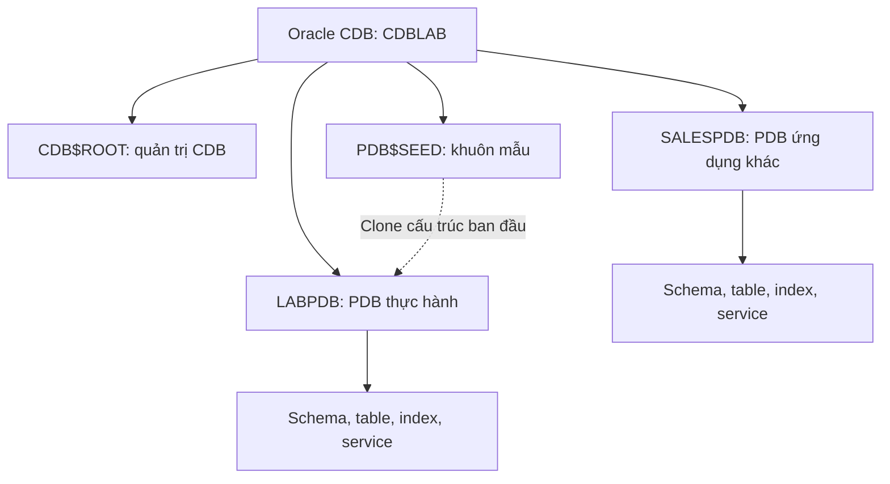
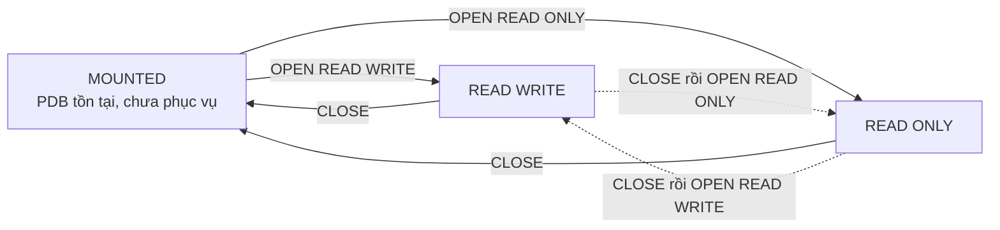

# Tạo, mở, đóng PDB và lưu trạng thái mở trong Oracle Database

Trong kiến trúc Oracle Multitenant, một **Container Database (CDB)** có thể chứa nhiều **Pluggable Database (PDB)**. Mỗi PDB cung cấp một phạm vi dữ liệu, đối tượng và tài khoản ứng dụng tương đối độc lập, nhưng sử dụng chung các thành phần hạ tầng của CDB. Việc tạo PDB, mở cho ứng dụng truy cập, đóng để bảo trì và lưu trạng thái mở sau khi CDB khởi động lại là nhóm thao tác cơ bản mà người quản trị Oracle cần nắm vững.

Bốn ý cần phân biệt ngay từ đầu:

- **`CREATE PLUGGABLE DATABASE`** tạo một PDB mới cùng metadata và các file cần thiết theo cấu hình lưu trữ.
- **`OPEN`** chuyển một PDB đã tồn tại sang trạng thái sẵn sàng phục vụ theo chế độ truy cập được chỉ định, thường là `READ WRITE` hoặc `READ ONLY`.
- **`CLOSE`** dừng phục vụ session trong PDB và đưa PDB về trạng thái `MOUNTED`; thao tác này **không xóa PDB**.
- **`SAVE STATE`** ghi nhận trạng thái mở cần được tự động khôi phục vào những lần khởi động instance/CDB tiếp theo; nó không thay thế lệnh `OPEN` đang chạy và không phải một bản sao lưu dữ liệu.

Các ví dụ sử dụng CDB thực hành `CDBLAB` và PDB mới `LABPDB`. Đây là tên minh họa, không phải tên mặc định có ở mọi môi trường. Các lệnh tạo/đóng PDB tác động tới kết nối và dữ liệu thực tế, vì vậy chỉ thực hiện trên **CDB lab riêng** bằng tài khoản quản trị được cấp phép; không chạy trên hệ thống dùng chung hoặc production để thử cú pháp.

## 1. Hiểu cấu trúc CDB và các trạng thái của PDB

### 1.1. CDB$ROOT, PDB$SEED và user PDB

Một CDB phổ biến có ba loại container:

| Container | Vai trò | Có dùng làm nơi lưu bảng ứng dụng mới không? |
|---|---|---|
| **`CDB$ROOT`** | Phạm vi quản trị chung của CDB; chứa metadata và thành phần cần để quản lý các PDB | Không; thao tác quản trị CDB khác với tạo dữ liệu nghiệp vụ |
| **`PDB$SEED`** | PDB mẫu do Oracle cung cấp để tạo PDB mới; thông thường được duy trì ở chế độ chỉ đọc | Không; không sửa seed để làm lab |
| **User PDB** như `LABPDB` | Môi trường chứa schema, bảng, dữ liệu và tài khoản ứng dụng riêng | Có; ứng dụng kết nối qua service của PDB |



Một instance Oracle quản lý tài nguyên như bộ nhớ và các tiến trình nền; các PDB cùng CDB không phải là các Oracle instance độc lập chỉ vì chúng có tên/service khác nhau. PDB có thể được đưa về `MOUNTED` trong khi CDB root và PDB khác vẫn đang mở.

### 1.2. Các trạng thái cần đọc đúng

Cột `OPEN_MODE` của view `V$PDBS` phản ánh trạng thái đang hoạt động của PDB:

| `OPEN_MODE` thường gặp | Ý nghĩa | Khả năng truy cập ứng dụng |
|---|---|---|
| **`MOUNTED`** | PDB tồn tại và được CDB nhận diện nhưng chưa mở để sử dụng như một database thông thường | Chưa phục vụ kết nối ứng dụng bình thường |
| **`READ WRITE`** | PDB mở cho đọc và ghi với các quyền đã cấp | Ứng dụng có thể truy vấn và thay đổi dữ liệu |
| **`READ ONLY`** | PDB mở để đọc; các thao tác cần ghi dữ liệu thông thường bị hạn chế | Phù hợp các kịch bản cần chế độ đọc |
| **`MIGRATE`** hoặc trạng thái chuyên biệt khác | Phục vụ nâng cấp/migration hoặc hoạt động đặc biệt theo phiên bản | Không xem là mode thông thường của ứng dụng |

Ngoài `OPEN_MODE`, cần xem cột **`RESTRICTED`**. PDB có thể mở `READ WRITE` nhưng ở chế độ hạn chế kết nối; khi đó không phải mọi tài khoản ứng dụng đều được phép đăng nhập. Vì vậy “đã mở” không luôn đồng nghĩa “ứng dụng đã vào được”.



Khi muốn đổi từ `READ WRITE` sang `READ ONLY` hoặc ngược lại trong một quy trình quản trị thông thường, đóng PDB trước rồi mở lại bằng mode mới. Đừng coi `ALTER PLUGGABLE DATABASE ... OPEN` là lệnh chuyển mode tùy ý trên một PDB đã mở.

## 2. Chuẩn bị môi trường trước khi tạo PDB

### 2.1. Điều kiện hệ thống

Cần có:

1. Một **CDB đã được tạo và đang hoạt động**, có kiến trúc Multitenant và phiên bản/edition cho phép tạo thêm PDB theo giới hạn thực tế.
2. Tài khoản quản trị có quyền tạo PDB ở **`CDB$ROOT`**, thường là một common administrative user được ủy quyền hoặc `SYSDBA` trên lab.
3. Dung lượng lưu trữ và cơ chế xác định nơi đặt các **datafile** được tạo mới từ `PDB$SEED`.
4. Oracle Net listener/service thích hợp nếu sẽ kết nối tới PDB từ máy client.
5. Kế hoạch tên PDB, tên tài khoản quản trị cục bộ và mật khẩu riêng cho lab.

Không nên thử tạo PDB bằng tài khoản ứng dụng chỉ có `CREATE TABLE` trong một PDB. Đây là thao tác quản trị CDB ở phạm vi cao hơn.

### 2.2. Kiểm tra vị trí container hiện tại

Từ máy chủ database có xác thực hệ điều hành dành cho DBA, SQL*Plus có thể được mở theo cách:

```console
sqlplus /nolog
SQL> CONNECT / AS SYSDBA
```

Cách xác thực này phụ thuộc cấu hình máy chủ và quyền hệ điều hành, không hoạt động trên mọi máy người dùng. Nếu đăng nhập từ xa, DBA dùng cách xác thực quản trị được hệ thống cấp, không chèn mật khẩu trực tiếp vào lệnh lưu trong script chia sẻ.

Kiểm tra mình đang ở `CDB$ROOT`:

```sql
SHOW CON_NAME

SELECT SYS_CONTEXT('USERENV', 'CON_NAME') AS current_container
FROM dual;

SELECT name, cdb, open_mode
FROM v$database;
```

`SHOW CON_NAME` là lệnh của SQL*Plus/SQLcl, không phải câu SQL dùng với mọi JDBC client. Khi `CDB` là `YES` và container là `CDB$ROOT`, ta đang ở phạm vi quản trị thích hợp cho thao tác tạo PDB.

Nếu một quản trị viên đã xác thực đủ quyền đang ở PDB khác, có thể chuyển về root bằng:

```sql
ALTER SESSION SET CONTAINER = CDB$ROOT;
```

Quyền chuyển container phải hợp lệ. Local user trong PDB không được tự ý chuyển sang root chỉ vì biết câu lệnh này.

### 2.3. Xem các PDB đang tồn tại

```sql
SHOW PDBS

SELECT con_id,
       name,
       open_mode,
       restricted
FROM v$pdbs
ORDER BY con_id;
```

Đây là cách nhanh nhất để tránh tạo trùng tên và biết PDB nào đang mở. `PDB$SEED` thường hiển thị trong danh sách. Không thay đổi trạng thái của seed như thay đổi một PDB người dùng.

Để xem thêm metadata, quản trị viên có thể dùng:

```sql
SELECT pdb_name,
       status,
       creation_time
FROM dba_pdbs
ORDER BY pdb_name;
```

**`DBA_PDBS.STATUS` và `V$PDBS.OPEN_MODE` trả lời hai câu hỏi khác nhau.** `STATUS` mô tả trạng thái metadata/vòng đời như `NEW` hoặc `NORMAL` tùy trường hợp; `OPEN_MODE` mới là thông tin trực tiếp để biết PDB có đang mở `READ WRITE`, `READ ONLY` hay còn `MOUNTED`. Không trộn hai cột thành một khái niệm.

### 2.4. Chuẩn bị vị trí file cho PDB mới

Tạo PDB từ seed cần một cơ chế xác định đường dẫn file mới. Cách thường gặp:

- **Oracle Managed Files (OMF):** Oracle tự đặt tên/quản lý datafile dựa trên vị trí được cấu hình, chẳng hạn tham số `DB_CREATE_FILE_DEST`.
- **`FILE_NAME_CONVERT`:** quy định ánh xạ phần đường dẫn/tên file từ seed sang vị trí file của PDB mới khi không dùng OMF thích hợp.
- **Cấu hình do DBA/cloud service cung cấp:** một số môi trường managed database có cơ chế riêng, người dùng không trực tiếp quản lý mọi đường dẫn.

Quan sát thông số hiện có:

```sql
SHOW PARAMETER db_create_file_dest
SHOW PARAMETER pdb_file_name_convert
```

Đây là các lệnh quan sát, không thay đổi cấu hình. Nếu không có OMF hoặc quy tắc đổi tên file hợp lệ, lệnh tạo PDB có thể thất bại vì không biết tạo file mới ở đâu. Trong database đang hoạt động, **không tự đặt lại vị trí lưu trữ của toàn CDB** chỉ để chạy ví dụ: việc đó cần DBA đánh giá ổ đĩa, ASM/Oracle Managed Files, quyền truy cập và chính sách backup.

## 3. Tạo một PDB mới từ PDB$SEED

### 3.1. Ví dụ CREATE PLUGGABLE DATABASE cơ bản

Giả sử CDB lab đã bật OMF và đã có không gian lưu trữ hợp lệ cho datafile. Trong phiên quản trị ở `CDB$ROOT`:

```sql
CREATE PLUGGABLE DATABASE labpdb
  ADMIN USER lab_admin
  IDENTIFIED BY "ReplaceWithUniqueStrongLabPassword123";
```

Thành phần câu lệnh:

| Phần | Ý nghĩa |
|---|---|
| `CREATE PLUGGABLE DATABASE labpdb` | Tạo PDB có tên `LABPDB` trong CDB hiện tại |
| `ADMIN USER lab_admin` | Tạo tài khoản quản trị cục bộ đầu tiên bên trong PDB mới |
| `IDENTIFIED BY ...` | Thiết lập mật khẩu cho tài khoản PDB administrator |
| Phần đường dẫn file không ghi ở ví dụ | Oracle sử dụng cấu hình OMF/file placement đã được chuẩn bị |

Mật khẩu trên chỉ là placeholder cho môi trường riêng; không copy nguyên vào production, không commit mật khẩu thật vào repository và không in thông tin đăng nhập vào log chia sẻ. Việc có `ADMIN USER` không đồng nghĩa ứng dụng nghiệp vụ nên sử dụng tài khoản quản trị đó.

Sau khi tạo, PDB mới thông thường ở trạng thái **`MOUNTED`**. Tức là lệnh `CREATE` đã hoàn thành nhưng người dùng vẫn chưa thể kết nối và chạy nghiệp vụ bình thường cho tới khi PDB được mở.

```sql
SELECT name, open_mode, restricted
FROM v$pdbs
WHERE name = 'LABPDB';
```

Kết quả kỳ vọng sau bước tạo là có hàng `LABPDB` và `OPEN_MODE` là `MOUNTED` (trước khi chạy lệnh mở).

### 3.2. Trường hợp cần FILE_NAME_CONVERT

Nếu hệ thống không dùng OMF thích hợp, DBA có thể chỉ định cặp mẫu thay thế đường dẫn/tên file từ seed sang PDB:

```sql
-- Ví dụ đường dẫn minh họa cho một CDB lab có bố cục file tương ứng.
-- Không chạy nguyên văn nếu chưa kiểm tra datafile của PDB$SEED.
CREATE PLUGGABLE DATABASE labpdb
  ADMIN USER lab_admin
  IDENTIFIED BY "ReplaceWithUniqueStrongLabPassword123"
  FILE_NAME_CONVERT = (
    '/u02/oradata/CDBLAB/pdbseed/',
    '/u02/oradata/CDBLAB/labpdb/'
  );
```

`FILE_NAME_CONVERT` không phải lệnh “di chuyển bảng” và cũng không đổi tên service. Oracle sử dụng quy tắc này để tạo đường dẫn file đích tương ứng với các file nguồn cần clone từ seed. Các đường dẫn trên là **ví dụ**, chỉ hợp lệ khi khớp file thật và thư mục đích có đủ quyền/dung lượng. Với ASM/OMF, cấu hình có thể hoàn toàn khác; không suy diễn rằng mọi Oracle Database đều có thư mục `/u02/oradata/...`.

**Chỉ chọn một phương án tạo PDB.** Nếu lệnh cơ bản đã tạo `LABPDB`, không chạy tiếp ví dụ `FILE_NAME_CONVERT` như một lệnh thứ hai cho cùng tên. Muốn làm lại từ đầu phải có quy trình riêng xử lý PDB đã tồn tại và dữ liệu của nó.

### 3.3. Tạo PDB không giống tạo một CDB mới

`CREATE PLUGGABLE DATABASE`:

- Tạo một container người dùng bên trong **CDB hiện hữu**.
- Dựa trên cơ chế clone từ `PDB$SEED` cho trường hợp tạo mới thông thường.
- Tạo/chuẩn bị các file và metadata thuộc PDB mới theo cấu hình.
- Không tự tạo listener mới và không đòi một Oracle instance độc lập cho mỗi PDB.
- Không mặc nhiên tạo sẵn mọi schema ứng dụng, bảng nghiệp vụ hay một service riêng tùy biến theo tên dự án.

Câu lệnh DDL quản trị này có các tác động lưu trữ thật và thuộc loại thao tác có implicit commit theo cơ chế Oracle; không dựa vào `ROLLBACK` SQL như một cách “hủy việc đã tạo PDB” sau khi chạy thành công.

## 4. Mở PDB bằng ALTER PLUGGABLE DATABASE ... OPEN

### 4.1. Mở READ WRITE

Ở `CDB$ROOT`:

```sql
ALTER PLUGGABLE DATABASE labpdb OPEN READ WRITE;
```

`OPEN READ WRITE` là mode thông thường để ứng dụng được quyền đọc/ghi dữ liệu. Trong nhiều trường hợp `ALTER PLUGGABLE DATABASE labpdb OPEN;` cũng mở với chế độ read-write mặc định theo cú pháp và trạng thái thích hợp, nhưng viết rõ `READ WRITE` giúp tránh nhầm với kịch bản `READ ONLY`.

Kiểm tra:

```sql
SELECT name, open_mode, restricted
FROM v$pdbs
WHERE name = 'LABPDB';
```

Khi hoạt động bình thường, `OPEN_MODE` trả `READ WRITE` và `RESTRICTED` thường là `NO`. Nếu `RESTRICTED` là `YES`, DBA cần kiểm tra lý do PDB đang hạn chế kết nối trước khi cho ứng dụng sử dụng.

### 4.2. Kết nối đến PDB sau khi mở

Thông thường Oracle tạo một service mặc định gắn với tên PDB, ví dụ `labpdb`; môi trường thực tế có thể có domain, service name do DBA quản lý hoặc cơ chế đăng ký khác. Phải sử dụng **service thật được listener biết**, không đoán từ tên file hoặc tên user.

Ví dụ kết nối từ SQL*Plus/SQLcl:

```console
sqlplus /nolog

SQL> CONNECT lab_admin@//db-lab.example.test:1521/labpdb
Enter password:
Connected.
```

Nếu listener chưa nhận đăng ký service vừa được mở hoặc có cấu hình Oracle Net đặc biệt, kết nối có thể cần thời gian đăng ký hoặc hành động kiểm tra từ DBA. Không sửa đường dẫn file PDB khi nguyên nhân thực tế là hostname/port/service sai.

Xác nhận **đang thực sự ở trong PDB**:

```sql
SELECT SYS_CONTEXT('USERENV', 'SESSION_USER') AS session_user,
       SYS_CONTEXT('USERENV', 'CON_NAME') AS container_name,
       SYS_CONTEXT('USERENV', 'SERVICE_NAME') AS service_name
FROM dual;
```

Kết quả mong đợi: container là `LABPDB`; service là service đã được database định tuyến cho session. Người dùng ở PDB không nên nhầm tên hiển thị trong SQL Developer với giá trị container mà server trả về.

### 4.3. Mở READ ONLY

Khi cần cho phép truy vấn đọc mà không cho thao tác DML nghiệp vụ thông thường, DBA có thể mở PDB ở mode `READ ONLY`. Với PDB đang `READ WRITE`, thực hiện chuyển trạng thái qua bước đóng:

```sql
-- Trong CDB$ROOT; chỉ thực hiện sau khi thông báo/điều phối client lab.
ALTER PLUGGABLE DATABASE labpdb CLOSE IMMEDIATE;

ALTER PLUGGABLE DATABASE labpdb OPEN READ ONLY;
```

Kiểm tra `V$PDBS.OPEN_MODE` phải trả `READ ONLY`. Các quyền đọc vẫn được áp dụng bình thường, còn những hoạt động ghi cần kiểm soát theo chế độ này. Không sử dụng `READ ONLY` như phương án thay thế cơ chế phân quyền tài khoản: một tài khoản vẫn cần được cấp quyền phù hợp để đọc dữ liệu.

### 4.4. Restricted mode

Trong một số hoạt động quản trị, PDB có thể được mở **restricted** để chỉ những tài khoản có quyền tương ứng vào được. Ví dụ cú pháp:

```sql
ALTER PLUGGABLE DATABASE labpdb OPEN RESTRICTED;
```

Chỉ chạy khi PDB đang ở trạng thái phù hợp để mở và theo quy trình DBA. Mode restricted là một thuộc tính khác với `READ WRITE`/`READ ONLY`: khi quan sát phải đọc **cả `OPEN_MODE` và `RESTRICTED`**. Nếu ứng dụng báo lỗi đăng nhập dù PDB “OPEN”, đây là một điểm cần kiểm tra.

## 5. Đóng PDB: CLOSE và CLOSE IMMEDIATE

### 5.1. CLOSE thực hiện điều gì?

Khi DBA đóng một PDB, Oracle ngừng cung cấp hoạt động session thông thường trong PDB đó và đưa PDB về trạng thái **`MOUNTED`**. Các datafile vẫn thuộc PDB; schema, bảng và dữ liệu vẫn tồn tại. Đóng PDB **không phải** `DROP PLUGGABLE DATABASE`.

Thao tác từ `CDB$ROOT`:

```sql
ALTER PLUGGABLE DATABASE labpdb CLOSE;
```

Với thao tác đóng thông thường, các phiên đang kết nối, hoạt động giao dịch và quy tắc chờ/ngắt phiên có thể ảnh hưởng việc lệnh hoàn tất. DBA phải xem số session còn hoạt động và quy trình bảo trì thay vì kỳ vọng mọi lần `CLOSE` đều kết thúc tức thì.

### 5.2. CLOSE IMMEDIATE

Trong kịch bản cần đóng PDB lab dứt khoát sau khi đã kiểm soát workload:

```sql
ALTER PLUGGABLE DATABASE labpdb CLOSE IMMEDIATE;
```

`IMMEDIATE` làm Oracle đóng mà không chờ ứng dụng tự kết thúc toàn bộ phiên theo cách graceful; các transaction chưa hoàn tất được xử lý theo cơ chế rollback/recovery của Oracle và session có thể bị ngắt. Đây là thao tác **gây gián đoạn dịch vụ** cho mọi ứng dụng dùng PDB. Không thực hiện trên production nếu chưa có lịch bảo trì, đánh giá ảnh hưởng và quyền quản trị.

Sau khi đóng:

```sql
SELECT name, open_mode
FROM v$pdbs
WHERE name = 'LABPDB';
```

Mong đợi `MOUNTED`. Một kết nối mới qua service ứng dụng của PDB đã đóng thường không thể thiết lập session bình thường. Nguyên nhân có thể biểu hiện thành lỗi service/handler tùy client, listener và cách dịch vụ được đăng ký.

### 5.3. Đóng PDB khác với dừng toàn bộ CDB

Giả sử `LABPDB` và `SALESPDB` cùng nằm trong một CDB. DBA đóng `LABPDB` thì `SALESPDB` không mặc nhiên bị đóng theo. CDB root vẫn giữ vai trò quản trị và có thể mở lại `LABPDB`.

Ngược lại, khi instance/CDB thực sự dừng, các PDB của instance đó cũng ngừng phục vụ. Sau lần startup tiếp theo, **trạng thái PDB được khôi phục như thế nào phụ thuộc saved state và cấu hình hiện hành**; đó là lý do cần học `SAVE STATE` riêng.

## 6. SAVE STATE — lưu trạng thái mở sau lần khởi động tiếp theo

### 6.1. Vấn đề: PDB mở rồi nhưng restart lại thành MOUNTED

Một kịch bản phổ biến:

1. DBA tạo `LABPDB` và chạy `ALTER PLUGGABLE DATABASE labpdb OPEN READ WRITE`.
2. Ứng dụng kết nối thành công.
3. Instance/CDB được restart theo lịch.
4. PDB không có saved state thích hợp quay về `MOUNTED` và ứng dụng không thể truy cập cho tới khi DBA mở lại.

Việc một PDB **đang mở** tại một thời điểm không tự động chứng minh nó sẽ **tự mở sau restart**. Oracle cung cấp cơ chế lưu trạng thái để tránh phải tự viết script mở PDB thủ công sau mỗi lần khởi động trong các phiên bản hỗ trợ.

### 6.2. Lưu trạng thái PDB đã mở

Ở `CDB$ROOT`, khi `LABPDB` đang `READ WRITE`:

```sql
ALTER PLUGGABLE DATABASE labpdb SAVE STATE;
```

Lệnh này lưu trạng thái mở hiện hành để Oracle biết cần mở PDB ở trạng thái tương ứng khi instance/CDB khởi động lần sau. Đây là **metadata vận hành**, không phải lệnh sao lưu bảng hoặc ảnh datafile.

Sau lệnh `SAVE STATE`:

- PDB đang `READ WRITE` tiếp tục hoạt động; `SAVE STATE` **không tự đóng hoặc mở lại PDB ngay lúc đó**.
- Ở lần khởi động thích hợp tiếp theo, Oracle có thể tự đưa PDB về trạng thái đã lưu thay vì để mặc định `MOUNTED`.
- Chế độ mở và các thông tin hạn chế kết nối có thể được ghi nhận theo cơ chế lưu trạng thái của phiên bản đang dùng.
- Với Oracle RAC, trạng thái được quản lý theo **instance**; cần đánh giá cấu hình saved state trên các instance liên quan, không kết luận từ trạng thái của một instance rồi áp dụng cho cả cluster.

**Không phải cứ CLOSE sau SAVE STATE thì saved state tự mất.** Ví dụ đã lưu `READ WRITE`, sau đó đóng PDB để thử nghiệm: PDB hiện tại là `MOUNTED` nhưng metadata đã lưu có thể vẫn yêu cầu `READ WRITE` ở lần startup kế tiếp. Đây là khác biệt giữa “hiện tại đang đóng” và “sau restart sẽ mở”.

### 6.3. Xem saved state đã được ghi nhận hay chưa

DBA có thể xem view:

```sql
SELECT con_name,
       instance_name,
       state,
       restricted
FROM dba_pdb_saved_states
WHERE con_name = 'LABPDB'
ORDER BY instance_name;
```

Cách diễn giải:

| Trường | Ý nghĩa |
|---|---|
| `CON_NAME` | Tên PDB đã lưu trạng thái |
| `INSTANCE_NAME` | Instance mà bản ghi saved state liên quan |
| `STATE` | Trạng thái mở đã được lưu, chẳng hạn `OPEN` hoặc mode tương ứng được view thể hiện theo phiên bản |
| `RESTRICTED` | Thông tin mở hạn chế nếu có |

Đọc giá trị `STATE` đúng theo tài liệu/schema của phiên bản Oracle đang chạy; không tự suy ra tên cột/value của view phải giống hệt `V$PDBS.OPEN_MODE`. **`DBA_PDB_SAVED_STATES` cho biết trạng thái đã lưu**, còn **`V$PDBS` cho biết trạng thái đang chạy**.

Để so sánh hai góc nhìn trong cùng phiên DBA ở root:

```sql
SELECT name, open_mode, restricted
FROM v$pdbs
WHERE name = 'LABPDB';

SELECT con_name, instance_name, state, restricted
FROM dba_pdb_saved_states
WHERE con_name = 'LABPDB';
```

Nếu một PDB đang `READ WRITE` nhưng không có bản ghi saved state mong muốn, đừng khẳng định PDB sẽ tự mở sau restart chỉ dựa vào trạng thái runtime hiện tại.

### 6.4. DISCARD STATE — bỏ thông tin tự mở

Khi không muốn giữ cơ chế tự khôi phục trạng thái mở đã lưu, DBA có thể chạy:

```sql
ALTER PLUGGABLE DATABASE labpdb DISCARD STATE;
```

`DISCARD STATE` **xóa cấu hình trạng thái mở đã lưu** theo phạm vi áp dụng; nó **không xóa PDB**, **không xóa dữ liệu**, và **không phải lệnh đóng PDB đang chạy**. Nếu PDB hiện đang `READ WRITE`, nó vẫn ở trạng thái runtime đó cho đến khi có thao tác khác hoặc instance thay đổi trạng thái.

Sau `DISCARD STATE`, kiểm tra lại `DBA_PDB_SAVED_STATES` để xác nhận bản ghi tương ứng đã được bỏ. Khi instance/CDB restart, PDB không còn được tự mở dựa trên bản ghi saved state vừa xóa (trừ khi có cơ chế khởi động khác do hạ tầng quản lý).

### 6.5. SAVE STATE khác ALTER SYSTEM và script tự động

`SAVE STATE` là khả năng Oracle cung cấp để lưu trạng thái mở PDB. Nó khác:

- **`ALTER SYSTEM`** dùng thay đổi tham số/cấu hình instance theo phạm vi tương ứng.
- **`ALTER PLUGGABLE DATABASE ... OPEN`** tác động ngay đến trạng thái PDB hiện tại.
- **Startup script** do DBA hoặc nền tảng bên ngoài tạo, có thể mở PDB theo lịch/cơ chế khác.
- **Backup/recovery** dùng bảo vệ/khôi phục dữ liệu, không được thay bằng saved state.

Trong môi trường được hệ thống quản lý tự động, trạng thái PDB có thể còn chịu tác động của orchestration, service startup hoặc runbook của tổ chức. Không khẳng định mọi lần PDB tự mở đều do `SAVE STATE` nếu chưa kiểm tra các cơ chế đó.

## 7. Một quy trình đầy đủ: CREATE → OPEN → SAVE STATE

Giả sử **CDB lab** đã dùng OMF, người quản trị có quyền ở root và tên `LABPDB` chưa tồn tại.

### Bước 1 — Kiểm tra root và tên PDB

```sql
SHOW CON_NAME

SELECT name, open_mode
FROM v$pdbs
ORDER BY con_id;
```

Xác nhận `CDB$ROOT` và không có `LABPDB`.

### Bước 2 — Tạo PDB

```sql
CREATE PLUGGABLE DATABASE labpdb
  ADMIN USER lab_admin
  IDENTIFIED BY "ReplaceWithUniqueStrongLabPassword123";
```

Kết quả dự kiến: PDB tồn tại, được ghi vào dictionary và ở trạng thái `MOUNTED` trước khi mở.

### Bước 3 — Mở và kiểm tra

```sql
ALTER PLUGGABLE DATABASE labpdb OPEN READ WRITE;

SELECT name, open_mode, restricted
FROM v$pdbs
WHERE name = 'LABPDB';
```

Kết quả dự kiến: `READ WRITE`, thường không restricted.

### Bước 4 — Lưu trạng thái

```sql
ALTER PLUGGABLE DATABASE labpdb SAVE STATE;

SELECT con_name, instance_name, state, restricted
FROM dba_pdb_saved_states
WHERE con_name = 'LABPDB';
```

Kết quả dự kiến: xuất hiện saved state cho PDB/instance liên quan.

### Bước 5 — Kiểm tra từ client

```console
sqlplus /nolog
SQL> CONNECT lab_admin@//db-lab.example.test:1521/labpdb
Enter password:
Connected.
```

Sau đó chạy:

```sql
SELECT SYS_CONTEXT('USERENV', 'CON_NAME') AS container_name
FROM dual;
```

Kết quả dự kiến: `LABPDB`.

### Bước 6 — Xác minh sau restart có kiểm soát

Chỉ trên lab có quyền quản trị và kế hoạch dừng/khởi động rõ ràng, DBA thực hiện restart theo phương pháp phù hợp với môi trường đó. **Không yêu cầu người học tự chạy `SHUTDOWN` trên máy chủ dùng chung.**

Sau startup, kiểm tra:

```sql
SELECT name, open_mode, restricted
FROM v$pdbs
WHERE name = 'LABPDB';

SELECT con_name, instance_name, state, restricted
FROM dba_pdb_saved_states
WHERE con_name = 'LABPDB';
```

Nếu saved state đã được áp dụng đúng và không có yếu tố ngăn cản việc mở, PDB cần trở lại mode đã lưu. Nếu vẫn `MOUNTED`, điều tra quyền, tình trạng file, lỗi startup/open, saved state theo instance và hệ thống quản lý dịch vụ trước khi chỉ lặp lại lệnh `SAVE STATE`.

### Bước 7 — Thử CLOSE và DISCARD STATE riêng biệt

Trên lab sau khi không còn client cần sử dụng:

```sql
ALTER PLUGGABLE DATABASE labpdb CLOSE IMMEDIATE;

SELECT name, open_mode
FROM v$pdbs
WHERE name = 'LABPDB';

SELECT con_name, instance_name, state
FROM dba_pdb_saved_states
WHERE con_name = 'LABPDB';
```

Ở bước này, `V$PDBS` có thể cho thấy `MOUNTED` nhưng saved state vẫn còn. Tiếp theo, nếu mục tiêu là bỏ tự mở:

```sql
ALTER PLUGGABLE DATABASE labpdb DISCARD STATE;

SELECT con_name, instance_name, state
FROM dba_pdb_saved_states
WHERE con_name = 'LABPDB';
```

Kết quả mong đợi: bản ghi saved state tương ứng không còn; PDB vẫn tồn tại và đang `MOUNTED`. Muốn tiếp tục sử dụng lab thì **phải OPEN lại**, ví dụ `ALTER PLUGGABLE DATABASE labpdb OPEN READ WRITE;`. Nếu muốn tự mở ở lần khởi động kế tiếp, cần `SAVE STATE` lại sau khi mở.

## 8. Bảng trạng thái: lệnh làm thay đổi điều gì?

Giả sử `LABPDB` mới tạo, chưa có saved state và lệnh đều thành công trên một instance lab:

| Bước | Lệnh | Trạng thái hiện tại (`V$PDBS`) | Saved state | Ý nghĩa |
|---|---|---|---|---|
| 1 | `CREATE PLUGGABLE DATABASE` | `MOUNTED` | Chưa có | Đã tạo PDB, chưa phục vụ ứng dụng |
| 2 | `OPEN READ WRITE` | `READ WRITE` | Chưa có | Dùng ngay được, chưa yêu cầu tự mở sau restart |
| 3 | `SAVE STATE` | `READ WRITE` | Có | Ghi nhớ trạng thái cho lần startup phù hợp |
| 4 | `CLOSE IMMEDIATE` | `MOUNTED` | Vẫn có | Đang đóng, nhưng cấu hình tự mở vẫn được giữ |
| 5 | `DISCARD STATE` | `MOUNTED` | Không còn | Bỏ cấu hình tự mở; không xóa PDB |
| 6 | `OPEN READ ONLY` | `READ ONLY` | Chưa có | Mở chỉ đọc cho phiên hiện tại |
| 7 | `SAVE STATE` | `READ ONLY` | Có | Ghi nhận trạng thái chỉ đọc theo cơ chế saved state |

Bảng này là mô hình lý tưởng của chuỗi thao tác. Hệ thống RAC, phiên bản Oracle, PDB có lỗi file, PDB restricted hoặc cơ chế startup bên ngoài có thể cần đánh giá riêng. **Không áp dụng bảng như một cam kết tuyệt đối rằng mọi PDB luôn mở được sau restart.**

## 9. Tạo user ứng dụng trong PDB đã mở

Tạo PDB không tự tạo toàn bộ tài khoản ứng dụng nghiệp vụ. Sau khi PDB đã mở, quản trị viên có thể kết nối bằng `LAB_ADMIN` vào service của `LABPDB` và tạo **local user** riêng để chạy SQL của ứng dụng.

Ví dụ cho môi trường lab có permanent tablespace `USERS`:

```sql
-- Chạy bên trong LABPDB bởi quản trị viên được cấp quyền thích hợp.
SELECT SYS_CONTEXT('USERENV', 'CON_NAME') AS container_name
FROM dual;

CREATE USER lab_app
  IDENTIFIED BY "ReplaceWithSeparateAppPassword123"
  DEFAULT TABLESPACE users
  QUOTA 100M ON users;

GRANT CREATE SESSION, CREATE TABLE TO lab_app;
```

Chỉ chạy khi `USERS` thực sự tồn tại trong PDB và tài khoản quản trị có quyền cấp quota/user phù hợp. Nếu tablespace mặc định của PDB có tên khác, DBA cần dùng đúng tên. Đây là ví dụ giáo dục, không khuyến khích cấp quyền rộng cho tài khoản ứng dụng production.

Từ phía ứng dụng Java:

```text
jdbc:oracle:thin:@//db-lab.example.test:1521/labpdb
```

Phần `labpdb` xác định **service/PDB**, còn username `LAB_APP` và password được truyền riêng để xác thực. JDBC pool trong Spring Boot/HikariCP có thể giữ nhiều kết nối mở; khi DBA đóng PDB, các kết nối này có thể trở nên không sử dụng được. Ứng dụng phải có cấu hình timeout, kiểm tra connection và cơ chế phục hồi sau gián đoạn theo nhu cầu nghiệp vụ.

## 10. Những thao tác gần giống nhưng khác hẳn nhau

### 10.1. PDB CLOSE không phải PDB DROP

| Thao tác | Hiệu lực chính | Dữ liệu/schema còn tồn tại? |
|---|---|---|
| `CLOSE` | Dừng phục vụ, trở lại `MOUNTED` | Có |
| `OPEN` | Cho phục vụ lại ở mode chỉ định | Có |
| `SAVE STATE` | Lưu cấu hình trạng thái mở | Có |
| `DISCARD STATE` | Bỏ cấu hình trạng thái mở | Có |
| `DROP PLUGGABLE DATABASE` | Xóa PDB khỏi CDB theo điều kiện/cú pháp và tùy chọn quản lý file | Tác động phá hủy/loại bỏ tài nguyên; **không dùng để thử CLOSE** |

Bài này không yêu cầu drop PDB. Khi cần dọn môi trường, phải có quy trình riêng xác nhận phạm vi dữ liệu, backup, client liên quan và lệnh xóa thích hợp.

### 10.2. PDB MOUNTED không đồng nghĩa CDB đang tắt

Một PDB `MOUNTED` là đối tượng đã được CDB nhận diện nhưng chưa mở cho hoạt động ứng dụng. CDB có thể vẫn đang chạy và các PDB khác vẫn `READ WRITE`. Nếu toàn bộ instance không chạy, câu truy vấn `V$PDBS` cũng không thể được thực hiện như bình thường từ một session vào instance đó.

### 10.3. Saved state không đồng nghĩa sao lưu dữ liệu

`SAVE STATE` chỉ định trạng thái mở ở lần startup sau; nó không tạo backup, không chụp snapshot và không bảo vệ trước mất datafile. Bảo vệ dữ liệu là nhiệm vụ của backup/recovery (ví dụ RMAN) cùng chính sách lưu trữ, kiểm thử restore và phục hồi.

### 10.4. PDB name không luôn là service duy nhất

Thông thường có service mặc định liên quan tới PDB, nhưng một PDB có thể có nhiều service phục vụ nhóm ứng dụng khác nhau. Cấu hình listener, dịch vụ RAC, domain và chính sách kết nối có thể khiến tên service thực tế khác chuỗi ngắn mà người học tưởng tượng. Khi lỗi đăng nhập, kiểm tra service được listener cung cấp thay vì sửa tên PDB trong DDL.

## 11. Giám sát và xử lý lỗi khi tạo/mở/đóng/lưu state

### 11.1. Bộ câu lệnh quan sát cơ bản

Từ `CDB$ROOT` bằng tài khoản có quyền:

```sql
-- Đang ở container nào?
SELECT SYS_CONTEXT('USERENV', 'CON_NAME') AS current_container
FROM dual;

-- Các PDB và trạng thái hiện hành.
SELECT con_id, name, open_mode, restricted
FROM v$pdbs
ORDER BY con_id;

-- Metadata một PDB cụ thể.
SELECT pdb_name, status, creation_time
FROM dba_pdbs
WHERE pdb_name = 'LABPDB';

-- Trạng thái mở đã lưu.
SELECT con_name, instance_name, state, restricted
FROM dba_pdb_saved_states
WHERE con_name = 'LABPDB';
```

Khi cần biết vì sao PDB không mở, DBA còn có thể xem diagnostic alert log, trace, service registration và trạng thái file/dung lượng theo quy trình vận hành. Các view quản trị đòi privilege thích hợp; không cấp `DBA` hoặc `SELECT ANY DICTIONARY` cho app user chỉ vì muốn theo dõi.

### 11.2. Các lỗi hoặc tình huống thường gặp

| Hiện tượng | Nguyên nhân có thể | Kiểm tra đầu tiên |
|---|---|---|
| `CREATE PLUGGABLE DATABASE` báo thiếu quyền | Session không ở root hoặc user thiếu quyền tạo PDB | `SHOW CON_NAME`, cách đăng nhập và grant quản trị |
| `CREATE` báo lỗi đường dẫn file, ví dụ `ORA-65016` | Thiếu cơ chế file name conversion khi cần, OMF chưa phù hợp | `DB_CREATE_FILE_DEST`, `PDB_FILE_NAME_CONVERT`, đường dẫn seed/đích |
| Tên PDB đã tồn tại | Trùng tên hoặc đã tạo thành công ở lần trước | `V$PDBS`, `DBA_PDBS` |
| PDB còn `MOUNTED` sau tạo | Chưa thực hiện `OPEN` | `OPEN_MODE` và lệnh `ALTER PLUGGABLE DATABASE ... OPEN` |
| `OPEN` thất bại do file/dung lượng | Datafile không truy cập được, sai vị trí, filesystem/ASM thiếu tài nguyên | Thông báo ORA đầy đủ, alert log, file/storage |
| Client báo `ORA-12514` sau khi PDB đang đóng | Listener không biết service đang được yêu cầu, service chưa hoạt động/đăng ký hoặc tên sai | `OPEN_MODE`, `lsnrctl services` và connect string |
| PDB đã `READ WRITE` nhưng app không đăng nhập được | Sai user/password, service, trạng thái restricted hoặc quyền | `RESTRICTED`, service và thông báo lỗi |
| `CLOSE` không kết thúc như mong muốn | Còn session/transaction hoạt động, cơ chế đóng thường phải xử lý | Kiểm tra session active, window bảo trì và mode close |
| Sau restart PDB `MOUNTED` | Chưa `SAVE STATE`, saved state sai instance, lỗi trong startup/open hoặc automation khác | `DBA_PDB_SAVED_STATES`, `V$PDBS`, alert log |
| `DISCARD STATE` xong PDB vẫn mở | Đây là hành vi mong đợi: xóa saved state, không đổi runtime | So sánh `V$PDBS` với `DBA_PDB_SAVED_STATES` |

Mã lỗi là gợi ý xác định lớp vấn đề, không đủ để kết luận nguyên nhân. Chẳng hạn `ORA-12514` cũng có thể đến từ việc gõ sai service dù PDB đã mở; `ORA-01017` thường liên quan xác thực chứ không chứng minh PDB bị đóng.

### 11.3. Listener và service

Người quản trị có thể xem dịch vụ được đăng ký tại listener thích hợp:

```text
lsnrctl services
```

Khi PDB mở, service liên quan phải sẵn sàng và được định tuyến phù hợp để client kết nối. Listener không phải nơi lưu trạng thái PDB, và `lsnrctl services` không thay thế `V$PDBS`. Để điều tra cần kiểm tra cả ba: **PDB runtime state**, **service/listener**, **client connect identifier**.

### 11.4. Những điểm riêng ở Oracle RAC

Trong Oracle RAC, một PDB có thể được mở trên những instance khác nhau theo cấu hình và mục tiêu dịch vụ. Trạng thái lưu bằng `SAVE STATE` có phạm vi **instance**, và SQL hỗ trợ tùy chọn chọn instance trong các trường hợp tương ứng. Khi vận hành RAC:

- Không suy ra “PDB mở trên instance A” nghĩa là đã mở trên mọi instance.
- Kiểm tra saved state theo `INSTANCE_NAME` và trạng thái PDB trên các instance liên quan bằng các view cluster như `GV$PDBS` khi có quyền.
- Phối hợp chính sách service, failover và workload với đội DBA/RAC; không tự áp dụng một script mở toàn bộ instance từ bài lab đơn instance.

Mục tiêu của bài học này là nhận diện đúng phạm vi. Việc triển khai câu lệnh `INSTANCES=...` cụ thể phải theo topology/version Oracle và runbook của cluster.

## 12. Thực hành theo tình huống

### Tình huống A — PDB mới tạo nhưng app không vào được

**Dữ kiện:** `CREATE PLUGGABLE DATABASE labpdb ...` báo thành công, nhưng ứng dụng Java kết nối tới service `labpdb` thất bại.

**Cách suy luận:** Tạo thành công mới khẳng định PDB tồn tại. Kiểm tra `V$PDBS.OPEN_MODE`. Nếu `MOUNTED`, mở `READ WRITE`. Sau đó kiểm tra service đã được listener đăng ký, dùng đúng host/port/service và thử login bằng tài khoản PDB. Không cấp thêm quyền bảng, không sửa datasource password khi lỗi thực tế nằm ở trạng thái PDB.

### Tình huống B — Sau bảo trì cuối tuần ứng dụng lỗi

**Dữ kiện:** trước lúc restart, `LABPDB` ở `READ WRITE`; sau restart, nó ở `MOUNTED`.

**Cách suy luận:** `OPEN` trước bảo trì không chứng minh có saved state. Kiểm tra `DBA_PDB_SAVED_STATES`. Nếu chưa lưu, sau khi mở lại và xác nhận dịch vụ, DBA chạy `SAVE STATE` theo phạm vi instance cần thiết. Nếu đã lưu, đọc alert log và cấu hình startup để tìm nguyên nhân trạng thái không được áp dụng.

### Tình huống C — Muốn tạm dừng PDB mà không xóa dữ liệu

**Dữ kiện:** DBA cần ngắt một PDB lab khỏi ứng dụng để điều tra.

**Cách suy luận:** thông báo và ngắt client, sau đó dùng `CLOSE` hoặc `CLOSE IMMEDIATE` theo yêu cầu bảo trì. PDB vẫn tồn tại và có thể `OPEN` lại. Nếu muốn PDB **không tự mở sau lần startup tới**, cần xem và điều chỉnh saved state riêng; chỉ CLOSE không phải thao tác bảo đảm xóa cấu hình tự mở.

### Tình huống D — Chỉ cho đọc trong một đợt kiểm tra

**Dữ kiện:** PDB cần mở phục vụ truy vấn đọc, không thực hiện cập nhật dữ liệu nghiệp vụ.

**Cách suy luận:** chuyển từ `READ WRITE` qua `CLOSE` rồi `OPEN READ ONLY` theo kế hoạch gián đoạn. Xác minh ứng dụng có hỗ trợ chế độ chỉ đọc, kiểm tra `OPEN_MODE`; nếu mong muốn tự mở lại ở chế độ chỉ đọc sau restart, lưu state khi PDB đang mở theo chế độ đó. Trước khi đưa ứng dụng trở lại ghi bình thường, cần đóng và mở lại `READ WRITE`, rồi cập nhật saved state tương ứng.

## 13. Bài tập tổng hợp có kết quả mong đợi

Trên CDB lab riêng, thực hiện bằng tài khoản quản trị thích hợp:

1. **Nhận diện CDB:** dùng `SHOW CON_NAME` và `V$DATABASE` xác nhận đang ở `CDB$ROOT` của một CDB.
2. **Kiểm tra storage:** xem `DB_CREATE_FILE_DEST` hoặc cơ chế `FILE_NAME_CONVERT` trước khi tạo PDB.
3. **Tạo PDB:** tạo `LABPDB`, kiểm tra hàng mới trong `V$PDBS` và giải thích tại sao ban đầu `MOUNTED`.
4. **Mở đọc/ghi:** chạy `OPEN READ WRITE`, đọc `OPEN_MODE`, kiểm tra service và đăng nhập từ client.
5. **Lưu state:** chạy `SAVE STATE` và đối chiếu `DBA_PDB_SAVED_STATES` với trạng thái runtime.
6. **Đóng PDB:** ngắt client của lab rồi `CLOSE IMMEDIATE`; quan sát trạng thái `MOUNTED` và kiểm tra saved state có còn.
7. **Bỏ saved state:** chạy `DISCARD STATE`, xác nhận bản ghi saved state được bỏ mà PDB không bị xóa.
8. **Mở chỉ đọc:** chạy `OPEN READ ONLY`, xác nhận mode và thảo luận tác động với ứng dụng ghi dữ liệu.
9. **Khôi phục môi trường học:** đóng rồi mở `READ WRITE`, lưu state tương ứng nếu muốn PDB tự mở khi khởi động lần tiếp theo.

Phiếu ghi kết quả nên có:

| Thao tác | `V$PDBS.OPEN_MODE` | `V$PDBS.RESTRICTED` | Có bản ghi saved state? | Kết nối app thành công? |
|---|---|---|---|---|
| Sau CREATE | `MOUNTED` | Theo kết quả thực tế | Chưa | Không bình thường |
| Sau OPEN READ WRITE | `READ WRITE` | Thường `NO` | Chưa | Có, nếu service và credential đúng |
| Sau SAVE STATE | `READ WRITE` | Theo kết quả | Có | Không đổi chỉ vì lưu state |
| Sau CLOSE | `MOUNTED` | Theo kết quả | Vẫn có | Không thể phục vụ session mới bình thường |
| Sau DISCARD STATE | `MOUNTED` | Theo kết quả | Không | Không đổi runtime |
| Sau OPEN READ ONLY | `READ ONLY` | Theo kết quả | Chưa có nếu chưa lưu lại | Đăng nhập/đọc theo quyền và mode |

Trong phiếu, ghi lại **lỗi thực tế và bối cảnh** nếu một bước không thành công. Không điền kết quả dự kiến thành “bằng chứng đã chạy” nếu chưa được quan sát.

## 14. Những câu hỏi phải trả lời được

1. `CDB$ROOT`, `PDB$SEED` và một user PDB khác nhau ở điểm nào? Vì sao không tạo bảng ứng dụng trong `PDB$SEED`?
2. Vì sao lệnh `CREATE PLUGGABLE DATABASE` có thể thành công nhưng ứng dụng vẫn chưa kết nối được?
3. `MOUNTED`, `READ WRITE`, `READ ONLY` và `RESTRICTED` có quan hệ ra sao?
4. Lệnh nào mở một PDB đã đóng? Cần quyền ở container nào?
5. `CLOSE IMMEDIATE` tác động gì tới session và transaction đang chạy? Vì sao không thể dùng nó tùy tiện trên production?
6. Sau khi `SAVE STATE` rồi `CLOSE`, vì sao hai view `V$PDBS` và `DBA_PDB_SAVED_STATES` có thể cho thông tin khác nhau mà đều đúng?
7. `DISCARD STATE` có xóa PDB, xóa dữ liệu hoặc tự đóng PDB đang mở không?
8. Cần chuẩn bị đường dẫn file hoặc OMF như thế nào trước khi tạo PDB từ seed?
9. Nếu PDB mở nhưng client báo lỗi service, sẽ kiểm tra `OPEN_MODE`, listener và connect string theo thứ tự nào?
10. Vì sao khi dùng RAC cần lưu ý saved state theo instance?

Nắm được các bước **CREATE → OPEN → SAVE STATE → CLOSE → DISCARD STATE** giúp người học quản trị đúng vòng đời PDB: biết PDB đã tồn tại hay chưa, hiện có phục vụ ứng dụng không, và sẽ ở trạng thái nào sau lần khởi động CDB tiếp theo. Đồng thời, việc luôn xác nhận **container, service, trạng thái runtime và saved state** giúp tránh nhầm lẫn giữa vấn đề lưu trữ, vấn đề đăng nhập và thao tác vận hành.
