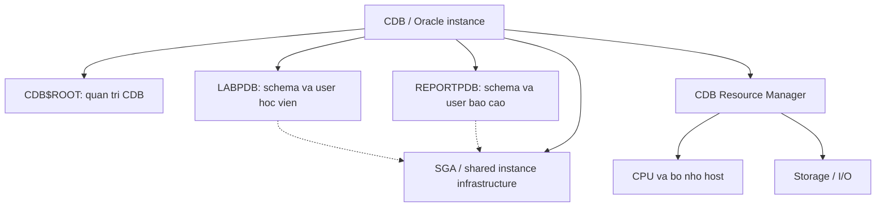

# Phân quyền và giới hạn tài nguyên giữa các PDB trong Oracle

Trong một Oracle **Container Database (CDB)**, nhiều **Pluggable Database (PDB)** có thể chạy trên cùng hạ tầng. Điều này thuận tiện khi một tổ chức muốn tách môi trường phát triển, báo cáo và các ứng dụng mà không phải dựng một Oracle instance cho mỗi nhóm. Tuy nhiên, việc đặt nhiều PDB cạnh nhau đặt ra hai câu hỏi quan trọng:

1. **Ai được làm gì ở đâu?** Một người quản trị CDB có được quyền trên mọi PDB không? User của PDB này có tự xem bảng hoặc cấp quyền trong PDB khác được không?
2. **Ai được sử dụng bao nhiêu tài nguyên?** Nếu truy vấn báo cáo ở một PDB chiếm nhiều CPU, PGA hoặc TEMP, làm thế nào để những PDB khác vẫn hoạt động ổn định?

Trong Oracle, hai bài toán này được giải quyết bằng những cơ chế riêng nhưng phối hợp với nhau: **phạm vi tài khoản và quyền (common/local user, role, privilege)**; **quota, profile và cấu hình tài nguyên cấp PDB**; **CDB Resource Manager và giới hạn lưu trữ**; cùng với việc giám sát thực tế.

Ví dụ xuyên suốt sử dụng một CDB có hai PDB: `LABPDB` dành cho học viên và `REPORTPDB` dành cho báo cáo. Tên PDB, role, user và số liệu giới hạn chỉ để minh họa. Các lệnh thay đổi quyền hoặc cấu hình tài nguyên cần chạy bởi quản trị viên có thẩm quyền trong môi trường thử nghiệm; những tính năng khả dụng phụ thuộc phiên bản/edition và cấu hình Oracle đang sử dụng.

## 1. Phân biệt ranh giới PDB với tài nguyên dùng chung



Một PDB là **ranh giới logic cho dữ liệu, metadata, nhiều tài khoản và cấu hình**. Ví dụ, local user `LAB_ALICE` trong `LABPDB` không trở thành user của `REPORTPDB` chỉ vì hai PDB cùng thuộc một CDB. Bảng cùng tên ở hai PDB là hai đối tượng riêng.

Tuy nhiên, các PDB **chia sẻ nhiều thành phần của CDB/instance**, chẳng hạn CPU, bộ nhớ tổng, các tiến trình nền và hạ tầng lưu trữ. Một truy vấn nặng có thể ảnh hưởng tài nguyên PDB khác nếu không có kế hoạch phân bổ, giới hạn và theo dõi phù hợp. Mức cô lập này không tương đương với hai máy chủ hoàn toàn độc lập.

| Phạm vi | Ví dụ thành phần | Nguyên tắc |
| --- | --- | --- |
| **CDB/root** | Common users/roles, chính sách resource plan giữa PDB, cấu hình instance | Dành cho DBA quản trị nhiều container. |
| **Từng PDB** | Local users, local roles, schema, object privileges, nhiều tham số cấp PDB | Dành cho quản trị PDB và ứng dụng riêng của PDB. |
| **Từng user/schema** | Quyền tạo/đọc/sửa bảng, profile, quota trên permanent tablespace | Phân quyền và hạn mức trong nội bộ PDB. |
| **Tài nguyên chia sẻ** | CPU, PGA/SGA tổng thể, I/O, storage nền | Cần chính sách phân phối để PDB không tranh chấp không kiểm soát. |

Trong cấu hình multitenant, redo và nhiều hoạt động ở cấp instance vẫn có quan hệ với CDB; undo có thể được tổ chức theo **local undo mode** hoặc cấu hình phù hợp với phiên bản. Không nên suy từ một tên PDB rằng toàn bộ CPU, RAM, redo log và hệ điều hành đều độc lập.

## 2. Quyền truy cập bắt đầu bằng container mà phiên đang kết nối

Quản trị viên thường làm việc ở `CDB$ROOT` hoặc kết nối trực tiếp vào PDB qua **service name** của PDB. Khi chạy câu `CREATE USER`, `GRANT` hoặc `ALTER SYSTEM`, trước hết phải biết mình đang ở container nào.

Trong SQL*Plus/SQLcl, có thể kiểm tra:

```sql
SHOW CON_NAME;
SHOW PDBS;

SELECT SYS_CONTEXT('USERENV', 'CON_NAME') AS current_container,
       SYS_CONTEXT('USERENV', 'SESSION_USER') AS session_user
FROM dual;
```

`SHOW` là lệnh của client; truy vấn `SYS_CONTEXT` là SQL nên có thể dùng trong những client khác. Với phiên quản trị có quyền chuyển container, ví dụ:

```sql
ALTER SESSION SET CONTAINER = CDB$ROOT;

SELECT con_id, name, open_mode
FROM v$pdbs
WHERE name IN ('LABPDB', 'REPORTPDB')
ORDER BY con_id;
```

`ALTER SESSION SET CONTAINER` chỉ dùng được khi phiên có **quyền phù hợp để chuyển sang container đích**. Ứng dụng thông thường nên kết nối tới service của đúng PDB; không cần và không nên được cấp đặc quyền quản trị CDB.

### Common user và local user

Oracle phân biệt hai loại tài khoản:

| Loại user | Nơi tạo và phạm vi | Ví dụ sử dụng |
| --- | --- | --- |
| **Common user** | Được tạo theo quy tắc common user ở root và tồn tại trong các container thích hợp | Tài khoản vận hành cần quản trị/giám sát nhiều PDB. |
| **Local user** | Tạo trong một PDB cụ thể và thuộc PDB đó | Tài khoản ứng dụng, học viên hoặc DBA chỉ quản lý một PDB. |

Trong CDB thông thường, tên common user do người quản trị tạo dùng tiền tố mặc định `C##`. Local user như `LAB_ALICE` không yêu cầu tiền tố này. **Tên common user tồn tại trên nhiều PDB không có nghĩa mọi quyền đều tự động được cấp trên mọi PDB**; phạm vi của từng lần `GRANT` vẫn cần được xác định rõ.

Từ root, DBA có thể kiểm tra user theo container bằng dictionary view, nếu được cấp quyền:

```sql
SELECT con_id, username, common, oracle_maintained
FROM cdb_users
WHERE username IN ('LAB_ALICE', 'C##OPS_VIEWER')
ORDER BY con_id, username;
```

`CON_ID` cho biết container của hàng metadata. `COMMON` phân biệt thuộc tính common/local. Một user local có thể cùng tên với user local ở PDB khác mà vẫn là những danh tính riêng biệt.

### Common privilege và local privilege

Phạm vi của việc cấp quyền được điều khiển bởi container hiện tại và, khi hợp lệ, mệnh đề `CONTAINER`:

- **`CONTAINER=CURRENT`:** cấp quyền trong container hiện tại; là phạm vi local.
- **`CONTAINER=ALL`:** cấp quyền common qua các container thích hợp, khi lệnh chạy ở root và thỏa yêu cầu về common grantee/privilege. Không phải cú pháp để cấp quyền tùy ý cho bất cứ local user nào trên mọi PDB.

Ví dụ dành riêng cho DBA cấp CDB, với mật khẩu được thay bằng bí mật thật lúc triển khai:

```sql
ALTER SESSION SET CONTAINER = CDB$ROOT;

CREATE USER C##OPS_VIEWER
IDENTIFIED BY "<MAT_KHAU_BAO_MAT>"
CONTAINER = ALL;

GRANT CREATE SESSION TO C##OPS_VIEWER CONTAINER = ALL;
```

Đây chỉ là ví dụ để thấy phạm vi **common user và common grant**. `CREATE SESSION` cho phép kết nối, **không tự cấp quyền xem mọi bảng của các PDB**. Khi thực sự cần giám sát, DBA phải cấp chính xác các quyền đọc metadata/đối tượng cần thiết, cân nhắc **`CONTAINER_DATA`** đối với các container data object có liên quan, và kiểm soát phạm vi dữ liệu mà người dùng được thấy.

Với ứng dụng chỉ chạy trong `LABPDB`, ưu tiên **local user và local grant**, tránh cấp common privilege không cần thiết.

## 3. Tạo local user, local role và phân quyền trong LABPDB

Giả định `LABPDB` đã tồn tại, đang mở, và có permanent tablespace `LAB_DATA` cùng temporary tablespace `TEMP`. Những câu sau phải chạy ở **`LABPDB`**, bằng tài khoản có quyền tạo user/role và cấp quyền trong PDB.

```sql
ALTER SESSION SET CONTAINER = LABPDB;

SELECT SYS_CONTEXT('USERENV', 'CON_NAME') AS target_pdb
FROM dual;

CREATE ROLE LAB_READERS;
CREATE ROLE LAB_CREATORS;

GRANT CREATE SESSION TO LAB_READERS;
GRANT CREATE SESSION, CREATE TABLE TO LAB_CREATORS;

CREATE USER LAB_ALICE
  IDENTIFIED BY "<MAT_KHAU_ALICE>"
  DEFAULT TABLESPACE LAB_DATA
  TEMPORARY TABLESPACE TEMP
  QUOTA 128M ON LAB_DATA
  ACCOUNT UNLOCK;

GRANT LAB_CREATORS TO LAB_ALICE;
```

Ở đây:

- `LAB_CREATORS` là **local role** có quyền kết nối và tạo bảng trong phạm vi thích hợp của PDB.
- `LAB_ALICE` là **local user**. Quota `128M ON LAB_DATA` giới hạn dung lượng segment mà user được cấp phát trong permanent tablespace đó.
- `CREATE TABLE` cho phép tạo bảng của mình; **không cấp** `CREATE ANY TABLE`, `DROP ANY TABLE` hay `SELECT ANY TABLE`.
- User có quyền SQL vẫn cần quota trên tablespace để có thể cấp phát segment ở đó. Không thể thay quota bằng việc grant `CREATE TABLE` cho một role.
- Role là cách quản lý nhóm quyền thuận tiện; riêng chương trình PL/SQL **definer's rights** có quy tắc quyền trực tiếp khác với SQL chạy tương tác (quyền từ role thường không được áp dụng khi biên dịch/thực thi đối tượng definer's rights).

Nếu một bảng đã tồn tại thuộc schema `LAB_OWNER` và cần cho nhóm đọc, **chính chủ sở hữu bảng hoặc người có quyền grant thích hợp** có thể chạy trong `LABPDB`:

```sql
-- Chạy bởi chủ sở hữu LAB_OWNER, sau khi có bảng ORDERS.
GRANT SELECT ON lab_owner.orders TO LAB_READERS;

-- Chạy bởi DBA PDB hoặc người sở hữu vai trò có quyền grant.
GRANT LAB_READERS TO LAB_ALICE;
```

`GRANT SELECT ON ...` cấp quyền đối tượng cụ thể, không mặc định cấp quyền cho toàn schema. Nếu học viên cần xem thêm bảng, nên cấp từng đối tượng cần thiết hoặc thiết kế view giao diện dữ liệu thích hợp.

### Local quyền trong PDB khác không tự lan truyền

Để tạo ứng dụng báo cáo trong `REPORTPDB`, quản trị viên của PDB đó phải quản lý user và role tại chính PDB ấy:

```sql
ALTER SESSION SET CONTAINER = REPORTPDB;

SELECT SYS_CONTEXT('USERENV', 'CON_NAME') AS target_pdb
FROM dual;

-- Ví dụ: local role cho báo cáo, độc lập với LAB_READERS ở LABPDB.
CREATE ROLE REPORT_READERS;
GRANT CREATE SESSION TO REPORT_READERS;
```

`LAB_ALICE` ở `LABPDB` không tự có quyền kết nối vào `REPORTPDB` hay `SELECT` bảng tại đó. Ngay cả khi tạo một local user cũng tên `LAB_ALICE` ở `REPORTPDB`, đó vẫn là danh tính **khác container**, với quyền và mật khẩu được quản lý độc lập.

Nếu cần lấy dữ liệu qua PDB khác, phải thiết kế luồng truy cập tường minh (ví dụ service, database link hoặc cơ chế tích hợp được phê duyệt) với nguyên tắc **least privilege**. Việc chung CDB không thay thế bước cấp quyền truy cập dữ liệu.

### Xem lại quyền đã cấp

Trong `LABPDB`, DBA có quyền đọc dictionary kiểm tra:

```sql
SELECT username, common, account_status, default_tablespace
FROM dba_users
WHERE username = 'LAB_ALICE';

SELECT grantee, granted_role, default_role
FROM dba_role_privs
WHERE grantee = 'LAB_ALICE';

SELECT grantee, privilege, common
FROM dba_sys_privs
WHERE grantee IN ('LAB_CREATORS', 'LAB_READERS')
ORDER BY grantee, privilege;

SELECT grantee, owner, table_name, privilege
FROM dba_tab_privs
WHERE grantee = 'LAB_READERS';

SELECT username, tablespace_name, bytes, max_bytes
FROM dba_ts_quotas
WHERE username = 'LAB_ALICE';
```

Khi xem quyền hiệu lực, cần nhớ user có thể được cấp **quyền trực tiếp** và **qua role**, role có thể được cấp lồng nhau, và common privilege có thể được thừa hưởng trong container. Không nên chỉ nhìn một dòng `DBA_SYS_PRIVS` rồi kết luận user không có quyền. Mặt khác, role có nhiều quyền quá rộng có thể khiến một user vô tình được phép làm nhiều hơn mục tiêu ban đầu.

## 4. Giới hạn tài nguyên: nhiều cơ chế ở nhiều cấp

Phân quyền trả lời câu hỏi “**được phép thao tác gì**”; giới hạn tài nguyên trả lời câu hỏi “**một workload có thể sử dụng bao nhiêu và được ưu tiên như thế nào khi cùng tranh chấp**”.

| Cơ chế | Cấp áp dụng | Điều khiển chủ yếu | Điều không nên nhầm |
| --- | --- | --- | --- |
| **User quota** | User trên **permanent tablespace** trong PDB | Dung lượng segment được cấp phát | Không giới hạn tổng CPU, PGA hoặc TEMP của user. |
| **User profile** | User trong phạm vi được quản lý | Ví dụ giới hạn session/user, thời gian idle, chính sách mật khẩu | Không phân chia CPU giữa các PDB. |
| **CDB Resource Manager** | CDB, với directive cho PDB | Ưu tiên CPU khi tranh chấp, mức sử dụng tối đa và một số giới hạn liên quan workload | `SHARES` không tự đảm bảo tốc độ hoặc tỷ lệ CPU cố định mỗi thời điểm. |
| **PDB resource controls / initialization parameters** | Từng PDB khi Oracle hỗ trợ | Một số giới hạn CPU, SGA/PGA, session và tài nguyên khác | Giới hạn hợp lệ phụ thuộc CDB, phiên bản và cách quản lý memory. |
| **PDB storage limit / tempfile / datafile** | PDB hoặc file/tablespace | Mức sử dụng lưu trữ có thể cấp phát | Datafile `MAXSIZE` không phải giới hạn tổng của mọi user. |
| **Database Resource Manager ở cấp PDB** | Workload/consumer group bên trong PDB khi cấu hình | Phân bổ ưu tiên giữa các nhóm phiên của một PDB | Khác bài toán chia CPU giữa các PDB ở cấp CDB. |

Không có **một** lệnh `GRANT` hay `ALTER SYSTEM` giải quyết toàn bộ các chiều: CPU, bộ nhớ, I/O, kết nối và storage. Cần xác định tài nguyên đang bị tranh chấp rồi đặt giới hạn ở đúng cấp.

### Tài nguyên cứng và tài nguyên chia sẻ theo ưu tiên

Hai dạng giới hạn đặc biệt quan trọng:

- **Mức trần (*cap/limit*)**: khi được áp dụng, ngăn PDB vượt một mức sử dụng tài nguyên nhất định. Ví dụ một utilization limit có thể giới hạn CPU của PDB ngay cả khi PDB khác ít chạy.
- **Tỷ trọng (*share/weight*)**: quy định mức ưu tiên tương đối khi các PDB **cùng cần một tài nguyên đang tranh chấp**. PDB có share lớn hơn có cơ hội nhận tỷ lệ lớn hơn khi cả hai đều bận, nhưng PDB ít bận không phải lúc nào cũng “giữ chỗ” phần tài nguyên của mình.

Đặt `SHARES` cao có thể giúp một PDB ưu tiên CPU khi cạnh tranh, nhưng không thay thế kiểm soát số phiên, memory pressure hay storage capacity.

## 5. Dùng CDB Resource Manager để chia CPU giữa các PDB

**Oracle Database Resource Manager** cho phép DBA định nghĩa kế hoạch quản lý tải. Ở cấp CDB, **CDB resource plan** chứa các **plan directive** cho từng PDB. Một directive có thể mô tả `SHARES` (trọng số tương đối) và `UTILIZATION_LIMIT` (giới hạn phần trăm sử dụng CPU theo semantics của Resource Manager), cùng một số tham số workload khác tùy phiên bản.

Ví dụ mục tiêu vận hành:

- `LABPDB` là môi trường học, ưu tiên thấp hơn khi tranh chấp: `SHARES = 1`.
- `REPORTPDB` phục vụ báo cáo quan trọng hơn: `SHARES = 3`.
- Đặt trần sử dụng CPU ở mức minh họa cho từng PDB để truy vấn nặng không lấn toàn bộ năng lực instance.

| PDB | Shares minh họa | Utilization limit minh họa | Ý nghĩa |
| --- | ---: | ---: | --- |
| `LABPDB` | 1 | 50% | Độ ưu tiên CPU thấp hơn và được giới hạn mức sử dụng khi plan hoạt động. |
| `REPORTPDB` | 3 | 80% | Độ ưu tiên CPU cao hơn khi tranh chấp, nhưng vẫn có giới hạn sử dụng. |

**Không diễn giải** `1:3` là “LABPDB luôn dùng đúng 25% còn REPORTPDB đúng 75% CPU”: tỷ trọng chỉ có ý nghĩa trong điều kiện cạnh tranh, số lượng CPU thực tế còn phụ thuộc tải và các giới hạn khác. Hai mức trần 50% và 80% cũng không phải cam kết cấp đủ CPU tương ứng cho cả hai PDB cùng lúc.

### Ví dụ tạo một CDB resource plan

Khối PL/SQL sau là **mẫu triển khai trên CDB có hỗ trợ các thủ tục tương ứng**, dành cho DBA chạy tại `CDB$ROOT`. Cần xác nhận tên các PDB tồn tại, quyền quản trị, quyền sử dụng Resource Manager và plan hiện tại trước khi sử dụng. Chạy **một lần** trong môi trường thử nghiệm có kế hoạch quản lý tải rõ ràng:

```sql
ALTER SESSION SET CONTAINER = CDB$ROOT;

BEGIN
    DBMS_RESOURCE_MANAGER.CREATE_PENDING_AREA();

    DBMS_RESOURCE_MANAGER.CREATE_CDB_PLAN(
        plan    => 'LAB_CDB_PLAN',
        comment => 'Resource allocation for lab and reporting PDBs'
    );

    DBMS_RESOURCE_MANAGER.CREATE_CDB_PLAN_DIRECTIVE(
        plan               => 'LAB_CDB_PLAN',
        pluggable_database => 'LABPDB',
        shares             => 1,
        utilization_limit  => 50
    );

    DBMS_RESOURCE_MANAGER.CREATE_CDB_PLAN_DIRECTIVE(
        plan               => 'LAB_CDB_PLAN',
        pluggable_database => 'REPORTPDB',
        shares             => 3,
        utilization_limit  => 80
    );

    DBMS_RESOURCE_MANAGER.VALIDATE_PENDING_AREA();
    DBMS_RESOURCE_MANAGER.SUBMIT_PENDING_AREA();
END;
/
```

Resource Manager dùng **pending area** để tạo/sửa/kiểm tra kế hoạch trước khi công bố. Nếu khối báo lỗi khi tạo hoặc validate, DBA phải đọc lỗi, xử lý pending area theo quy trình quản trị và kiểm tra xem tên plan đã tồn tại hay chưa; không nên chạy lại nguyên khối nhiều lần trên CDB đang được sử dụng.

Trong CDB có plan đã được cấu hình trước, việc kích hoạt plan mới **thay đổi hành vi phân phối tài nguyên toàn CDB**. Chỉ sau khi đánh giá các PDB khác và directive mặc định (bao gồm phạm vi PDB chưa chỉ định), DBA mới đặt plan hoạt động, ví dụ cho phiên bản có tham số này:

```sql
-- Thực hiện tại CDB$ROOT sau khi đã xác minh kế hoạch.
ALTER SYSTEM SET RESOURCE_MANAGER_PLAN = 'LAB_CDB_PLAN' SCOPE = MEMORY;
```

`SCOPE=MEMORY` minh họa việc thay đổi tham số trong instance đang chạy. Với nhu cầu tồn tại qua restart, DBA phải quản lý cấu hình bền vững theo cách khởi động SPFILE/PFILE của hệ thống. Không thay plan ở production chỉ để chạy bài tập, và không xóa/sửa resource plan đang dùng bởi hệ thống khác.

### Quan sát plan đang được cấu hình

DBA ở `CDB$ROOT` có thể truy vấn:

```sql
SELECT name, value
FROM v$parameter
WHERE name = 'resource_manager_plan';

SELECT plan, pluggable_database, shares, utilization_limit
FROM dba_cdb_rsrc_plan_directives
WHERE plan = 'LAB_CDB_PLAN'
ORDER BY pluggable_database;
```

`V$PARAMETER` cho biết giá trị tham số ở instance/phiên phù hợp; dictionary view cho biết directive đã định nghĩa. **Có directive trong dictionary không đồng nghĩa plan đã được bật**. Khi triển khai thực tế, cần xem cả plan hiệu lực và số liệu tài nguyên/wait theo PDB để biết tác động.

### Điều gì xảy ra khi một PDB nhàn rỗi?

Giả sử `LABPDB` ít tải còn `REPORTPDB` cần nhiều CPU. Việc định share không bắt REPORTPDB luôn phải chờ LABPDB “sử dụng hết lượt” khi LABPDB không có nhu cầu. Nhưng REPORTPDB vẫn chịu các giới hạn độc lập như `UTILIZATION_LIMIT` và hạ tầng CPU. Khi cả hai PDB đều bận, kế hoạch ưu tiên mới thể hiện rõ hiệu quả.

Ở chiều ngược lại, nếu một truy vấn `ORDER BY` lớn trong LABPDB đang sử dụng TEMP/đọc I/O mạnh, **CPU shares một mình không bảo đảm REPORTPDB không bị ảnh hưởng ở storage**. Cần quan sát đúng tài nguyên bị nghẽn.

## 6. Giới hạn bộ nhớ, CPU và kết nối ở cấp PDB

CDB chia sẻ RAM và CPU, nhưng các bản Oracle hiện đại hỗ trợ **một số tham số quản lý ở cấp PDB**. Chúng phụ thuộc version, licensing/edition và các ràng buộc của tham số cấp CDB; không phải tham số nào cũng được thay tùy ý bên trong PDB.

### CPU: shares, utilization limit và CPU_COUNT

Ba khái niệm dễ bị lẫn:

- **`SHARES` trong CDB resource plan**: ưu tiên tương đối khi PDB tranh chấp CPU.
- **`UTILIZATION_LIMIT`**: mức trần CPU áp dụng bởi Resource Manager theo semantics của plan.
- **`CPU_COUNT` ở mức PDB khi được phiên bản hỗ trợ**: một tham số giới hạn/ảnh hưởng ngân sách CPU của PDB và cách Oracle quyết định khả năng thực thi, đặc biệt trong môi trường có cơ chế PDB CPU control.

Khi đánh giá CPU của một PDB, hãy xem **cả** plan CDB, thông số PDB và tải thực tế. Không đặt `CPU_COUNT=2` rồi mặc định mọi môi trường sẽ giới hạn chính xác ở “hai CPU vật lý”, bởi cơ chế sử dụng CPU và số CPU logic của instance khác nhau theo cấu hình.

### PGA và SGA

Oracle phân biệt:

- **SGA**: bộ nhớ chia sẻ của instance, gồm buffer cache/shared pool và các thành phần khác.
- **PGA**: bộ nhớ phía server process dùng cho công việc riêng như sort/hash, thông tin phiên.
- **`SGA_TARGET` / `PGA_AGGREGATE_TARGET` ở cấp PDB (khi hỗ trợ)**: các mức mục tiêu/quản lý cho PDB trong khuôn khổ cấu hình và giới hạn bộ nhớ của CDB.
- **`PGA_AGGREGATE_LIMIT` và các giới hạn liên quan**: kiểm soát mức sử dụng PGA theo chính sách tham số; cần hiểu hành vi khi vượt ngưỡng và ràng buộc cấp CDB.

`PGA_AGGREGATE_TARGET` là **target**, không phải cam kết cung cấp một vùng RAM riêng bằng đúng từng ấy byte cho mỗi PDB. Việc tăng target ở PDB này có thể tác động môi trường chung; DBA nên đo mức tiêu thụ và cân nhắc nhiều PDB cùng hoạt động.

Ở phiên quản trị của một PDB, có thể **xem** các tham số liên quan mà không thay đổi cấu hình:

```sql
SELECT SYS_CONTEXT('USERENV', 'CON_NAME') AS current_container
FROM dual;

SELECT name, display_value, ispdb_modifiable
FROM v$parameter
WHERE name IN (
    'cpu_count',
    'sga_target',
    'pga_aggregate_target',
    'pga_aggregate_limit',
    'sessions'
)
ORDER BY name;
```

`ISPDB_MODIFIABLE` giúp nhận biết khả năng đặt tham số ở cấp PDB trong môi trường đang chạy. Dù bằng `TRUE`, các thay đổi vẫn có điều kiện đi kèm (giá trị cấp CDB, phạm vi SCOPE, trạng thái PDB, giới hạn nền tảng). Với PDB do dịch vụ managed/cloud vận hành, nhà cung cấp có thể hạn chế các thao tác mà DBA tự quản trị.

### Giới hạn số kết nối và profile

Quá nhiều session có thể tăng dùng PGA và tranh chấp nội bộ, nhưng **profile giới hạn số session của một user** khác với **tham số giới hạn tổng session** của PDB/CDB.

Một quản trị viên ở `LABPDB` có thể tạo profile phù hợp cho tài khoản học viên:

```sql
CREATE PROFILE LAB_STUDENT_PROFILE LIMIT
    SESSIONS_PER_USER 3
    IDLE_TIME 30;

ALTER USER LAB_ALICE PROFILE LAB_STUDENT_PROFILE;
```

`SESSIONS_PER_USER 3` giới hạn số session của user nếu chính sách resource limit được thực thi; `IDLE_TIME 30` thể hiện số phút nhàn rỗi được phép theo cơ chế profile. Để các giới hạn tài nguyên profile như trên được Oracle thực thi, DBA cần kiểm tra tham số `RESOURCE_LIMIT` và điều kiện áp dụng; các chính sách mật khẩu của profile có ngữ nghĩa riêng. Không nên kỳ vọng profile ngăn được mọi dạng sử dụng CPU/tài nguyên giữa các PDB.

Trong ứng dụng dùng connection pool, số session thực tế còn phụ thuộc max pool size, số replica và cách quản lý timeout. Cấp profile thấp mà không kiểm tra pool có thể khiến ứng dụng gặp lỗi kết nối ngay cả khi CPU vẫn rảnh.

## 7. Giới hạn lưu trữ: PDB, tablespace, tempfile và user quota

Giả sử `LABPDB` có permanent tablespace `LAB_DATA` và một temporary tablespace `LAB_TEMP`. Đây là các lớp giới hạn **khác nhau**:

```text
Storage cua host / ASM / cloud
  +-- CDB va cac file can thiet cua Oracle
      +-- LABPDB (co the co gioi han storage cap PDB)
      |   +-- LAB_DATA: datafile, AUTOEXTEND, MAXSIZE
      |   |   +-- LAB_ALICE: quota 128 MB
      |   |   +-- LAB_BOB: quota rieng
      |   +-- LAB_TEMP: tempfile, gioi han file / TEMP workload
      +-- REPORTPDB (gioi han / tablespace / tempfile rieng)
```

| Giới hạn | Phạm vi | Điều cần nhớ |
| --- | --- | --- |
| **Quota user trên permanent tablespace** | Một user và một tablespace | Hạn mức cấp phát segment của user; không hạn chế trực tiếp CPU hoặc TEMP. |
| **`AUTOEXTEND MAXSIZE` của datafile** | Một file | Hạn mức mở rộng file; nhiều file có thể cùng thuộc một tablespace. |
| **`MAXSIZE` của tempfile** | Một tempfile | Hạn mức của file TEMP; không phải quota riêng cho từng session. |
| **Giới hạn lưu trữ PDB** | Tổng storage thuộc phạm vi PDB mà Oracle kiểm soát, nếu tính năng được cấu hình | Cần kiểm tra cách tính và khả năng hỗ trợ của phiên bản/edition. |
| **Storage vật lý** | Máy chủ/ASM/cloud volume | Trần thực tế, có thể làm cấp phát thất bại trước khi các mức max logic đạt giới hạn. |

Với user mẫu, có thể xem quota trong `LABPDB`:

```sql
SELECT username,
       tablespace_name,
       ROUND(bytes / 1024 / 1024, 1) AS used_mb,
       CASE
           WHEN max_bytes = -1 THEN 'UNLIMITED'
           ELSE TO_CHAR(ROUND(max_bytes / 1024 / 1024, 1))
       END AS quota_mb
FROM dba_ts_quotas
WHERE username = 'LAB_ALICE';
```

`MAX_BYTES=-1` có nghĩa **không giới hạn ở cấp user quota tương ứng**, không có nghĩa storage của PDB hay host là vô hạn.

Nếu cần giảm quota, DBA có thể dùng lệnh local:

```sql
ALTER USER LAB_ALICE QUOTA 64M ON LAB_DATA;
```

Lệnh này **không xóa các segment đã được cấp phát**. Nếu user đang sử dụng nhiều hơn 64 MB, quota nhỏ hơn không làm dữ liệu tự biến mất; việc xin extent mới có thể thất bại cho đến khi không gian được giải phóng hoặc quota được tăng.

Lệnh `GRANT UNLIMITED TABLESPACE` cho một user có thể làm mất ý nghĩa kiểm soát quota thông thường. **Không dùng `UNLIMITED TABLESPACE` để chữa lỗi thiếu quota** nếu mục tiêu đang là giới hạn storage cho tài khoản thực hành.

### TEMP không được giới hạn bằng permanent quota

Một truy vấn sort/hash lớn có thể sử dụng TEMP khi PGA workarea không đủ. `QUOTA 64M ON LAB_DATA` không giới hạn một phép `ORDER BY` được dùng bao nhiêu MB TEMP. Để kiểm soát tình trạng TEMP đầy, DBA cần xem temporary tablespace, tempfile, truy vấn đang dùng TEMP, áp lực PGA và các giới hạn workload liên quan.

Khi quản lý storage tổng cho PDB, Oracle cung cấp những cấu hình/điều khoản giới hạn ở cấp PDB trong các bản hỗ trợ, nhưng không nên áp dụng một cú pháp `STORAGE (MAXSIZE ...)` hoặc tham số tương tự mà chưa kiểm tra đúng phiên bản và phạm vi cấp lệnh. Các file hệ thống, temporary storage và những loại dung lượng khác có thể chịu quy tắc tính riêng; thiết lập capacity nên được kiểm tra bằng dictionary view và tình huống thực nghiệm của môi trường đó.

## 8. Resource Manager ở cấp PDB và phân quyền sử dụng tài nguyên bên trong PDB

**CDB resource plan** giải quyết cạnh tranh tài nguyên **giữa các PDB**. Khi một PDB có nhiều nhóm workload nội bộ, DBA còn có thể cấu hình **PDB resource plan** để phân phối ưu tiên cho các consumer group bên trong PDB, ví dụ:

```text
CDB resource plan
  LABPDB          -> phan tai nguyen cap PDB
    PDB resource plan
      APP_ONLINE   -> uu tien API dang phuc vu nguoi dung
      BATCH_JOB    -> tai batch, co the cho khi workload cao
  REPORTPDB       -> phan tai nguyen cap PDB
    PDB resource plan
      DASHBOARD    -> truy van dashboard
      ETL          -> job tong hop dinh ky
```

Mức phân bổ nội bộ PDB **không cấp thêm CPU vượt giới hạn cấp CDB**. Nếu CDB giới hạn một PDB và PDB đó lại có một plan chia consumer group, việc phân bổ nội bộ diễn ra trong ngân sách PDB nhận được.

Với các hệ thống cần giới hạn theo **user, module hoặc loại workload**, ngoài database-side Resource Manager cần phối hợp với:

- **Connection pool**: tránh ứng dụng mở không kiểm soát nhiều session.
- **Transaction và statement timeout**: cắt các giao dịch hoặc truy vấn hoạt động quá lâu theo chính sách của ứng dụng.
- **Giới hạn job song song**: không cho nhiều tiến trình ETL lớn đồng thời tranh CPU/PGA/TEMP.
- **Chính sách người dùng**: chỉ cấp quyền DML, DDL và object access phù hợp; tài khoản chỉ đọc không cần quyền thay đổi schema.
- **Giám sát và cảnh báo**: phát hiện xu hướng CPU/I/O/TEMP trước khi PDB khác bị ảnh hưởng.

Các lớp này bổ sung nhau. Một user chỉ có `SELECT` vẫn có thể gửi truy vấn rất tốn CPU/TEMP; **quyền chỉ đọc không phải giới hạn tài nguyên**.

## 9. Giám sát thực tế: PDB nào đang dùng tài nguyên?

Sau khi thiết lập quyền và resource plan, DBA cần kiểm chứng cả **chính sách** lẫn **hành vi**. Chạy một truy vấn `SELECT` cấu hình plan chưa đủ để chứng minh mỗi PDB đã được cô lập hợp lý.

### 9.1. Xác định PDB đang mở

Tại `CDB$ROOT`, với quyền xem dynamic views:

```sql
SELECT con_id, name, open_mode
FROM v$pdbs
WHERE name IN ('LABPDB', 'REPORTPDB')
ORDER BY con_id;
```

`CON_ID` là chìa khóa nối thông tin ở các view có dữ liệu nhiều container. Với RAC, thống kê trên một instance không tự động đại diện cho toàn cluster; tùy nguồn cần đối chiếu `INST_ID` hoặc dùng `GV$` phù hợp.

### 9.2. Xem CPU tiêu thụ và thời gian chờ do Resource Manager

Ở các bản Oracle cung cấp nhóm view Resource Manager PDB, DBA có thể xem số liệu tại thời điểm đo hoặc lịch sử ngắn hạn, ví dụ:

```sql
SELECT con_id,
       cpu_consumed_time,
       cpu_wait_time
FROM v$rsrc_pdb_metric
ORDER BY con_id;
```

`CPU_CONSUMED_TIME` và `CPU_WAIT_TIME` có đơn vị và cửa sổ đo theo định nghĩa của view/version. **Không tự đổi các bộ đếm này thành “phần trăm CPU tức thời”** nếu chưa đọc ngữ nghĩa của cột. Khi đánh giá giới hạn shares/cap, nên lấy nhiều mẫu theo thời gian và so sánh trong lúc các PDB thực sự cạnh tranh CPU.

Một PDB có `CPU_WAIT_TIME` tăng có thể đang bị điều tiết bởi Resource Manager, nhưng cũng cần xem tải CPU, trạng thái active session, thời gian chờ I/O và giới hạn hạ tầng. Không nên kết luận “Resource Manager làm chậm database” chỉ từ một bộ đếm.

### 9.3. Xem session và workload theo container

DBA tại root với quyền phù hợp có thể tóm tắt session theo container:

```sql
SELECT con_id,
       status,
       COUNT(*) AS session_count
FROM v$session
WHERE type = 'USER'
GROUP BY con_id, status
ORDER BY con_id, status;
```

Số lượng session không bằng số CPU đang sử dụng: một session `INACTIVE` có thể chủ yếu đang chờ client, còn một session đang thực thi SQL song song có thể sử dụng nhiều tài nguyên. Cần xem cả hoạt động query, số execution, thời gian và các wait event liên quan.

### 9.4. Xem memory và TEMP theo đúng PDB

Ở phiên quản trị của từng PDB, có thể dùng các view liên quan PGA, TEMP và storage (nếu được cấp quyền):

```sql
SELECT name, value, unit
FROM v$pgastat
WHERE name IN (
    'total PGA allocated',
    'total PGA inuse',
    'aggregate PGA target parameter'
);

SELECT tablespace_name,
       ROUND(tablespace_size / 1024 / 1024, 1) AS size_mb,
       ROUND(free_space / 1024 / 1024, 1) AS free_mb
FROM dba_temp_free_space;
```

Các view/thống kê **không phải tất cả đều có cùng phạm vi và độ chính xác PDB** trên mọi bản Oracle. Với một số thống kê PGA, giá trị có thể đại diện cho phạm vi instance thay vì riêng PDB; để phân tích PDB cần đối chiếu view có `CON_ID`, metric/resource monitor chính thức và công cụ quản trị của môi trường. Không gắn nhãn một số liệu toàn CDB thành “PGA riêng của LABPDB” chỉ vì đang kết nối PDB.

Khi phân tích TEMP, cần phân biệt **kích thước tempfile**, **extent đang được quản lý/tái sử dụng** và **temporary segment đang được session dùng**. Một file TEMP còn lớn sau khi truy vấn đã xong không nhất thiết là rò rỉ tài nguyên.

### 9.5. Audit quyền và thay đổi cấu hình

Ngoài resource metrics, quản trị nhiều PDB còn cần biết:

- Ai đã tạo user, role, grant hoặc revoke quyền trong từng PDB?
- Ai thay đổi resource plan, quota hay tham số PDB?
- Có common user nào đang sở hữu quyền trên nhiều PDB ngoài nhu cầu vận hành không?
- Ứng dụng nào dùng tài khoản có quyền quản trị hoặc đọc dữ liệu không cần thiết?

Các cơ chế auditing của Oracle (đặc biệt unified auditing trong môi trường hỗ trợ), log thay đổi cấu hình và quy trình phê duyệt giúp truy vết những thao tác này. Khi truy vấn audit trail phải tuân theo quyền DBA và chính sách bảo vệ dữ liệu; **không cấp quyền xem mọi audit record cho user ứng dụng thông thường**.

## 10. Tình huống minh họa: LABPDB ảnh hưởng REPORTPDB

Giả sử `REPORTPDB` phục vụ dashboard, còn `LABPDB` được dùng để chạy một bài `GROUP BY` trên hàng triệu dòng. Vào một thời điểm cao điểm:

- CPU của instance gần đầy.
- Báo cáo trong `REPORTPDB` phản hồi chậm.
- Nhiều session của `LABPDB` chạy cùng lúc, có query sort/hash lớn.
- Hệ thống cũng xuất hiện I/O cao.

Quy trình chẩn đoán đúng cần phân tách nguyên nhân:

**Bước 1 — Xác định PDB và tải.** Xem các PDB đang mở, session theo `CON_ID`, SQL đang chạy, CPU consumed/wait và I/O. Không suy rằng LABPDB gây lỗi chỉ vì nó có nhiều session.

**Bước 2 — Xác định loại tranh chấp.** Nếu tranh chấp CPU, xem CDB resource plan, shares và utilization limit. Nếu truy vấn đang spill, kiểm tra PGA workarea, TEMP và read/write I/O. Nếu do nhiều session chờ khóa, CPU shares sẽ không giải quyết xung đột locking.

**Bước 3 — Kiểm tra chính sách và quyền.** LABPDB có resource directive chưa? Plan có đang active không? Có người dùng `UNLIMITED TABLESPACE` hoặc role quản trị quá rộng không? Batch job có thể giảm concurrency không?

**Bước 4 — Áp dụng điều chỉnh có mục tiêu.** Điều chỉnh shares/cap qua quy trình DBA khi tranh CPU; tối ưu execution plan/giới hạn batch nếu query làm quá nhiều việc; cân nhắc bộ nhớ/TEMP/storage nếu xác định thiếu thật; điều chỉnh connection pool nếu có quá nhiều phiên.

**Bước 5 — Đo lại dưới tải đại diện.** Theo dõi độ trễ dashboard, CPU wait, throughput, memory và I/O của **cả hai PDB**. Giải pháp đạt yêu cầu khi ưu tiên đúng workload và không tạo giới hạn vô tình khiến hệ thống khác lỗi.

Một ví dụ khác về **security isolation**: học viên có `CREATE TABLE` trong LABPDB và cố chạy:

```sql
SELECT *
FROM report_owner.monthly_revenue;
```

Nếu đối tượng này **chỉ tồn tại trong REPORTPDB**, câu SQL ở LABPDB không tự “đi sang PDB kia” vì có cùng tên schema/table. Oracle chỉ phân giải đối tượng trong container kết nối và các đối tượng được tham chiếu hợp lệ theo cơ chế được cấu hình (chẳng hạn database link). Nếu cố xem bảng trong LABPDB mà không được cấp quyền, Oracle có thể báo không tồn tại/không được phép xem đối tượng. **Cô lập dữ liệu dựa trên container + privilege**, không dựa trên tên schema đơn thuần.

## 11. Sai lầm phổ biến

| Nhận định sai | Cách hiểu đúng |
| --- | --- |
| “PDB giống một máy chủ độc lập nên không thể ảnh hưởng PDB khác.” | PDB có ranh giới logic, nhưng chia sẻ tài nguyên instance/hạ tầng; workload nặng vẫn có thể cạnh tranh CPU, memory, I/O. |
| “Local user ở LABPDB có thể truy cập REPORTPDB nếu biết tên bảng.” | Local user/role và object privilege thuộc phạm vi PDB; muốn truy cập chéo cần cơ chế và quyền được cấu hình rõ. |
| “Một common user mặc định có quyền toàn bộ dữ liệu PDB.” | Phạm vi tồn tại của account khác phạm vi privilege; phải xem common/local grants và quyền thực tế. |
| “`CONTAINER=ALL` dùng để cấp quyền một local user bất kỳ ở mọi PDB.” | Common grant có điều kiện và phạm vi riêng, thường quản trị tại root cho common grantee hợp lệ. |
| “`SHARES=3` đảm bảo PDB dùng đúng 75% CPU.” | Shares là trọng số tương đối khi tranh chấp, không phải tỷ lệ cố định mọi thời điểm. |
| “CPU cao thì tăng quota tablespace.” | Quota kiểm soát permanent segment allocation, không tăng hoặc giảm CPU. |
| “Quota 128 MB cũng giới hạn mọi sort của user vào 128 MB TEMP.” | TEMP/workarea có cơ chế cấp phát khác, không chịu permanent tablespace quota đó. |
| “Chỉ cần `GRANT DBA` cho app để tránh lỗi quyền.” | Đặc quyền quá rộng gây nguy cơ dữ liệu và vận hành; nên cấp tối thiểu theo chức năng. |
| “Cứ bật Resource Manager là mọi vấn đề hiệu năng tự hết.” | Plan xử lý một số chiều tranh chấp; SQL plan, khóa, memory, I/O và connection pooling vẫn cần xử lý. |
| “Chỉ cần đọc một metric khi PDB idle để xác nhận trần CPU hoạt động.” | Phải đo trong điều kiện tải phù hợp, với thời gian/đơn vị metric và trạng thái plan rõ ràng. |

## 12. Bài tập thực hành và câu hỏi tự kiểm tra

### Bài tập A: kiểm tra phạm vi bảo mật

1. Đăng nhập vào `LABPDB` bằng user quản trị PDB, kiểm tra tên container.
2. Tạo local role `LAB_READERS` và local user `LAB_ALICE` như ví dụ, cấp quota giới hạn trên permanent tablespace có thật.
3. Kiểm tra `DBA_USERS`, `DBA_ROLE_PRIVS`, `DBA_SYS_PRIVS` và `DBA_TS_QUOTAS`.
4. Kết nối bằng `LAB_ALICE` tới service của LABPDB, tạo bảng của chính mình (nếu được cấp `LAB_CREATORS`). Giải thích vì sao user không thể tạo bảng thuộc schema khác nếu thiếu đặc quyền thích hợp.
5. Nếu có `REPORTPDB` được quản trị riêng, đối chiếu `CON_NAME` và xác minh quyền trong LABPDB **không tự được chuyển** sang REPORTPDB.

**Kết quả kỳ vọng:** học viên nhận ra mỗi local user/role và quyền chỉ có ý nghĩa trong container được khai báo, còn quota là giới hạn riêng trên permanent tablespace.

### Bài tập B: đọc kế hoạch chia tài nguyên

Với một CDB resource plan đã được DBA tạo cho môi trường lab:

1. Ghi nhận plan đang active qua `V$PARAMETER`.
2. Xem directive trong `DBA_CDB_RSRC_PLAN_DIRECTIVES`.
3. So sánh `SHARES=1` và `SHARES=3` trong tình huống một PDB nhàn rỗi và tình huống cả hai cùng cần CPU.
4. Phân biệt mục tiêu chia ưu tiên CPU với trần `UTILIZATION_LIMIT`.
5. Nêu loại metric/wait cần xem để xác định việc điều tiết có xảy ra thực sự.

**Không cần kích hoạt plan mới** chỉ để hoàn thành phần đọc và giải thích; môi trường dùng chung có thể đã có chính sách đang vận hành.

### Bài tập C: phân biệt các giới hạn lưu trữ và memory

Cho tình huống:

- `LAB_ALICE` có quota 128 MB trên `LAB_DATA`.
- Datafile của `LAB_DATA` có khả năng autoextend tới 1 GB.
- `LABPDB` chạy một truy vấn sort lớn và gặp lỗi cấp phát TEMP.
- `REPORTPDB` vẫn truy cập bình thường.

Hãy trả lời:

1. Quota 128 MB có trực tiếp chặn TEMP của phép sort không? **Không.**
2. `AUTOEXTEND MAXSIZE 1G` đảm bảo cả PDB có tổng storage 1 GB? **Không.** Đây là giới hạn của một file.
3. Nếu CPU REPORTPDB bị ảnh hưởng, tăng datafile cho LABPDB có chắc giải quyết? **Không.** Cần đo CPU/Resource Manager và loại nghẽn thật.
4. Một profile có `SESSIONS_PER_USER` giới hạn riêng mỗi PDB không? **Nó áp dụng lên user theo phạm vi quản lý và thực thi profile**, không phải trần CPU chung của PDB.
5. Vì sao phải theo dõi cả memory và TEMP? **Thiếu workarea có thể tạo spill, làm tăng nhu cầu I/O/TEMP dù dữ liệu thường trực không tăng tương ứng.**

### Tự kiểm tra kiến thức

1. **Phạm vi của local user là gì?** Một PDB cụ thể; danh tính này không tự có mặt hay có quyền trong PDB khác.
2. **Common user khác common privilege thế nào?** Common user là phạm vi tồn tại của account; common privilege là quyền được cấp theo phạm vi phù hợp, không tự xuất hiện cho mọi hành động.
3. **`CONTAINER=CURRENT` và `CONTAINER=ALL` khác nhau ở đâu?** Cái thứ nhất dành cho phạm vi hiện tại; cái thứ hai áp dụng theo quy tắc common grant trên các container thích hợp.
4. **CDB Resource Manager và PDB Resource Manager khác nhau gì?** Cấp CDB phân phối giữa PDB; cấp PDB phân phối giữa workload/consumer group bên trong một PDB.
5. **Tại sao một PDB có share cao hơn vẫn có thể chậm?** Có thể do utilization cap, contention không phải CPU, query plan, khóa, PGA/TEMP, I/O hoặc giới hạn host.
6. **Quota user có phải giới hạn số GB của PDB không?** Không; quota là mức cấp phát permanent segment của một user trên một tablespace.
7. **DBA muốn giới hạn hai PDB phải kiểm tra gì trước?** Quyền và container hiện tại, resource plan đang dùng, ràng buộc version/edition, số liệu tải và chính sách vận hành của mọi PDB liên quan.
8. **Vì sao quyền đọc vẫn cần Resource Manager?** Một câu `SELECT` có thể tiêu thụ nhiều CPU, PGA và TEMP dù không thay đổi bảng.

Khi vận hành Oracle multitenant, hãy quản lý **danh tính và quyền tại đúng container**, sau đó đặt **quota/profile cho user**, **resource plan và tham số phù hợp cho PDB/CDB**, cuối cùng đo CPU, memory, I/O, TEMP và session theo PDB. Sự phối hợp này giúp các nhóm chia sẻ một CDB nhưng vẫn có quyền truy cập rõ ràng và mức sử dụng tài nguyên dự đoán được.
