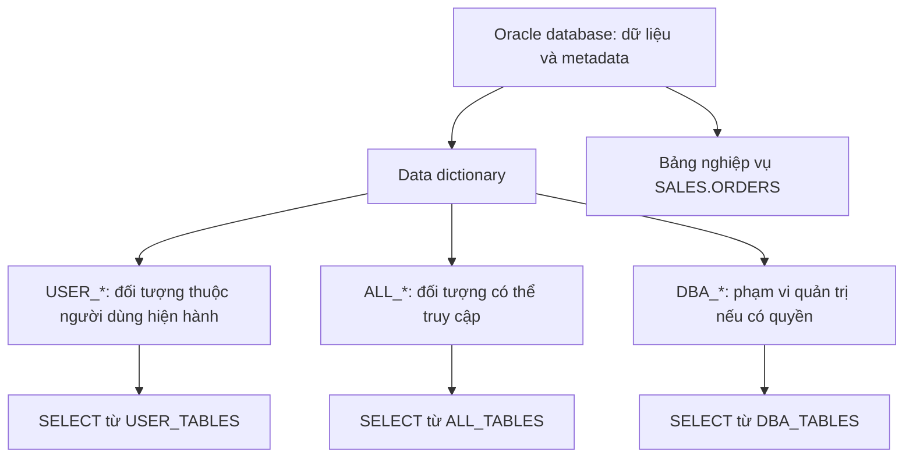
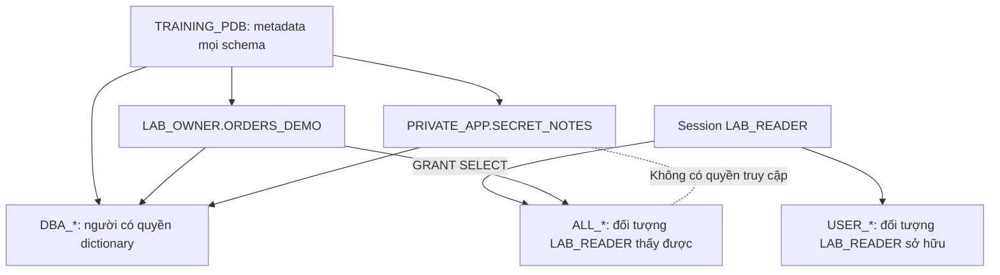
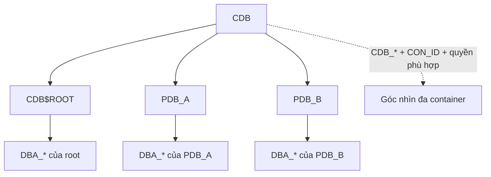

# Phạm vi dữ liệu trong USER_*, ALL_* và DBA_* của Oracle Database

Khi quản lý schema hoặc điều tra lỗi SQL trong Oracle Database, lập trình viên thường gặp ba nhóm **data dictionary views** có tiền tố `USER_`, `ALL_` và `DBA_`. Chúng cung cấp metadata về bảng, cột, khóa, index, view, quyền truy cập và nhiều đối tượng khác. Cùng một chủ đề, ví dụ danh sách bảng, Oracle có thể cung cấp `USER_TABLES`, `ALL_TABLES` và `DBA_TABLES`, nhưng kết quả không giống nhau: **sự khác biệt chính nằm ở phạm vi đối tượng mà người truy vấn được phép quan sát**.

Hiểu đúng ba nhóm view giúp trả lời những câu hỏi thực tế:

- “Tôi vừa tạo bảng nhưng vì sao tài khoản khác không thấy trong `USER_TABLES`?”
- “Vì sao tôi thấy bảng trong `ALL_TABLES` nhưng không tìm được bảng đó trong schema của mình?”
- “Tại sao truy vấn `DBA_TABLES` bị báo `ORA-00942` dù `USER_TABLES` chạy được?”
- “Khi đăng nhập vào một PDB, `DBA_TABLES` có nhìn thấy tất cả bảng của những PDB khác không?”
- “Có tên bảng trong dictionary thì tôi đã đọc được toàn bộ dữ liệu của bảng đó chưa?”

Trọng tâm bài học là **phạm vi metadata (visibility)**, các quyền dẫn tới phạm vi ấy, mối liên hệ giữa schema và container, cùng cách sử dụng view phù hợp khi viết ứng dụng và làm việc với DBA.

## 1. Data dictionary là gì?

**Data dictionary** là tập metadata do Oracle duy trì để mô tả cấu trúc và cấu hình database: người dùng, schema, bảng, cột, constraint, index, privilege, storage, đối tượng chương trình và những thông tin cần để Oracle xử lý SQL. Oracle công bố nhiều metadata thông qua các view để người dùng có thể truy vấn bằng SQL.

Ví dụ, bảng `SALES.ORDERS` chứa **dữ liệu nghiệp vụ** như mã đơn, thời điểm đặt hàng, trạng thái. Trong khi đó `ALL_TABLES` và `ALL_TAB_COLUMNS` chứa **thông tin về bảng và cột** mà phiên hiện tại được phép nhìn thấy.



Các view này **không phải bản sao của dữ liệu hàng trong bảng**. Chúng cho biết cấu trúc, thuộc tính hoặc quyền liên quan đến đối tượng; muốn truy vấn dữ liệu ứng dụng vẫn phải dùng `SELECT` trên bảng/view cụ thể với quyền thích hợp.

### 1.1. Cùng hậu tố, khác tiền tố

| View | Câu hỏi trả lời | Phạm vi cơ bản |
|---|---|---|
| `USER_TABLES` | Những bảng nào thuộc schema của người dùng hiện hành? | Bảng do người dùng hiện hành sở hữu |
| `ALL_TABLES` | Những bảng nào người dùng hiện hành có thể truy cập? | Bảng thuộc mình và bảng thuộc schema khác mà ngữ cảnh quyền hiện tại cho phép thấy |
| `DBA_TABLES` | Những bảng nào tồn tại trong phạm vi database/container mà tài khoản quản trị được phép quan sát? | Metadata quản trị rộng, yêu cầu quyền dictionary phù hợp |
| `USER_OBJECTS` | Đối tượng nào thuộc mình và trạng thái của chúng ra sao? | Nhiều kiểu đối tượng của user |
| `ALL_OBJECTS` | Đối tượng nào mình có thể truy cập? | Nhiều kiểu đối tượng theo quyền và cơ chế visibility |
| `DBA_OBJECTS` | Những đối tượng nào có trong phạm vi quản trị? | Phạm vi dictionary rộng, theo container và quyền |

Trong nhiều nhóm view, hậu tố giống nhau để đối chiếu dễ dàng, nhưng **không phải mọi view đều có đầy đủ ba biến thể** hoặc có tập cột hoàn toàn giống nhau. Ví dụ `USER_TABLES` thường không cần cột `OWNER` vì chủ sở hữu đã được ngầm xác định; `ALL_TABLES` và `DBA_TABLES` có cột `OWNER` để phân biệt schema.

### 1.2. “USER, ALL, DBA” không phải ba chế độ kết nối

Không có yêu cầu phải kết nối ba lần vào ba database khác nhau mới sử dụng được các tiền tố này. Một session bình thường có thể truy vấn `USER_*` và nhiều `ALL_*`; tài khoản có quyền quản trị dictionary phù hợp có thể truy vấn thêm `DBA_*`.

Tiền tố view **không tự cấp quyền**. Viết `SELECT * FROM DBA_TABLES` không biến tài khoản ứng dụng thành DBA. Nếu thiếu quyền, Oracle từ chối truy vấn ngay cả khi tên view có tồn tại trong database.

## 2. USER_* — metadata thuộc người dùng hiện hành

Các view `USER_*` giúp khám phá đối tượng thuộc **người dùng/schema hiện hành trong ngữ cảnh truy vấn**. Đây thường là điểm bắt đầu phù hợp khi bạn vừa tạo một bảng, muốn kiểm tra cột của bảng mình hoặc kiểm tra index/constraint của schema mình quản lý.

Ví dụ kết nối bằng user `LAB_OWNER` và chạy:

```sql
SELECT table_name,
       tablespace_name,
       num_rows
FROM user_tables
ORDER BY table_name;
```

Kết quả liệt kê các bảng mà user này sở hữu, theo phạm vi của view. Nếu một user khác sở hữu bảng `ORDERS_DEMO` và chỉ cấp quyền `SELECT` cho `LAB_OWNER`, bảng đó **không trở thành bảng do `LAB_OWNER` sở hữu** nên không xuất hiện trong `USER_TABLES` của `LAB_OWNER`.

### 2.1. Các view USER_* quen thuộc

| View | Dùng khi nào? | Cột thường quan tâm |
|---|---|---|
| `USER_OBJECTS` | Xem tên, kiểu và trạng thái đối tượng do mình sở hữu | `OBJECT_NAME`, `OBJECT_TYPE`, `STATUS` |
| `USER_TABLES` | Xem bảng và thuộc tính lưu trữ/thống kê | `TABLE_NAME`, `TABLESPACE_NAME`, `NUM_ROWS` |
| `USER_TAB_COLUMNS` | Xem tên cột, thứ tự, kiểu dữ liệu, nullable | `TABLE_NAME`, `COLUMN_NAME`, `DATA_TYPE`, `NULLABLE` |
| `USER_CONSTRAINTS` | Xem PK/FK/unique/check và trạng thái constraint | `CONSTRAINT_NAME`, `CONSTRAINT_TYPE`, `TABLE_NAME`, `STATUS` |
| `USER_CONS_COLUMNS` | Xem các cột tham gia một constraint | `CONSTRAINT_NAME`, `COLUMN_NAME`, `POSITION` |
| `USER_INDEXES` | Xem index thuộc schema | `INDEX_NAME`, `TABLE_NAME`, `UNIQUENESS` |
| `USER_IND_COLUMNS` | Xem cột và vị trí trong index | `INDEX_NAME`, `COLUMN_NAME`, `COLUMN_POSITION` |
| `USER_VIEWS` | Xem view do mình sở hữu | `VIEW_NAME` |
| `USER_SEQUENCES` | Xem sequence của mình | `SEQUENCE_NAME`, `INCREMENT_BY` |
| `USER_TRIGGERS` | Xem trigger trong schema | `TRIGGER_NAME`, `TABLE_NAME`, `STATUS` |

Không mặc định rằng một đối tượng có mặt trong mọi view. Ví dụ bảng nằm trong `USER_TABLES`, view nằm trong `USER_VIEWS`, còn cả hai có thể xuất hiện trong `USER_OBJECTS` với `OBJECT_TYPE` tương ứng.

### 2.2. Xem cấu trúc và trạng thái đối tượng

```sql
SELECT object_name,
       object_type,
       status
FROM user_objects
WHERE object_name LIKE 'ORDERS%'
ORDER BY object_type, object_name;

SELECT column_id,
       column_name,
       data_type,
       data_length,
       nullable
FROM user_tab_columns
WHERE table_name = 'ORDERS_DEMO'
ORDER BY column_id;
```

Tên đối tượng không đặt trong dấu ngoặc kép thường được Oracle chuẩn hóa thành chữ hoa trong dictionary. Vì vậy `'ORDERS_DEMO'` phù hợp khi bảng được tạo bằng `CREATE TABLE orders_demo ...`. Nếu cố ý tạo đối tượng bằng quoted identifier như `"Orders_Demo"` thì phép so sánh tên phải giữ đúng chữ hoa/chữ thường.

### 2.3. USER_* không mặc nhiên hiển thị bảng của người khác

Giả sử `HR` sở hữu bảng `EMPLOYEES` và `LAB_OWNER` được cấp `SELECT` trên bảng đó. Khi đăng nhập là `LAB_OWNER`:

```sql
SELECT table_name
FROM user_tables
WHERE table_name = 'EMPLOYEES';
```

Truy vấn có thể không trả hàng nào, vì `LAB_OWNER` **không sở hữu** bảng `HR.EMPLOYEES`. Điều này không mâu thuẫn với việc `SELECT * FROM HR.EMPLOYEES` có thể chạy thành công nếu quyền thực tế cho phép.

## 3. ALL_* — metadata của đối tượng có thể truy cập

`ALL_*` là nhóm view thường dùng để khám phá **đối tượng có thể truy cập từ tài khoản/ngữ cảnh hiện hành**, bao gồm đối tượng do mình sở hữu và những đối tượng thuộc schema khác được Oracle cho phép thấy theo quyền hoặc cơ chế tương ứng.

Ví dụ:

```sql
SELECT owner,
       table_name,
       tablespace_name
FROM all_tables
WHERE table_name = 'ORDERS_DEMO'
ORDER BY owner, table_name;
```

Cột `OWNER` là yếu tố quyết định: có thể cùng tên `ORDERS_DEMO` nhưng nằm trong các schema khác nhau. Trong một database, `SALES.ORDERS_DEMO` và `REPORTING.ORDERS_DEMO` là hai đối tượng khác nhau.

### 3.1. Quyền truy cập ảnh hưởng kết quả ALL_*

Đối với nhiều loại đối tượng, một tài khoản có thể nhìn thấy metadata nhờ:

- **Sở hữu đối tượng**.
- **Quyền object được cấp trực tiếp**, chẳng hạn `GRANT SELECT ON lab_owner.orders_demo TO lab_reader`.
- **Quyền thông qua role đang có hiệu lực**, tùy view, loại đối tượng và ngữ cảnh SQL.
- **Quyền cấp cho PUBLIC** hoặc quyền hệ thống có phạm vi phù hợp.

Tuy nhiên, quy tắc visibility chi tiết khác nhau giữa các dictionary view. Không nên lấy một câu mô tả chung về `ALL_TABLES` để suy luận máy móc cho mọi `ALL_*`, nhất là metadata về code nguồn, privilege, policy hoặc các đối tượng đặc biệt.

### 3.2. ALL_* không có nghĩa “mọi đối tượng trong database”

Tiền tố `ALL_` nói về **tập đối tượng mà phiên có thể quan sát theo quyền**, không nói rằng người dùng được liệt kê mọi bảng trên server. Một user ứng dụng chỉ có quyền trên hai bảng sẽ không tự nhiên nhìn thấy toàn bộ bảng nội bộ của mọi schema khi truy vấn `ALL_TABLES`.

Ngược lại, với user có nhiều quyền hoặc các role lớn, tập kết quả `ALL_*` có thể rất rộng. Vì thế:

```sql
SELECT COUNT(*) FROM all_tables;
```

chỉ đếm các hàng view đang trả về trong session hiện tại, **không phải tổng số bảng tuyệt đối của toàn bộ Oracle Database**.

### 3.3. Những câu truy vấn hữu ích

Liệt kê bảng có thể truy cập của một schema cụ thể:

```sql
SELECT owner, table_name
FROM all_tables
WHERE owner = 'LAB_OWNER'
ORDER BY table_name;
```

Xem các cột của bảng thuộc schema khác:

```sql
SELECT owner,
       table_name,
       column_id,
       column_name,
       data_type,
       nullable
FROM all_tab_columns
WHERE owner = 'LAB_OWNER'
  AND table_name = 'ORDERS_DEMO'
ORDER BY column_id;
```

Khám phá loại đối tượng:

```sql
SELECT owner,
       object_name,
       object_type,
       status
FROM all_objects
WHERE owner = 'LAB_OWNER'
  AND object_name LIKE 'ORDERS%'
ORDER BY object_type, object_name;
```

Nếu truy vấn không trả về hàng, có thể đối tượng không tồn tại, tên/owner sai, session vào sai PDB, hoặc người dùng chưa có phạm vi visibility cần thiết. **Kết quả rỗng không chứng minh tuyệt đối rằng đối tượng không tồn tại.**

## 4. DBA_* — phạm vi metadata quản trị

Nhóm `DBA_*` cung cấp metadata quản trị rộng hơn: các đối tượng trong phạm vi database/container đang được truy vấn, không bị giới hạn theo quyền truy cập bảng nghiệp vụ của user thông thường như nhóm `ALL_*`. Nhưng để đọc được các view này, tài khoản cần **quyền truy cập dictionary** thích hợp.

Ví dụ DBA tra cứu bảng ở nhiều schema trong cùng phạm vi container:

```sql
SELECT owner,
       table_name,
       tablespace_name
FROM dba_tables
WHERE owner IN ('LAB_OWNER', 'LAB_READER')
ORDER BY owner, table_name;
```

Các biến thể quản trị khác:

```sql
SELECT owner,
       object_name,
       object_type,
       status
FROM dba_objects
WHERE owner = 'LAB_OWNER'
ORDER BY object_type, object_name;

SELECT owner,
       table_name,
       column_name,
       data_type
FROM dba_tab_columns
WHERE owner = 'LAB_OWNER'
  AND table_name = 'ORDERS_DEMO'
ORDER BY column_id;
```

### 4.1. Điều kiện quyền truy cập DBA_*

Trong môi trường Oracle, các quyền dictionary có thể được quản lý bằng role như `SELECT_CATALOG_ROLE` hoặc đặc quyền khác được DBA cấp theo chính sách. Chính xác view nào đọc được phụ thuộc quyền thực tế, phiên bản và ngữ cảnh thực thi; không phải cứ tên user chứa “DBA” là có quyền, cũng không phải mọi role đều áp dụng trong mọi thủ tục PL/SQL.

Trên tài khoản ứng dụng ít quyền:

```sql
SELECT owner, table_name
FROM dba_tables
WHERE owner = 'LAB_OWNER';
```

có thể trả `ORA-00942: table or view does not exist` do Oracle không cho truy cập đối tượng view, dù bản thân `DBA_TABLES` thực sự tồn tại. Tùy ngữ cảnh có thể gặp lỗi thiếu quyền khác. **Không xử lý bằng cách tự cấp role DBA hoặc `SELECT ANY DICTIONARY` cho user chạy ứng dụng.**

Nếu cần báo cáo quản trị, giao nhiệm vụ cho DBA hoặc dùng một tài khoản/role đọc metadata được cấp đúng phạm vi. Nếu ứng dụng chỉ cần biết các cột của bảng mà nó sử dụng, `USER_*` hoặc `ALL_*` có thể đã đáp ứng.

### 4.2. DBA_* có phải “toàn bộ CDB”?

**Không mặc định.** Trong Oracle Multitenant, `DBA_*` diễn giải metadata theo **container đang kết nối**, cùng với quyền hiện hành:

- Kết nối vào **PDB A**: `DBA_TABLES` được dùng để xem metadata thuộc phạm vi PDB A khi tài khoản đủ quyền.
- Kết nối vào **CDB$ROOT**: `DBA_TABLES` phản ánh phạm vi root; **không tự động gộp bảng người dùng của mọi PDB** chỉ vì truy vấn thực hiện bằng SYS/DBA ở root.
- Cần tổng hợp metadata qua các container: tìm hiểu các view `CDB_*` và cột `CON_ID`, quyền container data, trạng thái PDB và khả năng truy cập tương ứng.

Đây là ranh giới quan trọng: **phạm vi đặc quyền** và **phạm vi container** là hai trục khác nhau. Có quyền quản trị metadata trong PDB này không có nghĩa người dùng được phép xem mọi PDB khác.

## 5. Sơ đồ ba phạm vi trong cùng một PDB

Giả sử PDB `TRAINING_PDB` có ba schema:

- `LAB_OWNER` sở hữu bảng `ORDERS_DEMO`.
- `LAB_READER` được `GRANT SELECT` trên `LAB_OWNER.ORDERS_DEMO`.
- `PRIVATE_APP` sở hữu bảng `SECRET_NOTES` mà `LAB_READER` không được cấp quyền.



Trong một session thông thường của `LAB_READER`:

| Câu hỏi | `USER_*` | `ALL_*` | `DBA_*` |
|---|---|---|---|
| Có thấy `LAB_OWNER.ORDERS_DEMO`? | Không, vì không sở hữu | Có thể thấy, khi `SELECT` đã được cấp và có hiệu lực | Có nếu tài khoản được cấp quyền đọc dictionary rộng |
| Có thấy `PRIVATE_APP.SECRET_NOTES`? | Không | Thông thường không, nếu không có quyền/đường visibility khác | Có trong phạm vi quản trị tương ứng |
| Có thấy bảng do `LAB_READER` tự tạo? | Có | Có | Có nếu có quyền dictionary |
| Có phải cấp thêm quyền để đọc `DBA_TABLES`? | Không áp dụng | Không áp dụng | Có |

Lưu ý: bảng minh họa áp dụng cho trường hợp bảng thường với quyền đơn giản. Các tính năng bảo mật đặc biệt, role và loại đối tượng khác có thể có quy tắc visibility riêng.

## 6. Thực hành xuyên suốt với hai schema và một bảng

Để quan sát kết quả chứ không chỉ học định nghĩa, tạo một PDB lab riêng với hai tài khoản `LAB_OWNER` và `LAB_READER`. **Các lệnh tạo user sau đây chỉ để DBA chạy trong PDB thực hành có permanent tablespace `USERS` và quota phù hợp.** Không dùng mật khẩu mẫu trên môi trường thật hoặc ghi vào git.

### 6.1. Bước 1 — DBA tạo user lab

Trước hết xác nhận đang ở đúng PDB:

```sql
SELECT SYS_CONTEXT('USERENV', 'CON_NAME') AS container_name
FROM dual;
```

Sau đó, bằng tài khoản quản trị có quyền cần thiết:

```sql
CREATE USER lab_owner IDENTIFIED BY "SetUniqueLabOwnerPassword123"
  DEFAULT TABLESPACE users
  QUOTA 30M ON users;

CREATE USER lab_reader IDENTIFIED BY "SetUniqueLabReaderPassword123";

GRANT CREATE SESSION, CREATE TABLE TO lab_owner;
GRANT CREATE SESSION TO lab_reader;
```

Tài khoản `LAB_READER` chỉ có `CREATE SESSION`; không cần `CREATE TABLE` để đọc bảng được cấp quyền. Việc cấp quyền trên bảng và quota lưu trữ là hai cơ chế khác nhau.

Nếu PDB không có tablespace `USERS`, DBA phải thay bằng tablespace phù hợp đã được cấp cho lab. Không chạy các lệnh ở `CDB$ROOT` để vô tình tạo tài khoản ngoài phạm vi bài học.

### 6.2. Bước 2 — LAB_OWNER tạo bảng và dữ liệu

Kết nối bằng `LAB_OWNER` vào đúng PDB, rồi chạy:

```sql
CREATE TABLE orders_demo (
    order_id     NUMBER(10) CONSTRAINT pk_orders_demo PRIMARY KEY,
    customer_ref VARCHAR2(50 CHAR) NOT NULL,
    amount       NUMBER(12,2) NOT NULL,
    CONSTRAINT ck_orders_demo_amount CHECK (amount >= 0)
);

INSERT INTO orders_demo (order_id, customer_ref, amount)
VALUES (1001, 'CUST-01', 350000);

INSERT INTO orders_demo (order_id, customer_ref, amount)
VALUES (1002, 'CUST-02', 780000);

COMMIT;
```

`LAB_OWNER` tự xác nhận bảng của mình:

```sql
SELECT table_name
FROM user_tables
WHERE table_name = 'ORDERS_DEMO';

SELECT object_name, object_type, status
FROM user_objects
WHERE object_name = 'ORDERS_DEMO';
```

Dự kiến `USER_TABLES` và `USER_OBJECTS` đều trả kết quả tương ứng, vì `LAB_OWNER` sở hữu bảng.

### 6.3. Bước 3 — LAB_READER thử truy vấn trước khi được cấp quyền

Đăng nhập bằng `LAB_READER` và chạy:

```sql
SELECT table_name
FROM user_tables
WHERE table_name = 'ORDERS_DEMO';

SELECT owner, table_name
FROM all_tables
WHERE owner = 'LAB_OWNER'
  AND table_name = 'ORDERS_DEMO';
```

Với user mới chỉ có quyền đăng nhập và chưa có grant phù hợp, cả hai truy vấn thông thường không trả về hàng nào cho bảng này. `LAB_OWNER.ORDERS_DEMO` vẫn tồn tại; việc `ALL_TABLES` không cho thấy bảng chỉ chứng minh `LAB_READER` chưa có đường visibility thích hợp trong tình huống lab.

Thử truy vấn dữ liệu:

```sql
SELECT order_id, amount
FROM lab_owner.orders_demo;
```

Lệnh này thường thất bại vì thiếu quyền trên bảng. Oracle có thể báo `ORA-00942`, không phải là bằng chứng DBA đã làm mất bảng.

### 6.4. Bước 4 — Chủ bảng cấp quyền đọc

Quay lại session `LAB_OWNER`:

```sql
GRANT SELECT ON orders_demo TO lab_reader;
```

Quay lại session `LAB_READER`:

```sql
SELECT owner,
       table_name
FROM all_tables
WHERE owner = 'LAB_OWNER'
  AND table_name = 'ORDERS_DEMO';

SELECT owner,
       table_name,
       column_name,
       data_type
FROM all_tab_columns
WHERE owner = 'LAB_OWNER'
  AND table_name = 'ORDERS_DEMO'
ORDER BY column_id;

SELECT order_id, amount
FROM lab_owner.orders_demo
ORDER BY order_id;
```

Giờ `ALL_TABLES` và `ALL_TAB_COLUMNS` có thể thấy metadata liên quan; truy vấn dữ liệu chạy được theo quyền `SELECT`. Nhưng:

```sql
SELECT table_name
FROM user_tables
WHERE table_name = 'ORDERS_DEMO';
```

vẫn **không** trả bảng đó cho `LAB_READER` vì lệnh `GRANT` không thay đổi ownership.

### 6.5. Bước 5 — Đối chiếu với DBA_TABLES

Trong phiên DBA có quyền đọc dictionary tại cùng PDB:

```sql
SELECT owner,
       table_name
FROM dba_tables
WHERE owner IN ('LAB_OWNER', 'LAB_READER')
ORDER BY owner, table_name;
```

DBA có thể thấy bảng `LAB_OWNER.ORDERS_DEMO` dù có hay không có grant `SELECT` cho `LAB_READER`. `DBA_TABLES` được sử dụng để điều tra inventory/metadata trong phạm vi quản trị, không phải để mô phỏng chính xác quyền đọc dữ liệu của từng user.

### 6.6. Bước 6 — Thu hồi quyền và quan sát lại

Trong session `LAB_OWNER`:

```sql
REVOKE SELECT ON orders_demo FROM lab_reader;
```

Sau đó ở session `LAB_READER`, thử lại `ALL_TABLES` và `SELECT ... FROM LAB_OWNER.ORDERS_DEMO`. Trong mô hình lab chỉ có một grant trực tiếp và không có role/quyền khác, bảng sẽ không còn accessible theo đường grant đã thu hồi, còn `USER_TABLES` vẫn không đổi. DBA vẫn có thể nhìn thấy metadata qua `DBA_TABLES`.

Nếu một tài khoản còn được cấp quyền qua **role khác, PUBLIC hoặc quyền hệ thống**, thu hồi một grant trực tiếp có thể **không loại bỏ mọi đường truy cập**; vì thế kiểm tra effective privileges thực tế khi vận hành.

## 7. Ownership, CURRENT_SCHEMA và tên đối tượng

Lỗi hiểu về `USER_*` thường đến từ việc trộn lẫn ba khái niệm:

1. **Schema owner:** tên schema thực sự sở hữu bảng, ví dụ `LAB_OWNER`.
2. **Người dùng/ngữ cảnh thực thi:** principal có quyền thực hiện thao tác ở thời điểm đó.
3. **CURRENT_SCHEMA:** schema mặc định Oracle dùng để phân giải tên đối tượng **không ghi tiền tố**; nó không tự chuyển ownership hay cấp thêm quyền.

Kiểm tra các giá trị trong một session SQL thông thường:

```sql
SELECT USER AS user_name,
       SYS_CONTEXT('USERENV', 'SESSION_USER') AS session_user,
       SYS_CONTEXT('USERENV', 'CURRENT_USER') AS current_user,
       SYS_CONTEXT('USERENV', 'CURRENT_SCHEMA') AS current_schema,
       SYS_CONTEXT('USERENV', 'CON_NAME') AS container_name
FROM dual;
```

Giả sử `LAB_READER` đã được grant quyền trên `LAB_OWNER.ORDERS_DEMO`. Trong session của `LAB_READER`:

```sql
ALTER SESSION SET CURRENT_SCHEMA = LAB_OWNER;

SELECT order_id FROM orders_demo ORDER BY order_id;
```

Câu `SELECT` không ghi `LAB_OWNER.` vẫn có thể phân giải đến `LAB_OWNER.ORDERS_DEMO` nhờ `CURRENT_SCHEMA`. Nhưng **đổi CURRENT_SCHEMA không cấp quyền và không biến bảng đó thành tài sản của `LAB_READER`**. Trong một session SQL tương tác thông thường, `USER_TABLES` vẫn phản ánh ownership của user đang truy vấn, chứ không đơn giản liệt kê toàn bộ bảng thuộc schema được chỉ định bởi `ALTER SESSION SET CURRENT_SCHEMA`.

Với PL/SQL có quyền người định nghĩa (`AUTHID DEFINER`) hoặc quyền người gọi (`AUTHID CURRENT_USER`), `CURRENT_USER`, role và khả năng truy cập dictionary có thể khác so với session tương tác thông thường. Khi phân tích trong stored program, phải xét **ngữ cảnh thực thi thực tế** thay vì luôn đồng nhất `SESSION_USER` và `CURRENT_USER`.

## 8. Quyền object, role và visibility của ALL_*

### 8.1. Direct grant, role và PUBLIC

Ví dụ chủ bảng cấp quyền cho một user:

```sql
GRANT SELECT ON lab_owner.orders_demo TO lab_reader;
```

Nếu chủ bảng hoặc DBA được ủy quyền cấp cho role, mô hình có thể là:

```sql
-- Ví dụ trong lab với quyền quản trị role và đối tượng phù hợp.
CREATE ROLE reporting_role;
GRANT SELECT ON lab_owner.orders_demo TO reporting_role;
GRANT reporting_role TO lab_reader;
```

Lúc đó quyền đọc có thể đến từ role đang bật. Cần phân biệt:

| Kiểu quyền | Ý nghĩa |
|---|---|
| **Object privilege trực tiếp** | `SELECT`, `INSERT`, `UPDATE`... trên đối tượng cụ thể |
| **Role** | Nhóm quyền có thể được grant cho user và có trạng thái bật/tắt theo ngữ cảnh |
| **PUBLIC grant** | Quyền được cấp cho nhóm `PUBLIC`, có phạm vi rộng, phải dùng thận trọng |
| **System privilege** | Quyền trên lớp thao tác/toàn database hoặc phạm vi được phép, ví dụ `CREATE TABLE`, `SELECT ANY TABLE` |
| **Dictionary privilege** | Quyền xem metadata quản trị, không đồng nhất với quyền trên từng bảng ứng dụng |

`CREATE TABLE` không tự cấp `SELECT` trên mọi bảng của schema khác. `SELECT_CATALOG_ROLE` cho phép truy cập các dictionary views phù hợp, không nên dùng như cách cấp quyền dữ liệu nghiệp vụ cho ứng dụng.

### 8.2. Truy vấn kiểm tra quyền và role

Từ session người dùng:

```sql
SELECT role
FROM session_roles
ORDER BY role;

SELECT privilege
FROM session_privs
ORDER BY privilege;
```

Hai view này phản ánh role và system privileges đang có hiệu lực trong ngữ cảnh session tương ứng. Chúng **không thay thế** truy vấn các object grants.

Chủ đối tượng có thể xem các grant mình đã cấp:

```sql
SELECT table_name,
       grantee,
       privilege
FROM user_tab_privs_made
WHERE table_name = 'ORDERS_DEMO'
ORDER BY grantee, privilege;
```

Để xem grant được nhận trực tiếp trên đối tượng:

```sql
SELECT owner,
       table_name,
       privilege
FROM user_tab_privs_recd
ORDER BY owner, table_name, privilege;
```

Khi được cấp quyền truy cập dictionary thích hợp, DBA có thể kiểm tra quyền object bằng `DBA_TAB_PRIVS` hoặc vai trò/role grant qua các view `DBA_*` tương ứng. Một danh sách grant trực tiếp **không luôn bằng toàn bộ quyền hiệu lực** do role, PUBLIC, system privileges và ngữ cảnh thực thi.

### 8.3. Role trong stored PL/SQL

Trong nhiều khối PL/SQL có **definer's rights**, các role thông thường bị vô hiệu hóa khi đánh giá quyền của code. Vì vậy một câu SQL chạy thành công ngoài SQL*Plus nhờ role có thể lỗi khi chuyển nguyên vào một procedure chạy dưới definer's rights, dù cùng user gọi.

Khi code cần truy cập bảng/schema khác, hãy kiểm tra:

- Procedure/package dùng `AUTHID DEFINER` hay `AUTHID CURRENT_USER`?
- Quyền cần thiết được cấp trực tiếp cho owner của chương trình hay chỉ thông qua role?
- Các role có hiệu lực trong ngữ cảnh gọi và tính năng Oracle tương ứng hay không?
- Tên schema được phân giải ở đâu?

Không tự động cấp `SELECT ANY TABLE` hoặc role DBA để “chữa” lỗi; nên sửa quyền object cụ thể và mô hình thực thi.

## 9. Metadata nhìn thấy được khác với dữ liệu có thể đọc được

Một hàng xuất hiện trong `ALL_TABLES` cho biết dictionary view đang công bố metadata trong ngữ cảnh hiện tại. **Nó không phải lời cam kết rằng mọi dữ liệu và mọi thao tác đều được phép.**

Ví dụ, ứng dụng có thể:

- Chỉ được `SELECT` nhưng không được `INSERT` hay `DELETE`.
- Chỉ được phép đọc một view và không được đọc bảng gốc.
- Chịu giới hạn dữ liệu theo row-level security/VPD hoặc redaction/masking phù hợp.
- Chỉ được đọc một số cột qua quyền hoặc lớp view theo thiết kế bảo mật.
- Bị từ chối ở thời điểm chạy SQL do quyền đã thay đổi hoặc role bị tắt.

So sánh:

```sql
-- Metadata cột mà user hiện tại nhìn thấy:
SELECT owner, table_name, column_name
FROM all_tab_columns
WHERE owner = 'LAB_OWNER'
  AND table_name = 'ORDERS_DEMO';

-- Truy vấn dữ liệu thật, cần quyền SELECT có hiệu lực:
SELECT order_id, amount
FROM lab_owner.orders_demo;
```

Hai truy vấn có mục đích và cơ chế bảo vệ khác nhau. Không suy ra số hàng thật của bảng từ `NUM_ROWS` trong dictionary: `NUM_ROWS` thường dựa trên **optimizer statistics** ở lần thu thập gần nhất, nên có thể bằng `NULL` hoặc không khớp số hàng hiện tại. Nếu được phép và thật sự cần số hàng chính xác tại thời điểm đọc, dùng `COUNT(*)` trên bảng trong phạm vi quyền; cần cân nhắc chi phí với bảng lớn.

## 10. Chọn đúng view cho từng mục đích

### 10.1. Tìm bảng theo owner

Khi đã biết mình sở hữu bảng:

```sql
SELECT table_name
FROM user_tables
WHERE table_name LIKE 'ORDER%'
ORDER BY table_name;
```

Khi cần tìm bảng của schema khác mà mình có thể truy cập:

```sql
SELECT owner, table_name
FROM all_tables
WHERE owner = 'SALES'
  AND table_name LIKE 'ORDER%'
ORDER BY table_name;
```

Khi làm inventory quản trị trong container đang kết nối:

```sql
SELECT owner, table_name
FROM dba_tables
WHERE owner = 'SALES'
ORDER BY table_name;
```

Điều kiện `OWNER` rất hữu ích với `ALL_*`/`DBA_*` để tránh nhầm các bảng trùng tên.

### 10.2. Tìm view và synonym

`USER_TABLES` không liệt kê các đối tượng view như bảng thường. Khi ứng dụng truy vấn thành công `SELECT ... FROM CUSTOMER_REPORT` nhưng không thấy trong `USER_TABLES`, kiểm tra:

```sql
SELECT object_name, object_type
FROM user_objects
WHERE object_name = 'CUSTOMER_REPORT';

SELECT owner, object_name, object_type
FROM all_objects
WHERE object_name = 'CUSTOMER_REPORT'
ORDER BY owner, object_type;
```

Đối tượng có thể là **view** hoặc **synonym**, không phải table. Synonym là một tên tham chiếu tới đối tượng khác; **tồn tại synonym không tự động cấp quyền đọc đối tượng đích**.

Có thể tìm synonym trong phạm vi metadata khả dụng:

```sql
SELECT owner,
       synonym_name,
       table_owner,
       table_name
FROM all_synonyms
WHERE synonym_name = 'CUSTOMER_REPORT'
ORDER BY owner;
```

Sự hiện diện của tên trong `ALL_SYNONYMS` không chứng minh user được phép `SELECT` từ bảng/view đích. Nếu synonym trỏ qua database link hoặc đối tượng đã bị xóa/đổi quyền, cần điều tra thêm đường phân giải và quyền trên đối tượng đích.

### 10.3. Kiểm tra constraint và index

Từ schema sở hữu:

```sql
SELECT constraint_name,
       constraint_type,
       table_name,
       status
FROM user_constraints
WHERE table_name = 'ORDERS_DEMO'
ORDER BY constraint_name;

SELECT index_name,
       table_name,
       uniqueness
FROM user_indexes
WHERE table_name = 'ORDERS_DEMO'
ORDER BY index_name;
```

Muốn xem bảng accessible ở schema khác, sử dụng `ALL_CONSTRAINTS`/`ALL_INDEXES` và lọc theo `OWNER`, hoặc nhờ DBA dùng `DBA_*` khi phạm vi cần thiết rộng hơn. Với index, cần phân biệt owner của index và owner của table khi diễn giải các view chi tiết. Không nên kết luận “không có index” từ một view không bao phủ đúng phạm vi hoặc loại đối tượng.

### 10.4. Xem cột trong một lệnh điều tra

```sql
SELECT owner,
       table_name,
       column_name,
       data_type,
       data_precision,
       data_scale,
       nullable
FROM all_tab_columns
WHERE owner = 'LAB_OWNER'
  AND table_name = 'ORDERS_DEMO'
ORDER BY column_id;
```

Đây là mẫu phù hợp khi viết code generator hoặc kiểm tra mapping Java/JDBC của một bảng mà ứng dụng được phép truy cập. Tuy nhiên, nếu cần metadata về **hidden/invisible columns** hoặc các thuộc tính đặc thù, cần hiểu sự khác biệt giữa các view như `ALL_TAB_COLUMNS` và `ALL_TAB_COLS` cùng phiên bản Oracle đang dùng: một số view lọc những cột do hệ thống sinh ra. Không giả định một câu `SELECT` từ `ALL_TAB_COLUMNS` bao trùm mọi chi tiết nội bộ.

## 11. Phạm vi CDB/PDB: bổ sung chiều CON_ID

Ở Oracle Multitenant, các PDB chia sẻ hạ tầng CDB nhưng có phạm vi schema/dữ liệu của từng container. Do đó phải đặt câu hỏi **“mình đang ở container nào?”** trước khi diễn giải metadata.

```sql
SELECT USER AS user_name,
       SYS_CONTEXT('USERENV', 'CON_NAME') AS container_name,
       SYS_CONTEXT('USERENV', 'SERVICE_NAME') AS service_name
FROM dual;
```

### 11.1. DBA_* trong PDB

Nếu DBA đăng nhập vào `SALES_PDB`, `DBA_TABLES` được dùng để quan sát các bảng trong **phạm vi SALES_PDB**. Cùng schema `APP` có thể tồn tại ở một PDB khác với bảng hoàn toàn khác mà câu truy vấn trong `SALES_PDB` không tự động gộp vào.

### 11.2. DBA_* trong CDB$ROOT

Khi ở `CDB$ROOT`, query `DBA_TABLES` thuộc phạm vi root. Để tổng hợp metadata nhiều container, Oracle cung cấp các **`CDB_*` views** có thêm `CON_ID` (với yêu cầu quyền, visibility và trạng thái container phù hợp).

Ví dụ dành cho common administrator được cấp quyền cần thiết khi đang ở `CDB$ROOT`:

```sql
SELECT con_id,
       owner,
       table_name
FROM cdb_tables
WHERE owner = 'LAB_OWNER'
ORDER BY con_id, owner, table_name;
```

`CON_ID` cho biết hàng metadata thuộc container nào. Có thể ghép với thông tin container do DBA đọc được, chẳng hạn `V$CONTAINERS`, để xác định tên PDB. Trong thực tế, visibility của `CDB_*` chịu ảnh hưởng bởi quyền truy cập dictionary, thuộc tính **CONTAINER_DATA**, trạng thái mở của PDB và các quy tắc phiên bản Oracle. **Không mặc định rằng `CDB_TABLES` luôn trả toàn bộ mọi PDB cho mọi tài khoản ở root.**



**Ranh giới cần nhớ:** `USER_*`, `ALL_*` và `DBA_*` phân biệt **phạm vi đối tượng/quyền**; CDB/PDB bổ sung **phạm vi container**. Một báo cáo tổng hợp toàn doanh nghiệp phải thiết kế cả hai, không chỉ đổi prefix view.

## 12. Dictionary views khác dynamic performance views

Trong quá trình quản trị, còn gặp các view như:

```sql
SELECT sid, serial#, username, status
FROM v$session
WHERE username IS NOT NULL;
```

Nhóm `V$...`/`GV$...` thường biểu diễn **trạng thái hoạt động và số liệu động của instance/cluster**, ví dụ session, SQL đang chạy, thống kê hiệu năng. Chúng không phải là “biến thể thứ tư” của `USER_TABLES`:

| Nhóm | Ví dụ | Câu hỏi chính |
|---|---|---|
| Data dictionary `USER_*` | `USER_TABLES`, `USER_CONSTRAINTS` | Schema mình có những đối tượng nào? |
| Data dictionary `ALL_*` | `ALL_OBJECTS`, `ALL_TAB_COLUMNS` | Mình nhìn thấy cấu trúc đối tượng nào? |
| Data dictionary `DBA_*` | `DBA_TABLES`, `DBA_USERS` | Metadata quản trị trong phạm vi được cấp quyền? |
| Dynamic performance `V$*/GV$*` | `V$SESSION`, `V$SQL` | Instance/session hiện đang làm gì và có số liệu gì? |
| Multitenant `CDB_*` | `CDB_TABLES`, `CDB_OBJECTS` | Metadata của nhiều container theo quyền và `CON_ID`? |

Việc được phép `SELECT` trên một bảng ứng dụng không tự cấp quyền xem `V$SESSION`. Các view động thường đòi privilege riêng; không cấp quyền quá rộng cho ứng dụng chỉ để làm màn hình monitoring.

## 13. Lỗi thường gặp và hướng điều tra

| Tình huống | Nguyên nhân thường gặp | Cách kiểm tra |
|---|---|---|
| `USER_TABLES` không có bảng vừa “được chia sẻ” | Bảng thuộc schema khác, user chỉ được grant quyền | `ALL_TABLES` với `OWNER`, kiểm tra grant |
| `ALL_TABLES` không tìm thấy tên bảng | Sai tên/owner, chưa có quyền, sai PDB hoặc view không bao phủ loại đối tượng đó | `CON_NAME`, `ALL_OBJECTS`, quyền và owner |
| `DBA_TABLES` báo `ORA-00942` | User thiếu quyền xem dictionary | Đối chiếu quyền với DBA; chọn `USER_*`/`ALL_*` nếu phù hợp |
| `SELECT owner FROM user_tables` bị lỗi cột | `USER_TABLES` thường không có `OWNER` | Dùng `ALL_TABLES` hoặc `DBA_TABLES` nếu cần owner |
| `ALL_TABLES` thấy bảng nhưng `SELECT` thất bại | Quyền/role ngữ cảnh khác, sai tên phân giải, chính sách bảo mật hoặc quyền thay đổi | Dùng tên `owner.table`, kiểm tra effective privilege và lỗi cụ thể |
| Script SQL bên ngoài chạy, procedure lỗi | Definer's rights vô hiệu hóa role; thiếu direct grant | Kiểm tra `AUTHID`, grant trực tiếp và owner của chương trình |
| Kết quả `DBA_TABLES` ở root thiếu bảng của PDB | `DBA_*` không tự tổng hợp nhiều PDB | Dùng `CDB_*` theo quyền và lọc `CON_ID` |
| `NUM_ROWS` không khớp `COUNT(*)` | `NUM_ROWS` là optimizer statistics, không luôn real-time | Kiểm tra thời điểm thu thập statistics |
| `ALL_SYNONYMS` có tên nhưng truy vấn không được | Synonym không tự cấp quyền tới đối tượng đích | Kiểm tra target object, database link và privilege |
| Cùng tên bảng nhưng kết quả khác giữa user | Ownership, quyền, role và container khác nhau | Ghi lại user, current schema, container, owner và roles |

Khi điều tra, ghi rõ **tài khoản đang chạy, nơi chạy SQL (trực tiếp hay PL/SQL), PDB/service, tên đối tượng có owner, câu truy vấn và mã lỗi thực tế**. Các yếu tố này thường giải thích được sự khác nhau mà không cần thử cấp thêm quyền rộng.

### 13.1. Một quy trình điều tra ngắn

1. **Xác nhận ngữ cảnh:** `SESSION_USER`, `CURRENT_USER`, `CURRENT_SCHEMA`, `CON_NAME`.
2. **Xác nhận loại đối tượng:** dùng `USER_OBJECTS` hoặc `ALL_OBJECTS`; bảng, view và synonym không phải cùng một loại.
3. **Xác nhận owner:** lọc `OWNER` ở `ALL_*` hoặc `DBA_*` khi có quyền.
4. **Xác nhận quyền:** kiểm tra grant trực tiếp, role hiệu lực, PUBLIC/system privileges và cách code được thực thi.
5. **Đối chiếu góc nhìn DBA:** nếu cần chứng minh đối tượng tồn tại bên ngoài phạm vi của user, nhờ DBA truy vấn đúng container.
6. **Chỉ sau đó mới sửa cấu hình/grant:** tránh cấp quyền rộng dựa trên một kết quả dictionary rỗng.

## 14. Bài thực hành mở rộng

### Bài 1 — Dự đoán trước khi chạy

Với lab hai schema ở mục 6, dự đoán kết quả cho mỗi truy vấn sau ba thời điểm: trước `GRANT`, sau `GRANT SELECT`, sau `REVOKE SELECT`:

```sql
-- Chạy bằng LAB_READER.
SELECT table_name
FROM user_tables
WHERE table_name = 'ORDERS_DEMO';

SELECT owner, table_name
FROM all_tables
WHERE owner = 'LAB_OWNER'
  AND table_name = 'ORDERS_DEMO';

SELECT COUNT(*)
FROM lab_owner.orders_demo;
```

Đối chiếu kết quả thực tế với nguyên tắc: **ownership không thay đổi theo grant**, còn accessibility có thể thay đổi theo grant và các đường quyền khác.

### Bài 2 — Tìm schema và cấu trúc đầy đủ

Trong session `LAB_READER` đã được grant quyền đọc, viết câu SQL:

1. Tìm tất cả bảng accessible có tên bắt đầu bằng `ORDERS` cùng owner.
2. Liệt kê cột, thứ tự, kiểu dữ liệu, nullable của `LAB_OWNER.ORDERS_DEMO`.
3. Liệt kê mọi đối tượng accessible có tên `ORDERS_DEMO` và phân biệt table với view/synonym.
4. Từ user sở hữu, xem tên constraint, cột thuộc primary key và index hỗ trợ.

Không cần quyền `DBA_*` để hoàn thành bài này nếu user đã có đường visibility phù hợp.

### Bài 3 — Hiểu CURRENT_SCHEMA

Trong session `LAB_READER` được `GRANT SELECT` trên `LAB_OWNER.ORDERS_DEMO`:

```sql
SELECT USER,
       SYS_CONTEXT('USERENV', 'CURRENT_SCHEMA') AS current_schema
FROM dual;

ALTER SESSION SET CURRENT_SCHEMA = LAB_OWNER;

SELECT order_id FROM orders_demo ORDER BY order_id;

SELECT table_name
FROM user_tables
WHERE table_name = 'ORDERS_DEMO';
```

Giải thích vì sao câu `SELECT` không có prefix chạy được nhưng `USER_TABLES` vẫn không cho rằng `LAB_READER` sở hữu bảng. Khi kết thúc, có thể trả lại default schema cho session bằng `ALTER SESSION SET CURRENT_SCHEMA = LAB_READER`.

### Bài 4 — Nhìn từ DBA và CDB

Nhờ DBA quan sát `DBA_TABLES` trong cùng PDB và so sánh với `ALL_TABLES` của `LAB_READER`. Nếu lab có nhiều PDB, từ root dùng `CDB_TABLES` để phân biệt bằng `CON_ID`. Thảo luận:

- Vì sao DBA biết bảng tồn tại nhưng user ứng dụng không thấy?
- Vì sao DBA đăng nhập nhầm PDB có thể nhìn thấy danh sách bảng khác?
- `CDB_*` cần thêm điều kiện quyền và container nào?

### Bài 5 — Phân biệt metadata với dữ liệu

So sánh số lượng bảng từ `ALL_TABLES` với kết quả một `COUNT(*)` trên bảng được grant. Kiểm tra `NUM_ROWS` trong `ALL_TABLES` trước/sau vài thao tác DML và giải thích tại sao nó không phải bộ đếm số hàng trực tiếp. Không chạy `COUNT(*)` trên bảng production lớn chỉ để kiểm tra một khác biệt thống kê nhỏ.

### Bảng kết quả mẫu

| Ngữ cảnh | `USER_TABLES` có `ORDERS_DEMO`? | `ALL_TABLES` thấy `LAB_OWNER.ORDERS_DEMO`? | `SELECT` dữ liệu được? |
|---|---|---|---|
| `LAB_OWNER` | Có | Có | Có |
| `LAB_READER` trước `GRANT` | Không | Thông thường không | Không |
| `LAB_READER` sau `GRANT SELECT` | Không | Có | Có |
| `LAB_READER` sau `REVOKE`, không có quyền khác | Không | Thông thường không | Không |
| Tài khoản DBA có quyền dictionary | Tùy bảng do chính tài khoản DBA sở hữu | Tùy đường quyền mà DBA có | Không thể suy ra từ `DBA_TABLES` một mình |

Lưu kết quả thực tế, tên PDB và các grant đã dùng; đó mới là bằng chứng của từng trường hợp.

## 15. Câu hỏi tự kiểm tra

1. Vì sao `USER_TABLES` không cần cột `OWNER` trong khi `ALL_TABLES` có cột này?
2. Sự khác nhau giữa `USER_OBJECTS`, `ALL_OBJECTS` và `DBA_OBJECTS` nằm ở đâu?
3. Tại sao `ALL_TABLES` không có bảng `HR.EMPLOYEES` không đủ để kết luận bảng đó đã bị xóa?
4. `GRANT SELECT ON LAB_OWNER.ORDERS_DEMO TO LAB_READER` thay đổi ownership hay accessibility?
5. Khi nào một user có thể đọc `DBA_TABLES`? Vì sao không nên cấp quyền dictionary rộng cho ứng dụng?
6. `ALTER SESSION SET CURRENT_SCHEMA=LAB_OWNER` có cấp quyền truy vấn dữ liệu và đổi owner bảng không?
7. Vì sao code PL/SQL theo definer's rights có thể lỗi khi quyền chỉ đến từ role?
8. `NUM_ROWS` trong `ALL_TABLES` có phải luôn bằng `SELECT COUNT(*)` không?
9. Vì sao tồn tại synonym không có nghĩa người dùng có quyền trên bảng/view đích?
10. Trong môi trường CDB/PDB, `DBA_TABLES` và `CDB_TABLES` khác nhau ở phạm vi container ra sao?
11. `USER_*`, `ALL_*`, `DBA_*` khác `V$SESSION`/`V$SQL` ở mục đích gì?
12. Nếu query metadata báo `ORA-00942`, cần kiểm tra những lớp thông tin nào trước khi xin DBA cấp thêm quyền?

Ba nhóm dictionary view phản ánh ba góc nhìn: **`USER_*` cho đối tượng thuộc mình; `ALL_*` cho đối tượng có thể truy cập theo quyền/ngữ cảnh hiện tại; `DBA_*` cho metadata quản trị khi được cấp quyền phù hợp**. Trong Oracle Multitenant, luôn đặt thêm câu hỏi “đang ở PDB nào?”, và khi sử dụng kết quả hãy phân biệt **thấy metadata**, **sở hữu đối tượng** và **được thực thi SQL trên dữ liệu**. Đó là cơ sở để khám phá schema an toàn, kiểm tra quyền và chẩn đoán lỗi Oracle chính xác.
