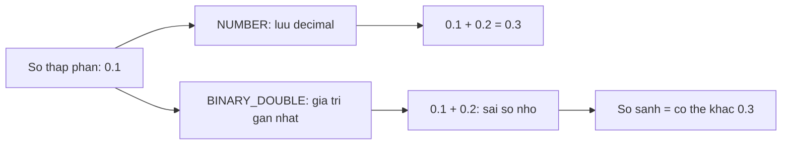
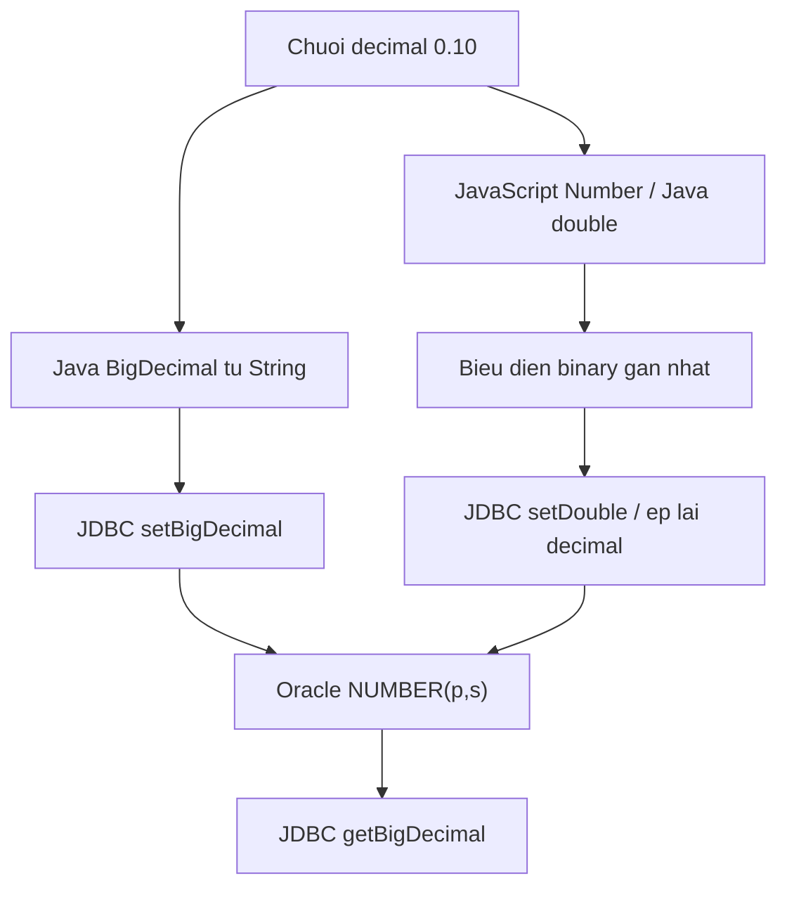

# NUMBER, precision, scale và sai số khi chuyển sang số dấu phẩy động trong Oracle

Khi thiết kế bảng Oracle, chọn kiểu số không chỉ là quyết định về độ lớn tối đa. Một cột tiền tệ phải giữ chính xác phần thập phân theo chính sách nghiệp vụ; một cột số lượng cần ngăn giá trị có phần lẻ; còn số đo cảm biến có thể chấp nhận sai số xấp xỉ. Những yêu cầu này dẫn đến sự khác biệt giữa **`NUMBER` với `precision`/`scale`** và các kiểu số dấu phẩy động nhị phân **`BINARY_FLOAT`/`BINARY_DOUBLE`**.

Ví dụ: hệ thống lưu `0.10` và `0.20` rồi muốn tính chính xác `0.30`. Với kiểu thập phân `NUMBER`, các giá trị này biểu diễn chính xác trong phạm vi hỗ trợ. Nếu chuyển sang số nhị phân của `BINARY_DOUBLE` hoặc `double` trong Java, `0.1` và `0.2` đều không có biểu diễn nhị phân hữu hạn: sai số có thể xuất hiện khi cộng dồn, so sánh hoặc chuyển về decimal.

Sau bài học, bạn có thể:

- Giải thích `NUMBER`, `NUMBER(p)` và `NUMBER(p,s)`, kể cả scale âm hoặc lớn hơn precision.
- Xác định khi nào Oracle **làm tròn** và khi nào giá trị bị từ chối vì **vượt precision**.
- Phân biệt phép toán thập phân có độ chính xác giới hạn với số dấu phẩy động nhị phân gần đúng.
- Nhận diện sai số khi `CAST`, trộn toán hạng khác kiểu, hoặc truyền dữ liệu qua JDBC/Java.
- Chọn kiểu lưu số lượng, tiền, tỷ lệ, ID và đại lượng đo phù hợp.

## 1. Oracle NUMBER là gì?

`NUMBER` là kiểu số thập phân của Oracle, được lưu theo dạng số biến độ dài (mã hóa nội bộ dựa trên cơ số 100). Nó **khác** với IEEE 754 binary floating point của `BINARY_FLOAT` và `BINARY_DOUBLE`. Một số thập phân hữu hạn như `0.1`, `0.2` hoặc `123.45` có thể được biểu diễn chính xác bằng `NUMBER` khi nằm trong giới hạn độ chính xác và phạm vi của kiểu.

Oracle bảo đảm **tối đa 38 chữ số có nghĩa** cho `NUMBER`. Phạm vi trị tuyệt đối của một `NUMBER` khác 0 rất rộng, từ khoảng `1E-130` đến dưới `1E126`. Khai báo `NUMBER(p,s)` tạo ra ràng buộc bổ sung hẹp hơn để phản ánh miền giá trị nghiệp vụ. Độ chính xác tối đa 38 chữ số **không có nghĩa** mọi phép toán đều luôn chính xác vô hạn; ví dụ `1/3` vẫn phải được làm tròn khi biểu diễn thập phân hữu hạn.

| Cách khai báo | Ý nghĩa | Ví dụ |
| --- | --- | --- |
| `NUMBER` | Không khai báo precision/scale cố định cho cột, nhưng vẫn chịu giới hạn của kiểu `NUMBER`. | Giá trị thập phân cần linh hoạt. |
| `NUMBER(p)` | Tương đương `NUMBER(p,0)`, làm tròn đến đơn vị. | `NUMBER(10)` cho số lượng nguyên. |
| `NUMBER(p,s)` | Precision `p` là số chữ số có nghĩa theo khai báo; scale `s` là số chữ số sau dấu thập phân được giữ. | `NUMBER(12,2)` cho giá trị tiền. |
| `NUMBER(p,s)` với `s < 0` | Làm tròn về hàng chục/hàng trăm… bên trái dấu thập phân. | `NUMBER(5,-2)`. |
| `NUMBER(p,s)` với `s > p` | Giữ các số rất nhỏ gần 0; phải có các vị trí 0 thích hợp sau dấu thập phân. | `NUMBER(4,5)`. |

Khi đặt `NUMBER(p,s)`, phạm vi khai báo thông thường là **`p` từ 1 đến 38** và **`s` từ -84 đến 127**. Những giá trị được đưa vào vẫn phải thỏa phạm vi chung của `NUMBER`.

### Precision và scale

**Precision** (`p`) là số chữ số có nghĩa tối đa theo khai báo; **scale** (`s`) là vị trí làm tròn:

- `s = 2`: giữ hai chữ số sau dấu thập phân.
- `s = 0`: làm tròn tới số nguyên.
- `s = -2`: làm tròn tới hàng trăm.
- `s = 5`: giữ đến năm vị trí sau dấu thập phân, miễn giá trị phù hợp precision.

Với `0 ≤ s ≤ p`, số chữ số phần nguyên được phép là `p - s`. Chẳng hạn `NUMBER(5,2)` có thể giữ ba chữ số phần nguyên và hai chữ số phần lẻ:

```text
NUMBER(5,2)
       | |
       | +-- s = 2: 2 chu so sau dau thap phan
       +---- p = 5: 5 chu so theo khai bao

123.45   -> du 5 chu so
999.99   -> gia tri duong lon nhat
1000.00  -> 4 chu so phan nguyen, vuot gioi han
```

Precision là ràng buộc trên **giá trị số**, không phải số ký tự của chuỗi hiển thị. Dấu âm, dấu thập phân và số 0 dẫn đầu không được đếm giống như một chuỗi văn bản. Đặc biệt, giá trị **sau khi làm tròn theo scale** vẫn phải phù hợp với precision.

## 2. Ví dụ precision, scale và giá trị thực tế

| Khai báo | Giá trị nhập | Kết quả dự kiến | Lý do |
| --- | ---: | ---: | --- |
| `NUMBER(5,2)` | `123.456` | `123.46` | Làm tròn đến hai chữ số lẻ. |
| `NUMBER(5,2)` | `999.99` | `999.99` | Vừa giới hạn ba chữ số phần nguyên. |
| `NUMBER(5,2)` | `1000` | Lỗi | Phần nguyên vượt `p-s = 3`. |
| `NUMBER(5,2)` | `999.995` | Lỗi | Làm tròn thành `1000.00` nên vượt precision. |
| `NUMBER(5,0)` | `123.6` | `124` | Scale 0 làm tròn đến số nguyên. |
| `NUMBER(5,-2)` | `12345` | `12300` | Làm tròn về hàng trăm. |
| `NUMBER(5,-2)` | `12350` | `12400` | Đúng ngưỡng làm tròn lên. |
| `NUMBER(4,5)` | `0.01234` | `0.01234` | Scale lớn hơn precision nhưng giá trị đủ nhỏ. |
| `NUMBER(5,2)` | `0.001` | `0` | Phần thập phân quá nhỏ so với scale. |

Thử bằng `CAST` (các literal dưới đây là `NUMBER`, chưa chuyển sang số nhị phân):

```sql
SELECT
    CAST(123.456 AS NUMBER(5,2)) AS rounded_cents,
    CAST(123.6   AS NUMBER(5,0)) AS rounded_integer,
    CAST(12345   AS NUMBER(5,-2)) AS rounded_hundreds,
    CAST(0.01234 AS NUMBER(4,5)) AS small_value
FROM dual;
```

Kết quả tương ứng có giá trị `123.46`, `124`, `12300` và `0.01234`. Oracle client có thể hiển thị `12300` hoặc `12300.0` theo công cụ và định dạng. Việc hiển thị có hay không có số 0 cuối **không quyết định** precision/scale của cột.

Một giá trị `1000` đưa vào cột `NUMBER(5,2)` thường dẫn tới `ORA-01438` (giá trị lớn hơn precision của cột). Một phép `CAST` không hợp lệ có thể trả về mã lỗi ép kiểu tương ứng; cần xem lỗi thực tế trong ngữ cảnh thực hiện:

```sql
CREATE TABLE lab_limit_demo (
    id     NUMBER(5,0) PRIMARY KEY,
    amount NUMBER(5,2) NOT NULL
);

INSERT INTO lab_limit_demo (id, amount) VALUES (1, 123.456);
-- Lưu 123.46.

-- Ví dụ lỗi độc lập: không chèn được hàng này.
INSERT INTO lab_limit_demo (id, amount) VALUES (2, 1000);
-- Lỗi precision, thường là ORA-01438.

COMMIT;
```

Sau câu `INSERT` lỗi, những câu DML thành công khác trong cùng transaction **không tự động bị rollback toàn bộ**; ứng dụng phải chọn `COMMIT` hoặc `ROLLBACK` theo quy tắc nghiệp vụ. Trong bài tập không muốn lưu thay đổi, có thể `ROLLBACK` thay vì `COMMIT`.

### NUMBER không chỉ định p,s vẫn có giới hạn

```sql
CREATE TABLE numeric_precision_demo (
    id            NUMBER(6,0) PRIMARY KEY,
    exact_decimal NUMBER,
    limited_money NUMBER(12,2)
);
```

`EXACT_DECIMAL` không có precision/scale **khai báo**, nhưng vẫn dùng biểu diễn số của Oracle và giới hạn 38 chữ số có nghĩa được bảo đảm. `LIMITED_MONEY` có thêm quy tắc về miền giá trị và làm tròn phần lẻ. Khi phép tính trả về nhiều chữ số hơn khả năng biểu diễn, việc giữ thêm chữ số không thể tiếp diễn vô hạn.

## 3. ROUND, TRUNC và định dạng hiển thị

Có ba thời điểm làm tròn khác nhau:

1. **Lúc lưu vào `NUMBER(p,s)` hoặc `CAST` về kiểu này:** Oracle áp dụng scale và kiểm tra precision.
2. **Lúc gọi `ROUND` hoặc `TRUNC` trong SQL:** câu lệnh tạo giá trị số mới; dữ liệu bảng chỉ thay đổi nếu bạn ghi lại kết quả.
3. **Lúc dùng `TO_CHAR` hoặc formatter giao diện:** chỉ định dạng thành **chuỗi**, không thay đổi giá trị lưu.

Với toán hạng là `NUMBER`, `ROUND` làm tròn tại nửa đơn vị của vị trí cần giữ theo hướng **ra xa 0**, còn `TRUNC` cắt bỏ phần dư:

```sql
SELECT
    ROUND( 2.345, 2) AS round_pos, -- 2.35
    ROUND(-2.345, 2) AS round_neg, -- -2.35
    TRUNC( 2.345, 2) AS trunc_pos, -- 2.34
    TRUNC(-2.345, 2) AS trunc_neg  -- -2.34
FROM dual;
```

Với toán hạng số nhị phân gần đúng, giá trị thực tế có thể nằm hơi khác vị trí thập phân bạn tưởng; hành vi ở điểm giữa cần được xem theo semantics của kiểu nhị phân.

```sql
SELECT
    CAST(12.3 AS NUMBER(7,2)) AS numeric_value,
    TO_CHAR(
        CAST(12.3 AS NUMBER(7,2)),
        'FM9999990D00',
        'NLS_NUMERIC_CHARACTERS = ''.,'''
    ) AS formatted_value
FROM dual;
```

`NUMERIC_VALUE` là số, có thể được client in là `12.3`. `FORMATTED_VALUE` là chuỗi `12.30`. Muốn hiển thị tiền có hai chữ số lẻ, hãy format **khi xuất báo cáo**; không sửa kiểu cột chỉ để in thêm ký tự `0`.

## 4. NUMBER khác BINARY_FLOAT và BINARY_DOUBLE thế nào?

Số thập phân `0.1` được viết hữu hạn trong cơ số 10, nhưng có biểu diễn vô hạn trong cơ số 2. Kiểu IEEE 754 binary floating point phải lưu một **giá trị nhị phân gần nhất** với số đó. Vì vậy, giá trị toán học mong muốn và giá trị máy đang lưu có thể hơi khác nhau.

| Kiểu Oracle | Bản chất | Độ chính xác gần đúng hoặc bảo đảm | Phù hợp |
| --- | --- | --- | --- |
| `NUMBER` | Số decimal theo biểu diễn Oracle | Tối đa 38 chữ số có nghĩa được bảo đảm | Tiền, lượng, phép tính decimal, mã số |
| `BINARY_FLOAT` | IEEE 754 binary32 (32 bit) | Khoảng 6–7 chữ số thập phân có nghĩa | Một số bài toán đo lường gần đúng |
| `BINARY_DOUBLE` | IEEE 754 binary64 (64 bit) | Khoảng 15–16 chữ số thập phân có nghĩa | Đại lượng liên tục/tính toán khoa học |

`BINARY_FLOAT`/`BINARY_DOUBLE` còn có các giá trị đặc biệt như NaN và infinity với quy tắc so sánh của Oracle; `NUMBER` thông thường không mang các giá trị đặc biệt này. Không áp đặt quy tắc so sánh NaN của Java/IEEE lên mọi biểu thức Oracle mà chưa xem semantics database.

**Cảnh báo về tên `FLOAT`:** trong Oracle SQL, `FLOAT(p)` là **subtype của `NUMBER`** với precision khai báo bằng số bit nhị phân. Nó **không phải** tên thay thế cho kiểu IEEE `BINARY_FLOAT`. Muốn kiểu nhị phân 32/64 bit, hãy ghi rõ `BINARY_FLOAT`/`BINARY_DOUBLE`.



### Thử so sánh trong Oracle

```sql
-- Literal số thường mặc định là NUMBER.
SELECT CASE
         WHEN 0.1 + 0.2 = 0.3 THEN 'BANG'
         ELSE 'KHAC'
       END AS decimal_test
FROM dual;

-- Chuyển các toán hạng thành BINARY_DOUBLE trước khi cộng.
SELECT CASE
         WHEN CAST(0.1 AS BINARY_DOUBLE)
            + CAST(0.2 AS BINARY_DOUBLE)
              = CAST(0.3 AS BINARY_DOUBLE)
         THEN 'BANG'
         ELSE 'KHAC'
       END AS binary_double_test
FROM dual;
```

Với decimal, kết quả mong đợi là `BANG`. Với binary64, tổng hai số nhị phân gần `0.1` và `0.2` thường khác giá trị binary64 gần `0.3`, nên kết quả là `KHAC`. Việc client in ngắn ra `0.3` không chứng minh hai bit pattern bằng nhau.

### Mất độ phân giải ở số nguyên lớn

Một cách khác để thấy khác biệt mà không phụ thuộc chuỗi định dạng:

```sql
SELECT
    CASE
      WHEN 10000000000000000 + 1 = 10000000000000000
      THEN 'BANG' ELSE 'KHAC'
    END AS number_test,
    CASE
      WHEN CAST(10000000000000000 AS BINARY_DOUBLE)
             + CAST(1 AS BINARY_DOUBLE)
           = CAST(10000000000000000 AS BINARY_DOUBLE)
      THEN 'BANG' ELSE 'KHAC'
    END AS binary_double_test
FROM dual;
```

Trong `NUMBER`, hai số nguyên ở câu thứ nhất là khác nhau. Với binary64, quanh `10^16`, bước biểu diễn giữa hai số liên tiếp lớn hơn 1: cộng thêm 1 có thể cho lại **cùng một giá trị nhị phân**. Lỗi này nguy hiểm khi số định danh dài được truyền qua JavaScript `Number` hoặc Java `double`. Chẳng hạn JavaScript Number chỉ bảo đảm mọi số nguyên chính xác trong khoảng từ `-(2^53-1)` tới `2^53-1`.

## 5. Mất chính xác ở đâu khi chuyển kiểu?

Sai số thường xuất hiện **trước lúc chèn dữ liệu vào Oracle**. Một cột `NUMBER(18,2)` không thể “khôi phục” các chữ số đã bị mất qua các bước chuyển sang số binary64.



Các chặng cần chú ý:

- **Nhập dữ liệu:** số từ một form, CSV hoặc JSON có thể đã được parser biến thành `double`. Nếu hệ thống cần giữ chính xác chuỗi người dùng nhập, parse trực tiếp sang kiểu decimal.
- **Tính toán:** biểu thức trộn `NUMBER` với `BINARY_FLOAT`/`BINARY_DOUBLE` thường phải chuyển toán hạng theo **numeric precedence**. Với các phép toán số có kiểu trộn, thứ tự ưu tiên thông dụng là `BINARY_DOUBLE` cao hơn `BINARY_FLOAT`, cao hơn `NUMBER`. Một toán hạng xấp xỉ có thể khiến cả phép tính mang tính xấp xỉ.
- **Binding:** `PreparedStatement.setDouble` đưa dữ liệu nhị phân vào luồng xử lý; `setBigDecimal` phù hợp khi muốn giữ decimal.
- **Đọc lại:** đọc cột `NUMBER` thành Java `double` để tính toán tiếp có thể tạo sai số mới dù dữ liệu trong Oracle vẫn đúng.
- **Hiển thị:** formatter có thể che sai số bằng cách in ít chữ số; đây là hoạt động làm đẹp đầu ra, không phải xác nhận giá trị đã exact.

Ví dụ chuyển kiểu:

```sql
SELECT
    CAST(0.1 AS NUMBER(10,4)) AS exact_decimal,
    CAST(0.1 AS BINARY_DOUBLE) AS approximate_binary
FROM dual;

SELECT
    CAST(123456789.125 AS NUMBER(12,3)) AS exact_number,
    CAST(CAST(123456789.125 AS BINARY_FLOAT)
         AS NUMBER(12,3)) AS after_binary_float
FROM dual;
```

`BINARY_FLOAT` có khoảng bảy chữ số thập phân có nghĩa, ít hơn số chữ số của `123456789.125`. Khi chuyển giá trị đó về `NUMBER(12,3)`, Oracle không thể tái tạo các chữ số đã mất ở bước chuyển sang binary32.

Không nên dùng `CAST(... AS NUMBER)` **sau** hàng loạt phép toán gần đúng rồi mặc định kết quả đã trở nên chính xác. Đổi kiểu đích chỉ thay đổi cách biểu diễn **kết quả đã tính**, không xóa bỏ sai số của các phép tính trước.

### Chuỗi số và NLS

Với chuỗi `'1,234'`, dấu phẩy có thể là phân cách thập phân hoặc hàng nghìn theo thiết lập locale. Tránh implicit conversion:

```sql
-- Phụ thuộc NLS, không phải cách nạp dữ liệu ổn định:
SELECT '1,234' + 1
FROM dual;
```

Ưu tiên bind tham số **có kiểu** từ ứng dụng. Khi cần parse một chuỗi trong SQL, chỉ định format và NLS rõ ràng:

```sql
SELECT TO_NUMBER(
           '1234.56',
           '9999D99',
           'NLS_NUMERIC_CHARACTERS = ''.,'''
       ) AS parsed_number
FROM dual;
```

Việc parse từ chuỗi decimal có thể giữ giá trị đúng; chuyển từ `double` đã làm mất chữ số trước đó thì không thể phục hồi phần thông tin đã mất.

## 6. Chọn kiểu số theo mục đích nghiệp vụ

| Dữ liệu | Khai báo gợi ý | Giải thích |
| --- | --- | --- |
| Số lượng nguyên | `NUMBER(10,0)` | Scale 0; thêm `CHECK(quantity >= 0)` để cấm số âm. |
| Giá/tiền có hai chữ số lẻ | `NUMBER(18,2)` | Làm tròn đến 0.01 khi lưu, cần quy tắc nghiệp vụ. |
| Đơn giá cần bốn chữ số lẻ | `NUMBER(18,4)` | Bảo toàn độ lẻ trước khi tính tổng dòng. |
| Tỷ lệ có sáu chữ số thập phân | `NUMBER(12,6)` | Giữ decimal trong phạm vi quy định. |
| Số đo xấp xỉ | `BINARY_DOUBLE` | Chọn khi phép tính chấp nhận sai số binary64. |
| Số đo cần biểu diễn gọn và độ chính xác thấp hơn | `BINARY_FLOAT` | Chọn khi khoảng 7 chữ số có nghĩa là đủ. |
| Định danh dạng số | `NUMBER(p,0)` | Phải xem khả năng truyền qua Java/JavaScript mà không mất chữ số. |
| Mã có số 0 ở đầu, dấu gạch hoặc chữ cái | `VARCHAR2` | Đây là mã văn bản, không phải lượng cần cộng/trừ. |

Các ví dụ chỉ là điểm xuất phát. Đơn vị tiền tệ không luôn có hai chữ số lẻ; tỷ giá có thể cần scale lớn hơn số tiền thanh toán. Cột `NUMBER(19,0)` có thể chứa số nằm ngoài phạm vi `long` có dấu của Java: đừng map theo thói quen mà chưa xác định giá trị tối đa thật.

### ROUND trước hay sau SUM là quy tắc nghiệp vụ

Cho hóa đơn với số lượng và đơn giá:

```sql
CREATE TABLE invoice_lines (
    line_id    NUMBER(12,0) PRIMARY KEY,
    quantity   NUMBER(10,0) NOT NULL,
    unit_price NUMBER(18,4) NOT NULL,
    CONSTRAINT ck_invoice_quantity CHECK (quantity > 0),
    CONSTRAINT ck_invoice_price CHECK (unit_price >= 0)
);

SELECT ROUND(SUM(quantity * unit_price), 2)
       AS rounded_invoice_total
FROM invoice_lines;
```

Hai chính sách làm tròn có thể tạo kết quả khác nhau:

```sql
SELECT
    ROUND(0.015 + 0.015, 2)            AS round_after_sum,
    ROUND(0.015, 2) + ROUND(0.015, 2) AS sum_rounded_lines
FROM dual;
-- ROUND_AFTER_SUM = 0.03
-- SUM_ROUNDED_LINES = 0.04
```

Kết quả khác nhau **không phải do Oracle sai**; phép thứ nhất làm tròn tổng, phép thứ hai làm tròn từng dòng. Hãy quy định rõ thời điểm làm tròn thuế, chiết khấu và tổng tiền rồi dùng cùng quy tắc ở SQL và ứng dụng.

Ngay cả kiểu decimal vẫn cần làm tròn khi kết quả không thể viết hữu hạn:

```sql
SELECT
    ROUND(1 / 3, 2) AS two_decimals,
    ROUND(1 / 3, 6) AS six_decimals
FROM dual;
-- 0.33 và 0.333333
```

## 7. Java và JDBC: dùng BigDecimal để giữ decimal

Java `double` và `float` là kiểu số nhị phân gần đúng. `BigDecimal` cho phép thao tác trên số thập phân với precision tùy ý phía Java, nên thường là lựa chọn đúng cho số tiền hoặc dữ liệu decimal cần tính chính xác.

### Không khởi tạo BigDecimal từ double đã xấp xỉ

```java
import java.math.BigDecimal;

public class DecimalDemo {
    public static void main(String[] args) {
        double binarySum = 0.1d + 0.2d;
        BigDecimal decimalSum = new BigDecimal("0.1")
                .add(new BigDecimal("0.2"));

        System.out.println(binarySum);  // 0.30000000000000004
        System.out.println(decimalSum); // 0.3

        BigDecimal correct = new BigDecimal("0.1");
        BigDecimal fromDouble = new BigDecimal(0.1d);
        System.out.println(correct);    // 0.1
        System.out.println(fromDouble); // chuỗi decimal dài của giá trị nhị phân
    }
}
```

`new BigDecimal(0.1d)` nhận đúng **giá trị nhị phân** gần nhất với 0.1 và biểu diễn nó thành chuỗi decimal dài. `new BigDecimal("0.1")` đọc trực tiếp biểu diễn decimal người dùng đã nhập. `BigDecimal.valueOf(0.1d)` thường cho dạng `0.1` vì đi qua chuỗi chuẩn của `double`, nhưng không thể cứu độ chính xác đã mất bởi phép toán nhị phân trước đó.

### Dùng PreparedStatement với kiểu decimal

```java
import java.math.BigDecimal;
import java.math.RoundingMode;
import java.sql.Connection;
import java.sql.PreparedStatement;
import java.sql.ResultSet;

public class PriceRepository {
    public void savePrice(Connection connection, long id, String rawPrice)
            throws Exception {
        BigDecimal price = new BigDecimal(rawPrice)
                .setScale(2, RoundingMode.HALF_UP);

        try (PreparedStatement st = connection.prepareStatement(
                "UPDATE products SET price = ? WHERE product_id = ?")) {
            st.setBigDecimal(1, price);
            st.setLong(2, id);
            st.executeUpdate();
        }
    }

    public BigDecimal findPrice(Connection connection, long id)
            throws Exception {
        try (PreparedStatement st = connection.prepareStatement(
                "SELECT price FROM products WHERE product_id = ?")) {
            st.setLong(1, id);
            try (ResultSet rs = st.executeQuery()) {
                return rs.next() ? rs.getBigDecimal("price") : null;
            }
        }
    }
}
```

Ví dụ giả định bảng `PRODUCTS` có cột `PRICE NUMBER(...,2)` và khóa `PRODUCT_ID` vừa phạm vi Java `long`. `setBigDecimal`/`getBigDecimal` giữ đường decimal thích hợp; ranh giới transaction `COMMIT`/`ROLLBACK` thuộc tầng ứng dụng quản lý kết nối, không phải trách nhiệm của phương thức đọc/ghi giá này.

Nếu muốn **từ chối** số tiền có quá hai chữ số lẻ thay vì làm tròn, có thể dùng `setScale(2, RoundingMode.UNNECESSARY)` và xử lý ngoại lệ. Nếu nghiệp vụ chọn `HALF_EVEN` thay vì `HALF_UP`, phải bảo đảm quy tắc Java và Oracle tương thích tại nơi tính/lưu.

### equals, compareTo và phép chia

```java
BigDecimal a = new BigDecimal("1.0");
BigDecimal b = new BigDecimal("1.00");

System.out.println(a.equals(b));         // false: scale khác nhau
System.out.println(a.compareTo(b) == 0); // true: cùng giá trị số
```

`BigDecimal.equals` so sánh cả scale; `compareTo` so sánh giá trị số. Với phép chia không kết thúc, `BigDecimal` cần chỉ định scale/mode hoặc `MathContext`:

```java
import java.math.BigDecimal;
import java.math.RoundingMode;

BigDecimal ratio = BigDecimal.ONE.divide(
        new BigDecimal("3"), 6, RoundingMode.HALF_UP);
System.out.println(ratio); // 0.333333
```

`BigDecimal.ONE.divide(new BigDecimal("3"))` không có rounding context sẽ ném `ArithmeticException` do kết quả có vô hạn chữ số thập phân. Đây là vấn đề thiết kế độ chính xác trung gian, không phải lỗi của Oracle.

## 8. Bài thực hành Oracle: lưu decimal và so sánh binary

Thực hành trong schema riêng có quyền `CREATE TABLE` và quota trên permanent tablespace. DDL có **implicit commit**, nên tạo bảng trước khi thử các transaction.

### Bước 1: tạo bảng

```sql
CREATE TABLE lab_numeric_values (
    sample_id    NUMBER(6,0) PRIMARY KEY,
    quantity     NUMBER(8,0) NOT NULL,
    price        NUMBER(7,2) NOT NULL,
    exact_value  NUMBER,
    approx_value BINARY_DOUBLE,
    CONSTRAINT ck_lab_numeric_qty CHECK (quantity >= 0)
);
```

`PRICE` giữ tối đa năm chữ số phần nguyên và hai chữ số phần lẻ. `EXACT_VALUE` lưu decimal; `APPROX_VALUE` lưu gần đúng binary64.

### Bước 2: chèn và đọc lại

```sql
INSERT INTO lab_numeric_values (
    sample_id, quantity, price, exact_value, approx_value
) VALUES (
    1, 4, 123.456, 0.1, CAST(0.1 AS BINARY_DOUBLE)
);

INSERT INTO lab_numeric_values (
    sample_id, quantity, price, exact_value, approx_value
) VALUES (
    2, 3, 999.995, 0.2, CAST(0.2 AS BINARY_DOUBLE)
);

COMMIT;

SELECT sample_id, quantity, price, exact_value, approx_value
FROM lab_numeric_values
ORDER BY sample_id;
```

`PRICE` của hai hàng tương ứng là `123.46` và `1000.00`; hàng thứ hai vẫn vừa phần nguyên năm chữ số của `NUMBER(7,2)`.

### Bước 3: xem metadata precision/scale

```sql
SELECT column_name, data_type, data_precision, data_scale
FROM user_tab_columns
WHERE table_name = 'LAB_NUMERIC_VALUES'
ORDER BY column_id;
```

Với `EXACT_VALUE NUMBER` không chỉ định p/s, metadata precision/scale thường là `NULL`. Điều này nghĩa là **schema không ràng buộc p/s**, không phải Oracle cho phép độ chính xác vô hạn.

### Bước 4: chủ động tạo lỗi tràn precision

```sql
-- Chạy riêng; lệnh này dự kiến bị từ chối.
INSERT INTO lab_numeric_values (
    sample_id, quantity, price, exact_value, approx_value
) VALUES (
    3, 1, 100000.00, 1, CAST(1 AS BINARY_DOUBLE)
);
-- NUMBER(7,2) chỉ cho 5 chữ số nguyên; 100000.00 có 6.
```

Lỗi `ORA-01438` thường báo giá trị vượt precision của cột. Một câu `INSERT` thất bại không tự rollback toàn bộ transaction trước đó.

### Bước 5: so sánh tổng decimal và binary

```sql
SELECT
    CASE
      WHEN SUM(exact_value) = 0.3 THEN 'BANG'
      ELSE 'KHAC'
    END AS exact_sum_test,
    CASE
      WHEN SUM(approx_value) = CAST(0.3 AS BINARY_DOUBLE)
      THEN 'BANG'
      ELSE 'KHAC'
    END AS approximate_sum_test
FROM lab_numeric_values
WHERE sample_id IN (1, 2);
```

Ngay cả khi client hiển thị `0.1`/`0.2`/`0.3` ngắn gọn, so sánh nhị phân vẫn dựa trên những giá trị binary64 thực tế.

### Bước 6: dọn bảng mẫu

```sql
DROP TABLE lab_numeric_values PURGE;
```

Chỉ xóa bảng thực hành của mình sau khi đã hoàn thành bài; `DROP TABLE ... PURGE` là DDL không thể rollback như DML chưa commit.

## 9. So sánh số gần đúng bằng tolerance

Với `NUMBER` dùng cho ID, số lượng nguyên hoặc decimal nằm trong giới hạn, phép `=` thường có ý nghĩa so sánh chính xác. Với `BINARY_FLOAT`/`BINARY_DOUBLE`, `=` so sánh **giá trị số nhị phân theo semantics Oracle**, không có nghĩa “gần bằng” theo độ chính xác đo lường.

Với dữ liệu cảm biến, có thể dùng ngưỡng tuyệt đối cộng ngưỡng tương đối:

```sql
-- :target và các tolerance được ứng dụng bind với kiểu thích hợp.
SELECT *
FROM sensor_readings
WHERE ABS(measured_value - :target) <=
      :abs_tolerance
      + :rel_tolerance
        * GREATEST(ABS(measured_value), ABS(:target));
```

Giả định bảng `SENSOR_READINGS` có cột `MEASURED_VALUE` chứa số đo gần đúng. Các giá trị tolerance phải được xác định từ độ chính xác cảm biến, đơn vị đo và phạm vi chấp nhận. Cần xử lý riêng `NULL`, NaN/infinity và các giá trị đặc biệt theo dữ liệu thực. **Không dùng tolerance cho khóa định danh hoặc quyết toán tiền**.

Ngưỡng cố định như `1E-9` không phù hợp với mọi thang đo: đối với số gần 0, ngưỡng tuyệt đối có ích; đối với số có trị tuyệt đối rất lớn, ngưỡng tương đối có ý nghĩa hơn. Việc chọn tolerance là một phần yêu cầu nghiệp vụ/kỹ thuật đo lường.

## 10. Những nhầm lẫn thường gặp

| Triệu chứng hoặc nhận định | Giải thích đúng |
| --- | --- |
| “`NUMBER(5,2)` giữ nguyên `123.456` vì vẫn là NUMBER.” | Không; scale 2 làm tròn thành `123.46`. |
| “`NUMBER(5,2)` cho nhập `1000` nếu chỉ có một dấu chấm.” | Không; chỉ dành ba chữ số cho phần nguyên. |
| “`NUMBER` không khai báo p/s có độ chính xác vô hạn.” | Sai; vẫn có giới hạn của Oracle NUMBER, bảo đảm đến 38 chữ số có nghĩa. |
| “`FLOAT` của Oracle chính là `BINARY_FLOAT`.” | Sai; Oracle `FLOAT` là subtype của `NUMBER`, không phải IEEE binary32. |
| “Khi `BINARY_DOUBLE` hiển thị `0.1` thì giá trị chính xác là decimal 0.1.” | Sai; formatter có thể che sự khác biệt giữa giá trị nhị phân gần đúng và decimal chính xác. |
| “Ép `BINARY_FLOAT` về `NUMBER` sẽ khôi phục dữ liệu ban đầu.” | Sai; chữ số đã bị mất khi chuyển sang binary32 không thể tự tái tạo. |
| “Số tiền trong Oracle là NUMBER nên Java dùng double vẫn ổn.” | Sai khi nghiệp vụ đòi exact decimal; cần giữ `BigDecimal` toàn đường đi. |
| “`ROUND(SUM(...))` luôn bằng `SUM(ROUND(...))`.” | Sai; phụ thuộc vị trí áp dụng làm tròn. |
| “`12.3` và `12.30` được hiển thị khác nghĩa là database lưu sai.” | Không; sự khác nhau có thể chỉ là định dạng chuỗi. |
| “Bất kỳ số rất nhỏ cũng nên dùng `BINARY_DOUBLE`.” | Không; cần cân nhắc số chữ số có nghĩa, độ lớn, scale và yêu cầu exact/approximate. |
| “Một ID dài trong NUMBER vẫn chính xác khi đưa qua JavaScript Number.” | Không bảo đảm; số nguyên vượt giới hạn chính xác của JS Number có thể bị làm tròn. |

## 11. Cách chọn kiểu và quy tắc tính trong dự án

Trước khi viết `CREATE TABLE`, hãy trả lời:

1. **Giá trị là số lượng, định danh hay mã văn bản?** Mã có số 0 đầu hoặc ký tự không phải lượng cần tính toán nên thường dùng `VARCHAR2`.
2. **Cần decimal chính xác hay có thể gần đúng?** Tiền và lượng nghiệp vụ thường dùng `NUMBER(p,s)`; đại lượng đo có thể dùng `BINARY_DOUBLE`.
3. **Giá trị tối đa và số chữ số lẻ hợp lệ?** Chọn `p,s` dựa trên giới hạn thực, kể cả trường hợp làm tròn khiến phần nguyên tăng thêm một chữ số.
4. **Quy tắc làm tròn là gì?** Làm tròn từng dòng hay tổng, mode nào, thời điểm nào? Đồng bộ SQL và Java.
5. **Dữ liệu qua những kiểu trung gian nào?** Tránh chuyển qua `double`, `float` hay JS `Number` nếu cần giữ decimal hoặc ID dài.
6. **So sánh ra sao?** Dùng exact equality cho decimal/ID; tolerance chỉ khi dữ liệu và thuật toán chấp nhận sai số gần đúng.

## 12. Câu hỏi tự kiểm tra

1. **`NUMBER(7,2)` lưu `12345.67` được không?** Có: năm chữ số phần nguyên và hai chữ số lẻ.
2. **`NUMBER(7,2)` lưu `123456.78` được không?** Không: phần nguyên sáu chữ số vượt `p-s=5`.
3. **`NUMBER(5,-2)` lưu `12345` thành bao nhiêu?** `12300`, vì làm tròn đến hàng trăm.
4. **`NUMBER(4,5)` có sai cú pháp vì scale lớn hơn precision không?** Không. Oracle hỗ trợ trường hợp này cho những số rất nhỏ gần 0.
5. **Vì sao `NUMBER` không thực hiện chính xác vô hạn phép `1/3`?** Kết quả có vô hạn chữ số decimal, vượt độ chính xác hữu hạn của kiểu.
6. **`FLOAT(126)` có giống `BINARY_FLOAT` không?** Không; `FLOAT` là subtype của `NUMBER` với precision khai báo bằng bit.
7. **Vì sao `CAST` từ `BINARY_DOUBLE` về `NUMBER` không tự sửa mọi sai số?** Giá trị nhị phân đã được làm tròn trước đó; thông tin gốc có thể đã mất.
8. **Java nên đọc `PRICE NUMBER(18,2)` thành kiểu nào?** `BigDecimal`, thông qua `ResultSet.getBigDecimal`/ánh xạ tương đương.
9. **`new BigDecimal(0.1)` và `new BigDecimal("0.1")` khác gì?** Cách đầu nhận giá trị nhị phân gần 0.1, cách sau nhận chính xác chuỗi decimal.
10. **Khi nào so sánh bằng tolerance?** Khi dữ liệu là đại lượng gần đúng và có ngưỡng sai số hợp lệ; không dùng cho khóa hay tiền.
11. **`NUMBER(18,2)` có tự bảo đảm tổng thuế đúng nghiệp vụ không?** Không; schema chỉ giới hạn biểu diễn khi lưu, còn cách tính/làm tròn phải được quy định.

Trong Oracle, hãy xem **`NUMBER(p,s)` là hợp đồng về miền giá trị thập phân và vị trí làm tròn khi lưu**, còn **`BINARY_FLOAT`/`BINARY_DOUBLE` là lựa chọn cho tính toán gần đúng nhị phân**. Để kết quả đáng tin cậy, giữ đúng semantics suốt đường đi: **chuỗi đầu vào → kiểu Java/SQL → phép toán → ép kiểu/binding → cột Oracle → đọc lại và hiển thị**. Không chỉ chọn đúng kiểu trong bảng, mà còn tránh những bước chuyển kiểu âm thầm có thể làm mất độ chính xác.
