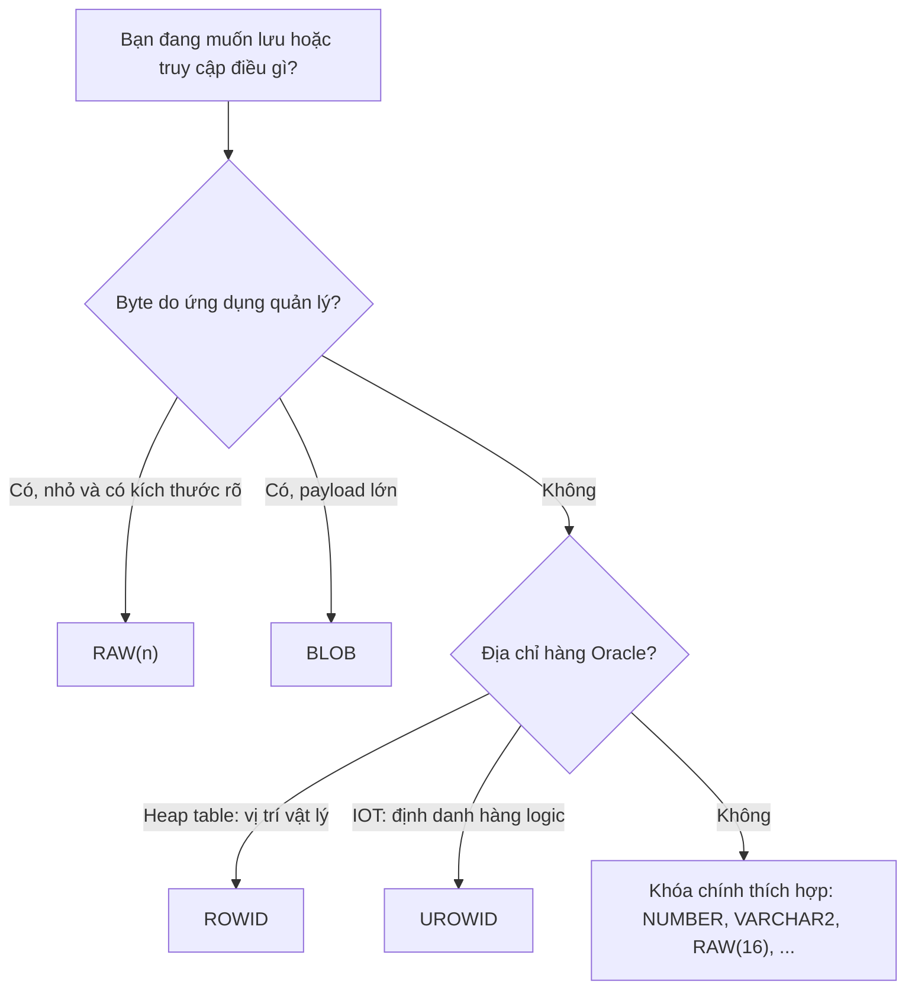
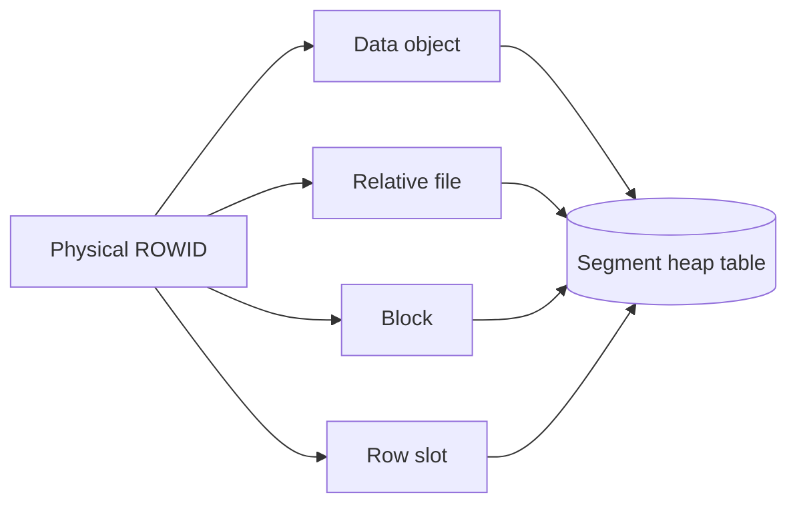
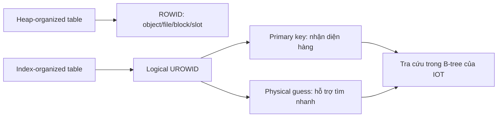

# RAW, ROWID, UROWID và cách sử dụng đúng mục đích trong Oracle Database

Oracle Database không chỉ lưu dữ liệu bằng `VARCHAR2`, `NUMBER` hay `TIMESTAMP`. Khi làm việc với mã định danh dạng byte, chữ ký số, hash, cấu trúc lưu trữ và cơ chế truy cập bản ghi, người học còn gặp ba kiểu dữ liệu dễ nhầm là **`RAW`, `ROWID` và `UROWID`**. Cả ba đều có thể hiện ra dưới dạng chuỗi ký tự trong công cụ SQL, nhưng mục đích sử dụng hoàn toàn khác nhau:

- **`RAW`** chứa *dãy byte nhị phân do ứng dụng định nghĩa*. Oracle không tự diễn giải byte đó thành chữ, số, UUID, ảnh hay hash.
- **`ROWID`** biểu diễn *địa chỉ hàng dạng vật lý* mà Oracle sử dụng cho những bảng có cấu trúc phù hợp, điển hình là heap-organized table.
- **`UROWID`** là *universal rowid* có thể biểu diễn cả rowid vật lý và rowid logic, đặc biệt cần cho index-organized table (IOT).

Không nên lấy `ROWID` hoặc `UROWID` thay cho khóa chính nghiệp vụ, và không nên coi một cột `RAW` là “đã mã hóa bảo mật”. Bài học hướng dẫn cách chọn kiểu, đọc giá trị, thao tác bằng SQL/JDBC, nhận diện rủi ro khi lưu rowid lâu dài và thực hành kiểm chứng trên Oracle Database.

## 1. Nhìn tổng thể: ba kiểu trả lời ba câu hỏi khác nhau

| Câu hỏi thiết kế | Kiểu phù hợp | Ví dụ điển hình |
|---|---|---|
| “Tôi cần lưu đúng **16 byte định danh** ứng dụng cấp” | `RAW(16)` | Token định danh, UUID/GUID ở dạng byte |
| “Tôi cần lưu đúng **32 byte digest**” | `RAW(32)` | SHA-256 đã được tính ở ứng dụng |
| “Tôi cần biết **hàng heap đang nằm ở đâu** để Oracle truy cập nhanh” | Pseudocolumn `ROWID`, giá trị kiểu `ROWID` | `SELECT ROWID, ... FROM orders` |
| “Tôi cần biểu diễn rowid **logic của IOT**, hoặc dữ liệu rowid có nhiều dạng” | `UROWID` | Pseudocolumn `ROWID` trả logical rowid của IOT |
| “Tôi cần lưu file PDF, ảnh lớn hoặc payload nhị phân nhiều MB” | `BLOB` | File đính kèm |
| “Tôi cần khóa ổn định để API, bảng liên kết và hệ thống khác tham chiếu” | Khóa chính nghiệp vụ/kỹ thuật | `NUMBER IDENTITY`, `RAW(16)` chứa GUID do ứng dụng quy định |

Điểm dễ gây nhầm là *tên* `ROWID` được dùng cho cả **kiểu dữ liệu** lẫn **pseudocolumn** có sẵn trong một số truy vấn bảng. Một pseudocolumn không nhất thiết là cột do người dùng khai báo trong DDL. Với index-organized table, pseudocolumn cùng tên có thể mang **giá trị logical rowid thuộc kiểu `UROWID`**, chứ không phải địa chỉ hàng heap vật lý thông thường.



## 2. `RAW`: lưu dữ liệu nhị phân ngắn theo đúng byte

### 2.1. `RAW(n)` có nghĩa gì?

`RAW` là kiểu dữ liệu nhị phân có độ dài biến đổi, khai báo bằng số byte tối đa:

```sql
CREATE TABLE binary_assets (
    asset_id    RAW(16) DEFAULT SYS_GUID() NOT NULL,
    checksum    RAW(32),
    marker      RAW(4),
    asset_name  VARCHAR2(100 CHAR) NOT NULL,
    CONSTRAINT pk_binary_assets PRIMARY KEY (asset_id)
);
```

Ý nghĩa:

- `asset_id RAW(16)` lưu tối đa **16 byte**. Hàm `SYS_GUID()` tạo một giá trị RAW 16 byte, có thể làm mã định danh kỹ thuật.
- `checksum RAW(32)` lưu tối đa **32 byte**, vừa với một digest SHA-256 nhị phân, nếu digest được tính bởi ứng dụng hoặc một thành phần được kiểm soát.
- `marker RAW(4)` có thể lưu các byte cố định như mã giao thức hoặc magic number.
- `asset_name VARCHAR2(100 CHAR)` lưu **văn bản** và có ý nghĩa về bộ ký tự; đây là mục đích khác với `RAW`.

Khai báo `RAW(16)` là **giới hạn tối đa**, không bắt buộc mọi giá trị phải có đúng 16 byte. Nếu yêu cầu nghiệp vụ đòi kích thước chính xác, cần bảo vệ ở tầng dữ liệu và ứng dụng, ví dụ dùng ràng buộc `CHECK` kết hợp `UTL_RAW.LENGTH` hoặc kiểm tra byte array trước khi ghi.

Trong các cấu hình Oracle phổ biến với `MAX_STRING_SIZE=STANDARD`, kích thước tối đa của một cột `RAW` trong SQL là **2.000 byte**; cấu hình `MAX_STRING_SIZE=EXTENDED` cho phép giới hạn cao hơn, tối đa **32.767 byte** theo các điều kiện phiên bản và khả năng hỗ trợ tương ứng. `RAW` trong PL/SQL cũng có giới hạn kích thước riêng của môi trường PL/SQL. Không giả định một schema có thể tạo `RAW(32767)` nếu CDB/PDB chưa được cấu hình cho extended data types.

Nếu kích thước dữ liệu có thể tăng đến hàng MB hoặc GB, `BLOB` mới là lựa chọn tự nhiên; không cố chia file thành nhiều cột `RAW` chỉ để vượt giới hạn.

### 2.2. `RAW` không tự có encoding

Giả sử hai byte `C3 A9` biểu diễn ký tự “é” theo UTF-8. Khi lưu:

```sql
INSERT INTO binary_assets (asset_id, marker, asset_name)
VALUES (SYS_GUID(), HEXTORAW('C3A9'), 'UTF-8 marker example');
```

Oracle lưu **các byte** `C3A9` trong `marker`. Oracle không tự hiểu rằng đó là một ký tự “é”. Nếu ứng dụng chọn cách diễn giải byte theo UTF-8 thì có thể nhận lại chữ tương ứng; nếu chọn encoding khác, kết quả có thể khác. Cột `RAW` không được xử lý theo cùng quy tắc chuyển đổi bộ ký tự dành cho `VARCHAR2`.

Điều này hữu ích với dữ liệu phải giữ nguyên byte qua các tầng hệ thống, chẳng hạn hash, identifier theo chuẩn nhị phân, mã giao thức hoặc vùng dữ liệu đã được mã hóa **bởi cơ chế bên ngoài**. Nhưng chỉ chuyển chữ sang `RAW` **không hề mã hóa bảo mật**: byte có thể được biểu diễn lại bằng hex hoặc giải mã theo encoding gốc.

### 2.3. Hai hàm cần nhớ: `HEXTORAW` và `RAWTOHEX`

`HEXTORAW` chuyển biểu diễn **hexadecimal** thành byte; hai ký tự hex biểu diễn một byte. `RAWTOHEX` chuyển byte thành chuỗi hex dễ đọc:

```sql
SELECT HEXTORAW('00A1FF') AS raw_value,
       RAWTOHEX(HEXTORAW('00A1FF')) AS hex_value
FROM dual;
```

Kết quả quan sát trên SQL client thường hiển thị hex `00A1FF`. Giá trị thứ nhất là RAW; giá trị thứ hai là chuỗi thể hiện byte dưới dạng hex. Chuỗi hex dài gấp đôi số byte, chẳng hạn **3 byte** chuyển thành **6 ký tự hex**.

Với giá trị đã lưu:

```sql
SELECT RAWTOHEX(asset_id) AS asset_id_hex,
       RAWTOHEX(marker) AS marker_hex,
       UTL_RAW.LENGTH(marker) AS marker_bytes
FROM binary_assets
ORDER BY asset_name;
```

`UTL_RAW.LENGTH` tính độ dài giá trị RAW theo byte; trong nhiều trường hợp, `LENGTHB` cũng được dùng để đo độ dài byte theo quy tắc kiểu dữ liệu liên quan. Nếu giá trị `NULL`, các hàm độ dài thường trả `NULL`; cần phân biệt `NULL` với RAW rỗng theo cách client/Oracle biểu diễn.

Không đưa một chuỗi bất kỳ như `'Hello'` vào `HEXTORAW`: đây **không phải** hàm “văn bản thành nhị phân”. Đầu vào phải là biểu diễn hex hợp lệ. Khi đầu vào sai hoặc độ dài không phù hợp, Oracle có thể báo lỗi chuyển đổi hoặc biểu diễn hex không hợp lệ.

### 2.4. Thêm dữ liệu và so sánh byte

Ví dụ kiểm tra đúng từng byte:

```sql
INSERT INTO binary_assets (asset_id, checksum, marker, asset_name)
VALUES (
    SYS_GUID(),
    HEXTORAW('000102030405060708090A0B0C0D0E0F101112131415161718191A1B1C1D1E1F'),
    HEXTORAW('DEADBEEF'),
    'Report checksum'
);

COMMIT;

SELECT asset_name,
       RAWTOHEX(marker) AS marker_hex,
       UTL_RAW.LENGTH(checksum) AS checksum_bytes
FROM binary_assets
WHERE marker = HEXTORAW('DEADBEEF');
```

So sánh ở đây là so sánh giá trị nhị phân. `'DEADBEEF'` là **8 ký tự hex** đại diện cho **4 byte** `DE AD BE EF`, không phải 8 byte mã ASCII. Khi đọc bằng công cụ hoặc ngôn ngữ khác, cùng một dãy byte có thể hiển thị khác nhau, nhưng giá trị nhị phân không thay đổi.

### 2.5. `SYS_GUID()` và UUID: tương đồng, không phải một khái niệm tuyệt đối

`SYS_GUID()` trả về **16 byte RAW** và thường được dùng để tạo ID duy nhất trong Oracle. Một UUID chuẩn ứng dụng cũng thường dài 128 bit và có thể lưu trong `RAW(16)`. Tuy nhiên:

- Không mặc nhiên khẳng định mọi giá trị do `SYS_GUID()` tạo là **UUID phiên bản 4 theo RFC 4122/UUID chuẩn cụ thể**. Nếu hệ thống yêu cầu một phiên bản UUID nhất định, hãy tạo và kiểm chứng theo chuẩn đó.
- Khi cần hiển thị UUID kiểu `550e8400-e29b-41d4-a716-446655440000`, phải định nghĩa rõ cách chuyển giữa chuỗi UUID và 16 byte. `RAWTOHEX` chỉ tạo **32 ký tự hex không có dấu gạch nối**.
- Nếu nhiều ứng dụng cùng sinh khóa, thống nhất **endianness, thứ tự byte và biểu diễn** để tránh cùng một UUID được ghi bằng hai dãy byte khác nhau.
- ID sinh ngẫu nhiên phân bố khác ID số tăng dần; khi làm primary key/index, cần cân nhắc workload ghi, cache và phân mảnh index trên dữ liệu thật.

Ví dụ dùng literal UUID ở dạng byte đã được thống nhất:

```sql
INSERT INTO binary_assets (asset_id, asset_name)
VALUES (
    HEXTORAW('550E8400E29B41D4A716446655440000'),
    'UUID example'
);

SELECT RAWTOHEX(asset_id) AS id_hex, asset_name
FROM binary_assets
WHERE asset_id = HEXTORAW('550E8400E29B41D4A716446655440000');
```

Nếu đã chạy ví dụ trước và ID trên trùng với một bản ghi có sẵn, primary key sẽ ngăn trùng lặp. Đây là ràng buộc dữ liệu đúng, không phải lỗi của `RAW`.

## 3. Đặt `RAW` đúng chỗ khi tích hợp Java/JDBC

Oracle JDBC thường ánh xạ giá trị `RAW` thành **`byte[]`** trong Java:

```java
import java.sql.Connection;
import java.sql.PreparedStatement;
import java.sql.ResultSet;
import java.sql.SQLException;

public final class BinaryAssetRepository {
    public static void saveMarker(Connection connection, byte[] id,
                                  byte[] marker, String name)
            throws SQLException {
        String sql =
            "INSERT INTO binary_assets(asset_id, marker, asset_name) " +
            "VALUES (?, ?, ?)";
        try (PreparedStatement ps = connection.prepareStatement(sql)) {
            ps.setBytes(1, id);
            ps.setBytes(2, marker);
            ps.setString(3, name);
            ps.executeUpdate();
        }
    }

    public static byte[] findMarker(Connection connection, byte[] id)
            throws SQLException {
        String sql =
            "SELECT marker FROM binary_assets WHERE asset_id = ?";
        try (PreparedStatement ps = connection.prepareStatement(sql)) {
            ps.setBytes(1, id);
            try (ResultSet rs = ps.executeQuery()) {
                return rs.next() ? rs.getBytes(1) : null;
            }
        }
    }
}
```

Trong ứng dụng thực tế, transaction do service/JDBC framework điều phối và nên tránh commit lẻ tẻ bên trong phương thức repository. Với `RAW(16)`, kiểm tra input array có đúng 16 byte và dùng bind parameter (`?`) thay vì nối hex string do người dùng gửi trực tiếp vào SQL.

### 3.1. Chuyển `java.util.UUID` thành 16 byte

Nếu ứng dụng dùng UUID theo biểu diễn chuẩn của Java, có thể chuyển 128 bit thành hai số `long` theo thứ tự byte lớn trước (big-endian) để lưu và đọc nhất quán:

```java
import java.nio.ByteBuffer;
import java.util.UUID;

public final class UuidBinary {
    public static byte[] toBytes(UUID uuid) {
        return ByteBuffer.allocate(16)
                .putLong(uuid.getMostSignificantBits())
                .putLong(uuid.getLeastSignificantBits())
                .array();
    }

    public static UUID fromBytes(byte[] bytes) {
        if (bytes == null || bytes.length != 16) {
            throw new IllegalArgumentException("UUID needs exactly 16 bytes");
        }
        ByteBuffer buffer = ByteBuffer.wrap(bytes);
        return new UUID(buffer.getLong(), buffer.getLong());
    }
}
```

Ví dụ `UUID.fromString("550e8400-e29b-41d4-a716-446655440000")` chuyển bằng `toBytes` cho 16 byte có hex `550E8400E29B41D4A716446655440000`. Điều quan trọng là **cùng dùng một quy tắc chuyển đổi ở cả lúc ghi và lúc đọc**. Nếu hệ thống đang dùng byte order khác (ví dụ từ một số driver/hệ lưu trữ bên ngoài), hãy chuyển đổi theo hợp đồng định dạng của hệ thống đó.

### 3.2. Khi nào không nên dùng `RAW`?

| Dữ liệu | Lựa chọn thường hợp lý hơn | Lý do |
|---|---|---|
| Họ tên, email, JSON văn bản nhỏ | `VARCHAR2`, `CLOB` hoặc kiểu JSON phù hợp phiên bản | Cần ngữ nghĩa chuỗi, tìm kiếm/ký tự và khả năng xử lý theo charset |
| Số tiền, số lượng | `NUMBER` | Cần tính toán số và ràng buộc phạm vi |
| File nhị phân lớn | `BLOB` | Vượt kích thước RAW, cần API LOB/stream |
| Mật khẩu người dùng | Không lưu mật khẩu thô; dùng cơ chế băm mật khẩu chuyên dụng | `RAW` không làm mật khẩu an toàn; hash mật khẩu cần salt và thuật toán chống brute-force thích hợp |
| ID tự nhiên ổn định dưới dạng văn bản | `VARCHAR2` với ràng buộc phù hợp | Định danh có ngữ nghĩa ký tự, ví dụ mã hàng |

`RAW` cũng không tự cung cấp **mã hóa**. Với dữ liệu nhạy cảm, cần thiết kế quyền truy cập, TLS, mã hóa lưu trữ (như TDE nếu phù hợp), quản lý khóa và audit theo yêu cầu bảo mật.

## 4. `ROWID`: địa chỉ vật lý của hàng trong heap table

### 4.1. Pseudocolumn `ROWID` xuất hiện từ đâu?

Trong bảng **heap-organized table** thông thường, Oracle cung cấp pseudocolumn `ROWID` để biểu diễn vị trí vật lý hiện tại của hàng. Bạn có thể đọc nó dù không hề khai báo cột `rowid` trong `CREATE TABLE`:

```sql
CREATE TABLE rowid_heap_lab (
    item_id NUMBER(10) CONSTRAINT pk_rowid_heap_lab PRIMARY KEY,
    item_name VARCHAR2(80 CHAR) NOT NULL
);

INSERT INTO rowid_heap_lab (item_id, item_name) VALUES (1, 'First');
INSERT INTO rowid_heap_lab (item_id, item_name) VALUES (2, 'Second');
COMMIT;

SELECT item_id,
       item_name,
       ROWID AS physical_rowid,
       ROWIDTOCHAR(ROWID) AS physical_rowid_text
FROM rowid_heap_lab
ORDER BY item_id;
```

Cột `PHYSICAL_ROWID` không được khai báo trong bảng, nhưng Oracle có thể trả giá trị tương ứng. Dạng văn bản của một **extended physical ROWID** thường dài **18 ký tự** và có encoding riêng của Oracle; không coi nó là UUID hoặc chuỗi ngẫu nhiên do ứng dụng tạo.

### 4.2. ROWID vật lý mô tả những thành phần nào?

Một extended ROWID của heap table có các thành phần logic:

1. **Data object number** liên quan tới segment/đối tượng dữ liệu đang lưu hàng.
2. **Relative file number** của datafile trong cấu trúc lưu trữ liên quan.
3. **Block number** nơi hàng được đặt.
4. **Row slot number** xác định vị trí hàng bên trong block.



Đây là địa chỉ **theo cấu trúc lưu trữ của Oracle**, không phải địa chỉ TCP, hostname hay địa chỉ bộ nhớ RAM. Oracle có thể sử dụng rowid khi lấy hàng sau khi đã tìm được rowid trong index.

Để quan sát các thành phần trên một hàng trong bảng lab, có thể dùng package `DBMS_ROWID` khi được cấp quyền thực thi:

```sql
SELECT item_id,
       DBMS_ROWID.ROWID_OBJECT(ROWID) AS data_object_id,
       DBMS_ROWID.ROWID_RELATIVE_FNO(ROWID) AS relative_file_no,
       DBMS_ROWID.ROWID_BLOCK_NUMBER(ROWID) AS block_no,
       DBMS_ROWID.ROWID_ROW_NUMBER(ROWID) AS row_slot
FROM rowid_heap_lab
ORDER BY item_id;
```

Các hàm `DBMS_ROWID` ở đây giải mã **physical rowid**. Không áp dụng máy móc cách giải mã block/file này cho logical rowid của IOT.

### 4.3. Truy vấn trực tiếp theo ROWID

Oracle có thể truy cập hàng theo một rowid vật lý hợp lệ:

```sql
SELECT item_id, item_name
FROM rowid_heap_lab
WHERE ROWID = (
    SELECT ROWID
    FROM rowid_heap_lab
    WHERE item_id = 1
);
```

Ví dụ trên dùng subquery để lấy rowid từ khóa chính ngay trong cùng câu lệnh, tránh hardcode một địa chỉ phụ thuộc máy lab. Khi client đã đọc rowid dưới dạng chuỗi từ một lần truy vấn trước, trong trường hợp **physical rowid** phù hợp có thể chuyển về kiểu rowid bằng `CHARTOROWID`:

```sql
-- :rid là bind variable chứa chuỗi ROWID vật lý thu được từ truy vấn trước.
SELECT item_id, item_name
FROM rowid_heap_lab
WHERE ROWID = CHARTOROWID(:rid);
```

Khi gửi từ ứng dụng, sử dụng bind parameter thay vì nối string vào câu SQL. Tên `:rid` là ký hiệu bind phổ biến trong Oracle SQL/SQL*Plus; giá trị phải được client đặt trước khi chạy. Trong một số JDBC API, placeholder được viết `?` và được bind thông qua `PreparedStatement`.

**Giá trị ROWID chỉ có ý nghĩa theo đối tượng và thời điểm hiện tại.** Nếu lấy rowid hôm nay rồi lưu vào message queue để ngày khác cập nhật, hàng có thể đã bị xóa, di chuyển hoặc row slot được tái sử dụng. Đó là lý do không dùng ROWID làm ID công khai của hệ thống.

### 4.4. `ROWID` không phải khóa chính

Khóa chính (primary key) và ROWID phục vụ những mục đích khác nhau:

| Tiêu chí | Khóa chính | Physical ROWID |
|---|---|---|
| Do ai định nghĩa? | Schema/nghiệp vụ chọn và ràng buộc | Oracle cung cấp theo vị trí hàng |
| Dùng trong foreign key? | Có | Không nên dùng để thiết kế quan hệ |
| Ổn định qua move/rebuild/reorganization? | Thường giữ giá trị khi dữ liệu được chuyển đúng | Có thể thay đổi |
| Tốt cho API URL và tích hợp ngoài? | Có, với thiết kế ID phù hợp | Không |
| Tốc độ truy cập một hàng trong trạng thái hiện tại? | Theo index/plan và schema | Có thể truy cập trực tiếp theo địa chỉ hợp lệ |
| Có thể bị tái sử dụng sau DELETE/INSERT? | Giá trị khóa do ứng dụng/ràng buộc quản lý | Vị trí lưu trữ có thể được tái sử dụng |
| Ý nghĩa nghiệp vụ? | Có hoặc là ID kỹ thuật ổn định | Không có |

Một bản ghi có khóa chính `item_id=1` có thể vẫn mang `item_id=1` sau khi Oracle chuyển segment qua một datafile khác, nhưng physical rowid thay đổi. Ngược lại, một rowid cũ có thể không còn trỏ tới hàng đó khi bảng bị tổ chức lại.

### 4.5. Những sự kiện làm ROWID thay đổi hoặc mất ý nghĩa

Các trường hợp cần đặc biệt chú ý:

- `ALTER TABLE ... MOVE` hoặc các thao tác tái tổ chức/di chuyển segment có thể làm thay đổi địa chỉ vật lý của hàng.
- `SHRINK SPACE`, khi bảng và cấu hình cho phép row movement, có thể sắp xếp lại hàng và thay đổi rowid.
- Di chuyển hàng giữa các **partition** khi có chính sách row movement phù hợp có thể làm thay đổi rowid.
- Export/import, tái tạo bảng hoặc một số công cụ phục hồi/chuyển đổi có thể tạo segment mới với địa chỉ hàng khác.
- `DELETE` giải phóng vị trí cũ; một hàng mới có thể chiếm lại một slot sau đó.
- Với những trường hợp row migration/chaining, rowid có thể vẫn trỏ tới phần đầu của hàng; không suy ra mọi thay đổi cách lưu byte đều làm rowid đổi.

Không cần thuộc mọi cơ chế nội bộ để chọn khóa. Quy tắc thiết kế là: **một định danh phải tồn tại bền qua thay đổi hạ tầng thì không dùng physical ROWID**.

## 5. ROWID trong execution plan và xử lý SQL

ROWID xuất hiện rất thường xuyên trong kế hoạch thực thi, dù lập trình viên không viết `ROWID` trong truy vấn:

```sql
CREATE INDEX ix_rowid_heap_name
ON rowid_heap_lab (item_name);

EXPLAIN PLAN FOR
SELECT item_id, item_name
FROM rowid_heap_lab
WHERE item_name = 'First';

SELECT * FROM TABLE(DBMS_XPLAN.DISPLAY);
```

Ở các bảng có kích thước và thống kê phù hợp, một kế hoạch có thể chứa:

```text
INDEX RANGE SCAN
TABLE ACCESS BY INDEX ROWID
```

Ý nghĩa:

1. Oracle dùng index để tìm khóa/index entry phù hợp.
2. Index entry của heap table thường chứa rowid của hàng liên quan.
3. Oracle dùng rowid đó để truy cập hàng trong table segment khi cần dữ liệu không có sẵn từ index.

**Không có gì buộc optimizer phải chọn index trong ví dụ vài dòng.** Full table scan có thể rẻ hơn; `EXPLAIN PLAN` là kế hoạch ước tính. Câu `TABLE ACCESS BY INDEX ROWID` trong plan không phải lời khuyên biến rowid thành ID nghiệp vụ.

Ví dụ ứng dụng có thể sử dụng ROWID cho thao tác nội bộ ngắn hạn, chẳng hạn lấy danh sách hàng trong cùng transaction rồi xử lý với các điều kiện bảo vệ. Tuy nhiên, khi cập nhật có đồng thời, vẫn cần xác minh danh tính/phiên bản:

```sql
-- :rid, :item_id và :old_name là các bind variable được ứng dụng cung cấp.
UPDATE rowid_heap_lab
SET item_name = 'Updated'
WHERE ROWID = CHARTOROWID(:rid)
  AND item_id = :item_id
  AND item_name = :old_name;
```

Phải kiểm tra số hàng bị ảnh hưởng. Nếu bằng 0, hàng đã thay đổi, bị xóa/di chuyển, hoặc điều kiện không còn đúng; ứng dụng cần xử lý xung đột thay vì âm thầm coi là thành công. Điều kiện `item_id` giúp chống cập nhật nhầm một hàng khác trong trường hợp slot được tái sử dụng; trong ứng dụng thực tế nên dùng thêm version column/optimistic locking thích hợp.

## 6. `UROWID`: universal rowid cho địa chỉ vật lý hoặc logic

### 6.1. Vì sao Oracle cần một loại ROWID khác?

Heap table có hàng lưu theo block và slot, nên physical ROWID mô tả một địa chỉ. Nhưng trong **index-organized table (IOT)**, hàng được tổ chức theo cấu trúc index trên khóa chính. Các leaf entry chứa dữ liệu hàng, và vị trí vật lý có thể thay đổi khi cấu trúc index được tái tổ chức. Vì thế dùng địa chỉ block/slot cố định làm danh tính hàng là không phù hợp.

Oracle cung cấp **logical rowid** cho IOT. Logical rowid dựa trên **giá trị primary key**, có thể gồm gợi ý vị trí vật lý (physical guess) để tăng tốc truy cập. Giá trị này thuộc kiểu **`UROWID`**, có thể biểu diễn linh hoạt hơn physical ROWID.



Một logical rowid của IOT có thể duy trì khả năng xác định hàng khi vị trí vật lý thay đổi, miễn là khóa chính tương ứng còn có ý nghĩa theo cơ chế Oracle. Nhưng **nếu khóa chính thay đổi hoặc hàng bị xóa**, không thể xem UROWID cũ là ID nghiệp vụ bền vững. Với hệ thống phân tán, dùng chính primary key để tham chiếu.

### 6.2. Ví dụ index-organized table

Tạo một IOT nhỏ trong schema lab:

```sql
CREATE TABLE catalog_iot (
    catalog_code VARCHAR2(20 CHAR) NOT NULL,
    description  VARCHAR2(100 CHAR),
    CONSTRAINT pk_catalog_iot PRIMARY KEY (catalog_code)
)
ORGANIZATION INDEX;

INSERT INTO catalog_iot (catalog_code, description)
VALUES ('BOOK-001', 'Database fundamentals');

INSERT INTO catalog_iot (catalog_code, description)
VALUES ('BOOK-002', 'Oracle SQL lab');

COMMIT;
```

Truy vấn:

```sql
SELECT catalog_code,
       description,
       ROWID AS logical_rowid
FROM catalog_iot
ORDER BY catalog_code;
```

Pseudocolumn vẫn tên `ROWID`, nhưng với IOT nó biểu diễn **logical rowid thuộc kiểu UROWID**. Không giả định dạng chuỗi hoặc độ dài bằng 18 ký tự như extended physical ROWID của heap table. Độ dài logical rowid còn phụ thuộc cấu trúc/khóa của IOT.

Để phân biệt bảng heap và IOT trong metadata:

```sql
SELECT table_name,
       iot_type
FROM user_tables
WHERE table_name IN ('ROWID_HEAP_LAB', 'CATALOG_IOT')
ORDER BY table_name;
```

Với IOT có tổ chức index, metadata sẽ phản ánh loại IOT phù hợp. Đây là bằng chứng tốt hơn việc đoán từ tên bảng hoặc việc truy vấn `ROWID` có chạy được hay không.

### 6.3. Kiểu cột `UROWID` dùng để làm gì?

Oracle có kiểu dữ liệu cột `UROWID` để chứa giá trị rowid có dạng vật lý hoặc logic khi thật sự cần lưu chúng. Ví dụ cú pháp:

```sql
CREATE TABLE row_locator_cache_lab (
    cache_key NUMBER(10) PRIMARY KEY,
    locator   UROWID(4000)
);
```

`UROWID(n)` có tham số kích thước tính theo byte và giới hạn tối đa thông dụng của SQL là **4.000 byte**. Giá trị dài bao nhiêu phụ thuộc loại rowid được lưu; việc khai báo `UROWID(4000)` không có nghĩa mọi giá trị chiếm đúng 4.000 byte. Không coi cột này là khóa nghiệp vụ hoặc foreign key chuẩn chỉ vì nó có thể chứa một row identifier.

Một số hoạt động đặc biệt của Oracle có thể sử dụng UROWID để chứa rowid của những nguồn dữ liệu có tổ chức khác nhau. **Không phải tất cả object đều có thể truy vấn ROWID tùy ý**: các view phức tạp, join view không có key-preserved table hoặc một số loại đối tượng có hạn chế riêng.

### 6.4. UROWID không phải “ROWID tốt hơn cho mọi bảng”

`UROWID` được thiết kế để **bao quát nhiều hình thức rowid**, đặc biệt logical rowid. Nó không tự cấp tính ổn định của ID nghiệp vụ và không tạo index/constraint cho quan hệ giữa hai bảng.

Với heap table, `ROWID` phù hợp để biểu diễn physical rowid ngắn hạn. Với IOT, Oracle tự quyết định logical rowid. Bạn không cần chuyển mọi primary key từ `NUMBER` hoặc `RAW(16)` thành `UROWID` khi dùng IOT.

## 7. Phân biệt chính xác `RAW`, `ROWID` và `UROWID`

| Thuộc tính | `RAW(n)` | `ROWID` | `UROWID(n)` |
|---|---|---|---|
| Dữ liệu đại diện | Byte theo hợp đồng ứng dụng | Địa chỉ vật lý của một hàng Oracle | Universal rowid, gồm dạng vật lý hoặc logic |
| Ai quyết định giá trị? | Ứng dụng, hàm DB hoặc quy trình tích hợp | Oracle dựa trên cấu trúc lưu trữ hiện tại | Oracle cấp theo loại rowid |
| Ví dụ hiển thị | `550E8400E29B41D4A716446655440000` | Chuỗi extended ROWID vật lý | Có thể là chuỗi logical rowid độ dài thay đổi |
| Có thể dùng làm PK ứng dụng? | **Có**, nếu byte là ID bền vững và có ràng buộc unique/PK | **Không nên** | **Không nên** |
| Có thể lưu dạng cột? | Có | Có kiểu cột `ROWID`, nhưng thường không thiết kế như dữ liệu nghiệp vụ | Có |
| Có thể lấy như pseudocolumn `ROWID`? | Không: RAW là loại dữ liệu do người dùng khai báo | Có với heap table phù hợp | Có dạng logical rowid trong IOT |
| Phụ thuộc bố trí vật lý của bảng? | Không trực tiếp | Có | Với IOT, nhận diện logic dựa vào PK; có thể mang physical guess |
| Cần lo encoding/định dạng? | Có ở tầng trao đổi byte ↔ UUID/text | Có định dạng rowid riêng của Oracle | Có định dạng Oracle riêng, có thể biến thiên |
| Thích hợp với file nhị phân lớn? | Không | Không | Không |
| Ứng dụng Java thường xử lý | `byte[]`, có thể chuyển `UUID` | `java.sql.RowId`/biểu diễn chuỗi tùy driver | Driver/Oracle-specific handling tùy loại logical rowid |

Sự giống nhau về cách công cụ hiển thị không làm chúng có cùng ngữ nghĩa: **RAWTOHEX của một ID có thể là dữ liệu lâu dài**, còn chuỗi physical rowid chỉ là một cách biểu diễn locator ở thời điểm hiện tại.

## 8. Kỹ thuật xử lý ROWID/UROWID trong Java

Với `RAW`, Java nên sử dụng `byte[]`. Với physical ROWID, API JDBC có kiểu `java.sql.RowId` và các phương thức như `ResultSet.getRowId`, `PreparedStatement.setRowId` nếu driver tương thích. Một số ứng dụng đọc biểu diễn chuỗi của ROWID để hiển thị hoặc dùng trong tác vụ nội bộ, nhưng phải thận trọng với việc chuyển đổi từ chuỗi, đặc biệt khi dữ liệu là logical UROWID.

Ví dụ dùng JDBC để đọc physical rowid của heap table trong một transaction ngắn:

```java
import java.sql.Connection;
import java.sql.PreparedStatement;
import java.sql.ResultSet;
import java.sql.RowId;
import java.sql.SQLException;

public final class HeapRowLocatorReader {
    public static RowId findRowId(Connection connection, long itemId)
            throws SQLException {
        String sql = "SELECT ROWID FROM rowid_heap_lab WHERE item_id = ?";
        try (PreparedStatement ps = connection.prepareStatement(sql)) {
            ps.setLong(1, itemId);
            try (ResultSet rs = ps.executeQuery()) {
                return rs.next() ? rs.getRowId(1) : null;
            }
        }
    }
}
```

Phải kiểm tra khả năng hỗ trợ API của Oracle JDBC driver đang dùng và vòng đời của `RowId`. Một `RowId` nhận từ lần chạy trước không mặc nhiên còn trỏ tới cùng một hàng sau khi transaction khác đã xóa/move dữ liệu. Khi thao tác nghiệp vụ thật, truy vấn theo khóa chính và kết hợp version/locking phù hợp thường dễ bảo đảm tính đúng đắn hơn.

### 8.1. Không lộ ROWID ra hợp đồng API ngoài

Giả sử REST API trả:

```json
{
  "orderId": 1001,
  "rowId": "AAAXYZAAEAAAACXAAA"
}
```

Chuỗi ROWID trong JSON chỉ là ví dụ cấu trúc, không phải giá trị đã được xác minh tồn tại trong database hiện tại. Không khuyến khích client dùng `rowId` làm định danh cho lệnh `PUT /orders/{id}` hoặc làm tham chiếu lưu ở dịch vụ khác. Khi move/rebuild/import bảng, locator có thể thay đổi; việc đồng bộ bên ngoài sẽ bị phá vỡ dù đơn hàng `orderId=1001` vẫn tồn tại.

Thiết kế API nên chỉ công bố ID ổn định, ví dụ:

```json
{
  "orderId": 1001,
  "status": "NEW"
}
```

ROWID có thể hữu ích cho công cụ DBA, truy vấn nội bộ hoặc tối ưu xử lý lô ngắn hạn dưới sự kiểm soát, nhưng không phải hợp đồng dữ liệu giữa các hệ thống.

## 9. Chọn khóa chính: NUMBER, VARCHAR2 hoặc RAW, không dùng ROWID

Một ví dụ hệ thống đơn hàng cần:

- ID ổn định khi backup/restore/migration.
- Bảng `order_items` tham chiếu tới đơn hàng bằng khóa ngoại.
- API giữ URL ổn định.
- Dữ liệu có thể di chuyển sang bảng/partition khác.

Thiết kế dùng `NUMBER IDENTITY`:

```sql
CREATE TABLE orders_by_number (
    order_id NUMBER GENERATED BY DEFAULT AS IDENTITY
        CONSTRAINT pk_orders_by_number PRIMARY KEY,
    order_status VARCHAR2(20 CHAR) NOT NULL
);
```

Hoặc dùng `RAW(16)` nếu hệ thống có hợp đồng GUID/UUID 16 byte:

```sql
CREATE TABLE orders_by_guid (
    order_id RAW(16) DEFAULT SYS_GUID() NOT NULL,
    order_status VARCHAR2(20 CHAR) NOT NULL,
    CONSTRAINT pk_orders_by_guid PRIMARY KEY (order_id)
);
```

Một bảng con có thể tham chiếu bằng khóa ngoại `RAW(16)` tương ứng:

```sql
CREATE TABLE order_events (
    event_id NUMBER(10) CONSTRAINT pk_order_events PRIMARY KEY,
    order_id RAW(16) NOT NULL,
    event_name VARCHAR2(80 CHAR) NOT NULL,
    CONSTRAINT fk_order_events_order
        FOREIGN KEY (order_id) REFERENCES orders_by_guid(order_id)
);
```

Khi bảng `orders_by_guid` được move/reorganize, giá trị khóa `order_id` vẫn mang ý nghĩa độc lập với physical ROWID. Còn các rowid mà Oracle dùng nội bộ có thể thay đổi theo vị trí mới. Đây chính là lý do khóa chính và rowid là hai thành phần kiến trúc khác nhau.

### 9.1. Khi nào có thể lưu locator như một cache?

Trong một công cụ vận hành được kiểm soát, có thể cache rowid để tăng tốc một tác vụ ngắn hạn. Để giảm rủi ro, cần:

1. Lưu kèm **ID thực** của hàng.
2. Chỉ dùng cache trong phạm vi thời gian và transaction đã xác định.
3. Khi truy vấn, xác minh lại ID và điều kiện/version của hàng.
4. Chấp nhận cache bị vô hiệu hóa sau move, import, truncate, partition maintenance hoặc thay đổi vị trí dữ liệu.
5. Có đường fallback truy vấn theo primary key và tạo lại locator.

Nếu không có nhu cầu hiệu năng đã được đo, thường **không nên thiết kế thêm cột lưu ROWID/UROWID**. Nó tạo thêm dữ liệu dẫn xuất khó duy trì mà không thay thế khóa chính.

## 10. Lỗi thường gặp và cách nhận diện

| Hiện tượng / lỗi | Nguyên nhân có thể | Hướng xử lý |
|---|---|---|
| Giá trị `HEXTORAW` không hợp lệ | Chuỗi đầu vào không phải hex đúng định dạng | Xác nhận ký tự `0–9, A–F` và chiều dài biểu diễn |
| Lỗi giá trị quá dài cho `RAW(n)` | Dãy byte vượt giới hạn cột, hoặc driver bind không phù hợp | Kiểm tra số byte thực, DDL và loại dữ liệu |
| `RAWTOHEX` trả 32 ký tự mà ứng dụng cần UUID 36 ký tự | RAWTOHEX chỉ tạo hex liên tục, không thêm dấu gạch nối | Chuyển đổi biểu diễn UUID tại tầng ứng dụng theo format đã quy định |
| Java đọc byte nhưng GUID hiển thị “ngược” | Các tầng dùng quy ước byte order khác nhau | Chuẩn hóa 16 byte ↔ UUID và kiểm tra bằng vector thử cố định |
| `ORA-01410: invalid ROWID` | ROWID truyền vào không hợp lệ theo ngữ cảnh hoặc locator lỗi | Không tự sửa string tùy ý; lấy lại rowid bằng khóa chính |
| Query theo rowid trả 0 hàng | Hàng đã bị xóa/chuyển, rowid cũ hoặc điều kiện khác không còn đúng | Truy vấn lại bằng khóa ổn định, xử lý xung đột |
| Query theo rowid cũ trỏ sang hàng không mong muốn | Slot có thể được tái sử dụng sau thay đổi dữ liệu | Không dùng rowid làm ID duy nhất cho cập nhật; kiểm tra PK và version |
| `ROWIDTOCHAR` không áp dụng cho dạng logical rowid mong muốn | Đang nhầm physical ROWID với UROWID của IOT | Kiểm tra tổ chức bảng, kiểu dữ liệu, dùng API/biểu diễn tương thích |
| Chọn `ROWID` từ join view/complex view bị từ chối, ví dụ `ORA-01445`/`ORA-01446` | Oracle không xác định được rowid hợp lệ cho view trong cấu trúc đang truy vấn | Lấy rowid trực tiếp từ bảng gốc phù hợp hoặc dùng khóa chính |
| `USER_TAB_COLUMNS` không có cột `ROWID` | ROWID là pseudocolumn, không phải cột DDL của heap table | Truy vấn `SELECT ROWID FROM table` khi loại bảng hỗ trợ |
| Query vẫn chậm dù đã thêm điều kiện ROWID | Nút thắt nằm ở lock, I/O, dữ liệu chưa cache hoặc thao tác khác | Quan sát execution plan, wait event và transaction |

Mã lỗi và triệu chứng phải được diễn giải cùng câu SQL, loại bảng, quyền của session, tình trạng object và phiên bản Oracle. Nếu `CHARTOROWID` nhận một chuỗi trông giống rowid nhưng là logical UROWID của IOT, không nên cố ép chuyển theo quy tắc physical rowid; cần chọn API/kiểu tương ứng.

### 10.1. Những nhầm lẫn quan trọng cần tránh

**“RAW là chuỗi hex.”** Không chính xác. RAW là byte; chuỗi hex chỉ là một cách thể hiện nó cho người đọc.

**“Dùng SYS_GUID trong RAW thì chắc chắn có UUID v4.”** Không thể suy ra như vậy. `SYS_GUID` tạo định danh RAW 16 byte; yêu cầu UUID version/variant cần được kiểm soát riêng.

**“ROWID là primary key sẵn có của Oracle.”** Không đúng về mặt mô hình quan hệ. ROWID là locator và có vòng đời phụ thuộc lưu trữ.

**“IOT không có ROWID nên SELECT ROWID phải lỗi.”** IOT có thể cung cấp **logical rowid dưới dạng UROWID** qua pseudocolumn `ROWID`.

**“UROWID không bao giờ thay đổi.”** Không nên cam kết như vậy. Logical rowid có quan hệ với primary key và cấu trúc tổ chức bảng, không dùng thay khóa ổn định do ứng dụng quản lý.

**“Chỉ cần biết ROWID là query luôn nhanh nhất.”** Không. Chi phí thật phụ thuộc truy vấn, index, I/O, cache, transaction và số hàng cần lấy. Optimizer có thể chọn cách truy cập khác tốt hơn.

**“RAW bảo vệ dữ liệu bí mật.”** Không. Bất kỳ người nào có quyền đọc giá trị đều có thể xem chuỗi hex hoặc các byte; bảo mật là trách nhiệm của encryption, access control và quản trị khóa.

## 11. Bài thực hành: từ RAW tới physical/logical rowid

Thực hành trong schema riêng của một PDB lab, có quyền `CREATE TABLE` và quota trên tablespace phù hợp. Đừng dùng bảng production để thử `MOVE`, `TRUNCATE` hoặc các thao tác tái tổ chức.

### Bài 1 — Kiểm tra byte của RAW

```sql
SELECT RAWTOHEX(HEXTORAW('00112233445566778899AABBCCDDEEFF')) AS hex_value,
       UTL_RAW.LENGTH(HEXTORAW('00112233445566778899AABBCCDDEEFF')) AS byte_count
FROM dual;
```

Giải thích vì sao chuỗi hiển thị có **32 ký tự hex** nhưng chỉ có **16 byte**. So sánh `HEXTORAW('AA')` và `HEXTORAW('aa')` để hiểu chữ hoa/thường trong ký hiệu hex không đổi giá trị byte.

### Bài 2 — Tạo primary key nhị phân

Tạo bảng `binary_assets` ở mục 2, chèn một dòng bằng `SYS_GUID()` và một dòng bằng `HEXTORAW`. Dùng `RAWTOHEX(asset_id)` để hiển thị, thử chèn cùng mã `asset_id` hai lần và giải thích lỗi unique/primary key. Trả lời: việc giữ ID ổn định do **byte của cột** và constraint đảm bảo, hay do rowid vật lý?

### Bài 3 — Quan sát ROWID của heap table

Tạo `rowid_heap_lab` ở mục 4:

```sql
SELECT item_id,
       ROWID,
       ROWIDTOCHAR(ROWID) AS rid_text
FROM rowid_heap_lab
ORDER BY item_id;
```

Ghi lại rowid thực tế và dùng `DBMS_ROWID` nếu có quyền để đọc object/file/block/slot. Không kết luận từ hai rowid có tiền tố giống nhau rằng chúng luôn nằm cạnh nhau trong mọi tổ chức bảng.

### Bài 4 — Quan sát ROWID của index-organized table

Tạo `catalog_iot` ở mục 6 và chạy:

```sql
SELECT catalog_code, ROWID AS iot_rowid
FROM catalog_iot
ORDER BY catalog_code;

SELECT table_name, iot_type
FROM user_tables
WHERE table_name IN ('ROWID_HEAP_LAB', 'CATALOG_IOT');
```

So sánh giá trị trả về, không cố đọc file/block/slot từ logical UROWID bằng hàm dành cho physical rowid. Giải thích vì sao primary key quan trọng đối với tổ chức index của IOT.

### Bài 5 — Lập kế hoạch tác động của row movement

Giả sử ứng dụng lưu physical ROWID trong một queue và chạy lại sau một đợt import hoặc `ALTER TABLE ... MOVE`. Hãy thiết kế lại luồng xử lý bằng `item_id`:

```sql
SELECT item_id, item_name
FROM rowid_heap_lab
WHERE item_id = :item_id;
```

Nếu cần chống ghi đè dữ liệu do request cạnh tranh, thêm cột `version_no` và cập nhật có điều kiện theo version. Chỉ khi có phép đo hiệu năng và kiểm soát vòng đời locator mới cân nhắc dùng rowid như tối ưu nội bộ ngắn hạn.

### Bài 6 — Java round-trip RAW(16)

Tạo một `UUID` trong Java, chuyển sang `byte[16]` bằng `UuidBinary.toBytes`, bind `setBytes` vào cột `RAW(16)` rồi đọc lại bằng `getBytes`. Dùng `UuidBinary.fromBytes` xác nhận UUID trước/sau bằng nhau. So sánh với `RAWTOHEX` ở Oracle; ghi rõ quy tắc byte order của ứng dụng.

### Hồ sơ bàn giao bài lab

Kết quả nên có:

| Bằng chứng | Điều muốn chứng minh |
|---|---|
| DDL `RAW(16)`, dữ liệu hex và `UTL_RAW.LENGTH` | Byte là dữ liệu thực, hex chỉ là biểu diễn |
| Bảng có PK `RAW(16)` hoặc `NUMBER` | Khóa bền vững không phụ thuộc ROWID |
| `SELECT ROWID` trên heap table | Oracle cung cấp physical locator |
| `SELECT ROWID` trên IOT | Oracle cung cấp logical UROWID |
| Kết quả `USER_TABLES.IOT_TYPE` | Phân biệt tổ chức vật lý của bảng |
| Kịch bản dùng khóa chính thay ROWID lưu lâu dài | Xử lý đúng khi hàng di chuyển hoặc vị trí bị tái sử dụng |
| Java `byte[]` ↔ UUID | Hợp đồng chuyển đổi nhị phân rõ ràng, nhất quán |

## 12. Câu hỏi tự kiểm tra

1. `RAW(16)` lưu tối đa 16 **byte** hay 16 **ký tự hex**? Giá trị `RAWTOHEX` thường dài bao nhiêu ký tự khi đủ 16 byte?
2. `HEXTORAW('48656C6C6F')` có tự tuyên bố đây là văn bản UTF-8 “Hello” không? Ai chịu trách nhiệm chọn encoding?
3. `SYS_GUID()` trả kiểu gì và vì sao không mặc định tuyên bố đó là UUID v4?
4. Vì sao cột hash SHA-256 có thể dùng `RAW(32)`, còn file ảnh lớn nên dùng `BLOB`?
5. Một bảng heap có khai báo cột `ROWID` thì mới truy vấn được `ROWID` hay Oracle cung cấp pseudocolumn?
6. Physical ROWID mô tả những thành phần nào của hàng?
7. Tại sao `ALTER TABLE ... MOVE` hoặc tổ chức lại storage có thể làm locator cũ không còn dùng được?
8. `TABLE ACCESS BY INDEX ROWID` trong execution plan có nghĩa optimizer đang dùng rowid như thế nào?
9. Vì sao IOT cần logical rowid, và logical UROWID liên quan gì tới primary key?
10. `UROWID` có phải một primary key thay thế lý tưởng cho mọi bảng không?
11. Tại sao việc cập nhật `WHERE ROWID=...` nên đi kèm khóa chính và điều kiện/version trong bài toán có concurrency?
12. Khi truyền `RAW(16)` giữa Java và Oracle, vì sao phải thống nhất byte order và định dạng UUID?

**Ghi nhớ nguyên tắc lựa chọn:** nếu thứ bạn cần lưu là **byte có ý nghĩa do ứng dụng xác định**, hãy cân nhắc `RAW`; nếu đang phân tích **vị trí hàng heap** và cách Oracle thực thi SQL, hãy hiểu `ROWID`; nếu cần làm việc với **logical rowid của IOT**, hãy hiểu `UROWID`. Nhưng với quan hệ dữ liệu, khóa ngoại, API hay tích hợp dài hạn, hãy sử dụng **khóa chính ổn định** và để Oracle quản lý locator vật lý bên dưới.
