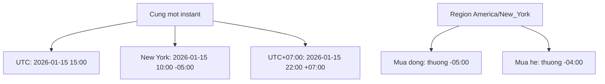
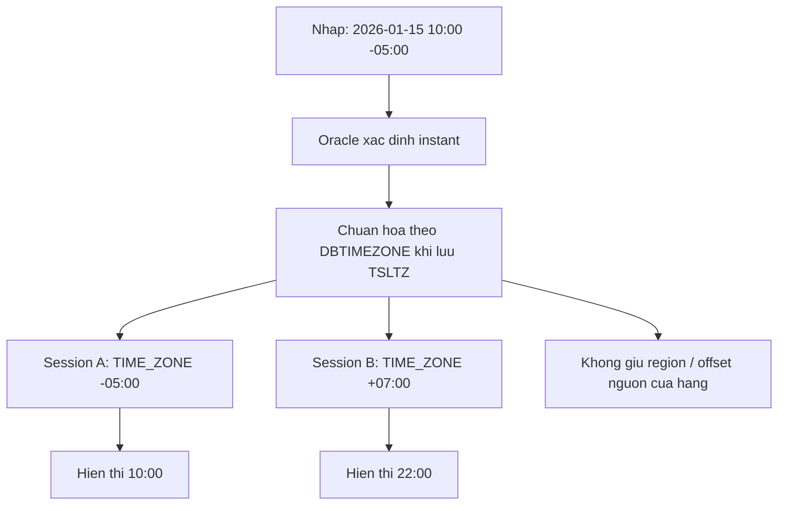

# TIMESTAMP WITH TIME ZONE và TIMESTAMP WITH LOCAL TIME ZONE trong Oracle

Một ứng dụng có người dùng ở nhiều quốc gia phải xử lý ít nhất hai khái niệm thời gian: **thời điểm thực tế một sự kiện xảy ra** (*instant*) và **ngày giờ mà con người nhìn thấy trên đồng hồ ở một múi giờ cụ thể** (*local civil time*). Hai người ở Hà Nội và New York có thể nhìn thấy hai giờ khác nhau nhưng cùng quan sát một thời điểm. Ngược lại, “09:00 sáng thứ Hai tại New York” là một quy tắc lịch địa phương; nếu chuyển thành một offset cố định cho cả năm, giờ mùa hè (*daylight saving time*, DST) có thể làm lịch hẹn lệch một giờ.

Oracle Database cung cấp hai kiểu thường gây nhầm lẫn:

- **`TIMESTAMP WITH TIME ZONE` (TSTZ)**: lưu thời gian với thông tin múi giờ/offset gắn cùng giá trị, cho phép diễn giải thời điểm và trình bày theo vùng hoặc offset đã cung cấp.
- **`TIMESTAMP WITH LOCAL TIME ZONE` (TSLTZ)**: chuẩn hóa giá trị khi lưu theo **database time zone**, sau đó **chuyển sang session time zone khi đọc**; không giữ múi giờ nguồn riêng cho từng hàng.

Bài này giải thích sâu sự khác nhau giữa hai kiểu trong ngữ cảnh **Ngày giờ và NLS** của Oracle: cách tạo giá trị, hiển thị, chuyển múi giờ, tác động của session, ranh giới DST, cách lưu và truy vấn, cùng lưu ý khi kết nối từ Java/JDBC. Các ví dụ sử dụng cú pháp SQL/SQL*Plus của Oracle; nếu môi trường dùng SQL Developer, hãy chạy DDL/DML bằng worksheet và chạy các lệnh cấu hình session trong đúng connection.

## 1. Phân biệt thời điểm, giờ địa phương, offset và vùng múi giờ

Để hiểu hai kiểu dữ liệu, hãy phân biệt bốn khái niệm:

| Khái niệm | Ý nghĩa | Ví dụ |
| --- | --- | --- |
| **Instant** | Một thời điểm duy nhất trên trục thời gian | `2026-01-15 15:00:00 UTC` |
| **Local date-time** | Ngày giờ trên đồng hồ, **chưa** cho biết đang ở múi giờ nào | `2026-01-15 10:00:00` |
| **UTC offset** | Độ lệch cố định so với UTC tại một thời điểm | `-05:00` hoặc `+07:00` |
| **Time zone region** | Tên vùng có quy tắc offset lịch sử/hiện tại và có thể áp dụng DST | `America/New_York`, `Europe/Paris` |

Ví dụ ngày 15/01/2026, `10:00 -05:00` ở New York tương ứng `15:00 +00:00` UTC. Vào mùa hè, New York thường chuyển sang `-04:00`; do đó **`-05:00` không tương đương về ý nghĩa lâu dài với `America/New_York`**. Offset cho biết lệch UTC tại một giá trị cụ thể; region cho phép áp dụng quy tắc múi giờ theo ngày.



Hai chuỗi giờ địa phương khác nhau có thể biểu diễn **cùng một instant** khi offset khác nhau. Nhưng một chuỗi chỉ có `2026-01-15 10:00` thì **chưa đủ thông tin** để kết luận instant nào.

## 2. So sánh các kiểu ngày giờ của Oracle

Oracle có nhiều kiểu ngày giờ; chọn kiểu dựa trên thông tin cần lưu:

| Kiểu | Có phần giây lẻ? | Có múi giờ trong giá trị? | Hành vi đặc trưng |
| --- | --- | --- | --- |
| `DATE` | Không; chính xác đến giây | Không | Lưu năm, tháng, ngày, giờ, phút, giây; không đồng nghĩa “chỉ có ngày”. |
| `TIMESTAMP(p)` | Có; `p` là precision phần giây | Không | Lưu thời gian trên đồng hồ nhưng không nói rõ offset hay vùng. |
| `TIMESTAMP(p) WITH TIME ZONE` | Có | **Có** thông tin offset hoặc region | Giá trị mang ngữ cảnh múi giờ đã đưa vào, có thể chuyển sang múi giờ khác. |
| `TIMESTAMP(p) WITH LOCAL TIME ZONE` | Có | **Không lưu region/offset nguồn theo hàng** | Chuẩn hóa khi lưu, trình bày theo session time zone khi đọc. |

Với `TIMESTAMP(p)` và hai biến thể có time zone, `p` là số chữ số phần giây từ **0 đến 9**, mặc định thường là **6**. Ví dụ `TIMESTAMP(3)` giữ đến mili giây; `TIMESTAMP(6)` giữ đến micro giây. **Độ chính xác phần giây** và **độ chính xác của múi giờ** là hai vấn đề khác nhau: giữ 6 chữ số phần giây không khiến một offset trở thành region có quy tắc DST.

Các cột:

```sql
CREATE TABLE lab_event_types (
    event_id      NUMBER(10) PRIMARY KEY,
    local_time    TIMESTAMP(3),
    zoned_time    TIMESTAMP(3) WITH TIME ZONE,
    session_time  TIMESTAMP(3) WITH LOCAL TIME ZONE
);
```

Ở đây, ba giá trị có thể cùng xuất hiện trong một hàng nhưng mang thông tin khác nhau: `LOCAL_TIME` không có zone; `ZONED_TIME` có timezone; `SESSION_TIME` được Oracle chuyển khi lưu/đọc theo ngữ cảnh database/session.

## 3. TIMESTAMP WITH TIME ZONE: lưu gì, dùng khi nào?

**`TIMESTAMP WITH TIME ZONE`** kết hợp ngày giờ, phần giây lẻ và **thông tin múi giờ**. Người dùng có thể tạo giá trị từ một **offset** như `+07:00` hoặc từ một **region** như `America/New_York`. Oracle dùng time zone information để xác định instant; khi truy vấn, giá trị vẫn mang ngữ cảnh timezone trong kiểu.

Hai giá trị có thể cùng chỉ một instant:

```text
2026-01-15 10:00:00 -05:00
2026-01-15 15:00:00 +00:00
2026-01-15 22:00:00 +07:00
```

Trong so sánh thời gian, Oracle có thể quy về mốc tương ứng để xác định các giá trị bằng nhau về thời điểm. Tuy nhiên, **chuỗi trình bày ban đầu** và **region/offset dùng để giải thích thời gian** là thông tin có ý nghĩa nghiệp vụ riêng, nên hai bản ghi cùng instant có thể được định dạng khác nhau.

### Tạo giá trị với offset bằng TO_TIMESTAMP_TZ

```sql
SELECT TO_TIMESTAMP_TZ(
           '2026-01-15 10:00:00.125 -05:00',
           'YYYY-MM-DD HH24:MI:SS.FF3 TZH:TZM'
       ) AS new_york_offset,
       TO_TIMESTAMP_TZ(
           '2026-01-15 22:00:00.125 +07:00',
           'YYYY-MM-DD HH24:MI:SS.FF3 TZH:TZM'
       ) AS utc_plus_seven
FROM dual;
```

`TO_TIMESTAMP_TZ` trả về một giá trị kiểu `TIMESTAMP WITH TIME ZONE`. Mẫu `TZH:TZM` diễn tả offset; `FF3` diễn tả ba chữ số phần giây. Trong ví dụ hai giờ trên đều tương ứng **15:00:00.125 UTC**.

### Tạo giá trị với region bằng FROM_TZ

`FROM_TZ` nhận một `TIMESTAMP` **không có timezone** và bổ sung timezone:

```sql
SELECT FROM_TZ(
           TIMESTAMP '2026-01-15 10:00:00',
           'America/New_York'
       ) AS ny_winter,
       FROM_TZ(
           TIMESTAMP '2026-07-15 10:00:00',
           'America/New_York'
       ) AS ny_summer
FROM dual;
```

Khi timezone file của Oracle có định nghĩa region này và áp dụng quy tắc DST tương ứng, ví dụ ngày tháng Một sẽ có offset mùa đông `-05:00` còn ngày tháng Bảy là `-04:00`. Region giúp Oracle xác định **offset phù hợp với ngày cụ thể**, trong khi offset `-05:00` cố định không tự thay đổi theo mùa.

**`FROM_TZ` không tự đoán “10:00” thuộc múi giờ nào**: tham số thứ hai phải nêu đúng offset hoặc region theo yêu cầu nghiệp vụ. Khi nhận dữ liệu từ người dùng, đừng lấy timezone của máy chủ ứng dụng làm zone của người dùng nếu người dùng không thực sự sử dụng zone đó.

### Khi nào TSTZ là lựa chọn phù hợp?

- Nhật ký sự kiện cần biết instant và timezone/offset gắn với dữ liệu gốc.
- Giao dịch ghi timestamp do nhiều hệ thống ở các múi giờ khác nhau gửi tới, cần giữ ngữ cảnh timestamp.
- Lịch hẹn gắn với vùng múi giờ và cần thể hiện lại theo quy tắc của region đó.
- Dữ liệu tích hợp nơi việc phân biệt `10:00 -05:00` với `10:00 -04:00` quan trọng.

Nếu cần bảo tồn **cả chuỗi timezone nguồn, địa điểm, định dạng đầu vào hoặc quy tắc lịch tương lai** theo hợp đồng nghiệp vụ, hãy cân nhắc lưu thêm metadata trong cột riêng. `TIMESTAMP WITH TIME ZONE` giữ thông tin timezone của giá trị nhưng không tự lưu mọi thông tin như vị trí người dùng, chuỗi đầu vào nguyên văn hay phiên bản quy tắc timezone tại thời điểm nhập.

## 4. TIMESTAMP WITH LOCAL TIME ZONE: chuẩn hóa và trình bày theo session

**`TIMESTAMP WITH LOCAL TIME ZONE` (TSLTZ)** có hành vi khác TSTZ:

1. Khi chèn giá trị, Oracle xác định instant bằng timezone của đầu vào. Nếu đầu vào **không có timezone**, Oracle diễn giải theo **session time zone**.
2. Oracle **chuẩn hóa giá trị** theo **database time zone** để lưu; timezone/region nguồn không được giữ riêng trong cột.
3. Khi `SELECT`, Oracle **chuyển giá trị sang session time zone** của kết nối đang đọc.

Do đó **cùng một hàng** TSLTZ có thể hiện ra là `10:00` ở kết nối New York và `22:00` ở kết nối `+07:00`, trong khi vẫn là **cùng một instant**.



Lưu ý ba mệnh đề rất dễ nhầm:

- **`DBTIMEZONE`** là múi giờ mà Oracle sử dụng khi chuẩn hóa lưu TSLTZ; nó **không phải mặc định** thời gian mà mọi người dùng luôn nhìn thấy.
- **`SESSIONTIMEZONE`** ảnh hưởng trực tiếp đến cách TSLTZ được hiển thị và cách đầu vào không kèm timezone được diễn giải khi chèn.
- **Time zone nguồn** không thể khôi phục từ TSLTZ một cách chắc chắn. Dù biết instant và timezone của phiên hiện tại, bạn không biết người nhập lúc đầu ở region nào.

### Ví dụ: một hàng, hai cách hiển thị

Tạo bảng trong schema thực hành:

```sql
CREATE TABLE lab_tz_events (
    event_id    NUMBER(10) PRIMARY KEY,
    event_name  VARCHAR2(80 CHAR) NOT NULL,
    event_tstz  TIMESTAMP(3) WITH TIME ZONE,
    event_ltz   TIMESTAMP(3) WITH LOCAL TIME ZONE
);
```

Chèn **cùng một giá trị TSTZ có offset rõ ràng** vào hai cột:

```sql
INSERT INTO lab_tz_events (
    event_id, event_name, event_tstz, event_ltz
) VALUES (
    1,
    'System event',
    TO_TIMESTAMP_TZ(
        '2026-01-15 10:00:00.125 -05:00',
        'YYYY-MM-DD HH24:MI:SS.FF3 TZH:TZM'
    ),
    TO_TIMESTAMP_TZ(
        '2026-01-15 10:00:00.125 -05:00',
        'YYYY-MM-DD HH24:MI:SS.FF3 TZH:TZM'
    )
);

COMMIT;
```

Trong kết nối đầu tiên:

```sql
ALTER SESSION SET TIME_ZONE = '-05:00';

SELECT SESSIONTIMEZONE AS session_zone,
       TO_CHAR(
           event_tstz,
           'YYYY-MM-DD HH24:MI:SS.FF3 TZH:TZM'
       ) AS tstz_text,
       TO_CHAR(
           event_ltz,
           'YYYY-MM-DD HH24:MI:SS.FF3 TZH:TZM'
       ) AS ltz_text
FROM lab_tz_events
WHERE event_id = 1;
```

Với offset của phiên là `-05:00`, cả hai cột biểu diễn thời điểm trên dưới dạng **10:00:00.125 -05:00**. Chuyển timezone của **cùng phiên**:

```sql
ALTER SESSION SET TIME_ZONE = '+07:00';

SELECT SESSIONTIMEZONE AS session_zone,
       TO_CHAR(
           event_tstz,
           'YYYY-MM-DD HH24:MI:SS.FF3 TZH:TZM'
       ) AS tstz_text,
       TO_CHAR(
           event_ltz,
           'YYYY-MM-DD HH24:MI:SS.FF3 TZH:TZM'
       ) AS ltz_text
FROM lab_tz_events
WHERE event_id = 1;
```

| Session time zone | `EVENT_TSTZ` theo offset đã lưu | `EVENT_LTZ` được hiển thị tại session |
| --- | --- | --- |
| `-05:00` | `2026-01-15 10:00:00.125 -05:00` | `2026-01-15 10:00:00.125 -05:00` |
| `+07:00` | `2026-01-15 10:00:00.125 -05:00` | `2026-01-15 22:00:00.125 +07:00` |

Đây là điểm khác biệt trọng tâm: **giá trị TSTZ được đọc vẫn có timezone của giá trị**, còn **TSLTZ được dựng lại theo timezone của session đang đọc**. Thay đổi `ALTER SESSION SET TIME_ZONE` không cập nhật lại hai cột; nó thay đổi cách đọc và cách diễn giải những giá trị đầu vào thiếu timezone.

### Khi nào nên chọn TSLTZ?

TSLTZ thuận tiện với dữ liệu mà nghiệp vụ chủ yếu cần **instant**, còn mỗi người đọc muốn tự thấy giờ trong timezone của mình: hoạt động hệ thống, thời điểm đăng nhập, thời điểm cập nhật hay sự kiện được trình bày cho người dùng trên toàn cầu.

Ngược lại, nếu cần chứng minh người dùng đã **cung cấp timezone nào**, hoặc muốn tái hiện giờ theo **region của sự kiện**, TSLTZ đơn độc không đủ. Có thể lưu thêm cột `event_zone VARCHAR2(64)` chứa tên region do nghiệp vụ xác thực, và dùng instant để xử lý việc sắp thứ tự.

## 5. DBTIMEZONE, SESSIONTIMEZONE và các hàm thời gian

Oracle có nhiều hàm “thời gian hiện tại” nhưng chúng trả **kiểu dữ liệu và timezone khác nhau**:

| Hàm/biểu thức | Kiểu hoặc đặc tính chính | Time zone dùng để diễn giải |
| --- | --- | --- |
| `SYSTIMESTAMP` | `TIMESTAMP WITH TIME ZONE` của máy chủ database | Time zone của hệ thống đang chạy database. |
| `CURRENT_TIMESTAMP` | `TIMESTAMP WITH TIME ZONE` | **Session time zone**. |
| `LOCALTIMESTAMP` | `TIMESTAMP`, **không kèm timezone** | Giá trị ngày giờ hiện hành theo session time zone. |
| `SYSDATE` | `DATE`, độ chính xác đến giây | Giờ hệ thống của database; không kèm timezone trong giá trị. |
| `CURRENT_DATE` | `DATE` | Ngày giờ theo session time zone, không kèm timezone trong giá trị. |
| `DBTIMEZONE` | Chuỗi chỉ múi giờ database | Dùng cho cơ chế chuẩn hóa TSLTZ. |
| `SESSIONTIMEZONE` | Chuỗi chỉ múi giờ session | Ảnh hưởng hiển thị TSLTZ và các hàm local/current. |

Truy vấn quan sát:

```sql
SELECT DBTIMEZONE       AS database_zone,
       SESSIONTIMEZONE  AS session_zone,
       SYSTIMESTAMP     AS system_timestamp,
       CURRENT_TIMESTAMP AS current_timestamp_value,
       LOCALTIMESTAMP   AS local_timestamp_value,
       SYSDATE          AS system_date,
       CURRENT_DATE     AS current_date_value
FROM dual;
```

Thử thay timezone của phiên rồi đọc lại:

```sql
ALTER SESSION SET TIME_ZONE = '+07:00';

SELECT DBTIMEZONE, SESSIONTIMEZONE,
       CURRENT_TIMESTAMP, LOCALTIMESTAMP
FROM dual;

ALTER SESSION SET TIME_ZONE = '-05:00';

SELECT DBTIMEZONE, SESSIONTIMEZONE,
       CURRENT_TIMESTAMP, LOCALTIMESTAMP
FROM dual;
```

`CURRENT_TIMESTAMP` mang timezone của phiên. `LOCALTIMESTAMP` đổi cách thể hiện **nhưng kiểu trả về là TIMESTAMP không timezone**; nếu gán nó vào TSLTZ, Oracle sẽ diễn giải thời gian local trong timezone của phiên tại thời điểm insert.

### Không dùng DBTIMEZONE làm “múi giờ của người dùng”

`DBTIMEZONE` có thể là UTC hoặc một offset/region tùy cấu hình. Nó không tự xác định giờ địa phương của khách hàng. Nếu khách hàng chọn `America/New_York`, hãy lưu/áp dụng timezone đó theo yêu cầu ứng dụng thay vì dựa vào DBTIMEZONE hoặc timezone máy chạy backend.

Việc **thay database time zone** không giống `ALTER SESSION SET TIME_ZONE`. Nó là thay đổi quản trị có điều kiện và có thể bị Oracle từ chối khi database đang chứa cột `TIMESTAMP WITH LOCAL TIME ZONE`; một thay đổi hợp lệ cũng có thể đòi khởi động lại và kế hoạch chuyển đổi phù hợp. Không thay DBTIMEZONE giữa bài thực hành để tạo hai giờ hiển thị: chỉ cần thay SESSIONTIMEZONE.

## 6. Chuyển múi giờ bằng AT TIME ZONE, AT LOCAL và SYS_EXTRACT_UTC

Thay vì cộng/trừ số giờ thủ công, Oracle có cú pháp để **chuyển cùng instant sang timezone đích**:

```sql
SELECT TO_CHAR(
           FROM_TZ(
               TIMESTAMP '2026-01-15 10:00:00',
               'America/New_York'
           ) AT TIME ZONE '+07:00',
           'YYYY-MM-DD HH24:MI:SS TZH:TZM'
       ) AS utc_plus_seven_text
FROM dual;
```

Ngày 15/01/2026, 10:00 ở New York theo quy tắc mùa đông tương ứng 22:00 tại UTC+07:00. `AT TIME ZONE` chuyển **cách thể hiện của instant**, không làm phát sinh một sự kiện mới.

Ví dụ xem giờ theo cả UTC và New York:

```sql
SELECT TO_CHAR(
           FROM_TZ(
               TIMESTAMP '2026-07-15 14:30:00',
               '+00:00'
           ) AT TIME ZONE 'America/New_York',
           'YYYY-MM-DD HH24:MI:SS TZH:TZM'
       ) AS ny_summer_time,
       TO_CHAR(
           FROM_TZ(
               TIMESTAMP '2026-01-15 14:30:00',
               '+00:00'
           ) AT TIME ZONE 'America/New_York',
           'YYYY-MM-DD HH24:MI:SS TZH:TZM'
       ) AS ny_winter_time
FROM dual;
```

Vào mùa hè, 14:30 UTC tương ứng 10:30 New York khi offset là `-04:00`; vào mùa đông, 14:30 UTC tương ứng 09:30 khi offset là `-05:00`. Đây là lý do chuyển đổi theo **region** tốt hơn một công thức trừ 5 giờ cố định quanh năm.

`AT LOCAL` cũng cho phép biểu diễn một giá trị TSTZ ở **session time zone**:

```sql
ALTER SESSION SET TIME_ZONE = '+07:00';

SELECT FROM_TZ(
           TIMESTAMP '2026-01-15 10:00:00',
           '-05:00'
       ) AT LOCAL AS value_in_session_zone
FROM dual;
```

Để tính **mốc UTC** từ TSTZ, có thể dùng `SYS_EXTRACT_UTC`:

```sql
SELECT SYS_EXTRACT_UTC(
           TO_TIMESTAMP_TZ(
               '2026-01-15 10:00:00 -05:00',
               'YYYY-MM-DD HH24:MI:SS TZH:TZM'
           )
       ) AS utc_timestamp
FROM dual;
-- Giá trị ngày giờ UTC tương ứng: 2026-01-15 15:00:00.
```

**Lưu ý kiểu trả về:** `SYS_EXTRACT_UTC` trả về `TIMESTAMP` **không mang timezone**, nhưng giá trị ngày giờ của nó được tính theo UTC. Nếu API cần một kiểu biểu diễn instant có timezone rõ ràng, phải giữ hợp đồng kiểu tương ứng; đừng tự suy từ một cột `TIMESTAMP` bất kỳ rằng nó là UTC.

### Định dạng TZH/TZM, TZR và TZD

| Format element | Ý nghĩa |
| --- | --- |
| `TZH` | Thành phần giờ của offset múi giờ, có dấu. |
| `TZM` | Thành phần phút của offset. |
| `TZR` | Tên time zone region hoặc cách biểu diễn múi giờ thích hợp. |
| `TZD` | Ký hiệu trạng thái DST/standard tương ứng nếu có, ví dụ dạng viết tắt cho thời gian mùa hè/mùa đông. |
| `FF3`, `FF6` | Số chữ số phần giây khi định dạng TIMESTAMP. |

Ví dụ:

```sql
SELECT TO_CHAR(
           FROM_TZ(
               TIMESTAMP '2026-07-15 10:00:00',
               'America/New_York'
           ),
           'YYYY-MM-DD HH24:MI:SS TZR TZD TZH:TZM'
       ) AS region_information
FROM dual;
```

Với giá trị đã được tạo từ một **offset** cố định, `TZR` không tự trở thành `America/New_York`: nhiều region cùng dùng một offset ở một thời điểm, nên không thể suy ra region nguồn chỉ từ offset.

## 7. DST: giờ không tồn tại và giờ xuất hiện hai lần

Vùng có DST tạo ra hai loại trường hợp quan trọng:

- **Spring forward (đồng hồ nhảy tới):** một đoạn giờ địa phương bị bỏ qua. Ví dụ ở một ngày đổi DST tại New York, thời gian địa phương từ khoảng 02:00 đến 02:59 có thể **không tồn tại**.
- **Fall back (đồng hồ lùi lại):** một đoạn giờ địa phương xuất hiện **hai lần** với hai offset khác nhau. Ví dụ 01:30 có thể chỉ **hai instant khác nhau**.

Tùy **ngày, region và phiên bản time zone file**, những khoảng này có thể khác nhau. Không phải quốc gia nào cũng áp dụng DST, và chính sách có thể được chính phủ thay đổi theo thời gian.

Ví dụ ngày New York quay về giờ mùa đông trong năm 2026:

```text
2026-11-01 01:30:00 -04:00  --> 2026-11-01 05:30:00 UTC
2026-11-01 01:30:00 -05:00  --> 2026-11-01 06:30:00 UTC
```

Hai chuỗi có **cùng giờ trên đồng hồ** nhưng là **hai thời điểm khác nhau**. Nếu chỉ lưu `TIMESTAMP '2026-11-01 01:30:00'`, ứng dụng không thể biết người dùng muốn lần 01:30 nào.

### Ví dụ biểu diễn rõ hai instant

```sql
SELECT
    SYS_EXTRACT_UTC(
        TO_TIMESTAMP_TZ(
            '2026-11-01 01:30:00 -04:00',
            'YYYY-MM-DD HH24:MI:SS TZH:TZM'
        )
    ) AS first_utc,
    SYS_EXTRACT_UTC(
        TO_TIMESTAMP_TZ(
            '2026-11-01 01:30:00 -05:00',
            'YYYY-MM-DD HH24:MI:SS TZH:TZM'
        )
    ) AS second_utc
FROM dual;
```

Hai giá trị UTC khác nhau một giờ. Muốn giữ cả ý nghĩa “New York” và lần đổi DST nào, ứng dụng có thể nhận region, local date-time và offset/nhánh DST được chọn, rồi xác định instant trước khi lưu.

Oracle có tham số session **`ERROR_ON_OVERLAP_TIME`** liên quan cách xử lý thời gian địa phương bị lặp trong lúc chuyển đổi theo vùng có DST. Cấu hình xử lý *ambiguous time* nên là quyết định rõ ràng của ứng dụng, không dựa vào một mặc định ít được biết đến:

```sql
-- Chỉ minh họa cho phiên làm việc đang thử nhập local time DST.
ALTER SESSION SET ERROR_ON_OVERLAP_TIME = TRUE;

-- Tạo time zone offset rõ ràng để tránh mơ hồ:
SELECT TO_TIMESTAMP_TZ(
           '2026-11-01 01:30:00 -04:00',
           'YYYY-MM-DD HH24:MI:SS TZH:TZM'
       ) AS explicitly_first_occurrence
FROM dual;
```

Khi địa phương **không có** thời điểm tương ứng trong ngày spring-forward, việc tự quy đổi bằng cộng/trừ offset hoặc gắn region mà không xác nhận có thể dẫn đến kết quả không hợp lệ hoặc lỗi chuyển đổi. Hãy thiết kế UX yêu cầu người dùng đổi giờ hoặc chọn quy tắc xử lý rõ ràng; không âm thầm chuyển “02:30” sang một thời điểm khác.

### Time zone file và luật DST thay đổi

Oracle sử dụng **time zone files** để ánh xạ region sang offset theo ngày và áp dụng quy tắc lịch sử. Phiên bản time zone file có thể được DBA kiểm tra, ví dụ:

```sql
SELECT filename, version
FROM v$timezone_file;
```

Nếu hai môi trường Oracle dùng phiên bản time zone file khác nhau, việc chuyển cùng **region và local time** theo các quy tắc đã được cập nhật có thể dẫn tới kết quả khác, nhất là khi luật múi giờ thay đổi. Nâng cấp time zone file và dữ liệu `TIMESTAMP WITH TIME ZONE`/`TIMESTAMP WITH LOCAL TIME ZONE` liên quan cần quy trình DBA thích hợp (ví dụ công cụ/cơ chế `DBMS_DST` khi được yêu cầu), chứ không chỉ cập nhật định dạng UI.

## 8. So sánh, sắp xếp và lọc thời gian

Với các giá trị TSTZ chỉ cùng instant:

```sql
SELECT CASE
         WHEN TO_TIMESTAMP_TZ(
                  '2026-01-15 10:00:00 -05:00',
                  'YYYY-MM-DD HH24:MI:SS TZH:TZM'
              )
              =
              TO_TIMESTAMP_TZ(
                  '2026-01-15 22:00:00 +07:00',
                  'YYYY-MM-DD HH24:MI:SS TZH:TZM'
              )
         THEN 'SAME_INSTANT'
         ELSE 'DIFFERENT_INSTANT'
       END AS comparison_result
FROM dual;
```

Kết quả là `SAME_INSTANT` vì hai giá trị cùng tương ứng 15:00 UTC. Với TSLTZ, việc so sánh các giá trị cũng dựa trên ngữ nghĩa thời điểm chuẩn hóa, không phải so chuỗi trình bày theo timezone của session.

### Lọc theo khoảng thời gian thay vì định dạng thành chuỗi

Để lọc sự kiện trong khoảng hai mốc tuyệt đối, đưa tham số đã có offset/region rõ ràng vào SQL:

```sql
SELECT event_id, event_name, event_tstz
FROM lab_tz_events
WHERE event_tstz >= TO_TIMESTAMP_TZ(
          '2026-01-15 00:00:00 +00:00',
          'YYYY-MM-DD HH24:MI:SS TZH:TZM'
      )
  AND event_tstz < TO_TIMESTAMP_TZ(
          '2026-01-16 00:00:00 +00:00',
          'YYYY-MM-DD HH24:MI:SS TZH:TZM'
      );
```

Điều kiện **`>= start` và `< end`** phù hợp cho khoảng thời gian liên tục và tránh tính toán “23:59:59.999999” không thống nhất với precision. Khi người dùng yêu cầu “mọi sự kiện trong ngày 15/01 tại New York”, **ranh giới ngày phải được xác định tại timezone New York**, rồi chuyển thành các instant để lọc. Không tự coi 00:00 UTC là đầu ngày của tất cả người dùng.

**Ngày địa phương có DST có thể dài 23 hoặc 25 giờ**. Vì vậy “từ 00:00 hôm nay đến 00:00 ngày mai theo region” không luôn bằng “cộng 24 giờ tuyệt đối”.

### Sắp xếp theo ngày giờ

`ORDER BY event_tstz` hoặc `ORDER BY event_ltz` thường biểu thị thứ tự thời gian của các instant tương ứng. Ngược lại, nếu viết `ORDER BY TO_CHAR(event_ltz, 'HH24:MI:SS')`, SQL đang sắp theo **chuỗi đồng hồ trong session timezone**, không phải theo trục thời gian toàn cục, và có thể làm optimizer không dùng được thứ tự index theo cột trực tiếp.

Khi một giao diện cần nhóm sự kiện theo ngày địa phương, hãy chọn timezone nhóm một cách chủ đích, rồi chuyển/format cho mục đích báo cáo. Ngày dùng cho thống kê “theo ngày” cần quy tắc timezone nhất quán giữa các lượt truy vấn.

## 9. NLS ảnh hưởng hiển thị và diễn giải đầu vào như thế nào?

NLS (*National Language Support*) điều khiển nhiều cấu hình định dạng/ngôn ngữ của phiên Oracle. Với hai kiểu timestamp có timezone, cần phân biệt:

1. **Giá trị và timezone thực tế trong dữ liệu.**
2. **Mẫu định dạng mặc định mà client/NLS dùng để hiển thị thành chuỗi.**
3. **Timezone của session**, ảnh hưởng TSLTZ và các hàm current/local.

Các tham số NLS tiêu biểu:

| Tham số | Vai trò |
| --- | --- |
| `NLS_TIMESTAMP_FORMAT` | Định dạng chuỗi mặc định cho `TIMESTAMP` không timezone. |
| `NLS_TIMESTAMP_TZ_FORMAT` | Định dạng chuỗi mặc định cho `TIMESTAMP WITH TIME ZONE` và cách biểu diễn có timezone. |
| `NLS_DATE_FORMAT` | Định dạng mặc định cho `DATE`. |
| `NLS_DATE_LANGUAGE` | Ngôn ngữ của tên ngày/tháng khi parse/format. |
| `NLS_TERRITORY` | Có thể ảnh hưởng các quy tắc định dạng mặc định theo lãnh thổ. |
| `SESSIONTIMEZONE` | Không phải tham số định dạng NLS; quyết định timezone của session. |

Kiểm tra:

```sql
SELECT parameter, value
FROM nls_session_parameters
WHERE parameter IN (
    'NLS_DATE_FORMAT',
    'NLS_TIMESTAMP_FORMAT',
    'NLS_TIMESTAMP_TZ_FORMAT',
    'NLS_DATE_LANGUAGE',
    'NLS_TERRITORY'
)
ORDER BY parameter;
```

Ví dụ thay **chỉ cách trình bày** của timestamp có timezone trong session:

```sql
ALTER SESSION SET NLS_TIMESTAMP_TZ_FORMAT =
    'YYYY-MM-DD HH24:MI:SS.FF3 TZH:TZM';

SELECT event_tstz, event_ltz
FROM lab_tz_events
WHERE event_id = 1;
```

Định dạng NLS giúp hiển thị, **không chuyển timezone của TSTZ đang lưu**. Muốn điều khiển đồng thời cách hiển thị và việc đổi region, hãy dùng `TO_CHAR` với format cụ thể cùng `AT TIME ZONE` khi cần chuyển instant.

### Tránh parse timestamp từ chuỗi phụ thuộc NLS

Không nên phụ thuộc vào implicit conversion:

```sql
-- Dễ phụ thuộc NLS format của phiên; không dùng làm hợp đồng API ổn định.
INSERT INTO lab_tz_events (event_id, event_name, event_tstz)
VALUES (99, 'Ambiguous input', '15/01/2026 10:00:00 -05:00');
```

Thay bằng chuyển kiểu và format tường minh:

```sql
INSERT INTO lab_tz_events (event_id, event_name, event_tstz)
VALUES (
    99,
    'Explicit input',
    TO_TIMESTAMP_TZ(
        '2026-01-15 10:00:00 -05:00',
        'YYYY-MM-DD HH24:MI:SS TZH:TZM'
    )
);
```

Trong ứng dụng dùng JDBC, ưu tiên **bind tham số có kiểu** thay vì ghép giá trị ngày giờ thành literal SQL, tránh lỗi NLS và nguy cơ SQL injection.

## 10. Dùng TSTZ hay TSLTZ cho bài toán nghiệp vụ?

| Yêu cầu | Lựa chọn thường phù hợp | Giải thích |
| --- | --- | --- |
| Lưu thời điểm đăng nhập, cập nhật, sự kiện để hiển thị theo timezone của session | `TIMESTAMP WITH LOCAL TIME ZONE` hoặc chiến lược lưu instant UTC có quy tắc rõ | Oracle tự hiển thị TSLTZ theo session. |
| Lưu thời điểm kèm offset hoặc region mà nguồn cung cấp | `TIMESTAMP WITH TIME ZONE` | Giữ ngữ cảnh timezone của giá trị. |
| Lịch hẹn tại địa điểm cụ thể, có thể nằm sau lần đổi DST tương lai | Region + local date-time + quy tắc resolve DST; có thể kết hợp TSTZ và metadata | Không chỉ lưu offset hiện tại nếu lịch cần theo giờ dân sự của region. |
| Ghi “09:00 hằng ngày ở New York” | Lưu **giờ địa phương + region + quy tắc lặp** | Đây là lịch lặp, không phải một instant cố định. |
| Sự kiện API cần chuẩn hóa, trao đổi với nhiều hệ thống | Một instant chuẩn (ví dụ UTC) và thông tin nguồn khi nghiệp vụ yêu cầu | Hợp đồng kiểu và timezone phải nhất quán. |
| Chỉ lưu sinh nhật hoặc ngày hạn không có ý nghĩa “giờ xảy ra” | Có thể dùng `DATE` với quy ước chỉ-ngày được áp dụng rõ ràng | Không ép mọi dữ liệu lịch thành instant. |
| Cần tái hiện timezone người dùng đã chọn lúc tạo sự kiện | TSTZ khi đủ semantics; có thể thêm cột region nguồn | TSLTZ đơn độc làm mất timezone nguồn. |

**Lưu ý về lịch tương lai:** Ngay cả khi lưu TSTZ kèm region, có thể cần giữ thêm “09:00 địa phương” và luật/lựa chọn xử lý DST vì quy tắc chính phủ có thể thay đổi sau khi sự kiện được đặt. Dữ liệu sự kiện đã diễn ra là instant cố định; một lịch tương lai theo giờ địa phương là một cam kết khác.

## 11. Java/JDBC: mapping và chuyển timezone đúng cách

Trong Java, các kiểu `java.time` giúp tách biệt:

- `Instant`: thời điểm tuyệt đối, không mang region.
- `LocalDateTime`: ngày giờ không timezone, **chưa xác định instant**.
- `OffsetDateTime`: ngày giờ kèm offset, xác định instant.
- `ZonedDateTime`: ngày giờ kèm `ZoneId` là region và quy tắc DST.
- `ZoneId`: định danh region, ví dụ `America/New_York`.

```java
import java.time.Instant;
import java.time.LocalDateTime;
import java.time.OffsetDateTime;
import java.time.ZoneId;
import java.time.ZonedDateTime;

public class TimeZoneExample {
    public static void main(String[] args) {
        Instant instant = Instant.parse("2026-01-15T15:00:00Z");

        ZonedDateTime newYork = instant.atZone(ZoneId.of("America/New_York"));
        ZonedDateTime vietnam = instant.atZone(ZoneId.of("Asia/Ho_Chi_Minh"));

        System.out.println(newYork); // 2026-01-15T10:00-05:00[America/New_York]
        System.out.println(vietnam); // 2026-01-15T22:00+07:00[Asia/Ho_Chi_Minh]

        OffsetDateTime withOffset = newYork.toOffsetDateTime();
        LocalDateTime localOnly = newYork.toLocalDateTime();

        System.out.println(withOffset); // Có offset, không giữ tên region.
        System.out.println(localOnly);  // Không xác định instant nếu thiếu zone.
    }
}
```

Với JDBC, nên dùng **driver Oracle hiện đại**, xác định version và mapping được hỗ trợ cho `TIMESTAMP WITH TIME ZONE`/`TIMESTAMP WITH LOCAL TIME ZONE`. Một ví dụ đọc TSTZ bằng JDBC 4.2, khi driver hỗ trợ mapping tương ứng:

```java
import java.sql.Connection;
import java.sql.PreparedStatement;
import java.sql.ResultSet;
import java.time.OffsetDateTime;

public class EventTimeReader {
    public OffsetDateTime readEventTime(Connection connection, long eventId)
            throws Exception {
        String sql = "SELECT event_tstz FROM lab_tz_events WHERE event_id = ?";
        try (PreparedStatement ps = connection.prepareStatement(sql)) {
            ps.setLong(1, eventId);
            try (ResultSet rs = ps.executeQuery()) {
                return rs.next()
                        ? rs.getObject("event_tstz", OffsetDateTime.class)
                        : null;
            }
        }
    }
}
```

**Không giả định mọi JDBC driver tự giữ region khi map sang `OffsetDateTime`**: `OffsetDateTime` chỉ giữ offset, không lưu `ZoneId`. Nếu cần lấy lại chính region của TSTZ, hãy xác minh khả năng của Oracle JDBC/kiểu Oracle cụ thể hoặc lưu region riêng theo hợp đồng dữ liệu. TSLTZ có thể phụ thuộc session time zone của kết nối khi được driver chuyển thành kiểu phía Java; ứng dụng có connection pool nên thiết lập/kiểm tra **session time zone nhất quán** thay vì dựa vào mặc định không rõ ràng.

### Quy tắc khi dùng connection pool

Một pool có thể tái sử dụng session từng được người dùng A đặt `TIME_ZONE = '+07:00'`, sau đó phục vụ người dùng B mong đợi New York. Nếu ứng dụng đọc TSLTZ mà không thiết lập lại timezone theo hợp đồng, kết quả hiển thị có thể khác dự kiến.

Hai chiến lược phổ biến:

1. **Đặt session time zone nhất quán**, ví dụ UTC, khi mở/nhận kết nối, đọc instant theo quy ước thống nhất rồi chuyển sang `ZoneId` của người dùng ở tầng ứng dụng.
2. **Thiết lập đúng session time zone cho từng tác vụ** khi thực sự dựa vào chuyển đổi tự động của TSLTZ, sau đó reset theo cơ chế pool trước khi trả kết nối.

Với việc truyền qua API, định dạng có offset rõ ràng như `2026-01-15T15:00:00Z` hoặc `2026-01-15T10:00:00-05:00` giúp đối tác hiểu instant. Khi cần bảo toàn region, truyền thêm `America/New_York` qua trường riêng; chuỗi ISO có offset **không suy ra được region nguồn**.

## 12. Bài thực hành tổng hợp

Thực hiện trong **schema học tập** có quyền tạo bảng và quota phù hợp. Không thay DBTIMEZONE trên database dùng chung. `ALTER SESSION` chỉ tác động session đang kết nối; `CREATE TABLE` và `DROP TABLE` là DDL có implicit commit của Oracle.

### Bước A. Chuẩn bị dữ liệu cùng instant

```sql
CREATE TABLE lab_zone_compare (
    id           NUMBER(4) PRIMARY KEY,
    source_zone  VARCHAR2(64 CHAR),
    exact_tstz   TIMESTAMP(6) WITH TIME ZONE,
    local_tstz   TIMESTAMP(6) WITH LOCAL TIME ZONE
);

INSERT INTO lab_zone_compare (
    id, source_zone, exact_tstz, local_tstz
)
SELECT 1,
       'America/New_York',
       FROM_TZ(
           TIMESTAMP '2026-01-15 10:00:00',
           'America/New_York'
       ),
       FROM_TZ(
           TIMESTAMP '2026-01-15 10:00:00',
           'America/New_York'
       )
FROM dual;

COMMIT;
```

`SOURCE_ZONE` lưu tên region nguồn như metadata nghiệp vụ; `EXACT_TSTZ` và `LOCAL_TSTZ` nhận **cùng một instant**. Vì câu `SELECT` tạo từ `FROM_TZ` có region rõ ràng, kết quả không phụ thuộc session time zone lúc chèn.

### Bước B. Đọc trong hai session time zone

```sql
ALTER SESSION SET TIME_ZONE = '-05:00';

SELECT SESSIONTIMEZONE,
       TO_CHAR(exact_tstz,
           'YYYY-MM-DD HH24:MI:SS TZH:TZM') AS tzt,
       TO_CHAR(local_tstz,
           'YYYY-MM-DD HH24:MI:SS TZH:TZM') AS ltz
FROM lab_zone_compare;

ALTER SESSION SET TIME_ZONE = '+07:00';

SELECT SESSIONTIMEZONE,
       TO_CHAR(exact_tstz,
           'YYYY-MM-DD HH24:MI:SS TZH:TZM') AS tzt,
       TO_CHAR(local_tstz,
           'YYYY-MM-DD HH24:MI:SS TZH:TZM') AS ltz
FROM lab_zone_compare;
```

Giải thích vì sao `EXACT_TSTZ` giữ ngữ cảnh timezone của giá trị còn `LOCAL_TSTZ` đổi dạng hiển thị theo session. Sau đó kiểm tra `DBTIMEZONE` và xác nhận giá trị này **không đổi** chỉ vì đã chạy hai câu `ALTER SESSION`.

### Bước C. So sánh thời điểm qua hai offset

```sql
SELECT CASE
         WHEN TO_TIMESTAMP_TZ(
                  '2026-01-15 10:00:00 -05:00',
                  'YYYY-MM-DD HH24:MI:SS TZH:TZM'
              )
            = TO_TIMESTAMP_TZ(
                  '2026-01-15 22:00:00 +07:00',
                  'YYYY-MM-DD HH24:MI:SS TZH:TZM'
              )
         THEN 'SAME_INSTANT'
         ELSE 'DIFFERENT_INSTANT'
       END AS same_instant
FROM dual;
```

Giải thích tại sao hai giờ địa phương chênh nhau **12 giờ** nhưng instant bằng nhau.

### Bước D. Kiểm tra chênh lệch DST

```sql
SELECT TO_CHAR(
           FROM_TZ(TIMESTAMP '2026-01-15 10:00:00',
                   'America/New_York'),
           'YYYY-MM-DD HH24:MI:SS TZH:TZM'
       ) AS january_time,
       TO_CHAR(
           FROM_TZ(TIMESTAMP '2026-07-15 10:00:00',
                   'America/New_York'),
           'YYYY-MM-DD HH24:MI:SS TZH:TZM'
       ) AS july_time
FROM dual;
```

Nêu sự khác nhau giữa region `America/New_York` và offset `-05:00` khi xử lý lịch hẹn mùa hè.

### Bước E. Dọn môi trường bài tập

```sql
DROP TABLE lab_zone_compare PURGE;
DROP TABLE lab_tz_events PURGE;
DROP TABLE lab_event_types PURGE;
```

Chỉ chạy các lệnh xóa nếu bạn đã tạo đúng ba bảng trong schema thực hành của mình và không cần giữ dữ liệu. `PURGE` bỏ qua Recycle Bin; đây là DDL, không thể rollback như DML đang chờ commit.

## 13. Nhầm lẫn thường gặp

| Nhận định sai | Cách hiểu đúng |
| --- | --- |
| “`TIMESTAMP` mặc định đã có múi giờ.” | `TIMESTAMP` không có timezone; phải chọn TSTZ/TSLTZ hoặc lưu metadata riêng. |
| “`TIMESTAMP WITH LOCAL TIME ZONE` luôn hiển thị giờ địa phương của server.” | Nó hiển thị theo **session time zone**, không nhất thiết theo máy chủ. |
| “TSLTZ giữ nguyên timezone người tạo dữ liệu.” | Không; dữ liệu chuẩn hóa khi lưu và mất thông tin timezone nguồn. |
| “TSTZ từ `-05:00` có thể xác định chắc chắn region `America/New_York`.” | Không; nhiều region dùng cùng offset, cần tên region từ nguồn nếu quan trọng. |
| “`DBTIMEZONE` đổi khi chạy `ALTER SESSION SET TIME_ZONE`.” | Không; lệnh này chỉ đổi timezone của session. |
| “`SYSTIMESTAMP` và `CURRENT_TIMESTAMP` luôn giống timezone.” | Chúng có nguồn timezone khác nhau: hệ thống database và session. |
| “`LOCALTIMESTAMP` có timezone vì tên chứa LOCAL.” | Không; nó trả `TIMESTAMP` không kèm timezone. |
| “Giờ New York luôn bằng UTC - 5.” | Không; có DST với offset mùa hè thường là -4. |
| “Mỗi ngày địa phương luôn có 24 giờ.” | Không đúng trong ngày chuyển DST của nhiều region. |
| “`SYS_EXTRACT_UTC` trả TSTZ có timezone +00:00.” | Hàm trả `TIMESTAMP` biểu diễn giờ UTC, không mang timezone trong kiểu. |
| “Đổi `NLS_TIMESTAMP_TZ_FORMAT` sẽ sửa dữ liệu giờ đã lưu.” | NLS format chỉ đổi cách biểu diễn chuỗi; không thay instant. |
| “Sắp xếp giờ theo chuỗi `HH24:MI` giống sắp theo instant.” | Không; đây là hai tiêu chí khác nhau. |
| “Chọn TSTZ/TSLTZ là đủ để biết lịch lặp mỗi ngày tại địa điểm.” | Cần thêm local time, region và quy tắc lịch/DST. |

## 14. Câu hỏi tự kiểm tra

1. **`TIMESTAMP WITH TIME ZONE` khác `TIMESTAMP WITH LOCAL TIME ZONE` ở điểm gì?** TSTZ mang timezone/offset của giá trị; TSLTZ chuẩn hóa khi lưu rồi chuyển sang timezone của session khi hiển thị, không giữ timezone nguồn.
2. **Cùng một hàng TSLTZ, vì sao phiên `+07:00` và `-05:00` thấy giờ khác?** Vì Oracle hiển thị instant đó theo timezone của từng session.
3. **`DBTIMEZONE` có phải múi giờ thiết bị của người dùng không?** Không. Nó phục vụ chuẩn hóa dữ liệu TSLTZ và là cấu hình database.
4. **`FROM_TZ` cần thông tin gì để tạo TSTZ?** Một `TIMESTAMP` không timezone và một offset/region rõ ràng.
5. **`AT TIME ZONE` có làm đổi instant không?** Không; nó chuyển cách biểu diễn một instant sang timezone đích.
6. **`-05:00` khác `America/New_York` ở đâu?** Offset là độ lệch cố định; region có quy tắc lịch và DST theo ngày.
7. **Vì sao 01:30 vào ngày fall-back có thể mơ hồ?** Đồng hồ lùi khiến giờ đó xuất hiện hai lần với hai offset, tương ứng hai instant.
8. **`CURRENT_TIMESTAMP` và `LOCALTIMESTAMP` khác kiểu thế nào?** Cái thứ nhất trả TSTZ trong session timezone, cái thứ hai trả TIMESTAMP không timezone.
9. **`SYS_EXTRACT_UTC` cho kiểu gì?** `TIMESTAMP` không timezone, chứa giá trị ngày giờ theo UTC.
10. **Nếu phải biết người dùng chọn region nào khi lưu sự kiện, TSLTZ có đủ không?** Không. Cần TSTZ phù hợp hoặc một cột region nguồn riêng.
11. **Vì sao lọc “một ngày ở New York” không nên luôn cộng 24 giờ?** Ngày DST có thể dài 23 hoặc 25 giờ; phải xác định hai mốc 00:00 liên tiếp trong cùng region.
12. **Tại sao connection pool phải quản lý session time zone?** Session có thể được tái sử dụng; TSLTZ và các hàm current/local sẽ phản ánh timezone session còn hiệu lực.

Trong Oracle, **`TIMESTAMP WITH TIME ZONE` phù hợp khi ngữ cảnh timezone của giá trị có ý nghĩa**, còn **`TIMESTAMP WITH LOCAL TIME ZONE` thuận tiện khi chủ yếu lưu instant và muốn Oracle hiển thị theo từng session**. Hãy chọn kiểu theo câu hỏi nghiệp vụ: *cần lưu thời điểm tuyệt đối, cần tái hiện múi giờ nguồn, hay cần lịch địa phương theo region?* Từ đó thiết kế rõ định dạng NLS, xử lý DST, timezone của kết nối và hợp đồng truyền nhận thời gian giữa Oracle và ứng dụng.
