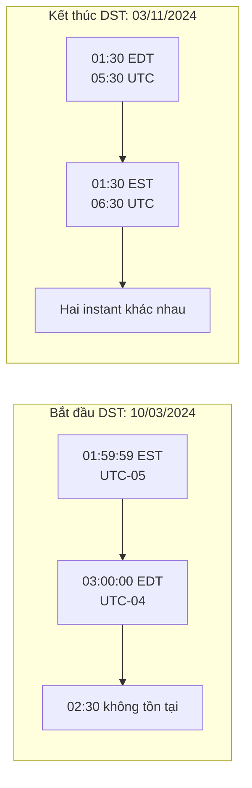
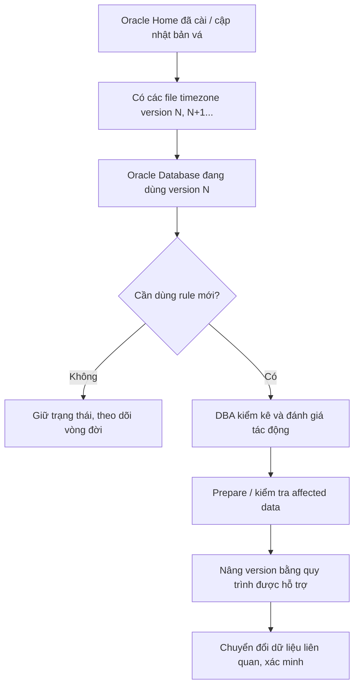

# Múi giờ mùa hè, vùng giờ và cập nhật timezone file trong Oracle Database

Trong ứng dụng dùng Oracle Database, thời gian không chỉ là một chuỗi kiểu `2024-11-03 01:30:00`. Để hiểu một thời điểm chính xác, đôi khi cần biết **múi giờ**, **quy tắc thay đổi giờ mùa hè (Daylight Saving Time – DST)** và **phiên bản dữ liệu múi giờ** mà Oracle đang sử dụng. Nếu bỏ qua các yếu tố này, hai giá trị có vẻ giống nhau có thể chỉ hai thời điểm khác nhau; một giờ địa phương có thể chưa từng tồn tại; và một hệ thống đã chạy nhiều năm có thể bắt đầu tính sai giờ lịch hẹn sau khi quốc gia thay đổi quy định DST.

Trong Oracle, ba vấn đề phải được tách bạch:

1. **Kiểu dữ liệu và trạng thái phiên:** `DATE`, `TIMESTAMP`, `TIMESTAMP WITH TIME ZONE`, `TIMESTAMP WITH LOCAL TIME ZONE`, `SESSIONTIMEZONE` và `DBTIMEZONE`.
2. **Cách xác định múi giờ:** độ lệch cố định như `+07:00` khác với **vùng giờ có tên** như `Asia/Ho_Chi_Minh`, `America/New_York` hay `Europe/Berlin`. Vùng giờ mang theo lịch sử và quy tắc DST thay đổi theo ngày.
3. **Timezone file của Oracle:** bộ dữ liệu quy tắc vùng giờ mà Oracle Net/database sử dụng để diễn giải và chuyển đổi thời gian. Việc cài bộ file mới vào Oracle Home **không luôn đồng nghĩa** database đã nâng phiên bản timezone data đang dùng; bước nâng cấp dữ liệu cần quy trình DBA riêng.

Bài học đi từ ví dụ DST dễ kiểm chứng tới SQL, thiết kế dữ liệu, Java/JDBC và quy trình vận hành timezone file an toàn. Các ví dụ thay đổi phiên chỉ dành cho lab; mọi thao tác nâng cấp timezone database cần được DBA lên kế hoạch riêng.

## 1. Thời điểm tuyệt đối, giờ địa phương, offset và vùng giờ

### 1.1. Một thời điểm có thể hiển thị nhiều giờ đồng hồ

Ví dụ, hai chuỗi sau biểu diễn cùng một thời điểm:

```text
2024-07-01 12:00:00 +00:00   (UTC)
2024-07-01 08:00:00 -04:00   (New York đang áp dụng DST)
2024-07-01 19:00:00 +07:00   (offset +07:00)
```

Về mặt thời điểm tuyệt đối (*instant*), ba biểu diễn này bằng nhau. Nhưng trong giao diện người dùng, hiển thị theo giờ địa phương là hữu ích vì mỗi người đang ở một nơi khác nhau.

Ngược lại, chuỗi **`2024-07-01 08:00:00` không kèm timezone** không đủ để xác định instant. Nó có thể là 08:00 ở New York, Hà Nội, London hoặc một hệ thống đã đặt múi giờ mặc định khác.

| Khái niệm | Ví dụ | Nó trả lời điều gì? |
|---|---|---|
| **Instant / UTC** | `2024-07-01T12:00:00Z` | Sự kiện xảy ra vào lúc nào trên trục thời gian chung? |
| **Local date-time** | `2024-07-01 08:00:00` | Đồng hồ và lịch địa phương hiển thị gì? |
| **UTC offset** | `-04:00` | Tại thời điểm đang xét, local time lệch UTC bao nhiêu? |
| **Time zone region** | `America/New_York` | Quy tắc lịch sử và tương lai áp dụng cho địa phương nào? |
| **DST** | New York chuyển từ UTC−05 sang UTC−04 vào mùa hè | Quy tắc đổi offset theo ngày/thời điểm |
| **Timezone file version** | Số phiên bản Oracle timezone data đang dùng | Database đang sử dụng bộ quy tắc nào để chuyển đổi? |

**Offset không phải region.** `-04:00` chỉ là độ lệch tại một thời điểm; nó không cho biết mùa đông New York thường dùng `-05:00`. Còn `America/New_York` giúp Oracle tra quy tắc phù hợp với ngày được hỏi. Để tính một cuộc họp vào **tháng tới** hay một lịch lặp lại hằng tuần theo giờ địa phương, cần region, không chỉ lưu offset hiện tại.

### 1.2. Giờ mùa hè là gì?

**Daylight Saving Time (DST)** là chính sách của một số khu vực thay đổi đồng hồ theo mùa. Không phải mọi vùng giờ áp dụng DST; ngày bắt đầu, ngày kết thúc, độ lệch và quy định lịch sử có thể khác nhau giữa các quốc gia, khu vực và từng năm.

Trong ví dụ New York năm 2024:

- Trước lần đổi giờ ngày **10/03/2024**, giờ tiêu chuẩn tương ứng offset `-05:00` (EST).
- Vào thời điểm bắt đầu DST, đồng hồ chuyển từ **01:59:59** thẳng sang **03:00:00**; khoảng **02:00–02:59** không xuất hiện trên đồng hồ địa phương ngày đó.
- Ngày **03/11/2024**, khi kết thúc DST, đồng hồ đi từ **01:59:59** quay lại **01:00:00**; khoảng **01:00–01:59** xuất hiện **hai lần**, trước đó theo EDT `-04:00` rồi theo EST `-05:00`.

Hai sự kiện được gọi là:

- **Gap (khoảng giờ không tồn tại):** giờ địa phương bị bỏ qua khi đồng hồ tiến về phía trước.
- **Overlap (khoảng giờ trùng lặp):** giờ địa phương bị lặp lại khi đồng hồ quay về phía sau.



Ở Việt Nam hiện nay, `Asia/Ho_Chi_Minh` thông thường có offset `+07:00` và không áp dụng DST theo lịch hiện hành. Nhưng **tên vùng giờ vẫn mang thông tin lịch sử**, vì vậy không nên đánh đồng `Asia/Ho_Chi_Minh` với chuỗi `+07:00` cho mọi thời điểm trong quá khứ hoặc mọi khả năng thay đổi luật tương lai.

## 2. Vùng giờ có tên khác độ lệch cố định và ký hiệu viết tắt

### 2.1. Region ID là cách biểu diễn quy tắc

Các tên thường gặp:

```text
Asia/Ho_Chi_Minh
Asia/Tokyo
America/New_York
Europe/Berlin
Europe/London
UTC
```

Tên vùng giờ được Oracle nhận diện theo dữ liệu timezone của phiên bản đang sử dụng. Không tự suy luận Oracle hỗ trợ mọi tên/alias từng thấy trong thư viện Java hoặc hệ điều hành. Có thể xem danh sách ở **chính Oracle Database** bằng view `V$TIMEZONE_NAMES` khi có quyền.

```sql
SELECT DISTINCT tzname
FROM v$timezone_names
WHERE tzname IN (
    'Asia/Ho_Chi_Minh',
    'America/New_York',
    'Europe/Berlin'
)
ORDER BY tzname;
```

Một region có thể liên hệ với nhiều ký hiệu daylight/standard; view `V$TIMEZONE_NAMES` có các cột `TZNAME` và `TZABBREV` để hỗ trợ nhận diện.

### 2.2. Offset không có quy tắc DST

Đoạn:

```text
2024-01-15 09:00:00 -05:00
2024-07-15 09:00:00 -05:00
```

đều dùng offset cố định `-05:00`. Nó không tự đổi thành `-04:00` vào tháng 7 chỉ vì người lập trình nghĩ tới New York. Nếu yêu cầu là “09:00 theo giờ New York quanh năm”, nên sử dụng region `America/New_York` và quy tắc DST tương ứng; hai cách diễn giải sẽ không cho cùng UTC instant trong mọi tháng.

### 2.3. Viết tắt có thể mơ hồ

`EST`, `EDT`, `CST`, `IST` là các chữ viết tắt thường thấy; một số viết tắt được dùng bởi nhiều khu vực hoặc chịu diễn giải theo ngữ cảnh. Ví dụ `CST` có thể chỉ các chuẩn giờ khác nhau ngoài đời sống. Vì vậy:

- Tránh thiết kế API yêu cầu client chỉ gửi `CST` hay `IST` mà không có region xác định.
- Dùng **region chuẩn được Oracle hỗ trợ** khi cần quy tắc theo ngày.
- Dùng **offset rõ ràng** khi chỉ cần biểu diễn một instant đã xác định.
- Khi cần phân biệt giờ trùng lặp trong cùng region, có thể dùng **`TZD`** (time zone daylight saving abbreviation) phù hợp với region và ngày để xác định nhánh DST/standard.

**Một region không đồng nghĩa luôn có DST**. Region là tập quy tắc, có thể gồm nhiều mốc lịch sử và những thay đổi chính sách.

## 3. Bốn kiểu thời gian Oracle: loại nào thực sự có thông tin múi giờ?

| Kiểu | Dữ liệu chính | Có tự giữ timezone không? | Trường hợp sử dụng |
|---|---|---|---|
| `DATE` | Ngày, giờ, phút, giây | **Không** | Dữ liệu ngày giờ không cần fractional seconds hoặc ngữ nghĩa timezone |
| `TIMESTAMP(p)` | Ngày giờ với phần giây lẻ | **Không** | Local date-time chưa gắn zone, ví dụ giờ mở cửa theo lịch |
| `TIMESTAMP(p) WITH TIME ZONE` (**TSTZ**) | Timestamp cùng timezone offset hoặc region tương ứng | **Có** | Instant có ngữ nghĩa timezone; sự kiện qua nhiều vùng |
| `TIMESTAMP(p) WITH LOCAL TIME ZONE` (**TSLTZ**) | Giá trị được chuẩn hóa theo database time zone; hiển thị chuyển sang session timezone | **Không giữ tên vùng ban đầu** | Cùng một thời điểm hiển thị địa phương theo session người xem |

`p` là độ chính xác phần giây lẻ; giá trị mặc định và giới hạn cần xem theo DDL/phiên bản Oracle. Ví dụ `TIMESTAMP(6)` có phần giây lẻ đến microsecond.

### 3.1. DATE không có timezone

```sql
CREATE TABLE date_example (
    event_id NUMBER PRIMARY KEY,
    occurred_at DATE
);
```

Một giá trị `DATE` như `2024-11-03 01:30:00` không cho biết nó xảy ra ở New York trước hay sau lần quay đồng hồ. Oracle `DATE` chứa cả phần giờ/phút/giây, nhưng không chứa fractional seconds, timezone region hay offset. Thay đổi `SESSIONTIMEZONE` không biến một giá trị `DATE` thành dữ liệu timezone-aware.

### 3.2. TIMESTAMP không có timezone

```sql
CREATE TABLE local_schedule (
    schedule_id NUMBER PRIMARY KEY,
    local_start TIMESTAMP(6) NOT NULL,
    zone_name VARCHAR2(64 CHAR) NOT NULL
);
```

Đây là mô hình hữu ích để **lên lịch theo giờ địa phương tương lai**, ví dụ “thứ Hai 09:00 theo Europe/Berlin”, với region được lưu riêng. Trước khi chuyển sang một instant để nhắc lịch, ứng dụng cần dùng quy tắc vùng giờ của ngày thực tế, đồng thời quy định rõ cách xử lý gap/overlap.

Nếu chỉ lưu `TIMESTAMP '2024-11-03 01:30:00'` mà không lưu zone, lịch hẹn không thể được tái tạo thành một instant duy nhất khi thiếu ngữ cảnh.

### 3.3. TIMESTAMP WITH TIME ZONE

```sql
CREATE TABLE tz_events (
    event_id NUMBER PRIMARY KEY,
    event_time TIMESTAMP(6) WITH TIME ZONE NOT NULL,
    event_type VARCHAR2(30 CHAR) NOT NULL
);
```

Kiểu TSTZ cho phép biểu diễn timestamp với offset hoặc tên vùng giờ theo cách Oracle lưu/diễn giải. Khi lưu bằng **region**, Oracle có thể áp dụng các quy tắc DST trong timezone file; khi lưu bằng **offset cố định**, bạn đã xác định độ lệch tại thời điểm đó nhưng không kèm lịch thay đổi DST của vùng địa lý.

Ví dụ:

```sql
INSERT INTO tz_events (event_id, event_time, event_type)
VALUES (
    1,
    TO_TIMESTAMP_TZ(
        '2024-07-01 08:30:00 America/New_York',
        'YYYY-MM-DD HH24:MI:SS TZR'
    ),
    'MEETING'
);

INSERT INTO tz_events (event_id, event_time, event_type)
VALUES (
    2,
    TO_TIMESTAMP_TZ(
        '2024-07-01 12:30:00 +00:00',
        'YYYY-MM-DD HH24:MI:SS TZH:TZM'
    ),
    'MEETING_UTC'
);

COMMIT;
```

Hai giá trị trên đại diện cùng một instant (08:30 ở New York đang EDT = 12:30 UTC). Để so sánh trên trục thời gian chung, dùng:

```sql
SELECT event_id,
       TO_CHAR(event_time,
           'YYYY-MM-DD HH24:MI:SS TZR TZD TZH:TZM') AS original_display,
       SYS_EXTRACT_UTC(event_time) AS utc_time
FROM tz_events
ORDER BY event_id;
```

`SYS_EXTRACT_UTC` chuyển giá trị timezone-aware thành timestamp UTC; **kết quả của hàm là `TIMESTAMP` không mang timezone**, vì vậy tên cột và tài liệu API nên ghi rõ nó được hiểu là UTC.

### 3.4. TIMESTAMP WITH LOCAL TIME ZONE

```sql
CREATE TABLE ltz_events (
    event_id NUMBER PRIMARY KEY,
    seen_at TIMESTAMP(6) WITH LOCAL TIME ZONE NOT NULL
);
```

Khi chèn một giá trị có timezone, Oracle chuẩn hóa giá trị theo **database time zone** để lưu. Khi đọc, nó chuyển sang **session time zone** để hiển thị. Ví dụ:

```sql
INSERT INTO ltz_events (event_id, seen_at)
VALUES (
    1,
    TO_TIMESTAMP_TZ(
        '2024-07-01 12:30:00 +00:00',
        'YYYY-MM-DD HH24:MI:SS TZH:TZM'
    )
);
COMMIT;

ALTER SESSION SET TIME_ZONE = 'America/New_York';

SELECT event_id,
       TO_CHAR(seen_at, 'YYYY-MM-DD HH24:MI:SS.FF3') AS local_display
FROM ltz_events;
```

Trong phiên New York ở ngày ví dụ, `LOCAL_DISPLAY` phản ánh 08:30 theo luật DST. Nếu đổi:

```sql
ALTER SESSION SET TIME_ZONE = 'Asia/Ho_Chi_Minh';

SELECT event_id,
       TO_CHAR(seen_at, 'YYYY-MM-DD HH24:MI:SS.FF3') AS local_display
FROM ltz_events;
```

thì cùng giá trị có thể hiển thị 19:30 tại Việt Nam. **Oracle không lưu nguyên tên vùng mà client đã nhập** trong TSLTZ; nếu ứng dụng cần biết người tạo chọn `America/New_York` hay một region khác, hãy lưu region riêng.

Đối với các kịch bản cần bảo toàn giờ địa phương của một sự kiện tương lai, TSLTZ đơn lẻ có thể chưa đủ: nó phản ánh instant theo session, không ghi lại hợp đồng “09:00 tại thành phố X” để điều chỉnh theo thay đổi luật trong tương lai.

## 4. NLS chỉ điều khiển cách diễn giải và hiển thị, không thay thế timezone

Trong Oracle, **NLS (National Language Support)** điều khiển nhiều quy tắc ngôn ngữ/định dạng. Các tham số dễ gặp:

| Tham số | Vai trò |
|---|---|
| `NLS_DATE_FORMAT` | Định dạng mặc định khi chuyển `DATE` sang/nhận từ chuỗi theo ngữ cảnh |
| `NLS_TIMESTAMP_FORMAT` | Định dạng mặc định của `TIMESTAMP` |
| `NLS_TIMESTAMP_TZ_FORMAT` | Định dạng mặc định của `TIMESTAMP WITH TIME ZONE` |
| `NLS_DATE_LANGUAGE` | Ngôn ngữ tên tháng, tên ngày và một số thành phần khi format/parse |
| `NLS_TERRITORY` | Ảnh hưởng các quy ước mặc định theo lãnh thổ, không định danh timezone cho mọi timestamp |
| `SESSIONTIMEZONE` | Vùng giờ/offset của session khi chuyển đổi dữ liệu thời gian |
| `DBTIMEZONE` | Database timezone liên quan cơ chế chuẩn hóa của `TIMESTAMP WITH LOCAL TIME ZONE` |

Ví dụ:

```sql
ALTER SESSION SET NLS_DATE_FORMAT = 'YYYY-MM-DD HH24:MI:SS';
ALTER SESSION SET NLS_TIMESTAMP_TZ_FORMAT =
    'YYYY-MM-DD HH24:MI:SS.FF3 TZR TZD';

SELECT SYSDATE AS server_date,
       SYSTIMESTAMP AS server_timestamp_tz,
       CURRENT_TIMESTAMP AS current_session_tz
FROM dual;
```

Đổi `NLS_DATE_FORMAT` chỉ đổi quy tắc trình bày/chuyển đổi chuỗi mặc định cho kiểu `DATE`. Nó **không gắn timezone mới vào DATE**, không chuyển các hàng `TIMESTAMP` thành UTC và không sửa quy tắc DST của database.

### 4.1. Không để implicit conversion quyết định kết quả nghiệp vụ

Ví dụ dễ gây nhầm:

```sql
-- Không khuyến khích cho chương trình nhiều môi trường:
SELECT TO_DATE('03/04/2024') FROM dual;
```

Chuỗi trên có thể được diễn giải khác nhau theo thiết lập mặc định. Nên truyền type/bind parameter từ Java và dùng format mask tường minh khi bắt buộc xử lý chuỗi:

```sql
SELECT TO_DATE('2024-04-03', 'YYYY-MM-DD') AS parsed_date
FROM dual;

SELECT TO_TIMESTAMP_TZ(
           '2024-04-03 09:30:00 +07:00',
           'YYYY-MM-DD HH24:MI:SS TZH:TZM'
       ) AS parsed_instant
FROM dual;
```

Định dạng `TZH:TZM` dùng khi chuỗi chứa offset số; `TZR` dùng với region. Khi muốn phân biệt daylight/standard trong overlap, có thể cần `TZD`.

## 5. Các hàm và thiết lập timezone thường dùng trong SQL

### 5.1. Biết Oracle đang dùng timezone nào

```sql
SELECT SESSIONTIMEZONE AS session_tz,
       DBTIMEZONE AS database_tz
FROM dual;

SELECT SYSTIMESTAMP AS server_timestamp,
       CURRENT_TIMESTAMP AS session_timestamp,
       LOCALTIMESTAMP AS local_timestamp,
       CURRENT_DATE AS session_date,
       SYSDATE AS server_date
FROM dual;
```

Phân biệt:

- `SYSTIMESTAMP`: giá trị timestamp with timezone theo hệ thống chạy Oracle Database (có thể phản ánh OS offset/time zone).
- `CURRENT_TIMESTAMP`: timestamp with timezone ở **session time zone**.
- `LOCALTIMESTAMP`: giờ địa phương của session ở kiểu **TIMESTAMP không có timezone**.
- `CURRENT_DATE`: kiểu `DATE` theo session timezone.
- `SYSDATE`: ngày giờ theo hệ thống máy chủ database, **không kèm timezone**.

`SYSTIMESTAMP` và `CURRENT_TIMESTAMP` có thể hiển thị giờ khác nhau nhưng chỉ những thời điểm hiện tại rất gần nhau. Không dùng chênh lệch giữa các hàm này như một phép đo latency chính xác; việc thực thi và thời điểm lấy mẫu cũng ảnh hưởng kết quả.

### 5.2. Thay đổi timezone của phiên

```sql
ALTER SESSION SET TIME_ZONE = 'UTC';

SELECT SESSIONTIMEZONE FROM dual;

ALTER SESSION SET TIME_ZONE = 'America/New_York';

SELECT SESSIONTIMEZONE FROM dual;

ALTER SESSION SET TIME_ZONE = '+07:00';

SELECT SESSIONTIMEZONE FROM dual;
```

Hai cách cuối cùng khác ngữ nghĩa:

- `America/New_York` là **region**, có thể đổi offset theo ngày.
- `+07:00` là **offset cố định**, không mang quy tắc DST.

`ALTER SESSION` ảnh hưởng phiên hiện tại; trong ứng dụng dùng connection pool, connection có thể được tái sử dụng. Nếu code đổi timezone cho một connection rồi trả về pool mà không khôi phục cấu hình, request khác có thể nhận kết quả hiển thị khác với mong muốn. Nên xác định chính sách timezone nhất quán khi thiết lập/checkout connection.

### 5.3. Chuyển một instant sang region cụ thể

```sql
SELECT
    TO_CHAR(
        TO_TIMESTAMP_TZ(
            '2024-07-01 12:30:00 +00:00',
            'YYYY-MM-DD HH24:MI:SS TZH:TZM'
        ) AT TIME ZONE 'America/New_York',
        'YYYY-MM-DD HH24:MI:SS TZR TZD TZH:TZM'
    ) AS new_york_time
FROM dual;
```

Tại instant ví dụ, kết quả mang giờ New York theo DST, tức 08:30 với offset -04:00. `AT TIME ZONE` thực hiện chuyển đổi cùng một instant sang timezone yêu cầu, không đổi sự kiện đã xảy ra.

Cách tương tự với Hà Nội/TP.HCM:

```sql
SELECT TO_CHAR(
           TO_TIMESTAMP_TZ(
               '2024-07-01 12:30:00 +00:00',
               'YYYY-MM-DD HH24:MI:SS TZH:TZM'
           ) AT TIME ZONE 'Asia/Ho_Chi_Minh',
           'YYYY-MM-DD HH24:MI:SS TZR TZH:TZM'
       ) AS vietnam_time
FROM dual;
```

### 5.4. TZ_OFFSET không trả lời mọi câu hỏi lịch sử

`TZ_OFFSET` có thể trả về offset liên quan tới một timezone identifier theo thời điểm/cách Oracle đánh giá. Ví dụ:

```sql
SELECT TZ_OFFSET('America/New_York') AS ny_offset_now
FROM dual;
```

Không dùng giá trị này để áp dụng vào mọi ngày trong quá khứ hoặc tương lai. Offset của New York trong tháng 1 có thể khác tháng 7. Khi cần biết offset cho **một instant cụ thể**, chuyển timestamp đó sang region rồi định dạng `TZH:TZM` như mục 5.3.

## 6. Gap: giờ địa phương không tồn tại khi bắt đầu DST

### 6.1. Điều gì xảy ra ở New York ngày 10/03/2024?

| Giờ địa phương | Offset | Instant UTC | Có tồn tại? |
|---|---|---|---|
| `2024-03-10 01:30:00` | EST `-05:00` | `06:30 UTC` | Có |
| `2024-03-10 02:30:00` | Không có offset hợp lệ tại thời điểm chuyển | Không có instant tương ứng theo region | **Không** |
| `2024-03-10 03:30:00` | EDT `-04:00` | `07:30 UTC` | Có |

Một người đặt lịch “02:30 ngày 10/03/2024 tại New York” đã chọn một local time không tồn tại. Nếu hệ thống âm thầm biến nó thành 03:30 hoặc chuyển sang ngày khác mà không có quy tắc nghiệp vụ rõ ràng, dữ liệu lịch hẹn sẽ khó kiểm chứng.

### 6.2. Ví dụ kiểm tra với Oracle

Hai giá trị hợp lệ:

```sql
SELECT SYS_EXTRACT_UTC(
           TO_TIMESTAMP_TZ(
               '2024-03-10 01:30:00 America/New_York EST',
               'YYYY-MM-DD HH24:MI:SS TZR TZD'
           )
       ) AS before_dst_utc,
       SYS_EXTRACT_UTC(
           TO_TIMESTAMP_TZ(
               '2024-03-10 03:30:00 America/New_York EDT',
               'YYYY-MM-DD HH24:MI:SS TZR TZD'
           )
       ) AS after_dst_utc
FROM dual;
```

Chênh lệch **UTC** giữa hai thời điểm này chỉ một giờ dù đồng hồ địa phương nhảy từ 01:30 tới 03:30.

Ví dụ **dự kiến gây lỗi do local time không tồn tại** trong region:

```sql
-- Chạy riêng trong lab để quan sát lỗi; đây là thời điểm không tồn tại.
SELECT TO_TIMESTAMP_TZ(
           '2024-03-10 02:30:00 America/New_York',
           'YYYY-MM-DD HH24:MI:SS TZR'
       ) AS invalid_local_time
FROM dual;
```

Với dữ liệu và quy tắc DST phù hợp, Oracle có thể báo **`ORA-01878: specified field not found in datetime or interval`** cho trường hợp này. Thông báo lỗi cụ thể phụ thuộc câu lệnh, phiên bản timezone data và cách client chuyển chuỗi; điều quan trọng là **không tồn tại một instant hợp lệ cho giờ địa phương ấy** trong region đã chọn.

### 6.3. Chính sách ứng dụng phải chọn rõ

Khi người dùng đặt một lịch lặp lại vào giờ thuộc gap, ứng dụng có các chiến lược nghiệp vụ khác nhau:

1. **Từ chối lịch không hợp lệ**, yêu cầu chọn lại giờ (an toàn cho giao dịch cần chính xác).
2. **Dời đến giờ hợp lệ tiếp theo** theo chính sách được công bố, ví dụ từ 02:30 sang 03:00 hoặc 03:30 tùy quy ước.
3. **Bỏ kỳ lịch đó** nếu chương trình hẹn giờ định kỳ quy định không chạy vào khoảng gap.

Không có một lựa chọn tự động đúng cho tất cả lĩnh vực. Hẹn khám bệnh, giao dịch tài chính, báo cáo chạy định kỳ và lịch báo thức có thể cần cách xử lý khác nhau. Hãy ghi lại chính sách và áp dụng nhất quán giữa Java, Oracle và scheduler.

## 7. Overlap: giờ địa phương xuất hiện hai lần khi kết thúc DST

### 7.1. Hai lần 01:30, hai instant khác nhau

Ngày 03/11/2024 tại New York:

| Biểu diễn địa phương | Offset | UTC instant |
|---|---|---|
| `2024-11-03 01:30:00 EDT` | `-04:00` | `2024-11-03 05:30:00 UTC` |
| `2024-11-03 01:30:00 EST` | `-05:00` | `2024-11-03 06:30:00 UTC` |

Cùng một local date-time `01:30` nhưng có **hai thời điểm thực tế cách nhau 60 phút**. Nếu chỉ lưu `TIMESTAMP '2024-11-03 01:30:00'`, không thể biết người dùng chọn lần nào.

### 7.2. Chỉ rõ TZD để loại bỏ mơ hồ

```sql
SELECT SYS_EXTRACT_UTC(
           TO_TIMESTAMP_TZ(
               '2024-11-03 01:30:00 America/New_York EDT',
               'YYYY-MM-DD HH24:MI:SS TZR TZD'
           )
       ) AS first_0130_utc,
       SYS_EXTRACT_UTC(
           TO_TIMESTAMP_TZ(
               '2024-11-03 01:30:00 America/New_York EST',
               'YYYY-MM-DD HH24:MI:SS TZR TZD'
           )
       ) AS second_0130_utc
FROM dual;
```

`TZR` cung cấp region; `TZD` giúp xác định daylight/standard time khi cần phân biệt. Trong ví dụ, hai cột UTC khác nhau một giờ.

Nếu bỏ `TZD` và chỉ truyền `2024-11-03 01:30:00 America/New_York`, local time là **ambiguous**. Oracle có tham số session `ERROR_ON_OVERLAP_TIME` cho phép chọn cách phản ứng với trường hợp như vậy.

```sql
-- Môi trường lab: yêu cầu Oracle báo lỗi khi gặp local time chồng lặp.
ALTER SESSION SET ERROR_ON_OVERLAP_TIME = TRUE;

-- Dự kiến lỗi cho timestamp mơ hồ không kèm TZD.
SELECT TO_TIMESTAMP_TZ(
           '2024-11-03 01:30:00 America/New_York',
           'YYYY-MM-DD HH24:MI:SS TZR'
       )
FROM dual;
```

Khi `ERROR_ON_OVERLAP_TIME=TRUE`, Oracle xử lý overlap không được giải quyết thành lỗi thay vì âm thầm chọn một offset. Ở chế độ `FALSE`, Oracle có thể diễn giải theo giờ tiêu chuẩn theo quy tắc của sản phẩm/phiên bản, nhưng **ứng dụng không nên dựa vào lựa chọn mặc định** để quyết định giao dịch hoặc sự kiện quan trọng.

Thực hành có thể trả lại:

```sql
ALTER SESSION SET ERROR_ON_OVERLAP_TIME = FALSE;
```

Trong vận hành, lựa chọn tốt hơn là thiết kế đầu vào đủ thông tin để tránh mơ hồ và không dựa vào một tham số phiên vô tình được connection pool giữ lại.

### 7.3. Những hệ quả đối với số liệu

Nếu hệ thống nhóm log bằng “`YYYY-MM-DD HH24:MI` theo New York” mà bỏ offset, hai giờ `01:30` có thể bị gộp thành một nhóm. Nếu lấy thời gian kết thúc trừ thời gian bắt đầu bằng local timestamp không có timezone, báo cáo có thể tính sai khoảng thời gian thực.

Với số liệu đo thời gian, hãy dùng **instant/UTC hoặc kiểu timezone-aware** để tính duration, rồi chuyển vùng giờ **ở bước trình bày**. Nếu nghiệp vụ nhóm theo ngày địa phương, cần xác định region của báo cáo và quy tắc DST cho khoảng thời gian đó.

## 8. Thiết kế dữ liệu cho lịch hẹn, log và giao dịch

### 8.1. Log sự kiện đã xảy ra: lưu instant không mơ hồ

Đối với audit log, sự kiện thanh toán hoặc thời điểm một request hoàn thành, câu hỏi thường là **“xảy ra chính xác khi nào?”**. Một cách lưu rõ ràng là:

```sql
CREATE TABLE service_audit (
    audit_id NUMBER GENERATED BY DEFAULT AS IDENTITY PRIMARY KEY,
    occurred_at TIMESTAMP(6) WITH TIME ZONE NOT NULL,
    actor_code VARCHAR2(50 CHAR) NOT NULL,
    action_code VARCHAR2(50 CHAR) NOT NULL
);
```

Lúc ghi, dùng một instant do ứng dụng hoặc database cung cấp theo hợp đồng rõ ràng:

```sql
INSERT INTO service_audit (occurred_at, actor_code, action_code)
VALUES (SYSTIMESTAMP, 'USER-01', 'LOGIN');
```

`SYSTIMESTAMP` có timezone của môi trường database; nếu hợp đồng API chọn UTC, ứng dụng có thể bind một instant UTC và đồng nhất quy tắc hiển thị. Không dùng `LOCALTIMESTAMP` không kèm timezone để biểu diễn sự kiện xuyên nhiều vùng nếu chưa có cách diễn giải thống nhất.

### 8.2. Lịch tương lai theo giờ địa phương: lưu region và local time

Một cuộc họp diễn ra **09:00 mỗi thứ Hai tại Europe/Berlin** khác với cuộc họp diễn ra **08:00 UTC mỗi thứ Hai**. Khi Berlin đổi offset do DST, instant UTC tương ứng của cuộc họp 09:00 địa phương sẽ thay đổi.

Một schema minh họa:

```sql
CREATE TABLE recurring_schedule (
    schedule_id NUMBER GENERATED BY DEFAULT AS IDENTITY PRIMARY KEY,
    local_time_text VARCHAR2(5 CHAR) NOT NULL,
    zone_region VARCHAR2(64 CHAR) NOT NULL,
    overlap_policy VARCHAR2(20 CHAR) NOT NULL,
    gap_policy VARCHAR2(20 CHAR) NOT NULL,
    CONSTRAINT ck_schedule_overlap CHECK (
        overlap_policy IN ('FIRST', 'SECOND', 'REJECT')
    ),
    CONSTRAINT ck_schedule_gap CHECK (
        gap_policy IN ('SKIP', 'NEXT_VALID', 'REJECT')
    )
);
```

Trong hệ thống thật, có thể dùng kiểu số phút trong ngày hoặc cấu trúc chuẩn hóa thay cho chuỗi `HH24:MI`; cần lưu thêm quy tắc lặp (thứ trong tuần, ngày hiệu lực, lịch ngoại lệ). Bảng trên chỉ nêu các dữ kiện tối thiểu thường bị bỏ sót: **local time, time zone region và chính sách xử lý DST**. Khi lập lịch kỳ tiếp theo, xác định instant bằng timezone rules hiện hành rồi lưu instant được quyết định để worker thực thi ổn định.

### 8.3. Không chỉ lưu offset khi cần lịch theo thành phố

Ví dụ API chỉ lưu:

```json
{
  "localTime": "09:00",
  "offset": "-05:00"
}
```

không đủ để biết 09:00 là ở New York, Bogotá hay nơi khác. Nếu người dùng muốn 09:00 tại New York cả năm, lịch tháng 7 có thể phải dùng offset `-04:00`. Hợp đồng thích hợp hơn:

```json
{
  "localTime": "09:00",
  "zoneRegion": "America/New_York",
  "overlapPolicy": "REJECT",
  "gapPolicy": "NEXT_VALID"
}
```

Khi sự kiện cụ thể đã được xác định, có thể bổ sung UTC instant tương ứng. **Không lấy region name làm dữ liệu bảo mật**; nó là quy tắc thời gian, không phải bí mật.

## 9. Java/JDBC và Oracle: đừng đánh mất timezone ở biên hệ thống

Java hiện đại có `java.time` với các kiểu giúp giữ đúng ngữ nghĩa:

| Java type | Ý nghĩa chính | Liên hệ với Oracle |
|---|---|---|
| `Instant` | Thời điểm trên timeline UTC | Hữu ích cho audit/log/event; ánh xạ qua driver/API thích hợp |
| `OffsetDateTime` | Local timestamp + offset | Phù hợp khi bind/đọc `TIMESTAMP WITH TIME ZONE` qua JDBC 4.2 với driver hỗ trợ |
| `ZonedDateTime` | Local timestamp + `ZoneId` và luật vùng giờ | Phù hợp xử lý lịch/DST tại Java; cân nhắc lưu thêm zone ID riêng |
| `LocalDateTime` | Ngày giờ không có zone | Phù hợp `TIMESTAMP` và lịch địa phương chưa gắn instant |
| `LocalDate` | Ngày không có giờ | Cần quy ước ánh xạ rõ ràng; Oracle `DATE` vẫn chứa thành phần giờ |

Ví dụ Java xử lý hai giờ 01:30 New York khác nhau:

```java
import java.time.LocalDateTime;
import java.time.ZoneId;
import java.time.ZoneOffset;
import java.time.ZonedDateTime;
import java.util.List;

public class DstOverlapExample {
    public static void main(String[] args) {
        ZoneId zone = ZoneId.of("America/New_York");
        LocalDateTime local =
                LocalDateTime.of(2024, 11, 3, 1, 30);

        List<ZoneOffset> offsets =
                zone.getRules().getValidOffsets(local);

        // Có hai offset hợp lệ: -04:00 và -05:00.
        for (ZoneOffset offset : offsets) {
            ZonedDateTime chosen =
                    ZonedDateTime.ofLocal(local, zone, offset);
            System.out.println(chosen + " => " + chosen.toInstant());
        }
    }
}
```

Với gap, `getValidOffsets(local)` trả danh sách rỗng; với giờ bình thường có một offset; trong overlap có hai. Đây là cơ chế giúp ứng dụng **phát hiện** sự mơ hồ trước khi ghi xuống Oracle. Lưu ý Java sử dụng bộ quy tắc timezone của **JDK**, còn Oracle sử dụng timezone file riêng. Hai bộ quy tắc có thể khác phiên bản dù cùng region name.

### 9.1. Bind timezone-aware value bằng PreparedStatement

Ví dụ JDBC 4.2 với driver Oracle hỗ trợ `OffsetDateTime`:

```java
import java.sql.Connection;
import java.sql.PreparedStatement;
import java.time.OffsetDateTime;
import java.time.ZoneOffset;

public final class AuditWriter {
    public static void write(Connection connection,
                             long auditId,
                             OffsetDateTime eventTime) throws Exception {
        String sql =
            "INSERT INTO audit_events(event_id, event_time) VALUES (?, ?)";
        try (PreparedStatement ps = connection.prepareStatement(sql)) {
            ps.setLong(1, auditId);
            ps.setObject(2, eventTime);
            ps.executeUpdate();
        }
    }

    public static OffsetDateTime nowUtc() {
        return OffsetDateTime.now(ZoneOffset.UTC);
    }
}
```

Đoạn code giả định bảng `AUDIT_EVENTS` có cột `EVENT_TIME TIMESTAMP WITH TIME ZONE` và cột `EVENT_ID` phù hợp. Driver/JDBC version và cấu hình framework cần được xác nhận về ánh xạ timezone-aware; một số driver cũ hoặc ORM có hành vi khác nhau. Không coi `java.sql.Timestamp`/`LocalDateTime` là lựa chọn không mất thông tin khi muốn giữ region.

### 9.2. Connection pool và phiên NLS/TIME_ZONE

Ứng dụng Spring Boot/HikariCP tái sử dụng connection; session Oracle gắn với connection đó có thể giữ:

- `TIME_ZONE` đã đổi bởi request trước.
- Các tham số `NLS_*` được đặt bằng `ALTER SESSION`.
- Trạng thái khác như current schema hoặc setting của chương trình.

Nếu code thay đổi session time zone, phải có chính sách khởi tạo/khôi phục trạng thái trước khi connection được dùng lại. Nên ưu tiên bind kiểu datetime tường minh, đặt timezone mặc định nhất quán cho hệ thống và chỉ chuyển sang zone của người dùng khi cần hiển thị.

### 9.3. Khác phiên bản luật giữa JDK, Oracle và OS

Đồng hồ “đúng” không chứng minh quy tắc timezone đều giống nhau. Một hệ thống có thể:

- JDK đã được cập nhật thông tin DST mới của một quốc gia;
- Oracle Database vẫn dùng timezone file cũ;
- OS/container sử dụng một phiên bản `tzdata` khác;
- Mobile client gửi local time với offset tự tính theo dữ liệu của điện thoại.

Khi quốc gia thay đổi luật, cùng một lịch tương lai có thể được các tầng đổi sang UTC khác nhau. Cần kiểm kê phiên bản của các tầng, thử nghiệm trên vùng/ngày bị ảnh hưởng và có kế hoạch cập nhật đồng bộ theo yêu cầu nghiệp vụ.

## 10. Oracle timezone file là gì?

Oracle dùng **time zone files** chứa dữ liệu tên vùng và quy tắc chuyển đổi theo thời gian. Tùy bản phát hành, Oracle Home có thể chứa các file vùng giờ thuộc bộ **small** và **large**, thường ở dưới thư mục dạng:

```text
$ORACLE_HOME/oracore/zoneinfo/

timezone_<version>.dat
timezlrg_<version>.dat
```

Đây là hình thức tên file phổ biến, không phải hướng dẫn để tự copy hoặc sửa bằng tay. Vị trí thực tế còn phụ thuộc Oracle Home, mô hình cài đặt và các bản vá.

Những thay đổi timezone data có thể bao gồm:

1. Chính phủ thay đổi ngày bắt đầu/kết thúc DST.
2. Một nước bỏ DST hoặc áp dụng DST trở lại.
3. Một vùng đổi offset chuẩn.
4. Oracle cập nhật thông tin lịch sử hoặc alias/region được hỗ trợ.

**Timezone file version** không phải phiên bản SQL engine hay một kiểu NLS date format. Hai database cùng phiên bản Oracle Database có thể vẫn đang dùng **các phiên bản timezone file khác nhau** do lịch sử vá lỗi/nâng cấp.

### 10.1. Hai lớp phiên bản rất dễ nhầm

**Lớp 1 — File có trong Oracle Home:** phần mềm Oracle đã cài/vá có thể mang nhiều phiên bản timezone data.

**Lớp 2 — Phiên bản database đang sử dụng:** database/container đang dùng một phiên bản nhất định để giải thích các region và lưu/đọc dữ liệu có timezone. Để nâng mức này một cách được hỗ trợ, có thể cần **DBMS_DST/timezone upgrade** chứ không chỉ cài file mới.



Việc thêm file mới không mặc nhiên cập nhật các giá trị TSTZ đang lưu. Cần đánh giá dữ liệu và thay đổi quy tắc với các vùng chịu ảnh hưởng; với dữ liệu đã được xác định bằng **offset cố định**, mức độ ảnh hưởng khác dữ liệu gắn tên **region**.

### 10.2. Xem timezone file version đang được sử dụng

Với quyền đọc dynamic performance views thích hợp:

```sql
SELECT filename,
       version
FROM v$timezone_file;
```

Kết quả `VERSION` là số phiên bản timezone file **hiện database/container đang dùng**. Đừng nhầm với năm hiện tại hay giờ offset hiện tại.

Xem các thông tin hỗ trợ quá trình chuyển đổi DST khi có quyền:

```sql
SELECT property_name,
       property_value
FROM database_properties
WHERE property_name IN (
    'DST_PRIMARY_TT_VERSION',
    'DST_SECONDARY_TT_VERSION',
    'DST_UPGRADE_STATE'
)
ORDER BY property_name;
```

Các property này dùng để nhận diện phiên bản chính/phụ và trạng thái chuẩn bị/nâng cấp khi cơ chế tương ứng hoạt động. Tên và phạm vi giá trị cần được diễn giải theo phiên bản Oracle và thời điểm chạy; không tự coi một con số thứ cấp bằng 0 là dấu hiệu lỗi.

Để kiểm tra tên vùng mà file hiện tại biết:

```sql
SELECT tzname, tzabbrev
FROM v$timezone_names
WHERE tzname = 'America/New_York'
ORDER BY tzabbrev;
```

View có thể hiển thị nhiều abbreviation cho cùng region. Đây là dictionary vùng giờ, không phải bảng dự báo DST của mọi ngày; phải dùng giá trị timestamp cụ thể để tìm offset tại thời điểm mong muốn.

## 11. Khi nào việc cập nhật timezone file là cần thiết?

Nhu cầu thường đến từ một trong các tình huống:

- **Luật múi giờ thay đổi:** ứng dụng đặt lịch tương lai cho một region vừa đổi DST/offset.
- **Nâng cấp Oracle Database/patching:** phiên bản timezone data mới có trong Oracle Home, cần đánh giá việc dùng phiên bản mới.
- **Data Pump import/export:** phiên bản timezone file của nguồn và đích không tương thích theo quy tắc của bản Oracle đang dùng.
- **Hệ thống phân tán lệch giờ:** cùng local timestamp/region nhưng Java, Oracle, một dịch vụ khác cho UTC instant khác nhau.
- **Yêu cầu tuân thủ/kiểm toán:** cần chứng minh các phép chuyển đổi lịch sử và kế hoạch thời gian có cơ sở dữ liệu quy tắc được kiểm soát.

**Không cập nhật chỉ vì “có bản cao hơn” mà không kiểm tra tác động.** Thay đổi quy tắc timezone có thể làm cách diễn giải những giá trị timestamp gắn region khác trước, nhất là các mốc chịu ảnh hưởng. Việc nâng cấp nên đi cùng test, backup, cửa sổ bảo trì và kế hoạch phục hồi.

### 11.1. Không nhầm ORACLE_HOME với DBTIMEZONE

`DBTIMEZONE` là một setting của database liên quan cơ chế `TIMESTAMP WITH LOCAL TIME ZONE`. **Thay đổi `DBTIMEZONE` không tương đương nâng phiên bản timezone file**. Đây là thao tác khác có điều kiện và ảnh hưởng dữ liệu riêng; không sửa `DBTIMEZONE` chỉ để giải quyết lỗi region thiếu hoặc DST rule cũ.

### 11.2. Hệ thống không có TSTZ vẫn cần xem xét?

Nếu mọi giá trị chỉ dùng `DATE`/`TIMESTAMP` không kèm timezone, Oracle không thể suy ra region của các hàng đó. Một timezone file mới cũng không tự “sửa” những giá trị local time thiếu ngữ cảnh. Tuy nhiên, ứng dụng vẫn có thể dùng `AT TIME ZONE`, `TO_TIMESTAMP_TZ`, `CURRENT_TIMESTAMP` hoặc scheduler dựa vào region; lúc đó bản quy tắc vẫn có thể ảnh hưởng kết quả.

Nên kiểm kê **cả dữ liệu lưu trữ lẫn SQL/PLSQL/API chuyển đổi thời gian**, không chỉ xem có cột `TIMESTAMP WITH TIME ZONE` hay không.

## 12. Quy trình nâng cấp timezone file an toàn với DBMS_DST

**Đây là nội dung kiến trúc và thao tác quản trị, không phải script chạy ngay trên production.** Các phiên bản Oracle khác nhau có yêu cầu thứ tự, trạng thái instance/PDB và utility khác nhau. DBA phải sử dụng tài liệu chính thức phù hợp với đúng release/update, đồng thời tuân thủ runbook nội bộ.

Oracle cung cấp package **`DBMS_DST`** để hỗ trợ chuẩn bị, đánh giá và nâng phiên bản timezone data trong database. Một số phiên bản Oracle còn cung cấp các utility script trong `$ORACLE_HOME/rdbms/admin` như `utltz_upg_check.sql` và `utltz_upg_apply.sql` để hỗ trợ quy trình. Không chạy hai cách tùy ý chồng lên nhau trong cùng một cửa sổ nâng cấp.

### 12.1. Giai đoạn A — Kiểm kê và lên kế hoạch

1. Xác nhận **Oracle Database version/Release Update**, kiểu triển khai single instance hay RAC, CDB/PDB, standby/Data Guard và service liên quan.
2. Ghi lại `V$TIMEZONE_FILE.VERSION` của **từng database/container cần xem xét**, cùng `DST_*` properties.
3. Kiểm kê file timezone bản mới đã được Oracle cung cấp/hỗ trợ trong Oracle Home và cách vá phần mềm.
4. Xác định ứng dụng nào dùng TSTZ/TSLTZ, region name, Data Pump, lịch chạy tương lai hoặc conversion ở Java.
5. Phân tích chính sách backup, restore test, cửa sổ gián đoạn, rollback strategy và khả năng cập nhật các hệ thống phụ thuộc.
6. Chuẩn bị một môi trường staging có dữ liệu và workload đại diện.

Ví dụ tra cứu các cột timestamp có timezone trong schema quản trị được phép:

```sql
SELECT owner,
       table_name,
       column_name,
       data_type
FROM dba_tab_columns
WHERE data_type IN (
    'TIMESTAMP WITH TIME ZONE',
    'TIMESTAMP WITH LOCAL TIME ZONE'
)
ORDER BY owner, table_name, column_id;
```

Đây là cách kiểm kê khởi đầu, **không bao trùm mọi cấu trúc ẩn, nested types, dữ liệu bên trong object, queue hoặc các phụ thuộc khác**. Các utility chuẩn của Oracle có cơ chế quét đối tượng bị ảnh hưởng sâu hơn.

### 12.2. Giai đoạn B — Prepare window

`DBMS_DST` có giai đoạn **prepare** để xác định dữ liệu/đối tượng có thể bị tác động bởi khác biệt giữa timezone file version hiện tại và phiên bản đích. Các tên API quan trọng gồm:

```text
DBMS_DST.BEGIN_PREPARE(new_version)
DBMS_DST.FIND_AFFECTED_TABLES(...)
DBMS_DST.END_PREPARE
```

Đây là **danh sách API để nhận diện quy trình**, không phải toàn bộ bộ lệnh chạy độc lập: cần quyền, log/error table và tham số đúng theo version. Việc quét affected data có thể tốn thời gian/tài nguyên đáng kể và cần kế hoạch riêng nếu database lớn.

Đầu ra cần thu thập là danh sách các bảng/đối tượng affected, trường hợp chuyển đổi sai/không xác định, khoảng thời gian cần thiết và yêu cầu gián đoạn nghiệp vụ. Các gap/overlap được tạo ra do thay đổi quy tắc cần chính sách xử lý rõ ràng, không được ép thành một instant tùy ý.

### 12.3. Giai đoạn C — Upgrade window

Quy trình nâng cấp qua `DBMS_DST` thường có các khái niệm:

```text
BEGIN_UPGRADE(target_version)
UPGRADE_DATABASE(...) / nâng dữ liệu liên quan
END_UPGRADE(...)
```

Trong những quy trình Oracle, **BEGIN_UPGRADE** có điều kiện về database ở upgrade mode và chuyển đổi metadata hệ thống; sau đó có các bước khởi động phù hợp và nâng dữ liệu người dùng ở phase tương ứng. **Không suy ra ba tên hàm trên là ba câu gọi có thể chạy liên tiếp trong một session bình thường.** DBA cần dùng đúng trình tự start/stop, mở container, tham số error handling, log và kiểm tra hậu kỳ theo phiên bản Oracle hiện tại.

Với CDB/PDB, cần xét có phải nâng **root và từng PDB** riêng, cách xử lý PDB đang đóng, và phạm vi instance trong RAC. Không chỉ nhìn version của root để kết luận mọi PDB cùng trạng thái.

### 12.4. Giai đoạn D — Kiểm tra sau nâng cấp

Sau khi quy trình thành công:

1. Đọc lại `V$TIMEZONE_FILE`, `DST_*` properties và trạng thái PDB liên quan.
2. Kiểm tra kết quả utility về số bảng/dòng đã chuyển, lỗi chưa xử lý và đối tượng phụ thuộc.
3. Kiểm tra truy vấn TSTZ/TSLTZ của **vùng và ngày bị ảnh hưởng**, gồm gap, overlap và các lịch tương lai.
4. Chạy thử Java/JDBC, jobs/scheduler, báo cáo BI, Data Pump và các giao tiếp có chuyển đổi timezone.
5. Theo dõi alert log và các lỗi mới sau khi mở lại dịch vụ.
6. Bảo đảm lịch sử audit và sự kiện đã xảy ra vẫn giữ đúng instant theo thiết kế; kiểm tra timezone rule của JDK/OS nếu hệ thống tính thời điểm tại nhiều tầng.

Giai đoạn này cần kết quả chạy thật và phê duyệt vận hành; không đánh giá “thành công” chỉ vì đã tăng số `VERSION`.

### 12.5. Vì sao sao lưu và phục hồi cần được chuẩn bị trước?

Thay đổi timezone data có thể tác động cách diễn giải hoặc chuyển đổi nhiều giá trị TSTZ cùng lúc. Không phải mọi thay đổi đều có phép “downgrade” đơn giản và không phải bản vá/file mới có thể xóa đi an toàn sau khi dữ liệu đã được nâng. **Backup/restore thử được** quan trọng hơn suy đoán có thể chạy lại `BEGIN_UPGRADE` theo chiều ngược.

Trong môi trường có standby, replication hoặc Data Pump, cần thống nhất kế hoạch phiên bản dữ liệu giờ giữa các nơi và kiểm tra tương thích trước khi bắt đầu.

## 13. Timezone file và multitenant CDB/PDB

Một CDB có `CDB$ROOT`, `PDB$SEED` và nhiều PDB ứng dụng. Việc quan sát và nâng cấp timezone data có thể có **phạm vi container** theo phiên bản và cơ chế Oracle đang sử dụng.

Trước khi truy vấn:

```sql
SELECT SYS_CONTEXT('USERENV', 'CON_NAME') AS con_name
FROM dual;

SELECT filename, version
FROM v$timezone_file;
```

Khi cần kiểm kê toàn CDB, DBA phải xác định cách quan sát từng PDB bằng service/connection hoặc view phù hợp, trạng thái mở của PDB và quyền container. Không tự giả định rằng một câu `SELECT` ở root đọc hết phiên bản và dữ liệu timezone của mọi PDB.

Những câu hỏi cần DBA trả lời trước upgrade:

- Root và từng PDB đang sử dụng **version nào**, target version là bao nhiêu?
- PDB nào chứa các cột TSTZ/TSLTZ hoặc dữ liệu bị ảnh hưởng?
- Có PDB đang `MOUNTED`/`READ ONLY` không và quy trình utility yêu cầu mở ở mode nào?
- Có RAC instances, application services hoặc Data Guard cần điều phối không?
- Database có dùng OMF, encryption hoặc các chính sách backup đặc thù không?

**Lưu trạng thái mở PDB không phải nâng timezone file**. `ALTER PLUGGABLE DATABASE ... SAVE STATE` phục vụ trạng thái khởi động PDB; `DBMS_DST` giải quyết việc đổi phiên bản quy tắc múi giờ. Hai tác vụ hoàn toàn khác nhau và không thể thay thế nhau.

## 14. Data Pump và chênh lệch TSTZ version

Khi chuyển dữ liệu bằng Oracle Data Pump giữa hai môi trường, sự khác nhau của timezone file version có thể ảnh hưởng import, nhất là dữ liệu `TIMESTAMP WITH TIME ZONE`. Một lỗi thường được DBA gặp là:

```text
ORA-39405: Oracle Data Pump does not support importing from a source
database with TSTZ version ... into a target database with TSTZ version ...
```

Thông điệp và quy tắc tương thích cụ thể phụ thuộc phiên bản Oracle/Data Pump; không nên suy luận rằng mọi hướng chuyển đổi giữa version khác nhau đều có cùng kết quả.

Cách tiếp cận:

1. Thu thập `V$TIMEZONE_FILE.VERSION` của **nguồn** và **đích** trong đúng container.
2. Ghi lại phiên bản Oracle Database/patch, phương thức export/import và kiểu dữ liệu liên quan.
3. Đọc tài liệu tương thích Data Pump của phiên bản tương ứng.
4. Nếu cần nâng timezone file ở đích, thực hiện theo quy trình DBA được hỗ trợ và kiểm tra lại import trên staging.
5. Không tự sửa file dump, không ép đổi chuỗi region hoặc hạ version bằng thủ thuật ngoài quy trình.

Timezone file version chỉ là một điều kiện tương thích; Data Pump còn có các yêu cầu khác về phiên bản database, character set, quyền và kiểu object.

## 15. Chẩn đoán các lỗi thường gặp

| Dấu hiệu | Ý nghĩa có thể | Nên kiểm tra |
|---|---|---|
| `ORA-01878` khi parse local time | Thời điểm không tồn tại do DST gap hoặc lỗi trường datetime | Ngày, region, format mask, timezone file version |
| Lỗi overlap/transition, ví dụ `ORA-01883` trong bối cảnh thích hợp | Local time mơ hồ hoặc quy tắc daylight/standard đang bị kiểm soát | `TZR`, `TZD`, `ERROR_ON_OVERLAP_TIME` và thời điểm |
| `ORA-01882: timezone region not found` | Region không được nhận diện bởi thành phần Oracle/client thích hợp | `V$TIMEZONE_NAMES`, driver/JDK, region gửi từ client |
| `ORA-39405` khi Data Pump import | Phiên bản TSTZ/timezone file của nguồn và đích không tương thích theo Data Pump hiện hành | Version nguồn/đích, Oracle/Data Pump compatibility |
| Lịch báo cáo sai 1 giờ chỉ trong vài tuần | Dùng offset cố định thay region hoặc thiếu DST rule mới | Region, timezone data ở Oracle/JDK, thời điểm sai |
| `CURRENT_TIMESTAMP` khác `SYSTIMESTAMP` | Session và server có timezone hiển thị khác nhau | `SESSIONTIMEZONE`, OS timezone, chuyển cả hai về UTC |
| `TIMESTAMP WITH LOCAL TIME ZONE` hiển thị khác giữa hai client | Session time zone khác nhau | `SESSIONTIMEZONE` và cấu hình pool/client |
| Cập nhật Oracle Home nhưng `V$TIMEZONE_FILE.VERSION` vẫn cũ | Chưa thực hiện upgrade timezone data của database/container | Quy trình DBMS_DST/utility và trạng thái container |
| Hai hệ thống cùng tên region nhưng UTC khác nhau cho lịch tương lai | Bộ quy tắc vùng giờ khác phiên bản hoặc cách xử lý gap/overlap khác | Oracle file version, Java tzdb, OS tzdata, chính sách |

Lỗi thời gian thường là **lỗi chuyển đổi ngữ nghĩa** chứ không phải lỗi ổ cứng hay mất mạng. Khi điều tra, cần ghi lại đủ dữ kiện:

```text
1. Input datetime gốc và region/offset được gửi.
2. Kiểu dữ liệu Oracle của cột/biểu thức.
3. SESSIONTIMEZONE, DBTIMEZONE, các tham số NLS liên quan.
4. Oracle timezone file version và CDB/PDB đang kết nối.
5. Driver/JDK/OS timezone rule version nếu có tầng Java.
6. UTC instant được tính ra ở từng tầng.
7. Chính sách giải quyết giờ không tồn tại hoặc trùng lặp.
```

Không sửa một hàng dữ liệu lịch sử chỉ vì format hiển thị khác mong đợi. Phải phân biệt trường hợp **cùng instant khác giờ hiển thị** với trường hợp **instant thực sự bị tính sai**.

## 16. Thực hành có hướng dẫn trên Oracle lab

Thực hiện trong schema lab của một PDB được cấp quyền, sử dụng SQL*Plus, SQLcl, SQL Developer hoặc JDBC; không cần quyền SYSDBA cho những truy vấn `DUAL` thông thường. Một số dynamic views cần DBA cấp quyền đọc hoặc cung cấp kết quả. Không thực hiện nâng timezone file thật chỉ để hoàn thành bài SQL này.

### Bài 1 — Phân biệt timezone của phiên và database

```sql
SELECT SESSIONTIMEZONE AS session_tz,
       DBTIMEZONE AS db_tz,
       SYSTIMESTAMP AS server_time,
       CURRENT_TIMESTAMP AS session_time
FROM dual;
```

Chạy lần lượt:

```sql
ALTER SESSION SET TIME_ZONE = 'UTC';
SELECT SESSIONTIMEZONE, CURRENT_TIMESTAMP FROM dual;

ALTER SESSION SET TIME_ZONE = 'Asia/Ho_Chi_Minh';
SELECT SESSIONTIMEZONE, CURRENT_TIMESTAMP FROM dual;
```

Đối chiếu giờ hiển thị và giải thích tại sao hai kết quả vẫn là những instant gần như cùng thời điểm. Không kết luận `SYSDATE` có timezone chỉ vì máy server được đặt một múi giờ.

### Bài 2 — Chuyển cùng một instant sang hai vùng

```sql
WITH t AS (
    SELECT TO_TIMESTAMP_TZ(
               '2024-07-01 12:00:00 +00:00',
               'YYYY-MM-DD HH24:MI:SS TZH:TZM'
           ) AS utc_instant
    FROM dual
)
SELECT TO_CHAR(
           utc_instant AT TIME ZONE 'America/New_York',
           'YYYY-MM-DD HH24:MI:SS TZR TZH:TZM'
       ) AS new_york,
       TO_CHAR(
           utc_instant AT TIME ZONE 'Asia/Ho_Chi_Minh',
           'YYYY-MM-DD HH24:MI:SS TZR TZH:TZM'
       ) AS vietnam
FROM t;
```

Ghi lại offset của từng vùng; giải thích vì sao Việt Nam có thể hiển thị 19:00 còn New York hiển thị 08:00 tại instant này.

### Bài 3 — Gap tại New York

Thực hiện truy vấn hai giờ hợp lệ ở mục 6.2; tính chênh lệch UTC giữa 01:30 EST và 03:30 EDT. Sau đó **trên lab**, thử chuyển `2024-03-10 02:30 America/New_York` và ghi lại lỗi thực tế. Thảo luận cách ứng dụng hẹn lịch cần thông báo người dùng.

### Bài 4 — Overlap với TZD

Chạy ví dụ hai `01:30` ở mục 7.2 và ghi lại hai giá trị UTC. Bật `ERROR_ON_OVERLAP_TIME=TRUE`, thử một timestamp cùng giờ/region nhưng không ghi `TZD` để quan sát phản ứng. Kết thúc, đưa session về setting đã thống nhất cho môi trường lab.

Không thử thay đổi `ERROR_ON_OVERLAP_TIME` trong connection được production pool tái sử dụng nếu không có cơ chế khôi phục.

### Bài 5 — So sánh TSTZ và TSLTZ

Tạo hai bảng `TZ_EVENTS` và `LTZ_EVENTS` như mục 3. Chèn một instant với `+00:00`, sau đó đọc bằng hai session time zones khác nhau.

Ghi lại:

| Kiểu/cột | Session UTC | Session Asia/Ho_Chi_Minh | Có giữ region nguồn? |
|---|---|---|---|
| `TIMESTAMP WITH TIME ZONE` | Cùng instant, cách format phụ thuộc giá trị gốc | Cùng instant; muốn đổi vùng dùng `AT TIME ZONE` | Có thể giữ thông tin offset/region theo cách nhập và lưu |
| `TIMESTAMP WITH LOCAL TIME ZONE` | Hiển thị theo UTC | Hiển thị theo timezone session Việt Nam | Không giữ region nguồn |

Chú ý khi quan sát TSTZ: **đổi `SESSIONTIMEZONE` không có nghĩa giá trị TSTZ lưu dưới một region phải tự đổi sang region mới trong mọi phép hiển thị**. Hãy dùng `AT TIME ZONE` tường minh khi muốn chuyển vùng cho TSTZ.

### Bài 6 — Kiểm kê timezone file

Nhờ DBA chạy trong đúng PDB/container:

```sql
SELECT filename, version
FROM v$timezone_file;

SELECT property_name, property_value
FROM database_properties
WHERE property_name IN (
    'DST_PRIMARY_TT_VERSION',
    'DST_SECONDARY_TT_VERSION',
    'DST_UPGRADE_STATE'
)
ORDER BY property_name;
```

Ghi lại version **đang được dùng**, không chỉ file nằm trong Oracle Home. Trong báo cáo, nêu nếu thiếu quyền thay vì tự yêu cầu cấp DBA cho tài khoản ứng dụng.

### Bài 7 — Thiết kế API an toàn khi DST thay đổi

Cho dữ kiện: một người dùng muốn “mỗi Chủ nhật 01:30 tại New York” và một hệ thống job phải tự chạy sau restart.

Đề xuất schema/hợp đồng API lưu:

- giờ địa phương và quy tắc lặp;
- time zone region chính xác;
- chính sách khi giờ 01:30 lặp lại;
- chính sách khi một lịch khác rơi vào gap;
- next-run instant (UTC) đã được tính;
- phiên bản quy tắc hoặc thông tin quản trị đủ để giải thích việc tính lại lịch khi chính sách timezone thay đổi.

Giải thích vì sao không thể dùng riêng `CURRENT_TIMESTAMP` tại thời điểm tạo lịch hoặc offset hiện tại để xác định toàn bộ lần chạy tương lai.

### Bài 8 — Mô phỏng yêu cầu nâng timezone file

Không chạy `DBMS_DST` thật. Viết một bảng bàn giao DBA theo mẫu:

| Hạng mục | Nội dung phải thu thập |
|---|---|
| Nguồn hiện tại | Oracle release/RU, CDB/PDB, `V$TIMEZONE_FILE.VERSION` |
| Mục tiêu | Version timezone data đích được bản Oracle hỗ trợ |
| Phạm vi dữ liệu | Cột TSTZ/TSLTZ, object bị ảnh hưởng, lịch tương lai |
| Ứng dụng phụ thuộc | Java/JDBC, API, scheduler, reporting, Data Pump |
| Cửa sổ triển khai | Downtime, backup, staging, danh sách service/client |
| Quy trình | Prepare/check → upgrade → validate theo tài liệu đúng phiên bản |
| Tiêu chí hoàn thành | Không có lỗi tồn, rule mới đúng ở các ngày test, app kết nối bình thường |
| Phục hồi | Kế hoạch restore/backout đã được kiểm tra và phê duyệt |

Bảng này là đầu ra kiến trúc/vận hành, không phải lệnh tự động thay đổi database.

## 17. Câu hỏi tự kiểm tra

1. Vì sao offset `-04:00` không đủ để biểu diễn lịch “09:00 tại New York quanh năm”?
2. Gap và overlap xảy ra như thế nào khi vùng giờ áp dụng DST? Ngày 10/03/2024 và 03/11/2024 ở New York minh họa gì?
3. `TZR` và `TZD` khác nhau như thế nào trong một format mask?
4. `TIMESTAMP` có đủ dữ kiện để xác định instant của giờ `2024-11-03 01:30` ở New York không?
5. `TIMESTAMP WITH TIME ZONE` và `TIMESTAMP WITH LOCAL TIME ZONE` khác nhau ở lưu và hiển thị vùng giờ ra sao?
6. `SESSIONTIMEZONE` khác `DBTIMEZONE` như thế nào? Có nên đổi `DBTIMEZONE` chỉ để sửa một lỗi DST không?
7. `CURRENT_TIMESTAMP`, `SYSTIMESTAMP` và `LOCALTIMESTAMP` khác nhau về type/timezone thế nào?
8. `ALTER SESSION SET NLS_DATE_FORMAT` có đổi dữ liệu `DATE` sang một timezone khác không?
9. Vì sao `ERROR_ON_OVERLAP_TIME=TRUE` có ích trong một số quy trình nhập giờ địa phương?
10. Khi cập nhật JDK tzdb mà Oracle timezone file chưa cập nhật, những lỗi tích hợp nào có thể xảy ra?
11. `V$TIMEZONE_FILE.VERSION` cho biết điều gì? Vì sao khác với việc chỉ thấy một file `timezlrg_*.dat` mới trên ổ đĩa?
12. Giai đoạn prepare và upgrade trong `DBMS_DST` giải quyết hai nhóm việc gì? Vì sao không chạy trên production như một bài lab?
13. Data Pump có thể gặp vấn đề gì khi source/target dùng timezone file version khác nhau?
14. Trong CDB/PDB, vì sao phải kiểm tra container trước khi kết luận timezone file version của toàn hệ thống?
15. Một ứng dụng cần cả “instant đã xảy ra” và “09:00 mỗi thứ Hai tại Berlin” thì nên thiết kế hai nhóm dữ liệu đó giống hay khác nhau?

Điểm quan trọng nhất của bài học là tách **instant**, **local date-time**, **offset**, **region** và **phiên bản quy tắc timezone**. Dùng kiểu dữ liệu timezone-aware cho sự kiện đã xảy ra; dùng region và chính sách DST khi lên lịch tương lai; tránh implicit conversion phụ thuộc NLS/session; và để DBA quản lý timezone file/`DBMS_DST` theo quy trình có backup, đánh giá tác động và kiểm chứng. Khi giữ rõ những ranh giới này, hệ thống Oracle có thể xử lý thời gian nhất quán ngay cả khi người dùng ở nhiều quốc gia hoặc luật đổi giờ thay đổi.
