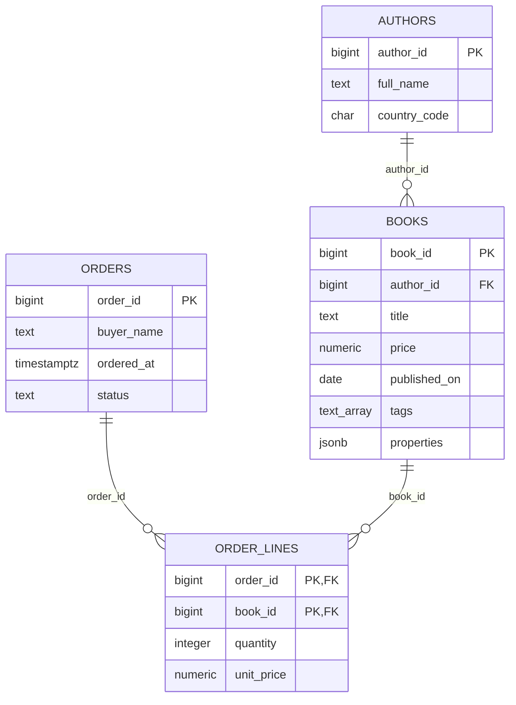

# Mô hình quan hệ, SQL và đặc trưng quan hệ đối tượng của PostgreSQL

## 1. PostgreSQL là hệ quản trị cơ sở dữ liệu gì?

**PostgreSQL** là một hệ quản trị cơ sở dữ liệu quan hệ mã nguồn mở, thường được mô tả chính xác hơn là **hệ quản trị cơ sở dữ liệu quan hệ–đối tượng** (*object-relational database management system – ORDBMS*). PostgreSQL lấy **mô hình quan hệ** làm nền tảng: dữ liệu được tổ chức thành các bảng, các hàng và các cột; các bảng liên hệ bằng khóa và ràng buộc; dữ liệu được truy vấn bằng **SQL**. Đồng thời, PostgreSQL có hệ thống kiểu dữ liệu và khả năng mở rộng phong phú, cho phép làm việc với kiểu dữ liệu do người dùng định nghĩa, giá trị phức hợp, mảng, JSONB, kiểu phạm vi, hàm và phần mở rộng.

Ba ý cần phân biệt:

- **Quan hệ (relational):** dữ liệu có cấu trúc, khóa, ràng buộc và các phép toán kết hợp/tổng hợp trên tập hàng.
- **SQL:** ngôn ngữ để định nghĩa lược đồ, thao tác, truy vấn và kiểm soát dữ liệu.
- **Quan hệ–đối tượng (object-relational):** vẫn dùng quan hệ và SQL, nhưng có thêm các đặc tính kiểu dữ liệu phong phú, khả năng tự định nghĩa kiểu/hàm/toán tử và một số cơ chế kế thừa.

PostgreSQL **không phải** là một hệ quản trị chỉ lưu “đối tượng Java/Python” thay cho bảng. Nó cũng không trở thành một hệ quản trị NoSQL chỉ vì hỗ trợ JSONB. Khả năng mở rộng của PostgreSQL **bổ sung** cho mô hình quan hệ, chứ không xóa đi các nguyên tắc thiết kế quan hệ.

```text
Ứng dụng (Java, Python, Go, ...)
                  │
                  │ SQL / PostgreSQL protocol
                  ▼
          PostgreSQL Server
                  │
    +-------------+-----------------+
    |             |                 |
 Lược đồ SQL  Cơ chế thực thi   Kiểu/hàm mở rộng
 Bảng, khóa    Index, MVCC       ENUM, DOMAIN,
 FK, JOIN      transaction       ARRAY, JSONB,
 GROUP BY      WAL, VACUUM       RANGE, extension
    |             |                 |
    +-------------+-----------------+
                  │
                  ▼
          Dữ liệu được lưu trữ
```

Bài học này dùng **PostgreSQL** làm ngữ cảnh xuyên suốt; các ví dụ SQL không nên mặc nhiên sao chép sang MySQL vì cú pháp kiểu dữ liệu, identity, toán tử JSONB, schema và những cơ chế mở rộng có thể khác nhau.

## 2. Mô hình quan hệ: bảng, hàng, cột và quan hệ giữa các bảng

### 2.1. Từ khái niệm toán học đến bảng SQL

Trong lý thuyết quan hệ, một **relation** có thể được hình dung như một tập các **tuple** (bộ giá trị) tuân theo cấu trúc gồm các **attribute** (thuộc tính). Khi hiện thực trong SQL, ta thường dùng:

| Khái niệm | Trong PostgreSQL | Ví dụ |
| --- | --- | --- |
| Quan hệ (*relation*) | Bảng (*table*) | `books` |
| Bộ (*tuple*) | Hàng (*row*) | Một cuốn sách |
| Thuộc tính (*attribute*) | Cột (*column*) | `title`, `price` |
| Miền giá trị (*domain*) | Kiểu dữ liệu và ràng buộc giá trị | `numeric(12,2)`, `CHECK` |
| Định danh bản ghi | Khóa chính / khóa duy nhất | `book_id` |
| Liên hệ giữa các thực thể | Khóa ngoại | `books.author_id → authors.author_id` |
| Lược đồ quan hệ | Tên cột, kiểu và ràng buộc | `CREATE TABLE` |

Ví dụ bảng `books`:

| book_id | author_id | title | price |
| ---: | ---: | --- | ---: |
| 101 | 1 | PostgreSQL nhập môn | 180000.00 |
| 102 | 1 | SQL thực hành | 150000.00 |
| 103 | 2 | Thiết kế dữ liệu | 220000.00 |

Mỗi hàng thể hiện **một sách**; mỗi cột lưu một thuộc tính. Trong SQL thực tế, bảng có thể có nhiều hàng trùng nhau nếu không khai báo ràng buộc phù hợp. Vì vậy, muốn đảm bảo bản ghi có định danh rõ ràng, thường cần một **khóa chính**.

Một điểm quan trọng: **bảng không có thứ tự hàng được bảo đảm**. Nếu ứng dụng muốn liệt kê sách theo giá tăng dần, phải viết `ORDER BY price ASC`; không thể dựa vào thứ tự các lệnh `INSERT` hay vị trí vật lý của hàng.

### 2.2. Khóa chính (PRIMARY KEY)

Khóa chính là cột hoặc bộ cột dùng để định danh mỗi hàng. Trong PostgreSQL, `PRIMARY KEY` đảm bảo **không NULL** và **duy nhất** theo các cột khóa.

```sql
CREATE TABLE authors (
    author_id bigint PRIMARY KEY,
    full_name text NOT NULL
);
```

Những hàng:

```text
author_id = 1, full_name = 'Nguyễn An'
author_id = 2, full_name = 'Trần Bình'
```

có định danh khác nhau. Một lệnh thêm hàng khác với `author_id = 1` sẽ vi phạm ràng buộc khóa chính. Một bảng có thể có nhiều ràng buộc `UNIQUE`, nhưng chỉ có **một** ràng buộc `PRIMARY KEY` (ràng buộc đó có thể gồm nhiều cột).

Một ví dụ khóa ghép:

```sql
PRIMARY KEY (order_id, book_id)
```

Khóa này có nghĩa là **cặp mã đơn hàng + mã sách** phải duy nhất. Từng `order_id` có thể lặp lại ở các dòng hàng của cùng đơn; từng `book_id` có thể xuất hiện trong nhiều đơn.

### 2.3. Khóa ngoại (FOREIGN KEY)

Khóa ngoại biểu diễn quan hệ giữa bảng con và bảng cha. Ví dụ:

```text
authors                             books
+--------------------+             +--------------------+
| author_id (PK)     |◄────────────| author_id (FK)     |
| full_name          |             | book_id (PK)       |
+--------------------+             | title              |
                                   | price              |
                                   +--------------------+
```

Ở đây `books.author_id` tham chiếu `authors.author_id`. PostgreSQL kiểm tra ràng buộc để ngăn sách tham chiếu một tác giả không tồn tại (trừ những trường hợp được cho phép bởi thiết kế và hành vi ràng buộc).

```sql
CREATE TABLE books (
    book_id bigint PRIMARY KEY,
    author_id bigint NOT NULL REFERENCES authors(author_id),
    title text NOT NULL,
    price numeric(12,2) NOT NULL
);
```

Giả sử bảng `authors` chỉ có ID 1 và 2. Thao tác:

```sql
INSERT INTO books (book_id, author_id, title, price)
VALUES (999, 9999, 'Sách không rõ tác giả', 100000.00);
```

sẽ bị từ chối vì `author_id = 9999` không khớp hàng tác giả nào.

**Khóa ngoại không tự nối bảng khi truy vấn.** Muốn lấy tên tác giả kèm tên sách, câu `SELECT` vẫn cần một điều kiện `JOIN` thích hợp.

### 2.4. Các kiểu quan hệ phổ biến

| Kiểu quan hệ | Ví dụ | Thiết kế thường gặp |
| --- | --- | --- |
| 1–1 | Một người dùng có một hồ sơ mở rộng | Khóa ngoại có `UNIQUE` ở bảng hồ sơ |
| 1–N | Một tác giả có nhiều sách | Bảng `books` chứa `author_id` |
| N–N | Một đơn hàng có nhiều sách; một sách nằm trong nhiều đơn | Bảng trung gian `order_lines` nối `orders` và `books` |

```text
authors   1 ---- N   books
                        |
                        | 1
                        |
                        N
                   order_lines
                        N
                        |
                        | 1
                      orders
```

Đối với quan hệ N–N, không nên lưu toàn bộ mã sách dưới dạng chuỗi `'101,102,103'` rồi tự tách trong mỗi truy vấn. Một **bảng trung gian có khóa ngoại** thường rõ ràng hơn, kiểm tra toàn vẹn tốt hơn và thuận lợi cho `JOIN`.

## 3. Miền giá trị, kiểu dữ liệu, NULL và ràng buộc

Một cột không chỉ có tên; nó còn có **kiểu dữ liệu** và có thể mang ràng buộc nghiệp vụ. PostgreSQL cung cấp nhiều kiểu SQL phổ biến:

| Kiểu dữ liệu | Dùng khi nào? | Ví dụ |
| --- | --- | --- |
| `integer`, `bigint` | Số nguyên, mã định danh | `book_id bigint` |
| `numeric(12,2)` | Giá trị thập phân cần chính xác | Giá sách, số tiền |
| `text`, `varchar(n)` | Văn bản | Tên sách |
| `boolean` | Đúng/sai | `is_active boolean` |
| `date` | Ngày không kèm giờ | Ngày xuất bản |
| `timestamp` | Ngày giờ không kèm múi giờ | Thời gian mang tính địa phương |
| `timestamptz` | Một thời điểm tuyệt đối, có quy tắc hiển thị theo timezone phiên | Thời điểm đặt đơn |
| `uuid` | Định danh UUID | Mã ngoài hệ thống |
| `bytea` | Dữ liệu nhị phân | Một payload nhị phân nhỏ |

**`numeric(12,2)`** phù hợp với giá trị tiền trong ví dụ vì giữ được độ chính xác thập phân theo khai báo; không nên dùng `real`/`double precision` cho số tiền cần tính toán chính xác tuyệt đối theo số thập phân.

**`NULL` không đồng nghĩa với 0 hay chuỗi rỗng**. Nó biểu thị giá trị không xác định hoặc không có, theo ngữ cảnh. Với SQL:

```sql
-- Đúng cách kiểm tra NULL:
WHERE published_on IS NULL

-- Không dùng để kiểm tra NULL:
-- WHERE published_on = NULL
```

Trong logic ba giá trị của SQL, phép so sánh bằng `NULL` thường cho kết quả **UNKNOWN**, không phải `TRUE`.

### 3.1. Những ràng buộc cơ bản

```sql
CREATE TABLE demo_products (
    product_id bigint PRIMARY KEY,
    sku text UNIQUE NOT NULL,
    price numeric(12,2) NOT NULL CHECK (price >= 0),
    is_active boolean NOT NULL DEFAULT true
);
```

| Ràng buộc | Ý nghĩa |
| --- | --- |
| `PRIMARY KEY` | Định danh duy nhất, không NULL |
| `UNIQUE` | Đảm bảo tính duy nhất theo quy tắc NULL của ràng buộc |
| `NOT NULL` | Không cho giá trị NULL |
| `CHECK (...)` | Yêu cầu biểu thức kiểm tra không trả về FALSE |
| `DEFAULT` | Giá trị mặc định khi không cấp giá trị cột |
| `REFERENCES` / `FOREIGN KEY` | Kiểm tra quan hệ tham chiếu |

Ví dụ: `CHECK (price >= 0)` ngăn số tiền âm khi `price` có giá trị. Nếu cột cho phép `NULL` thì biểu thức CHECK có thể nhận UNKNOWN và không tự loại bỏ NULL; vì thế ví dụ còn khai báo `NOT NULL`.

Với ràng buộc `UNIQUE` thông thường, PostgreSQL có quy tắc riêng đối với NULL; trong các phiên bản hiện đại còn hỗ trợ `NULLS NOT DISTINCT` khi cần coi NULL như giá trị trùng nhau. Không nên mặc nhiên nghĩ `UNIQUE` và `PRIMARY KEY` có cùng quy tắc NULL.

## 4. SQL: ngôn ngữ thao tác với mô hình quan hệ

**SQL (Structured Query Language)** là ngôn ngữ khai báo: bạn mô tả **kết quả mong muốn**, còn PostgreSQL lập kế hoạch để thực thi. Điều này khác với cách viết một thuật toán duyệt từng bản ghi của ứng dụng.

Các nhóm câu lệnh thường gặp:

| Nhóm | Mục đích | Câu lệnh |
| --- | --- | --- |
| DDL (*Data Definition Language*) | Định nghĩa cấu trúc | `CREATE`, `ALTER`, `DROP` |
| DML (*Data Manipulation Language*) | Thay đổi dữ liệu | `INSERT`, `UPDATE`, `DELETE` |
| Query | Đọc dữ liệu | `SELECT`, `WITH` |
| Transaction control | Quản lý giao dịch | `BEGIN`, `COMMIT`, `ROLLBACK`, `SAVEPOINT` |
| Quyền truy cập | Cấp và thu hồi quyền | `GRANT`, `REVOKE` |

Đây là cách phân loại để học. Trong thực tế, các câu lệnh có thể có những đặc điểm chồng nhau: `INSERT ... RETURNING` vừa ghi vừa trả kết quả; `WITH` có thể dùng với câu lệnh dữ liệu.

### 4.1. Truy vấn là phép biến đổi trên tập hàng

```sql
SELECT title, price
FROM books
WHERE price >= 150000
ORDER BY price DESC;
```

Đọc logic:

1. **`FROM`** xác định nguồn dữ liệu.
2. **`WHERE`** giới hạn những hàng cần giữ.
3. **`SELECT`** xác định các cột/biểu thức cần trả về.
4. **`ORDER BY`** yêu cầu thứ tự hiển thị.

Bộ tối ưu hóa có thể thực hiện các thao tác vật lý theo cách khác để tăng tốc, miễn đáp ứng ngữ nghĩa SQL.

### 4.2. Tên đối tượng và chữ hoa/chữ thường

PostgreSQL chuyển **identifier không có dấu nháy kép** về chữ thường. Hai câu:

```sql
SELECT title FROM books;
SELECT TITLE FROM BOOKS;
```

đều tham chiếu những identifier không quote tương ứng với `title` và `books` (nếu chúng được tạo không quote).

Nhưng:

```sql
SELECT "Title" FROM books;
```

tham chiếu **chính xác** cột tên `Title` (có chữ T hoa), không phải `title`. Để giảm lỗi, nên dùng tên bảng/cột `snake_case` và tránh tạo identifier có phân biệt chữ hoa bằng dấu nháy kép nếu không có lý do rõ ràng.

### 4.3. PostgreSQL có nhiều lược đồ (schema) trong một database

`schema` là không gian tên chứa bảng, kiểu dữ liệu, hàm, view và các đối tượng khác. Một PostgreSQL server có thể quản lý nhiều **database**, mỗi database có nhiều **schema**.

```text
PostgreSQL instance
  ├── database: app_db
  │     ├── schema: public
  │     ├── schema: library_demo
  │     │      ├── authors
  │     │      ├── books
  │     │      └── orders
  │     └── schema: analytics
  └── database: other_db
```

Dùng tên đủ:

```sql
SELECT *
FROM library_demo.books;
```

hoặc thiết lập `search_path` trong phiên để tham chiếu `books` trực tiếp. `search_path` giúp PostgreSQL tìm đối tượng không ghi schema, vì thế cũng cần quản lý quyền và thứ tự schema tin cậy trong môi trường có nhiều người dùng.

## 5. Thực hành đầy đủ: lược đồ thư viện trong PostgreSQL

Các ví dụ tiếp theo giả định bạn đã kết nối bằng `psql` hoặc công cụ PostgreSQL tương đương vào **một database thử nghiệm** với quyền tạo schema/bảng. Chỉ chạy các câu `CREATE` và `INSERT` một lần; việc chạy lại có thể gây lỗi trùng đối tượng hoặc trùng khóa.

### 5.1. Tạo schema riêng

```sql
CREATE SCHEMA IF NOT EXISTS library_demo;

SET search_path TO library_demo, public;
```

Câu `SET search_path` chỉ tác động phạm vi phiên hiện tại. Với ứng dụng thực tế, nên xác định schema rõ ràng trong cấu hình hoặc ghi tên schema đầy đủ khi cần. Không dùng `DROP SCHEMA ... CASCADE` trên một schema chứa dữ liệu quan trọng chỉ để làm sạch bài tập.

### 5.2. Tạo các bảng và ràng buộc

```sql
CREATE TABLE authors (
    author_id bigint PRIMARY KEY,
    full_name text NOT NULL,
    country_code char(2)
);

CREATE TABLE books (
    book_id bigint PRIMARY KEY,
    author_id bigint NOT NULL,
    title text NOT NULL,
    price numeric(12,2) NOT NULL CHECK (price >= 0),
    published_on date,
    tags text[] NOT NULL DEFAULT '{}'::text[],
    properties jsonb NOT NULL DEFAULT '{}'::jsonb,

    CONSTRAINT fk_books_author
        FOREIGN KEY (author_id)
        REFERENCES authors(author_id)
        ON DELETE RESTRICT
);

CREATE TABLE orders (
    order_id bigint PRIMARY KEY,
    buyer_name text NOT NULL,
    ordered_at timestamptz NOT NULL DEFAULT now(),
    status text NOT NULL DEFAULT 'NEW'
        CHECK (status IN ('NEW', 'PAID', 'CANCELLED'))
);

CREATE TABLE order_lines (
    order_id bigint NOT NULL REFERENCES orders(order_id),
    book_id bigint NOT NULL REFERENCES books(book_id),
    quantity integer NOT NULL CHECK (quantity > 0),
    unit_price numeric(12,2) NOT NULL CHECK (unit_price >= 0),
    PRIMARY KEY (order_id, book_id)
);
```

Ở đây:

- `authors` là bảng tác giả.
- `books` lưu sách và tham chiếu tác giả qua `author_id`.
- `orders` lưu đơn mua hàng.
- `order_lines` là bảng trung gian nhiều–nhiều giữa đơn hàng và sách, kèm số lượng và giá tại thời điểm đặt.
- `tags text[]` và `properties jsonb` minh họa các kiểu dữ liệu phong phú của PostgreSQL; phần sau sẽ giải thích vì sao không nên dùng chúng thay thế mọi quan hệ.
- `status` có ràng buộc kiểm tra giá trị hợp lệ.

Sơ đồ:



### 5.3. Thêm dữ liệu minh họa

```sql
INSERT INTO authors (author_id, full_name, country_code)
VALUES
    (1, 'Nguyễn An', 'VN'),
    (2, 'Trần Bình', 'VN'),
    (3, 'Alex Morgan', 'US');

INSERT INTO books
    (book_id, author_id, title, price, published_on, tags, properties)
VALUES
    (
        101, 1, 'PostgreSQL nhập môn',
        180000.00, DATE '2026-03-10',
        ARRAY['postgresql', 'sql', 'beginner'],
        '{"language":"vi","pages":240,"edition":1}'::jsonb
    ),
    (
        102, 1, 'SQL thực hành',
        150000.00, DATE '2026-04-20',
        ARRAY['sql', 'practice'],
        '{"language":"vi","pages":190}'::jsonb
    ),
    (
        103, 2, 'Thiết kế dữ liệu',
        220000.00, DATE '2026-05-15',
        ARRAY['database', 'design'],
        '{"language":"vi","pages":310}'::jsonb
    ),
    (
        104, 3, 'Database Systems',
        380000.00, DATE '2025-11-01',
        ARRAY['database', 'advanced'],
        '{"language":"en","pages":420}'::jsonb
    );

INSERT INTO orders (order_id, buyer_name, status)
VALUES
    (1001, 'Khách A', 'PAID'),
    (1002, 'Khách B', 'NEW');

INSERT INTO order_lines
    (order_id, book_id, quantity, unit_price)
VALUES
    (1001, 101, 1, 180000.00),
    (1001, 102, 2, 150000.00),
    (1002, 103, 1, 220000.00);
```

### 5.4. `SELECT` với điều kiện và sắp xếp

```sql
SELECT book_id, title, price
FROM books
WHERE price >= 180000
ORDER BY price DESC, book_id ASC;
```

Kết quả theo dữ liệu mẫu:

| book_id | title | price |
| ---: | --- | ---: |
| 104 | Database Systems | 380000.00 |
| 103 | Thiết kế dữ liệu | 220000.00 |
| 101 | PostgreSQL nhập môn | 180000.00 |

`ORDER BY price DESC, book_id ASC` làm rõ cả quy tắc sắp xếp theo giá lẫn cách phá hòa theo ID. Nếu không có `ORDER BY`, PostgreSQL **không cam kết** thứ tự hàng.

### 5.5. `INNER JOIN`: kết hợp các bảng quan hệ

```sql
SELECT
    b.book_id,
    b.title,
    a.full_name AS author_name,
    b.price
FROM books AS b
INNER JOIN authors AS a
    ON b.author_id = a.author_id
ORDER BY b.book_id;
```

Kết quả:

| book_id | title | author_name | price |
| ---: | --- | --- | ---: |
| 101 | PostgreSQL nhập môn | Nguyễn An | 180000.00 |
| 102 | SQL thực hành | Nguyễn An | 150000.00 |
| 103 | Thiết kế dữ liệu | Trần Bình | 220000.00 |
| 104 | Database Systems | Alex Morgan | 380000.00 |

Điều kiện `ON b.author_id = a.author_id` thể hiện **mối quan hệ khóa ngoại–khóa chính**. Không nối theo hai cột chỉ vì cả hai đều chứa số hoặc có tên gần giống nhau.

### 5.6. `LEFT JOIN` và hàng chưa có quan hệ

```sql
SELECT
    a.author_id,
    a.full_name,
    COUNT(b.book_id) AS book_count
FROM authors AS a
LEFT JOIN books AS b
    ON b.author_id = a.author_id
GROUP BY a.author_id, a.full_name
ORDER BY a.author_id;
```

`LEFT JOIN` giữ cả tác giả không có sách, nếu có, với `COUNT(b.book_id) = 0`. Dùng `COUNT(b.book_id)` thay vì `COUNT(*)` vì trong outer join, một hàng tác giả không có sách vẫn có thể tạo ra **một hàng kết quả chứa NULL phía sách**; `COUNT(*)` sẽ tính hàng đó.

Với dữ liệu hiện tại:

| author_id | full_name | book_count |
| ---: | --- | ---: |
| 1 | Nguyễn An | 2 |
| 2 | Trần Bình | 1 |
| 3 | Alex Morgan | 1 |

### 5.7. `GROUP BY`, `SUM` và bảng trung gian

```sql
SELECT
    o.order_id,
    o.buyer_name,
    SUM(ol.quantity * ol.unit_price) AS order_total
FROM orders AS o
JOIN order_lines AS ol
    ON ol.order_id = o.order_id
GROUP BY o.order_id, o.buyer_name
ORDER BY o.order_id;
```

Kết quả:

| order_id | buyer_name | order_total |
| ---: | --- | ---: |
| 1001 | Khách A | 480000.00 |
| 1002 | Khách B | 220000.00 |

Tổng đơn 1001 là `1 × 180000 + 2 × 150000 = 480000`. Bảng `order_lines` có `unit_price` riêng vì **giá bán tại thời điểm đặt** có thể khác giá niêm yết hiện tại ở `books.price`.

Truy vấn này minh họa lợi ích của mô hình quan hệ: không cần nhúng cả danh sách sách vào một cột văn bản rồi tự phân tích cú pháp để tính tiền.

## 6. SQL còn cho phép cập nhật dữ liệu có ràng buộc

### 6.1. `INSERT ... RETURNING`

PostgreSQL có mệnh đề `RETURNING` để lấy ngay giá trị từ hàng đã ghi:

```sql
INSERT INTO authors (author_id, full_name, country_code)
VALUES (4, 'Lê Chi', 'VN')
RETURNING author_id, full_name;
```

Kết quả trả về gồm các cột của hàng vừa thêm. Đây là cú pháp hữu ích khi ứng dụng cần nhận ID hoặc dữ liệu sau thao tác ghi mà không phải viết một câu `SELECT` tách biệt.

Lưu ý nếu chạy ví dụ trên lần thứ hai trong cùng database, khóa `author_id = 4` đã tồn tại và PostgreSQL sẽ báo lỗi trùng khóa. Hãy dùng database thử nghiệm mới hoặc chủ động quản lý dữ liệu khi thực hành.

### 6.2. `UPDATE` với điều kiện

```sql
UPDATE books
SET price = 175000.00
WHERE book_id = 101
RETURNING book_id, title, price;
```

Mệnh đề `WHERE` xác định hàng được sửa. Nếu bỏ `WHERE`, `UPDATE` có thể thay đổi **mọi hàng** trong bảng.

Một câu lệnh có điều kiện cũng là cách bảo vệ tính đúng đắn:

```sql
UPDATE books
SET price = price + 10000
WHERE book_id = 101
  AND price < 200000
RETURNING book_id, price;
```

Nếu điều kiện không còn đúng, câu lệnh có thể không trả hàng nào trong `RETURNING`. Khi nhiều giao dịch cập nhật cùng lúc, cần kết hợp thêm các quyết định phù hợp về transaction/locking để bảo vệ toàn bộ nghiệp vụ.

### 6.3. `DELETE` và ràng buộc khóa ngoại

```sql
DELETE FROM authors
WHERE author_id = 1;
```

Với dữ liệu mẫu, tác giả 1 vẫn có sách nên lệnh bị ngăn bởi khóa ngoại `books.author_id` và `ON DELETE RESTRICT`. Đây là **tính toàn vẹn tham chiếu** đang được thực thi, không phải lỗi ngẫu nhiên.

Không nên gỡ khóa ngoại chỉ để chạy một thao tác xóa trái với quy tắc dữ liệu. Hãy xác định hành vi nghiệp vụ: hạn chế xóa, xóa các bản ghi phụ thuộc theo chính sách hay chỉ đánh dấu ngừng sử dụng.

## 7. Giao dịch, ACID và MVCC trong PostgreSQL

Mô hình quan hệ cần được duy trì đúng ngay cả khi nhiều kết nối cùng ghi dữ liệu. PostgreSQL hỗ trợ giao dịch với các thuộc tính **ACID**:

| Thuộc tính | Ý nghĩa |
| --- | --- |
| **Atomicity** | Các bước trong giao dịch cùng thành công hoặc cùng được hoàn tác theo ranh giới giao dịch |
| **Consistency** | Dữ liệu phải tuân thủ các ràng buộc và quy tắc được áp dụng khi giao dịch hoàn thành |
| **Isolation** | Các giao dịch đồng thời được quan sát theo quy tắc cô lập của hệ quản trị |
| **Durability** | Sau khi commit được xác nhận theo cấu hình bền vững, thay đổi được duy trì qua sự cố theo cơ chế lưu trữ/ghi log |

### 7.1. Giao dịch nhiều bước

Nếu cần thêm một đơn và các dòng sách đi cùng, nên đặt trong cùng một giao dịch:

```sql
BEGIN;

INSERT INTO orders (order_id, buyer_name, status)
VALUES (1003, 'Khách C', 'NEW');

INSERT INTO order_lines
    (order_id, book_id, quantity, unit_price)
VALUES
    (1003, 101, 1, 180000.00),
    (1003, 104, 1, 380000.00);

COMMIT;
```

Nếu một bước thất bại, ứng dụng cần thực hiện `ROLLBACK` thay vì coi đơn hàng đã tạo thành công. Với PostgreSQL, khi một câu lệnh gây lỗi trong transaction, transaction thường đi vào **trạng thái lỗi** và các lệnh tiếp theo sẽ không thể tiếp tục thông thường cho đến khi `ROLLBACK` hoặc xử lý bằng savepoint phù hợp.

### 7.2. Thử hoàn tác

```sql
BEGIN;

UPDATE books
SET price = price + 50000
WHERE book_id = 101;

-- Hủy thay đổi chưa commit:
ROLLBACK;
```

Sau `ROLLBACK`, giá trị giá của sách 101 trở về trạng thái trước khi giao dịch thử bắt đầu (theo những thay đổi hợp lệ đã commit trước đó).

Không phải mọi câu lệnh quản trị đều được thực hiện trong transaction block; chẳng hạn `CREATE DATABASE` có hạn chế riêng. Nhưng nhiều thao tác DDL thông thường của PostgreSQL có thể tham gia giao dịch, một đặc điểm hữu ích khi phát triển migration có kiểm soát.

### 7.3. MVCC: nhiều phiên đọc và ghi đồng thời

**MVCC (Multi-Version Concurrency Control)** là cơ chế quản lý nhiều phiên bản hàng nhằm giúp các giao dịch đọc dữ liệu theo mức cô lập mà không phải luôn chặn nhau bằng khóa đọc. PostgreSQL mặc định sử dụng mức cô lập **READ COMMITTED** cho transaction mới, trừ khi được cấu hình khác.

```text
Transaction A                       Transaction B
    |                                     |
    | SELECT sách 101                     |
    |                                     | UPDATE sách 101
    |                                     | COMMIT
    | SELECT lại sách 101                 |
    |   (snapshot của statement mới       |
    |    trong READ COMMITTED có thể      |
    |    thấy giá đã commit)              |
```

Hành vi cụ thể phụ thuộc mức cô lập và thời điểm giao dịch. MVCC không có nghĩa là mọi xung đột ghi được giải quyết tự động theo nghiệp vụ; khi hai giao dịch thay đổi cùng hàng hoặc cần đảm bảo điều kiện “đọc rồi ghi”, vẫn phải thiết kế transaction và khóa phù hợp.

### 7.4. WAL và VACUUM liên quan gì?

- **WAL (Write-Ahead Logging):** PostgreSQL ghi thông tin cần thiết về thay đổi để hỗ trợ phục hồi sau sự cố và những tính năng liên quan đến tái hiện bản ghi.
- **VACUUM:** thu hồi/đánh dấu không gian có thể tái sử dụng từ các phiên bản hàng không còn cần thiết theo MVCC và duy trì thông tin cần thiết cho vận hành; autovacuum tự động làm nhiều công việc thường ngày.
- **Index:** cấu trúc truy cập giúp chọn/lọc/sắp xếp hiệu quả; không đảm bảo truy vấn nào cũng tự nhanh.

Các cơ chế này giúp PostgreSQL xử lý dữ liệu quan hệ trong môi trường thật, nhưng không phải là một phần cú pháp `JOIN` hay khái niệm khóa chính. Chúng thuộc lớp lưu trữ và vận hành của hệ quản trị.

## 8. Đặc trưng quan hệ–đối tượng: kiểu dữ liệu phong phú

Phần “đối tượng” trong **object-relational** thường dễ bị hiểu sai. Điểm nổi bật là PostgreSQL có **hệ thống kiểu dữ liệu mở rộng được** và hỗ trợ các cấu trúc phức tạp trong **giá trị cột**, bên cạnh các kiểu SQL cơ bản.

### 8.1. `ENUM`: tập giá trị được đặt tên

Tạo một kiểu liệt kê:

```sql
CREATE TYPE book_format AS ENUM (
    'PAPERBACK',
    'HARDCOVER',
    'EBOOK'
);
```

Giá trị kiểu:

```sql
SELECT 'EBOOK'::book_format AS format;
```

Có thể sử dụng trong bảng:

```sql
ALTER TABLE books
ADD COLUMN format book_format NOT NULL DEFAULT 'PAPERBACK';
```

Lợi ích: dữ liệu chỉ nhận các nhãn được khai báo, có ngữ nghĩa rõ hơn một chuỗi tự do. Một số lưu ý:

- Thêm giá trị cho enum được quản lý bằng DDL như `ALTER TYPE ... ADD VALUE`.
- Việc xóa/đổi một nhãn đã được sử dụng có thể đòi hỏi quy trình migration.
- Khi danh sách giá trị là dữ liệu nghiệp vụ thay đổi thường xuyên, một **bảng danh mục + khóa ngoại** có thể linh hoạt hơn enum.

### 8.2. `DOMAIN`: kiểu dữ liệu có ràng buộc dùng lại

PostgreSQL cho phép tạo **domain** dựa trên một kiểu có sẵn:

```sql
CREATE DOMAIN nonnegative_price AS numeric(12,2)
    CHECK (VALUE >= 0);
```

Ví dụ:

```sql
SELECT 125000.00::nonnegative_price AS price;
```

Lợi ích: quy tắc giá không âm có thể được sử dụng trong nhiều cột mà không lặp lại toàn bộ khai báo. Domain không có nghĩa thay thế mọi ràng buộc của bảng: chẳng hạn kiểm tra liên quan **hai cột** vẫn cần quy tắc phù hợp ở mức bảng hoặc ứng dụng.

Cần hiểu rằng `CHECK (VALUE >= 0)` không tự loại bỏ NULL trong mọi tình huống. Nếu cần không nhận NULL, hãy kết hợp ràng buộc `NOT NULL` phù hợp ở mức cột/domain.

### 8.3. Kiểu composite: một giá trị có nhiều trường

Có thể định nghĩa một **composite type**:

```sql
CREATE TYPE postal_address AS (
    street text,
    city text,
    country_code char(2)
);
```

Sử dụng trong bảng:

```sql
CREATE TABLE supplier_profiles (
    supplier_id bigint PRIMARY KEY,
    supplier_name text NOT NULL,
    address postal_address
);
```

Thêm dữ liệu và truy cập trường:

```sql
INSERT INTO supplier_profiles
    (supplier_id, supplier_name, address)
VALUES
    (
        1,
        'Nhà cung cấp A',
        ROW('12 Lê Lợi', 'Hà Nội', 'VN')::postal_address
    );

SELECT
    supplier_name,
    (address).city AS city,
    (address).country_code AS country_code
FROM supplier_profiles;
```

Kiểu composite giúp biểu diễn một giá trị có nhiều thành phần trong một cột. Tuy nhiên, **composite type không tự thay thế một bảng quan hệ có khóa, chỉ mục và ràng buộc tham chiếu**. Nếu địa chỉ hoặc thành phần bên trong cần có đời sống độc lập, được nối từ nhiều thực thể hoặc cần ràng buộc riêng, mô hình bảng thường phù hợp hơn.

### 8.4. Array: một cột có nhiều phần tử cùng kiểu

Trong bảng `books`, `tags` là `text[]`:

```sql
SELECT book_id, title, tags
FROM books
WHERE tags @> ARRAY['sql']::text[]
ORDER BY book_id;
```

Toán tử `@>` kiểm tra mảng bên trái có chứa các phần tử được yêu cầu ở bên phải theo ngữ nghĩa mảng của PostgreSQL.

Với dữ liệu mẫu, hai sách 101 và 102 có tag `sql`.

Thao tác khác:

```sql
SELECT
    book_id,
    title,
    cardinality(tags) AS tag_count
FROM books
ORDER BY book_id;
```

`cardinality()` trả về tổng số phần tử của mảng. PostgreSQL còn có `unnest()` để biến phần tử mảng thành các hàng:

```sql
SELECT
    b.book_id,
    tag
FROM books AS b
CROSS JOIN LATERAL unnest(b.tags) AS t(tag)
ORDER BY b.book_id, tag;
```

**Khi nào dùng array?** Khi danh sách nhỏ, có kiểu thống nhất, gắn liền một bản ghi và không cần quan hệ khóa ngoại phức tạp.

**Khi nào dùng bảng con?** Khi mỗi phần tử có thuộc tính riêng, cần FK, cần phân quyền riêng, thường xuyên cập nhật/tra cứu độc lập hoặc có quan hệ N–N. Đừng nhét nhiều mã định danh quan trọng vào mảng chỉ để tránh thiết kế bảng trung gian.

### 8.5. JSONB: lưu thuộc tính bán cấu trúc và truy vấn được

PostgreSQL có `json` và `jsonb`. `jsonb` lưu dữ liệu JSON theo dạng đã phân tích và tối ưu cho nhiều phép truy vấn/toán tử; đổi lại có đặc tính bảo toàn chi tiết biểu diễn khác với `json`. `json` giữ dạng văn bản đầu vào gần hơn, trong khi `jsonb` không giữ nguyên thứ tự khóa đối tượng hay các khóa trùng theo cách văn bản nguồn.

Trong ví dụ `books`:

```sql
SELECT
    book_id,
    title,
    properties ->> 'language' AS language,
    (properties ->> 'pages')::integer AS pages
FROM books
ORDER BY book_id;
```

- `->` lấy giá trị dạng JSON/JSONB.
- `->>` lấy giá trị dưới dạng văn bản.
- `::integer` chuyển văn bản trang sách sang số nguyên nếu giá trị hợp lệ.

Lọc theo containment:

```sql
SELECT book_id, title
FROM books
WHERE properties @> '{"language":"vi"}'::jsonb
ORDER BY book_id;
```

Với dữ liệu mẫu, kết quả gồm sách 101, 102 và 103. Toán tử `@>` ở đây kiểm tra tài liệu JSONB bên trái có chứa cấu trúc/vật thể JSON được yêu cầu.

**Vì sao JSONB thuộc nhóm đặc trưng object-relational?** Một cột trong bảng quan hệ có thể giữ một giá trị phức tạp dạng tài liệu gồm nhiều khóa, mảng và đối tượng lồng nhau, nhưng SQL vẫn có thể truy cập/lọc nó.

**Không lạm dụng JSONB cho dữ liệu quan hệ cốt lõi:**

- Nếu `author_id` là mối quan hệ quan trọng, nên giữ cột `author_id` với `FOREIGN KEY`, không chỉ để mã tác giả bên trong JSONB.
- Một trường trong JSONB không tự được đảm bảo tính toàn vẹn tham chiếu như khóa ngoại thông thường.
- Tên khóa và kiểu dữ liệu bên trong có thể thay đổi giữa các hàng nếu không kiểm tra/thiết kế; ứng dụng phải quyết định mức linh hoạt chấp nhận được.

JSONB thích hợp với **metadata tùy chọn hoặc biến đổi**, nhưng không nhất thiết là thiết kế tốt nhất cho các thuộc tính cần truy vấn, thống kê, khóa ngoại và ràng buộc chặt chẽ.

### 8.6. Kiểu phạm vi (range types)

PostgreSQL hỗ trợ các kiểu phạm vi như `int4range`, `numrange`, `daterange` và `tstzrange`. Chúng thuận tiện cho khoảng thời gian hoặc giá trị liên tục.

Ví dụ:

```sql
SELECT
    daterange(
        DATE '2026-01-01',
        DATE '2026-02-01',
        '[)'
    ) @> DATE '2026-01-15' AS inside_period;
```

Kết quả `inside_period` là `true` vì ngày 15/01 nằm trong khoảng từ ngày 01/01 đến **trước** ngày 01/02.

Một số toán tử:

| Toán tử | Ý nghĩa khái quát |
| --- | --- |
| `@>` | Phạm vi chứa một giá trị hoặc phạm vi khác |
| `<@` | Giá trị/phạm vi nằm trong phạm vi khác |
| `&&` | Hai phạm vi có phần giao nhau |
| `-|-` | Hai phạm vi liền kề |

Kiểu phạm vi có thể hữu ích trong hệ thống đặt phòng, lịch sử hiệu lực, lịch làm việc và phân bổ tài nguyên. Nhưng việc dùng chúng phải đi với quy tắc đóng/mở biên và đơn vị thời gian rõ ràng để tránh lỗi biên.

## 9. PostgreSQL cho phép mở rộng toán tử, hàm và chỉ mục

Khả năng mở rộng không chỉ dừng ở một danh sách kiểu dữ liệu có sẵn. PostgreSQL có thể được mở rộng bằng:

- **Kiểu dữ liệu do người dùng định nghĩa** và domain.
- **Hàm** SQL, PL/pgSQL hoặc các ngôn ngữ được hỗ trợ khác.
- **Toán tử** dùng với những kiểu dữ liệu tương ứng.
- **Operator class** và những phương thức truy cập/chỉ mục tương thích với kiểu dữ liệu.
- **Extension** để đóng gói các đối tượng và khả năng mở rộng.

### 9.1. Hàm SQL tự định nghĩa

Ví dụ hàm tính giá sau giảm theo phần trăm:

```sql
CREATE FUNCTION discounted_price(
    original_price numeric,
    discount_percent numeric
)
RETURNS numeric
LANGUAGE sql
IMMUTABLE
AS $$
    SELECT round(
        original_price * (1 - discount_percent / 100),
        2
    )
$$;
```

Gọi hàm:

```sql
SELECT
    title,
    price,
    discounted_price(price, 10) AS price_after_discount
FROM books
ORDER BY book_id;
```

Hàm có thể được dùng như một thành phần biểu thức SQL. Trong ví dụ, `IMMUTABLE` diễn đạt rằng với cùng đối số, kết quả không phụ thuộc dữ liệu database hay trạng thái thay đổi bên ngoài; phải khai báo thuộc tính biến động của hàm **đúng với hành vi thực**, vì nó ảnh hưởng cách optimizer xử lý hàm.

Ứng dụng thực vẫn cần xác định chính sách làm tròn, thuế và giảm giá đúng nghiệp vụ; ví dụ này chỉ minh họa cơ chế hàm PostgreSQL.

### 9.2. Chỉ mục GIN cho array và JSONB

PostgreSQL hỗ trợ nhiều phương thức index. B-tree là phổ biến cho so sánh bằng nhau, phạm vi và sắp xếp; **GIN** thường hữu ích với những kiểu dữ liệu có nhiều thành phần, như mảng và JSONB, cho các toán tử phù hợp.

```sql
CREATE INDEX idx_books_tags_gin
    ON books USING GIN (tags);

CREATE INDEX idx_books_properties_gin
    ON books USING GIN (properties);
```

Ví dụ truy vấn có thể hưởng lợi:

```sql
SELECT book_id, title
FROM books
WHERE tags @> ARRAY['sql']::text[];

SELECT book_id, title
FROM books
WHERE properties @> '{"language":"vi"}'::jsonb;
```

Tuy nhiên, index GIN trên `properties` **không mặc nhiên tối ưu mọi biểu thức** như `properties ->> 'language' = 'vi'` theo cùng cách. Với truy vấn biểu thức được dùng nhiều, có thể cân nhắc **expression index**:

```sql
CREATE INDEX idx_books_language
    ON books ((properties ->> 'language'));
```

Index tốt hay không phụ thuộc số hàng, độ chọn lọc, operator, phiên bản và kế hoạch thực thi. Hãy xem `EXPLAIN`, không giả định “có index là mọi truy vấn JSONB đều nhanh”.

### 9.3. Expression index và partial index

PostgreSQL có thể tạo index dựa trên một **biểu thức**:

```sql
CREATE INDEX idx_books_title_lower
    ON books (lower(title));
```

Ứng viên cho:

```sql
SELECT book_id, title
FROM books
WHERE lower(title) = lower('SQL thực hành');
```

Và **partial index** chỉ đánh index trên một phần các hàng thỏa điều kiện:

```sql
CREATE INDEX idx_orders_paid_recent
    ON orders (ordered_at DESC, order_id DESC)
    WHERE status = 'PAID';
```

Ứng viên cho truy vấn thường xuyên lấy đơn đã thanh toán mới nhất:

```sql
SELECT order_id, ordered_at
FROM orders
WHERE status = 'PAID'
ORDER BY ordered_at DESC, order_id DESC
LIMIT 20;
```

Một partial index chỉ được optimizer dùng khi điều kiện truy vấn phù hợp phạm vi hàng đã lập index. Không tạo nhiều index cho mọi trường hợp mà bỏ qua chi phí `INSERT`/`UPDATE`/`DELETE` và dung lượng lưu trữ.

### 9.4. Extension: cài thêm khả năng chuyên biệt

PostgreSQL có hệ sinh thái extension. Ví dụ `pg_trgm` bổ sung hỗ trợ so khớp tương tự văn bản theo trigram:

```sql
-- Kiểm tra extension có khả dụng trên server:
SELECT name, default_version, installed_version
FROM pg_available_extensions
WHERE name = 'pg_trgm';
```

Nếu máy chủ có extension và tài khoản được phép cài:

```sql
CREATE EXTENSION IF NOT EXISTS pg_trgm;
```

Một ví dụ ứng dụng:

```sql
CREATE INDEX idx_books_title_trgm
    ON books USING GIN (title gin_trgm_ops);

SELECT book_id, title
FROM books
WHERE title ILIKE '%postgresql%';
```

Chỉ mục trigram có thể giúp tìm văn bản theo mẫu mà B-tree thông thường khó tận dụng. Tuy nhiên, extension `pg_trgm` phải **được cài đặt/hỗ trợ trên server**, và quyền cài có thể bị giới hạn. Trong ví dụ, `search_path` có thể ảnh hưởng schema cài extension; hãy kiểm soát nơi cài đặt trong môi trường thật.

**Không bắt buộc mọi hệ thống PostgreSQL phải cài tất cả extension.** Chỉ cài khi nghiệp vụ và môi trường triển khai cần, đồng thời xem xét bảo mật, nâng cấp phiên bản và vận hành.

## 10. Kế thừa bảng (table inheritance): có, nhưng cần hiểu giới hạn

Một đặc tính mang màu sắc object-relational trong PostgreSQL là **table inheritance**. Ví dụ:

```sql
CREATE TABLE assets (
    asset_id bigint,
    asset_name text NOT NULL
);

CREATE TABLE laptops (
    cpu_model text
) INHERITS (assets);
```

Bảng `laptops` kế thừa các cột từ `assets` và có thêm `cpu_model`:

```sql
INSERT INTO assets (asset_id, asset_name)
VALUES (1, 'Máy in');

INSERT INTO laptops (asset_id, asset_name, cpu_model)
VALUES (2, 'Laptop nhân viên', 'CPU mẫu');

SELECT asset_id, asset_name
FROM assets
ORDER BY asset_id;
```

Trong PostgreSQL, truy vấn bảng cha **mặc định có thể bao gồm hàng của bảng con**, nên kết quả này chứa cả asset 1 lẫn 2. Muốn chỉ lấy hàng lưu trực tiếp trong bảng cha:

```sql
SELECT asset_id, asset_name
FROM ONLY assets
ORDER BY asset_id;
```

**Điểm cần nhớ:** table inheritance **không** phải đối tượng Java tự động được ánh xạ vào database, và không thay thế mọi hình thức quan hệ cha–con. Đặc biệt, một số ràng buộc **`PRIMARY KEY`, `UNIQUE` và `FOREIGN KEY` không tự động bao phủ toàn bộ cây kế thừa như trực giác từ lập trình hướng đối tượng**. Vì vậy, đừng sử dụng table inheritance để thiết kế một hệ phân loại có yêu cầu toàn vẹn mạnh mà chưa nghiên cứu kỹ hành vi ràng buộc.

Khi muốn chia một bảng lớn theo khoảng thời gian hoặc một khóa, PostgreSQL còn có **declarative partitioning** (`PARTITION BY ...`), với cơ chế và quy tắc riêng. Không đánh đồng partitioning với kế thừa đối tượng hay với bảng trung gian N–N.

## 11. PostgreSQL quan hệ–đối tượng khác ORM ở điểm nào?

Hai thuật ngữ gần nhau nhưng không giống nhau:

| Thuật ngữ | Vị trí | Vai trò |
| --- | --- | --- |
| **ORDBMS (PostgreSQL)** | Hệ quản trị database | Lưu trữ, truy vấn và xử lý kiểu dữ liệu/ràng buộc phong phú |
| **ORM (Object-Relational Mapping)** | Thư viện ở ứng dụng | Ánh xạ class/object của Java/Python/... sang bảng và hàng |
| **Composite type** | Trong PostgreSQL | Kiểu giá trị gồm nhiều trường |
| **Table inheritance** | Trong PostgreSQL | Cho phép bảng con kế thừa cột và một số hành vi truy vấn từ bảng cha |
| **Class inheritance** | Trong ngôn ngữ lập trình | Kế thừa trường/phương thức theo cơ chế của ngôn ngữ |

Ví dụ: một entity Java `Book` có thể ánh xạ tới bảng `books` qua JPA/Hibernate. Nhưng việc PostgreSQL hỗ trợ `jsonb`, `text[]` hay `CREATE TYPE` là đặc tính **của database**, không phụ thuộc ứng dụng có dùng ORM hay không.

Một ORM có thể không hỗ trợ tự nhiên mọi kiểu PostgreSQL. Khi dùng JSONB, composite type hoặc range type, cần kiểm tra driver và chiến lược mapping phù hợp; đôi khi dùng thư viện mở rộng, converter hoặc SQL thuần.

## 12. Dùng kiểu dữ liệu phức tạp hay chuẩn hóa thành bảng?

Đặc tính object-relational giúp linh hoạt, nhưng không có nghĩa cột nào cũng nên là JSONB hoặc array.

### 12.1. Tình huống danh sách tác giả của sách

Nếu một sách có nhiều tác giả và mỗi tác giả viết nhiều sách, đây là quan hệ **N–N**. Thiết kế chuẩn:

```sql
CREATE TABLE book_authors (
    book_id bigint NOT NULL REFERENCES books(book_id),
    author_id bigint NOT NULL REFERENCES authors(author_id),
    author_order integer NOT NULL CHECK (author_order > 0),
    PRIMARY KEY (book_id, author_id),
    UNIQUE (book_id, author_order)
);
```

Bảng trung gian có thể lưu **thứ tự tác giả**, có FK và ràng buộc không trùng. Nó phù hợp hơn việc lưu `author_ids bigint[]` nếu yêu cầu toàn vẹn tham chiếu và thuộc tính của quan hệ.

Lưu ý lược đồ mẫu ban đầu đã có `books.author_id` để minh họa quan hệ một–nhiều. Nếu ứng dụng thực sự chuyển sang **nhiều tác giả cho một sách**, cần thiết kế migration rõ ràng cho `author_id`, không đơn giản thêm bảng `book_authors` rồi để hai nguồn dữ liệu mâu thuẫn.

### 12.2. Tình huống metadata của sách

Nếu mỗi sách có những thuộc tính tùy chọn khác nhau:

```json
{
  "language": "vi",
  "pages": 240,
  "illustrated": true,
  "edition": 1
}
```

thì `jsonb` có thể phù hợp vì các trường không phải luôn cố định và ít cần liên kết quan hệ. Nếu `language` trở thành trường lọc thường xuyên với quy tắc kiểm tra chặt chẽ hoặc khóa ngoại tới một danh mục ngôn ngữ, việc tách nó thành **cột có kiểu rõ ràng** có thể mang lại lợi ích.

### 12.3. Bảng quyết định

| Dữ liệu | Lựa chọn thường phù hợp | Lý do |
| --- | --- | --- |
| Mã tác giả của sách | FK `author_id` | Cần toàn vẹn tham chiếu |
| Nhiều tác giả của một sách | Bảng trung gian `book_authors` | Quan hệ N–N, có thể có thuộc tính quan hệ |
| Bộ tag nhỏ, không cần FK | `text[]` hoặc bảng tag tùy nhu cầu | Array thuận tiện nếu chỉ là thuộc tính đơn giản |
| Metadata biến đổi theo loại sách | `jsonb` | Linh hoạt và có toán tử truy vấn |
| Trạng thái có vài nhãn ổn định | `ENUM`/`CHECK`/bảng danh mục | Tùy tần suất thay đổi và yêu cầu liên kết |
| Địa chỉ như một giá trị gắn trong profile | Composite type hoặc các cột riêng | Tùy cách truy vấn/ràng buộc |
| Khoảng hiệu lực của giá | Range type hoặc cột bắt đầu/kết thúc | Range có toán tử containment/overlap mạnh |

**Tiêu chí cốt lõi:** dữ liệu đó có định danh và quan hệ độc lập cần được database kiểm tra hay chỉ là thuộc tính phức tạp của một thực thể?

## 13. PostgreSQL đảm bảo tính đúng đắn ở database, không chỉ trong code

Một API có thể có nhiều phiên bản: Java, ứng dụng di động, batch job, công cụ quản trị. Nếu chỉ kiểm tra quy tắc “giá không âm” trong một service, những nguồn ghi khác vẫn có thể đưa dữ liệu sai vào database.

Ràng buộc ở mức PostgreSQL bảo vệ quy tắc chung:

```sql
ALTER TABLE books
ADD CONSTRAINT chk_book_price_nonnegative
CHECK (price >= 0);
```

**Lưu ý thực hành:** bảng `books` trong ví dụ đã có một `CHECK (price >= 0)` ngay từ đầu, nên lệnh trên nếu chạy sẽ tạo **một ràng buộc bổ sung cùng ý nghĩa**. Nó chỉ minh họa cú pháp `ALTER TABLE`; không cần thêm ràng buộc trùng lặp vào bảng mẫu.

Tương tự:

- `PRIMARY KEY` ngăn trùng định danh.
- `FOREIGN KEY` kiểm tra tham chiếu.
- `NOT NULL` buộc có dữ liệu.
- `UNIQUE` ngăn giá trị/cặp giá trị trùng theo quy tắc khai báo.
- `CHECK` ràng buộc điều kiện hợp lệ trên hàng.
- Transaction bảo đảm nhiều thay đổi có thể được commit/rollback như một đơn vị.

**Ràng buộc database và kiểm tra ứng dụng nên phối hợp.** Ứng dụng vẫn cần thông báo lỗi dễ hiểu; database là lớp bảo vệ cuối cùng trước những luồng ghi khác nhau.

## 14. View, materialized view và biểu diễn quan hệ ở cấp truy vấn

PostgreSQL hỗ trợ **view** – một đối tượng biểu diễn truy vấn có tên:

```sql
CREATE VIEW book_catalog AS
SELECT
    b.book_id,
    b.title,
    b.price,
    a.full_name AS author_name
FROM books AS b
JOIN authors AS a
    ON a.author_id = b.author_id;
```

Sử dụng:

```sql
SELECT *
FROM book_catalog
ORDER BY book_id;
```

View thông thường không tự lưu một bản sao vĩnh viễn của các hàng như một bảng riêng; dữ liệu truy vấn phản ánh các bảng nguồn theo ngữ nghĩa query.

**Materialized view** thì lưu kết quả được tính tại thời điểm tạo/refresh:

```sql
CREATE MATERIALIZED VIEW book_price_summary AS
SELECT
    author_id,
    COUNT(*) AS book_count,
    AVG(price) AS avg_price
FROM books
GROUP BY author_id;
```

Để làm mới kết quả khi bảng nguồn thay đổi:

```sql
REFRESH MATERIALIZED VIEW book_price_summary;
```

Materialized view cần quy trình refresh; nếu không làm mới, dữ liệu có thể **cũ** so với bảng nguồn. Hai loại view phục vụ những nhu cầu đọc và vận hành khác nhau.

## 15. So sánh mô hình quan hệ truyền thống và đặc trưng mở rộng

| Tiêu chí | Khả năng quan hệ cơ bản | Mở rộng trong PostgreSQL |
| --- | --- | --- |
| Định nghĩa bảng | `CREATE TABLE` với cột kiểu cơ bản | Cột `jsonb`, array, composite, range, enum, domain |
| Liên hệ dữ liệu | PK, FK, JOIN | Vẫn dùng PK/FK/JOIN; các kiểu phức hợp bổ sung cách biểu diễn thuộc tính |
| Truy vấn | `SELECT`, `WHERE`, `JOIN`, `GROUP BY` | Toán tử JSONB/array/range, hàm custom |
| Đảm bảo hợp lệ | `NOT NULL`, `CHECK`, `UNIQUE`, `FOREIGN KEY` | Domain và các ràng buộc tùy chỉnh trong giới hạn PostgreSQL |
| Tối ưu | B-tree index thông thường | GIN, GiST, expression index, partial index, operator class |
| Mở rộng hệ thống | SQL và chức năng lõi | `CREATE EXTENSION`, custom types/functions/operators |
| Kế thừa | Không phải nền tảng quan hệ thuần túy | Table inheritance có giới hạn riêng |
| Kiểu dữ liệu | Số, văn bản, ngày giờ, boolean | JSONB, mảng, phạm vi, composite, kiểu tùy chỉnh |

Điểm chung vẫn là **SQL và mô hình quan hệ**. PostgreSQL không yêu cầu mọi dữ liệu phải nhét vào một kiểu riêng. Những thiết kế quan hệ bình thường như khách hàng–đơn hàng–dòng hàng vẫn là nền tảng vững chắc.

## 16. Những nhầm lẫn phổ biến

| Nhầm lẫn | Hiểu đúng |
| --- | --- |
| “PostgreSQL là NoSQL vì có JSONB.” | PostgreSQL là hệ quản trị quan hệ–đối tượng; JSONB là một kiểu dữ liệu được truy vấn trong SQL |
| “Object-relational đồng nghĩa dùng Java ORM.” | ORDBMS là đặc tính của database; ORM là thư viện ánh xạ ở ứng dụng |
| “Bảng SQL không thể chứa hai hàng trùng.” | Nếu không có ràng buộc, SQL có thể chứa hàng trùng; `PRIMARY KEY`/`UNIQUE` giúp đảm bảo định danh |
| “Hàng được trả ra theo thứ tự đã INSERT.” | Không có đảm bảo thứ tự nếu thiếu `ORDER BY` |
| “Foreign key tự nối bảng khi SELECT.” | FK kiểm tra tham chiếu; `JOIN ... ON ...` mới xác định cặp hàng trong truy vấn |
| “Một cột mảng chứa ID thay thế hoàn toàn bảng N–N.” | Mảng không tự mang FK cho từng phần tử như bảng trung gian |
| “JSONB có nghĩa các thuộc tính bên trong luôn hợp lệ.” | Cần thiết kế ràng buộc/kiểm tra riêng theo yêu cầu |
| “Mọi dữ liệu nên đưa vào JSONB cho linh hoạt.” | Dữ liệu cốt lõi có quan hệ/ràng buộc thường phù hợp với cột và bảng rõ ràng |
| “ENUM tốt cho mọi danh mục thay đổi liên tục.” | ENUM thích hợp một số tập nhãn ổn định; bảng danh mục thường linh hoạt hơn khi thay đổi thường xuyên |
| “Kiểu composite là một bảng con có primary key.” | Composite là một **kiểu giá trị**, không phải bảng quan hệ độc lập |
| “Kế thừa bảng giống hoàn toàn kế thừa class.” | Table inheritance có quy tắc riêng và giới hạn ràng buộc |
| “MVCC nghĩa không có tranh chấp khi ghi.” | MVCC cải thiện khả năng đọc/ghi đồng thời; xung đột ghi vẫn có thể xảy ra |
| “Có index là mọi truy vấn đều nhanh.” | Hiệu quả phụ thuộc operator, độ chọn lọc, kích thước bảng và kế hoạch |
| “Kiểu dữ liệu đặc biệt không cần SQL.” | Các kiểu phức hợp vẫn được tạo, đọc, lọc và cập nhật bằng SQL |

## 17. Bài tập thực hành và lời giải gợi ý

### Bài 1. Phân biệt thực thể và thuộc tính

Một cửa hàng có khách hàng, đơn hàng và nhiều dòng hàng trong mỗi đơn. Nên có những bảng nào?

**Gợi ý:**

```text
customers (customer_id PK, ...)
orders (order_id PK, customer_id FK, ...)
products (product_id PK, ...)
order_lines (order_id FK, product_id FK, quantity, unit_price, ...)
```

Không nên lưu tất cả các mã sản phẩm thành một chuỗi trong `orders` nếu cần khóa ngoại, số lượng và giá từng dòng.

### Bài 2. Lấy sách kèm tên tác giả

```sql
SELECT
    b.book_id,
    b.title,
    a.full_name
FROM books AS b
JOIN authors AS a
    ON b.author_id = a.author_id
ORDER BY b.book_id;
```

Điều kiện `ON` phản ánh khóa ngoại `books.author_id` tham chiếu `authors.author_id`.

### Bài 3. Đếm số sách mỗi tác giả, kể cả tác giả chưa có sách

```sql
SELECT
    a.author_id,
    a.full_name,
    COUNT(b.book_id) AS book_count
FROM authors AS a
LEFT JOIN books AS b
    ON b.author_id = a.author_id
GROUP BY a.author_id, a.full_name
ORDER BY a.author_id;
```

Dùng `LEFT JOIN` để giữ cả tác giả không có sách; dùng `COUNT(b.book_id)` để không tính hàng NULL giả định của phía sách.

### Bài 4. Tìm các sách viết bằng tiếng Việt trong JSONB

```sql
SELECT book_id, title
FROM books
WHERE properties @> '{"language":"vi"}'::jsonb
ORDER BY book_id;
```

`@>` kiểm tra cấu trúc JSONB bên trái có chứa cặp khóa–giá trị yêu cầu.

### Bài 5. Tìm các sách có tag `sql`

```sql
SELECT book_id, title
FROM books
WHERE tags @> ARRAY['sql']::text[]
ORDER BY book_id;
```

`tags` là một **array**; PostgreSQL cung cấp toán tử làm việc với mảng mà không cần tách thủ công chuỗi.

### Bài 6. Tại sao `numeric(12,2)` thích hợp hơn `double precision` cho giá sách?

Vì giá tiền trong ví dụ cần được lưu/tính bằng biểu diễn thập phân chính xác theo scale khai báo. Kiểu dấu phẩy động nhị phân như `double precision` có thể biểu diễn xấp xỉ nhiều phân số thập phân; thích hợp hơn cho nhiều bài toán đo lường, không phải mặc định cho tiền tệ cần chính xác.

### Bài 7. Dùng enum hay bảng danh mục cho trạng thái?

Nếu có đúng vài giá trị trạng thái ổn định và không cần thuộc tính khác, `ENUM` hoặc `CHECK` có thể phù hợp. Nếu trạng thái có tên hiển thị nhiều ngôn ngữ, quyền chuyển đổi, thứ tự, mô tả và cần cập nhật thường xuyên, **bảng danh mục** cùng khóa ngoại có thể hợp lý hơn.

### Bài 8. Tại sao khóa ngoại quan trọng dù ứng dụng đã kiểm tra tác giả tồn tại?

Vì nhiều chương trình/transaction có thể ghi vào bảng. Ràng buộc FK ở database là lớp bảo vệ nhất quán cho **tất cả các đường ghi hợp lệ**, tránh một phiên tạo sách tham chiếu tới ID tác giả không tồn tại.

## 18. Tóm lược

- **PostgreSQL là hệ quản trị quan hệ–đối tượng:** mô hình quan hệ và SQL là nền tảng; các kiểu phức hợp và khả năng mở rộng tạo thêm lựa chọn biểu diễn dữ liệu.
- **Bảng/hàng/cột, khóa và ràng buộc** giúp tổ chức dữ liệu có cấu trúc và giữ tính toàn vẹn. Một mô hình tốt thường tách thực thể và dùng khóa ngoại/bảng trung gian cho các quan hệ.
- **SQL là ngôn ngữ chung** để tạo bảng, đọc và biến đổi tập hàng, nối bảng, tổng hợp, cập nhật dữ liệu và quản lý transaction.
- **PostgreSQL có hệ thống kiểu phong phú:** `ENUM`, `DOMAIN`, composite, array, JSONB, range cùng khả năng định nghĩa hàm, chỉ mục và extension.
- **Kiểu phức tạp bổ sung, không thay thế mọi quan hệ.** Dùng JSONB/array cho thuộc tính phù hợp; dùng FK và bảng quan hệ khi cần tính toàn vẹn, định danh hoặc liên kết nhiều thực thể.
- **ACID, MVCC, WAL và VACUUM** là các cơ chế quan trọng giúp PostgreSQL phục vụ đồng thời, phục hồi và duy trì dữ liệu trong vận hành.
- **Table inheritance tồn tại nhưng có giới hạn ràng buộc riêng** và không đồng nghĩa với kế thừa class của lập trình hướng đối tượng.
- **Quy tắc lựa chọn thiết kế:** đặt dữ liệu đúng cấu trúc, để database kiểm tra những quy tắc mà nó có thể bảo vệ, dùng tính năng mở rộng khi thật sự đem lại lợi ích.

Khi học PostgreSQL, nên nhìn hệ quản trị theo hai lớp bổ sung cho nhau: **lớp quan hệ** giúp dữ liệu nhất quán và truy vấn được bằng SQL; **lớp khả năng mở rộng** cho phép làm việc hiệu quả với những kiểu giá trị, toán tử và nhu cầu nghiệp vụ mà mô hình bảng cơ bản không diễn đạt tiện lợi.
