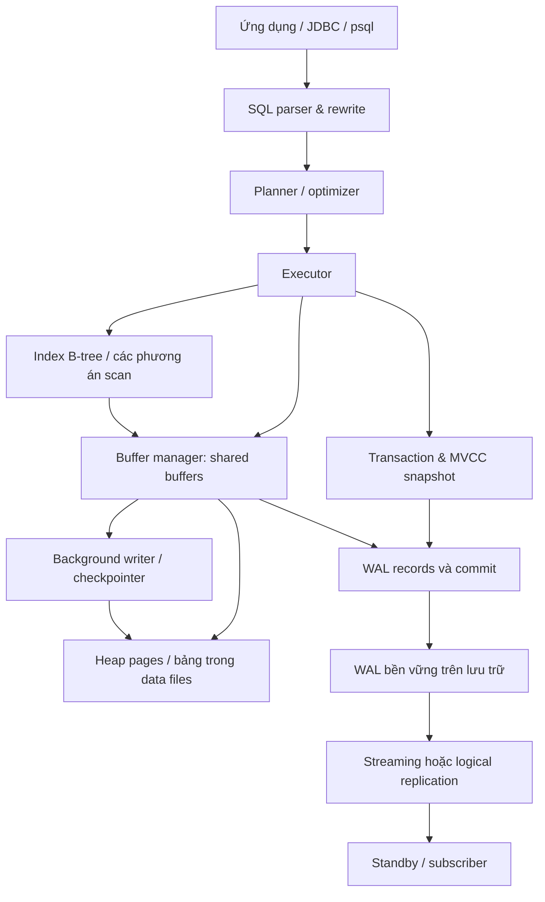
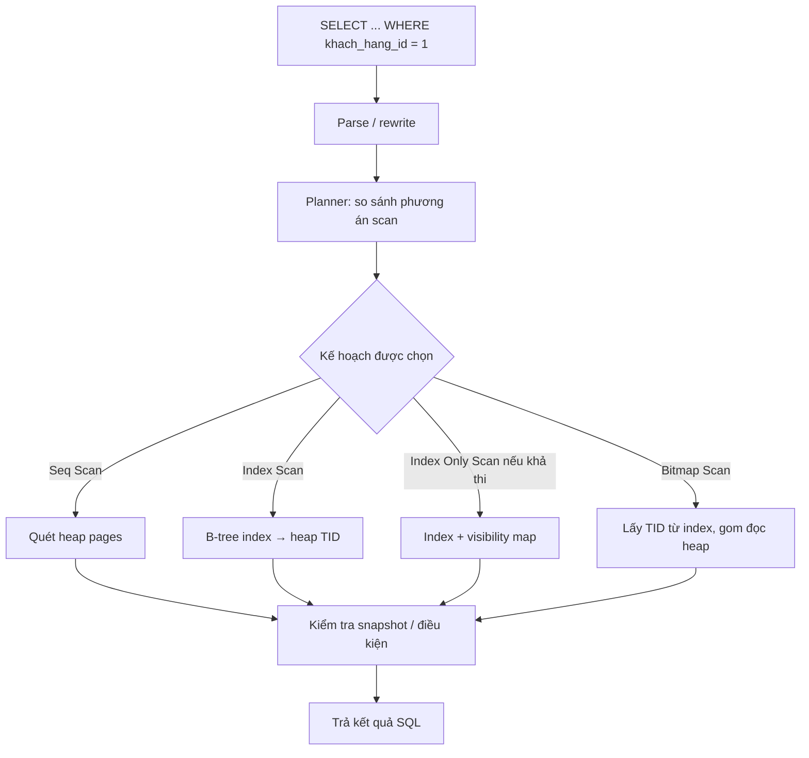
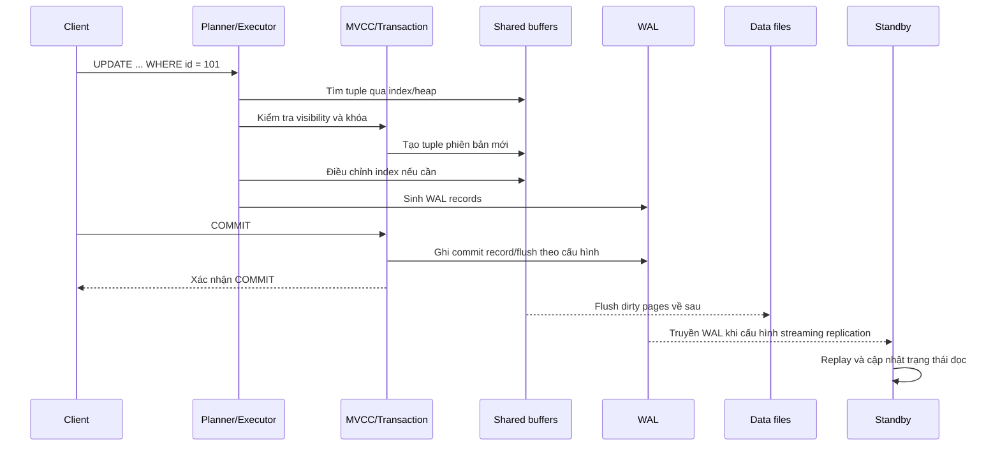
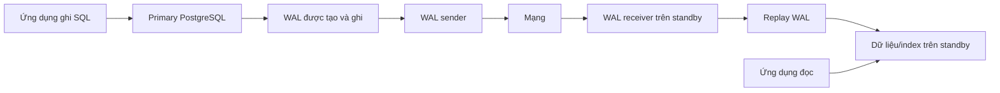

# Quan hệ giữa lưu trữ, truy vấn, giao dịch, chỉ mục và sao chép

PostgreSQL là một hệ quản trị cơ sở dữ liệu quan hệ, nhưng một câu lệnh SQL không được xử lý bởi riêng một thành phần. Khi ứng dụng gửi `SELECT`, PostgreSQL phải phân tích truy vấn, chọn kế hoạch thực thi, đọc trang từ bộ nhớ hoặc đĩa, tra cứu chỉ mục khi hữu ích và quyết định **phiên bản hàng nào được phép nhìn thấy**. Khi ứng dụng gửi `UPDATE` và `COMMIT`, PostgreSQL phải tạo phiên bản dữ liệu mới, quản lý khóa và giao dịch, ghi **Write-Ahead Log (WAL)** để phục hồi sau sự cố, rồi có thể truyền thay đổi sang máy chủ sao chép.

Nhìn từng khái niệm riêng lẻ rất dễ gây nhầm lẫn: “có chỉ mục thì không cần đọc bảng”, “COMMIT nghĩa là mọi trang dữ liệu đã ghi xuống đĩa”, “đã sao chép sang replica thì không cần backup”, hoặc “mỗi bản ghi chỉ tồn tại một lần trong tệp bảng”. Bài học này xây dựng **một bản đồ nhân quả** để thấy năm mảng **lưu trữ – truy vấn – giao dịch – chỉ mục – sao chép** kết nối với nhau như thế nào trong PostgreSQL.

Phạm vi minh họa là PostgreSQL hiện đại với các bảng thông thường dùng heap storage và chỉ mục B-tree. Những extension như columnar storage, foreign tables, distributed PostgreSQL hoặc cơ chế lưu trữ không mặc định có thể khác; ví dụ tập trung vào kiến trúc nền tảng để người học có thể tiếp tục tìm hiểu sâu hơn.

## 1. Năm thành phần nhìn từ một câu lệnh SQL

| Thành phần | Câu hỏi nó giải quyết | Những khái niệm cần nhớ |
|---|---|---|
| **Lưu trữ (storage)** | Bảng, hàng và trang được đặt ở đâu, đọc/ghi ra sao? | Heap, page, tuple, shared buffers, WAL, vacuum |
| **Truy vấn (query processing)** | Làm thế nào biến SQL thành các bước thực thi? | Parser, rewrite, planner, executor, scan, join, aggregate |
| **Giao dịch (transactions)** | Những thay đổi nào được nhìn thấy, khi nào commit/rollback? | ACID, MVCC, snapshot, isolation, locks |
| **Chỉ mục (indexes)** | Làm thế nào tìm hàng hiệu quả mà không phải quét mọi trang? | B-tree, index scan, bitmap scan, index-only scan |
| **Sao chép (replication)** | Làm sao duy trì dữ liệu ở server khác và phục vụ HA/đọc? | WAL streaming, standby, logical decoding, publication/subscription |

Một cơ chế thường phụ thuộc cơ chế khác:

- Chỉ mục giúp **tìm vị trí hàng**, nhưng kết quả truy vấn vẫn chịu quy tắc **visibility của MVCC**.
- Giao dịch tạo các phiên bản hàng, dẫn đến nhu cầu **VACUUM** và ảnh hưởng tới hiệu quả chỉ mục.
- Thay đổi dữ liệu sinh ra **WAL** để crash recovery và cung cấp luồng thông tin cho các hình thức sao chép.
- Bộ lập kế hoạch sử dụng thống kê về dữ liệu và chỉ mục để quyết định đọc qua **heap** hay qua **index**.
- Replica áp dụng thay đổi với một mức trễ nhất định, nên một `SELECT` trên standby có thể khác kết quả trên primary dù cả hai đều chạy SQL đúng.

### 1.1. Bản đồ kiến trúc ở mức khái niệm



Sơ đồ biểu diễn **mối liên hệ logic**, không phải thứ tự thực thi bắt buộc của mọi lệnh. Chẳng hạn, một `SELECT` đơn giản không làm phát sinh WAL cho thay đổi nghiệp vụ; việc tạo redo/WAL trong quá trình xử lý còn phụ thuộc thao tác thực tế, và một `UPDATE` có thể chạm cả heap, index và WAL trước khi client gửi `COMMIT`.

## 2. Một ví dụ xuyên suốt: khách hàng, đơn hàng và dòng hàng

Ta tạo một schema nhỏ để dùng lại trong các phần giải thích. Các lệnh PostgreSQL sau được thiết kế để thực hành trong database thử nghiệm, không chạy trên dữ liệu production.

```sql
CREATE SCHEMA IF NOT EXISTS demo_pg_arch;

CREATE TABLE demo_pg_arch.khach_hang (
    id BIGINT GENERATED BY DEFAULT AS IDENTITY PRIMARY KEY,
    ho_ten TEXT NOT NULL,
    email TEXT NOT NULL UNIQUE
);

CREATE TABLE demo_pg_arch.don_hang (
    id BIGINT GENERATED BY DEFAULT AS IDENTITY PRIMARY KEY,
    khach_hang_id BIGINT NOT NULL
        REFERENCES demo_pg_arch.khach_hang(id),
    trang_thai TEXT NOT NULL
        CHECK (trang_thai IN ('NEW', 'PAID', 'CANCELLED')),
    tong_tien NUMERIC(14, 2) NOT NULL
        CHECK (tong_tien >= 0),
    tao_luc TIMESTAMPTZ NOT NULL DEFAULT now()
);

CREATE TABLE demo_pg_arch.dong_hang (
    id BIGINT GENERATED BY DEFAULT AS IDENTITY PRIMARY KEY,
    don_hang_id BIGINT NOT NULL
        REFERENCES demo_pg_arch.don_hang(id),
    san_pham TEXT NOT NULL,
    so_luong INTEGER NOT NULL CHECK (so_luong > 0),
    don_gia NUMERIC(14, 2) NOT NULL CHECK (don_gia >= 0)
);

CREATE INDEX idx_don_hang_khach_tao
    ON demo_pg_arch.don_hang(khach_hang_id, tao_luc DESC);

CREATE INDEX idx_dong_hang_ma_don
    ON demo_pg_arch.dong_hang(don_hang_id);
```

Nhập dữ liệu mẫu:

```sql
INSERT INTO demo_pg_arch.khach_hang (id, ho_ten, email)
VALUES
    (1, 'Lan', 'lan@example.test'),
    (2, 'Minh', 'minh@example.test');

INSERT INTO demo_pg_arch.don_hang
    (id, khach_hang_id, trang_thai, tong_tien, tao_luc)
VALUES
    (101, 1, 'NEW', 150000.00, '2026-11-10 08:00:00+07'),
    (102, 1, 'PAID', 230000.00, '2026-11-11 09:00:00+07'),
    (103, 2, 'PAID',  80000.00, '2026-11-12 10:00:00+07');

INSERT INTO demo_pg_arch.dong_hang
    (id, don_hang_id, san_pham, so_luong, don_gia)
VALUES
    (1001, 101, 'Sach',    1, 150000.00),
    (1002, 102, 'But',     3,  10000.00),
    (1003, 102, 'Vo',      2, 100000.00),
    (1004, 103, 'Tai nghe',1,  80000.00);
```

Trong hệ thống thật, việc ghi đè ID của cột identity `GENERATED BY DEFAULT` như ví dụ sẽ không tự làm sequence tiến tới giá trị lớn nhất đã chèn. Nếu sau đó cần sinh ID tự động trong cùng bảng thử nghiệm, phải đồng bộ trạng thái sequence hoặc sử dụng các lệnh `INSERT` không ghi ID ngay từ đầu. Ở đây, việc cố định ID chỉ nhằm giúp các truy vấn minh họa trả về kết quả dễ hiểu.

Mô hình quan hệ:

```text
khach_hang (một hàng / khách)
       │ 1:N
       ▼
don_hang (một hàng / đơn)
       │ 1:N
       ▼
dong_hang (một hàng / dòng sản phẩm)
```

Khi nói một đơn có hai dòng hàng, ta mô tả **quan hệ logic**. Ở lớp vật lý, những hàng đó có thể nằm trên nhiều trang heap và nhiều mục chỉ mục khác nhau.

## 3. Lưu trữ: bảng PostgreSQL không đơn thuần là một danh sách hàng

### 3.1. Heap, page và tuple

Một bảng PostgreSQL thông thường dùng **heap storage**: các phiên bản hàng (*tuples*) được đặt trong các trang dữ liệu của tệp quan hệ. Kích thước page thông dụng của PostgreSQL là **8 KiB** khi dùng cấu hình build mặc định, dù bản build khác có thể dùng kích thước khác.

Một tuple có header để hỗ trợ thông tin trạng thái giao dịch và lưu trữ dữ liệu hàng. Nhiều tuple có thể nằm trên cùng một page; cùng một bảng có thể gồm nhiều page và segment vật lý.

```text
Bảng demo_pg_arch.don_hang
 ├── Heap page 0
 │    ├── Tuple đơn 101, phiên bản A
 │    ├── Tuple đơn 102, phiên bản A
 │    └── ...
 ├── Heap page 1
 │    └── ...
 └── ...

Index idx_don_hang_khach_tao
 ├── Khóa (khach_hang_id, tao_luc)
 └── Con trỏ vật lý tới tuple trong heap (TID)
```

**TID (tuple identifier)** thường biểu diễn vị trí vật lý bằng cặp block/page và vị trí tuple. TID không phải khóa nghiệp vụ ổn định. Một lần `UPDATE` có thể tạo phiên bản tuple khác và các thao tác bảo trì/di chuyển lại dữ liệu có thể thay đổi vị trí vật lý.

Để định danh đơn hàng trong ứng dụng, dùng khóa chính `id`, **không dùng `ctid` như một định danh vĩnh viễn**.

### 3.2. Shared buffers và bộ nhớ đệm hệ điều hành

PostgreSQL dùng **shared buffers** để giữ các trang dữ liệu/index đang truy cập. Ngoài ra, hệ điều hành thường có page cache cho các thao tác I/O. Khi truy vấn cần một page:

1. Executor yêu cầu đọc dữ liệu từ heap/index.
2. Buffer manager kiểm tra page có trong shared buffers không.
3. Nếu chưa có, PostgreSQL đọc page từ hệ thống lưu trữ qua cơ chế I/O.
4. Page có thể được dùng cho nhiều câu truy vấn; nếu bị sửa, nó được đánh dấu dirty.
5. Background writer/checkpointer và các backend khi cần có thể ghi trang dirty xuống tệp dữ liệu.

```sql
SHOW shared_buffers;
SHOW block_size;
```

`shared_buffers` là một yếu tố cấu hình bộ nhớ quan trọng, nhưng tăng vô hạn không có nghĩa mọi truy vấn sẽ nhanh hơn. Số liệu cache, loại workload, hiệu quả index và khả năng I/O đều ảnh hưởng.

### 3.3. Những cấu trúc bên cạnh heap

| Cấu trúc | Vai trò trong kiến trúc |
|---|---|
| **Heap** | Chứa phiên bản hàng của bảng thông thường |
| **Index** | Hỗ trợ tra cứu/sắp xếp/kiểm tra duy nhất theo cấu trúc khóa |
| **WAL** | Ghi thông tin thay đổi phục vụ crash recovery và sao chép |
| **Visibility Map (VM)** | Ghi nhận trạng thái all-visible/all-frozen của các trang heap, hỗ trợ vacuum và index-only scan |
| **Free Space Map (FSM)** | Theo dõi không gian trống ước lượng trong các trang để hỗ trợ chèn/cập nhật |
| **TOAST** | Lưu trữ một số giá trị lớn vượt cách bố trí thông thường của hàng |
| **System catalogs** | Lưu metadata về bảng, cột, chỉ mục, quyền, kiểu dữ liệu và các đối tượng khác |

Những cấu trúc này có quan hệ chặt chẽ: một `UPDATE` có thể tạo tuple mới trong heap, cập nhật index tùy trường hợp, làm thay đổi visibility map và tạo WAL tương ứng. Sau đó VACUUM quản lý tuple cũ và không gian tái sử dụng.

## 4. Từ câu SQL đến đường đọc dữ liệu

Xét truy vấn lấy các đơn của khách số 1:

```sql
SELECT id, trang_thai, tong_tien, tao_luc
FROM demo_pg_arch.don_hang
WHERE khach_hang_id = 1
ORDER BY tao_luc DESC;
```

Các giai đoạn khái quát:

1. **Parser:** đọc cú pháp SQL thành cấu trúc cây.
2. **Analyzer/rewriter:** xác định bảng, cột, kiểu dữ liệu, view/rule và ngữ nghĩa truy vấn.
3. **Planner/optimizer:** đánh giá các phương án truy cập, lọc, nối, sắp xếp; ước lượng số hàng và chi phí.
4. **Executor:** chạy kế hoạch, đọc index/heap qua buffer manager và trả những hàng thỏa điều kiện.
5. **MVCC visibility:** xác định mỗi phiên bản tuple có hiển thị với snapshot của câu truy vấn hay không.



### 4.1. Planner không phải lúc nào cũng chọn index

Trong bảng có ba đơn như ví dụ, đọc toàn bộ bảng rất rẻ. PostgreSQL có thể chọn `Seq Scan` ngay cả khi đã tồn tại index `idx_don_hang_khach_tao`. Đây **không nhất thiết là sai**.

Với bảng vài triệu hàng và một khách chỉ có vài đơn, dùng index có thể giảm đáng kể số page cần đọc. Ngược lại, nếu điều kiện trả hầu hết hàng, quét heap tuần tự có thể rẻ hơn nhiều lần truy cập ngẫu nhiên qua chỉ mục.

Chi phí phụ thuộc:

- Số hàng và phân phối giá trị.
- Kích thước heap/index.
- Mức độ dữ liệu đã nằm trong cache.
- Cột cần lấy có nằm trong index không.
- Có cần `ORDER BY` hay không.
- Cấu hình planner và chi phí I/O/CPU.
- Tính chọn lọc của điều kiện và số lần truy cập bảng khi `JOIN`.

### 4.2. Đọc kế hoạch bằng EXPLAIN

```sql
EXPLAIN
SELECT id, trang_thai, tong_tien, tao_luc
FROM demo_pg_arch.don_hang
WHERE khach_hang_id = 1
ORDER BY tao_luc DESC;
```

Để thấy số liệu khi truy vấn **thực sự chạy**:

```sql
EXPLAIN (ANALYZE, BUFFERS)
SELECT id, trang_thai, tong_tien, tao_luc
FROM demo_pg_arch.don_hang
WHERE khach_hang_id = 1
ORDER BY tao_luc DESC;
```

`EXPLAIN` thông thường cho biết kế hoạch **dự kiến**; `EXPLAIN ANALYZE` **thực thi câu SQL** và hiển thị thời gian, số hàng thực tế và một số thông tin I/O. Với `UPDATE`/`DELETE`, `EXPLAIN ANALYZE` sẽ thực sự sửa dữ liệu nếu không được bao trong giao dịch có rollback phù hợp; không dùng nó vô ý trên production.

Các số trong bản kế hoạch của một bảng vài hàng không phản ánh được kết quả của bảng lớn. Bài này tập trung vào **vì sao optimizer có những lựa chọn đó**, thay vì gán một kế hoạch cố định cho mọi môi trường.

## 5. Chỉ mục là một cấu trúc dữ liệu riêng gắn với heap

### 5.1. Index B-tree liên kết giá trị khóa với vị trí tuple

Trong PostgreSQL, B-tree là loại index mặc định khi dùng `CREATE INDEX` mà không chỉ định phương thức khác. Một mục B-tree chứa thông tin khóa và tham chiếu tới tuple phù hợp.

Ví dụ:

```sql
CREATE INDEX idx_don_hang_trang_thai
    ON demo_pg_arch.don_hang(trang_thai);
```

Khi chạy:

```sql
SELECT id, tong_tien
FROM demo_pg_arch.don_hang
WHERE trang_thai = 'PAID';
```

Planner có thể chọn:

- **Seq Scan:** kiểm tra toàn bộ heap.
- **Index Scan:** tìm entry `'PAID'` trong B-tree, đi tới tuple tương ứng ở heap để lấy cột khác và kiểm tra visibility.
- **Bitmap Index/Heap Scan:** thu thập vị trí nhiều hàng rồi truy cập heap theo nhóm trang.
- **Index Only Scan:** nếu index có đủ cột cần thiết và điều kiện visibility cho phép giảm/loại lượt đọc heap.

Từ “index” không đồng nghĩa “tất cả dữ liệu hàng nằm trong index”. Một index thông thường chỉ lưu các khóa được index và thông tin tham chiếu cần thiết.

### 5.2. Index-only scan vẫn liên quan đến MVCC

PostgreSQL cần biết một phiên bản tuple có nhìn thấy được với snapshot hay không. Không thể chỉ lấy giá trị index và mặc nhiên tin rằng đó là hàng hợp lệ hiện tại.

**Visibility map** ghi nhận một trang heap có tất cả tuple hiển thị với mọi transaction hiện hành hay không. Khi trang được đánh dấu **all-visible**, một `Index Only Scan` có thể tránh truy cập heap để kiểm tra visibility cho những entry liên quan. Nếu chưa all-visible, executor có thể vẫn phải đọc heap.

```sql
CREATE INDEX idx_don_hang_khach_tao_cover
    ON demo_pg_arch.don_hang(khach_hang_id, tao_luc DESC)
    INCLUDE (tong_tien, trang_thai);
```

Index có `INCLUDE` có thể chứa thêm các cột phục vụ truy vấn mà không dùng chúng làm khóa tìm kiếm/sắp xếp chính. Điều này có thể giúp index-only scan, nhưng còn phụ thuộc:

- Những cột truy vấn thật sự cần.
- Trạng thái all-visible của heap pages.
- Quy mô dữ liệu và chi phí được planner ước lượng.
- Dung lượng index tăng và chi phí khi ghi dữ liệu.

**Không có bảo đảm cứ tạo covering index là mọi truy vấn sẽ thành Index Only Scan**.

### 5.3. Thêm index làm thao tác ghi đắt hơn

Mỗi index là một cấu trúc cần được duy trì. Khi thêm một đơn hàng:

```sql
INSERT INTO demo_pg_arch.don_hang
    (khach_hang_id, trang_thai, tong_tien)
VALUES (1, 'NEW', 99000.00);
```

PostgreSQL có thể phải:

1. Chèn tuple vào heap.
2. Chèn các mục liên quan vào index khóa chính, index foreign-key pattern và các index khác đã tạo.
3. Kiểm tra các ràng buộc phù hợp.
4. Sinh WAL cho những thay đổi cần phục hồi.
5. Duy trì cấu trúc page, đồng thời tạo thêm công việc VACUUM về sau.

Nhiều index có thể giúp một số `SELECT` nhưng làm `INSERT`/`UPDATE`/`DELETE` tốn thêm CPU, I/O, WAL và không gian đĩa. Thiết kế index phải theo **workload đọc/ghi**, không phải cứ thấy cột nào hay xuất hiện trong `WHERE` là tạo một index mới.

### 5.4. Không phải chỉ có B-tree

PostgreSQL còn có các phương thức index khác như Hash, GiST, SP-GiST, GIN và BRIN. Mỗi loại phù hợp với nhóm toán tử/phân phối dữ liệu riêng:

| Loại index | Ví dụ nhu cầu |
|---|---|
| **B-tree** | So sánh bằng, khoảng, thứ tự tăng/giảm ở nhiều kiểu dữ liệu |
| **Hash** | Phục vụ một số truy vấn so sánh bằng |
| **GIN** | Dữ liệu có nhiều phần tử/khóa, như mảng, JSONB hoặc full-text theo operator class phù hợp |
| **GiST/SP-GiST** | Những bài toán tìm kiếm chuyên biệt như không gian, phạm vi và operator class liên quan |
| **BRIN** | Bảng rất lớn có tương quan tốt giữa vị trí vật lý và giá trị, thường hữu ích cho dữ liệu theo thời gian |

Bài này dùng B-tree để làm rõ mối quan hệ **index → heap → visibility**; không nên suy ra mọi index đều có cấu trúc B-tree hay chi phí giống nhau.

## 6. Giao dịch: từ một hàng logic đến nhiều phiên bản vật lý

### 6.1. Atomicity và MVCC

Xét thay đổi trạng thái đơn hàng:

```sql
BEGIN;

UPDATE demo_pg_arch.don_hang
SET trang_thai = 'PAID'
WHERE id = 101;

COMMIT;
```

Đối với ứng dụng, đó là thay đổi của một đơn. Nhưng PostgreSQL sử dụng **Multi-Version Concurrency Control (MVCC)**: `UPDATE` thông thường tạo **phiên bản tuple mới** và đánh dấu phiên bản cũ theo thông tin giao dịch, thay vì ghi đè nội dung cũ tại chỗ như một mảng đơn giản.

Nhờ đó, một transaction đọc có snapshot cũ có thể tiếp tục thấy phiên bản trước trong khi transaction khác cập nhật và commit phiên bản mới. Khi không còn snapshot nào cần phiên bản cũ, VACUUM có thể đánh dấu/tái sử dụng không gian phù hợp.

```text
Đơn id=101, giá trị ban đầu:
  Tuple A: trang_thai = NEW

Transaction T1 thực hiện UPDATE:
  Tuple A: phiên bản cũ
  Tuple B: trang_thai = PAID

Transaction đọc với snapshot cũ:
  Có thể nhìn thấy A

Transaction đọc với snapshot mới sau commit T1:
  Nhìn thấy B

Khi A không còn cần:
  VACUUM xử lý tuple chết, thu hồi/tái sử dụng không gian
```

Đây là một điểm khác biệt giữa **thực thể nghiệp vụ** và **phiên bản vật lý của hàng**. Câu `SELECT COUNT(*)` thông thường đếm những hàng logic nhìn thấy theo snapshot, không đếm tất cả phiên bản tuple cũ còn nằm vật lý trong heap.

### 6.2. xmin/xmax và transaction status

Tuple header có những thông tin như `xmin` và `xmax` liên quan đến transaction tạo/xóa hoặc thay thế phiên bản. PostgreSQL còn duy trì trạng thái commit/abort của transaction để kiểm tra visibility.

Có thể quan sát trên dữ liệu thử:

```sql
SELECT
    ctid,
    xmin,
    xmax,
    id,
    trang_thai
FROM demo_pg_arch.don_hang
WHERE id = 101;
```

Các cột hệ thống này hữu ích để học kiến trúc và chẩn đoán chuyên sâu, nhưng không phải API nghiệp vụ để lưu trong ứng dụng. `xmin` không thay thế version column của optimistic locking; `ctid` không được coi là khóa chính ổn định.

### 6.3. Snapshot theo isolation level

Ở mức cô lập **READ COMMITTED** mặc định, mỗi statement thường thấy snapshot dữ liệu đã commit phù hợp với thời điểm statement bắt đầu. Hai câu `SELECT` trong cùng transaction có thể thấy kết quả khác nhau nếu transaction khác commit ở giữa.

Ở mức **REPEATABLE READ**, transaction duy trì snapshot nhất quán xuyên nhiều statement thông thường, giúp các truy vấn thấy cùng một thế giới logic cho đến khi transaction kết thúc (trừ ảnh hưởng từ những thay đổi chính transaction tự thực hiện và một số quy tắc khác).

```sql
BEGIN ISOLATION LEVEL REPEATABLE READ;

SELECT id, trang_thai
FROM demo_pg_arch.don_hang
WHERE id = 101;

-- Một session khác có thể COMMIT thay đổi sau khi snapshot đã hình thành.

SELECT id, trang_thai
FROM demo_pg_arch.don_hang
WHERE id = 101;

COMMIT;
```

Ví dụ cần **hai kết nối** nếu muốn quan sát một phiên cập nhật và phiên còn lại đọc. Snapshot trong PostgreSQL không đồng nghĩa khóa toàn bộ bảng để ngăn mọi `UPDATE`.

### 6.4. Khóa vẫn cần thiết dù có MVCC

MVCC giúp giảm xung đột giữa nhiều thao tác đọc và ghi, nhưng không xóa bỏ nhu cầu khóa:

- Hai transaction cập nhật cùng một hàng có thể phải chờ nhau.
- `SELECT ... FOR UPDATE` yêu cầu khóa hàng nhằm phối hợp xử lý đồng thời.
- DDL thường cần khóa phù hợp ở mức relation.
- Foreign key, unique constraint và một số thao tác kiểm tra dữ liệu cũng có thể liên quan đến khóa.

```sql
BEGIN;

SELECT *
FROM demo_pg_arch.don_hang
WHERE id = 101
FOR UPDATE;

-- Sau khi quyết định nghiệp vụ:
UPDATE demo_pg_arch.don_hang
SET trang_thai = 'PAID'
WHERE id = 101;

COMMIT;
```

Khóa hàng chỉ giữ trong phạm vi transaction phù hợp. Một transaction chờ người dùng hoặc gọi dịch vụ ngoài quá lâu có thể gây lock wait cho các transaction khác. **Transaction nên bao trùm đúng phần cần bảo đảm nguyên tử, không kéo dài tùy tiện.**

### 6.5. Các mức cô lập và kiểm soát bất thường

| Mức cô lập | Ý nghĩa khái quát trong PostgreSQL |
|---|---|
| `READ COMMITTED` | Mỗi statement dùng snapshot của riêng nó; mặc định |
| `REPEATABLE READ` | Snapshot nhất quán xuyên transaction, mạnh hơn cách mô tả tối thiểu trong tiêu chuẩn SQL |
| `SERIALIZABLE` | Cố gắng bảo đảm kết quả tương đương một thứ tự thực thi tuần tự; có thể yêu cầu retry khi phát hiện xung đột serialization |

PostgreSQL chấp nhận cú pháp `READ UNCOMMITTED` nhưng xử lý nó theo hành vi tương đương `READ COMMITTED`, không cho phép dirty read như một số hệ khác.

Ở `SERIALIZABLE`, một transaction có thể thất bại với lỗi serialization khi xung đột được phát hiện. Ứng dụng cần thiết kế retry **toàn bộ transaction** với giới hạn và idempotency, không đơn thuần chạy lại câu cuối.

## 7. Khi UPDATE, PostgreSQL phải phối hợp heap, index và WAL

Đây là luồng quan trọng nhất để kết nối ba thành phần lưu trữ, giao dịch và chỉ mục.

```sql
BEGIN;

UPDATE demo_pg_arch.don_hang
SET tong_tien = tong_tien + 10000.00
WHERE id = 101;

COMMIT;
```

Một cách mô tả quá trình:

1. **Executor tìm tuple mục tiêu**, có thể qua khóa chính `id`.
2. **Transaction/visibility** xác định phiên bản hàng cần sửa và xử lý khóa liên quan.
3. **Heap lưu phiên bản mới** của tuple; phiên bản cũ vẫn có thể tồn tại phục vụ snapshot trước.
4. **Index cần được duy trì** nếu thay đổi ảnh hưởng khóa index hoặc điều kiện HOT không thỏa.
5. **WAL được sinh** để PostgreSQL có đủ thông tin phục hồi các thay đổi cần thiết.
6. **COMMIT** ghi nhận trạng thái giao dịch và đáp ứng chính sách bền vững.
7. **Trang dữ liệu dirty** có thể được ghi xuống tệp về sau, độc lập với mốc trả kết quả commit.
8. **VACUUM** xử lý các phiên bản cũ khi chúng không còn cần thiết.



Đây là sơ đồ quan hệ, không phải lịch chính xác đến từng syscall. WAL có thể được sinh trong lúc các trang được sửa; background writer, walwriter và checkpointer có các nhịp hoạt động riêng. Một giao dịch rất lớn cũng có thể phải đẩy WAL trước khi commit.

### 7.1. WAL không phải danh sách câu SQL

**Write-Ahead Log (WAL)** là chuỗi log phục vụ crash recovery của PostgreSQL. Nó mô tả những thay đổi ở cấp cơ chế lưu trữ/transaction phù hợp để phục hồi, chứ không đơn giản là file chứa nguyên văn `UPDATE ...` để server chạy lại như một client.

Nguyên tắc **write-ahead logging** yêu cầu thông tin WAL cần thiết được làm bền vững trước khi một trang dữ liệu đã sửa tương ứng được ghi bền vững vào nơi lưu trữ chính.

Do đó, khi PostgreSQL bị mất điện sau khi client đã nhận `COMMIT` thành công với chính sách và thiết bị lưu trữ đáng tin cậy, các page heap/index chưa kịp flush vẫn có thể được tái tạo thông qua WAL khi crash recovery.

### 7.2. Commit không yêu cầu flush toàn bộ heap page ngay lập tức

Giả sử một transaction sửa ba bảng và năm chỉ mục. Nếu mỗi `COMMIT` phải ghi toàn bộ page bị ảnh hưởng xuống data files ngay lập tức, chi phí I/O ngẫu nhiên có thể rất cao. PostgreSQL tách việc:

- Ghi/flush WAL cần thiết để đảm bảo commit theo cấu hình.
- Giữ các page đã sửa trong buffer cache.
- Flush dirty data pages vào thời điểm phù hợp.
- Tiến checkpoint để xác định điểm phục hồi.

Một số tùy chọn liên quan:

```sql
SHOW synchronous_commit;
SHOW fsync;
SHOW full_page_writes;
SHOW checkpoint_timeout;
SHOW max_wal_size;
```

**`synchronous_commit = on`** thông thường yêu cầu WAL commit được flush ở primary trước khi xác nhận commit; đây không phải lời hứa rằng standby đã replay thay đổi. Chính sách xác nhận trên standby phụ thuộc `synchronous_standby_names` và mức `synchronous_commit` như `remote_write`, `on` hoặc `remote_apply` khi synchronous replication được cấu hình phù hợp.

Nếu tắt hoặc giảm một số cơ chế bền vững như `fsync`, rủi ro mất dữ liệu/hỏng trạng thái sau sự cố tăng đáng kể. Không dùng cấu hình mất an toàn chỉ để đạt benchmark cao trên hệ thống quan trọng.

### 7.3. Checkpoint và crash recovery

**Checkpoint** giúp PostgreSQL ghi dữ liệu dirty cần thiết và ghi nhận một điểm để khi khởi động lại không phải đọc toàn bộ lịch sử WAL từ đầu.

Nếu server tắt đột ngột:

1. PostgreSQL tìm trạng thái checkpoint và WAL còn cần thiết.
2. Replay WAL để phục hồi những thay đổi chưa được phản ánh đầy đủ ở data files.
3. Xác định trạng thái transaction đúng theo commit/abort.
4. Đưa database về trạng thái nhất quán cho việc phục vụ kết nối.

WAL **không thay thế backup**. Nó có thể cứu hệ thống khỏi một lần crash với volume còn nguyên, nhưng không tự phục hồi toàn bộ dữ liệu khi volume biến mất hoặc khi người dùng đã `DELETE` nhầm rồi commit.

## 8. MVCC khiến VACUUM quan trọng với cả lưu trữ và truy vấn

Khi một hàng được cập nhật, phiên bản cũ không nhất thiết biến mất khỏi heap ngay lập tức. Nếu nhiều transaction tiếp tục tạo phiên bản mới mà không dọn dẹp được phiên bản chết, dữ liệu có thể bị **bloat**: bảng/index chiếm nhiều không gian và phải đọc nhiều page hơn.

PostgreSQL dùng **VACUUM**, thông thường được tự động hóa qua **autovacuum**, để xử lý tuple chết và duy trì các cấu trúc trợ giúp.

### 8.1. Từ UPDATE tới tuple chết

```text
UPDATE một hàng
   │
   ├── Tuple phiên bản mới
   ├── Phiên bản cũ tiếp tục tồn tại khi snapshot còn cần
   │
   └── WAL cho thay đổi
          │
          ▼
Snapshot cũ không còn cần phiên bản trước
          │
          ▼
VACUUM có thể thu hồi/tái sử dụng không gian phù hợp
          │
          ▼
Visibility map và thống kê phục vụ quản lý/đọc
```

`VACUUM` thông thường không nhất thiết trả lại mọi không gian trống ở cuối tệp cho hệ điều hành; nó chủ yếu làm không gian tái sử dụng được. `VACUUM FULL` là thao tác khác, có khóa và chi phí lớn hơn vì viết lại bảng. Không coi `VACUUM FULL` là bước định kỳ mặc định.

### 8.2. HOT update liên kết heap và index

PostgreSQL có cơ chế **Heap-Only Tuple (HOT)** để giảm việc phải cập nhật index ở một số `UPDATE`. Nếu các cột mà index phụ thuộc không thay đổi và có đủ không gian trên cùng heap page, phiên bản tuple mới có thể được nối theo chuỗi HOT.

Ví dụ, nếu chỉ thay đổi `tong_tien` trong bảng mà **không có index nào chứa hoặc phụ thuộc vào `tong_tien`**, một số cập nhật có khả năng HOT. Nhưng sau khi tạo covering index có `INCLUDE (tong_tien)`, chính cột đó đã xuất hiện trong index, làm thay đổi điều kiện để HOT khả thi.

Vì vậy, một index được thêm để tăng tốc `SELECT` có thể:

- Tăng kích thước index và WAL.
- Tăng chi phí cập nhật.
- Làm giảm cơ hội HOT update.
- Tăng công việc dọn dẹp phiên bản cũ.

Đây là một quan hệ trực tiếp giữa **thiết kế chỉ mục** và **hành vi ghi của MVCC**.

### 8.3. Quan sát tuple chết và hoạt động VACUUM

```sql
SELECT
    schemaname,
    relname,
    n_live_tup,
    n_dead_tup,
    last_vacuum,
    last_autovacuum,
    last_analyze,
    last_autoanalyze
FROM pg_stat_user_tables
WHERE schemaname = 'demo_pg_arch'
ORDER BY relname;
```

`n_live_tup` và `n_dead_tup` là **ước lượng thống kê**, không phải phép đếm tuyệt đối tại một snapshot. Để hiểu bloat hoặc vacuum lag, xem xu hướng theo thời gian cùng tuổi transaction và các giới hạn snapshot.

Transaction đọc tồn tại quá lâu có thể giữ một snapshot cũ, khiến VACUUM không được phép dọn một số phiên bản tuple. Trong hệ thống có logical decoding, slot hoặc các phiên chạy dài cũng có thể ảnh hưởng khả năng giữ WAL/tuple theo những cơ chế khác nhau.

## 9. Thống kê liên kết lưu trữ với bộ tối ưu truy vấn

Optimizer không phân tích tất cả hàng cho mỗi truy vấn. Nó dựa vào thống kê về phân phối dữ liệu và chi phí.

```sql
ANALYZE demo_pg_arch.don_hang;

SELECT
    attname,
    n_distinct,
    most_common_vals,
    most_common_freqs
FROM pg_stats
WHERE schemaname = 'demo_pg_arch'
  AND tablename = 'don_hang';
```

`ANALYZE` thu thập thống kê để planner ước lượng số hàng theo điều kiện lọc. `pg_stats` có thể hiển thị thông tin như số giá trị phân biệt ước lượng và những giá trị xuất hiện phổ biến của cột.

Sự kết nối giữa các phần:

- **Storage:** heap chứa số hàng thực và phân phối giá trị.
- **Statistics:** cung cấp mô hình gần đúng về số lượng và phân phối.
- **Planner:** dùng ước lượng để chọn Seq Scan, Index Scan, Hash Join, Nested Loop...
- **Executor:** thực thi trên dữ liệu thật với snapshot của transaction.
- **Feedback vận hành:** `EXPLAIN ANALYZE` cho biết ước lượng lệch bao nhiêu và kế hoạch có phù hợp không.

Một chỉ mục vẫn có thể không được chọn nếu planner ước lượng chi phí của nó cao hơn table scan. Tương tự, chỉ mục có thể được chọn nhưng không đem lại cải thiện như mong đợi nếu dữ liệu lệch hoặc truy vấn cần đọc phần lớn bảng.

### 9.1. Các loại JOIN và số hàng trung gian

Giả sử báo cáo cần doanh thu theo khách:

```sql
SELECT
    k.id,
    k.ho_ten,
    COUNT(DISTINCT d.id) AS so_don,
    COALESCE(SUM(d.tong_tien), 0) AS tong_tien
FROM demo_pg_arch.khach_hang AS k
LEFT JOIN demo_pg_arch.don_hang AS d
    ON d.khach_hang_id = k.id
GROUP BY k.id, k.ho_ten
ORDER BY k.id;
```

Planner có thể chọn Nested Loop, Hash Join hoặc Merge Join tùy thống kê, index và khối lượng dữ liệu. Với bảng nhỏ, Seq Scan + Hash Join hoàn toàn có thể hợp lý.

**Lưu ý về grain:** nếu tiếp tục nối `dong_hang` vào báo cáo và vẫn `SUM(d.tong_tien)`, mỗi đơn có nhiều dòng hàng có thể bị nhân tổng. Đây là lỗi SQL ở cấp quan hệ, không phải do planner hoặc MVCC. Tối ưu truy vấn **không tự sửa logic tổng hợp sai**.

## 10. Sao chép vật lý: WAL từ primary tới standby

**Physical streaming replication** truyền các WAL records từ **primary** sang một hoặc nhiều **standby** để chúng áp dụng những thay đổi ở mức lưu trữ.

Luồng khái quát:



Vì standby replay WAL, physical replication phản ánh thay đổi ở mức **toàn cụm PostgreSQL tương ứng**, không phải chỉ “một bảng được chọn” như cơ chế logical replication. Nó bao gồm thay đổi vật lý của heap, index và nhiều đối tượng thuộc cụm tương ứng, trong phạm vi khả năng và ràng buộc của cấu hình replication.

Một physical standby thông thường có thể phục vụ truy vấn đọc khi **hot standby** được bật và trạng thái cho phép, nhưng nó không phải nơi ứng dụng ghi dữ liệu độc lập theo cách của primary.

### 10.1. Những mốc tiến độ quan trọng

| Mốc | Ý nghĩa |
|---|---|
| Primary sinh WAL | Thay đổi đã có thông tin WAL trên primary |
| Primary flush WAL | WAL đã được đẩy tới mức bền vững được yêu cầu tại primary |
| Standby nhận WAL | Dữ liệu log đã tới standby |
| Standby ghi/flush WAL | WAL đã được lưu theo trạng thái của standby |
| Standby replay WAL | Thay đổi đã được áp dụng vào trạng thái dữ liệu có thể đọc |

Vì nhận, flush và replay là các giai đoạn khác nhau, không nên đồng nhất “standby đã nhận WAL” với “query trên standby lập tức nhìn thấy hàng mới”.

### 10.2. Asynchronous và synchronous replication

**Asynchronous replication** là cấu hình thường gặp: primary có thể xác nhận commit mà không chờ standby nhận hoặc replay thay đổi. Điều này giảm phụ thuộc độ trễ mạng ở đường commit, nhưng có khả năng standby bị tụt lại.

**Synchronous replication** có thể cấu hình primary chờ phản hồi từ một hoặc nhiều synchronous standby theo chính sách đã chọn. Các mức `synchronous_commit` khi kết hợp với `synchronous_standby_names` quyết định chờ tới mức nào, ví dụ WAL được nhận/flush hoặc đã được apply trên standby.

- `synchronous_commit = on` trên primary không tự bảo đảm mọi standby đã replay.
- `remote_apply` có thể yêu cầu đợi thay đổi được áp dụng tới mức phù hợp trên synchronous standby.
- Mức bảo đảm thực tế phụ thuộc danh sách standby đồng bộ, tình trạng kết nối, chính sách và cấu hình đầy đủ.
- Nếu synchronous standby không sẵn sàng, commit có thể phải chờ, làm thay đổi trade-off giữa availability và durability.

### 10.3. Replica lag và đọc dữ liệu mới ghi

Giả sử ứng dụng:

1. Gửi `UPDATE don_hang SET trang_thai='PAID'` vào primary.
2. Nhận `COMMIT` thành công.
3. Ngay lập tức gửi `SELECT` vào standby bất đồng bộ.

Nếu standby chưa replay WAL tương ứng, kết quả `SELECT` có thể vẫn thấy trạng thái `NEW`. Đây là vấn đề **độ trễ sao chép (replication lag)**, không phải lỗi trong transaction ở primary.

Với yêu cầu **read-your-writes**, cần thiết kế đường đọc theo primary hoặc đợi replica đạt vị trí WAL/điều kiện nhất quán tương ứng trước khi đọc. Không nên giả định một connection pool đọc “bất kỳ replica nào” sẽ nhìn ngay dữ liệu vừa commit.

### 10.4. Replica không thay thế backup

Nếu người vận hành chạy:

```sql
DELETE FROM demo_pg_arch.don_hang WHERE id = 101;
```

và commit thành công, physical replication thường sẽ **truyền cả thao tác xóa đó** sang standby. Do đó, replica cũng có thể mất hàng mà người dùng đã xóa nhầm.

Replica chủ yếu phục vụ HA, khả năng đọc và một số nhu cầu vận hành; để khôi phục do xóa nhầm hoặc mất toàn bộ cụm, cần backup và chiến lược phục hồi độc lập, có thể kết hợp lưu trữ WAL để **point-in-time recovery (PITR)**.

## 11. Sao chép logic: dữ liệu hàng thay vì bản sao vật lý toàn cụm

**Logical replication** dùng thông tin thay đổi được giải mã từ WAL thành các sự kiện ở mức bảng/hàng phù hợp. Publisher có thể công bố thay đổi của một tập bảng; subscriber nhận và áp dụng chúng vào bảng đích.

Ví dụ khái niệm:

```text
PostgreSQL publisher
  Bảng don_hang
       │ INSERT / UPDATE / DELETE đã commit
       ▼
WAL + logical decoding
       │
       ▼
Publication: chọn bảng / nhóm thay đổi
       │
       ▼
Subscriber kết nối, nhận thay đổi
       │
       ▼
Bảng don_hang tương ứng trên subscriber
```

Một lệnh tạo publication trên publisher:

```sql
-- Chạy trên publisher có cấu hình wal_level và quyền phù hợp:
CREATE PUBLICATION pub_don_hang_demo
FOR TABLE demo_pg_arch.don_hang;
```

Trên subscriber, cần thiết lập schema/tables tương thích và cấu hình subscription kết nối tới publisher. Ví dụ khung cú pháp, **không thực thi trên production nếu chưa chuẩn bị tài khoản, quyền, mạng và dữ liệu đích**:

```sql
-- Chạy trên subscriber sau khi đã tạo bảng đích tương thích.
-- Chuỗi kết nối là ví dụ, không chứa mật khẩu thật.
CREATE SUBSCRIPTION sub_don_hang_demo
CONNECTION 'host=publisher.example.test port=5432 dbname=shopdb user=replicator'
PUBLICATION pub_don_hang_demo;
```

Trong môi trường thật, cần bảo đảm xác thực an toàn, quyền `REPLICATION`/quyền đọc cần thiết, slot, cấu hình `wal_level = logical` và networking phù hợp. Tạo subscription có thể bắt đầu **sao chép dữ liệu ban đầu** trước khi liên tục áp dụng thay đổi; quy trình này cần được chuẩn bị nếu subscriber đã có dữ liệu.

### 11.1. Physical và logical replication khác nhau ở đâu?

| Khía cạnh | Physical streaming | Logical replication |
|---|---|---|
| Dữ liệu truyền | WAL phục vụ thay đổi vật lý/khôi phục của cụm | Thay đổi hàng/bảng được giải mã từ WAL |
| Phạm vi | Cụm vật lý tương ứng | Publication/subscription chọn bảng và sự kiện phù hợp |
| Bảng/index phía nhận | Theo trạng thái vật lý của standby | Subscriber có bảng/index riêng, phải bảo đảm cấu trúc phù hợp |
| DDL | Thay đổi vật lý được replay theo cụm | Không mặc định sao chép tất cả thay đổi DDL |
| Khả năng đọc | Hot standby thường chỉ đọc | Subscriber có thể là hệ thống độc lập với quy tắc ghi riêng, cần tránh xung đột |
| Phiên bản/kiến trúc | Ràng buộc tương thích vật lý nghiêm ngặt | Có thể linh hoạt hơn trong những phạm vi phiên bản/đối tượng được hỗ trợ |
| Tác vụ phù hợp | HA và read replica của cùng cụm | Sao chép chọn lọc, tích hợp, chuyển dữ liệu và một số migration |

**Các giới hạn logical replication cần nhớ:** schema/DDL thường phải quản lý riêng; sequence state không được đồng bộ giống thay đổi dữ liệu bảng thông thường; thao tác `UPDATE`/`DELETE` có thể yêu cầu **replica identity** phù hợp để xác định hàng trên subscriber. Một subscription không tự biến hai database độc lập thành một hệ thống giao dịch phân tán nguyên tử.

### 11.2. Logical replication liên quan tới index

Với physical replication, WAL replay tái tạo thay đổi vật lý của cả index trên standby theo cơ chế storage. Với logical replication, subscriber tự áp dụng thay đổi hàng lên bảng của nó; vì thế cấu trúc index, ràng buộc và cách xác định hàng ở subscriber ảnh hưởng trực tiếp tới chi phí apply và khả năng xử lý `UPDATE`/`DELETE`.

Nếu bảng đích thiếu index phù hợp để tìm hàng nhận thay đổi, một số hoạt động apply có thể chậm. Tương tự, constraint khác nhau giữa publisher và subscriber có thể gây lỗi subscription. Vì vậy, replication là câu chuyện của **dữ liệu, giao dịch và thiết kế bảng**, không chỉ là cấu hình kết nối mạng.

## 12. Transaction và replication: nhất quán ở nhiều cấp khác nhau

Một transaction commit trên primary và một transaction apply trên standby có liên hệ, nhưng chúng không cùng một thời điểm quan sát được từ mọi client.

```mermaid
sequenceDiagram
    participant C as Client
    participant P as Primary
    participant W as WAL
    participant S as Standby
    participant R as Read client

    C->>P: BEGIN; UPDATE; COMMIT
    P->>W: Commit WAL
    P-->>C: COMMIT OK theo chính sách
    R->>S: SELECT ngay sau đó
    S-->>R: Có thể vẫn thấy bản cũ
    W-->>S: WAL đã nhận và replay
    R->>S: SELECT sau khi replay
    S-->>R: Thấy bản cập nhật
```

Trong một cấu hình đồng bộ chờ apply, mốc trả commit có thể được đặt chặt hơn so với hình trên. Tuy nhiên, không phải mọi standby, mọi route đọc và mọi hoạt động client tự động thuộc cùng mức nhất quán.

### 12.1. Ba dạng “đúng” khác nhau

1. **Đúng về transaction tại primary:** các thay đổi đã commit của một transaction được xử lý nguyên tử và hiển thị theo isolation.
2. **Đúng về trạng thái replica đã replay:** replica biểu diễn một trạng thái phù hợp tới tiến độ log nhất định, có thể chậm hơn primary.
3. **Đúng về yêu cầu nghiệp vụ xuyên dịch vụ:** sự kiện email, cache, message queue hoặc API ngoài phải được đồng bộ bằng thiết kế riêng; WAL và MVCC không tự kiểm soát mọi side effect.

Ví dụ, transaction ghi đơn hàng và gửi email không được xem là nguyên tử chỉ vì `COMMIT` thành công. Nếu cần phát sự kiện đáng tin cậy, có thể xem xét **transactional outbox**, sau đó xử lý publish với idempotency.

### 12.2. Sao chép làm thay đổi mô hình đọc/ghi

Một kiến trúc phổ biến:

```text
Application
   ├── Giao dịch ghi / đọc cần dữ liệu vừa ghi
   │       └── Primary
   │
   └── Báo cáo / truy vấn đọc chấp nhận trễ
           └── Read replica
```

Nhưng việc chia luồng đọc không tự bảo đảm tăng thông lượng tuyến tính: replica cũng có CPU, I/O, cache, vacuum/recovery conflict và giới hạn áp dụng WAL. Một truy vấn đọc rất dài trên standby có thể xung đột với việc replay thay đổi; chính sách xử lý conflict có thể khiến truy vấn bị hủy hoặc làm tăng replica lag, tùy cấu hình.

## 13. Replication slots, WAL retention và rủi ro vận hành

WAL là nguồn dữ liệu cho crash recovery, archival và replication. Nếu một standby hoặc logical subscriber chưa nhận các thay đổi cần thiết, hệ thống có thể phải **giữ lại WAL** để bên nhận còn có thể bắt kịp.

**Replication slot** giúp theo dõi tiến độ tiêu thụ log của một consumer, tránh loại bỏ WAL mà consumer chưa nhận khi cơ chế slot/cấu hình phù hợp. Nhưng slot cũng có thể tạo rủi ro:

- Subscriber dừng trong thời gian dài.
- Slot giữ WAL chưa tiêu thụ, làm tăng dung lượng `pg_wal`.
- Nếu không được giám sát, primary có thể chịu áp lực dung lượng đĩa.
- Slot logical còn có thể giữ một số thông tin liên quan để logical decoding/vacuum hoạt động đúng.

```sql
SELECT
    slot_name,
    slot_type,
    active,
    restart_lsn,
    confirmed_flush_lsn
FROM pg_replication_slots
ORDER BY slot_name;
```

`confirmed_flush_lsn` có ý nghĩa với logical slot; ở một số slot khác có thể là `NULL`. Không dùng một con số LSN chung để suy ra đầy đủ tiến độ nhận, flush, apply và khả năng mất dữ liệu.

**Không xóa slot chỉ vì thấy nó giữ nhiều WAL.** Xóa slot có thể khiến consumer không còn khả năng tiếp tục từ vị trí cũ và cần dựng lại quá trình sao chép. Hành động phải dựa trên xác nhận trạng thái subscriber và kế hoạch phục hồi.

## 14. Sao lưu, phục hồi và sao chép là ba lớp riêng

### 14.1. WAL cho crash recovery

Nếu PostgreSQL bị dừng đột ngột nhưng data files và WAL còn nguyên trên lưu trữ đáng tin cậy, server có thể replay WAL cần thiết khi khởi động để đưa database về trạng thái nhất quán.

### 14.2. Streaming replication cho HA

Nếu primary không sẵn sàng, có thể phát triển quy trình failover/promote standby phù hợp. Tuy nhiên, lượng transaction có thể mất khi failover phụ thuộc trạng thái replay/flush và chính sách synchronous/asynchronous replication. Failover còn liên quan đến endpoint ứng dụng, timeline và nguy cơ hai primary cùng phục vụ ghi (*split brain*).

### 14.3. Backup và PITR cho khôi phục dữ liệu

Nếu người dùng xóa nhầm dữ liệu rồi commit, thay đổi hợp lệ đó có thể được sao chép sang mọi replica. Khi ấy cần **backup** để khôi phục dữ liệu đã mất, và nếu muốn phục hồi tới một mốc cụ thể cần **PITR** với base backup cùng WAL archive đầy đủ theo quy trình tương ứng.

Một mô hình khái quát:

```text
Base backup nhất quán
        +
WAL archive liên tục trong khoảng cần thiết
        +
Quy trình restore tới recovery target
        ↓
PostgreSQL instance phục hồi theo mốc đã chọn
```

Không nên nghĩ chỉ cần giữ thư mục `pg_wal` hiện tại là có thể khôi phục vô hạn. WAL có vòng đời tái sử dụng/xóa theo nhu cầu, và backup phải giữ được các thành phần cần thiết ở vị trí độc lập với cụm nguồn.

## 15. Các công cụ SQL để quan sát quan hệ giữa năm thành phần

### 15.1. Xem phiên chạy và transaction mở

```sql
SELECT
    pid,
    usename,
    application_name,
    state,
    wait_event_type,
    wait_event,
    now() - xact_start AS transaction_age,
    now() - query_start AS query_age,
    left(query, 200) AS query_preview
FROM pg_stat_activity
WHERE datname = current_database()
ORDER BY xact_start NULLS LAST, query_start NULLS LAST;
```

Đây là ảnh chụp tại thời điểm chạy và còn phụ thuộc quyền quan sát. `transaction_age` có thể `NULL` khi phiên không có transaction mở. Một phiên `idle in transaction` cần được kiểm tra vì transaction kéo dài có thể giữ khóa hoặc snapshot cũ, ảnh hưởng VACUUM và DDL.

### 15.2. Xem mức độ sử dụng index

```sql
SELECT
    schemaname,
    relname,
    indexrelname,
    idx_scan,
    idx_tup_read,
    idx_tup_fetch
FROM pg_stat_user_indexes
WHERE schemaname = 'demo_pg_arch'
ORDER BY relname, indexrelname;
```

Các bộ đếm phục vụ phân tích **xu hướng và workload**, không phải kết luận tuyệt đối index nào không cần thiết. Một index unique có thể ít được scan nhưng vẫn rất quan trọng để duy trì ràng buộc duy nhất. Các chỉ số có phạm vi và thời điểm reset riêng.

### 15.3. Xem số tuple sống/chết và autovacuum

```sql
SELECT
    relname,
    n_live_tup,
    n_dead_tup,
    n_tup_ins,
    n_tup_upd,
    n_tup_del,
    n_tup_hot_upd,
    last_autovacuum,
    last_autoanalyze
FROM pg_stat_user_tables
WHERE schemaname = 'demo_pg_arch'
ORDER BY relname;
```

`n_tup_hot_upd` giúp quan sát số cập nhật được ghi nhận theo cơ chế HOT. Không suy ra một tỷ lệ HOT tối ưu duy nhất cho mọi workload: kết quả còn phụ thuộc cập nhật cột nào, fillfactor, index và khả năng còn chỗ trên heap page.

### 15.4. Quan sát tiến độ WAL và replication

Kiểm tra server có đang ở chế độ recovery/standby:

```sql
SELECT pg_is_in_recovery();
```

Trên primary, xem tiến độ của các standby đang kết nối:

```sql
SELECT
    pid,
    application_name,
    client_addr,
    state,
    sync_state,
    sent_lsn,
    write_lsn,
    flush_lsn,
    replay_lsn,
    write_lag,
    flush_lag,
    replay_lag
FROM pg_stat_replication
ORDER BY application_name;
```

Những cột `*_lag` có thể `NULL` và mô tả thời gian theo cách giám sát của PostgreSQL, **không phải phép đo tổng quát chắc chắn rằng truy vấn trên replica đang chậm đúng N giây**. Đặc biệt lúc không có commit mới, cách diễn giải lag cần cẩn thận.

Trên standby, quan sát tiến độ nhận/replay:

```sql
SELECT
    pg_last_wal_receive_lsn() AS received_lsn,
    pg_last_wal_replay_lsn() AS replayed_lsn,
    pg_last_xact_replay_timestamp() AS last_replay_commit_time;
```

Nếu không có thay đổi mới trên primary trong thời gian dài, “thời gian kể từ transaction cuối được replay” lớn **không tự chứng minh replica đang tụt hậu**. Muốn đánh giá freshness phải so với tiến độ primary và tình trạng stream phù hợp.

### 15.5. Xem tình trạng WAL và checkpoint

```sql
SELECT
    wal_records,
    wal_fpi,
    wal_bytes
FROM pg_stat_wal;

SELECT *
FROM pg_stat_bgwriter;
```

Một số thống kê checkpoint đã được tách sang view chuyên biệt như `pg_stat_checkpointer` ở các phiên bản PostgreSQL mới; không nên giả định cùng một view luôn có tất cả cột trên mọi bản. Các chỉ số nên được lấy **chênh lệch theo thời gian** để đánh giá tốc độ sinh WAL, flush trang và áp lực I/O.

## 16. Thí nghiệm 1: index, heap và planner

Mục tiêu là hiểu vì sao có index nhưng PostgreSQL không nhất thiết dùng nó.

### 16.1. Xem index và kế hoạch mặc định

```sql
SELECT
    indexname,
    indexdef
FROM pg_indexes
WHERE schemaname = 'demo_pg_arch'
  AND tablename = 'don_hang';

ANALYZE demo_pg_arch.don_hang;

EXPLAIN (ANALYZE, BUFFERS)
SELECT id, trang_thai, tao_luc
FROM demo_pg_arch.don_hang
WHERE khach_hang_id = 1
ORDER BY tao_luc DESC;
```

Với ba hàng mẫu, `Seq Scan` có thể hoàn toàn hợp lý. Điều quan trọng là đọc `actual rows`, `Buffers` và thời gian để biết truy vấn thực sự truy cập dữ liệu ra sao.

### 16.2. Hiểu tính chất covering của index

```sql
EXPLAIN (ANALYZE, BUFFERS)
SELECT khach_hang_id, tao_luc, id
FROM demo_pg_arch.don_hang
WHERE khach_hang_id = 1
ORDER BY tao_luc DESC;
```

Index `idx_don_hang_khach_tao` lưu các cột khóa; tuy nhiên `id` là cột khác, và PostgreSQL không có quy tắc chung rằng mọi secondary index mặc nhiên chứa toàn bộ primary key như một số engine khác. Vì thế index-only scan chỉ khả thi khi index thật sự chứa tất cả cột truy vấn cần, và visibility map cho phép giảm lượt heap fetch.

Nếu muốn thử index phù hợp, tạo index với `INCLUDE (id)`:

```sql
CREATE INDEX idx_khach_tao_id
    ON demo_pg_arch.don_hang(khach_hang_id, tao_luc DESC)
    INCLUDE (id);
```

Ngay cả như vậy, optimizer có thể vẫn chọn Seq Scan vì bảng rất nhỏ. **Không nên ép index chỉ để có một ảnh chụp EXPLAIN “đẹp”**; mục tiêu là hiểu trade-off với khối lượng thật.

## 17. Thí nghiệm 2: MVCC và hai phiên đọc khác nhau

Mở hai kết nối độc lập tới cùng database thử nghiệm.

### 17.1. Session A giữ một snapshot cũ

```sql
BEGIN ISOLATION LEVEL REPEATABLE READ;

SELECT id, trang_thai
FROM demo_pg_arch.don_hang
WHERE id = 101;
```

Giả sử kết quả là `NEW`. Giữ transaction A mở.

### 17.2. Session B cập nhật và commit

```sql
BEGIN;

UPDATE demo_pg_arch.don_hang
SET trang_thai = 'PAID'
WHERE id = 101;

COMMIT;
```

### 17.3. Session A đọc lại trước khi kết thúc transaction

```sql
SELECT id, trang_thai
FROM demo_pg_arch.don_hang
WHERE id = 101;

COMMIT;

-- Truy vấn mới sau COMMIT có snapshot mới:
SELECT id, trang_thai
FROM demo_pg_arch.don_hang
WHERE id = 101;
```

Khi A đã có snapshot tại câu `SELECT` đầu, lần đọc lại trong transaction `REPEATABLE READ` có thể tiếp tục thấy `NEW`. Sau khi A kết thúc và chạy truy vấn mới, kết quả thường là `PAID` đã commit.

Thí nghiệm này cho thấy **lưu trữ có thể tồn tại nhiều phiên bản tuple**, và **giao dịch quyết định phiên bản nào được xem**, dù câu SQL và chỉ mục không đổi.

Không giữ session A mở quá lâu trên môi trường thật: transaction đọc dài có thể trì hoãn việc dọn các phiên bản tuple mà VACUUM cần xử lý.

## 18. Thí nghiệm 3: cùng một UPDATE ảnh hưởng nhiều thành phần

Trên bảng thử nghiệm, trước và sau một lần thay đổi:

```sql
SELECT
    relname,
    n_tup_upd,
    n_tup_hot_upd,
    n_dead_tup
FROM pg_stat_user_tables
WHERE schemaname = 'demo_pg_arch'
  AND relname = 'don_hang';

SELECT pg_current_wal_lsn() AS wal_before;
```

Sau đó chạy:

```sql
BEGIN;

UPDATE demo_pg_arch.don_hang
SET tong_tien = tong_tien + 1000.00
WHERE id = 102;

COMMIT;

SELECT pg_current_wal_lsn() AS wal_after;
```

Có thể quan sát:

- **Heap:** một phiên bản tuple mới có thể đã được tạo.
- **Indexes:** tùy cột cập nhật và các index phụ thuộc, index entries có thể phải được duy trì.
- **WAL:** tiến độ WAL trên primary tiếp tục tăng do các hoạt động cần ghi log, không chỉ riêng câu SQL thử nghiệm.
- **Transaction:** thay đổi trở nên hiển thị với snapshot phù hợp sau commit.
- **Replication:** nếu có standby, WAL liên quan sẽ được gửi và replay theo cấu hình.
- **VACUUM:** về sau xử lý các tuple cũ không còn cần thiết.

Không nên coi chênh lệch LSN giữa hai câu SELECT là kích thước WAL chính xác của **riêng một UPDATE** nếu server có workload khác chạy đồng thời. Tương tự, thống kê trong `pg_stat_user_tables` có thể được cập nhật bất đồng bộ và không đổi ngay tức khắc sau một câu SQL.

## 19. Các đánh đổi khi thiết kế một hệ thống PostgreSQL

### 19.1. Đọc nhanh hơn có thể tạo gánh nặng ghi

Thêm index có thể giảm thời gian truy vấn, nhưng mỗi lần ghi làm phát sinh chi phí duy trì index và WAL. Bảng ghi rất nhiều với nhiều index có thể gặp write amplification và bloat lớn hơn.

### 19.2. Transaction dài làm các thành phần khác chậm lại

Transaction đọc có snapshot lâu có thể cản VACUUM; transaction ghi lâu có thể giữ row locks; cả hai gây áp lực cho lưu trữ và hiệu năng truy vấn, dù bản thân câu SQL không phức tạp.

### 19.3. Replication giải quyết tải đọc nhưng có giá nhất quán

Read replica hỗ trợ tách bớt tải đọc, nhưng dữ liệu có thể trễ. Nếu một luồng nghiệp vụ cần đọc đúng giá trị vừa ghi, phải thiết kế consistency path, không chỉ đổi connection string sang standby.

### 19.4. Durability và availability phải được đánh đổi có chủ đích

Chờ synchronous standby có thể tăng bảo đảm về mức WAL đã tới bên nhận, nhưng cũng làm commit phụ thuộc mạng và trạng thái standby. Chọn asynchronous giúp latency thấp và primary ít phụ thuộc hơn, nhưng tăng cửa sổ rủi ro khi failover.

### 19.5. Backup vẫn phải độc lập

Replica cũng sao chép thay đổi sai. WAL cho recovery không lưu lịch sử vô hạn. Một hệ thống cần phục hồi sau xóa nhầm hoặc ransomware phải có backup riêng, kiểm tra restore và bảo vệ lưu trữ độc lập.

## 20. Các hiểu nhầm thường gặp

**“Một hàng trong bảng là đúng một bản ghi vật lý.”** Không hẳn. MVCC có thể giữ nhiều phiên bản tuple của cùng một hàng logic cho đến khi dọn dẹp phù hợp.

**“Tạo index là SELECT không cần đụng heap.”** Không hẳn. Index có thể chỉ chứa khóa và TID; nhiều truy vấn vẫn phải đọc heap, còn index-only scan phụ thuộc dữ liệu index và visibility map.

**“UPDATE ghi đè trực tiếp lên cùng tuple như sửa một biến trong RAM.”** Không đúng với mô hình MVCC heap điển hình. UPDATE tạo phiên bản tuple mới và sử dụng các cơ chế liên kết/visibility phù hợp.

**“COMMIT nghĩa là PostgreSQL đã flush toàn bộ page bảng.”** Không đúng. Chính sách durability thường dựa trên WAL được flush, còn dirty data pages có thể ghi về sau.

**“WAL chỉ dùng để sao chép.”** Không đúng. WAL trước hết là cơ chế crash recovery; nhiều kiểu sao chép và backup liên tục dựa vào luồng WAL đó.

**“Replica sẽ luôn có dữ liệu mới ngay khi primary trả COMMIT.”** Không đúng với async replication. Với synchronous replication, mức chờ cũng phụ thuộc chính sách và standby được chọn.

**“Có replica là không cần backup.”** Không đúng. Xóa nhầm, dữ liệu lỗi đã commit hoặc thao tác phá hoại cũng có thể được sao chép.

**“Truy vấn chậm chắc chắn do thiếu index.”** Không đúng. Có thể do thống kê, cardinality, join sai, dữ liệu lớn, khóa, I/O, replica lag hoặc transaction dài.

**“VACUUM xóa dữ liệu nghiệp vụ còn sống.”** Không đúng. VACUUM bình thường chủ yếu dọn phiên bản không còn cần và giúp tái sử dụng không gian; tính đúng đắn phụ thuộc quy tắc visibility/transaction.

**“Logical replication sao chép luôn mọi thứ kể cả schema, sequence và quyền.”** Không đúng. Phạm vi logical replication có giới hạn và thường cần chuẩn bị đối tượng/metadata riêng.

## 21. Câu hỏi ôn tập

### Câu 1. Tại sao cùng một SELECT có thể trả trạng thái đơn hàng khác nhau ở hai transaction?

Vì PostgreSQL dùng **MVCC snapshots**. Các transaction có snapshot khác nhau có thể nhìn thấy các phiên bản tuple khác nhau, tùy trạng thái commit và isolation level.

### Câu 2. Khi UPDATE một cột không nằm trong index, có chắc không cần cập nhật index?

Không chắc. PostgreSQL có thể dùng **HOT update** nếu những điều kiện về index và không gian trang được thỏa; nếu không, vẫn có thể phải tạo các index entries cần thiết cho phiên bản mới. Cần xem cơ chế và index thực tế.

### Câu 3. Vì sao index-only scan có thể vẫn đọc heap?

Vì executor phải bảo đảm visibility với snapshot. Khi visibility map không đánh dấu page all-visible, nó có thể cần truy cập heap để xác nhận tuple phù hợp.

### Câu 4. Nếu page dữ liệu chưa flush, làm sao transaction đã COMMIT có thể bền vững?

Thông qua **WAL**, miễn là chính sách commit và lưu trữ đã đáp ứng yêu cầu ghi/flush WAL. Crash recovery có thể replay WAL để tái tạo thay đổi.

### Câu 5. Vì sao long transaction có thể khiến VACUUM không dọn được tuple cũ?

Vì snapshot của transaction đó vẫn có thể cần phiên bản hàng cũ. VACUUM không được loại bỏ những phiên bản còn cần cho khả năng đọc đúng theo MVCC.

### Câu 6. Primary vừa commit, standby async ngay lập tức SELECT thấy dữ liệu cũ. Có mâu thuẫn ACID không?

Không. ACID của giao dịch trên primary và **tiến độ replay của replica bất đồng bộ** là hai vấn đề khác nhau. Ứng dụng cần thiết kế chính sách đọc phù hợp với yêu cầu freshness.

### Câu 7. Nếu một thao tác xóa nhầm được commit và sao chép, có thể dùng replica để phục hồi ngay không?

Không được mặc định như vậy. Replica có thể đã replay xóa nhầm. Cần backup và quy trình PITR nếu muốn phục hồi dữ liệu trước sự kiện đó.

### Câu 8. Vì sao một index thêm vào để tăng tốc SELECT có thể làm replication lag tăng?

Vì index bổ sung tăng lượng công việc ghi và có thể tăng WAL. Ở physical replication, standby còn phải replay các thay đổi liên quan. Nếu khả năng nhận/replay không theo kịp nguồn, lag có thể tăng.

## 22. Tổng kết: nhìn hệ thống như một chuỗi có liên hệ

```text
                         ỨNG DỤNG / SQL
                                │
                 ┌──────────────┴───────────────┐
                 │                              │
                 ▼                              ▼
             ĐƯỜNG ĐỌC                     ĐƯỜNG GHI
                 │                              │
           Parse / Planner                   Transaction
                 │                              │
          Seq/Index/Join                     Locks + MVCC
                 │                              │
         Buffer manager                    Heap tuple mới
                 │                              │
          Heap + Index                     Index maintenance
                 │                              │
          Snapshot visibility                  WAL
                 │                              │
            Kết quả SELECT                    COMMIT
                                                │
                                      ┌─────────┴─────────┐
                                      │                   │
                                      ▼                   ▼
                               Flush data pages      Replication
                                      │                   │
                                  Checkpoint          Standby / subscriber
                                      │                   │
                               Crash recovery          Read lag / HA

Cả đường đọc lẫn đường ghi đều chịu ảnh hưởng của:
  - Thống kê và cấu trúc index
  - Snapshot, transaction và locks
  - Cache, I/O và dung lượng lưu trữ
  - VACUUM, WAL, checkpoint
  - Mức độ nhất quán và trạng thái replication
```

Có thể tóm lược bằng năm mối quan hệ cốt lõi:

1. **Truy vấn → lưu trữ:** Planner chọn cách truy cập; executor đọc trang heap/index thông qua buffer manager.
2. **Giao dịch → truy vấn:** MVCC và isolation quyết định phiên bản hàng nào nhìn thấy; locks bảo vệ những thao tác có xung đột.
3. **Chỉ mục ↔ lưu trữ/giao dịch:** Index định vị tuple, nhưng cần kiểm tra visibility; cập nhật tuple và VACUUM ảnh hưởng chi phí duy trì index.
4. **Ghi dữ liệu → WAL → sao chép:** Một thay đổi đã commit được bảo vệ bởi WAL theo chính sách durability; WAL cũng là nguồn cho streaming và logical decoding.
5. **Sao chép ↔ tính nhất quán/vận hành:** Replica có thể đọc trễ, cần kiểm soát lag/failover; backup và PITR vẫn là hệ thống bảo vệ dữ liệu riêng.

Hiểu các mối liên hệ này giúp người phát triển và vận hành trả lời đúng những câu hỏi thực tế: **vì sao có index mà truy vấn vẫn chậm, vì sao SELECT thấy dữ liệu khác nhau, vì sao UPDATE làm phình bảng, vì sao COMMIT không cần ghi mọi page ngay, và vì sao replica có thể chậm hơn primary**. Từ bức tranh tổng thể đó, các chủ đề chuyên sâu của PostgreSQL như EXPLAIN, VACUUM, WAL tuning, locking và replication sẽ có một nền tảng chung để tiếp tục nghiên cứu.
