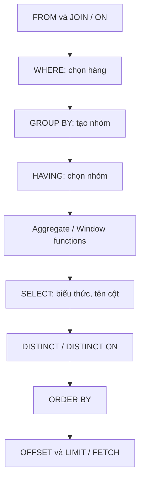

# Thứ tự xử lý logic của truy vấn và các lỗi hiểu nhầm trong PostgreSQL

Khi đọc một câu SQL, chúng ta thường nhìn từ trên xuống dưới: `SELECT`, rồi `FROM`, `WHERE`, `GROUP BY` và `ORDER BY`. Nhưng **thứ tự viết câu lệnh không phải thứ tự xử lý logic**. Sự khác biệt này giải thích nhiều vấn đề thường gặp: vì sao alias ở `SELECT` chưa thể dùng trong `WHERE`, vì sao `WHERE` không nhận hàm tổng hợp, vì sao lọc bảng bên phải trong `LEFT JOIN` có thể làm mất hàng, hoặc vì sao `LIMIT` không bảo đảm lấy được “10 bản ghi mới nhất” nếu thiếu `ORDER BY`.

Trong PostgreSQL, thứ tự logic là **mô hình để hiểu kết quả SQL**. PostgreSQL không bắt buộc thực thi vật lý từng bước đúng như sơ đồ: bộ tối ưu hóa (planner) có thể đẩy điều kiện lọc xuống sớm, đổi thứ tự join, chọn index hoặc thực hiện các phép tính theo kế hoạch tương đương. Bài học sẽ phân biệt hai tầng này, tập trung vào ngữ nghĩa truy vấn `SELECT` và những lỗi thực tế khi đọc, viết và sửa SQL.

## 1. Viết theo một thứ tự, hiểu theo một thứ tự khác

Câu truy vấn thường có dạng:

```sql
SELECT customer_id, COUNT(*) AS order_count
FROM orders
WHERE status = 'paid'
GROUP BY customer_id
HAVING COUNT(*) >= 2
ORDER BY order_count DESC
LIMIT 10;
```

Một mô hình logic dễ học là:

| Giai đoạn | Thành phần | Vai trò |
| --- | --- | --- |
| 1 | `WITH` (nếu có) | Định nghĩa các truy vấn con được đặt tên; việc materialize phụ thuộc ngữ cảnh/optimizer |
| 2 | `FROM`, `JOIN`, `ON` | Xác định nguồn hàng và quan hệ giữa các nguồn |
| 3 | `WHERE` | Lọc **hàng** trước khi gom nhóm |
| 4 | `GROUP BY` | Gom các hàng còn lại thành nhóm |
| 5 | `HAVING` | Lọc **nhóm** sau khi tổng hợp |
| 6 | Tổng hợp và hàm cửa sổ | Hàm tổng hợp hoạt động theo nhóm; hàm cửa sổ hoạt động trên tập hàng sau các bước lọc/nhóm liên quan |
| 7 | Danh sách `SELECT` | Tạo các cột kết quả, đặt tên alias |
| 8 | `DISTINCT` / `DISTINCT ON` | Loại hàng trùng hoặc chọn đại diện theo quy tắc tương ứng |
| 9 | `ORDER BY` | Quy định thứ tự kết quả |
| 10 | `OFFSET`, `LIMIT` / `FETCH` | Bỏ qua và giới hạn số hàng trả về |

Đây là **mô hình khái niệm**, không phải thuật toán cứng mà mỗi phiên bản PostgreSQL phải thi hành. Một số cấu trúc đặc biệt như `UNION`/`INTERSECT`/`EXCEPT`, `LATERAL`, `WINDOW`, locking clause hay subquery có quy tắc riêng được giải thích ở các phần sau.



Điều cốt lõi: muốn biết một điều kiện có hợp lệ và trả kết quả nào, trước hết phải hỏi **tại thời điểm logic đó còn những hàng, nhóm và cột nào?**

## 2. Tạo bộ dữ liệu thực hành

Các ví dụ sau sử dụng schema riêng `query_lab`. Hãy chạy trong database học tập; tên và dữ liệu được đặt cố định để dễ dự đoán kết quả.

```sql
CREATE SCHEMA IF NOT EXISTS query_lab;

CREATE TABLE query_lab.customers (
    customer_id integer PRIMARY KEY,
    customer_name text NOT NULL
);

CREATE TABLE query_lab.orders (
    order_id integer PRIMARY KEY,
    customer_id integer NOT NULL
        REFERENCES query_lab.customers(customer_id),
    status text NOT NULL
        CHECK (status IN ('paid', 'pending', 'cancelled')),
    amount numeric(10, 2) NOT NULL
        CHECK (amount >= 0),
    created_at timestamptz NOT NULL
);

INSERT INTO query_lab.customers(customer_id, customer_name)
VALUES
    (1, 'Alice'),
    (2, 'Bob'),
    (3, 'Carol'),
    (4, 'Dani');

INSERT INTO query_lab.orders
    (order_id, customer_id, status, amount, created_at)
VALUES
    (101, 1, 'paid',      100.00, '2026-11-01T08:00:00Z'),
    (102, 1, 'pending',    50.00, '2026-11-02T08:00:00Z'),
    (103, 2, 'paid',      200.00, '2026-11-03T08:00:00Z'),
    (104, 2, 'cancelled',  30.00, '2026-11-04T08:00:00Z'),
    (105, 4, 'paid',      120.00, '2026-11-05T08:00:00Z');
```

Bảng `customers` có bốn người; Carol chưa có đơn hàng. Bảng `orders` có ba đơn `paid`, một `pending` và một `cancelled`.

| order_id | customer | status | amount |
| --- | --- | --- | ---: |
| 101 | Alice | paid | 100.00 |
| 102 | Alice | pending | 50.00 |
| 103 | Bob | paid | 200.00 |
| 104 | Bob | cancelled | 30.00 |
| 105 | Dani | paid | 120.00 |

Các câu lệnh được trình bày tuần tự trong cùng môi trường thực hành. Nếu đã tạo các bảng đó trước đó, hãy dùng database/schema mới thay vì chèn lại dữ liệu và gây lỗi khóa chính trùng.

## 3. FROM và JOIN: tạo tập hàng ban đầu

Một câu truy vấn nhiều bảng bắt đầu về mặt logic từ các quan hệ được chỉ định ở `FROM`. Ví dụ:

```sql
SELECT c.customer_name, o.order_id, o.amount
FROM query_lab.customers AS c
JOIN query_lab.orders AS o
    ON o.customer_id = c.customer_id
ORDER BY c.customer_id, o.order_id;
```

`INNER JOIN` tạo các hàng từ cặp bản ghi khớp điều kiện `ON`. Trên dữ liệu mẫu có năm hàng kết quả vì mỗi order khớp đúng một customer.

Các ý cần nhớ:

- `JOIN` không tự “gộp thành một hàng cho mỗi customer”. Nếu một customer có hai orders, kết quả có hai hàng.
- `ON` mô tả điều kiện ghép các bảng. Nếu quên điều kiện quan hệ hoặc dùng `CROSS JOIN`, số hàng có thể tăng theo tích số hàng của các bảng.
- Bảng được gọi bằng alias `c` và `o` để phân biệt `customer_id` ở hai bên.
- Các mệnh đề `WHERE` và `GROUP BY` phía sau làm việc trên tập hàng đã được xác định về mặt logic từ `FROM`/`JOIN`.

### 3.1. LEFT JOIN giữ những hàng bên trái chưa có đối tác

```sql
SELECT
    c.customer_name,
    o.order_id
FROM query_lab.customers AS c
LEFT JOIN query_lab.orders AS o
    ON o.customer_id = c.customer_id
ORDER BY c.customer_id, o.order_id;
```

`LEFT JOIN` giữ cả Carol, với `o.order_id IS NULL`. Đây là hàng được *null-extend*: các cột phía `o` không có đối tác phù hợp nên xuất hiện dưới dạng `NULL`.

Với `LEFT JOIN`, diễn biến logic là: tìm cặp khớp điều kiện `ON` rồi **bổ sung những hàng bên trái không khớp**. Điều này lý giải vì sao đặt điều kiện ở `ON` hay `WHERE` có thể cho kết quả khác.

## 4. WHERE lọc hàng trước khi GROUP BY

Câu truy vấn:

```sql
SELECT order_id, customer_id, amount
FROM query_lab.orders
WHERE status = 'paid'
ORDER BY order_id;
```

`WHERE` giữ ba đơn đã thanh toán: 101, 103 và 105. Các đơn `pending` và `cancelled` không đi tiếp vào giai đoạn tổng hợp nếu có `GROUP BY` sau đó.

Nếu muốn tính doanh thu từ đơn đã thanh toán theo khách hàng:

```sql
SELECT customer_id, SUM(amount) AS total_paid
FROM query_lab.orders
WHERE status = 'paid'
GROUP BY customer_id
ORDER BY customer_id;
```

Bảng kết quả gồm Alice 100, Bob 200 và Dani 120; Carol không có order nào nên không có nhóm trong truy vấn xuất phát từ `orders`.

**Lỗi hiểu nhầm số 1:** dùng `WHERE` như bộ lọc trên kết quả tổng hợp.

```sql
-- Sai: aggregate không được dùng trực tiếp trong WHERE cùng cấp.
SELECT customer_id, SUM(amount) AS total_paid
FROM query_lab.orders
WHERE SUM(amount) > 100
GROUP BY customer_id;
```

`SUM(amount)` chỉ được tính sau khi nhóm được hình thành. Để lọc nhóm, dùng `HAVING`.

### 4.1. Điều kiện WHERE có thể trả UNKNOWN

SQL dùng logic ba giá trị: `TRUE`, `FALSE` và `UNKNOWN` (thường do `NULL`). `WHERE` **chỉ giữ hàng khi biểu thức là TRUE**.

```sql
SELECT
    NULL::integer = 1 AS unknown_comparison,
    NULL::integer IS NULL AS known_null_test;
```

Biểu thức thứ nhất trả `NULL`; biểu thức thứ hai trả `TRUE`.

Vì vậy, `WHERE column = NULL` không phải cách tìm các hàng thiếu dữ liệu. Hãy dùng `IS NULL`. Cũng cần cẩn thận với `NOT IN` khi danh sách chứa `NULL`:

```sql
SELECT 5 NOT IN (1, 2, NULL);
-- Kết quả NULL (UNKNOWN), không phải TRUE.
```

## 5. WHERE và ON có vai trò khác nhau với OUTER JOIN

Xem hai truy vấn sau.

**Truy vấn A — lọc phía phải ngay trong ON:**

```sql
SELECT c.customer_name, o.order_id, o.status
FROM query_lab.customers AS c
LEFT JOIN query_lab.orders AS o
    ON o.customer_id = c.customer_id
   AND o.status = 'paid'
ORDER BY c.customer_id, o.order_id;
```

Kết quả gồm Alice 101, Bob 103, Dani 105 và **Carol với order_id NULL**. Điều kiện `o.status = 'paid'` chỉ giới hạn đối tác được nối; `LEFT JOIN` vẫn giữ khách hàng không có đơn phù hợp.

**Truy vấn B — lọc sau LEFT JOIN bằng WHERE:**

```sql
SELECT c.customer_name, o.order_id, o.status
FROM query_lab.customers AS c
LEFT JOIN query_lab.orders AS o
    ON o.customer_id = c.customer_id
WHERE o.status = 'paid'
ORDER BY c.customer_id, o.order_id;
```

Carol biến mất vì `o.status` của hàng không khớp là `NULL`, nên `o.status = 'paid'` trả `UNKNOWN` và bị `WHERE` loại bỏ.

| Vị trí điều kiện | Carol có trong kết quả? | Ý nghĩa |
| --- | --- | --- |
| `ON ... AND o.status = 'paid'` | Có, cột `o.*` là NULL | Giữ mọi customer; chỉ nối đơn đã thanh toán |
| `WHERE o.status = 'paid'` | Không | Chỉ giữ các kết quả đã có đơn đã thanh toán |

Đây là một trong những lỗi phổ biến nhất khi báo cáo dữ liệu có hàng “không có quan hệ”.

Một cách đếm **số đơn paid của tất cả khách hàng, kể cả bằng 0**, là:

```sql
SELECT
    c.customer_id,
    c.customer_name,
    COUNT(o.order_id) AS paid_order_count
FROM query_lab.customers AS c
LEFT JOIN query_lab.orders AS o
    ON o.customer_id = c.customer_id
   AND o.status = 'paid'
GROUP BY c.customer_id, c.customer_name
ORDER BY c.customer_id;
```

Kết quả: Alice 1, Bob 1, Carol 0, Dani 1.

## 6. GROUP BY: chuyển từ các hàng riêng lẻ thành nhóm

Sau `FROM` và `WHERE`, `GROUP BY` gom các hàng có cùng khóa nhóm:

```sql
SELECT
    customer_id,
    COUNT(*) AS order_count,
    SUM(amount) AS total_amount
FROM query_lab.orders
GROUP BY customer_id
ORDER BY customer_id;
```

Kết quả: Alice có hai đơn (tổng 150), Bob hai đơn (tổng 230), Dani một đơn (tổng 120). Không có nhóm cho Carol vì bảng `orders` không chứa hàng của Carol.

Trong truy vấn có `GROUP BY`, các biểu thức trong `SELECT` thường phải là:

- Khóa được nhóm (ví dụ `customer_id`);
- Biểu thức tổng hợp như `COUNT(*)`, `SUM(amount)`, `MAX(created_at)`;
- Biểu thức hợp lệ theo quy tắc phụ thuộc hàm mà PostgreSQL công nhận trong trường hợp tương ứng, chẳng hạn cột phụ thuộc vào khóa chính đã được GROUP BY.

Ví dụ không hợp lệ:

```sql
-- Sai: order_id không thuộc GROUP BY và không được tổng hợp.
SELECT customer_id, order_id, COUNT(*)
FROM query_lab.orders
GROUP BY customer_id;
```

PostgreSQL không thể tự chọn order_id nào đại diện cho nhóm Alice có hai orders.

### 6.1. COUNT(*) và COUNT(column) khác nhau sau LEFT JOIN

```sql
SELECT
    c.customer_name,
    COUNT(*) AS joined_row_count,
    COUNT(o.order_id) AS real_order_count
FROM query_lab.customers AS c
LEFT JOIN query_lab.orders AS o
    ON o.customer_id = c.customer_id
GROUP BY c.customer_id, c.customer_name
ORDER BY c.customer_id;
```

Với Carol:

- `COUNT(*)` cho `1` vì `LEFT JOIN` vẫn tạo một hàng null-extended.
- `COUNT(o.order_id)` cho `0` vì aggregate này bỏ qua các giá trị `NULL` ở cột order_id.

Nếu muốn đếm đơn hàng thật, `COUNT(o.order_id)` hợp lý hơn trong ví dụ này.

### 6.2. Nhóm không giống loại trùng

`GROUP BY customer_id` tạo một nhóm cho mỗi customer_id, nhưng không nhất thiết chỉ làm thao tác giống `DISTINCT customer_id`: nhóm thường được dùng để tính aggregate.

```sql
-- Danh sách khách hàng đã từng có order:
SELECT DISTINCT customer_id
FROM query_lab.orders;

-- Số order của mỗi khách:
SELECT customer_id, COUNT(*)
FROM query_lab.orders
GROUP BY customer_id;
```

Hai kết quả đều có một hàng cho mỗi customer_id trong bảng `orders`, nhưng một bên trả danh sách định danh, bên còn lại tính số lượng.

## 7. HAVING: lọc nhóm sau GROUP BY

`HAVING` áp dụng điều kiện lên nhóm đã hình thành. Ví dụ chọn các khách hàng có từ hai đơn trở lên:

```sql
SELECT
    customer_id,
    COUNT(*) AS order_count
FROM query_lab.orders
GROUP BY customer_id
HAVING COUNT(*) >= 2
ORDER BY customer_id;
```

Alice và Bob được giữ lại; Dani có một đơn nên bị loại.

So sánh:

| `WHERE` | `HAVING` |
| --- | --- |
| Lọc từng hàng trước khi GROUP BY | Lọc nhóm sau khi GROUP BY |
| Không được trực tiếp dùng aggregate của cùng query level | Có thể dùng aggregate như `COUNT`, `SUM` |
| Thường giúp giới hạn hàng đầu vào sớm | Có ý nghĩa đối với kết quả nhóm |
| Ví dụ `WHERE status = 'paid'` | Ví dụ `HAVING SUM(amount) > 100` |

Chọn những khách có **tổng tiền đơn paid** lớn hơn 100:

```sql
SELECT customer_id, SUM(amount) AS total_paid
FROM query_lab.orders
WHERE status = 'paid'
GROUP BY customer_id
HAVING SUM(amount) > 100
ORDER BY total_paid DESC;
```

Kết quả: Bob (200) và Dani (120). Alice tổng paid bằng 100 nên bị loại bởi dấu `>`.

**Lỗi hiểu nhầm số 2:** nghĩ rằng `HAVING` chỉ là phiên bản khác của `WHERE`.

Nếu bạn đặt điều kiện `status = 'paid'` vào `HAVING` mà `status` không nằm trong khóa nhóm hoặc aggregate, PostgreSQL không thể dùng một giá trị status đại diện cho cả nhóm. Điều kiện hàng nên đặt tại `WHERE`; điều kiện nhóm đặt ở `HAVING`.

Một query có aggregate nhưng không có `GROUP BY` vẫn có thể xem toàn bộ tập đầu vào là **một nhóm**, ví dụ:

```sql
SELECT COUNT(*) AS total_orders
FROM query_lab.orders
HAVING COUNT(*) > 0;
```

Khi bảng có dữ liệu, truy vấn trả một hàng; khi điều kiện HAVING không đạt, nó không trả hàng nào, khác với một SELECT COUNT thông thường luôn trả một hàng chứa số 0 cho bảng rỗng.

## 8. SELECT: tên alias chưa có ở WHERE cùng cấp

Tại danh sách `SELECT`, PostgreSQL xác định các cột kết quả và tên alias của chúng:

```sql
SELECT
    amount * 1.1 AS amount_after_markup
FROM query_lab.orders;
```

Có người muốn lọc trực tiếp bằng tên mới:

```sql
-- Sai nếu không có cột đầu vào mang tên amount_after_markup:
SELECT amount * 1.1 AS amount_after_markup
FROM query_lab.orders
WHERE amount_after_markup > 150;
```

Trong mô hình logic, `WHERE` chạy trước giai đoạn danh sách `SELECT` nên alias `amount_after_markup` chưa tồn tại tại vị trí đó. Viết biểu thức trong `WHERE`:

```sql
SELECT
    amount * 1.1 AS amount_after_markup
FROM query_lab.orders
WHERE amount * 1.1 > 150
ORDER BY amount_after_markup DESC;
```

Hoặc dùng truy vấn con để chuyển alias thành cột đầu vào của query level ngoài:

```sql
SELECT *
FROM (
    SELECT
        order_id,
        amount * 1.1 AS amount_after_markup
    FROM query_lab.orders
) AS priced
WHERE priced.amount_after_markup > 150
ORDER BY priced.amount_after_markup DESC;
```

Cách thứ hai đặc biệt tiện khi biểu thức dài hoặc cần dùng lại ở nhiều vị trí trong tầng query bên ngoài.

### 8.1. Alias ở ORDER BY và GROUP BY trong PostgreSQL

PostgreSQL cho phép tham chiếu tên cột đầu ra trong `ORDER BY`:

```sql
SELECT amount * 1.1 AS amount_after_markup
FROM query_lab.orders
ORDER BY amount_after_markup DESC;
```

`GROUP BY` cũng có thể tham chiếu alias đầu ra trong một số trường hợp:

```sql
SELECT
    status AS order_state,
    COUNT(*) AS n
FROM query_lab.orders
GROUP BY order_state
ORDER BY order_state;
```

Nhưng **`HAVING` không được dùng alias đầu ra như một tên cột của cùng tầng truy vấn**:

```sql
-- Sai: n là alias của COUNT(*) trong SELECT cùng cấp.
SELECT status, COUNT(*) AS n
FROM query_lab.orders
GROUP BY status
HAVING n > 1;
```

Cách đúng:

```sql
SELECT status, COUNT(*) AS n
FROM query_lab.orders
GROUP BY status
HAVING COUNT(*) > 1;
```

Một ngoại lệ tên dễ gây nhầm: khi alias đầu ra trùng tên cột đầu vào, PostgreSQL có **quy tắc phân giải khác nhau** giữa `ORDER BY` và `GROUP BY`. Với tên đơn giản bị mơ hồ, `ORDER BY` ưu tiên tên đầu ra, còn `GROUP BY` ưu tiên tên đầu vào. Để tránh lỗi khó đọc, hãy dùng alias không trùng với cột nguồn hoặc viết biểu thức rõ ràng.

### 8.2. Dùng vị trí cột trong ORDER BY/GROUP BY

PostgreSQL hỗ trợ vị trí cột theo số thứ tự trong một số mệnh đề:

```sql
SELECT status, COUNT(*) AS n
FROM query_lab.orders
GROUP BY 1
ORDER BY 2 DESC, 1;
```

`GROUP BY 1` nhóm theo biểu thức đầu tiên trong danh sách `SELECT` (`status`); `ORDER BY 2` sắp theo cột thứ hai (`n`).

Cú pháp này ngắn nhưng dễ hỏng ý nghĩa khi thêm hoặc đổi thứ tự cột `SELECT`. Trong tài liệu và mã nguồn vận hành dài hạn, dùng tên/biểu thức rõ ràng thường dễ bảo trì hơn.

## 9. Hàm tổng hợp và hàm cửa sổ không cùng thời điểm logic

Hàm tổng hợp (`COUNT`, `SUM`, `AVG`...) làm việc theo nhóm hoặc toàn bộ tập hàng. Hàm cửa sổ (`ROW_NUMBER`, `RANK`, `SUM(...) OVER (...)`...) tạo kết quả trên **các hàng còn lại sau WHERE/GROUP BY/HAVING**, trong các phân vùng và thứ tự cửa sổ được chỉ định.

### 9.1. Window function không làm mất số hàng như GROUP BY

```sql
SELECT
    order_id,
    customer_id,
    amount,
    ROW_NUMBER() OVER (
        PARTITION BY customer_id
        ORDER BY created_at DESC, order_id DESC
    ) AS order_rank
FROM query_lab.orders
ORDER BY customer_id, order_rank;
```

Kết quả vẫn có năm hàng, mỗi order có một số thứ tự trong nhóm customer. Điều này khác với `GROUP BY customer_id` chỉ còn một hàng cho mỗi customer trong ví dụ tổng hợp.

### 9.2. Window function không thể được lọc trực tiếp tại WHERE cùng cấp

```sql
-- Sai: window function không được dùng ở WHERE.
SELECT
    order_id,
    ROW_NUMBER() OVER (
        PARTITION BY customer_id ORDER BY created_at DESC
    ) AS rn
FROM query_lab.orders
WHERE rn = 1;
```

Giải pháp là một tầng truy vấn con:

```sql
SELECT order_id, customer_id, amount, created_at
FROM (
    SELECT
        o.*,
        ROW_NUMBER() OVER (
            PARTITION BY customer_id
            ORDER BY created_at DESC, order_id DESC
        ) AS rn
    FROM query_lab.orders AS o
) AS ranked
WHERE rn = 1
ORDER BY customer_id;
```

Kết quả là order mới nhất của Alice (102), Bob (104) và Dani (105). Với hai order cùng thời gian, `order_id DESC` được thêm làm tiêu chí phá hòa để kết quả có thể dự đoán được.

PostgreSQL cho phép window functions trong danh sách `SELECT` và `ORDER BY` ở vị trí phù hợp, nhưng không cho dùng trực tiếp trong `WHERE`, `GROUP BY` hay `HAVING` của cùng query level. Nếu cần lọc theo kết quả window, hãy tạo query level ngoài.

### 9.3. GROUP BY/HAVING trước kết quả window

Giả sử muốn xếp hạng khách hàng theo tổng tiền đơn paid:

```sql
SELECT
    customer_id,
    SUM(amount) AS total_paid,
    RANK() OVER (ORDER BY SUM(amount) DESC) AS revenue_rank
FROM query_lab.orders
WHERE status = 'paid'
GROUP BY customer_id
HAVING SUM(amount) > 0
ORDER BY revenue_rank, customer_id;
```

Hàm cửa sổ làm việc trên các hàng kết quả tổng hợp còn lại, không trên từng order ban đầu. Ở đây Bob hạng 1, Dani hạng 2, Alice hạng 3.

**Chú ý:** `ORDER BY` bên trong `OVER (...)` điều khiển thứ tự **tính window function**; nó không tự bảo đảm thứ tự hiển thị cuối cùng. Muốn kết quả đầu ra được sắp đúng thứ tự, thêm `ORDER BY` ở cấp truy vấn ngoài như ví dụ.

## 10. DISTINCT được áp dụng lên các cột kết quả

`SELECT DISTINCT` loại các hàng trùng nhau trong tập các cột được `SELECT`:

```sql
SELECT DISTINCT status
FROM query_lab.orders
ORDER BY status;
```

Kết quả có ba giá trị `cancelled`, `paid` và `pending`.

Nhưng truy vấn này không có nghĩa “một order đại diện cho mỗi customer”:

```sql
SELECT DISTINCT customer_id, order_id
FROM query_lab.orders;
```

Vì `order_id` đã khác nhau ở từng hàng, cả năm hàng vẫn được giữ. `DISTINCT` xét **toàn bộ biểu thức được chọn**, không chỉ một cột mà người viết đang quan tâm.

### 10.1. DISTINCT ON là tính năng riêng của PostgreSQL

PostgreSQL có `DISTINCT ON`, cho phép giữ một hàng đại diện cho mỗi giá trị của các biểu thức chỉ định:

```sql
SELECT DISTINCT ON (customer_id)
    customer_id, order_id, created_at
FROM query_lab.orders
ORDER BY customer_id, created_at DESC, order_id DESC;
```

Với bộ dữ liệu mẫu, mỗi customer có order gần nhất. Để chọn hàng đại diện có ý nghĩa, cần `ORDER BY` xác định:

- Các biểu thức trong `DISTINCT ON (...)` phải phù hợp với các biểu thức đứng đầu `ORDER BY`.
- Các khóa sắp xếp tiếp theo xác định hàng nào được ưu tiên giữ trong mỗi nhóm.
- Nếu các khóa sắp xếp vẫn bằng nhau, không được giả định PostgreSQL luôn chọn cùng một hàng; thêm khóa phụ duy nhất khi cần kết quả ổn định.

`DISTINCT ON` không tương đương `GROUP BY` và không thay thế aggregate nếu bạn muốn tính tổng/số lượng.

### 10.2. DISTINCT và ORDER BY không thể kết hợp tùy ý

Trong PostgreSQL, khi dùng `SELECT DISTINCT` thông thường, biểu thức `ORDER BY` phải thuộc danh sách biểu thức được chọn theo quy tắc của cú pháp. Ví dụ:

```sql
-- Không hợp lệ trong PostgreSQL SELECT DISTINCT thông thường:
SELECT DISTINCT customer_id
FROM query_lab.orders
ORDER BY created_at;
```

Vì mỗi customer có nhiều `created_at`, còn kết quả đã gom thành một customer_id, database không có một created_at duy nhất để quyết định thứ tự. Muốn sắp theo thời điểm order mới nhất, hãy tổng hợp trước:

```sql
SELECT customer_id, MAX(created_at) AS last_order_at
FROM query_lab.orders
GROUP BY customer_id
ORDER BY last_order_at DESC, customer_id;
```

## 11. ORDER BY: SQL không hứa thứ tự khi bạn không yêu cầu

Một câu truy vấn không có `ORDER BY` **không được bảo đảm** trả hàng theo thứ tự chèn, theo khóa chính, theo index hay theo thứ tự lần chạy trước.

```sql
-- Thứ tự kết quả không được đảm bảo:
SELECT order_id, created_at
FROM query_lab.orders;
```

Muốn 3 đơn mới nhất:

```sql
SELECT order_id, created_at
FROM query_lab.orders
ORDER BY created_at DESC, order_id DESC
LIMIT 3;
```

Dữ liệu mẫu trả 105, 104, 103. Dùng `order_id` làm tiêu chí phụ khi `created_at` trùng để lựa chọn ba hàng đầu có quy tắc rõ ràng.

**Lỗi hiểu nhầm số 3:** nghĩ rằng `ORDER BY` bên trong một subquery/CTE luôn áp đặt thứ tự cho truy vấn bên ngoài.

```sql
WITH sorted_orders AS (
    SELECT order_id, amount
    FROM query_lab.orders
    ORDER BY amount DESC
)
SELECT *
FROM sorted_orders;
```

Nếu truy vấn ngoài không có `ORDER BY`, không nên coi kết quả đã được bảo đảm có thứ tự cuối cùng. Hãy đặt `ORDER BY` ở cấp kết quả cần xuất:

```sql
WITH sorted_orders AS (
    SELECT order_id, amount
    FROM query_lab.orders
)
SELECT *
FROM sorted_orders
ORDER BY amount DESC, order_id;
```

Trường hợp sắp xếp có `LIMIT` bên trong truy vấn con mang ý nghĩa riêng: nó quyết định tập hàng con được chọn, nhưng **vẫn không bảo đảm thứ tự trình bày cuối cùng của truy vấn ngoài**.

### 11.1. NULLS FIRST và NULLS LAST

PostgreSQL cho phép quy định thứ tự của `NULL`:

```sql
SELECT customer_id, created_at
FROM query_lab.orders
ORDER BY created_at DESC NULLS LAST, order_id DESC;
```

Khi `ORDER BY col ASC`, PostgreSQL mặc định `NULLS LAST`; với `DESC`, mặc định `NULLS FIRST`. Dùng `NULLS LAST` tường minh khi dữ liệu thiếu không được ưu tiên lên đầu danh sách.

## 12. LIMIT và OFFSET: cắt tập kết quả sau khi xác định thứ tự

`LIMIT` chỉ giới hạn **số hàng trả về**, không tự biến truy vấn thành “mới nhất”, “lớn nhất” hay “đúng thứ tự khóa chính”.

```sql
-- Bất kỳ hai hàng nào được chọn theo kế hoạch hiện tại đều có thể xuất hiện:
SELECT order_id
FROM query_lab.orders
LIMIT 2;
```

Cách có ý nghĩa hơn:

```sql
SELECT order_id, created_at
FROM query_lab.orders
ORDER BY created_at DESC, order_id DESC
LIMIT 2 OFFSET 1;
```

Kết quả trên dữ liệu mẫu: bỏ qua order 105, lấy hai order 104 và 103.

### 12.1. OFFSET lớn có thể chậm và thiếu ổn định khi dữ liệu đổi

Phân trang bằng `OFFSET 100000 LIMIT 20` thường phải đi qua nhiều hàng trước khi bỏ chúng; chi phí tăng theo vị trí trang. Nếu giữa hai lần gọi có insert/delete, hàng có thể chuyển vị trí, dẫn đến trùng hoặc thiếu hàng giữa các trang.

**Keyset pagination** thường phù hợp hơn khi thứ tự đã xác định bằng cặp khóa:

```sql
-- Tìm trang tiếp theo sau hàng có mốc
-- (created_at, order_id) = ('2026-11-04T08:00:00Z', 104).
SELECT order_id, created_at
FROM query_lab.orders
WHERE (created_at, order_id)
      < ('2026-11-04T08:00:00Z'::timestamptz, 104)
ORDER BY created_at DESC, order_id DESC
LIMIT 20;
```

Điều kiện so sánh tuple khớp với thứ tự giảm dần của hai cột và chỉ áp dụng khi các cột khóa dùng trong cursor có kiểu/semantics phù hợp. Cần index theo mẫu truy vấn và chính sách xử lý dữ liệu đổi nếu yêu cầu phân trang nhất quán lâu dài.

### 12.2. LIMIT không làm toàn bộ truy vấn rẻ đi theo cùng một cách

Nếu truy vấn phải tính tổng cho mọi nhóm, sắp xếp toàn bộ kết quả hoặc thực hiện phép join lớn, `LIMIT 10` không có nghĩa PostgreSQL chỉ xử lý 10 hàng từ bảng gốc. Planner có thể tối ưu với top-N hoặc index phù hợp, nhưng chi phí thực phụ thuộc kế hoạch.

Muốn biết thực tế, cần `EXPLAIN` hoặc `EXPLAIN (ANALYZE, BUFFERS)` trên môi trường được phép và dữ liệu đại diện.

## 13. Theo dõi một truy vấn từ đầu đến cuối

Xét mục tiêu: “Tìm hai khách hàng có **tổng tiền đơn đã thanh toán lớn nhất**, với tổng tiền phải lớn hơn 100”.

```sql
SELECT
    c.customer_id,
    c.customer_name,
    COUNT(o.order_id) AS paid_orders,
    SUM(o.amount) AS total_paid
FROM query_lab.customers AS c
JOIN query_lab.orders AS o
    ON o.customer_id = c.customer_id
WHERE o.status = 'paid'
GROUP BY c.customer_id, c.customer_name
HAVING SUM(o.amount) > 100
ORDER BY total_paid DESC, c.customer_id
LIMIT 2;
```

Dõi theo từng giai đoạn logic:

| Giai đoạn | Tập dữ liệu còn lại |
| --- | --- |
| `FROM / JOIN` | 5 cặp customer–order |
| `WHERE status = 'paid'` | 3 cặp: Alice–101, Bob–103, Dani–105 |
| `GROUP BY` | 3 nhóm theo customer |
| `HAVING SUM(amount) > 100` | 2 nhóm: Bob (200), Dani (120) |
| `SELECT` | Tạo cột customer_id, customer_name, paid_orders, total_paid |
| `ORDER BY total_paid DESC` | Bob trước Dani |
| `LIMIT 2` | Trả 2 hàng: Bob và Dani |

Kết quả cuối:

| customer_id | customer_name | paid_orders | total_paid |
| ---: | --- | ---: | ---: |
| 2 | Bob | 1 | 200.00 |
| 4 | Dani | 1 | 120.00 |

Truy vấn này minh họa rõ lý do `WHERE` và `HAVING` không thay thế nhau: nếu lọc `status` sau khi tính tổng tất cả order, tổng tiền Alice/Bob sẽ mang ý nghĩa hoàn toàn khác.

## 14. Truy vấn con và CTE tạo các tầng tên cột riêng

Một CTE (`WITH`) hoặc subquery là cách đặt tên cho một kết quả trung gian để truy vấn ngoài có thể xử lý tiếp.

```sql
WITH customer_totals AS (
    SELECT
        customer_id,
        SUM(amount) AS total_paid
    FROM query_lab.orders
    WHERE status = 'paid'
    GROUP BY customer_id
)
SELECT customer_id, total_paid
FROM customer_totals
WHERE total_paid > 100
ORDER BY total_paid DESC;
```

Alias `total_paid` xuất hiện trong `SELECT` của CTE, nhưng đối với truy vấn **bên ngoài**, nó là cột đầu vào từ `FROM customer_totals`; do đó `WHERE total_paid > 100` hợp lệ.

**Lỗi hiểu nhầm số 4:** “CTE luôn được tính, ghi ra bảng tạm rồi mới chạy query ngoài”.

Trong PostgreSQL hiện đại, một CTE `SELECT` không có tác dụng phụ có thể được **inline/fold** vào truy vấn ngoài khi điều kiện cho phép. Một số CTE có thể được materialize, và có các tùy chọn `MATERIALIZED`/`NOT MATERIALIZED` trên phiên bản hỗ trợ. Vì thế, CTE trước hết là **ranh giới tổ chức và đặt tên logic**, không tự bảo đảm một bước materialization hay tối ưu hiệu năng.

### 14.1. Mỗi tầng SELECT có phạm vi alias riêng

```sql
SELECT t.order_id, t.amount_with_tax
FROM (
    SELECT
        order_id,
        amount * 1.1 AS amount_with_tax
    FROM query_lab.orders
) AS t
WHERE t.amount_with_tax > 150;
```

Ở tầng trong, `amount_with_tax` là alias đầu ra. Ở tầng ngoài, nó là cột của bảng dẫn xuất `t`. Đọc SQL theo tầng giúp xử lý chính xác những lỗi “column does not exist”.

## 15. LATERAL: trường hợp nguồn FROM phụ thuộc từng hàng trước đó

`LATERAL` cho phép một subquery trong `FROM` tham chiếu các cột từ nguồn đứng trước cùng `FROM`. Đây là mẫu hữu ích để lấy “một vài bản ghi mới nhất của mỗi parent”:

```sql
SELECT
    c.customer_id,
    c.customer_name,
    recent.order_id,
    recent.created_at
FROM query_lab.customers AS c
LEFT JOIN LATERAL (
    SELECT o.order_id, o.created_at
    FROM query_lab.orders AS o
    WHERE o.customer_id = c.customer_id
    ORDER BY o.created_at DESC, o.order_id DESC
    LIMIT 1
) AS recent ON TRUE
ORDER BY c.customer_id;
```

Ý nghĩa logic: với từng customer bên trái, subquery `LATERAL` được đánh giá với customer_id tương ứng và chọn order gần nhất; `LEFT JOIN` vẫn giữ Carol có `recent.order_id = NULL`.

Đây là ví dụ cho thấy mô hình “FROM trước” vẫn có các **phụ thuộc nội bộ trong FROM**. Không được chuyển `WHERE o.customer_id = c.customer_id` ra ngoài LATERAL mà không xét thay đổi ngữ nghĩa.

## 16. UNION, INTERSECT và EXCEPT là các phép kết hợp kết quả

Khi dùng set operations, mỗi nhánh `SELECT` có tập kết quả riêng. Sau đó PostgreSQL kết hợp các nhánh theo toán tử được chọn:

```sql
-- Các customer_id xuất hiện trong orders paid hoặc pending.
SELECT customer_id
FROM query_lab.orders
WHERE status = 'paid'

UNION

SELECT customer_id
FROM query_lab.orders
WHERE status = 'pending'
ORDER BY customer_id;
```

`UNION` loại trùng theo các cột kết quả kết hợp, còn `UNION ALL` giữ trùng. `INTERSECT` giữ các hàng có ở cả hai phía và `EXCEPT` giữ những hàng phía trái không có ở phía phải, theo ngữ nghĩa set tương ứng.

Các phép set kết hợp các **hàng kết quả tương ứng về số cột và kiểu dữ liệu**, không dựa vào tên bảng nguồn. `ORDER BY` và `LIMIT` đặt sau một set operation không có dấu ngoặc tương ứng có thể áp dụng cho **kết quả kết hợp**, thay vì riêng một nhánh. Nếu muốn giới hạn/sắp xếp từng nhánh trước khi `UNION`, phải dùng dấu ngoặc hoặc subquery theo cú pháp phù hợp.

```sql
(
    SELECT order_id, created_at
    FROM query_lab.orders
    WHERE customer_id = 1
    ORDER BY created_at DESC, order_id DESC
    LIMIT 1
)
UNION ALL
(
    SELECT order_id, created_at
    FROM query_lab.orders
    WHERE customer_id = 2
    ORDER BY created_at DESC, order_id DESC
    LIMIT 1
)
ORDER BY created_at DESC, order_id DESC;
```

`UNION`/`INTERSECT`/`EXCEPT` có quy tắc ưu tiên toán tử và giới hạn cú pháp riêng; với truy vấn phức tạp nên dùng dấu ngoặc rõ ràng thay vì đoán thứ tự.

## 17. Thứ tự logic không phải thứ tự thực thi vật lý

Đây là phân biệt quan trọng khi phân tích hiệu năng. Nếu bạn viết:

```sql
SELECT
    c.customer_name,
    SUM(o.amount) AS revenue
FROM query_lab.customers AS c
JOIN query_lab.orders AS o
    ON o.customer_id = c.customer_id
WHERE o.status = 'paid'
GROUP BY c.customer_id, c.customer_name
ORDER BY revenue DESC;
```

Bạn có thể giải thích kết quả bằng thứ tự logic. Nhưng PostgreSQL có thể dùng index để đọc chỉ các order `paid`, dùng hash join hoặc nested loop thay vì join theo một thứ tự tưởng tượng, thực hiện hash aggregate hoặc sort aggregate, rồi sort/limit theo chiến lược phù hợp.

```sql
EXPLAIN
SELECT
    c.customer_name,
    SUM(o.amount) AS revenue
FROM query_lab.customers AS c
JOIN query_lab.orders AS o
    ON o.customer_id = c.customer_id
WHERE o.status = 'paid'
GROUP BY c.customer_id, c.customer_name
ORDER BY revenue DESC;
```

`EXPLAIN` mô tả **kế hoạch vật lý**, không hiển thị nguyên một chuỗi “FROM → WHERE → GROUP BY → SELECT” như bảng ở phần 1. Tên node như `Seq Scan`, `Index Scan`, `Hash Join`, `Aggregate`, `Sort` cho biết cách thực hiện mà planner đã chọn.

`EXPLAIN (ANALYZE, BUFFERS)` thực sự chạy truy vấn để ghi lại số hàng, thời gian và thông tin buffer; với câu lệnh làm thay đổi dữ liệu, nó cũng thực thi thay đổi nếu không được kiểm soát bằng transaction/rollback. Chỉ dùng khi hiểu rõ tác động.

### 17.1. PostgreSQL có thể đổi thứ tự đánh giá các điều kiện

Một sai lầm nguy hiểm là dựa vào `AND`/`OR` để “bảo đảm” một biểu thức không bao giờ được tính trước một biểu thức khác:

```sql
-- Không nên dựa vào thứ tự đọc từ trái sang phải để tránh chia cho 0:
SELECT 100 / amount
FROM query_lab.orders
WHERE amount <> 0
  AND 100 / amount > 2;
```

Optimizer được phép tổ chức việc kiểm tra biểu thức theo cách phù hợp với ngữ nghĩa SQL, và thứ tự đánh giá boolean không phải hàng rào xử lý lỗi đáng tin cậy. Cách an toàn, biểu đạt đúng ý nghĩa là:

```sql
SELECT 100 / NULLIF(amount, 0) AS ratio
FROM query_lab.orders
WHERE 100 / NULLIF(amount, 0) > 2;
```

`NULLIF(amount, 0)` trả `NULL` khi amount bằng 0, nên phép chia không tạo lỗi chia cho 0 trong trường hợp ấy. Với biểu thức phức tạp khác, `CASE` có thể diễn đạt lựa chọn có điều kiện, nhưng vẫn cần hiểu giới hạn tối ưu hóa/hằng số và giá trị có thể tính ở thời điểm lập kế hoạch.

Một hệ quả khác: **không viết SQL dựa trên giả định hàm có side effect sẽ được gọi đúng một lần theo thứ tự vị trí trong `WHERE`**. Planner có thể loại bỏ, lặp hoặc sắp xếp lại việc đánh giá biểu thức khi hợp lệ. Các hàm `VOLATILE` có những ràng buộc tối ưu hóa riêng; không nên xem chúng là lý do để đặt logic nghiệp vụ phụ thuộc vào thứ tự đánh giá không được bảo đảm.

## 18. Các lỗi hiểu nhầm phổ biến và cách sửa

| Hiểu nhầm | Hậu quả | Cách viết đúng hoặc cách suy nghĩ |
| --- | --- | --- |
| `SELECT` luôn được xử lý đầu tiên | Dùng alias mới tạo trong `WHERE` gây lỗi | `WHERE` xử lý trên cột đầu vào; dùng biểu thức hoặc subquery |
| `WHERE COUNT(*) > 1` là hợp lệ | Aggregate chưa có ở bước WHERE | `GROUP BY ... HAVING COUNT(*) > 1` |
| `HAVING` và `WHERE` giống nhau | Tính tổng trên sai tập hàng hoặc tham chiếu cột chưa nhóm | WHERE lọc hàng; HAVING lọc nhóm |
| `LEFT JOIN` luôn giữ mọi hàng trái, bất kể WHERE | WHERE trên cột phải loại hàng null-extended | Đặt điều kiện lọc đối tác vào ON khi muốn giữ hàng trái |
| `COUNT(*)` luôn đếm số hàng bảng phải | Hàng null-extended cũng được đếm | Dùng `COUNT(right_table.primary_key)` để đếm hàng khớp |
| `GROUP BY` cho phép SELECT cột bất kỳ | Truy vấn lỗi hoặc ngữ nghĩa không xác định | Chỉ chọn khóa nhóm, aggregate, hoặc biểu thức hợp lệ theo quy tắc phụ thuộc hàm |
| `DISTINCT customer_id, order_id` giữ một dòng/customer | Cặp cột khác nhau nên không bị loại | Chọn đúng tập cột hoặc dùng `DISTINCT ON`/window |
| `ORDER BY` trong `OVER` sắp đầu ra | Kết quả hiển thị có thể khác thứ tự mong muốn | Dùng `ORDER BY` ngoài cùng |
| `LIMIT 10` lấy 10 bản ghi mới nhất | Không có thứ tự được bảo đảm | `ORDER BY created_at DESC, id DESC LIMIT 10` |
| CTE luôn được materialize | Đánh giá sai hiệu năng hoặc số lần tính | Xem phiên bản, tùy chọn và kế hoạch thực thi |
| `NOT IN` với NULL luôn trả TRUE/FALSE | Có hàng không được chọn do UNKNOWN | Dùng `NOT EXISTS` khi phù hợp, xử lý NULL rõ |
| Thứ tự điều kiện trong `WHERE` bảo vệ khỏi lỗi | Planner có thể đánh giá biểu thức theo thứ tự khác | Dùng `NULLIF`/`CASE` và kiểm soát dữ liệu |
| `EXPLAIN` chính là thứ tự logic | Nhầm physical plan với kết quả SQL | Tách ngữ nghĩa logic và kế hoạch thực thi |

## 19. Bài thực hành theo từng cấp độ

Dùng bộ dữ liệu `query_lab.customers` và `query_lab.orders` đã tạo ở phần 2.

### Bài 1 — Lọc trước khi nhóm

Viết truy vấn đếm số order `paid` của mỗi customer có ít nhất một order paid, sắp theo customer_id. Hãy dự đoán bảng kết quả trước khi chạy.

```sql
SELECT customer_id, COUNT(*) AS paid_count
FROM query_lab.orders
WHERE status = 'paid'
GROUP BY customer_id
ORDER BY customer_id;
```

Câu hỏi: vì sao Carol không có trong kết quả, dù Carol có trong bảng `customers`?

### Bài 2 — Giữ customer không có order

Sửa bài 1 để trả cả Carol với `paid_count = 0`, bằng `LEFT JOIN` và điều kiện `status = 'paid'` ở `ON`.

```sql
SELECT
    c.customer_id,
    c.customer_name,
    COUNT(o.order_id) AS paid_count
FROM query_lab.customers AS c
LEFT JOIN query_lab.orders AS o
    ON o.customer_id = c.customer_id
   AND o.status = 'paid'
GROUP BY c.customer_id, c.customer_name
ORDER BY c.customer_id;
```

### Bài 3 — WHERE và HAVING

Tìm những customer có tổng `amount` của order đã thanh toán lớn hơn 100. Dự đoán vì sao Alice bị loại dù có một order `pending` trị giá 50.

```sql
SELECT customer_id, SUM(amount) AS total_paid
FROM query_lab.orders
WHERE status = 'paid'
GROUP BY customer_id
HAVING SUM(amount) > 100
ORDER BY total_paid DESC;
```

### Bài 4 — Alias trong WHERE

Thử đọc và giải thích lỗi của truy vấn sau:

```sql
SELECT order_id, amount * 1.1 AS gross_amount
FROM query_lab.orders
WHERE gross_amount > 150;
```

Sửa bằng một truy vấn con để `gross_amount` trở thành cột đầu vào của query ngoài.

### Bài 5 — Chọn bản ghi gần nhất theo nhóm

Dùng hai cách riêng:

1. `ROW_NUMBER() OVER (PARTITION BY customer_id ORDER BY created_at DESC, order_id DESC)` và query ngoài lọc `rn = 1`.
2. `DISTINCT ON (customer_id) ... ORDER BY customer_id, created_at DESC, order_id DESC`.

Giải thích vì sao cả hai cần khóa phụ `order_id` để phá hòa khi có hai order cùng `created_at`.

### Bài 6 — Phân trang

Lấy hai order mới nhất bằng `ORDER BY created_at DESC, order_id DESC LIMIT 2`. Sau đó lấy trang tiếp theo bằng `OFFSET 2`. Nếu dữ liệu mới được insert trước lần lấy trang 2, phân tích nguy cơ trùng/thiếu và đề xuất một cursor keyset phù hợp.

### Bài 7 — Quan sát EXPLAIN

```sql
EXPLAIN
SELECT customer_id, SUM(amount) AS total_paid
FROM query_lab.orders
WHERE status = 'paid'
GROUP BY customer_id
ORDER BY total_paid DESC;
```

Ghi lại node scan, aggregate và sort mà PostgreSQL chọn. So sánh kế hoạch vật lý quan sát được với các giai đoạn logic; giải thích vì sao tên node và thứ tự hiển thị của plan không bắt buộc giống thứ tự mệnh đề trong SQL.

## 20. Ghi nhớ khi đọc và viết SELECT

- `FROM`/`JOIN` tạo nguồn hàng; `ON` xác định cặp ghép; `WHERE` lọc hàng **sau khi quan hệ join được hình thành về mặt logic**. Với outer join, vị trí điều kiện có thể đổi kết quả.
- `GROUP BY` tạo nhóm và `HAVING` lọc nhóm. Aggregate không được dùng trực tiếp trong `WHERE` của cùng tầng.
- Danh sách `SELECT` tạo biểu thức và alias đầu ra; alias đó không xuất hiện trong `WHERE` cùng tầng. Truy vấn ngoài hoặc CTE tạo một tầng phạm vi tên mới.
- Window function đánh giá trên tập hàng tương ứng sau lọc/nhóm; muốn lọc theo kết quả window, dùng subquery/CTE.
- `DISTINCT` loại trùng theo các biểu thức kết quả, còn `DISTINCT ON` của PostgreSQL giữ một hàng đại diện theo `ORDER BY` đã chỉ rõ.
- `ORDER BY` ngoài cùng quyết định thứ tự được cam kết cho kết quả, và `LIMIT`/`OFFSET` không thay thế nó. Để kết quả ổn định, bổ sung tiêu chí phá hòa khi cần.
- PostgreSQL có thể chọn kế hoạch vật lý khác trình tự logic để tối ưu truy vấn. `EXPLAIN` trả lời “database định thực hiện thế nào”, còn mô hình logic trả lời “truy vấn phải có nghĩa gì”.
- Không dựa vào thứ tự đánh giá của các toán hạng Boolean để ngăn lỗi; dùng biểu thức an toàn như `NULLIF` hoặc điều kiện được mô hình hóa rõ ràng.

Đọc SQL bằng thứ tự xử lý logic giúp giải thích kết quả đúng, phát hiện lỗi lọc/nhóm/join từ sớm và tránh nhầm một tối ưu hóa vật lý với ngữ nghĩa dữ liệu. Khi biết mỗi mệnh đề đang xử lý **hàng, nhóm hay kết quả đã chiếu**, việc thiết kế và kiểm tra truy vấn PostgreSQL sẽ trở nên dễ dự đoán hơn.
