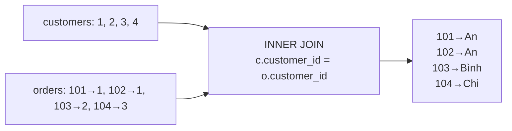
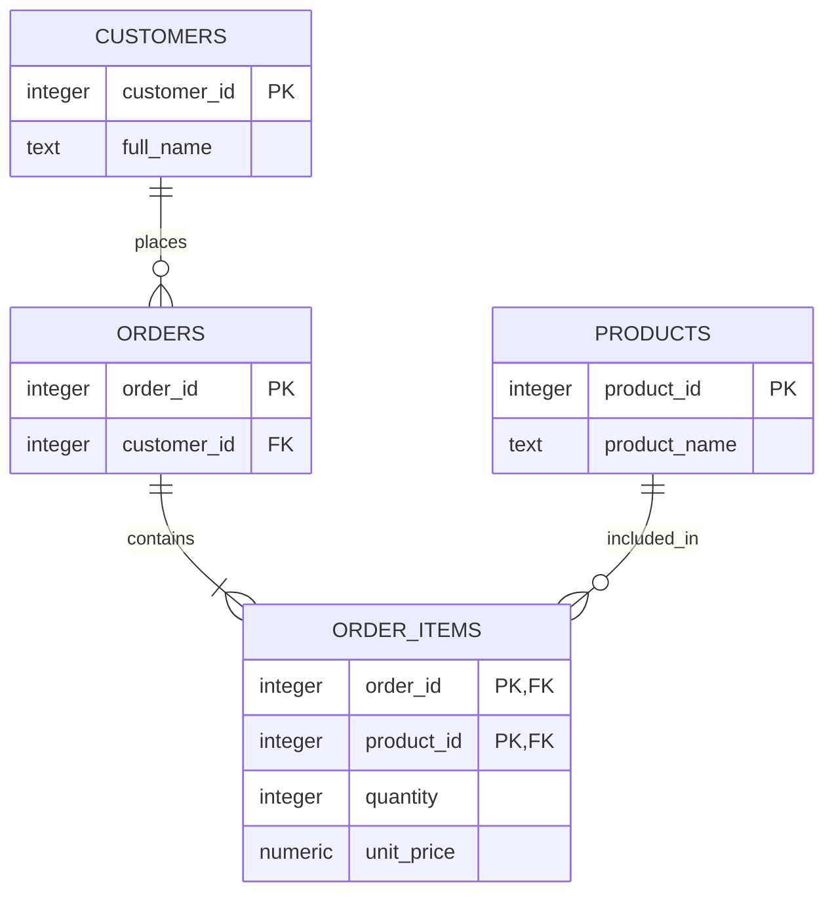

# INNER JOIN và điều kiện kết nối trong PostgreSQL

Trong hệ quản trị cơ sở dữ liệu quan hệ, thông tin nghiệp vụ thường được chia thành nhiều bảng để tránh lặp và bảo vệ tính nhất quán. Một đơn hàng nằm trong bảng `orders`, còn tên và thông tin khách hàng nằm trong bảng `customers`. Khi cần trả về “mã đơn, ngày đặt và tên khách”, truy vấn phải **kết hợp hàng từ nhiều bảng**.

**`INNER JOIN`** là phép kết nối chỉ giữ những tổ hợp hàng **thỏa điều kiện nối**. Đây là một trong những kỹ năng SQL quan trọng nhất vì nó giúp khôi phục các mối quan hệ được biểu diễn qua khóa chính, khóa ngoại hoặc các thuộc tính có ý nghĩa liên kết.

Bài học tập trung vào cú pháp `INNER JOIN ... ON`, ý nghĩa của biểu thức nối, `USING`, sự khác nhau giữa điều kiện nối và điều kiện lọc, ảnh hưởng của `NULL`, tính bội số của kết quả, cách nối nhiều bảng, khóa ghép và cách đọc kế hoạch `EXPLAIN` trên PostgreSQL.

## 1. Mô hình tư duy của INNER JOIN

Giả sử có hai bảng:

**`customers`**

| customer_id | full_name |
| ---: | --- |
| 1 | An |
| 2 | Bình |
| 3 | Chi |
| 4 | Dũng |

**`orders`**

| order_id | customer_id | status |
| ---: | ---: | --- |
| 101 | 1 | PAID |
| 102 | 1 | PENDING |
| 103 | 2 | PAID |
| 104 | 3 | PAID |

Ta muốn tìm khách của từng đơn:

```sql
SELECT
    o.order_id,
    c.full_name,
    o.status
FROM customers AS c
INNER JOIN orders AS o
    ON c.customer_id = o.customer_id
ORDER BY o.order_id;
```

Kết quả:

| order_id | full_name | status |
| ---: | --- | --- |
| 101 | An | PAID |
| 102 | An | PENDING |
| 103 | Bình | PAID |
| 104 | Chi | PAID |

**Khách Dũng không xuất hiện** vì không có đơn nào của khách này. `INNER JOIN` không bổ sung một hàng “đơn NULL” cho khách không có đơn. Muốn giữ cả khách chưa mua, cần `LEFT JOIN`; đó là phép nối có ngữ nghĩa khác.



Một cách hiểu logic: PostgreSQL xét các tổ hợp hàng hai phía, giữ những tổ hợp mà biểu thức `ON` có kết quả **TRUE**. Cách hiện thực thực tế không nhất thiết dựng toàn bộ tích Descartes rồi lọc; planner có thể sử dụng index, hash join hoặc merge join để tìm các cặp phù hợp hiệu quả hơn.

## 2. Cú pháp cơ bản

Khuôn mẫu:

```sql
SELECT
    alias_a.column_name,
    alias_b.other_column
FROM table_a AS alias_a
INNER JOIN table_b AS alias_b
    ON alias_a.join_key = alias_b.join_key;
```

Các thành phần:

| Thành phần | Vai trò |
| --- | --- |
| `FROM table_a AS alias_a` | Nguồn dữ liệu thứ nhất và bí danh của nó |
| `INNER JOIN table_b AS alias_b` | Nguồn dữ liệu thứ hai cần kết hợp |
| `ON ...` | **Điều kiện chọn cặp hàng** để tạo kết quả |
| `SELECT ...` | Chọn cột/biểu thức trả về |
| `WHERE ...` | Lọc những hàng trong kết quả logic của phép nối |
| `ORDER BY ...` | Quy định thứ tự hiển thị cuối cùng |

Trong PostgreSQL, viết `JOIN` đơn lẻ trong ngữ cảnh này là viết tắt của `INNER JOIN`:

```sql
SELECT o.order_id, c.full_name
FROM customers AS c
JOIN orders AS o
  ON o.customer_id = c.customer_id;
```

Hai từ khóa `JOIN` và `INNER JOIN` cho cùng loại nối. Dùng `INNER JOIN` khi muốn nhấn mạnh ngữ nghĩa; dùng `JOIN` khi dự án thích cú pháp ngắn. Điều quan trọng là **điều kiện nối chính xác**, không phải độ dài tên phép nối.

### 2.1. Dùng alias để phân biệt cột trùng tên

`customers` và `orders` đều có `customer_id`. Vì vậy, câu:

```sql
-- Không chạy trong cùng script với các bước quan trọng:
-- SELECT customer_id
-- FROM customers JOIN orders ON customers.customer_id = orders.customer_id;
```

có thể báo **column reference "customer_id" is ambiguous** vì tên không đủ để phân biệt nguồn. Viết tường minh:

```sql
SELECT
    c.customer_id,
    c.full_name,
    o.order_id
FROM customers AS c
JOIN orders AS o
  ON o.customer_id = c.customer_id;
```

Alias cũng giúp tránh lỗi khi câu truy vấn nối bốn, năm hoặc nhiều bảng. Một quy ước đơn giản là `c` cho customers, `o` cho orders, `i` cho order_items, `p` cho products; trong query phức tạp có thể dùng tên dài dễ hiểu hơn.

### 2.2. Một INNER JOIN có trả về một hàng cho mỗi bảng không?

**Không.** Số hàng phụ thuộc vào số cặp khớp điều kiện, không phải số bảng hoặc số hàng đầu vào.

Trong ví dụ, An có hai đơn nên An xuất hiện **hai lần**. Điều này hoàn toàn đúng: hai hàng là hai quan hệ khác nhau `(customer 1, order 101)` và `(customer 1, order 102)`. `INNER JOIN` không tự loại trùng theo khách hàng.

## 3. Tạo dữ liệu mẫu trên PostgreSQL

Các phần tiếp theo sử dụng schema `join_lab`. Bạn có thể chạy script này trên **database thử nghiệm** bằng một role được phép tạo schema và bảng. Script giả định các bảng chưa tồn tại trong schema; không chạy trên database production hay ghi đè dữ liệu thật.

### 3.1. Tạo bảng khách hàng

```sql
CREATE SCHEMA IF NOT EXISTS join_lab;

CREATE TABLE join_lab.customers (
    customer_id INTEGER PRIMARY KEY,
    full_name   TEXT NOT NULL,
    city        TEXT NOT NULL
);
```

`customer_id` là khóa chính, bảo đảm mỗi ID khách hàng xác định tối đa một hàng và không chứa `NULL`.

### 3.2. Tạo bảng đơn hàng

```sql
CREATE TABLE join_lab.orders (
    order_id    INTEGER PRIMARY KEY,
    customer_id INTEGER NOT NULL,
    ordered_at  DATE NOT NULL,
    status      TEXT NOT NULL,
    CONSTRAINT fk_orders_customer
        FOREIGN KEY (customer_id)
        REFERENCES join_lab.customers (customer_id),
    CONSTRAINT chk_orders_status
        CHECK (status IN ('PAID', 'PENDING', 'CANCELLED'))
);
```

Khóa ngoại nói rằng **mỗi đơn phải thuộc về một khách tồn tại**. Nó không bảo đảm mỗi khách phải có đơn. Đây là quan hệ **một khách → nhiều đơn**.

### 3.3. Tạo bảng sản phẩm và dòng đơn

```sql
CREATE TABLE join_lab.products (
    product_id   INTEGER PRIMARY KEY,
    sku          TEXT NOT NULL UNIQUE,
    product_name TEXT NOT NULL,
    list_price   NUMERIC(12, 2) NOT NULL
        CHECK (list_price >= 0)
);

CREATE TABLE join_lab.order_items (
    order_id   INTEGER NOT NULL,
    product_id INTEGER NOT NULL,
    quantity   INTEGER NOT NULL CHECK (quantity > 0),
    unit_price NUMERIC(12, 2) NOT NULL CHECK (unit_price >= 0),
    PRIMARY KEY (order_id, product_id),
    CONSTRAINT fk_order_items_order
        FOREIGN KEY (order_id)
        REFERENCES join_lab.orders (order_id),
    CONSTRAINT fk_order_items_product
        FOREIGN KEY (product_id)
        REFERENCES join_lab.products (product_id)
);
```

Trong bài, `PRIMARY KEY (order_id, product_id)` thể hiện giả định một sản phẩm chỉ xuất hiện **một dòng trên một đơn**. Nếu một sản phẩm có thể xuất hiện nhiều dòng do chương trình khuyến mại hoặc lô hàng, cần dùng khóa dòng như `(order_id, line_no)` thay vì ràng buộc trên cặp đơn–sản phẩm.

`unit_price` là **giá chốt tại thời điểm mua**, không lấy lại giá hiện hành của `products.list_price` khi tính lịch sử đơn.

### 3.4. Nạp dữ liệu có chủ đích

```sql
INSERT INTO join_lab.customers
    (customer_id, full_name, city)
VALUES
    (1, 'An', 'Hà Nội'),
    (2, 'Bình', 'Đà Nẵng'),
    (3, 'Chi', 'Hà Nội'),
    (4, 'Dũng', 'Huế');

INSERT INTO join_lab.orders
    (order_id, customer_id, ordered_at, status)
VALUES
    (101, 1, DATE '2026-01-05', 'PAID'),
    (102, 1, DATE '2026-01-10', 'PENDING'),
    (103, 2, DATE '2026-01-12', 'PAID'),
    (104, 3, DATE '2026-01-15', 'PAID');

INSERT INTO join_lab.products
    (product_id, sku, product_name, list_price)
VALUES
    (10, 'BOOK-A5', 'Sổ tay A5', 50000),
    (20, 'PEN-BLUE', 'Bút bi xanh', 10000),
    (30, 'MUG-WHITE', 'Cốc trắng', 80000),
    (40, 'BAG-BLACK', 'Túi đen', 120000);

INSERT INTO join_lab.order_items
    (order_id, product_id, quantity, unit_price)
VALUES
    (101, 10, 2, 45000),
    (101, 20, 3, 9000),
    (102, 30, 1, 80000),
    (103, 20, 5, 10000),
    (104, 10, 1, 50000);
```

**Các đặc điểm cố ý của dữ liệu thử nghiệm:**

- Khách **An** có hai đơn; **Dũng** chưa có đơn.
- Đơn **101** có hai dòng sản phẩm, các đơn 102, 103, 104 mỗi đơn có một dòng.
- Sản phẩm **BOOK-A5** xuất hiện trong hai đơn; **BAG-BLACK** chưa được mua.
- Sản phẩm BOOK-A5 hiện có giá niêm yết 50.000 nhưng ở đơn 101 giá chốt là 45.000.

Những khác biệt đó sẽ giúp thấy ngay tác dụng của `INNER JOIN`, cách nhân hàng và việc lựa chọn cột để tổng hợp.

## 4. INNER JOIN giữa hai bảng có quan hệ 1:N

### 4.1. Kết nối đơn với khách

```sql
SELECT
    o.order_id,
    c.customer_id,
    c.full_name,
    o.ordered_at,
    o.status
FROM join_lab.orders AS o
INNER JOIN join_lab.customers AS c
    ON c.customer_id = o.customer_id
ORDER BY o.order_id;
```

Kết quả dự kiến:

| order_id | customer_id | full_name | ordered_at | status |
| ---: | ---: | --- | --- | --- |
| 101 | 1 | An | 2026-01-05 | PAID |
| 102 | 1 | An | 2026-01-10 | PENDING |
| 103 | 2 | Bình | 2026-01-12 | PAID |
| 104 | 3 | Chi | 2026-01-15 | PAID |

**Vì sao có đúng bốn hàng?** Bảng `orders` có bốn đơn. Với khóa ngoại `customer_id NOT NULL` trỏ tới PK của khách, mỗi đơn hợp lệ sẽ khớp **đúng một** khách. Do đó, trong dữ liệu này, join không làm tăng hay giảm số hàng của `orders`.

Đây là hệ quả của **ràng buộc PK/FK/NOT NULL trong ví dụ**, không phải tính chất mặc định của mọi câu `INNER JOIN`. Khi nối qua khóa không unique hoặc qua điều kiện khác, một hàng đầu vào có thể khớp nhiều hàng phía còn lại.

### 4.2. Đảo thứ tự hai bảng trong INNER JOIN

```sql
SELECT o.order_id, c.full_name
FROM join_lab.customers AS c
JOIN join_lab.orders AS o
  ON c.customer_id = o.customer_id
ORDER BY o.order_id;
```

Về **tập kết quả**, phép nối trong trường hợp này tương đương câu có `FROM orders JOIN customers`. Tuy nhiên:

- Thứ tự cột của `SELECT *` có thể khác khi đổi phía bảng.
- **Thứ tự hàng không được đảm bảo** nếu không có `ORDER BY`.
- Planner có thể tự chọn cách đọc hai bảng khác với thứ tự câu SQL.

Vì vậy, không lấy thứ tự viết bảng trong `FROM` làm quy tắc kiểm soát thứ tự xuất dữ liệu.

## 5. Điều kiện ON: điều gì khiến hai hàng được nối?

`ON` nhận một **biểu thức logic**. Với `INNER JOIN`, chỉ những cặp hàng có `ON` đánh giá thành **TRUE** mới nằm trong kết quả.

Điều kiện phổ biến nhất là **equality join / equijoin**:

```sql
ON c.customer_id = o.customer_id
```

Nhưng `ON` có thể chứa nhiều biểu thức kết hợp bằng `AND`, `OR` và các toán tử khác. Điều quan trọng là biểu thức đó phải thực sự thể hiện **mối quan hệ nghiệp vụ**.

### 5.1. Kết nối bằng nhiều điều kiện

Ví dụ muốn lấy **đơn đã thanh toán** của khách ở Hà Nội:

```sql
SELECT
    c.full_name,
    o.order_id,
    o.status
FROM join_lab.customers AS c
JOIN join_lab.orders AS o
  ON o.customer_id = c.customer_id
 AND o.status = 'PAID'
WHERE c.city = 'Hà Nội'
ORDER BY o.order_id;
```

Kết quả:

| full_name | order_id | status |
| --- | ---: | --- |
| An | 101 | PAID |
| Chi | 104 | PAID |

Ở đây:

- `o.customer_id = c.customer_id` định nghĩa liên hệ đơn–khách.
- `o.status = 'PAID'` thu hẹp các cặp hàng được giữ.
- `c.city = 'Hà Nội'` lọc những khách ở Hà Nội.

Với **INNER JOIN**, phần lọc `o.status = 'PAID'` có thể được đặt trong `ON` hoặc `WHERE` mà **không đổi tập kết quả** nếu giữ nguyên các điều kiện và ngữ nghĩa của biểu thức. Với `LEFT JOIN`/`RIGHT JOIN`/`FULL JOIN`, chuyển điều kiện giữa `ON` và `WHERE` có thể đổi kết quả rất lớn; xem mục 10.

### 5.2. Không bắt buộc ON dùng dấu bằng

Trong PostgreSQL, điều kiện nối có thể là toán tử so sánh khác `=` nếu nghiệp vụ cần **non-equi join**.

Ví dụ độc lập có hai bảng mức xếp loại và điểm, ta có thể nối điểm với khoảng phù hợp:

```sql
CREATE TABLE join_lab.score_bands (
    band_name TEXT PRIMARY KEY,
    minimum_score INTEGER NOT NULL,
    maximum_score INTEGER NOT NULL,
    CHECK (maximum_score >= minimum_score)
);

INSERT INTO join_lab.score_bands
    (band_name, minimum_score, maximum_score)
VALUES
    ('C', 0, 59),
    ('B', 60, 79),
    ('A', 80, 100);

WITH exam_results(student_name, score) AS (
    VALUES
        ('An', 88),
        ('Bình', 71),
        ('Chi', 54)
)
SELECT
    r.student_name,
    r.score,
    b.band_name
FROM exam_results AS r
JOIN join_lab.score_bands AS b
  ON r.score BETWEEN b.minimum_score AND b.maximum_score
ORDER BY r.student_name;
```

Kết quả:

| student_name | score | band_name |
| --- | ---: | --- |
| An | 88 | A |
| Bình | 71 | B |
| Chi | 54 | C |

Điều kiện `BETWEEN` là **bao gồm cả hai đầu mút**. Nếu hai khoảng xếp loại chồng lấn, một điểm có thể khớp **nhiều band**, khiến kết quả có nhiều hàng cho một học viên. Ràng buộc `CHECK(maximum_score >= minimum_score)` chỉ bảo đảm **mỗi khoảng tự hợp lệ**, không ngăn chồng lấn giữa các hàng; muốn bảo vệ điều đó cần thiết kế constraint phù hợp khác.

### 5.3. Điều kiện ghép sai có thể tạo hàng không có nghĩa

Sai lầm nguy hiểm:

```sql
-- Có ON, nhưng không nối khách với đúng đơn!
SELECT c.full_name, o.order_id
FROM join_lab.customers AS c
JOIN join_lab.orders AS o
  ON o.status = 'PAID';
```

Trong dữ liệu mẫu có **4 khách** và **3 đơn PAID**, điều kiện này cho phép **4 × 3 = 12 cặp**. Mỗi khách được ghép với mọi đơn PAID, kể cả đơn của người khác. Đây thực chất là **tích các hàng khách với tập đơn PAID**, không phải nối theo quan hệ sở hữu đơn.

**Một câu SQL chạy thành công không đồng nghĩa điều kiện ON đúng nghiệp vụ.** Hãy tự hỏi mỗi cặp hàng được ghép dựa trên khóa hoặc logic gì, rồi kiểm tra tính duy nhất và số hàng mong đợi.

## 6. JOIN USING khi tên cột khóa giống nhau

Khi hai bảng có **cùng tên cột cần nối** và bạn muốn so bằng trên cột đó, PostgreSQL hỗ trợ cú pháp `USING`:

```sql
SELECT
    order_id,
    customer_id,
    full_name
FROM join_lab.orders
JOIN join_lab.customers
USING (customer_id)
ORDER BY order_id;
```

Về điều kiện nối, câu trên tương đương:

```sql
SELECT
    o.order_id,
    o.customer_id,
    c.full_name
FROM join_lab.orders AS o
JOIN join_lab.customers AS c
  ON o.customer_id = c.customer_id
ORDER BY o.order_id;
```

### 6.1. Khác biệt khi SELECT *

Với `JOIN ... ON`, `SELECT *` có thể trả **hai cột cùng tên** `customer_id`: một từ bảng orders và một từ customers. Với `JOIN ... USING (customer_id)`, phần cột đầu ra của phép join có **một cột customer_id đã được gộp**, sau đó là các cột còn lại của hai nguồn.

Do đó, dù hai cú pháp có điều kiện nối tương đương trong ví dụ, **danh sách cột của `SELECT *` không nhất thiết giống nhau**.

Nên liệt kê cột đầu ra một cách tường minh trong API hoặc báo cáo:

```sql
SELECT
    o.order_id,
    o.customer_id,
    c.full_name
FROM join_lab.orders AS o
JOIN join_lab.customers AS c USING (customer_id);
```

Với `INNER JOIN`, giá trị của cột ghép từ hai bảng bằng nhau ở mỗi hàng kết quả, nên lựa chọn bên nào cho `customer_id` thường không đổi giá trị; tuy nhiên hình dạng kết quả `USING` và tên cột vẫn cần được kiểm soát.

### 6.2. USING với khóa nhiều cột

`USING` hỗ trợ danh sách cột:

```sql
SELECT *
FROM tenant_orders AS o
JOIN tenant_customers AS c
USING (tenant_id, customer_id);
```

Ví dụ này mô tả bảng **giả định** trong một hệ thống multi-tenant; nó chỉ chạy nếu các bảng tương ứng đã tồn tại và có cả hai cột cùng tên. Điều kiện nối tương đương:

```sql
ON o.tenant_id = c.tenant_id
AND o.customer_id = c.customer_id
```

Nếu cột phía con và phía cha **khác tên** (ví dụ `created_by_id` với `user_id`), nên dùng `ON`. `USING` không hỗ trợ ánh xạ hai tên khác nhau theo ý muốn.

## 7. NATURAL JOIN và lý do nên thận trọng

PostgreSQL hỗ trợ `NATURAL INNER JOIN`. Cú pháp này tự lấy **mọi cột có cùng tên ở hai phía** làm điều kiện `USING`.

Ví dụ về mặt cú pháp:

```sql
SELECT *
FROM join_lab.orders
NATURAL JOIN join_lab.customers;
```

Với schema mẫu, tên cột chung là `customer_id`, nên kết quả có thể giống `USING (customer_id)`. Nhưng giả sử sau này đội phát triển thêm cột `status` hoặc `created_at` vào cả hai bảng, PostgreSQL sẽ **tự thêm những cột đó vào điều kiện nối** mà không có thay đổi nào ở câu truy vấn.

Điều này có thể khiến:

- Hàng đáng lẽ khớp bị loại do một cột cùng tên nhưng khác giá trị.
- Số lượng kết quả thay đổi sau migration schema.
- Người đọc code không biết những cột nào thực sự đang được nối.
- Nếu không có cột chung, natural join có thể hành xử như một phép kết hợp không có điều kiện theo cú pháp tương ứng, tạo rất nhiều hàng.

**Khuyến nghị thực hành:** ưu tiên `JOIN ... ON ...` hoặc `JOIN ... USING (...)` với danh sách cột được chỉ định rõ. `NATURAL JOIN` có thể hữu ích ở tình huống ad hoc đã kiểm soát schema, nhưng thường kém an toàn cho truy vấn ứng dụng có vòng đời lâu dài.

## 8. INNER JOIN không đồng nghĩa khóa ngoại bắt buộc

`INNER JOIN` có thể nối hai nguồn **dù không có FK**. Cơ sở dữ liệu không yêu cầu bạn phải khai báo FK trước khi được sử dụng điều kiện `ON`.

Tuy nhiên, FK giúp:

- Bảo vệ quan hệ tham chiếu khi dữ liệu được ghi.
- Ngăn hàng con tham chiếu khóa cha không tồn tại theo quy tắc FK.
- Ghi lại ý nghĩa cấu trúc nghiệp vụ cho người đọc schema.

Nếu không có FK, có thể tồn tại một đơn mang `customer_id` không có trong bảng customers. Khi đó:

```sql
SELECT ...
FROM orders AS o
INNER JOIN customers AS c
    ON c.customer_id = o.customer_id;
```

sẽ **loại đơn không khớp**. Điều này có thể khiến tổng số hàng trong báo cáo ít hơn số dòng ở `orders`. Do đó, khi so số lượng, cần phân biệt **lọc có chủ đích bởi INNER JOIN** với **dữ liệu tham chiếu sai**.

Đừng tự dùng `INNER JOIN` như cách “làm sạch” tất cả dữ liệu sai mà không ghi nhận vấn đề; những bản ghi bị loại có thể che giấu lỗi tích hợp dữ liệu.

## 9. NULL và logic ba trị trong điều kiện nối

Trong SQL, so sánh với `NULL` không theo logic Boolean hai trị thông thường:

```sql
SELECT
    (NULL::integer = NULL::integer) AS equal_nulls,
    (1 = NULL::integer) AS one_equals_null,
    (1 IS NOT DISTINCT FROM NULL::integer) AS null_safe_compare;
```

Giá trị của hai biểu thức đầu là **NULL/UNKNOWN**; biểu thức thứ ba là **FALSE**.

Với `INNER JOIN ... ON a.key = b.key`:

- `TRUE`: cặp hàng được giữ.
- `FALSE`: cặp hàng bị loại.
- `UNKNOWN` do `NULL`: cặp hàng cũng **không được giữ**.

### 9.1. Minh họa giá trị NULL ở cả hai phía

```sql
WITH left_data(id, group_code) AS (
    VALUES
        (1, 'A'::text),
        (2, NULL::text)
),
right_data(id, group_code) AS (
    VALUES
        (10, 'A'::text),
        (20, NULL::text)
)
SELECT
    l.id AS left_id,
    r.id AS right_id,
    l.group_code
FROM left_data AS l
JOIN right_data AS r
  ON l.group_code = r.group_code
ORDER BY l.id, r.id;
```

Kết quả chỉ có:

| left_id | right_id | group_code |
| ---: | ---: | --- |
| 1 | 10 | A |

Hai hàng có `group_code IS NULL` **không khớp nhau** qua toán tử `=`.

### 9.2. So khớp NULL có chủ đích bằng IS NOT DISTINCT FROM

PostgreSQL hỗ trợ:

```sql
ON l.group_code IS NOT DISTINCT FROM r.group_code
```

Biểu thức này coi hai `NULL` là **không phân biệt** cho mục đích so sánh, nên ví dụ có thể trả thêm cặp `(2, 20)`.

Đây **không phải** hành vi mặc định của `=`; chỉ dùng khi nghiệp vụ xác định hai giá trị thiếu cùng loại nên được ghép với nhau. Nếu mỗi phía có hàng nghìn `NULL`, điều kiện null-safe có thể nhân ra rất nhiều cặp không mang ý nghĩa.

### 9.3. Khóa chính ghép không chứa NULL

Nếu `customers.customer_id` là PK, nó không chứa `NULL`. Nếu `orders.customer_id NOT NULL` lại có FK tới PK đó, mỗi hàng orders hợp lệ đều có một khách khớp theo equality join.

Với **khóa ngoại ghép nullable**, quy tắc `MATCH SIMPLE` hoặc `MATCH FULL` còn ảnh hưởng liệu các cột tham chiếu có thể bị thiếu một phần. Hãy phân biệt **ràng buộc dữ liệu lúc ghi** với **điều kiện ghép cặp lúc SELECT**.

## 10. ON và WHERE khác nhau như thế nào?

Đây là điểm quan trọng khi đi từ `INNER JOIN` sang các loại JOIN khác.

### 10.1. Với INNER JOIN: có thể chuyển điều kiện lọc

Hai câu sau cho kết quả tương đương với schema mẫu:

**Lọc trong ON:**

```sql
SELECT o.order_id, c.full_name
FROM join_lab.orders AS o
INNER JOIN join_lab.customers AS c
  ON c.customer_id = o.customer_id
 AND o.status = 'PAID'
ORDER BY o.order_id;
```

**Lọc trong WHERE:**

```sql
SELECT o.order_id, c.full_name
FROM join_lab.orders AS o
INNER JOIN join_lab.customers AS c
  ON c.customer_id = o.customer_id
WHERE o.status = 'PAID'
ORDER BY o.order_id;
```

Cả hai trả ba hàng có mã đơn 101, 103, 104. Với inner join thuần, điều kiện kết hợp bằng `AND` có thể được planner đẩy xuống trước hoặc sau về mặt thực thi nếu giữ nguyên ngữ nghĩa.

**Cách viết dễ bảo trì:** dùng `ON` cho **quan hệ giữa hai nguồn** (ví dụ `c.customer_id = o.customer_id`), dùng `WHERE` cho **bộ lọc báo cáo** (ví dụ `o.status = 'PAID'` hoặc `c.city = 'Hà Nội'`). Đây là quy ước đọc hiểu, không phải yêu cầu cú pháp bắt buộc cho INNER JOIN.

### 10.2. Với LEFT JOIN: chuyển điều kiện có thể loại hàng

So sánh:

```sql
-- A: giữ mọi khách; chỉ nối những đơn PAID.
SELECT
    c.customer_id,
    c.full_name,
    o.order_id
FROM join_lab.customers AS c
LEFT JOIN join_lab.orders AS o
  ON o.customer_id = c.customer_id
 AND o.status = 'PAID'
ORDER BY c.customer_id, o.order_id;
```

Kết quả A có **bốn hàng**:

| customer_id | full_name | order_id |
| ---: | --- | ---: |
| 1 | An | 101 |
| 2 | Bình | 103 |
| 3 | Chi | 104 |
| 4 | Dũng | NULL |

Trong khi:

```sql
-- B: WHERE sau LEFT JOIN loại các hàng không có đơn PAID.
SELECT
    c.customer_id,
    c.full_name,
    o.order_id
FROM join_lab.customers AS c
LEFT JOIN join_lab.orders AS o
  ON o.customer_id = c.customer_id
WHERE o.status = 'PAID'
ORDER BY c.customer_id, o.order_id;
```

Kết quả B chỉ có **ba hàng**, **không có Dũng**. Điều kiện ở `WHERE` yêu cầu `o.status = 'PAID'`, mà ở hàng không có đơn, `o.status` là `NULL` và điều kiện là UNKNOWN nên bị loại.

Vì vậy, kết luận “chuyển điều kiện từ `ON` sang `WHERE` không đổi kết quả” **chỉ áp dụng trong những trường hợp phù hợp như INNER JOIN ở trên**, không phải quy tắc chung cho mọi phép JOIN.

## 11. Kết nối nhiều bảng: khách → đơn → dòng đơn → sản phẩm

Một câu SQL có thể có nhiều `INNER JOIN` liên tiếp. Với schema mẫu, đường quan hệ:



Query:

```sql
SELECT
    o.order_id,
    c.full_name,
    p.sku,
    p.product_name,
    i.quantity,
    i.unit_price,
    i.quantity * i.unit_price AS line_total
FROM join_lab.orders AS o
JOIN join_lab.customers AS c
  ON c.customer_id = o.customer_id
JOIN join_lab.order_items AS i
  ON i.order_id = o.order_id
JOIN join_lab.products AS p
  ON p.product_id = i.product_id
ORDER BY o.order_id, p.product_id;
```

Kết quả:

| order_id | full_name | sku | quantity | unit_price | line_total |
| ---: | --- | --- | ---: | ---: | ---: |
| 101 | An | BOOK-A5 | 2 | 45000.00 | 90000.00 |
| 101 | An | PEN-BLUE | 3 | 9000.00 | 27000.00 |
| 102 | An | MUG-WHITE | 1 | 80000.00 | 80000.00 |
| 103 | Bình | PEN-BLUE | 5 | 10000.00 | 50000.00 |
| 104 | Chi | BOOK-A5 | 1 | 50000.00 | 50000.00 |

Sản phẩm `BAG-BLACK` không xuất hiện vì chưa được mua; khách Dũng cũng không xuất hiện. Điều này đúng với ngữ nghĩa của **chuỗi INNER JOIN**.

### 11.1. Vì sao có năm hàng dù chỉ có bốn đơn?

Một đơn có thể có nhiều dòng. Đơn 101 có hai dòng; khi nối `orders` với `order_items`, thông tin đơn 101 **lặp lại cho mỗi dòng**. Ta không có dữ liệu bị nhân bản “sai” trong database: đây là **kết quả quan hệ một–nhiều**.

Số hàng có thể tăng nhiều hơn nữa nếu nối hai quan hệ 1:N độc lập vào cùng một bảng cha. Ví dụ một đơn có **3 dòng sản phẩm** và **2 lần thanh toán**, nếu nối cả hai bảng con trực tiếp, có thể tạo **3 × 2 = 6 hàng cho cùng đơn**. Muốn tổng hợp đúng, cần tiền tổng hợp riêng mỗi phía hoặc áp dụng truy vấn phù hợp, thay vì `SUM` trên một tập đã bị nhân bội.

### 11.2. Thứ tự JOIN trong câu SQL và planner

Trong mô hình logic, `JOIN` xây dựng quan hệ kết quả. PostgreSQL planner có thể lựa chọn thứ tự thực thi của các inner joins nhằm giảm chi phí, miễn không phá vỡ ngữ nghĩa và các giới hạn áp dụng.

Vì vậy, thứ tự viết:

```text
orders -> customers -> order_items -> products
```

không phải lời hứa executor sẽ đọc `orders` trước rồi mới đọc `customers`. Muốn hiểu đường thực thi cụ thể, dùng `EXPLAIN`.

## 12. Khóa ghép và điều kiện JOIN nhiều cột

Trong mô hình **multi-tenant**, một khách có thể được định danh bằng cặp `(tenant_id, customer_id)`. Hai công ty khác nhau có thể cùng có `customer_id = 10`, nên nối chỉ theo `customer_id` sẽ trộn dữ liệu.

Ví dụ dùng CTE `VALUES` để chạy độc lập, không cần tạo thêm bảng:

```sql
WITH tenant_customers(tenant_id, customer_id, full_name) AS (
    VALUES
        (1, 10, 'An công ty A'),
        (2, 10, 'Bình công ty B')
),
tenant_orders(tenant_id, order_id, customer_id) AS (
    VALUES
        (1, 500, 10),
        (2, 600, 10)
)
SELECT
    o.tenant_id,
    o.order_id,
    c.full_name
FROM tenant_orders AS o
JOIN tenant_customers AS c
  ON c.tenant_id = o.tenant_id
 AND c.customer_id = o.customer_id
ORDER BY o.tenant_id, o.order_id;
```

Kết quả đúng:

| tenant_id | order_id | full_name |
| ---: | ---: | --- |
| 1 | 500 | An công ty A |
| 2 | 600 | Bình công ty B |

Nếu bỏ `c.tenant_id = o.tenant_id` trong điều kiện `ON`, mỗi đơn sẽ khớp **cả hai khách có customer_id = 10**, tạo bốn hàng, trong đó hai hàng tham chiếu nhầm công ty.

### 12.1. Khóa ngoại ghép giúp bảo vệ lúc ghi

Trong schema thật, nên khai báo:

```sql
-- Mảnh DDL minh họa: bảng cha cần PK/UNIQUE đúng cặp.
FOREIGN KEY (tenant_id, customer_id)
REFERENCES tenant_customers (tenant_id, customer_id)
```

FK ghép ngăn tạo đơn trỏ sang khách ở tenant khác. Tuy nhiên, khi viết câu `SELECT`, bạn vẫn phải **JOIN đúng đủ cột**. Constraint không tự thêm mọi điều kiện `ON` cho một câu truy vấn viết sai.

**Ngoài ra, khóa ghép không thay thế phân quyền hoặc Row-Level Security.** Điều kiện tenant giúp giữ đúng quan hệ, nhưng để chặn đọc dữ liệu tenant khác còn phải có cơ chế kiểm soát truy cập phù hợp.

## 13. Điều kiện JOIN ảnh hưởng đến số hàng thế nào?

Để dự đoán kết quả, hãy xét **cardinality** của quan hệ được nối.

| Quan hệ đầu vào | Điều kiện nối | Hệ quả thường gặp |
| --- | --- | --- |
| N:1, phía 1 là PK/UNIQUE và FK bắt buộc hợp lệ | `o.customer_id = c.customer_id` | Mỗi đơn khớp đúng một khách |
| 1:N | `o.order_id = i.order_id` | Một đơn có thể tạo nhiều hàng theo số dòng |
| N:M qua bảng liên kết | `orders -> order_items -> products` | Mỗi quan hệ đơn–sản phẩm tạo một hàng |
| Không duy nhất ở cả hai phía | `a.code = b.code` | Có thể nhân số hàng theo số trùng key |
| Không có điều kiện quan hệ hữu ích | `ON TRUE` hoặc chỉ lọc một bảng | Có thể tạo tích Descartes rất lớn |
| Khóa nullable so bằng `=` | `a.key = b.key` | NULL không khớp, có thể làm giảm hàng |

### 13.1. Một khóa trùng ở cả hai phía có thể tạo nhiều kết quả

```sql
WITH a(code, description) AS (
    VALUES
        ('X', 'A1'),
        ('X', 'A2')
),
b(code, description) AS (
    VALUES
        ('X', 'B1'),
        ('X', 'B2'),
        ('X', 'B3')
)
SELECT
    a.description AS from_a,
    b.description AS from_b
FROM a
JOIN b ON a.code = b.code
ORDER BY from_a, from_b;
```

Kết quả có **2 × 3 = 6 hàng**. Không có lỗi SQL: vì `code = 'X'` xuất hiện hai lần bên A và ba lần bên B, mọi cặp tương ứng đều thỏa điều kiện.

Nếu nghiệp vụ kỳ vọng một mã chỉ có một bản ghi, cần **ràng buộc UNIQUE/PK tại nguồn**, hoặc điều chỉnh mô hình/điều kiện nối cho đúng. `DISTINCT` có thể che triệu chứng nhưng không sửa được mối quan hệ dữ liệu sai.

### 13.2. Đếm hàng trước và sau JOIN

```sql
SELECT COUNT(*) AS order_count
FROM join_lab.orders;

SELECT COUNT(*) AS joined_line_count
FROM join_lab.orders AS o
JOIN join_lab.order_items AS i
  ON i.order_id = o.order_id;
```

Kết quả lần lượt là **4** và **5**. Phép nối không làm dữ liệu ở bảng `orders` tăng lên; nó tạo **năm cặp hàng** ở kết quả truy vấn.

## 14. INNER JOIN và tổng hợp GROUP BY

Vì JOIN có thể tạo nhiều hàng cho một đối tượng cha, cần đặc biệt cẩn thận với `COUNT` và `SUM`.

### 14.1. Đếm số đơn và tổng giá trị theo khách

```sql
SELECT
    c.customer_id,
    c.full_name,
    COUNT(DISTINCT o.order_id) AS order_count,
    SUM(i.quantity * i.unit_price) AS total_items_value
FROM join_lab.customers AS c
JOIN join_lab.orders AS o
  ON o.customer_id = c.customer_id
JOIN join_lab.order_items AS i
  ON i.order_id = o.order_id
GROUP BY c.customer_id, c.full_name
ORDER BY c.customer_id;
```

Kết quả mong đợi:

| customer_id | full_name | order_count | total_items_value |
| ---: | --- | ---: | ---: |
| 1 | An | 2 | 197000.00 |
| 2 | Bình | 1 | 50000.00 |
| 3 | Chi | 1 | 50000.00 |

Lý do cần `COUNT(DISTINCT o.order_id)`:

- An có **hai đơn**: 101 và 102.
- Nhưng sau khi nối dòng đơn, đơn 101 xuất hiện **hai lần** và đơn 102 một lần.
- `COUNT(o.order_id)` sẽ trả **3** cho An, không phải số đơn **2**.
- `COUNT(DISTINCT o.order_id)` tính đúng số mã đơn khác nhau.

Với tổng giá trị, mỗi dòng `order_items` là một phần của số tiền cần cộng, nên `SUM(i.quantity * i.unit_price)` đúng theo giả định **mỗi dòng được nối đúng một lần**. Nếu nối thêm bảng thanh toán có nhiều hàng trên mỗi đơn, tổng có thể bị nhân bội; cần tổng hợp trước khi nối.

### 14.2. Tổng hợp bảng con trước khi JOIN

Cách an toàn khi cần một hàng cho mỗi đơn:

```sql
WITH order_totals AS (
    SELECT
        order_id,
        SUM(quantity * unit_price) AS items_total,
        COUNT(*) AS line_count
    FROM join_lab.order_items
    GROUP BY order_id
)
SELECT
    o.order_id,
    c.full_name,
    t.line_count,
    t.items_total
FROM join_lab.orders AS o
JOIN join_lab.customers AS c
  ON c.customer_id = o.customer_id
JOIN order_totals AS t
  ON t.order_id = o.order_id
ORDER BY o.order_id;
```

`order_totals` có tối đa **một hàng cho một order_id**, nên nối vào `orders` không nhân kết quả theo số dòng hàng nữa. Cách này rất hữu ích khi cần nối nhiều nguồn đã tổng hợp như thanh toán, giảm giá, vận chuyển.

**Lưu ý:** vì dùng `INNER JOIN order_totals`, đơn không có dòng sẽ bị loại. Nếu báo cáo cần giữ đơn rỗng, dùng `LEFT JOIN` cùng xử lý `NULL`/`COALESCE` phù hợp.

### 14.3. Đừng dùng SUM(DISTINCT amount) để chữa join nhân bội

Nếu hai đơn có giá trị bằng nhau, `SUM(DISTINCT amount)` chỉ cộng **một lần cho mỗi giá trị tiền khác nhau**, không phải một lần cho mỗi đơn. Vì vậy nó có thể cho tổng sai. Giải pháp đúng thường là **đảm bảo độ hạt (grain) của kết quả** bằng cách tổng hợp theo ID trước, hoặc điều chỉnh quan hệ nối.

## 15. Khi chỉ cần kiểm tra tồn tại, có thể dùng EXISTS

Giả sử câu hỏi là “khách nào **đã từng đặt đơn**?”, nhưng không cần lấy mã đơn. Nếu dùng:

```sql
SELECT c.customer_id, c.full_name
FROM join_lab.customers AS c
JOIN join_lab.orders AS o
  ON o.customer_id = c.customer_id;
```

An xuất hiện **hai lần** vì có hai đơn. Có thể dùng `DISTINCT`, nhưng nếu mục tiêu chỉ là kiểm tra sự tồn tại, một truy vấn `EXISTS` diễn đạt ý rõ hơn:

```sql
SELECT c.customer_id, c.full_name
FROM join_lab.customers AS c
WHERE EXISTS (
    SELECT 1
    FROM join_lab.orders AS o
    WHERE o.customer_id = c.customer_id
)
ORDER BY c.customer_id;
```

Kết quả là An, Bình và Chi, mỗi khách **một hàng**, không có Dũng. PostgreSQL có thể tối ưu `EXISTS` bằng những kế hoạch kiểu semi join phù hợp.

**Quy tắc lựa chọn:**

- Dùng `INNER JOIN` khi cần lấy **dữ liệu từ cả hai phía** hoặc quan tâm từng cặp quan hệ.
- Dùng `EXISTS` khi chỉ cần biết phía bên kia **có ít nhất một hàng phù hợp**.
- Dùng `NOT EXISTS` khi cần tìm đối tượng **không có quan hệ tương ứng**.

Ví dụ tìm khách chưa mua:

```sql
SELECT c.customer_id, c.full_name
FROM join_lab.customers AS c
WHERE NOT EXISTS (
    SELECT 1
    FROM join_lab.orders AS o
    WHERE o.customer_id = c.customer_id
)
ORDER BY c.customer_id;
```

Kết quả là Dũng. Không nên cố tìm khách chưa mua chỉ bằng `INNER JOIN` vì phép nối này **loại các khách không có đơn** ngay từ đầu.

## 16. Self JOIN: nối một bảng với chính nó

`INNER JOIN` cũng dùng được khi hai phía là **cùng một bảng** nhưng đại diện cho hai vai trò khác nhau. Đây là **self join**.

Ví dụ bảng nhân viên có người quản lý:

```sql
CREATE TABLE join_lab.employees (
    employee_id INTEGER PRIMARY KEY,
    full_name   TEXT NOT NULL,
    manager_id  INTEGER,
    CONSTRAINT fk_employee_manager
        FOREIGN KEY (manager_id)
        REFERENCES join_lab.employees (employee_id)
);

INSERT INTO join_lab.employees
    (employee_id, full_name, manager_id)
VALUES
    (1, 'Giám đốc', NULL),
    (2, 'Trưởng nhóm A', 1),
    (3, 'Kỹ sư A', 2),
    (4, 'Kỹ sư B', 2);
```

Query:

```sql
SELECT
    e.employee_id,
    e.full_name AS employee_name,
    m.full_name AS manager_name
FROM join_lab.employees AS e
INNER JOIN join_lab.employees AS m
  ON e.manager_id = m.employee_id
ORDER BY e.employee_id;
```

Kết quả:

| employee_id | employee_name | manager_name |
| ---: | --- | --- |
| 2 | Trưởng nhóm A | Giám đốc |
| 3 | Kỹ sư A | Trưởng nhóm A |
| 4 | Kỹ sư B | Trưởng nhóm A |

Giám đốc không xuất hiện vì `manager_id IS NULL` và không có hàng manager tương ứng.

Nếu cần danh sách **tất cả nhân viên**, kể cả người không có quản lý, hãy dùng `LEFT JOIN`. Nếu cần toàn bộ chuỗi cấp quản lý nhiều tầng, self join một lần chỉ đi được một cấp; với chuỗi độ sâu bất kỳ có thể dùng **recursive CTE**.

## 17. CROSS JOIN, INNER JOIN ON TRUE và nối thiếu điều kiện

**`CROSS JOIN`** tạo mọi tổ hợp hàng giữa hai nguồn:

```sql
SELECT c.full_name, p.product_name
FROM join_lab.customers AS c
CROSS JOIN join_lab.products AS p;
```

Với **4 khách** và **4 sản phẩm**, kết quả gồm **16 hàng**. Điều đó có thể hợp lý khi dựng ma trận gợi ý, lịch, hoặc tập tổ hợp cần kiểm tra; nhưng sẽ rất nguy hiểm nếu xuất hiện ngoài ý muốn.

`INNER JOIN ... ON TRUE` cũng có ngữ nghĩa tạo mọi tổ hợp cặp:

```sql
SELECT c.full_name, p.product_name
FROM join_lab.customers AS c
INNER JOIN join_lab.products AS p
  ON TRUE;
```

Hai ví dụ trên đều tạo 16 hàng. Trái lại, câu:

```sql
SELECT c.full_name, o.order_id
FROM join_lab.customers AS c
INNER JOIN join_lab.orders AS o
  ON c.customer_id = o.customer_id;
```

chỉ tạo bốn cặp hàng của quan hệ khách–đơn.

Nếu hai bảng có lần lượt một triệu và một trăm nghìn hàng, một tích Descartes đầy đủ về mặt lý thuyết có thể chứa **100 tỷ cặp**. PostgreSQL có thể chọn kế hoạch xử lý phù hợp, nhưng việc tạo kết quả cực lớn vẫn gây tốn CPU, bộ nhớ, I/O và thời gian truyền dữ liệu.

### 17.1. Dấu phẩy trong FROM có thể khiến query khó đọc

Cú pháp cũ:

```sql
SELECT ...
FROM customers c, orders o
WHERE c.customer_id = o.customer_id;
```

về mặt logic có thể diễn đạt inner join qua điều kiện lọc. Tuy nhiên, với nhiều bảng, việc để điều kiện nối lẫn trong `WHERE` dễ khiến thiếu sót một điều kiện và sinh tích Descartes. Cú pháp `JOIN ... ON ...` làm **ranh giới các quan hệ** rõ ràng hơn.

Ngoài ra, cú pháp dấu phẩy và cú pháp `JOIN` tường minh có quy tắc mức ưu tiên khác nhau khi trộn trong cùng `FROM`; vì vậy nên dùng nhất quán cú pháp JOIN tường minh.

## 18. Nối theo dữ liệu không cùng kiểu và xử lý chuẩn hóa

Ví dụ một bảng lưu `customer_id` kiểu `INTEGER`, bảng khác lưu dưới dạng `TEXT`. PostgreSQL không tự động bảo đảm một phép so sánh:

```sql
-- Ví dụ sai thiết kế:
-- ON a.customer_id_integer = b.customer_id_text
```

luôn có toán tử/ép kiểu phù hợp. Bạn có thể phải ép kiểu tường minh, chẳng hạn `b.customer_id_text::integer`. Nhưng điều này dẫn tới các rủi ro:

- Bản ghi text có giá trị như `'ABC'` không chuyển được sang integer, làm truy vấn lỗi.
- Việc ép kiểu trên cột trong điều kiện JOIN có thể ảnh hưởng khả năng dùng index trực tiếp.
- Giá trị có số 0 ở đầu hoặc mã định danh đặc biệt có thể mang ngữ nghĩa khác khi ép kiểu.
- Hai bảng dùng collation hoặc quy tắc chữ hoa/thường khác nhau cũng có thể tạo kết quả bất ngờ.

**Cách tốt hơn:** chuẩn hóa kiểu khóa liên kết ngay ở schema và import pipeline; để FK/UNIQUE bảo vệ dữ liệu thay vì lặp phép ép kiểu trong mỗi JOIN.

### 18.1. Chuẩn hóa tên không phải giải pháp thay thế khóa

Một kiểu JOIN dễ gây lỗi:

```sql
-- Chỉ minh họa; không dùng để nối khách trong hệ thống thật.
ON lower(c.full_name) = lower(o.customer_name)
```

Tên người có thể trùng, thay đổi, có khoảng trắng và quy tắc Unicode phức tạp. Khóa `customer_id` ổn định thường phù hợp hơn. Những phép nối theo text đã chuẩn hóa có thể cần thiết khi đối soát dữ liệu ngoài, nhưng phải chấp nhận **xác suất trùng nhầm và thiếu khớp** và thiết kế quy trình reconciliation riêng.

## 19. INNER JOIN và điều kiện về ngày, khoảng và trạng thái

Các bộ lọc theo ngày thường được đặt trong `WHERE` sau khi nối khóa quan hệ:

```sql
SELECT
    o.order_id,
    c.full_name,
    o.ordered_at
FROM join_lab.orders AS o
JOIN join_lab.customers AS c
  ON c.customer_id = o.customer_id
WHERE o.ordered_at >= DATE '2026-01-10'
  AND o.ordered_at < DATE '2026-01-16'
ORDER BY o.ordered_at, o.order_id;
```

Kết quả gồm đơn **102, 103, 104**. Dùng khoảng **nửa mở** `[start, end)` giúp truy vấn trên `TIMESTAMP`/`TIMESTAMPTZ` tránh bẫy thời điểm cuối ngày khi chia khoảng thời gian. Trong ví dụ này `ordered_at` là `DATE`, nhưng quy tắc nửa mở vẫn dễ mở rộng cho timestamp.

### 19.1. JOIN trên khoảng thời gian

Một trường hợp phức tạp hơn: nối sự kiện với chính sách có hiệu lực trong khoảng.

```sql
WITH price_periods(product_id, valid_from, valid_to, price) AS (
    VALUES
        (10, DATE '2026-01-01', DATE '2026-02-01', 45000::numeric),
        (10, DATE '2026-02-01', DATE '2026-03-01', 50000::numeric)
),
sample_sales(product_id, sold_on) AS (
    VALUES
        (10, DATE '2026-01-15'),
        (10, DATE '2026-02-10')
)
SELECT
    s.sold_on,
    p.price
FROM sample_sales AS s
JOIN price_periods AS p
  ON s.product_id = p.product_id
 AND s.sold_on >= p.valid_from
 AND s.sold_on < p.valid_to
ORDER BY s.sold_on;
```

Kết quả minh họa:

| sold_on | price |
| --- | ---: |
| 2026-01-15 | 45000 |
| 2026-02-10 | 50000 |

Nếu các khoảng giá của cùng sản phẩm bị **chồng lấn**, một sale có thể nối với nhiều mức giá, làm sai tổng hợp. Vì vậy bên cạnh câu JOIN đúng, schema cần kiểm soát **tính không giao nhau của các khoảng**, có thể bằng exclusion constraint phù hợp hoặc quy trình ghi dữ liệu được bảo vệ.

## 20. Hiệu năng JOIN trong PostgreSQL

`INNER JOIN` diễn đạt quan hệ cần trả, còn PostgreSQL **planner/optimizer** quyết định cách thực hiện hiệu quả dựa trên thống kê, index, điều kiện lọc, số lượng hàng và chi phí dự kiến.

Ba thuật toán kết nối thường gặp:

| Phương pháp | Ý tưởng | Tình huống thường phù hợp |
| --- | --- | --- |
| **Nested Loop Join** | Với một hàng phía ngoài, tìm các hàng phù hợp ở phía trong | Tập phía ngoài nhỏ, index lookup tốt ở phía trong |
| **Hash Join** | Tạo bảng băm từ một phía, dò khóa từ phía kia | Equijoin với tập dữ liệu phù hợp tài nguyên |
| **Merge Join** | Đọc hai luồng theo thứ tự khóa nối và ghép các nhóm khớp | Dữ liệu đã có thứ tự hoặc chi phí sort hợp lý |

**Không tồn tại quy tắc “INNER JOIN luôn dùng Hash Join”**. Một câu cùng cú pháp có thể dùng Nested Loop khi chọn một khách, nhưng dùng Hash Join khi xử lý một báo cáo hàng triệu hàng.

### 20.1. Xem kế hoạch bằng EXPLAIN

```sql
EXPLAIN
SELECT
    o.order_id,
    c.full_name
FROM join_lab.orders AS o
JOIN join_lab.customers AS c
  ON c.customer_id = o.customer_id
WHERE o.status = 'PAID';
```

PostgreSQL có thể chọn `Hash Join`, `Nested Loop` hoặc cách khác tùy quy mô và thống kê. Với bảng demo rất nhỏ, **Seq Scan** có thể hoàn toàn hợp lý dù đã có index từ PK. Không nên đánh giá truy vấn chậm chỉ bằng việc nhìn thấy từ khóa `Seq Scan`.

### 20.2. Đo thực tế bằng EXPLAIN ANALYZE

```sql
EXPLAIN (ANALYZE, BUFFERS)
SELECT
    o.order_id,
    c.full_name
FROM join_lab.orders AS o
JOIN join_lab.customers AS c
  ON c.customer_id = o.customer_id
WHERE o.status = 'PAID';
```

Vì đây là `SELECT` trên dữ liệu thử nghiệm, có thể đo tương đối an toàn. `EXPLAIN ANALYZE` **thực thi câu SQL**, khác `EXPLAIN` chỉ trình bày kế hoạch ước lượng.

Quan sát:

- `cost=... rows=...`: ước lượng của planner, không phải số mili giây.
- `actual time=... rows=... loops=...`: số liệu thời gian/hàng/lần thực thi thực tế.
- `Hash Cond`, `Merge Cond` hoặc `Join Filter`: điều kiện được thực hiện trong các phần của plan.
- `Rows Removed by Join Filter`: số hàng bị loại bởi join filter nếu được báo.
- `Buffers`: mức sử dụng buffer ở những node được instrument.
- `Planning Time` và `Execution Time`: thời gian lập kế hoạch và thực thi được báo.

Nếu estimated rows khác actual rows rất lớn, xem độ mới thống kê, phân bố các khóa nối, điều kiện lọc và độ trùng dữ liệu. Nhưng không nên mặc định đó là lý do duy nhất truy vấn chậm: lock wait, I/O, cache, memory spill và tải đồng thời cũng ảnh hưởng.

### 20.3. Chỉ mục liên quan tới điều kiện nối

PostgreSQL tự tạo B-tree index hỗ trợ `PRIMARY KEY`/`UNIQUE`. Nhưng **không tự tạo index cho mọi cột FOREIGN KEY phía con**.

Ví dụ một index có thể hữu ích để tìm đơn theo khách:

```sql
CREATE INDEX idx_orders_customer
ON join_lab.orders (customer_id);
```

Với `order_items` đã có `PRIMARY KEY (order_id, product_id)`, index PK có tiền tố `order_id`, có thể hỗ trợ truy vấn lấy tất cả dòng của một đơn. Nếu thường tìm tất cả đơn chứa **một sản phẩm**, index dẫn đầu bằng `product_id` có thể hữu ích:

```sql
CREATE INDEX idx_order_items_product
ON join_lab.order_items (product_id);
```

Không tạo index trùng lặp theo phản xạ. Mỗi index chiếm dung lượng và làm tăng chi phí ghi. Cần quan sát workload và kế hoạch truy vấn trước khi thiết kế những index ghép phức tạp.

### 20.4. Statistics và ANALYZE

```sql
ANALYZE join_lab.customers;
ANALYZE join_lab.orders;
ANALYZE join_lab.order_items;
ANALYZE join_lab.products;
```

`ANALYZE` cập nhật thống kê để planner ước lượng số hàng và chọn phương án phù hợp hơn; nó **không tự thêm index** và không cam kết một kế hoạch nhất định. Trên production, chi phí đo thống kê và lịch autoanalyze phải được cân nhắc theo nhu cầu vận hành.

## 21. Những sai lầm thường gặp khi INNER JOIN

| Sai lầm | Hậu quả | Cách xử lý |
| --- | --- | --- |
| Không nối theo khóa quan hệ thật | Ghép nhầm hàng, tăng số dòng | Xác định PK/FK và điều kiện ON chính xác |
| Chỉ dùng `o.status = 'PAID'` trong `ON` mà không có `o.customer_id = c.customer_id` | Tích các khách với mọi đơn PAID | Giữ điều kiện liên kết khóa |
| JOIN theo một cột của khóa ghép | Trộn tenant/nhân bội | So đầy đủ các cột của khóa |
| Dùng `SELECT *` trong nhiều bảng | Trả cột trùng tên, payload lớn | Chỉ rõ các cột cần dùng và alias |
| Mong một khách chỉ xuất hiện một lần trong join 1:N | Hiểu sai số hàng kết quả | Xác định độ hạt của kết quả; dùng EXISTS hoặc GROUP BY khi phù hợp |
| Dùng `COUNT(o.order_id)` sau JOIN dòng đơn để đếm số đơn | Đếm lặp một đơn nhiều lần | `COUNT(DISTINCT o.order_id)` hoặc tổng hợp trước |
| Nối cùng lúc hai tập con 1:N rồi SUM trực tiếp | Tổng bị nhân bội | Tổng hợp riêng mỗi tập trước JOIN |
| Dùng `SUM(DISTINCT amount)` để khử nhân bội | Có thể mất hai giao dịch cùng số tiền | Tổng hợp theo khóa bản ghi, không theo trị số |
| Cho rằng `NULL = NULL` là TRUE | Thiếu hàng khớp hoặc hiểu sai dữ liệu | Hiểu logic ba trị; dùng null-safe khi nghiệp vụ yêu cầu |
| Chuyển điều kiện `ON` sang `WHERE` trong OUTER JOIN | Có thể loại hàng phía được bảo toàn | Phân biệt INNER và LEFT/RIGHT/FULL JOIN |
| Dùng `NATURAL JOIN` không kiểm soát | Schema đổi làm điều kiện nối đổi ngầm | Dùng ON/USING tường minh |
| Dùng `DISTINCT` để che mọi bản ghi nhân đôi | Che lỗi quan hệ, gây chi phí | Tìm nguyên nhân từ cardinality và JOIN |
| JOIN theo tên/email chưa chuẩn hóa | Ghép nhầm người hoặc thiếu khớp | Dùng khóa ổn định, xác minh dữ liệu đối soát |
| Tin rằng JOIN tự sắp xếp hàng | Kết quả thay thứ tự giữa các lần chạy | Dùng `ORDER BY` |
| Cho rằng có FK là đã có index ở bảng con | Query có thể tốn nhiều I/O | Xem index thật và EXPLAIN |
| Đánh giá Seq Scan là sai tuyệt đối | Tối ưu sai vấn đề | So estimated/actual rows và cost |
| Dùng INNER JOIN để tìm đối tượng không có quan hệ | Đối tượng không khớp đã bị loại | Dùng `NOT EXISTS` hoặc LEFT JOIN/IS NULL phù hợp |
| Chỉ dựa vào điều kiện tenant trong JOIN để bảo mật | Có thể đọc dữ liệu tenant khác qua query khác | Kết hợp phân quyền và RLS khi cần |

## 22. Bài tập thực hành

Các bài dưới đây dùng schema `join_lab` và dữ liệu ở mục 3. Chỉ chạy những câu cố ý gây lỗi trên môi trường học độc lập, tránh giữ transaction ứng dụng ở trạng thái aborted.

1. Viết `INNER JOIN` trả `order_id`, `ordered_at`, `full_name` cho tất cả đơn. Dự đoán số hàng rồi kiểm tra bằng `COUNT(*)`.
2. Viết lại câu ở bài 1 bằng `JOIN` không ghi `INNER`. Kết quả có khác không? Tại sao?
3. Lọc đơn `PAID` bằng điều kiện trong `ON` và một bản khác trong `WHERE`. So hai kết quả và giải thích phạm vi tương đương với INNER JOIN.
4. Dùng `JOIN ... USING (customer_id)` và `JOIN ... ON ...` với `SELECT *`. Quan sát tên cột đầu ra của hai truy vấn.
5. Viết query trả tên khách, SKU, tên sản phẩm, số lượng và giá chốt của các dòng đơn. Vì sao kết quả có năm dòng thay vì bốn?
6. Viết query tổng giá trị dòng đơn 101, dùng `SUM(quantity * unit_price)`. Kết quả đúng phải là **117000**.
7. Tính số đơn và tổng giá trị hàng theo mỗi khách. Vì sao `COUNT(o.order_id)` cho khách An có thể ra 3, còn số đơn thực là 2?
8. Viết một CTE `order_totals` tổng hợp dòng đơn trước rồi JOIN với bảng orders. So kết quả với JOIN trực tiếp và GROUP BY.
9. Tìm tất cả khách từng đặt ít nhất một đơn bằng `INNER JOIN` + `DISTINCT`, rồi dùng `EXISTS`. Ưu/nhược điểm của hai cách?
10. Tìm khách chưa đặt đơn. Vì sao `INNER JOIN` đơn thuần không trả Dũng? Hãy dùng `NOT EXISTS`.
11. Viết câu trả danh sách những sản phẩm từng được đặt bằng `INNER JOIN`. Sản phẩm nào không xuất hiện, và tại sao?
12. Thử JOIN `customers` với `orders` chỉ theo `o.status = 'PAID'` trong `ON`. Dự đoán 12 hàng rồi chứng minh điều kiện đang bị thiếu.
13. Tạo hai tập `VALUES` với hai và ba hàng cùng `code='X'` rồi nối bằng `=`. Giải thích vì sao có sáu hàng.
14. Dùng CTE hai tenant trong mục 12, cố ý bỏ điều kiện `tenant_id` khỏi `ON`. Vì sao kết quả gồm các cặp sai công ty?
15. Viết một self join nhân viên–người quản lý. Dùng INNER JOIN rồi thay bằng LEFT JOIN. Lý giải vì sao giám đốc chỉ xuất hiện ở phiên bản sau.
16. Tạo hai bảng CTE có `NULL` ở cột nối. So kết quả `ON a.code = b.code` với `ON a.code IS NOT DISTINCT FROM b.code`.
17. Viết query nối ngày bán với khoảng giá hiệu lực bằng điều kiện `>= valid_from` và `< valid_to`. Nếu có hai khoảng chồng lấn, một sale sẽ có thể có bao nhiêu hàng?
18. Chạy `EXPLAIN` cho câu nối orders–customers có lọc theo `status`; sau đó dùng `EXPLAIN (ANALYZE, BUFFERS)` để xem actual rows. Vì sao thuật toán join có thể khác giữa dữ liệu mẫu và production?
19. Thêm index trên `orders(customer_id)`; xem lại plan. Tại sao planner có thể vẫn chọn Seq Scan trên bảng nhỏ?
20. Một bảng payment_attempts có nhiều hàng cho mỗi đơn. Hãy mô tả lý do JOIN trực tiếp `orders + order_items + payment_attempts` có thể nhân tổng tiền, rồi viết kế hoạch tổng hợp riêng từng bảng con trước khi JOIN.
21. So sánh ngữ nghĩa “khách có ít nhất một đơn PAID” và “khách có một đơn bất kỳ”. Dùng `EXISTS` và điều kiện phù hợp để diễn đạt hai yêu cầu.
22. Viết bảng kiểm tra cho một query JOIN mới: khóa nối, tính duy nhất, loại join, xử lý NULL, kết quả mong đợi, quyền tenant và kế hoạch EXPLAIN.

## 23. Tổng kết

**`INNER JOIN`** là phép nối chỉ trả các tổ hợp hàng mà **điều kiện `ON` đúng (TRUE)**. Cú pháp:

```sql
SELECT ...
FROM table_a AS a
INNER JOIN table_b AS b
  ON a.key_column = b.key_column;
```

Những nguyên tắc nên ghi nhớ:

- **Nối theo quan hệ thực:** thường là PK/FK, nhưng có thể là khóa ghép hoặc một điều kiện khác đã được xác định rõ.
- **Phân biệt điều kiện nối và điều kiện lọc:** `ON`/`WHERE` có thể tương đương với INNER JOIN ở những trường hợp nhất định, nhưng khác biệt rõ khi dùng OUTER JOIN.
- **Hiểu cardinality:** một hàng có thể khớp nhiều hàng, dẫn đến số lượng kết quả và phép tổng hợp bị nhân lên.
- **Hiểu NULL:** toán tử `=` không làm hai NULL khớp nhau; chỉ dùng `IS NOT DISTINCT FROM` khi ngữ nghĩa nghiệp vụ cho phép.
- **Kiểm soát kết quả:** liệt kê cột tường minh, dùng `ORDER BY` khi cần thứ tự, dùng `EXISTS` khi chỉ hỏi về sự tồn tại.
- **Quan sát PostgreSQL thực tế:** dùng PK/FK/index phù hợp, `EXPLAIN` và `EXPLAIN ANALYZE` để hiểu kế hoạch thay vì suy đoán theo thứ tự viết SQL.

Khi xác định được **mỗi hàng đang đại diện cho điều gì** và **mỗi điều kiện ON đang nối hai đối tượng theo quy tắc nào**, bạn sẽ viết các truy vấn INNER JOIN đúng nghiệp vụ, tránh mất dữ liệu vì không khớp và tránh nhân bội kết quả khi kết hợp nhiều bảng.
