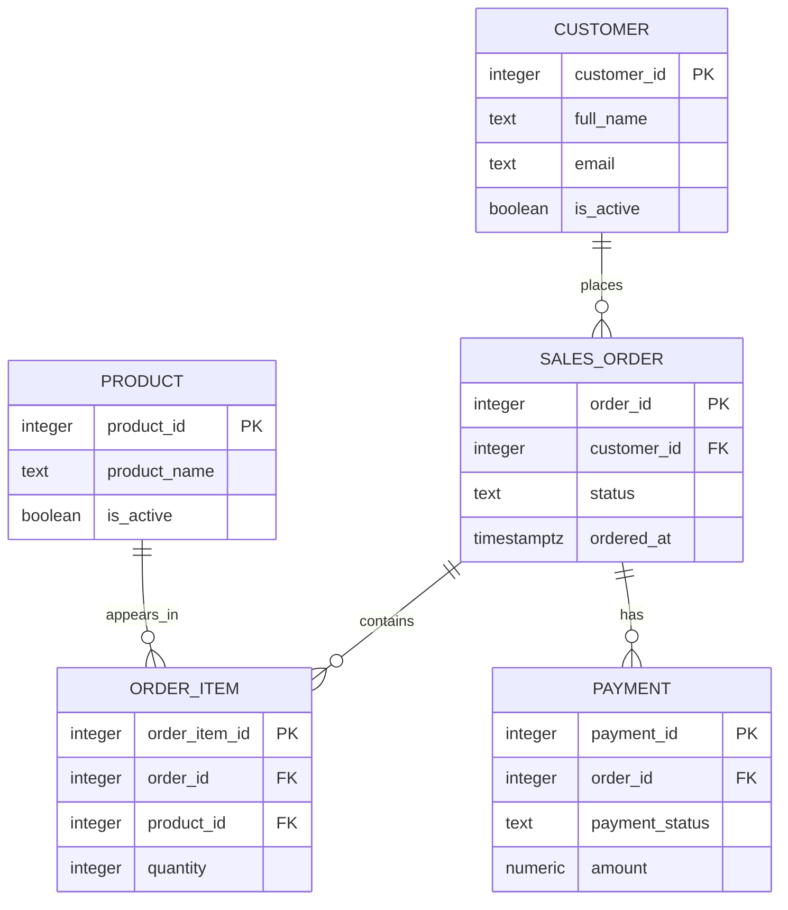
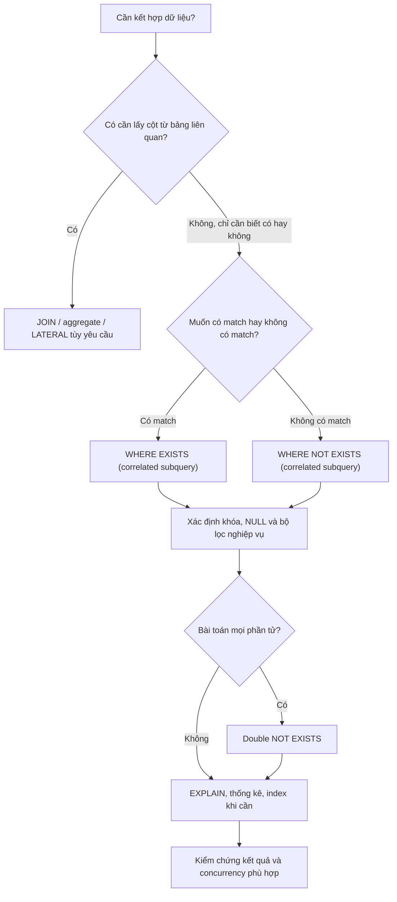

# EXISTS, NOT EXISTS và kiểm tra sự tồn tại trong PostgreSQL

Khi làm việc với cơ sở dữ liệu quan hệ, nhiều câu hỏi nghiệp vụ không yêu cầu lấy thêm dữ liệu từ bảng khác mà chỉ cần biết **có ít nhất một hàng liên quan hay không**:

- Khách hàng nào **đã từng đặt hàng**?
- Khách hàng nào **chưa có đơn hàng**?
- Đơn hàng nào **có ít nhất một khoản thanh toán thành công**?
- Sản phẩm nào **chưa từng xuất hiện trong đơn đã thanh toán**?
- Đơn hàng nào **có dòng hàng nhưng không có giao dịch thanh toán thành công**?
- Khách hàng nào **đã mua tất cả các sản phẩm đang bán**?

Với PostgreSQL, hai công cụ cốt lõi để diễn đạt những câu hỏi này là **`EXISTS`** và **`NOT EXISTS`**. Chúng hoạt động cùng `SELECT`, `WHERE`, `JOIN`, các truy vấn con tương quan (correlated subquery), bộ tối ưu truy vấn và quy tắc xử lý `NULL`.

Ý tưởng ngắn gọn:

> **`EXISTS (subquery)` đúng khi truy vấn con trả ít nhất một hàng; `NOT EXISTS (subquery)` đúng khi truy vấn con không trả hàng nào.**

Không cần biết truy vấn con trả mấy cột, các giá trị của chúng là gì hoặc có bao nhiêu hàng khớp. Điều được kiểm tra là **sự tồn tại của hàng**.

Bài này thuộc chương **Kết hợp dữ liệu**. Vì vậy, trọng tâm không chỉ là cú pháp `EXISTS` mà còn là **cách nó liên hệ với `JOIN`, `IN`, `NOT IN`, `LEFT JOIN`, các phép tập hợp và hiệu năng trên PostgreSQL**, kèm ví dụ thực hành đủ để nhìn thấy các khác biệt.

## 1. Hiểu EXISTS như một phép hỏi có/không

Cú pháp:

```sql
EXISTS (
    SELECT ...
    FROM ...
    WHERE ...
)
```

Toàn bộ biểu thức `EXISTS (...)` có kiểu kết quả **boolean**:

- `TRUE` khi truy vấn con có ít nhất một hàng.
- `FALSE` khi truy vấn con không có hàng nào.

Ví dụ không cần bảng dữ liệu:

```sql
SELECT
    EXISTS (SELECT 1) AS has_row,
    EXISTS (SELECT 1 WHERE FALSE) AS no_row,
    EXISTS (SELECT NULL::integer) AS null_is_still_a_row;
```

Kết quả logic:

| Biểu thức | Kết quả | Giải thích |
|---|---|---|
| `EXISTS (SELECT 1)` | `TRUE` | Có một hàng |
| `EXISTS (SELECT 1 WHERE FALSE)` | `FALSE` | Không có hàng |
| `EXISTS (SELECT NULL::integer)` | `TRUE` | Có một hàng chứa giá trị `NULL` |

**EXISTS không kiểm tra giá trị `NULL` hay không `NULL`.** Một truy vấn con trả một hàng gồm các ô `NULL` vẫn là truy vấn con **có hàng**.

### 1.1. NOT EXISTS là phủ định của sự tồn tại

```sql
SELECT
    NOT EXISTS (SELECT 1) AS has_no_row,
    NOT EXISTS (SELECT 1 WHERE FALSE) AS empty_result;
```

Kết quả: `FALSE` và `TRUE`.

Trong kiểm tra tồn tại thông thường, `EXISTS` và `NOT EXISTS` trả boolean xác định, không rơi vào `UNKNOWN` như những phép so sánh trực tiếp với `NULL`.

### 1.2. Mô hình tư duy

```text
       Truy vấn con được xác định
                 │
                 ▼
          Có hàng trả về?
           ┌─────┴─────┐
           │           │
          Có          Không
           │           │
           ▼           ▼
       EXISTS=TRUE  EXISTS=FALSE
       NOT EXISTS   NOT EXISTS
        =FALSE       =TRUE

Số hàng:    1 hoặc 1000 đều cho EXISTS=TRUE
Giá trị:    SELECT NULL vẫn có thể có hàng
```

Câu hỏi PostgreSQL thực sự giải quyết là **“tập kết quả có rỗng hay không?”**, không phải “trong tập kết quả có một giá trị truthy theo JavaScript hay không?”.

## 2. Dữ liệu thực hành xuyên suốt

Ta dựng hệ thống bán hàng nhỏ gồm khách hàng, đơn hàng, sản phẩm, dòng hàng và giao dịch thanh toán. Sử dụng một database học tập; **không chạy script tạo/sửa dữ liệu này trên production**.

### 2.1. Tạo schema và bảng

```sql
CREATE SCHEMA IF NOT EXISTS demo_exists;

CREATE TABLE demo_exists.customer (
    customer_id INTEGER PRIMARY KEY,
    full_name TEXT NOT NULL,
    email TEXT,
    is_active BOOLEAN NOT NULL DEFAULT TRUE
);

CREATE TABLE demo_exists.product (
    product_id INTEGER PRIMARY KEY,
    product_name TEXT NOT NULL,
    is_active BOOLEAN NOT NULL DEFAULT TRUE
);

CREATE TABLE demo_exists.sales_order (
    order_id INTEGER PRIMARY KEY,
    customer_id INTEGER NOT NULL,
    status TEXT NOT NULL,
    ordered_at TIMESTAMPTZ NOT NULL,
    CONSTRAINT fk_sales_order_customer
        FOREIGN KEY (customer_id)
        REFERENCES demo_exists.customer(customer_id),
    CONSTRAINT ck_sales_order_status
        CHECK (status IN ('NEW', 'PAID', 'CANCELLED'))
);

CREATE TABLE demo_exists.order_item (
    order_item_id INTEGER PRIMARY KEY,
    order_id INTEGER NOT NULL,
    product_id INTEGER NOT NULL,
    quantity INTEGER NOT NULL,
    CONSTRAINT fk_order_item_order
        FOREIGN KEY (order_id)
        REFERENCES demo_exists.sales_order(order_id),
    CONSTRAINT fk_order_item_product
        FOREIGN KEY (product_id)
        REFERENCES demo_exists.product(product_id),
    CONSTRAINT ck_order_item_quantity
        CHECK (quantity > 0)
);

CREATE TABLE demo_exists.payment (
    payment_id INTEGER PRIMARY KEY,
    order_id INTEGER NOT NULL,
    payment_status TEXT NOT NULL,
    amount NUMERIC(12, 2) NOT NULL,
    CONSTRAINT fk_payment_order
        FOREIGN KEY (order_id)
        REFERENCES demo_exists.sales_order(order_id),
    CONSTRAINT ck_payment_status
        CHECK (payment_status IN ('PENDING', 'SUCCESS', 'FAILED')),
    CONSTRAINT ck_payment_amount
        CHECK (amount > 0)
);
```

Quan hệ:



Một khách hàng có thể có nhiều đơn, một đơn có nhiều dòng hàng, một sản phẩm xuất hiện trên nhiều dòng hàng và một đơn có thể có nhiều lần thử thanh toán. Đây là kiểu dữ liệu mà `JOIN` dễ tạo nhiều dòng cho cùng một thực thể, còn `EXISTS` giúp trả lời câu hỏi có/không.

### 2.2. Chèn dữ liệu mẫu

```sql
INSERT INTO demo_exists.customer
    (customer_id, full_name, email, is_active)
VALUES
    (1, 'Lan',  'lan@example.test', TRUE),
    (2, 'Minh', 'minh@example.test', TRUE),
    (3, 'Hoa',  NULL, TRUE),
    (4, 'An',   'an@example.test', TRUE),
    (5, 'Binh', 'binh@example.test', TRUE),
    (6, 'Dao',  NULL, FALSE);

INSERT INTO demo_exists.product
    (product_id, product_name, is_active)
VALUES
    (10, 'Sách PostgreSQL', TRUE),
    (20, 'Bút', TRUE),
    (30, 'Chuột', FALSE);

INSERT INTO demo_exists.sales_order
    (order_id, customer_id, status, ordered_at)
VALUES
    (101, 1, 'PAID',      '2026-11-10 09:00:00+07'),
    (102, 1, 'CANCELLED', '2026-11-11 10:00:00+07'),
    (103, 2, 'NEW',       '2026-11-10 16:00:00+07'),
    (104, 4, 'PAID',      '2026-11-12 11:00:00+07'),
    (105, 5, 'PAID',      '2026-11-13 08:00:00+07'),
    (106, 5, 'PAID',      '2026-11-13 09:30:00+07'),
    (107, 2, 'CANCELLED', '2026-11-12 15:00:00+07'),
    (108, 4, 'NEW',       '2026-11-13 18:00:00+07');

INSERT INTO demo_exists.order_item
    (order_item_id, order_id, product_id, quantity)
VALUES
    (1001, 101, 10, 1),
    (1002, 101, 20, 2),
    (1003, 104, 10, 1),
    (1004, 105, 20, 1),
    (1005, 106, 10, 1),
    (1006, 106, 20, 1),
    (1007, 108, 30, 1);

INSERT INTO demo_exists.payment
    (payment_id, order_id, payment_status, amount)
VALUES
    (201, 101, 'SUCCESS', 200000.00),
    (202, 104, 'FAILED',  150000.00),
    (203, 104, 'SUCCESS', 150000.00),
    (204, 105, 'PENDING',  10000.00),
    (205, 106, 'SUCCESS', 160000.00),
    (206, 103, 'FAILED',   80000.00);
```

Các bảng và khóa trong bài là dữ liệu minh họa. Nếu chạy `INSERT` lần thứ hai trên cùng schema, khóa chính sẽ báo trùng. Nên dùng database lab sạch khi thực hành lại.

### 2.3. Các kết quả tham chiếu

Theo dữ liệu vừa tạo:

| Khách | Đơn hàng |
|---|---|
| Lan (1) | 101 (PAID), 102 (CANCELLED) |
| Minh (2) | 103 (NEW), 107 (CANCELLED) |
| Hoa (3) | Không có |
| An (4) | 104 (PAID), 108 (NEW) |
| Binh (5) | 105 (PAID), 106 (PAID) |
| Dao (6) | Không có |

Hai sản phẩm đang bán là 10 (Sách PostgreSQL) và 20 (Bút). Sản phẩm 30 (Chuột) không còn active. Thông tin này sẽ dùng trong các câu truy vấn lồng nhau ở phần sau.

## 3. EXISTS đơn giản: database có hàng phù hợp không?

Ví dụ kiểm tra hệ thống có đơn `PAID` không:

```sql
SELECT EXISTS (
    SELECT 1
    FROM demo_exists.sales_order
    WHERE status = 'PAID'
) AS has_paid_order;
```

Kết quả là `TRUE` vì có ít nhất một đơn thỏa điều kiện.

Kiểm tra một order cụ thể:

```sql
SELECT EXISTS (
    SELECT 1
    FROM demo_exists.sales_order
    WHERE order_id = 999
) AS order_exists;
```

Kết quả `FALSE` trong bộ dữ liệu mẫu.

Điều kiện bên trong subquery được thực thi theo ngữ nghĩa SQL thông thường. Nếu không có hàng thỏa `WHERE`, tập kết quả rỗng và `EXISTS` trả FALSE.

### 3.1. EXISTS có thể xuất hiện trong SELECT

```sql
SELECT
    EXISTS (
        SELECT 1
        FROM demo_exists.payment
        WHERE payment_status = 'FAILED'
    ) AS has_failed_payment,
    NOT EXISTS (
        SELECT 1
        FROM demo_exists.product
        WHERE is_active = FALSE
    ) AS all_products_active;
```

Kết quả lần lượt `TRUE`, `FALSE`.

Có thể dùng `EXISTS` như một biểu thức trong `SELECT`, `WHERE`, `CASE` hoặc ở những vị trí cho phép biểu thức boolean. Nó không bị giới hạn chỉ trong mệnh đề `WHERE`.

### 3.2. EXISTS không lấy về các cột của truy vấn con

```sql
SELECT
    EXISTS (
        SELECT order_id, customer_id, status
        FROM demo_exists.sales_order
        WHERE status = 'PAID'
    ) AS paid_order_exists;
```

Truy vấn này vẫn chỉ trả **một cột boolean**, không trả ba cột bên trong. Những cột của SELECT list trong subquery thông thường không quyết định phép kiểm tra có hàng hay không.

Vì vậy, quy ước viết phổ biến là:

```sql
EXISTS (SELECT 1 FROM ... WHERE ...)
```

Số 1 mang nghĩa “tôi không cần dữ liệu của hàng, chỉ cần biết hàng có tồn tại”. `SELECT *` cũng thường có cùng kết quả với mục tiêu này, nhưng `SELECT 1` diễn đạt ý định gọn.

## 4. Correlated subquery: liên kết từng hàng bên ngoài với hàng bên trong

Phần quan trọng nhất là truy vấn con **tham chiếu tới một cột từ truy vấn ngoài**.

Muốn tìm khách đã từng đặt ít nhất một đơn:

```sql
SELECT
    c.customer_id,
    c.full_name
FROM demo_exists.customer AS c
WHERE EXISTS (
    SELECT 1
    FROM demo_exists.sales_order AS o
    WHERE o.customer_id = c.customer_id
)
ORDER BY c.customer_id;
```

Cách đọc:

1. Truy vấn ngoài chọn từng ứng viên `c` từ bảng customer.
2. Truy vấn con hỏi có hàng `o` nào trong sales_order mà `o.customer_id = c.customer_id` hay không.
3. Nếu có, `EXISTS` là TRUE và khách đó được giữ.
4. Nếu không, `EXISTS` là FALSE và khách đó bị loại.

Kết quả: Lan (1), Minh (2), An (4), Binh (5). Hoa (3) và Dao (6) chưa có đơn.

### 4.1. Sơ đồ tương quan

```text
Customer bên ngoài             Sales order bên trong
───────────────────           ─────────────────────
c.customer_id = 1      ──→   Có order 101, 102 → EXISTS TRUE
c.customer_id = 2      ──→   Có order 103, 107 → EXISTS TRUE
c.customer_id = 3      ──→   Không có order    → EXISTS FALSE
c.customer_id = 4      ──→   Có order 104, 108 → EXISTS TRUE
c.customer_id = 5      ──→   Có order 105, 106 → EXISTS TRUE
c.customer_id = 6      ──→   Không có order    → EXISTS FALSE

Kết quả ngoài: c = 1, 2, 4, 5
```

Đây là **mô hình logic**. PostgreSQL không nhất thiết thực sự chạy toàn bộ subquery từ đầu cho từng khách theo một vòng lặp Java. Planner có thể biến đổi điều kiện thành một **semi join**, dùng hash/index hoặc một chiến lược khác tùy dữ liệu.

### 4.2. Tên alias quyết định đúng phạm vi cột

Ở truy vấn:

```sql
WHERE o.customer_id = c.customer_id
```

- `o.customer_id` thuộc bảng order bên trong.
- `c.customer_id` thuộc bảng customer bên ngoài.

Không nên viết mơ hồ:

```sql
-- Ví dụ CÓ THỂ SAI LOGIC:
SELECT c.customer_id
FROM demo_exists.customer AS c
WHERE EXISTS (
    SELECT 1
    FROM demo_exists.sales_order AS o
    WHERE o.customer_id = customer_id
);
```

Cột `customer_id` không có alias ở bên phải có thể được PostgreSQL phân giải ngay trong phạm vi bảng `o`, làm điều kiện trở thành so sánh cột order với chính nó. Khi có đơn bất kỳ với mã khách không NULL, rất nhiều khách bên ngoài có thể cùng được chọn, dù không có đơn của riêng mình.

**Luôn ghi rõ alias ở cả hai phía của điều kiện tương quan.** Đây là một quy tắc đọc được ngay trên code review, không phải chỉ là sở thích trình bày.

### 4.3. Subquery không tương quan cho cùng một kết quả trên mọi hàng

```sql
SELECT c.customer_id, c.full_name
FROM demo_exists.customer AS c
WHERE EXISTS (
    SELECT 1
    FROM demo_exists.sales_order
    WHERE status = 'PAID'
);
```

Ở đây không có điều kiện tham chiếu `c.customer_id`. Vì trong bảng có ít nhất một đơn PAID, điều kiện chung TRUE cho **mọi khách**, bao gồm Hoa và Dao chưa từng đặt hàng.

Truy vấn không sai cú pháp; nó chỉ trả lời một câu hỏi khác: “toàn hệ thống có đơn đã thanh toán hay không?”, không phải “khách hiện tại có đơn đã thanh toán hay không?”.

## 5. Lọc tồn tại theo điều kiện chi tiết

Muốn tìm khách có ít nhất một đơn **PAID**:

```sql
SELECT c.customer_id, c.full_name
FROM demo_exists.customer AS c
WHERE EXISTS (
    SELECT 1
    FROM demo_exists.sales_order AS o
    WHERE o.customer_id = c.customer_id
      AND o.status = 'PAID'
)
ORDER BY c.customer_id;
```

Kết quả: Lan (1), An (4), Binh (5).

Minh có đơn nhưng chưa có đơn PAID, nên không xuất hiện. Đây là lý do điều kiện status phải nằm trong truy vấn con nối tới khách **hiện tại**, thay vì chỉ kiểm tra toàn hệ thống có đơn PAID.

### 5.1. Điều kiện ngày tháng trong EXISTS

Ví dụ tìm khách có đơn từ ngày 12 đến trước ngày 14/11/2026 theo mốc UTC+07:

```sql
SELECT c.customer_id, c.full_name
FROM demo_exists.customer AS c
WHERE EXISTS (
    SELECT 1
    FROM demo_exists.sales_order AS o
    WHERE o.customer_id = c.customer_id
      AND o.ordered_at >= TIMESTAMPTZ '2026-11-12 00:00:00+07'
      AND o.ordered_at <  TIMESTAMPTZ '2026-11-14 00:00:00+07'
)
ORDER BY c.customer_id;
```

Khoảng **nửa mở** `[bắt_đầu, kết_thúc)` tránh phải tính “23:59:59.999...” và xử lý đúng những timestamp có độ chính xác cao.

Với hệ thống hoạt động ở nhiều múi giờ, cần xác định “ngày nghiệp vụ” rõ ràng trước khi tạo hai mốc. Không viết `ordered_at::date = '2026-11-13'` rồi mặc định không phụ thuộc timezone; ép `TIMESTAMPTZ` sang `DATE` chịu ảnh hưởng timezone phiên.

### 5.2. EXISTS với nhiều bộ lọc

Tìm khách active đã từng có đơn PAID:

```sql
SELECT c.customer_id, c.full_name
FROM demo_exists.customer AS c
WHERE c.is_active = TRUE
  AND EXISTS (
      SELECT 1
      FROM demo_exists.sales_order AS o
      WHERE o.customer_id = c.customer_id
        AND o.status = 'PAID'
  )
ORDER BY c.customer_id;
```

Mệnh đề ngoài `c.is_active = TRUE` kiểm tra thuộc tính của khách; điều kiện bên trong kiểm tra **sự tồn tại của đơn** thuộc khách đó. Việc tách này làm cấu trúc SQL dễ đọc và ít nhầm hơn khi có nhiều bảng.

## 6. NOT EXISTS: tìm hàng không có quan hệ khớp

Muốn tìm khách **chưa từng có đơn**:

```sql
SELECT
    c.customer_id,
    c.full_name
FROM demo_exists.customer AS c
WHERE NOT EXISTS (
    SELECT 1
    FROM demo_exists.sales_order AS o
    WHERE o.customer_id = c.customer_id
)
ORDER BY c.customer_id;
```

Kết quả: Hoa (3), Dao (6).

Đây là dạng truy vấn thường gọi là **anti-semi join** hoặc **anti join** ở mức ý tưởng: giữ hàng bên ngoài nếu không có hàng liên quan bên trong.

### 6.1. Không có đơn PAID khác với không có đơn nào

```sql
SELECT c.customer_id, c.full_name
FROM demo_exists.customer AS c
WHERE NOT EXISTS (
    SELECT 1
    FROM demo_exists.sales_order AS o
    WHERE o.customer_id = c.customer_id
      AND o.status = 'PAID'
)
ORDER BY c.customer_id;
```

Kết quả: Minh (2), Hoa (3), Dao (6).

Minh có đơn NEW và CANCELLED nhưng **không có đơn PAID**; do đó thỏa điều kiện này, dù không thỏa “chưa có đơn nào”.

Hai câu hỏi khác nhau:

| Nghiệp vụ | Điều kiện |
|---|---|
| Không có đơn bất kỳ | `NOT EXISTS (... WHERE o.customer_id = c.customer_id)` |
| Không có đơn PAID | `NOT EXISTS (... WHERE o.customer_id = c.customer_id AND o.status = 'PAID')` |

Vị trí bộ lọc trong subquery là một phần của **ngữ nghĩa**, không phải chi tiết có thể đổi tùy tiện.

### 6.2. NOT EXISTS không yêu cầu dữ liệu có số lượng bằng 0 trong bảng gốc

Nếu bảng order có hàng của khách khác, điều đó không ảnh hưởng kết quả cho khách hiện tại. PostgreSQL chỉ cần tìm **có ít nhất một match với điều kiện tương quan** hay không.

Chính điều kiện tương quan là thứ biến câu hỏi “bảng sales_order có rỗng không?” thành “tập đơn của khách này có rỗng không?”.

## 7. EXISTS khác INNER JOIN như thế nào?

Hai truy vấn sau có thể có mục tiêu giống nhau nhưng **kết quả về số hàng khác nhau**.

### 7.1. JOIN lấy các cặp hàng khớp

```sql
SELECT c.customer_id, c.full_name
FROM demo_exists.customer AS c
JOIN demo_exists.sales_order AS o
    ON o.customer_id = c.customer_id
ORDER BY c.customer_id, o.order_id;
```

Với Lan có hai đơn, JOIN trả **hai dòng cho Lan**. Tương tự Minh, An và Binh cũng có hai đơn. Kết quả không còn là “mỗi khách một dòng”.

### 7.2. EXISTS chỉ lọc từng hàng phía ngoài

```sql
SELECT c.customer_id, c.full_name
FROM demo_exists.customer AS c
WHERE EXISTS (
    SELECT 1
    FROM demo_exists.sales_order AS o
    WHERE o.customer_id = c.customer_id
)
ORDER BY c.customer_id;
```

Mỗi hàng `customer` xuất hiện tối đa một lần vì từ nguồn ngoài chỉ có một hàng cho mỗi `customer_id` và `EXISTS` trả boolean. Có 2 hay 200 đơn cũng không nhân bản hàng khách.

### 7.3. So sánh nhanh

| Tiêu chí | `INNER JOIN` | `WHERE EXISTS` |
|---|---|---|
| Mục tiêu | Kết hợp dữ liệu từ các bảng | Lọc hàng ngoài theo có/không có match |
| Số dòng | Có thể nhân hàng theo số match | Không nhân hàng ngoài do match của subquery |
| Lấy cột bảng trong | Có | Không trực tiếp |
| Cần `DISTINCT` để một khách một dòng? | Có thể, tùy quan hệ | Không vì chính `EXISTS` |
| Mô hình planner có thể dùng | Inner join | Semi join, SubPlan hoặc kế hoạch tương đương |
| Phù hợp khi nào | Cần dữ liệu bên trong hoặc xử lý từng cặp | Chỉ cần điều kiện tồn tại |

**Cẩn trọng:** `EXISTS` không tự loại các hàng trùng **đã tồn tại ở truy vấn ngoài**. Nếu truy vấn ngoài là một phép JOIN tạo trùng khách, thêm `WHERE EXISTS` không tự làm nó thành `DISTINCT`.

### 7.4. JOIN + DISTINCT không phải lúc nào là cách thay thế lý tưởng

```sql
SELECT DISTINCT c.customer_id, c.full_name
FROM demo_exists.customer AS c
JOIN demo_exists.sales_order AS o
    ON o.customer_id = c.customer_id;
```

Truy vấn này có thể trả danh sách khách giống câu `EXISTS`, nhưng nó trước hết tạo quan hệ các cặp khớp rồi áp dụng loại trùng theo kế hoạch thích hợp. PostgreSQL có thể tối ưu, nhưng ý định “chỉ cần có một đơn” rõ ràng hơn khi viết `EXISTS`.

Dùng `JOIN` khi cần thực sự lấy `o.order_id`, `o.status` hoặc tổng hợp theo đơn. Không thay mọi `JOIN` bằng `EXISTS` một cách máy móc.

## 8. NOT EXISTS so với LEFT JOIN ... IS NULL

Một cách phổ biến để tìm khách không có đơn:

```sql
SELECT c.customer_id, c.full_name
FROM demo_exists.customer AS c
LEFT JOIN demo_exists.sales_order AS o
    ON o.customer_id = c.customer_id
WHERE o.order_id IS NULL
ORDER BY c.customer_id;
```

Với `o.order_id` là PRIMARY KEY và không thể NULL trong hàng có thật, điều kiện `o.order_id IS NULL` ở kết quả `LEFT JOIN` cho biết **không có hàng order nào khớp**.

Viết bằng `NOT EXISTS`:

```sql
SELECT c.customer_id, c.full_name
FROM demo_exists.customer AS c
WHERE NOT EXISTS (
    SELECT 1
    FROM demo_exists.sales_order AS o
    WHERE o.customer_id = c.customer_id
)
ORDER BY c.customer_id;
```

Hai cách có cùng ý nghĩa trên mô hình này; PostgreSQL có thể tạo kế hoạch anti join tương đương tùy phiên bản, thống kê và truy vấn.

### 8.1. Bẫy khi kiểm tra một cột nullable

Giả sử bạn viết:

```sql
-- KHÔNG phải cách tìm khách không có đơn:
SELECT c.customer_id, c.full_name
FROM demo_exists.customer AS c
LEFT JOIN demo_exists.sales_order AS o
    ON o.customer_id = c.customer_id
WHERE o.status IS NULL;
```

Ở dữ liệu mẫu, `status` được khai báo NOT NULL, nên việc dùng nó làm tín hiệu có thể tình cờ đúng. Nhưng nếu ở bảng khác, cột phía phải **được phép NULL**, các hàng có match thật mà cột ấy NULL cũng lọt vào.

Chỉ dùng `IS NULL` trên **khóa hoặc cột bảo đảm không NULL ở hàng thực** khi dùng anti join theo dạng `LEFT JOIN`. `NOT EXISTS` thường diễn đạt điều kiện “không có hàng” trực tiếp hơn, không phải chọn một cột sentinel.

### 8.2. Bộ lọc của bảng phải phải nằm trong ON nếu dùng LEFT JOIN

Tìm khách không có đơn PAID bằng `LEFT JOIN`:

```sql
SELECT c.customer_id, c.full_name
FROM demo_exists.customer AS c
LEFT JOIN demo_exists.sales_order AS o
    ON o.customer_id = c.customer_id
   AND o.status = 'PAID'
WHERE o.order_id IS NULL
ORDER BY c.customer_id;
```

Điều kiện `o.status = 'PAID'` thuộc `ON` vì ta muốn outer join chỉ tìm các **đơn PAID**. Sau đó `WHERE o.order_id IS NULL` chọn khách không có match trong tập đó.

Nếu chuyển `o.status = 'PAID'` xuống `WHERE`, ta đang lọc **sau khi outer join** và có thể loại toàn bộ hàng không khớp, làm mất ý nghĩa anti join.

### 8.3. Khi nào nên dùng cách nào?

- Chọn `NOT EXISTS` khi chỉ cần diễn đạt phủ định “không có hàng thỏa điều kiện”.
- Chọn `LEFT JOIN` khi còn cần một số thông tin từ phía phải hoặc toàn bộ cấu trúc query phù hợp hơn, nhưng phải quản lý `ON` và sentinel NULL cẩn thận.
- Đừng kết luận kiểu nào luôn nhanh hơn. Kiểm tra `EXPLAIN` và chi phí thực tế ở bảng đủ lớn.

## 9. NOT EXISTS so với NOT IN: bẫy NULL

Đây là khác biệt quan trọng nhất về tính đúng dữ liệu.

Tạo một bảng danh sách khách bị loại trừ, cố tình có một mã NULL:

```sql
CREATE TABLE demo_exists.blocked_customer (
    customer_id INTEGER
);

INSERT INTO demo_exists.blocked_customer (customer_id)
VALUES (2), (NULL);
```

Bây giờ thử:

```sql
SELECT c.customer_id, c.full_name
FROM demo_exists.customer AS c
WHERE c.customer_id NOT IN (
    SELECT b.customer_id
    FROM demo_exists.blocked_customer AS b
)
ORDER BY c.customer_id;
```

**Kết quả: không có khách nào.** Tại sao? Với khách `1`, điều kiện có thể hiểu như:

```text
1 NOT IN (2, NULL)
= NOT (1 = 2 OR 1 = NULL)
= NOT (FALSE OR UNKNOWN)
= NOT UNKNOWN
= UNKNOWN
```

`WHERE` chỉ giữ TRUE, vì thế khách 1 bị loại. Khách 2 khớp số 2 nên `NOT IN` là FALSE. Tương tự, những khách khác không khớp 2 đều gặp UNKNOWN do NULL trong tập bên phải.

### 9.1. Viết bằng NOT EXISTS

```sql
SELECT c.customer_id, c.full_name
FROM demo_exists.customer AS c
WHERE NOT EXISTS (
    SELECT 1
    FROM demo_exists.blocked_customer AS b
    WHERE b.customer_id = c.customer_id
)
ORDER BY c.customer_id;
```

Kết quả: khách 1, 3, 4, 5, 6. Hàng `blocked_customer.customer_id IS NULL` không match với ID khách 1...6 qua phép `=`, nên không tự “đầu độc” toàn bộ kết quả.

### 9.2. Có thể sửa NOT IN bằng lọc NULL bên trong

```sql
SELECT c.customer_id, c.full_name
FROM demo_exists.customer AS c
WHERE c.customer_id NOT IN (
    SELECT b.customer_id
    FROM demo_exists.blocked_customer AS b
    WHERE b.customer_id IS NOT NULL
)
ORDER BY c.customer_id;
```

Trên mô hình có `customer.customer_id NOT NULL`, kết quả có thể giống `NOT EXISTS`.

Nếu biểu thức **bên trái cũng nullable**, phải xác định thêm nghĩa của NULL bên trái. `NOT EXISTS` với phép `=` thường không tìm match cho giá trị NULL, trong khi `NOT IN` khi danh sách bên phải không rỗng có thể trả UNKNOWN cho NULL ở vế trái.

**Không có quy tắc “thay mọi NOT IN bằng NOT EXISTS là luôn tương đương”.** Chúng có cách xử lý NULL khác nhau; cần xác định luật nghiệp vụ, nhất là khi cả hai bên nullable.

### 9.3. Nếu muốn NULL khớp với NULL?

Có thể dùng null-safe equality:

```sql
SELECT ...
WHERE NOT EXISTS (
    SELECT 1
    FROM another_table AS b
    WHERE b.key IS NOT DISTINCT FROM outer_table.key
);
```

Đây là **mẫu cú pháp**, không thể chạy nguyên văn vì `another_table` và `outer_table` chỉ là tên minh họa.

`IS NOT DISTINCT FROM` coi hai giá trị NULL là tương đương cho mục đích so sánh. Chỉ dùng khi nghiệp vụ xác nhận hai mã thiếu nên được xem là cùng một nhóm; đối với khóa định danh thực thể, không nên tự cho rằng hai NULL là cùng một thực thể.

## 10. EXISTS so với IN

Tìm khách có đơn bằng `IN`:

```sql
SELECT c.customer_id, c.full_name
FROM demo_exists.customer AS c
WHERE c.customer_id IN (
    SELECT o.customer_id
    FROM demo_exists.sales_order AS o
)
ORDER BY c.customer_id;
```

Trên dữ liệu với `customer_id` không NULL, kết quả giống câu `EXISTS` tìm khách có đơn: 1, 2, 4, 5.

Tuy nhiên:

- `IN` kiểm tra **một biểu thức có thuộc tập giá trị hay không**.
- `EXISTS` kiểm tra **subquery có ít nhất một hàng khớp điều kiện hay không**.
- Khi dùng trong `WHERE`, nhiều câu `IN` và `EXISTS` có thể cho cùng tập hàng trong những điều kiện cụ thể.
- Khi subquery hoặc biểu thức ở bên trái có NULL, kết quả boolean của `IN` có thể UNKNOWN, trong khi `EXISTS` chỉ TRUE/FALSE.

Vì PostgreSQL có thể chuyển đổi thành những kế hoạch semi join phù hợp, không cần mặc định `EXISTS` nhanh hơn `IN` trong mọi truy vấn.

### 10.1. Không nên dùng IN nếu cần điều kiện đa cột mơ hồ

Có thể dùng row constructor với `IN` cho các khóa ghép, nhưng cần xét logic NULL ở từng thành phần. Với điều kiện phức tạp liên quan hai bảng, `EXISTS` cùng điều kiện tương quan tường minh thường dễ thể hiện các luật nghiệp vụ, đặc biệt khi phải dùng null-safe equality cho một số cột.

## 11. Semi join và anti join trong kế hoạch PostgreSQL

Trong đại số quan hệ, một **semi join** cho các hàng bên trái có match bên phải nhưng không nhân chúng theo số hàng bên phải. **Anti join** cho các hàng bên trái không có match.

```text
          CUSTOMER                 SALES_ORDER
         (mỗi khách)               (nhiều đơn)
             │                        │
             └──────────┬─────────────┘
                        │
            Kiểm tra điều kiện khớp
                        │
        ┌───────────────┴───────────────┐
        │                               │
        ▼                               ▼
     Semi Join                       Anti Join
   (có ít nhất 1)                   (không có)
        │                               │
        ▼                               ▼
  EXISTS giữ khách                 NOT EXISTS giữ khách
  1, 2, 4, 5                       3, 6
```

Ví dụ kiểm tra kế hoạch dự kiến:

```sql
EXPLAIN
SELECT c.customer_id
FROM demo_exists.customer AS c
WHERE EXISTS (
    SELECT 1
    FROM demo_exists.sales_order AS o
    WHERE o.customer_id = c.customer_id
);
```

Tùy phiên bản, thống kê, kích thước bảng và chi phí, plan có thể có các node như:

- `Hash Semi Join`.
- `Nested Loop Semi Join`.
- `Merge Semi Join`.
- Một dạng join/tập hợp khác được PostgreSQL tối ưu thành hành vi tương đương.
- `SubPlan` cho những dạng truy vấn con không được biến đổi thành join theo cùng cách.

Với `NOT EXISTS`, bạn có thể thấy `Hash Anti Join`, `Nested Loop Anti Join`, `Merge Anti Join` hoặc kế hoạch phù hợp khác.

**Đừng bắt buộc kết quả EXPLAIN phải có đúng chữ “Semi Join”.** Planner có quyền chọn cấu trúc khác nếu bảo đảm ngữ nghĩa và chi phí tốt hơn.

### 11.1. Cách hiểu “chỉ cần thấy một hàng”

Ở mức ngữ nghĩa, `EXISTS` không cần đếm mọi hàng khớp. PostgreSQL có thể **dừng tìm khi đã có đủ bằng chứng** trong nhiều kiểu kế hoạch, ví dụ một index lookup lấy được hàng khớp.

Tuy vậy, không suy ra PostgreSQL luôn duyệt từng khách rồi tìm đúng một hàng trong index. Với hash semi join, engine có thể dựng cấu trúc hash từ nhiều hàng bên phải trước khi kiểm tra, vì đó có thể là cách tối ưu tổng thể.

Mục tiêu là **để planner chọn chiến lược kiểm tra tồn tại phù hợp**, không ép cách duyệt bằng trực giác từ mã Java.

## 12. Vì sao SELECT 1 thường được dùng trong EXISTS?

Một cách viết khuyến nghị:

```sql
WHERE EXISTS (
    SELECT 1
    FROM demo_exists.sales_order AS o
    WHERE o.customer_id = c.customer_id
)
```

Ý nghĩa của `1`: kết quả của truy vấn con không cần dùng dữ liệu cột. Với phần lớn trường hợp kiểm tra tồn tại đơn giản:

```sql
EXISTS (SELECT 1 FROM ...)
EXISTS (SELECT * FROM ...)
```

có cùng giá trị boolean khi `FROM`/`WHERE` và các ngữ nghĩa tạo hàng giống nhau.

### 12.1. Đừng gắn side effect vào SELECT list của EXISTS

Không nên đặt hàm thay đổi trạng thái hoặc tiêu thụ sequence trong SELECT list của subquery rồi mong PostgreSQL chắc chắn đánh giá nó đúng một lần:

```sql
-- Mẫu KHÔNG nên dựa vào side effect:
SELECT EXISTS (
    SELECT nextval('some_sequence')
    FROM some_table
    WHERE ...
);
```

Tùy planner và cấu trúc truy vấn, target list có thể không được đánh giá như người viết tưởng, vì `EXISTS` chỉ quan tâm tới sự tồn tại của hàng. Trong subquery có set operations hoặc một số biểu thức ảnh hưởng số hàng, còn có những trường hợp đặc biệt.

**Quy tắc an toàn:** để `EXISTS` là một phép kiểm tra không có side effect; những thay đổi dữ liệu phải được thực hiện tường minh bằng DML có transaction phù hợp.

### 12.2. LIMIT 1 thường không cần thiết

```sql
WHERE EXISTS (
    SELECT 1
    FROM demo_exists.sales_order AS o
    WHERE o.customer_id = c.customer_id
    LIMIT 1
)
```

Trong trường hợp này, `LIMIT 1` thường **không thay đổi ý nghĩa** vì `EXISTS` chỉ cần tối thiểu một hàng. Không cần thêm `LIMIT 1` để “báo” cho PostgreSQL rằng chỉ cần kiểm tra tồn tại.

Nhưng **`LIMIT 0`** làm subquery không trả hàng và có thể khiến `EXISTS` thành FALSE. `OFFSET`, `GROUP BY`, `HAVING` và set operations cũng có thể thay đổi việc subquery có hàng hay không, nên không xóa chúng tùy tiện.

### 12.3. ORDER BY không tạo ý nghĩa khi chỉ cần tồn tại

```sql
WHERE EXISTS (
    SELECT 1
    FROM demo_exists.sales_order AS o
    WHERE o.customer_id = c.customer_id
    ORDER BY o.ordered_at DESC
)
```

Nếu không dùng thành phần làm thay đổi số hàng theo thứ tự như `OFFSET`, một `ORDER BY` bên trong thường không có giá trị đối với kết quả `EXISTS`. Muốn **lấy đơn mới nhất**, đó là yêu cầu khác; cần `ORDER BY ... LIMIT 1` trong truy vấn trả dữ liệu hoặc dùng `LATERAL`/window function phù hợp.

## 13. Bẫy EXISTS với aggregate COUNT(*)

Một truy vấn nhìn có vẻ hợp lý:

```sql
SELECT EXISTS (
    SELECT COUNT(*)
    FROM demo_exists.sales_order
    WHERE order_id = -1
) AS surprising;
```

Kết quả **TRUE**, dù không có order với ID -1.

Lý do: một aggregate `COUNT(*)` **không có `GROUP BY`** trả **một hàng kết quả** chứa số 0, chứ không trả tập rỗng.

Hãy so:

```sql
SELECT COUNT(*)
FROM demo_exists.sales_order
WHERE order_id = -1;
-- Một hàng: 0

SELECT 1
FROM demo_exists.sales_order
WHERE order_id = -1;
-- Không có hàng
```

`EXISTS` kiểm tra **số hàng**, không kiểm tra giá trị đếm bằng 0 hay lớn hơn 0.

### 13.1. Đúng khi chỉ cần tồn tại

```sql
SELECT EXISTS (
    SELECT 1
    FROM demo_exists.sales_order
    WHERE order_id = -1
) AS correct_answer;
```

Kết quả FALSE.

### 13.2. HAVING có thể thay đổi việc aggregate có hàng

```sql
SELECT EXISTS (
    SELECT COUNT(*)
    FROM demo_exists.sales_order
    WHERE order_id = -1
    HAVING COUNT(*) > 0
) AS has_any;
```

Ở ví dụ này `HAVING` loại hàng aggregate vì đếm bằng 0, nên `EXISTS` trả FALSE. Cách viết này hoạt động theo mục tiêu nhưng **dài và không cần thiết** khi chỉ muốn hỏi có hàng: chọn `EXISTS (SELECT 1 FROM ... WHERE ...)` sẽ rõ hơn.

### 13.3. GROUP BY cũng thay đổi số hàng

```sql
SELECT EXISTS (
    SELECT customer_id, COUNT(*)
    FROM demo_exists.sales_order
    WHERE order_id = -1
    GROUP BY customer_id
) AS has_any_group;
```

Vì input rỗng và `GROUP BY customer_id` không tạo nhóm nào, kết quả subquery rỗng; `EXISTS` FALSE.

Khi review một truy vấn con dùng `EXISTS` mà có aggregate, hãy xác định nó **thật sự trả hàng trong trường hợp không có record gốc hay không**.

## 14. EXISTS lồng JOIN: tồn tại một đơn có thanh toán thành công

Câu hỏi: khách nào có **ít nhất một đơn mà đã có giao dịch thanh toán SUCCESS**?

```sql
SELECT
    c.customer_id,
    c.full_name
FROM demo_exists.customer AS c
WHERE EXISTS (
    SELECT 1
    FROM demo_exists.sales_order AS o
    JOIN demo_exists.payment AS p
        ON p.order_id = o.order_id
    WHERE o.customer_id = c.customer_id
      AND p.payment_status = 'SUCCESS'
)
ORDER BY c.customer_id;
```

Kết quả: Lan (1), An (4), Binh (5).

Ở đây `JOIN` bên trong là hợp lý vì ta cần kiểm tra **một quan hệ xuyên hai bảng**; `EXISTS` ở ngoài chỉ chọn **các khách** có bất kỳ đường liên kết phù hợp nào, không nhân hàng khách lên theo số payment.

### 14.1. Viết bằng EXISTS lồng nhau

Cùng ý định có thể biểu diễn:

```sql
SELECT c.customer_id, c.full_name
FROM demo_exists.customer AS c
WHERE EXISTS (
    SELECT 1
    FROM demo_exists.sales_order AS o
    WHERE o.customer_id = c.customer_id
      AND EXISTS (
          SELECT 1
          FROM demo_exists.payment AS p
          WHERE p.order_id = o.order_id
            AND p.payment_status = 'SUCCESS'
      )
)
ORDER BY c.customer_id;
```

Mô hình:

```text
Khách c
  └── Có đơn o của khách c?
        └── Đơn o có payment SUCCESS?
              └── Nếu có ít nhất một → chọn c
```

Hai phong cách đều có giá trị:

- `JOIN` trong subquery thường gọn khi nhiều bảng cùng tạo điều kiện khớp.
- `EXISTS` lồng nhau diễn đạt rõ chuỗi “có đơn” và “đơn có thanh toán”.

Hãy ưu tiên cách dễ đọc cho nghiệp vụ rồi đo kế hoạch nếu hiệu năng quan trọng.

### 14.2. “Đơn PAID” và “payment SUCCESS” là hai dữ kiện khác nhau

Trong dữ liệu mẫu, đơn `105` có `sales_order.status = 'PAID'` nhưng payment tương ứng đang `PENDING`. Điều đó là **dữ liệu giả định có chủ đích** để thấy hai điều kiện khác nhau, không phải mô hình chuẩn của một hệ thống thanh toán.

Nếu nghiệp vụ cần cả hai:

```sql
WHERE EXISTS (
    SELECT 1
    FROM demo_exists.sales_order AS o
    JOIN demo_exists.payment AS p ON p.order_id = o.order_id
    WHERE o.customer_id = c.customer_id
      AND o.status = 'PAID'
      AND p.payment_status = 'SUCCESS'
)
```

Không thay `payment_status = 'SUCCESS'` bằng `o.status = 'PAID'` khi hai cột có phạm vi ý nghĩa khác nhau.

## 15. NOT EXISTS lồng: đơn PAID nhưng chưa có payment SUCCESS

Tìm **đơn có trạng thái PAID nhưng không có payment thành công**:

```sql
SELECT
    o.order_id,
    o.customer_id,
    o.status
FROM demo_exists.sales_order AS o
WHERE o.status = 'PAID'
  AND NOT EXISTS (
      SELECT 1
      FROM demo_exists.payment AS p
      WHERE p.order_id = o.order_id
        AND p.payment_status = 'SUCCESS'
  )
ORDER BY o.order_id;
```

Theo dữ liệu mẫu, kết quả là đơn **105**. Các đơn 101, 104, 106 có ít nhất một payment SUCCESS.

Đây là một truy vấn đối soát thường gặp. Nó không khẳng định đơn 105 thực sự chưa được thu tiền ở thế giới bên ngoài; chỉ khẳng định **không có record payment SUCCESS trong dữ liệu mà truy vấn có thể thấy tại snapshot hiện tại**.

### 15.1. Chuyển từ “không có SUCCESS” sang “có FAILED”

Hai điều kiện **không tương đương**:

```sql
-- Điều kiện A: không có thanh toán SUCCESS
NOT EXISTS (
    SELECT 1 FROM demo_exists.payment AS p
    WHERE p.order_id = o.order_id
      AND p.payment_status = 'SUCCESS'
)

-- Điều kiện B: có ít nhất một thanh toán FAILED
EXISTS (
    SELECT 1 FROM demo_exists.payment AS p
    WHERE p.order_id = o.order_id
      AND p.payment_status = 'FAILED'
)
```

Một đơn có thể có cả FAILED lẫn SUCCESS (đơn 104). Một đơn khác có PENDING nhưng chưa có SUCCESS (đơn 105). Vì vậy:

- Đơn 104: điều kiện A FALSE, B TRUE.
- Đơn 105: điều kiện A TRUE, B FALSE.

**Không dùng phủ định một trạng thái như từ đồng nghĩa của trạng thái khác** khi dữ liệu có nhiều trạng thái hoặc nhiều lần thử.

## 16. Kết hợp nhiều EXISTS và NOT EXISTS

Câu hỏi: khách active **có ít nhất một đơn** nhưng **chưa có đơn PAID**.

```sql
SELECT c.customer_id, c.full_name
FROM demo_exists.customer AS c
WHERE c.is_active
  AND EXISTS (
      SELECT 1
      FROM demo_exists.sales_order AS o
      WHERE o.customer_id = c.customer_id
  )
  AND NOT EXISTS (
      SELECT 1
      FROM demo_exists.sales_order AS o
      WHERE o.customer_id = c.customer_id
        AND o.status = 'PAID'
  )
ORDER BY c.customer_id;
```

Kết quả: Minh (2).

Giải thích:

- `EXISTS` đầu: khách **có đơn ít nhất một lần**.
- `NOT EXISTS` sau: không có **bất kỳ đơn PAID**.
- `c.is_active`: khách đang active.

Nếu bỏ điều kiện `EXISTS` đầu, Hoa và Dao (chưa có đơn) có thể thỏa “không có đơn PAID” nếu các điều kiện ngoài cho phép. Vì vậy khi nghiệp vụ yêu cầu “đã từng có hoạt động nhưng chưa hoàn tất”, cần **vừa có ít nhất một sự kiện, vừa không có sự kiện ở trạng thái mong muốn**.

### 16.1. OR cũng có thể diễn đạt điều kiện tồn tại

Ví dụ khách có đơn PAID **hoặc** có đơn NEW:

```sql
SELECT c.customer_id, c.full_name
FROM demo_exists.customer AS c
WHERE EXISTS (
    SELECT 1 FROM demo_exists.sales_order AS o
    WHERE o.customer_id = c.customer_id
      AND o.status = 'PAID'
)
OR EXISTS (
    SELECT 1 FROM demo_exists.sales_order AS o
    WHERE o.customer_id = c.customer_id
      AND o.status = 'NEW'
)
ORDER BY c.customer_id;
```

Trong trường hợp này, có thể viết gọn với một `EXISTS` và `o.status IN ('PAID','NEW')`. Tuy nhiên khi hai điều kiện dựa trên **hai loại quan hệ khác nhau**, hai biểu thức `EXISTS` riêng biệt đôi khi rõ hơn.

## 17. Bài toán “đã mua tất cả”: hai lớp NOT EXISTS

Một yêu cầu phức tạp hơn: **khách hàng nào đã mua tất cả các sản phẩm đang active trong những đơn PAID?**

Đây là dạng bài toán “với **mọi** sản phẩm active, tồn tại một đơn đã thanh toán chứa sản phẩm đó”. Trong logic quan hệ, có thể dùng chuyển đổi:

> “Với mọi x, P(x) đúng” tương đương “Không tồn tại x mà P(x) sai”.

Áp dụng:

1. Chọn một khách `c`.
2. Hỏi có tồn tại **sản phẩm active `p` mà khách chưa từng mua** không.
3. Nếu **không tồn tại** sản phẩm active chưa mua, khách đã mua toàn bộ sản phẩm active.

```sql
SELECT
    c.customer_id,
    c.full_name
FROM demo_exists.customer AS c
WHERE NOT EXISTS (
    SELECT 1
    FROM demo_exists.product AS p
    WHERE p.is_active
      AND NOT EXISTS (
          SELECT 1
          FROM demo_exists.sales_order AS o
          JOIN demo_exists.order_item AS oi
              ON oi.order_id = o.order_id
          WHERE o.customer_id = c.customer_id
            AND o.status = 'PAID'
            AND oi.product_id = p.product_id
      )
)
ORDER BY c.customer_id;
```

Theo dữ liệu mẫu ban đầu, kết quả là **Lan (1)** và **Binh (5)**:

- Lan có đơn 101 PAID chứa sản phẩm 10 và 20.
- Binh có các đơn PAID 105/106, tổng cộng chứa 10 và 20.
- An chỉ có sản phẩm 10 trong đơn PAID; sản phẩm 30 ở đơn NEW còn không active.
- Minh chưa có đơn PAID; Hoa/Dao không có đơn.

### 17.1. Đọc từng lớp phủ định

```text
Với mỗi khách c:
    Tìm sản phẩm p đang active
        mà KHÔNG tồn tại đơn PAID của c chứa p.
    Nếu tập "sản phẩm chưa mua" RỖNG:
        Chọn khách c.
    Nếu tập đó có ít nhất một sản phẩm:
        Loại khách c.
```

Đây là cách viết rất có ích cho các yêu cầu:

- Nhân viên đã hoàn thành **tất cả** chứng chỉ bắt buộc.
- Khách đã chấp nhận **mọi** điều khoản áp dụng.
- Đơn đã được kiểm tra qua **mọi** bước bắt buộc.
- Người dùng có quyền **mọi** hành động yêu cầu trong một nhóm.

### 17.2. Trường hợp tập điều kiện rỗng: vacuous truth

Nếu **không có sản phẩm active**, subquery tìm sản phẩm chưa mua trả tập rỗng đối với mọi khách; `NOT EXISTS` ngoài là TRUE cho **tất cả khách**. Đây là tính chất logic “mọi phần tử trong tập rỗng đều thỏa” (vacuous truth).

Nếu nghiệp vụ muốn yêu cầu **có ít nhất một sản phẩm active** trước khi nói khách đã mua tất cả, thêm:

```sql
AND EXISTS (
    SELECT 1
    FROM demo_exists.product AS p0
    WHERE p0.is_active
)
```

ở `WHERE` ngoài cùng cùng điều kiện double NOT EXISTS.

Không nên coi trường hợp tập điều kiện rỗng là lỗi của PostgreSQL; nó là ngữ nghĩa logic phải được thiết kế theo nhu cầu.

### 17.3. Điều kiện mua thành công phải đúng nghiệp vụ

Ở ví dụ trên, “đã mua” được định nghĩa bằng `sales_order.status = 'PAID'`. Nếu hệ thống thực yêu cầu payment SUCCESS, hoặc cần tính đơn hoàn tiền/đổi trả, thì tiêu chí phải được bổ sung. `NOT EXISTS` cung cấp **cấu trúc logic**, không tự quyết định luật thương mại.

## 18. EXISTS trong SELECT để gắn cờ cho từng hàng

Thay vì lọc chỉ những khách có đơn, ta có thể giữ **mọi khách** và thêm cột boolean:

```sql
SELECT
    c.customer_id,
    c.full_name,
    EXISTS (
        SELECT 1
        FROM demo_exists.sales_order AS o
        WHERE o.customer_id = c.customer_id
    ) AS has_order,
    EXISTS (
        SELECT 1
        FROM demo_exists.sales_order AS o
        WHERE o.customer_id = c.customer_id
          AND o.status = 'PAID'
    ) AS has_paid_order
FROM demo_exists.customer AS c
ORDER BY c.customer_id;
```

Kết quả theo bộ dữ liệu gốc:

| Khách | has_order | has_paid_order |
|---|---|---|
| Lan | TRUE | TRUE |
| Minh | TRUE | FALSE |
| Hoa | FALSE | FALSE |
| An | TRUE | TRUE |
| Binh | TRUE | TRUE |
| Dao | FALSE | FALSE |

Dạng này tiện cho dashboard trạng thái hoặc API trả danh sách khách cùng chỉ báo. Nhưng nếu cần đếm số đơn hoặc lấy thời điểm đơn gần nhất, `EXISTS` **không cung cấp những giá trị đó**. Khi ấy cần aggregate, subquery trả giá trị, `JOIN LATERAL` hoặc window function tùy yêu cầu.

### 18.1. CASE WHEN EXISTS

```sql
SELECT
    c.customer_id,
    c.full_name,
    CASE
        WHEN EXISTS (
            SELECT 1
            FROM demo_exists.sales_order AS o
            WHERE o.customer_id = c.customer_id
              AND o.status = 'PAID'
        )
        THEN 'HAS_PAID_ORDER'
        ELSE 'NO_PAID_ORDER'
    END AS purchase_state
FROM demo_exists.customer AS c
ORDER BY c.customer_id;
```

`CASE` cho phép chuyển boolean thành nhãn nghiệp vụ. Với `NOT EXISTS` cũng có thể dùng `WHEN NOT EXISTS (...) THEN ...`.

Không biến nhãn “không có đơn PAID” thành “khách chưa từng mua hàng” nếu các trạng thái hoặc quy tắc lịch sử không cho phép kết luận đó.

## 19. EXISTS trong UPDATE: cập nhật có điều kiện tồn tại

`EXISTS` có thể dùng trong `UPDATE` để xác định những hàng cần thay đổi.

Ví dụ chỉ đặt trạng thái inactive cho **khách chưa có bất kỳ đơn nào**:

```sql
-- Chỉ thực hành trên database lab.
UPDATE demo_exists.customer AS c
SET is_active = FALSE
WHERE NOT EXISTS (
    SELECT 1
    FROM demo_exists.sales_order AS o
    WHERE o.customer_id = c.customer_id
)
RETURNING c.customer_id, c.full_name, c.is_active;
```

Theo dữ liệu mẫu ban đầu, Hoa (3) và Dao (6) đáp ứng điều kiện. Đó là một thao tác ghi dữ liệu thật.

### 19.1. Preview trước khi UPDATE

Trên production, nên kiểm tra cùng bộ lọc bằng `SELECT` trước:

```sql
SELECT c.customer_id, c.full_name
FROM demo_exists.customer AS c
WHERE NOT EXISTS (
    SELECT 1
    FROM demo_exists.sales_order AS o
    WHERE o.customer_id = c.customer_id
)
ORDER BY c.customer_id;
```

Sau đó, nếu đã được phép thực hiện và điều kiện nghiệp vụ được xác nhận, có thể dùng transaction, logging, `RETURNING` và chiến lược rollback phù hợp.

**SELECT preview và UPDATE không phải một thao tác nguyên tử** nếu nằm ở hai transaction riêng. Dữ liệu có thể thay đổi giữa lúc preview và lúc UPDATE; vì vậy preview chỉ giúp kiểm tra ý định, không tự loại bỏ race condition.

### 19.2. UPDATE ... FROM và EXISTS

`UPDATE ... FROM` có thể hữu ích khi cần lấy giá trị từ bảng khác để cập nhật. Nhưng nếu chỉ cần câu hỏi “có match không?”, `WHERE EXISTS` diễn đạt rõ và tránh sự mơ hồ về việc một hàng target khớp **nhiều hàng nguồn**.

Với `UPDATE ... FROM` mà một hàng target khớp nhiều hàng source có giá trị cập nhật khác nhau, không nên phụ thuộc việc PostgreSQL chọn hàng nào theo trực giác; phải thiết kế để chỉ có một hàng nguồn xác định hoặc dùng tổng hợp có quy tắc.

## 20. NOT EXISTS trong DELETE: dọn hàng mồ côi có kiểm soát

Một nhu cầu phổ biến là xóa bản ghi phụ khi không còn bản ghi parent hợp lệ. Nhưng nếu có **foreign key đúng**, việc tạo orphan có thể đã bị ngăn theo luật tham chiếu.

Ví dụ cú pháp minh họa trên bảng staging, không cần tạo trong lab:

```sql
DELETE FROM staging_record AS s
WHERE NOT EXISTS (
    SELECT 1
    FROM canonical_record AS c
    WHERE c.business_key = s.business_key
);
```

Ý nghĩa: xóa những hàng staging không có bản ghi canonical cùng business key.

**Không chạy nguyên văn đoạn này** vì bảng chỉ minh họa. Khi xây câu DELETE thật:

1. Xác định điều kiện match đúng khóa nghiệp vụ.
2. Kiểm tra NULL ở cả hai phía và quyết định dùng `=` hay `IS NOT DISTINCT FROM`.
3. Dùng `SELECT` preview/đếm ảnh hưởng trước.
4. Thực hiện theo batch khi bảng lớn.
5. Ghi nhận `RETURNING` hoặc audit phù hợp.
6. Đánh giá transaction, lock, WAL, replication và rollback.

Ví dụ chỉ dùng dữ liệu lab nếu thật sự cần xóa có điều kiện:

```sql
BEGIN;

DELETE FROM demo_exists.customer AS c
WHERE NOT EXISTS (
    SELECT 1
    FROM demo_exists.sales_order AS o
    WHERE o.customer_id = c.customer_id
)
RETURNING c.customer_id, c.full_name;

ROLLBACK;
```

`ROLLBACK` bảo đảm thao tác xóa trong ví dụ không được commit; tuy vậy PostgreSQL vẫn thực hiện công việc trong transaction, có thể tạo tải và khóa trong lúc chạy. Không dùng `EXPLAIN ANALYZE DELETE` trên production chỉ vì nghĩ sẽ “xem thử” mà không thay đổi dữ liệu.

## 21. EXISTS và MVCC: “tồn tại” theo snapshot nào?

PostgreSQL dùng **Multi-Version Concurrency Control (MVCC)**. Một `EXISTS` không kiểm tra trạng thái vĩnh viễn của thế giới; nó kiểm tra **các hàng visible theo snapshot của statement/transaction**.

Giả sử:

- Session A đang tìm khách có đơn.
- Session B vừa chèn một đơn cho khách 3 nhưng chưa commit.
- Câu `EXISTS` ở A chưa chắc nhìn thấy đơn đó; ở `READ COMMITTED`, nó không đọc thay đổi chưa commit của session khác.
- Sau khi B commit, một statement mới ở A tại `READ COMMITTED` có thể nhìn thấy đơn mới.
- Ở `REPEATABLE READ`, nếu transaction A đã lấy snapshot trước commit, những lần đọc tiếp theo có thể tiếp tục không thấy đơn mới cho đến khi A kết thúc transaction.

### 21.1. EXISTS không phải bảo đảm uniqueness hoặc chống đua ghi

Một lỗi ứng dụng thường gặp:

```text
Transaction A: NOT EXISTS(code='X') → TRUE
Transaction B: NOT EXISTS(code='X') → TRUE
A: INSERT code='X'
B: INSERT code='X'
```

Nếu không có ràng buộc, cả hai có thể đi đến bước chèn và tạo dữ liệu trùng. **Một lần `NOT EXISTS` không khóa tương lai để không ai được chèn**.

Nếu mã phải duy nhất, dùng constraint:

```sql
CREATE TABLE demo_exists.external_event (
    event_id BIGINT GENERATED ALWAYS AS IDENTITY PRIMARY KEY,
    event_code TEXT NOT NULL UNIQUE,
    payload TEXT
);
```

Sau đó dùng cú pháp phù hợp để giải quyết xung đột:

```sql
INSERT INTO demo_exists.external_event (event_code, payload)
VALUES ('EVT-001', 'first import')
ON CONFLICT (event_code) DO NOTHING
RETURNING event_id;
```

`UNIQUE` mới là cơ chế bảo vệ không trùng theo quy tắc dữ liệu. `NOT EXISTS` vẫn có ích để lọc/báo cáo, nhưng không thay thế unique constraint, transaction isolation hoặc một thiết kế khóa phù hợp.

### 21.2. Serializable và retry

Ở mức `SERIALIZABLE`, PostgreSQL có cơ chế phát hiện những lịch đồng thời không serializable và có thể từ chối một transaction với SQLSTATE `40001`. Khi gặp lỗi này, ứng dụng cần retry **toàn bộ transaction** theo quy trình an toàn, chứ không chỉ chạy lại một câu INSERT tùy tiện.

Đừng chọn isolation mạnh hơn chỉ để bỏ unique constraint; constraint vẫn nên biểu diễn luật duy nhất mà schema phải bảo vệ.

## 22. Tối ưu EXISTS: chỉ mục cho điều kiện tương quan

Một câu `EXISTS` chạy trên hàng triệu khách và đơn có thể nhanh hoặc chậm tùy **lọc, quan hệ, chỉ mục, thống kê và kế hoạch**.

Truy vấn:

```sql
SELECT c.customer_id
FROM demo_exists.customer AS c
WHERE EXISTS (
    SELECT 1
    FROM demo_exists.sales_order AS o
    WHERE o.customer_id = c.customer_id
      AND o.status = 'PAID'
);
```

Điều kiện tra cứu chính ở bên trong là:

```text
o.customer_id = c.customer_id
AND o.status = 'PAID'
```

Một index phù hợp trong nhiều workload:

```sql
CREATE INDEX idx_sales_order_customer_status
ON demo_exists.sales_order (customer_id, status);
```

Nó có thể hỗ trợ tra cứu đơn theo `customer_id` rồi theo `status`. Tuy nhiên PostgreSQL có thể chọn một index khác, quét tuần tự hoặc hash join tùy kích thước và phân phối dữ liệu.

### 22.1. Index một phần cho trạng thái cố định

Nếu truy vấn chỉ tìm đơn PAID rất thường xuyên:

```sql
CREATE INDEX idx_sales_order_paid_customer
ON demo_exists.sales_order (customer_id)
WHERE status = 'PAID';
```

Đây là **partial index**: chỉ chứa các hàng thỏa predicate. Nó có thể nhỏ và hữu ích trong workload thích hợp, nhưng hiệu quả phụ thuộc:

- Tỷ lệ đơn PAID trên toàn bảng.
- Các query có điều kiện tương thích với predicate.
- Tần suất UPDATE status và write amplification.
- Khả năng planner chứng minh điều kiện query bao hàm predicate, đặc biệt với SQL tham số hóa.

Không tạo cả index đơn, index ghép và partial index chỉ vì mỗi cái có vẻ hữu ích. Trên production phải đo số truy vấn hưởng lợi, số lần cập nhật, không gian và chi phí VACUUM.

### 22.2. Chỉ mục ở bảng payment

Với điều kiện:

```sql
WHERE p.order_id = o.order_id
  AND p.payment_status = 'SUCCESS'
```

cân nhắc:

```sql
CREATE INDEX idx_payment_order_status
ON demo_exists.payment (order_id, payment_status);
```

Bảng payment nhỏ trong lab sẽ chưa cho thấy lợi ích lớn. Trên hệ thống nhiều payment attempts, index có thể giúp kiểm tra nhanh mỗi đơn có một payment SUCCESS hay không.

**Foreign key ở cột child không tự tạo index phía child một cách mặc định.** Vì vậy, các truy vấn theo `payment.order_id` thường là một lý do để đánh giá index đó.

### 22.3. Vì sao thứ tự cột index quan trọng?

Index `(customer_id, status)` phù hợp với tra cứu theo một customer cụ thể rồi status. Index `(status, customer_id)` lại có thể phù hợp khi lọc mọi đơn PAID toàn hệ thống rồi liên hệ khách.

Trong PostgreSQL B-tree, khả năng tận dụng prefix, selectivity và cách planner kết hợp điều kiện quyết định kế hoạch. Không có một thứ tự cột luôn tối ưu cho mọi truy vấn.

## 23. EXPLAIN và EXPLAIN ANALYZE

Dùng `EXPLAIN` để xem dự kiến:

```sql
EXPLAIN
SELECT c.customer_id
FROM demo_exists.customer AS c
WHERE EXISTS (
    SELECT 1
    FROM demo_exists.sales_order AS o
    WHERE o.customer_id = c.customer_id
      AND o.status = 'PAID'
);
```

Dùng `EXPLAIN (ANALYZE, BUFFERS)` trên SELECT thử nghiệm:

```sql
EXPLAIN (ANALYZE, BUFFERS)
SELECT c.customer_id
FROM demo_exists.customer AS c
WHERE NOT EXISTS (
    SELECT 1
    FROM demo_exists.sales_order AS o
    WHERE o.customer_id = c.customer_id
      AND o.status = 'PAID'
);
```

Các chỉ số cần hiểu:

| Chỉ số/node | Ý nghĩa |
|---|---|
| `Hash Semi Join` | Kế hoạch giữ hàng phía trái có match, có thể dùng hash |
| `Hash Anti Join` | Kế hoạch giữ hàng phía trái không có match |
| `Nested Loop Semi Join` | Tìm match theo chiến lược lặp với phía trong |
| `SubPlan` | Truy vấn con được giữ dưới dạng một phần kế hoạch |
| `rows` | Ước lượng số hàng của planner |
| `actual rows` | Số hàng thực tế mỗi bước trả trong execution |
| `loops` | Số lần node thực thi |
| `Buffers: shared hit/read` | Tình trạng truy cập buffer và đọc trang |
| `Planning Time` | Thời gian lập kế hoạch |
| `Execution Time` | Thời gian thực thi có instrumentation |

Chi phí `cost` không phải milliseconds. `EXPLAIN ANALYZE` có overhead đo lường và thực sự chạy query; không nên dùng trên DML thật nếu chưa đánh giá tác động.

### 23.1. Có phải EXISTS luôn nhanh hơn COUNT(*) > 0?

Nếu chỉ cần boolean, `EXISTS` diễn đạt ý định tốt hơn:

```sql
SELECT EXISTS (
    SELECT 1
    FROM demo_exists.sales_order
    WHERE customer_id = 1
);
```

So với:

```sql
SELECT COUNT(*) > 0
FROM demo_exists.sales_order
WHERE customer_id = 1;
```

`COUNT(*)` được định nghĩa để đếm số hàng thỏa điều kiện, trong khi `EXISTS` chỉ cần kết luận có hay không. Trong nhiều kế hoạch, `EXISTS` có cơ hội ngừng sớm hoặc dùng semi join hiệu quả.

Nhưng **không tuyên bố `EXISTS` luôn nhanh hơn trong mọi truy vấn**. Planner, cache, index, dữ liệu và cấu trúc query có thể dẫn đến kế hoạch giống hoặc khác. Lựa chọn đầu tiên nên dựa trên **ý nghĩa cần trả về**, rồi đo khi latency quan trọng.

### 23.2. Cập nhật thống kê đúng lúc

Sau khi thay đổi rất nhiều dữ liệu:

```sql
ANALYZE demo_exists.sales_order;
ANALYZE demo_exists.payment;
```

`ANALYZE` giúp PostgreSQL có thống kê phù hợp hơn cho planner. Nó không tự sửa câu SQL viết sai điều kiện tương quan, không thay thế index cần thiết và không giải quyết lock wait từ transaction khác.

## 24. Viết EXISTS để dễ bảo trì

Một truy vấn dễ bảo trì nên làm rõ **hàng ngoài**, **quan hệ liên kết** và **điều kiện kiểm tra tồn tại**.

Ví dụ đặt tên alias:

```sql
SELECT
    customer.customer_id,
    customer.full_name
FROM demo_exists.customer AS customer
WHERE EXISTS (
    SELECT 1
    FROM demo_exists.sales_order AS sales_order
    WHERE sales_order.customer_id = customer.customer_id
      AND sales_order.status = 'PAID'
);
```

Alias dài hơn `c`/`o` nhưng có thể hữu ích trong truy vấn nhiều tầng. Trong codebase, chọn một quy ước nhất quán; cặp alias `c`/`o` cũng hoàn toàn chấp nhận được nếu phạm vi ngắn và rõ.

### 24.1. Tránh các điều kiện tự so sánh

Lỗi:

```sql
-- Dễ bị PostgreSQL hiểu thành cột ở cùng bảng trong:
WHERE customer_id = customer_id
```

Với cột không NULL, biểu thức gần như luôn TRUE, làm mất tương quan với khách ngoài.

Sửa:

```sql
WHERE o.customer_id = c.customer_id
```

### 24.2. Không mang ORDER BY hoặc DISTINCT vào subquery không cần thiết

```sql
WHERE EXISTS (
    SELECT DISTINCT o.customer_id
    FROM demo_exists.sales_order AS o
    WHERE o.customer_id = c.customer_id
)
```

`DISTINCT` thường không mang thêm ý nghĩa khi chỉ cần kiểm tra có hàng. Việc bỏ nó làm ý định rõ hơn. Nhưng đừng tùy tiện xóa `GROUP BY`/`HAVING` khi chúng đang là một phần logic về **nhóm có điều kiện**.

### 24.3. Đặt tên rõ cho câu hỏi nghiệp vụ

Tên trong code hoặc comment có thể là:

```text
has_any_order
has_successful_payment
has_missing_required_document
customer_without_paid_order
```

Tránh dùng một biến `exists` chung không nói rõ thứ gì tồn tại. “Không có payment” khác “không có payment SUCCESS”; “đã mua sản phẩm” khác “đã thanh toán thành công”.

### 24.4. Không dùng EXISTS thay cho kiểm tra quyền một cách sơ sài

Một điều kiện `EXISTS` có thể là một phần query phân quyền, ví dụ kiểm tra bảng membership. Nhưng nếu ứng dụng multi-tenant, điều kiện phải luôn xét **tenant_id, ownership, trạng thái quyền và ranh giới bảo mật** theo mô hình thật.

Đừng chỉ kiểm tra có một order ID trong database rồi cho mọi user đọc order đó; tồn tại không đồng nghĩa người đang gọi có quyền truy cập.

## 25. EXISTS trong ứng dụng Java/JDBC

Ví dụ service kiểm tra khách có đơn PAID:

```java
String sql = """
    SELECT EXISTS (
        SELECT 1
        FROM demo_exists.sales_order AS o
        WHERE o.customer_id = ?
          AND o.status = 'PAID'
    ) AS has_paid_order
    """;

try (PreparedStatement ps = connection.prepareStatement(sql)) {
    ps.setInt(1, customerId);

    try (ResultSet rs = ps.executeQuery()) {
        if (rs.next()) {
            boolean hasPaidOrder = rs.getBoolean("has_paid_order");
            System.out.println(hasPaidOrder);
        }
    }
}
```

Ở đây kết quả của `EXISTS` là boolean xác định, vì vậy `getBoolean` phù hợp với mục đích kiểm tra có/không. Với các cột boolean **nullable** bình thường, Java cần xét `rs.wasNull()` sau `getBoolean` nếu không muốn nhầm NULL với FALSE.

### 25.1. EXISTS không khẳng định hành động tiếp theo sẽ thành công

Trình tự:

```text
Client 1: EXISTS(order=101) → TRUE
Client 2: DELETE order=101; COMMIT
Client 1: UPDATE order=101 ...
```

Nếu giữa hai câu SQL có thay đổi concurrent, kết quả `EXISTS` trước đó không bảo đảm `UPDATE` sau sẽ tìm được cùng hàng.

Thay vì “check rồi write” ngoài transaction, hãy dựa trên:

- Ràng buộc khóa chính/foreign key/unique.
- Statement ghi có điều kiện.
- `RETURNING` hoặc affected-row count của lệnh ghi.
- Transaction và row locks khi cần phối hợp.
- Isolation và retry theo yêu cầu tính nhất quán.

Ví dụ `UPDATE ... WHERE ... RETURNING` có thể vừa xác nhận hàng phù hợp vừa sửa trong **một statement**, tránh một khoảng đua riêng giữa `SELECT EXISTS` và `UPDATE`.

### 25.2. Placeholder của JDBC không phải cú pháp psql

Ký hiệu `?` trong Java là JDBC bind placeholder. Nếu copy SQL có `?` nguyên văn vào `psql`, bạn sẽ không có một prepared statement giống Java. Trong `psql`, để thử nhanh, thay bằng giá trị đúng kiểu hoặc dùng cơ chế prepared statement/biến của PostgreSQL phù hợp.

Không ghép trực tiếp giá trị user vào SQL text để tạo câu `EXISTS`; luôn dùng parameter binding và kiểm tra quyền.

## 26. Những tình huống NULL nâng cao

### 26.1. EXISTS với subquery trả toàn NULL

```sql
SELECT EXISTS (
    SELECT NULL::text
    FROM demo_exists.customer
    WHERE customer_id = 1
);
```

TRUE vì có một hàng customer 1, dù SELECT list là NULL.

### 26.2. EXISTS với một điều kiện có UNKNOWN

```sql
SELECT EXISTS (
    SELECT 1
    FROM demo_exists.customer AS c
    WHERE c.email = NULL::text
);
```

FALSE vì phép `c.email = NULL` trong `WHERE` trả UNKNOWN và không có hàng nào được giữ.

Khác biệt:

- `SELECT NULL` vẫn tạo hàng nếu không có điều kiện lọc làm mất hàng.
- `WHERE email = NULL` lọc hết hàng vì điều kiện UNKNOWN.
- `WHERE email IS NULL` giữ các hàng email NULL đúng như mong muốn.

### 26.3. NOT EXISTS với điều kiện match nullable

Một subquery:

```sql
WHERE o.optional_code = c.optional_code
```

sẽ không match khi cả hai cột NULL theo phép `=`. Nếu nghiệp vụ muốn NULL khớp với NULL, dùng:

```sql
WHERE o.optional_code IS NOT DISTINCT FROM c.optional_code
```

Đoạn chỉ minh họa tên cột; các bảng lab hiện tại không có `optional_code`. Cần quyết định ý nghĩa NULL và tính duy nhất trước khi đưa null-safe equality vào một điều kiện join thật.

### 26.4. SQL NULL không phải “không tìm thấy hàng”

`EXISTS (SELECT NULL FROM ...)` TRUE khi có hàng. `NOT EXISTS` FALSE trong trường hợp đó. Không dùng `NOT EXISTS` để thay cho “giá trị trường A là NULL”.

Muốn tìm hàng có trường A NULL, dùng `WHERE A IS NULL`. Muốn tìm thực thể không có một hàng liên quan, dùng `NOT EXISTS` với điều kiện liên kết phù hợp.

## 27. Bài toán thực tế: tìm sản phẩm chưa từng được bán trong đơn PAID

Câu hỏi: sản phẩm nào chưa từng xuất hiện trên **dòng hàng của một đơn PAID**?

```sql
SELECT
    p.product_id,
    p.product_name
FROM demo_exists.product AS p
WHERE NOT EXISTS (
    SELECT 1
    FROM demo_exists.order_item AS oi
    JOIN demo_exists.sales_order AS o
        ON o.order_id = oi.order_id
    WHERE oi.product_id = p.product_id
      AND o.status = 'PAID'
)
ORDER BY p.product_id;
```

Kết quả theo dữ liệu mẫu: **Chuột (30)**, vì nó chỉ xuất hiện trong đơn 108 đang NEW.

Phân biệt:

- “Chưa từng nằm trong **đơn nào**”: `NOT EXISTS` trên `order_item` không cần lọc trạng thái order.
- “Chưa từng nằm trong **đơn PAID**”: cần join order và lọc `status = 'PAID'`.
- “Chưa từng được **thanh toán thành công**”: có thể cần nối thêm payment SUCCESS và quy tắc hoàn tiền.
- “Sản phẩm **đang bán** chưa từng được mua”: thêm `p.is_active` ở truy vấn ngoài.

Nếu chỉ hỏi sản phẩm active chưa từng được mua trong đơn PAID, dữ liệu mẫu ban đầu không có sản phẩm nào vì sản phẩm 10 và 20 đã xuất hiện trong đơn PAID. Đây là khác biệt giữa **kiểm tra tồn tại theo tất cả sản phẩm** và **theo tập sản phẩm active**.

## 28. Bài tập có lời giải

### Bài 1 — Tìm khách có ít nhất một đơn

```sql
SELECT c.customer_id, c.full_name
FROM demo_exists.customer AS c
WHERE EXISTS (
    SELECT 1
    FROM demo_exists.sales_order AS o
    WHERE o.customer_id = c.customer_id
)
ORDER BY c.customer_id;
```

**Đáp án:** 1, 2, 4, 5. Một khách có nhiều đơn vẫn chỉ xuất hiện một lần.

### Bài 2 — Tìm khách chưa có đơn

```sql
SELECT c.customer_id, c.full_name
FROM demo_exists.customer AS c
WHERE NOT EXISTS (
    SELECT 1
    FROM demo_exists.sales_order AS o
    WHERE o.customer_id = c.customer_id
)
ORDER BY c.customer_id;
```

**Đáp án:** Hoa (3), Dao (6).

### Bài 3 — Tìm đơn có ít nhất một payment FAILED

```sql
SELECT o.order_id
FROM demo_exists.sales_order AS o
WHERE EXISTS (
    SELECT 1
    FROM demo_exists.payment AS p
    WHERE p.order_id = o.order_id
      AND p.payment_status = 'FAILED'
)
ORDER BY o.order_id;
```

**Đáp án:** 103 và 104. Đơn 104 cũng có payment SUCCESS; `EXISTS FAILED` **không** có nghĩa tất cả payment đều FAILED.

### Bài 4 — Tìm đơn hoàn toàn chưa có payment nào

```sql
SELECT o.order_id
FROM demo_exists.sales_order AS o
WHERE NOT EXISTS (
    SELECT 1
    FROM demo_exists.payment AS p
    WHERE p.order_id = o.order_id
)
ORDER BY o.order_id;
```

**Đáp án:** 102, 107, 108. Đơn 105 có payment PENDING nên **không** thuộc nhóm “chưa có payment nào”.

### Bài 5 — Tìm đơn không có payment SUCCESS

```sql
SELECT o.order_id
FROM demo_exists.sales_order AS o
WHERE NOT EXISTS (
    SELECT 1
    FROM demo_exists.payment AS p
    WHERE p.order_id = o.order_id
      AND p.payment_status = 'SUCCESS'
)
ORDER BY o.order_id;
```

**Đáp án:** 102, 103, 105, 107, 108. Đơn 103 có FAILED và đơn 105 có PENDING; cả hai vẫn thỏa điều kiện không có SUCCESS.

### Bài 6 — Vì sao EXISTS SELECT COUNT(*) trả TRUE?

```sql
SELECT EXISTS (
    SELECT COUNT(*)
    FROM demo_exists.customer
    WHERE customer_id = -1
);
```

**Đáp án:** `COUNT(*)` không `GROUP BY` trả một hàng chứa `0`. `EXISTS` hỏi có **hàng kết quả** hay không nên TRUE. Để kiểm tra khách -1 có tồn tại, dùng `EXISTS (SELECT 1 FROM ... WHERE customer_id = -1)`.

### Bài 7 — NOT IN có một giá trị NULL

```sql
SELECT 9 NOT IN (1, 2, NULL);
```

**Đáp án:** UNKNOWN (`NULL::boolean`), không phải TRUE. Khi dùng trong `WHERE`, hàng bị loại. Hãy loại NULL khỏi danh sách nếu đúng nghiệp vụ hoặc dùng `NOT EXISTS` với điều kiện match rõ.

### Bài 8 — Khách có đơn nhưng chưa có đơn PAID

```sql
SELECT c.customer_id, c.full_name
FROM demo_exists.customer AS c
WHERE EXISTS (
    SELECT 1 FROM demo_exists.sales_order AS o
    WHERE o.customer_id = c.customer_id
)
AND NOT EXISTS (
    SELECT 1 FROM demo_exists.sales_order AS o
    WHERE o.customer_id = c.customer_id
      AND o.status = 'PAID'
)
ORDER BY c.customer_id;
```

**Đáp án:** Minh (2).

### Bài 9 — Tìm khách đã mua mọi sản phẩm active

Dùng **double NOT EXISTS** ở mục 17. Dự đoán kết quả trước khi chạy.

**Đáp án:** Lan (1), Binh (5). Nếu toàn bộ sản phẩm chuyển sang inactive, phép “mua tất cả sản phẩm active” có thể đúng với mọi khách theo quy tắc tập rỗng. Khi yêu cầu ít nhất một sản phẩm active, thêm một điều kiện `EXISTS` xác định tập yêu cầu không rỗng.

### Bài 10 — Tìm sản phẩm có đơn NEW nhưng chưa có đơn PAID

```sql
SELECT p.product_id, p.product_name
FROM demo_exists.product AS p
WHERE EXISTS (
    SELECT 1
    FROM demo_exists.order_item AS oi
    JOIN demo_exists.sales_order AS o ON o.order_id = oi.order_id
    WHERE oi.product_id = p.product_id
      AND o.status = 'NEW'
)
AND NOT EXISTS (
    SELECT 1
    FROM demo_exists.order_item AS oi
    JOIN demo_exists.sales_order AS o ON o.order_id = oi.order_id
    WHERE oi.product_id = p.product_id
      AND o.status = 'PAID'
)
ORDER BY p.product_id;
```

**Đáp án:** Chuột (30) trong dữ liệu mẫu. Đây là một ví dụ vừa **có sự kiện loại A** vừa **không có sự kiện loại B**.

### Bài 11 — Chọn JOIN hay EXISTS?

Đề bài: liệt kê mỗi khách một lần nếu có đơn; không cần cột order. Chọn `INNER JOIN` hay `WHERE EXISTS`?

**Đáp án gợi ý:** `WHERE EXISTS` thể hiện đúng “lọc khách theo sự tồn tại” và không nhân số dòng khách theo số đơn. Nếu cần hiển thị `order_id` hoặc `ordered_at` của từng đơn, `JOIN` mới phù hợp hơn.

### Bài 12 — Tránh cập nhật khi không có thay đổi

Ứng dụng chỉ cần cập nhật cấu hình khi `setting_value` thay đổi, kể cả từ NULL sang text.

**Giải thích:** dùng `IS DISTINCT FROM` trong điều kiện `WHERE` của nhánh `ON CONFLICT DO UPDATE`, như mục 10. Nó so sánh nullable đúng hơn `<>` và giúp tránh ghi lại các giá trị không đổi.

## 29. Câu hỏi kiểm tra thiết kế truy vấn

Trước khi chọn `EXISTS`, `NOT EXISTS` hoặc `JOIN`, có thể hỏi theo thứ tự:

1. **Đầu ra cần một hàng cho mỗi thực thể ngoài hay mỗi cặp khớp?** Nếu chỉ một hàng cho mỗi khách và không cần dữ liệu order, ưu tiên diễn đạt bằng `EXISTS`.
2. **Câu hỏi là “không có bất kỳ hàng nào” hay “không có hàng ở trạng thái X”?** Điều kiện trong subquery phải bám đúng câu hỏi.
3. **Subquery có tham chiếu rõ tới hàng ngoài không?** Thiếu điều kiện tương quan có thể làm mọi khách cùng được chọn hoặc cùng bị loại.
4. **Các khóa có thể NULL không?** `=`, `NOT IN` và `IS NOT DISTINCT FROM` mang những ngữ nghĩa khác nhau.
5. **Có nhiều match khiến JOIN nhân hàng không?** Đừng dùng `DISTINCT` như miếng vá cho grain chưa hiểu.
6. **LEFT JOIN dùng cột nào để phát hiện “không match”?** Cột sentinel phải không NULL ở hàng có thật.
7. **Có COUNT(*), GROUP BY hoặc HAVING trong EXISTS không?** Một aggregate không GROUP BY có thể trả một hàng dù không có record đầu vào.
8. **Mục tiêu là kiểm tra hay bảo đảm ràng buộc dữ liệu?** `NOT EXISTS` trước INSERT không thay thế `UNIQUE`.
9. **Truy vấn đang đọc snapshot nào?** Kết quả tồn tại có thể thay đổi giữa các statement khi transaction khác commit.
10. **Có index phù hợp với điều kiện tương quan không?** Đánh giá query thực và thống kê thay vì tạo index theo thói quen.
11. **Có phần nào của truy vấn cần lấy dữ liệu thực từ bảng trong?** Khi cần chọn đơn mới nhất hoặc tổng tiền, có thể phải dùng JOIN/aggregate/LATERAL.
12. **Đã kiểm tra trên dữ liệu đại diện có NULL và match nhiều-hàng chưa?** Dữ liệu chỉ có quan hệ một-một rất dễ che lỗi logic.

## 30. Những hiểu nhầm cần tránh

**“EXISTS kiểm tra giá trị SELECT 1 có bằng 1 không.”** Không đúng. `EXISTS (SELECT NULL)` vẫn TRUE nếu subquery có hàng.

**“Nếu khách có 10 đơn thì EXISTS trả 10 khách.”** Không đúng. `EXISTS` chỉ lọc từng hàng ngoài bằng boolean, không nhân hàng do số match.

**“EXISTS luôn chạy subquery đủ một lần cho từng hàng ngoài.”** Không đúng về mặt kế hoạch vật lý. PostgreSQL có thể dùng semi join, hash hoặc chiến lược tối ưu khác.

**“NOT EXISTS và NOT IN giống nhau ở mọi tình huống.”** Không đúng khi có NULL hoặc điều kiện khớp khác nhau.

**“NOT EXISTS payment SUCCESS nghĩa là đơn FAILED.”** Không đúng. Nó có thể PENDING, không có payment nào hoặc có FAILED mà chưa có SUCCESS.

**“LEFT JOIN rồi WHERE cột bất kỳ IS NULL luôn tìm được hàng không khớp.”** Không đúng nếu cột được chọn vốn nullable trong một hàng bên phải có thật.

**“Thêm LIMIT 1 luôn giúp EXISTS nhanh hơn.”** Không có bảo đảm; về ngữ nghĩa EXISTS đã chỉ cần biết có hàng.

**“EXISTS(SELECT COUNT(*)) kiểm tra count khác 0.”** Không đúng; COUNT không GROUP BY thường luôn trả một hàng.

**“Dùng EXISTS trước INSERT đảm bảo không ai khác chèn trùng.”** Không đúng dưới concurrency; cần unique constraint/transaction phù hợp.

**“Chỉ cần nhìn EXPLAIN thấy Seq Scan là truy vấn sai.”** Không đúng. Với bảng nhỏ hoặc dữ liệu kém chọn lọc, Seq Scan có thể rẻ hơn.

**“Mọi khách mua tất cả sản phẩm trong tập rỗng phải bị loại.”** Không đúng theo logic “với mọi”; nếu nghiệp vụ cần tập không rỗng, thêm điều kiện riêng.

## 31. Bảng tra cứu nhanh

| Muốn hỏi | Mẫu SQL |
|---|---|
| Có ít nhất một hàng thỏa điều kiện | `EXISTS (SELECT 1 FROM t WHERE ...)` |
| Không có hàng nào thỏa điều kiện | `NOT EXISTS (SELECT 1 FROM t WHERE ...)` |
| Hàng ngoài có quan hệ với bảng trong | `WHERE EXISTS (... WHERE inner.fk = outer.pk)` |
| Hàng ngoài không có quan hệ | `WHERE NOT EXISTS (... WHERE inner.fk = outer.pk)` |
| Có sự kiện A nhưng không có sự kiện B | `EXISTS (A) AND NOT EXISTS (B)` |
| Có mọi đối tượng thuộc tập yêu cầu | `NOT EXISTS (required r WHERE NOT EXISTS (matching ...))` |
| Kiểm tra một cột có NULL | `column IS NULL`, **không** phải `NOT EXISTS` |
| So hai giá trị nullable như bằng nhau | `a IS NOT DISTINCT FROM b` |
| So hai giá trị nullable có khác nhau | `a IS DISTINCT FROM b` |
| Loại hàng theo danh sách có thể NULL | `NOT EXISTS` với điều kiện phù hợp hoặc lọc NULL rõ ràng |
| Xem kế hoạch kiểm tra tồn tại | `EXPLAIN ... WHERE EXISTS (...)` |
| Xem thực thi và bộ đệm trên SELECT | `EXPLAIN (ANALYZE, BUFFERS) SELECT ...` |

### 31.1. Sơ đồ chốt kiến thức



## 32. Tổng kết

Năm ý chính cần ghi nhớ:

1. **`EXISTS` và `NOT EXISTS` hỏi có hay không có ít nhất một hàng**, bất kể giá trị trong SELECT list là số, text hay NULL.
2. **Điều kiện tương quan quyết định đúng thực thể**: `o.customer_id = c.customer_id` nối subquery với hàng ngoài. Viết alias rõ ràng để tránh vô tình tạo điều kiện không tương quan.
3. **`EXISTS` thường phù hợp hơn JOIN khi chỉ lọc theo sự tồn tại**: nó không nhân hàng ngoài theo số hàng khớp ở bảng bên trong. `NOT EXISTS` thể hiện anti join rất tự nhiên.
4. **`NOT IN`, `LEFT JOIN ... IS NULL` và `COUNT(*)` có những bẫy logic riêng**, đặc biệt với NULL, cột nullable và aggregate không GROUP BY.
5. **Tính đúng quan trọng hơn mẹo tối ưu**: chọn đúng ý nghĩa nghiệp vụ, sử dụng index/EXPLAIN khi cần, và không dùng EXISTS như thay thế cho constraint hoặc cơ chế bảo vệ cạnh tranh ghi.

Khi một yêu cầu nghe như **“có ít nhất một...”**, hãy nghĩ đến `EXISTS`. Khi nghe **“không tồn tại bất kỳ...”**, hãy nghĩ đến `NOT EXISTS`. Khi nghe **“đối với tất cả...”**, hãy xét phép phủ định kép bằng hai lớp `NOT EXISTS`. Sau đó xác định rõ **điều kiện khớp**, **cách xử lý NULL** và **phạm vi transaction/snapshot** để SQL thực sự trả lời đúng câu hỏi nghiệp vụ.
