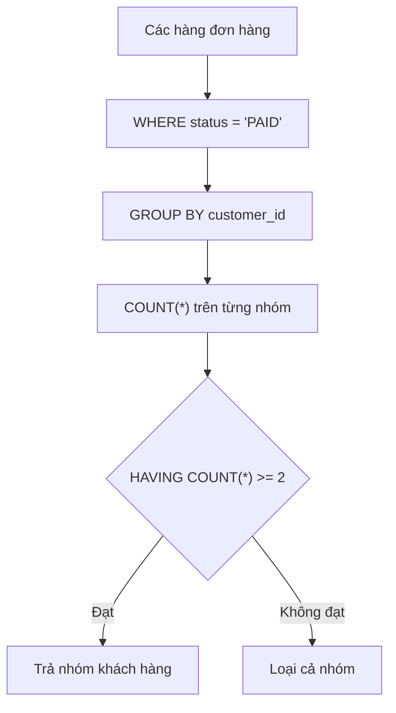

# HAVING và phân biệt lọc nhóm với lọc hàng trong PostgreSQL

Một bảng đơn hàng có thể lưu hàng triệu giao dịch. Khi ứng dụng hỏi **“có những đơn nào đã thanh toán?”**, ta muốn lọc từng hàng của bảng. Nhưng khi hỏi **“khách hàng nào đã thanh toán ít nhất hai đơn?”** hoặc **“tháng nào có doanh thu trên một ngưỡng?”**, ta cần **gom nhiều hàng thành nhóm, tính tổng hợp rồi mới kiểm tra nhóm đó**.

Hai câu hỏi rất khác nhau, dù cùng có từ “lọc”:

- **`WHERE`** chọn **hàng đầu vào** trước khi tổng hợp.
- **`HAVING`** chọn **nhóm** sau khi tính các biểu thức tổng hợp như `COUNT`, `SUM` và `AVG`.

PostgreSQL hỗ trợ cả hai cùng lúc, và còn có cú pháp **`FILTER (WHERE ...)`** để lọc đầu vào cho **từng hàm tổng hợp** mà không loại hàng khỏi các hàm tổng hợp khác. Hiểu rõ ba cơ chế này là nền tảng để viết báo cáo đúng số đơn, doanh thu, số khách hoạt động và tỷ lệ giao dịch.

Bài học thuộc chương **Tổng hợp dữ liệu**, tập trung vào cách phân biệt lọc hàng với lọc nhóm, các lỗi dễ gặp và nhiều ví dụ SQL có kết quả dự kiến rõ ràng.

## 1. Mô hình tư duy: hàng, nhóm và nhóm đạt điều kiện

Giả sử bảng `orders`:

| order_id | customer_id | status | amount |
| ---: | ---: | --- | ---: |
| 101 | 1 | PAID | 120000 |
| 102 | 1 | PAID | 80000 |
| 103 | 1 | PENDING | 50000 |
| 104 | 2 | PAID | 200000 |
| 105 | 2 | CANCELLED | 90000 |
| 106 | 3 | PAID | 70000 |
| 107 | 3 | PAID | 30000 |

Nếu câu hỏi là **“những đơn PAID?”**, ta chọn trực tiếp các hàng có `status = 'PAID'`.

Nếu câu hỏi là **“khách nào có ít nhất hai đơn PAID?”**, ta thực hiện về mặt logic:

1. Chọn các hàng có trạng thái `PAID` bằng `WHERE`.
2. Gom những hàng còn lại theo `customer_id` bằng `GROUP BY`.
3. Đếm số đơn trong mỗi nhóm bằng `COUNT(*)`.
4. Chỉ giữ nhóm có số đơn từ 2 trở lên bằng `HAVING COUNT(*) >= 2`.



Khi một nhóm bị loại bởi `HAVING`, PostgreSQL không xóa các hàng nguồn. Nó chỉ **không trả nhóm đó trong kết quả truy vấn**.

## 2. Thứ tự xử lý logic của một câu truy vấn tổng hợp

Một câu SQL thường được viết theo thứ tự:

```sql
SELECT
    customer_id,
    COUNT(*) AS order_count
FROM orders
WHERE status = 'PAID'
GROUP BY customer_id
HAVING COUNT(*) >= 2
ORDER BY order_count DESC
LIMIT 10;
```

Để hiểu ý nghĩa, hãy hình dung thứ tự **logic**:

| Giai đoạn | Mục đích | Câu hỏi tự kiểm tra |
| --- | --- | --- |
| `FROM` / `JOIN` | Xác định những nguồn hàng và quan hệ nối | Dữ liệu bắt đầu từ đâu? |
| `WHERE` | Loại **từng hàng** không thỏa điều kiện | Những giao dịch nào được phép tham gia tổng hợp? |
| `GROUP BY` | Chia các hàng còn lại thành nhóm | Một nhóm đại diện cho điều gì? |
| Hàm tổng hợp | Tính `COUNT`, `SUM`, `AVG`… cho từng nhóm | Nhóm này có bao nhiêu hàng hoặc tổng bao nhiêu? |
| `HAVING` | Loại **toàn bộ nhóm** không đạt yêu cầu | Nhóm nào được đưa vào báo cáo? |
| `SELECT` | Tạo các biểu thức/cột kết quả | Những thông tin nào được trình bày? |
| `ORDER BY` | Sắp xếp kết quả | Thứ tự hiển thị nào cần được đảm bảo? |
| `LIMIT` / `OFFSET` | Giới hạn số hàng kết quả | Trả bao nhiêu nhóm? |

Đây là **mô hình ngữ nghĩa**, không phải khẳng định executor thực sự chạy các mệnh đề tuần tự theo đúng thứ tự trên. PostgreSQL planner có thể đẩy điều kiện, đổi phương pháp quét hoặc dùng `HashAggregate`/`GroupAggregate` miễn giữ đúng kết quả.

Điểm cần nhớ: **`HAVING` không hoạt động trên các hàng thô như `WHERE`; nó hoạt động trên tập nhóm đã xác định**.

## 3. Chuẩn bị dữ liệu thực hành PostgreSQL

Hãy sử dụng một **database thử nghiệm**. Đoạn SQL dưới đây tạo schema riêng để tránh đụng các bảng khách hàng và đơn hàng của ứng dụng khác. Script giả định bảng chưa tồn tại; không chạy lặp lại các câu `INSERT` trên dữ liệu cũ.

### 3.1. Tạo bảng

```sql
CREATE SCHEMA IF NOT EXISTS having_lab;

CREATE TABLE having_lab.customers (
    customer_id INTEGER PRIMARY KEY,
    full_name   TEXT NOT NULL,
    city        TEXT NOT NULL
);

CREATE TABLE having_lab.orders (
    order_id    INTEGER PRIMARY KEY,
    customer_id INTEGER NOT NULL
        REFERENCES having_lab.customers (customer_id),
    order_date  DATE NOT NULL,
    status      TEXT NOT NULL
        CHECK (status IN ('PAID', 'PENDING', 'CANCELLED')),
    amount      NUMERIC(12, 2) NOT NULL
        CHECK (amount >= 0)
);
```

`NUMERIC(12, 2)` được chọn để minh họa số tiền thập phân chính xác. Trong nghiệp vụ thật cần làm rõ đơn vị tiền, cách tính thuế/giảm giá và chính sách làm tròn; bài này giả sử `amount` là tổng tiền chốt của đơn.

### 3.2. Nạp dữ liệu

```sql
INSERT INTO having_lab.customers
    (customer_id, full_name, city)
VALUES
    (1, 'An', 'Hà Nội'),
    (2, 'Bình', 'TP. Hồ Chí Minh'),
    (3, 'Chi', 'Hà Nội'),
    (4, 'Dũng', 'Huế'),
    (5, 'Em', 'TP. Hồ Chí Minh');

INSERT INTO having_lab.orders
    (order_id, customer_id, order_date, status, amount)
VALUES
    (101, 1, DATE '2026-01-05', 'PAID', 120000),
    (102, 1, DATE '2026-01-10', 'PAID',  80000),
    (103, 1, DATE '2026-02-01', 'PENDING',  50000),
    (104, 2, DATE '2026-01-12', 'PAID', 200000),
    (105, 2, DATE '2026-02-03', 'CANCELLED', 90000),
    (106, 3, DATE '2026-01-18', 'PAID',  70000),
    (107, 3, DATE '2026-01-20', 'PAID',  30000),
    (108, 3, DATE '2026-02-10', 'PENDING',  60000),
    (109, 4, DATE '2026-01-24', 'CANCELLED', 40000);
```

Đặc điểm được cố ý thiết kế:

- An có **3 đơn**, gồm **2 PAID**.
- Bình có **2 đơn**, gồm **1 PAID**.
- Chi có **3 đơn**, gồm **2 PAID**.
- Dũng có **1 đơn CANCELLED**, **0 PAID**.
- Em **chưa có đơn nào**.

Số liệu này giúp phân biệt kết quả do `WHERE`, `HAVING` và `LEFT JOIN` tạo ra.

### 3.3. Kiểm tra bảng trước khi tổng hợp

```sql
SELECT
    order_id,
    customer_id,
    order_date,
    status,
    amount
FROM having_lab.orders
ORDER BY order_id;
```

Nếu dữ liệu được nạp đúng như ví dụ, có **9 hàng**. Các phép tổng hợp bên dưới đều dựa trên đúng bộ dữ liệu này.

## 4. WHERE lọc hàng trước GROUP BY

Ví dụ muốn đếm **số đơn đã thanh toán** theo khách:

```sql
SELECT
    customer_id,
    COUNT(*) AS paid_order_count
FROM having_lab.orders
WHERE status = 'PAID'
GROUP BY customer_id
ORDER BY customer_id;
```

Kết quả:

| customer_id | paid_order_count |
| ---: | ---: |
| 1 | 2 |
| 2 | 1 |
| 3 | 2 |

**Dũng không xuất hiện** vì chỉ có đơn CANCELLED. Em không xuất hiện vì chưa có đơn. Sau `WHERE status = 'PAID'`, không còn hàng nào thuộc hai khách này để tạo nhóm.

### 4.1. Không phải WHERE xóa nhóm

`WHERE` được áp dụng **trước bước hình thành nhóm**. Nó không biết `COUNT(*)` của mỗi khách vì việc đếm chưa diễn ra ở tầng logic này.

Vì thế, câu sau **sai**:

```sql
-- KHÔNG CHẠY: aggregate function không được dùng trong WHERE.
SELECT customer_id, COUNT(*)
FROM having_lab.orders
WHERE COUNT(*) >= 2
GROUP BY customer_id;
```

PostgreSQL sẽ từ chối vì `COUNT(*)` là phép tính của nhóm. Muốn lọc theo số lượng trong nhóm phải dùng `HAVING`.

### 4.2. Lọc theo ngày trước khi gom nhóm

```sql
SELECT
    customer_id,
    COUNT(*) AS january_order_count
FROM having_lab.orders
WHERE order_date >= DATE '2026-01-01'
  AND order_date < DATE '2026-02-01'
GROUP BY customer_id
ORDER BY customer_id;
```

Kết quả theo dữ liệu mẫu:

| customer_id | january_order_count |
| ---: | ---: |
| 1 | 2 |
| 2 | 1 |
| 3 | 2 |
| 4 | 1 |

Đơn tháng 2 **không được đưa vào quá trình đếm**. Nếu cần báo cáo “khách có ít nhất hai đơn trong tháng 1”, sau khi lọc theo ngày còn phải bổ sung `HAVING COUNT(*) >= 2`.

## 5. HAVING lọc nhóm sau khi tính aggregate

Giữ tất cả trạng thái đơn, tìm khách có **từ hai đơn trở lên**:

```sql
SELECT
    customer_id,
    COUNT(*) AS total_orders
FROM having_lab.orders
GROUP BY customer_id
HAVING COUNT(*) >= 2
ORDER BY customer_id;
```

Kết quả:

| customer_id | total_orders |
| ---: | ---: |
| 1 | 3 |
| 2 | 2 |
| 3 | 3 |

`GROUP BY customer_id` tạo bốn nhóm từ các khách có đơn: 1, 2, 3 và 4. Nhóm của Dũng có một hàng, nên bị `HAVING COUNT(*) >= 2` loại. Em không tạo nhóm vì bảng orders không có hàng tương ứng.

### 5.1. HAVING có thể dùng nhiều phép tổng hợp

Giả sử muốn tìm khách **có ít nhất hai đơn và tổng giá trị mọi đơn từ 150.000 trở lên**:

```sql
SELECT
    customer_id,
    COUNT(*) AS order_count,
    SUM(amount) AS total_amount
FROM having_lab.orders
GROUP BY customer_id
HAVING COUNT(*) >= 2
   AND SUM(amount) >= 150000
ORDER BY customer_id;
```

Kết quả:

| customer_id | order_count | total_amount |
| ---: | ---: | ---: |
| 1 | 3 | 250000.00 |
| 2 | 2 | 290000.00 |
| 3 | 3 | 160000.00 |

Tổng ở đây **bao gồm mọi trạng thái** vì chưa có `WHERE status='PAID'`. Nếu muốn doanh thu đã thu thực tế, không thể mặc định cộng cả `PENDING`/`CANCELLED`; cần lọc/định nghĩa rõ giao dịch nào được tính.

### 5.2. HAVING với SUM, AVG, MIN và MAX

`HAVING` không chỉ dùng được với `COUNT(*)`. Ví dụ:

```sql
SELECT
    customer_id,
    AVG(amount) AS average_order_amount,
    MAX(amount) AS largest_order
FROM having_lab.orders
GROUP BY customer_id
HAVING AVG(amount) >= 100000
ORDER BY customer_id;
```

Trong dữ liệu mẫu, Bình có trung bình `(200000 + 90000)/2 = 145000` nên đạt ngưỡng; An có trung bình khoảng 83.333,33, Chi khoảng 53.333,33 và Dũng 40.000 nên không đạt.

Điều quan trọng là quyết định **đầu vào của AVG**: ở trên nó bao gồm cả đơn PAID, PENDING, CANCELLED. Nếu nghiệp vụ hỏi “giá trị trung bình của đơn đã thanh toán”, phải lọc trạng thái trước hoặc dùng `FILTER` cho aggregate thích hợp.

### 5.3. HAVING không bắt buộc liệt kê cùng aggregate ở SELECT

PostgreSQL cho phép:

```sql
SELECT customer_id
FROM having_lab.orders
GROUP BY customer_id
HAVING COUNT(*) >= 2
ORDER BY customer_id;
```

Kết quả là ba mã khách 1, 2, 3, dù `COUNT(*)` **không xuất hiện trong danh sách SELECT**. `HAVING` yêu cầu điều kiện đánh giá được trên nhóm, không đòi mọi phép tổng hợp phải hiển thị.

## 6. Kết hợp WHERE và HAVING trong một truy vấn

Câu hỏi: **“Khách nào có ít nhất hai đơn PAID?”**

```sql
SELECT
    customer_id,
    COUNT(*) AS paid_orders
FROM having_lab.orders
WHERE status = 'PAID'
GROUP BY customer_id
HAVING COUNT(*) >= 2
ORDER BY customer_id;
```

Kết quả:

| customer_id | paid_orders |
| ---: | ---: |
| 1 | 2 |
| 3 | 2 |

**Bình không đạt** vì chỉ một đơn PAID, dù có tổng cộng hai đơn. Câu này cho thấy:

- `WHERE status='PAID'` xác định **loại hàng** được đưa vào nhóm.
- `GROUP BY customer_id` xác định **đơn vị thống kê**.
- `HAVING COUNT(*) >= 2` xác định **điều kiện chấp nhận nhóm**.

### 6.1. Một thay đổi nhỏ có thể đổi ý nghĩa báo cáo

So sánh hai yêu cầu:

**A. Khách có ít nhất hai đơn, và ta muốn xem giá trị các đơn PAID của khách đó.**

**B. Khách có ít nhất hai đơn PAID.**

Hai yêu cầu không tương đương. Với Bình, A có thể chấp nhận khách vì có hai đơn tổng cộng, còn B từ chối vì chỉ một đơn PAID.

Nếu lỡ đặt `WHERE status='PAID'` trong truy vấn của A rồi dùng `COUNT(*) >= 2`, ta đã thay đổi điều kiện từ **“hai đơn bất kỳ”** sang **“hai đơn PAID”**. Đây là lỗi nghiệp vụ rất phổ biến và khó nhận ra nếu dữ liệu thử nghiệm thiếu các trạng thái khác nhau.

## 7. FILTER (WHERE ...): lọc đầu vào cho từng aggregate

PostgreSQL hỗ trợ cú pháp:

```sql
aggregate_function(...) FILTER (WHERE condition)
```

Đây là một **bộ lọc gắn với hàm tổng hợp riêng lẻ**. Nó không loại toàn bộ hàng khỏi những aggregate khác trong cùng nhóm.

Ví dụ muốn xem **tổng số đơn**, **số đơn PAID** và **doanh thu PAID** của từng khách:

```sql
SELECT
    customer_id,
    COUNT(*) AS all_orders,
    COUNT(*) FILTER (WHERE status = 'PAID') AS paid_orders,
    COALESCE(
        SUM(amount) FILTER (WHERE status = 'PAID'),
        0
    ) AS paid_amount
FROM having_lab.orders
GROUP BY customer_id
ORDER BY customer_id;
```

Kết quả:

| customer_id | all_orders | paid_orders | paid_amount |
| ---: | ---: | ---: | ---: |
| 1 | 3 | 2 | 200000.00 |
| 2 | 2 | 1 | 200000.00 |
| 3 | 3 | 2 | 100000.00 |
| 4 | 1 | 0 | 0.00 |

Giải thích:

- `COUNT(*)` đếm **mọi đơn** trong nhóm.
- `COUNT(*) FILTER (WHERE status='PAID')` chỉ đếm đơn PAID.
- `SUM(amount) FILTER (WHERE status='PAID')` chỉ cộng tiền của đơn PAID.
- `COALESCE(...,0)` đưa tổng không có hàng phù hợp về 0 thay vì `NULL`.

### 7.1. FILTER khác WHERE của câu SELECT

Nếu thay bằng:

```sql
SELECT
    customer_id,
    COUNT(*) AS all_orders
FROM having_lab.orders
WHERE status = 'PAID'
GROUP BY customer_id;
```

thì `all_orders` thực ra **chỉ đếm đơn PAID**; các đơn PENDING/CANCELLED không còn là đầu vào của bất kỳ aggregate nào. Vì vậy, khi cần thống kê nhiều trạng thái trong **cùng một hàng kết quả**, `FILTER` giúp câu SQL rõ nghĩa và hạn chế viết nhiều truy vấn con.

### 7.2. Dùng FILTER ngay trong HAVING

Câu hỏi: **“Khách có ít nhất hai đơn PAID nhưng vẫn hiển thị tổng số đơn mọi trạng thái?”**

```sql
SELECT
    customer_id,
    COUNT(*) AS all_orders,
    COUNT(*) FILTER (WHERE status = 'PAID') AS paid_orders
FROM having_lab.orders
GROUP BY customer_id
HAVING COUNT(*) FILTER (WHERE status = 'PAID') >= 2
ORDER BY customer_id;
```

Kết quả là:

| customer_id | all_orders | paid_orders |
| ---: | ---: | ---: |
| 1 | 3 | 2 |
| 3 | 3 | 2 |

Truy vấn này **khác** việc lọc trước với `WHERE status='PAID'`: điều kiện chọn khách giống trong bộ dữ liệu này, nhưng cột `all_orders` là **3**, không phải **2**.

### 7.3. FILTER có thể viết bằng CASE, nhưng ý nghĩa phải rõ

Một cách quen thuộc:

```sql
SELECT
    customer_id,
    SUM(CASE WHEN status = 'PAID' THEN 1 ELSE 0 END)
        AS paid_orders
FROM having_lab.orders
GROUP BY customer_id;
```

Với dữ liệu này, kết quả đếm tương đương:

```sql
COUNT(*) FILTER (WHERE status = 'PAID')
```

Tuy nhiên, hai cách không phải là hai biểu thức thay thế máy móc cho mọi aggregate: `COUNT(CASE WHEN ... THEN 1 ELSE 0 END)` sẽ đếm **mọi hàng**, vì giá trị 0 vẫn **khác NULL**. Muốn dùng CASE với COUNT, có thể viết `COUNT(CASE WHEN status='PAID' THEN 1 END)`.

**Khuyến nghị:** khi PostgreSQL hỗ trợ `FILTER` và bạn chỉ muốn điều kiện riêng cho aggregate, dùng `FILTER (WHERE ...)` thường dễ đọc hơn.

## 8. Phân biệt WHERE, FILTER và HAVING qua một bảng

| Tính năng | `WHERE` cấp SELECT | `FILTER (WHERE ...)` | `HAVING` |
| --- | --- | --- | --- |
| Lọc đối tượng nào? | **Hàng** của nguồn truy vấn | **Hàng đầu vào một aggregate** | **Nhóm** sau tổng hợp |
| Nằm ở đâu? | Sau `FROM`/`JOIN`, trước `GROUP BY` | Sau lời gọi hàm aggregate | Sau `GROUP BY` |
| Dùng `COUNT(*)` trực tiếp trong điều kiện? | **Không** | Phần điều kiện FILTER không được dùng aggregate tùy ý của cùng tầng như giá trị hàng | **Có** |
| Ảnh hưởng tất cả aggregate trong SELECT? | **Có** | **Không**, chỉ aggregate gắn FILTER | **Không đổi giá trị nhóm**; quyết định nhóm có được trả hay không |
| Dùng không có GROUP BY? | Có | Có, trên aggregate tương ứng | Có, với nhóm ngầm |
| Ví dụ | `WHERE status='PAID'` | `COUNT(*) FILTER (WHERE status='PAID')` | `HAVING COUNT(*) >= 2` |

Hãy tự kiểm tra: **mình muốn bỏ từng giao dịch, chỉ đếm một loại giao dịch, hay bỏ cả khách hàng sau khi thống kê?** Trả lời được câu này sẽ giúp chọn đúng vị trí của điều kiện.

## 9. HAVING có thể không có GROUP BY

Thông thường `HAVING` đi cùng `GROUP BY`. Tuy nhiên, PostgreSQL cũng cho phép `HAVING` trong một truy vấn tổng hợp **không có GROUP BY tường minh**: toàn bộ các hàng đầu vào được xem là **một nhóm ngầm**.

Ví dụ chỉ trả số đơn nếu tổng số đơn đạt ít nhất 5:

```sql
SELECT COUNT(*) AS total_orders
FROM having_lab.orders
HAVING COUNT(*) >= 5;
```

Với dữ liệu mẫu có 9 đơn, kết quả là **một hàng** có `total_orders = 9`.

Đổi ngưỡng:

```sql
SELECT COUNT(*) AS total_orders
FROM having_lab.orders
HAVING COUNT(*) >= 10;
```

Kết quả là **0 hàng**, không phải một hàng có giá trị 0. Nhóm ngầm đã bị `HAVING` loại.

### 9.1. So sánh với chỉ dùng WHERE

```sql
SELECT COUNT(*) AS paid_orders
FROM having_lab.orders
WHERE status = 'PAID';
```

Kết quả là một hàng có **5** vì tổng số đơn PAID là 5. Nếu không có hàng PAID, `COUNT(*)` vẫn trả một hàng với số đếm 0.

Ngược lại, thêm `HAVING COUNT(*) > 0` có thể khiến kết quả trở thành **0 hàng** khi không có đơn thỏa điều kiện. Phải phân biệt “không có nhóm kết quả” với “nhóm có số đếm 0”, đặc biệt khi API kỳ vọng luôn có đúng một dòng tổng hợp.

### 9.2. Truy vấn có HAVING nhưng không có aggregate

Về ngữ nghĩa PostgreSQL, việc xuất hiện `HAVING` làm truy vấn được coi như truy vấn có grouping, dù không khai báo `GROUP BY`. Khi không có nhóm tường minh, kết quả không thể tùy ý chọn các cột hàng thô:

```sql
-- Không hợp lệ: order_id là cột hàng riêng lẻ,
-- không được tổng hợp hoặc đưa vào GROUP BY.
SELECT order_id
FROM having_lab.orders
HAVING TRUE;
```

Đừng dùng `HAVING` thay cho `WHERE` chỉ vì cùng chấp nhận biểu thức điều kiện. Nếu cần các đơn có `order_id > 100`, viết `WHERE order_id > 100`.

## 10. Các cột được phép xuất hiện trong HAVING

Khi `GROUP BY customer_id`, mỗi nhóm đại diện cho **một customer_id**. Các biểu thức trong `SELECT` và `HAVING` phải có nghĩa ở cấp nhóm.

Hợp lệ:

```sql
SELECT customer_id, COUNT(*) AS order_count
FROM having_lab.orders
GROUP BY customer_id
HAVING customer_id IN (1, 3)
   AND COUNT(*) >= 2
ORDER BY customer_id;
```

Ở đây:

- `customer_id` là **cột khóa nhóm**.
- `COUNT(*)` là **giá trị tổng hợp của nhóm**.

Ví dụ sai:

```sql
-- KHÔNG CHẠY: status không nằm trong GROUP BY
-- và không được bọc trong aggregate.
SELECT customer_id, COUNT(*)
FROM having_lab.orders
GROUP BY customer_id
HAVING status = 'PAID';
```

Một khách có thể có nhiều trạng thái đơn, nên sau khi gom theo customer_id, PostgreSQL không có **một giá trị status duy nhất** để kiểm tra ở cấp nhóm.

Nếu ý định là đếm PAID, viết:

```sql
SELECT customer_id, COUNT(*) AS paid_count
FROM having_lab.orders
WHERE status = 'PAID'
GROUP BY customer_id
HAVING COUNT(*) >= 2;
```

Nếu ý định là **chọn nhóm có ít nhất một đơn PAID**, nhưng vẫn đếm mọi đơn:

```sql
SELECT customer_id, COUNT(*) AS all_orders
FROM having_lab.orders
GROUP BY customer_id
HAVING COUNT(*) FILTER (WHERE status = 'PAID') > 0;
```

**Ngoại lệ ngữ nghĩa:** PostgreSQL có một số quy tắc nhận biết phụ thuộc hàm, ví dụ khi group theo khóa chính của một bảng cơ sở, một số cột khác của cùng bảng được phép xuất hiện mà không viết riêng trong `GROUP BY`. Tuy nhiên, không nên mặc định hệ thống suy luận mọi quan hệ phụ thuộc hàm qua JOIN/view/biểu thức phức tạp. Khi mới học, hãy dùng cột nhóm hoặc aggregate tường minh.

## 11. Bí danh SELECT trong HAVING: lỗi thường gặp

Ví dụ:

```sql
SELECT
    customer_id,
    COUNT(*) AS order_count
FROM having_lab.orders
GROUP BY customer_id
HAVING order_count >= 2;
```

Trong PostgreSQL, bí danh `order_count` vừa được tạo trong danh sách `SELECT` **không tự được nhận diện ở HAVING trong cùng tầng SELECT**. Câu này báo lỗi nếu không có cột nguồn trùng tên.

Cách đúng là lặp biểu thức:

```sql
SELECT
    customer_id,
    COUNT(*) AS order_count
FROM having_lab.orders
GROUP BY customer_id
HAVING COUNT(*) >= 2
ORDER BY order_count DESC;
```

**`ORDER BY order_count` hợp lệ** vì PostgreSQL cho phép tham chiếu alias đầu ra ở `ORDER BY`.

### 11.1. Muốn lọc theo tên alias thì dùng CTE/subquery

```sql
WITH customer_counts AS (
    SELECT
        customer_id,
        COUNT(*) AS order_count
    FROM having_lab.orders
    GROUP BY customer_id
)
SELECT
    customer_id,
    order_count
FROM customer_counts
WHERE order_count >= 2
ORDER BY order_count DESC, customer_id;
```

Ở query ngoài, `order_count` đã là **cột đầu ra của CTE**, nên `WHERE order_count >= 2` hoàn toàn hợp lệ.

Hai cách thường tương đương về kết quả, nhưng phục vụ mục tiêu đọc hiểu khác:

- `HAVING COUNT(*) >= 2`: gọn và trực tiếp ở bước tổng hợp.
- CTE/subquery: phù hợp khi cần sử dụng **nhiều điều kiện trên các số liệu đã đặt tên**, nhiều bước báo cáo hoặc join tiếp với dữ liệu khác.

Không cần tạo bảng vật lý chỉ để có tên alias cho một điều kiện nhóm.

## 12. COUNT(*), COUNT(column), COUNT(DISTINCT ...) và NULL

Kết quả lọc nhóm có thể sai nếu dùng sai loại đếm.

| Aggregate | Đếm gì? | Xử lý NULL |
| --- | --- | --- |
| `COUNT(*)` | Mọi hàng trong nhóm | Đếm cả hàng có cột NULL |
| `COUNT(column)` | Số hàng mà `column IS NOT NULL` | Bỏ qua NULL |
| `COUNT(DISTINCT column)` | Số giá trị **khác nhau và không NULL** | Bỏ qua NULL và giá trị trùng |
| `SUM(column)` | Tổng các giá trị không NULL | Bỏ qua NULL; nhóm không có giá trị phù hợp trả NULL |
| `AVG(column)` | Trung bình các giá trị không NULL | Bỏ qua NULL; không có đầu vào phù hợp trả NULL |

Ví dụ độc lập:

```sql
WITH values_demo(group_id, value) AS (
    VALUES
        (1, 10),
        (1, 10),
        (1, NULL::integer),
        (1, 20),
        (2, NULL::integer)
)
SELECT
    group_id,
    COUNT(*) AS row_count,
    COUNT(value) AS nonnull_count,
    COUNT(DISTINCT value) AS unique_values,
    SUM(value) AS value_sum,
    AVG(value) AS value_avg
FROM values_demo
GROUP BY group_id
ORDER BY group_id;
```

Kết quả:

| group_id | row_count | nonnull_count | unique_values | value_sum | value_avg |
| ---: | ---: | ---: | ---: | ---: | ---: |
| 1 | 4 | 3 | 2 | 40 | 13.333... |
| 2 | 1 | 0 | 0 | NULL | NULL |

Nếu viết `HAVING COUNT(value) >= 1`, nhóm 2 bị loại; còn `HAVING COUNT(*) >= 1` giữ nhóm 2.

### 12.1. HAVING SUM(...) và UNKNOWN

Với nhóm không có giá trị số khác NULL, `SUM(value)` trả `NULL`. Do đó:

```sql
HAVING SUM(value) > 100
```

đánh giá thành **UNKNOWN** nếu SUM là NULL; nhóm không được giữ vì HAVING chỉ giữ điều kiện **TRUE**.

Khi nghiệp vụ muốn coi “không có giá trị” là 0, có thể viết:

```sql
HAVING COALESCE(SUM(value), 0) >= 0
```

Nhưng đừng tự động đổi mọi NULL thành 0: **“chưa có dữ liệu”** và **“dữ liệu có tổng bằng 0”** đôi khi mang nghĩa nghiệp vụ khác nhau.

## 13. LEFT JOIN, nhóm rỗng và đếm khách chưa mua

Trong dữ liệu mẫu, **Em** chưa có đơn. Nếu bắt đầu từ `having_lab.orders`, không có hàng nào tạo nhóm cho Em. Muốn báo cáo **tất cả khách hàng**, phải bắt đầu từ `customers` và dùng `LEFT JOIN`.

```sql
SELECT
    c.customer_id,
    c.full_name,
    COUNT(o.order_id) AS all_orders,
    COUNT(o.order_id) FILTER (WHERE o.status = 'PAID')
        AS paid_orders,
    COALESCE(
        SUM(o.amount) FILTER (WHERE o.status = 'PAID'),
        0
    ) AS paid_amount
FROM having_lab.customers AS c
LEFT JOIN having_lab.orders AS o
  ON o.customer_id = c.customer_id
GROUP BY c.customer_id, c.full_name
ORDER BY c.customer_id;
```

Kết quả:

| customer_id | full_name | all_orders | paid_orders | paid_amount |
| ---: | --- | ---: | ---: | ---: |
| 1 | An | 3 | 2 | 200000.00 |
| 2 | Bình | 2 | 1 | 200000.00 |
| 3 | Chi | 3 | 2 | 100000.00 |
| 4 | Dũng | 1 | 0 | 0.00 |
| 5 | Em | 0 | 0 | 0.00 |

### 13.1. Vì sao không dùng COUNT(*) để đếm đơn sau LEFT JOIN?

`LEFT JOIN` vẫn tạo một hàng kết quả cho khách Em; các cột phía `orders` nhận `NULL` do không khớp. Vì vậy:

```sql
COUNT(*)
```

**đếm 1** cho Em, trong khi:

```sql
COUNT(o.order_id)
```

**đếm 0**, vì `o.order_id` là NULL. Đây là một trong những lỗi đếm phổ biến nhất khi chuyển từ `INNER JOIN` sang `LEFT JOIN`.

### 13.2. HAVING tìm khách không có đơn

```sql
SELECT
    c.customer_id,
    c.full_name,
    COUNT(o.order_id) AS order_count
FROM having_lab.customers AS c
LEFT JOIN having_lab.orders AS o
  ON o.customer_id = c.customer_id
GROUP BY c.customer_id, c.full_name
HAVING COUNT(o.order_id) = 0
ORDER BY c.customer_id;
```

Kết quả chỉ có **Em**.

Có thể giải quyết yêu cầu tồn tại/không tồn tại hiệu quả và rõ nghĩa bằng `NOT EXISTS`:

```sql
SELECT c.customer_id, c.full_name
FROM having_lab.customers AS c
WHERE NOT EXISTS (
    SELECT 1
    FROM having_lab.orders AS o
    WHERE o.customer_id = c.customer_id
);
```

Khi chỉ cần kiểm tra **có hay không** quan hệ, `EXISTS`/`NOT EXISTS` thường diễn đạt ý định trực tiếp hơn việc group rồi `HAVING COUNT(...) = 0`.

### 13.3. Đặt bộ lọc ở ON hay WHERE của LEFT JOIN?

Giữ **tất cả khách** và chỉ nối đơn PAID:

```sql
SELECT
    c.customer_id,
    c.full_name,
    COUNT(o.order_id) AS paid_orders
FROM having_lab.customers AS c
LEFT JOIN having_lab.orders AS o
  ON o.customer_id = c.customer_id
 AND o.status = 'PAID'
GROUP BY c.customer_id, c.full_name
ORDER BY c.customer_id;
```

Kết quả có **năm khách**, gồm Dũng và Em với `paid_orders = 0`.

Nếu chuyển `o.status = 'PAID'` xuống `WHERE`:

```sql
SELECT
    c.customer_id,
    c.full_name,
    COUNT(o.order_id) AS paid_orders
FROM having_lab.customers AS c
LEFT JOIN having_lab.orders AS o
  ON o.customer_id = c.customer_id
WHERE o.status = 'PAID'
GROUP BY c.customer_id, c.full_name
ORDER BY c.customer_id;
```

thì các hàng khách không có đơn PAID bị loại ở `WHERE`, và báo cáo chỉ còn An, Bình, Chi. **Điều kiện đặt ở ON và WHERE không luôn tương đương với OUTER JOIN**. Đây là khác biệt về kết quả, không chỉ về hiệu năng.

## 14. HAVING với nhiều chiều phân nhóm

Không phải nhóm nào cũng là một khách. Bạn có thể nhóm theo trạng thái, thành phố, tháng hoặc **tổ hợp nhiều cột**.

### 14.1. Nhóm theo trạng thái

```sql
SELECT
    status,
    COUNT(*) AS order_count,
    SUM(amount) AS total_amount
FROM having_lab.orders
GROUP BY status
HAVING COUNT(*) >= 2
ORDER BY status;
```

Kết quả:

| status | order_count | total_amount |
| --- | ---: | ---: |
| CANCELLED | 2 | 130000.00 |
| PAID | 5 | 500000.00 |
| PENDING | 2 | 110000.00 |

Điều kiện `HAVING COUNT(*) >= 2` áp dụng **trên từng nhóm status**, không phải trên từng khách. Cùng một biểu thức `COUNT(*)` nhưng thay `GROUP BY` sẽ thay đổi hoàn toàn ý nghĩa báo cáo.

### 14.2. Nhóm theo thành phố và trạng thái

```sql
SELECT
    c.city,
    o.status,
    COUNT(*) AS order_count,
    SUM(o.amount) AS total_amount
FROM having_lab.customers AS c
JOIN having_lab.orders AS o
  ON o.customer_id = c.customer_id
GROUP BY c.city, o.status
HAVING COUNT(*) >= 2
ORDER BY c.city, o.status;
```

Kết quả các nhóm đạt ngưỡng:

| city | status | order_count | total_amount |
| --- | --- | ---: | ---: |
| Hà Nội | PAID | 4 | 300000.00 |
| Hà Nội | PENDING | 2 | 110000.00 |

Giải thích: An và Chi đều ở Hà Nội. Cộng hai khách tạo bốn đơn PAID và hai đơn PENDING; các nhóm khác chỉ có tối đa một đơn cho mỗi trạng thái.

**Cảnh báo về độ hạt:** `GROUP BY c.city, o.status` tạo nhóm theo cặp **(thành phố, trạng thái)**, không tạo nhóm riêng cho từng khách. Nếu muốn “mỗi khách trong mỗi thành phố”, phải đưa cả định danh khách vào khóa nhóm.

### 14.3. Nhóm theo tháng

```sql
SELECT
    date_trunc('month', order_date::timestamp)::date
        AS month_start,
    COUNT(*) AS order_count,
    SUM(amount) AS total_amount
FROM having_lab.orders
GROUP BY date_trunc('month', order_date::timestamp)::date
HAVING COUNT(*) >= 3
ORDER BY month_start;
```

Kết quả:

| month_start | order_count | total_amount |
| --- | ---: | ---: |
| 2026-01-01 | 6 | 540000.00 |
| 2026-02-01 | 3 | 200000.00 |

`date_trunc('month', ...)` tạo mốc đầu tháng trong biểu diễn tương ứng; cast `::date` làm kết quả gọn cho dữ liệu `DATE`. Trong hệ thống dùng `TIMESTAMPTZ`, phải xác định **múi giờ nghiệp vụ** trước khi nhóm theo ngày/tháng, vì cùng một thời điểm UTC có thể thuộc hai ngày khác nhau ở hai múi giờ.

### 14.4. ROLLUP và nhóm tổng

PostgreSQL hỗ trợ `ROLLUP` để lấy các mức nhóm chi tiết và tổng hợp:

```sql
SELECT
    status,
    GROUPING(status) AS is_grand_total,
    COUNT(*) AS order_count,
    SUM(amount) AS total_amount
FROM having_lab.orders
GROUP BY ROLLUP(status)
HAVING COUNT(*) >= 2
ORDER BY GROUPING(status), status;
```

Trong ví dụ này, các nhóm trạng thái có số lượng 2/5/2 và hàng tổng có **9** đơn. `GROUPING(status)` bằng 1 tại hàng tổng, giúp phân biệt **NULL tạo ra do cấp tổng hợp** với một giá trị NULL thực nếu cột được phép NULL.

Muốn **chỉ lấy hàng chi tiết, không lấy hàng tổng**:

```sql
HAVING GROUPING(status) = 0
   AND COUNT(*) >= 2
```

Đây là ví dụ nâng cao cho thấy `HAVING` có thể lọc theo **cấp grouping** chứ không chỉ theo `SUM`/`COUNT`. Với bài toán báo cáo đơn giản, `GROUP BY` bình thường thường dễ đọc hơn.

## 15. HAVING và JOIN: tránh số liệu bị nhân bội

Một rủi ro lớn trong báo cáo là **JOIN hai bảng con 1:N rồi mới GROUP BY**. Số hàng bị nhân ra trước khi aggregate, làm `HAVING` dựa trên số liệu sai.

Giả sử đơn 101 có:

- **2 dòng hàng**: 90.000 và 30.000.
- **2 lần thử thanh toán**: lần 1 FAILED, lần 2 SUCCEEDED.

Nếu JOIN trực tiếp các dòng hàng với lần thử thanh toán:

```sql
WITH order_lines(order_id, line_id, line_amount) AS (
    VALUES
        (101, 1, 90000::numeric),
        (101, 2, 30000::numeric)
),
payment_attempts(order_id, attempt_id, result) AS (
    VALUES
        (101, 1, 'FAILED'),
        (101, 2, 'SUCCEEDED')
)
SELECT
    l.order_id,
    COUNT(*) AS joined_rows,
    SUM(l.line_amount) AS incorrect_total
FROM order_lines AS l
JOIN payment_attempts AS p
  ON p.order_id = l.order_id
GROUP BY l.order_id;
```

Kết quả:

| order_id | joined_rows | incorrect_total |
| ---: | ---: | ---: |
| 101 | 4 | 240000 |

Tổng thực của hai dòng chỉ **120.000**. JOIN 2 dòng × 2 attempts tạo **4 cặp**, khiến tổng dòng hàng bị cộng **hai lần**.

### 15.1. Sửa bằng tổng hợp trước từng nhánh

```sql
WITH order_lines(order_id, line_id, line_amount) AS (
    VALUES
        (101, 1, 90000::numeric),
        (101, 2, 30000::numeric)
),
payment_attempts(order_id, attempt_id, result) AS (
    VALUES
        (101, 1, 'FAILED'),
        (101, 2, 'SUCCEEDED')
),
line_totals AS (
    SELECT
        order_id,
        COUNT(*) AS line_count,
        SUM(line_amount) AS correct_total
    FROM order_lines
    GROUP BY order_id
),
attempt_counts AS (
    SELECT
        order_id,
        COUNT(*) AS attempt_count
    FROM payment_attempts
    GROUP BY order_id
)
SELECT
    l.order_id,
    l.line_count,
    l.correct_total,
    a.attempt_count
FROM line_totals AS l
JOIN attempt_counts AS a
  ON a.order_id = l.order_id;
```

Kết quả có một hàng cho đơn 101, với `line_count = 2`, `correct_total = 120000`, `attempt_count = 2`.

**Không nên chữa fan-out bằng `SUM(DISTINCT line_amount)`**: nếu hai dòng hàng có cùng giá trị tiền, `DISTINCT` sẽ loại một giá trị hợp lệ và tiếp tục làm sai báo cáo. Cần sửa **độ hạt** của phép JOIN, không chỉ áp `DISTINCT` lên số tiền.

### 15.2. HAVING không thể tự sửa aggregate đã sai

Nếu viết `HAVING SUM(l.line_amount) >= 200000` sau JOIN sai, đơn 101 có thể vượt ngưỡng do tổng bị nhân đôi, mặc dù thực tế chỉ 120.000. `HAVING` lọc nhóm theo **giá trị được tính từ đầu vào hiện tại**; nó không hiểu nghiệp vụ để tự phát hiện những dòng bị JOIN nhân bội.

Vì vậy, trước khi đặt HAVING trên kết quả JOIN, hãy xác định **một hàng ở tầng GROUP BY đang đại diện cho đối tượng gì**, sau đó kiểm tra tính duy nhất của các khóa nối.

## 16. HAVING, window functions và nhu cầu giữ từng dòng

`GROUP BY` gom nhiều hàng thành một hàng kết quả cho mỗi nhóm. Tuy nhiên, có khi báo cáo muốn **giữ từng đơn hàng** nhưng chỉ hiển thị đơn của khách có từ hai đơn trở lên.

Nếu dùng:

```sql
SELECT customer_id, COUNT(*) AS order_count
FROM having_lab.orders
GROUP BY customer_id
HAVING COUNT(*) >= 2;
```

kết quả chỉ có **một hàng cho mỗi customer_id**, không còn các `order_id` riêng.

Khi cần giữ từng hàng, dùng **window function**:

```sql
WITH orders_with_counts AS (
    SELECT
        order_id,
        customer_id,
        status,
        amount,
        COUNT(*) OVER (PARTITION BY customer_id)
            AS customer_order_count
    FROM having_lab.orders
)
SELECT
    order_id,
    customer_id,
    status,
    amount,
    customer_order_count
FROM orders_with_counts
WHERE customer_order_count >= 2
ORDER BY customer_id, order_id;
```

Kết quả có **8 hàng**: tất cả đơn của An (3), Bình (2), Chi (3). Đơn của Dũng bị loại vì khách chỉ có một đơn; Em không có hàng nguồn.

### 16.1. Vì sao không đặt window function ngay vào HAVING?

Các window function như `COUNT(*) OVER (...)` hoạt động ở giai đoạn logic khác với hàm tổng hợp nhóm. Trong PostgreSQL, không thể đặt window function trực tiếp trong `WHERE` hoặc `HAVING` của cùng tầng truy vấn. Cần **CTE/subquery** để tạo cột window trước, sau đó lọc ở tầng SELECT ngoài.

Nhớ quy tắc:

- Muốn **một hàng mỗi nhóm**: `GROUP BY ... HAVING ...`.
- Muốn **giữ từng hàng nhưng gắn thống kê theo nhóm**: `OVER (PARTITION BY ...)` rồi lọc ở truy vấn ngoài.

## 17. Chọn WHERE hay HAVING để tối ưu hiệu năng?

Khi cùng một điều kiện có thể đặt ở nhiều vị trí, cách viết rõ ý nghĩa thường giúp optimizer và người bảo trì.

### 17.1. Lọc hàng càng sớm càng phù hợp

Giả sử chỉ cần thống kê đơn tháng 1:

```sql
SELECT
    customer_id,
    COUNT(*) AS january_orders
FROM having_lab.orders
WHERE order_date >= DATE '2026-01-01'
  AND order_date < DATE '2026-02-01'
GROUP BY customer_id
HAVING COUNT(*) >= 2;
```

`WHERE` xác định đầu vào gồm những hàng tháng 1. Trong workload lớn, nó có thể giảm số hàng phải đưa vào aggregate, và có thể tận dụng index hay partition pruning nếu schema hỗ trợ.

Một câu tương tự về logic:

```sql
SELECT customer_id, COUNT(*)
FROM having_lab.orders
GROUP BY customer_id
HAVING customer_id = 1;
```

có thể được PostgreSQL **đẩy điều kiện trên khóa nhóm** vào trước grouping. Nhưng nếu mục tiêu là **chỉ lấy giao dịch của khách 1 rồi tổng hợp**, thường viết:

```sql
SELECT customer_id, COUNT(*)
FROM having_lab.orders
WHERE customer_id = 1
GROUP BY customer_id;
```

sẽ thể hiện ý định rõ hơn.

**Không nên kết luận rằng cứ xuất hiện HAVING thì truy vấn luôn chậm hơn WHERE**: PostgreSQL planner tối ưu nhiều điều kiện tương đương. Nhưng điều kiện dựa trên `SUM` hoặc `COUNT` thực sự phải đánh giá sau khi đã có thông tin nhóm, nên không thể thay thế bằng WHERE đơn giản mà giữ nguyên kết quả trong mọi trường hợp.

### 17.2. Chỉ mục không trực tiếp “lọc SUM trước khi SUM tồn tại”

Một index trên `(customer_id, order_date)` có thể hỗ trợ truy cập các hàng cần tổng hợp nếu điều kiện `WHERE` phù hợp. Tuy nhiên, predicate `HAVING SUM(amount) >= 200000` không phải phép so sánh trực tiếp với **một hàng** trong index thông thường; PostgreSQL thường cần tổng hợp dữ liệu của mỗi nhóm trước khi quyết định nhóm đạt ngưỡng.

Với báo cáo lặp đi lặp lại trên dữ liệu rất lớn, có thể cân nhắc:

- Điều kiện `WHERE` chọn lọc hơn khi đúng nghĩa nghiệp vụ.
- Chỉ mục phù hợp với cột lọc và khóa nhóm.
- Partition theo thời gian nếu khối lượng dữ liệu và vận hành phù hợp.
- Bảng tổng hợp được duy trì có kiểm soát hoặc materialized view khi chấp nhận độ trễ cập nhật.
- Cache báo cáo với chính sách invalidation rõ ràng.

Mọi lựa chọn đều có chi phí bảo trì và phải đo trên workload thật.

## 18. Đọc kế hoạch bằng EXPLAIN và EXPLAIN ANALYZE

PostgreSQL có thể thực hiện aggregation bằng những node khác nhau:

| Node thường thấy | Ý nghĩa |
| --- | --- |
| `Seq Scan` / `Index Scan` / `Bitmap Heap Scan` | Truy xuất các hàng nguồn |
| `HashAggregate` | Gom nhóm bằng bảng băm |
| `GroupAggregate` | Gom nhóm trên đầu vào có thứ tự phù hợp |
| `Sort` | Sắp xếp dữ liệu khi cần |
| `Aggregate` | Tổng hợp không chia nhóm tường minh hoặc trường hợp thích hợp |
| `Filter` trên node aggregate | Có thể biểu diễn điều kiện `HAVING` trong plan |

Thử:

```sql
EXPLAIN
SELECT
    customer_id,
    COUNT(*) AS paid_orders
FROM having_lab.orders
WHERE status = 'PAID'
GROUP BY customer_id
HAVING COUNT(*) >= 2;
```

Một kế hoạch **minh họa, không phải output cố định từ server**:

```text
HashAggregate
  Group Key: customer_id
  Filter: (count(*) >= 2)
  -> Seq Scan on orders
       Filter: (status = 'PAID')
```

Phân biệt hai bộ lọc:

- `Filter: (status = 'PAID')` ở scan node có thể tương ứng với **WHERE lọc hàng**.
- `Filter: (count(*) >= 2)` ở aggregate node có thể tương ứng với **HAVING lọc nhóm**.

Kế hoạch thực tế phụ thuộc dữ liệu, phiên bản PostgreSQL, chỉ mục, thống kê và các thiết lập chi phí. Không đòi kế hoạch của mình giống hệt cây minh họa.

### 18.1. Đo số hàng thực tế

```sql
EXPLAIN (ANALYZE, BUFFERS)
SELECT
    customer_id,
    COUNT(*) AS paid_orders
FROM having_lab.orders
WHERE status = 'PAID'
GROUP BY customer_id
HAVING COUNT(*) >= 2;
```

Với `SELECT` trên bảng thử nghiệm, câu này cho phép đối chiếu estimated rows và actual rows, thời gian thực thi, buffer usage và số nhóm bị loại (nếu node báo thông tin tương ứng).

**`EXPLAIN ANALYZE` thực sự thực thi câu SQL.** Không chạy tùy tiện trên câu `UPDATE`/`DELETE` hoặc workload production chỉ vì muốn đọc một kế hoạch; cần đánh giá chi phí và tác dụng phụ.

### 18.2. Dữ liệu mẫu quá nhỏ để kết luận hiệu năng

Trong bài chỉ có chín đơn. PostgreSQL có thể chọn `Seq Scan` dù đã có index, vì đọc vài hàng thường rẻ hơn đi qua index. Khi học ý nghĩa HAVING, ưu tiên **đúng kết quả**; khi tối ưu performance, đo với khối lượng và phân bố dữ liệu đại diện.

## 19. Xử lý ranh giới: nhóm không có hàng, nhóm NULL và ngưỡng

Một bộ lọc nhóm thường gặp các câu hỏi cần làm rõ:

**“Ít nhất hai đơn” có tính đơn CANCELLED không?** Nếu có, `HAVING COUNT(*) >= 2` trên mọi đơn. Nếu không, `WHERE status = 'PAID'` hoặc conditional aggregate thích hợp.

**“Doanh thu” có bao gồm đơn chưa thanh toán không?** Không thể xác định chỉ bằng tên cột `amount`; phải thống nhất tập trạng thái, hoàn tiền, đơn vị tiền và thời điểm ghi nhận.

**“Khách không có đơn có tổng tiền bằng 0 không?”** Trong một báo cáo có `LEFT JOIN`, có thể dùng `COALESCE(SUM(o.amount), 0)` để biểu diễn 0. Trong một báo cáo chỉ xuất phát từ `orders`, khách không có đơn **không hình thành nhóm**.

**“HAVING COUNT(*) >= 0” có trả tất cả khách không?** Không, nếu `FROM orders GROUP BY customer_id`, chỉ có các nhóm từ hàng `orders`. `HAVING` không tự tạo nhóm khách thiếu dữ liệu.

**“COUNT(*) = 0” có bao giờ đúng cho một nhóm sinh ra trực tiếp từ bảng có GROUP BY không?** Với nhóm bình thường được tạo bởi ít nhất một hàng, `COUNT(*) >= 1`. Trường hợp nhóm phía `LEFT JOIN` có một hàng được null-extend vẫn có `COUNT(*) = 1`, nên cần `COUNT(o.order_id) = 0` để phát hiện không có đơn. Với tổng hợp không nhóm, `COUNT(*)` có thể 0 khi tập đầu vào rỗng.

**“Ngưỡng tiền bằng đúng 200.000 có được giữ không?”** Có với `>= 200000`; không với `> 200000`. Đặc biệt khi dùng `AVG` và số thập phân, phải thống nhất chính sách làm tròn trước khi so ngưỡng.

## 20. Những sai lầm thường gặp

| Sai lầm | Hậu quả | Cách viết/hiểu đúng |
| --- | --- | --- |
| `WHERE COUNT(*) > 1` | PostgreSQL từ chối aggregate trong WHERE | Dùng `HAVING COUNT(*) > 1` |
| Dùng HAVING để lọc mọi cột hàng thô | Sai nghĩa hoặc lỗi cột chưa GROUP BY | Dùng WHERE cho điều kiện hàng |
| Nghĩ HAVING luôn xảy ra trước GROUP BY | Hiểu sai số liệu và nhóm | HAVING xét kết quả logic sau grouping |
| Chỉ dùng `GROUP BY` mà quên HAVING | Báo cáo trả tất cả nhóm | Thêm HAVING khi cần giới hạn nhóm |
| Lọc `PAID` bằng WHERE khi vẫn muốn đếm mọi đơn | Mất đơn PENDING/CANCELLED khỏi tất cả aggregate | Dùng `FILTER (WHERE ...)` cho riêng aggregate |
| Dùng `COUNT(CASE WHEN ... THEN 1 ELSE 0 END)` | Đếm cả hàng không đạt điều kiện | Dùng FILTER, SUM(CASE...) hoặc COUNT(CASE ... THEN 1 END) |
| Sử dụng alias SELECT trực tiếp trong HAVING | Alias không được phân giải trong cùng tầng ở PostgreSQL | Lặp aggregate hoặc dùng CTE/subquery |
| Dùng `COUNT(*)` sau LEFT JOIN để đếm bản ghi con | Khách chưa có đơn bị đếm thành một | Dùng `COUNT(o.order_id)` |
| Chuyển filter từ ON xuống WHERE trong LEFT JOIN | Có thể loại các hàng cha không khớp | Kiểm tra yêu cầu giữ hàng trước khi di chuyển |
| Dùng HAVING COUNT(*) >= 0 để lấy cả khách chưa mua | Không tạo thêm nhóm khách không có trong FROM | Bắt đầu từ customers rồi LEFT JOIN |
| Dùng `SUM(DISTINCT amount)` để sửa phép JOIN nhân hàng | Có thể làm mất giao dịch có số tiền bằng nhau | Tổng hợp theo khóa ở từng nhánh trước JOIN |
| Đếm số đơn sau JOIN order_items bằng `COUNT(*)` | Một đơn có nhiều item sẽ bị đếm nhiều lần | COUNT(DISTINCT order_id) hoặc tiền tổng hợp |
| Không xử lý `SUM` trả NULL khi không có hàng phù hợp | So ngưỡng thành UNKNOWN, nhóm bị loại | COALESCE nếu ngữ nghĩa muốn xem là 0 |
| Chỉ dùng GROUP BY trên tên khách thay vì ID | Ghép các khách trùng tên thành một nhóm | Group theo khóa định danh |
| Dùng `HAVING COUNT(*) >= 2` nhưng quên định nghĩa “đơn hợp lệ” | Chấp nhận nhóm có hai đơn hủy | Lọc/đếm theo đúng trạng thái nghiệp vụ |
| Dùng HAVING thay cho bảo mật Row-Level Security | Dễ rò rỉ dữ liệu giữa các tenant | Xây dựng quyền, tenant scoping/RLS phù hợp |
| Kết luận HashAggregate luôn nhanh hơn GroupAggregate | Phụ thuộc số nhóm, bộ nhớ, sort và thống kê | Đo EXPLAIN ANALYZE trên dữ liệu đại diện |
| Mong `ORDER BY` trong CTE tự quyết định thứ tự kết quả cuối | SQL không đảm bảo thứ tự cuối nếu không ORDER BY ngoài | Đặt ORDER BY ở truy vấn trả về |

## 21. Bài tập thực hành

Sử dụng bộ dữ liệu `having_lab` ở mục 3. Với những câu truy vấn khác dữ liệu mẫu, hãy ghi rõ giả định để giải thích kết quả.

1. **Lọc hàng:** liệt kê tất cả đơn `PAID` bằng `WHERE`. Có bao nhiêu đơn và tổng tiền của chúng là bao nhiêu?
2. **Nhóm cơ bản:** đếm mọi đơn theo `customer_id`, không có HAVING. Khách nào không xuất hiện và vì sao?
3. **Lọc nhóm:** viết truy vấn tìm khách có ít nhất ba đơn thuộc mọi trạng thái. Kết quả phải gồm những khách nào?
4. **WHERE + HAVING:** tìm khách có ít nhất hai đơn PAID. Kết quả phải gồm An và Chi, mỗi người hai đơn.
5. **Tổng tiền:** tìm các khách có tổng `amount` của mọi đơn từ 200.000 trở lên. So với câu chỉ tính PAID, danh sách có khác không?
6. **Trung bình:** dùng `AVG(amount)` trong HAVING để tìm khách có giá trị trung bình một đơn từ 100.000 trở lên.
7. **Đếm nhiều trạng thái:** viết truy vấn trả `all_orders`, `paid_orders`, `cancelled_orders` trên cùng một hàng bằng `FILTER (WHERE...)`.
8. **Phân biệt phạm vi lọc:** tìm khách có từ hai đơn PAID trở lên nhưng hiển thị tổng số đơn mọi trạng thái. Tại sao `all_orders = 3` cho cả An và Chi?
9. **Bí danh:** thử `HAVING paid_orders >= 2` khi `paid_orders` chỉ là alias SELECT. Sửa bằng cách lặp biểu thức, sau đó sửa bằng CTE.
10. **Không GROUP BY:** viết `SELECT COUNT(*) ... HAVING COUNT(*) >= 10`. Giải thích vì sao dữ liệu mẫu không trả một hàng `0`.
11. **NULL:** tạo CTE có một nhóm toàn NULL và một nhóm có số; so sánh `COUNT(*)`, `COUNT(value)`, `SUM(value)` và kết quả của `HAVING SUM(value) > 0`.
12. **Khách chưa mua:** bắt đầu từ customers, LEFT JOIN orders; dùng `HAVING COUNT(o.order_id)=0` để tìm Em. Vì sao `COUNT(*)=0` không hoạt động tương tự?
13. **ON và WHERE:** thử hai câu LEFT JOIN đếm đơn PAID với điều kiện status đặt trong ON và trong WHERE. Chứng minh hai câu có số khách khác nhau.
14. **Nhóm theo nhiều cột:** group theo `city` và `status`, chỉ giữ nhóm có ít nhất hai đơn. Giải thích vì sao Hà Nội có hai nhóm đạt ngưỡng.
15. **Theo tháng:** dùng `date_trunc('month', order_date::timestamp)` để đếm số đơn mỗi tháng; áp HAVING chỉ giữ tháng có ít nhất bốn đơn.
16. **JOIN fan-out:** chạy CTE order_lines/payment_attempts trong mục 15. Vì sao `SUM(line_amount)` sai khi không tiền tổng hợp?
17. **Window function:** lấy từng đơn của khách có từ hai đơn trở lên, nhưng vẫn trả `order_id`. Vì sao một window function + CTE phù hợp hơn `GROUP BY ... HAVING` trực tiếp?
18. **GROUPING SETS/ROLLUP:** dùng `GROUP BY ROLLUP(status)` và `GROUPING(status)` để phân biệt hàng tổng với hàng chi tiết. Áp HAVING chỉ giữ nhóm trạng thái có ít nhất ba đơn.
19. **Đọc plan:** chạy `EXPLAIN` và `EXPLAIN (ANALYZE, BUFFERS)` cho truy vấn WHERE + GROUP BY + HAVING. Xác định vị trí filter ở scan và aggregate (nếu plan có).
20. **Thiết kế báo cáo:** một bảng event có `tenant_id`, `user_id`, `event_type` và `occurred_at`. Viết yêu cầu “user của mỗi tenant có ít nhất 5 event LOGIN trong 7 ngày gần một mốc thời gian được chỉ định”, phân biệt điều kiện nào dùng WHERE, nhóm theo cột nào và HAVING gì.
21. **Kiểm soát tổng:** giả sử mọi đơn PAID có một hoặc nhiều payment attempts. Đề xuất truy vấn không nhân doanh thu khi JOIN, và giải thích vì sao `SUM(DISTINCT amount)` không phải giải pháp tổng quát.
22. **Kiểm tra đúng nghiệp vụ:** một báo cáo ghi “khách hàng hoạt động” là khách có ít nhất hai đơn trong tháng, không tính đơn CANCELLED. Viết ba câu SQL kiểm tra (một câu WHERE, một câu HAVING, một câu FILTER) và nêu cách đảm bảo kết quả được hiểu đúng.

## 22. Tổng kết

Một câu truy vấn tổng hợp đúng thường được đọc theo chuỗi:

```text
FROM / JOIN
    -> WHERE: giữ những HÀNG phù hợp
    -> GROUP BY: tạo các NHÓM
    -> Aggregate: COUNT, SUM, AVG, ...
    -> HAVING: giữ những NHÓM đạt điều kiện
    -> SELECT / ORDER BY / LIMIT: trình bày kết quả
```

Ba nguyên tắc thực hành quan trọng:

- **WHERE chọn đầu vào của mọi aggregate**; dùng khi muốn loại các giao dịch không liên quan trước khi thống kê.
- **FILTER (WHERE ...) chọn đầu vào của từng aggregate cụ thể**; dùng khi cần đếm/tính tổng nhiều loại giao dịch trên cùng một nhóm.
- **HAVING chọn nhóm sau tổng hợp**; dùng cho điều kiện như “ít nhất N giao dịch”, “doanh thu trên X” hoặc “giá trị trung bình đạt ngưỡng”.

Hãy luôn xác định **một nhóm biểu diễn đối tượng gì**, **những hàng nào được đưa vào nhóm**, và **phép JOIN trước đó có làm nhân bội dữ liệu không**. Khi làm rõ ba điều này, `HAVING` trở thành công cụ lọc báo cáo rất chính xác thay vì một phiên bản khó hiểu của `WHERE`.
