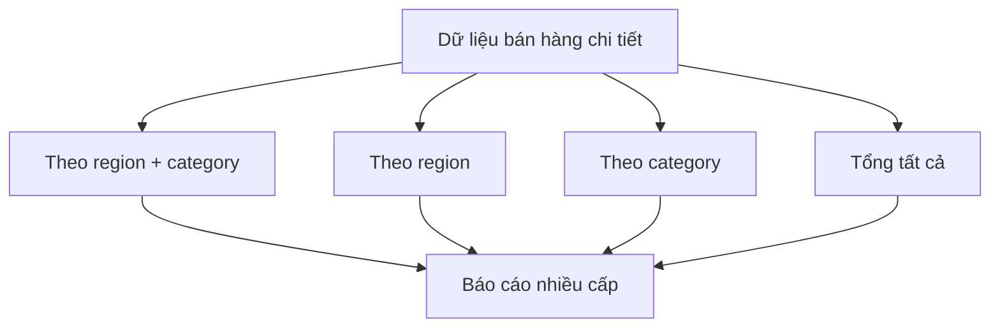

# GROUPING SETS, ROLLUP và CUBE trong PostgreSQL

Báo cáo tổng hợp thường cần nhiều cấp độ cùng lúc: doanh thu theo khu vực và ngành hàng, tổng theo từng khu vực, tổng theo ngành hàng và tổng doanh thu toàn công ty. Có thể viết nhiều truy vấn `GROUP BY` rồi ghép bằng `UNION ALL`, nhưng PostgreSQL cung cấp ba cấu trúc mạnh hơn để diễn đạt trực tiếp các cấp tổng hợp trong cùng một truy vấn: **`GROUPING SETS`**, **`ROLLUP`** và **`CUBE`**.

Ba công cụ này giải quyết những câu hỏi khác nhau:

- **`GROUPING SETS`:** chọn chính xác những tổ hợp chiều dữ liệu cần tính.
- **`ROLLUP`:** tạo chuỗi tổng hợp phân cấp, từ chi tiết đến các subtotal rồi grand total.
- **`CUBE`:** tạo tất cả tổ hợp tổng hợp có thể có của các chiều được chỉ định.

Khi trả kết quả, các cột không thuộc nhóm đang tính thường xuất hiện dưới dạng `NULL`. Điều này rất dễ bị hiểu nhầm là dữ liệu gốc bị thiếu. Vì vậy, bài học cũng giải thích hàm **`GROUPING()`** và cách sử dụng kết quả đúng trong báo cáo PostgreSQL, SQL và ứng dụng Java.

## 1. Từ GROUP BY thông thường đến tổng hợp nhiều cấp

Giả sử bảng `sales` có các cột `sale_year`, `region`, `category`, `channel` và `amount`. Để tính doanh thu theo khu vực:

```sql
SELECT region, SUM(amount) AS revenue
FROM analytics_lab.sales
GROUP BY region;
```

Để tính theo ngành hàng:

```sql
SELECT category, SUM(amount) AS revenue
FROM analytics_lab.sales
GROUP BY category;
```

Để tính theo khu vực **và** ngành hàng:

```sql
SELECT region, category, SUM(amount) AS revenue
FROM analytics_lab.sales
GROUP BY region, category;
```

Ba truy vấn này chọn ba **độ chi tiết (granularity)** khác nhau. Nếu một dashboard cần tất cả, thay vì duy trì ba luồng SQL tách biệt, chúng ta có thể mô tả những độ chi tiết cần lấy bằng một `GROUPING SETS`.



Cần hiểu hai khái niệm:

- **Chiều dữ liệu (dimension):** thuộc tính dùng để chia nhóm, chẳng hạn năm, khu vực, ngành hàng.
- **Chỉ số tổng hợp (measure):** kết quả như `SUM(amount)`, `COUNT(*)`, `AVG(amount)`.

`GROUPING SETS`, `ROLLUP` và `CUBE` quyết định **nhóm được tạo theo chiều nào**, còn `SUM`, `COUNT` và các aggregate khác quyết định **chỉ số được tính như thế nào**.

## 2. Chuẩn bị dữ liệu thực hành

Các ví dụ sử dụng bảng trong schema `analytics_lab`. Chạy trên một database học tập mới, không chạy lệnh thay đổi dữ liệu lên bảng đang phục vụ nghiệp vụ.

```sql
CREATE SCHEMA IF NOT EXISTS analytics_lab;

CREATE TABLE analytics_lab.sales (
    sale_id integer PRIMARY KEY,
    sale_year integer NOT NULL,
    region text,
    category text NOT NULL,
    channel text NOT NULL
        CHECK (channel IN ('Online', 'Store')),
    amount numeric(12, 2) NOT NULL CHECK (amount >= 0),
    units integer NOT NULL CHECK (units > 0)
);

INSERT INTO analytics_lab.sales
    (sale_id, sale_year, region, category, channel, amount, units)
VALUES
    (1, 2025, 'North', 'Books',   'Online', 100.00, 2),
    (2, 2025, 'North', 'Books',   'Store',   50.00, 1),
    (3, 2025, 'North', 'Devices', 'Online', 300.00, 1),
    (4, 2025, 'South', 'Books',   'Online',  80.00, 1),
    (5, 2025, 'South', 'Devices', 'Store',  200.00, 1),
    (6, 2026, 'North', 'Books',   'Online', 120.00, 2),
    (7, 2026, 'South', 'Devices', 'Online', 250.00, 1),
    (8, 2026, NULL,    'Books',  'Online',  40.00, 1);
```

Hàng có `sale_id = 8` cố ý để `region IS NULL`, đại diện cho giao dịch chưa xác định khu vực. Điều này giúp phân biệt **NULL thật trong dữ liệu gốc** với **NULL do một cấp tổng hợp không chứa cột đó**.

Dữ liệu mẫu có tám giao dịch. Tổng doanh thu phải là:

```sql
SELECT
    COUNT(*) AS sale_count,
    SUM(amount) AS revenue,
    SUM(units) AS total_units
FROM analytics_lab.sales;
```

Kết quả kỳ vọng là `sale_count = 8`, `revenue = 1140.00`, `total_units = 10`. Đây là mốc đối chiếu khi đọc các subtotal và grand total.

Có thể nhìn dữ liệu theo chiều đơn giản:

| Năm | Khu vực | Ngành hàng | Doanh thu |
| --- | --- | --- | ---: |
| 2025 | North | Books | 150.00 |
| 2025 | North | Devices | 300.00 |
| 2025 | South | Books | 80.00 |
| 2025 | South | Devices | 200.00 |
| 2026 | North | Books | 120.00 |
| 2026 | South | Devices | 250.00 |
| 2026 | NULL | Books | 40.00 |

Hai dòng Books/North của năm 2025 đã được gộp từ hai giao dịch khác kênh. Tổng theo năm là `730.00` cho 2025 và `410.00` cho 2026.

## 3. GROUPING SETS: liệt kê những cấp tổng hợp cần thiết

Cú pháp tổng quát:

```sql
SELECT grouping_columns, aggregate_expression
FROM source
GROUP BY GROUPING SETS (
    (column_a, column_b),
    (column_a),
    (column_b),
    ()
);
```

Mỗi phần tử trong `GROUPING SETS` là **một danh sách khóa nhóm**:

- `(region, category)`: nhóm theo hai chiều.
- `(region)`: tổng theo khu vực, bỏ chiều category.
- `(category)`: tổng theo ngành hàng, bỏ chiều region.
- `()`: nhóm rỗng, dùng để tính **grand total** (tổng toàn bộ tập hàng đầu vào).

Ví dụ:

```sql
SELECT
    region,
    category,
    SUM(amount) AS revenue
FROM analytics_lab.sales
GROUP BY GROUPING SETS (
    (region, category),
    (region),
    (category),
    ()
);
```

Kết quả chứa nhiều cấp tổng hợp trong cùng một bảng. Khi một cấp **không sử dụng** `region` hoặc `category` để nhóm, PostgreSQL hiển thị `NULL` ở cột đó. Tuy nhiên, giá trị `NULL` còn có thể là dữ liệu thật từ hàng `sale_id = 8`. Vì thế, chỉ nhìn cột `region` hay `category` chưa đủ để xác định dòng nào là subtotal.

### 3.1. GROUPING SETS tương đương ý tưởng UNION ALL

Về mặt ý nghĩa, truy vấn trên tương tự việc ghép bốn truy vấn `GROUP BY`:

```sql
SELECT region, category, SUM(amount) AS revenue
FROM analytics_lab.sales
GROUP BY region, category

UNION ALL

SELECT region, NULL::text AS category, SUM(amount)
FROM analytics_lab.sales
GROUP BY region

UNION ALL

SELECT NULL::text AS region, category, SUM(amount)
FROM analytics_lab.sales
GROUP BY category

UNION ALL

SELECT NULL::text AS region, NULL::text AS category, SUM(amount)
FROM analytics_lab.sales;
```

Ở cả hai cách, một `NULL` trong cột đầu ra có thể đến từ dòng tổng hợp hoặc từ dữ liệu nguồn. Nhưng PostgreSQL có thể lập kế hoạch khác nhau cho truy vấn `GROUPING SETS` và chuỗi `UNION ALL`; **không có bảo đảm** GROUPING SETS luôn quét bảng đúng một lần hoặc luôn nhanh hơn.

`UNION ALL` giữ mọi dòng được tạo, kể cả những dòng trông giống nhau. Đây cũng là lý do không nên tự động thay `UNION ALL` bằng `UNION` trong các báo cáo nhiều cấp: việc xóa dòng trùng có thể làm mất cấp tổng hợp có ý nghĩa.

### 3.2. Chọn đúng cấp, không phải mọi cấp

Giả sử dashboard chỉ cần:

- Chi tiết theo khu vực và ngành hàng.
- Tổng theo khu vực.
- Tổng toàn doanh nghiệp.

Khi đó:

```sql
SELECT region, category, SUM(amount) AS revenue
FROM analytics_lab.sales
GROUP BY GROUPING SETS (
    (region, category),
    (region),
    ()
);
```

Không có dòng tổng theo riêng ngành hàng, vì `(category)` không được liệt kê. Đây chính là ưu điểm của `GROUPING SETS`: tránh tạo các cấp tổng hợp không phục vụ yêu cầu.

### 3.3. Dùng biểu thức làm khóa nhóm

Khóa nhóm không nhất thiết là một cột nguyên dạng. Bạn có thể tổng hợp theo biểu thức:

```sql
SELECT
    CASE
        WHEN region IS NULL THEN 'Unassigned'
        ELSE region
    END AS region_label,
    category,
    SUM(amount) AS revenue
FROM analytics_lab.sales
GROUP BY GROUPING SETS (
    (
        CASE WHEN region IS NULL THEN 'Unassigned' ELSE region END,
        category
    ),
    (category)
);
```

Ở ví dụ này, biểu thức `CASE` là một khóa nhóm. Khi muốn dùng `GROUPING()` để phân biệt các cấp, đối số truyền vào phải phù hợp với **biểu thức khóa nhóm** tại cùng tầng truy vấn, không tùy ý đưa một biểu thức khác vào.

## 4. GROUPING(): phân biệt dòng tổng hợp và NULL từ dữ liệu nguồn

PostgreSQL cung cấp `GROUPING(expression [, ...])`. Hàm đặc biệt này cho biết những biểu thức nhóm có **bị lược khỏi grouping set hiện tại hay không**.

- `GROUPING(region) = 0`: `region` có mặt trong grouping set đang tính, kể cả khi giá trị của hàng là SQL `NULL` thật.
- `GROUPING(region) = 1`: `region` không có mặt trong grouping set, tức cột được cuộn lên cấp tổng.
- Với nhiều đối số, kết quả là **bitmask** biểu thị tổ hợp biểu thức bị lược.

```sql
SELECT
    region,
    category,
    GROUPING(region) AS region_is_rolled_up,
    GROUPING(category) AS category_is_rolled_up,
    GROUPING(region, category) AS grouping_code,
    SUM(amount) AS revenue
FROM analytics_lab.sales
GROUP BY GROUPING SETS (
    (region, category),
    (region),
    (category),
    ()
)
ORDER BY
    grouping_code,
    region NULLS LAST,
    category NULLS LAST;
```

Cách đọc `GROUPING(region, category)`:

| grouping_code | Bit region | Bit category | Nhóm đang được tính |
| ---: | ---: | ---: | --- |
| 0 | 0 | 0 | `(region, category)`: chi tiết hai chiều |
| 1 | 0 | 1 | `(region)`: subtotal khu vực |
| 2 | 1 | 0 | `(category)`: subtotal ngành hàng |
| 3 | 1 | 1 | `()`: grand total |

**Thứ tự đối số quyết định trọng số bit.** Trong `GROUPING(region, category)`, đối số **cuối** (`category`) là bit thấp nhất (giá trị 1); đối số đứng trước (`region`) có trọng số 2. Vì vậy, đổi thành `GROUPING(category, region)` sẽ đổi ý nghĩa của các mã 1 và 2.

### 4.1. NULL thật và NULL cuộn lên có thể nhìn giống nhau

Bộ dữ liệu mẫu có một giao dịch với `region IS NULL` và `category = 'Books'`. Khi chạy truy vấn `GROUPING SETS`, có thể thấy:

| region | category | grouping_code | revenue | Diễn giải |
| --- | --- | ---: | ---: | --- |
| NULL | Books | 0 | 40.00 | Giao dịch Books **thật sự chưa có khu vực** |
| NULL | NULL | 1 | 40.00 | Tổng của **khu vực chưa xác định**, bỏ chiều category |
| NULL | Books | 2 | 390.00 | Tổng ngành hàng Books ở **mọi khu vực** |
| NULL | NULL | 3 | 1140.00 | Grand total của mọi giao dịch |

Nếu chỉ xem `region IS NULL`, bốn dòng này dễ bị gộp sai thành “khu vực không rõ”. `GROUPING()` cho phép phân biệt được bản chất của chúng.

### 4.2. Đặt nhãn subtotal mà không làm mất NULL thật

```sql
SELECT
    CASE
        WHEN GROUPING(region) = 1 THEN 'All regions'
        WHEN region IS NULL THEN 'Unknown region'
        ELSE region
    END AS region_label,
    CASE
        WHEN GROUPING(category) = 1 THEN 'All categories'
        ELSE category
    END AS category_label,
    GROUPING(region, category) AS grouping_code,
    SUM(amount) AS revenue
FROM analytics_lab.sales
GROUP BY CUBE (region, category)
ORDER BY
    grouping_code,
    region_label,
    category_label;
```

Dùng `COALESCE(region, 'All regions')` một cách đơn giản sẽ **sai** vì nó gộp khu vực không xác định thật với dòng tổng mọi khu vực. Ưu tiên kiểm tra `GROUPING(region)` trước, rồi mới xử lý giá trị `NULL` thực sự của nguồn.

### 4.3. GROUPING không phải là một hàm thông thường độc lập

`GROUPING()` là cú pháp đặc biệt dùng trong truy vấn có ngữ cảnh `GROUP BY`; đối số của nó phải là biểu thức có trong các khóa nhóm được chỉ định tại tầng truy vấn tương ứng. Nó không phải công cụ tùy ý lấy bit của một cột trong mọi câu `SELECT` không có grouping.

Ví dụ hợp lệ:

```sql
SELECT
    sale_year,
    region,
    GROUPING(sale_year, region) AS grouping_code,
    SUM(amount) AS revenue
FROM analytics_lab.sales
GROUP BY ROLLUP (sale_year, region);
```

Khi xử lý kết quả qua ứng dụng hoặc truy vấn bao ngoài, nên **chọn mã grouping làm một cột đầu ra** để tầng ngoài có thể sử dụng mà không cần gọi lại `GROUPING()`.

## 5. ROLLUP: tổng hợp theo cấp bậc

`ROLLUP(a, b, c)` tạo các grouping set theo thứ tự tiền tố:

```text
(a, b, c)  -- chi tiết đủ ba chiều
(a, b)     -- bỏ c
(a)        -- bỏ b và c
()         -- grand total
```

Như vậy, với ba chiều có **bốn cấp** tổng hợp. ROLLUP đặc biệt phù hợp khi các chiều tạo một cây phân cấp: năm → khu vực → ngành hàng, hoặc công ty → chi nhánh → nhân viên.

```sql
SELECT
    sale_year,
    region,
    category,
    GROUPING(sale_year, region, category) AS grouping_code,
    SUM(amount) AS revenue
FROM analytics_lab.sales
GROUP BY ROLLUP (sale_year, region, category)
ORDER BY
    sale_year NULLS LAST,
    GROUPING(sale_year, region, category),
    region NULLS LAST,
    category NULLS LAST;
```

Các mã có thể xuất hiện:

| grouping_code | Cấp tổng hợp | Diễn giải |
| ---: | --- | --- |
| 0 | `(sale_year, region, category)` | Chi tiết theo năm, khu vực, ngành hàng |
| 1 | `(sale_year, region)` | Tổng theo năm và khu vực |
| 3 | `(sale_year)` | Tổng toàn bộ khu vực/ngành hàng của từng năm |
| 7 | `()` | Tổng toàn bộ dữ liệu |

Bitmask có ba đối số: `sale_year` mang trọng số 4, `region` trọng số 2, `category` trọng số 1. ROLLUP ở thứ tự trên chỉ có mã 0, 1, 3 và 7; nó **không tạo** các tổ hợp như chỉ `(region)` hoặc chỉ `(category)`.

### 5.1. Thứ tự cột trong ROLLUP quyết định những subtotal nào xuất hiện

Hai cấu trúc sau **không tương đương**:

```sql
GROUP BY ROLLUP (sale_year, region, category)
```

và:

```sql
GROUP BY ROLLUP (category, region, sale_year)
```

Cấu trúc đầu tạo tổng theo năm và khu vực, rồi theo năm. Cấu trúc sau tạo tổng theo ngành hàng và khu vực, rồi theo ngành hàng.

Vì vậy, hãy đặt cột theo **thứ tự phân cấp nghiệp vụ từ rộng đến hẹp**. Nếu cấp đầu không phải một chiều cha ổn định của cấp sau, `ROLLUP` có thể tạo các tổng phụ không có ý nghĩa; lúc đó `GROUPING SETS` cho phép chọn thủ công.

### 5.2. Ví dụ ROLLUP hai chiều và số dòng kết quả

```sql
SELECT
    region,
    category,
    GROUPING(region, category) AS grouping_code,
    SUM(amount) AS revenue
FROM analytics_lab.sales
GROUP BY ROLLUP (region, category)
ORDER BY
    GROUPING(region, category),
    region NULLS LAST,
    category NULLS LAST;
```

`ROLLUP(region, category)` tương đương về grouping sets với:

```sql
GROUP BY GROUPING SETS (
    (region, category),
    (region),
    ()
)
```

Trong dữ liệu mẫu:

- Có **5 tổ hợp (region, category)** đang thực sự xuất hiện: North/Books, North/Devices, South/Books, South/Devices và NULL/Books.
- Có **3 nhóm region**: North, South và vùng chưa xác định (`NULL` thật).
- Có **1 grand total**.

Tổng cộng có **9 hàng kết quả**. Không nên lấy số chiều nhân số giá trị khác nhau để suy ra số hàng nếu dữ liệu không có mọi tổ hợp; số nhóm chi tiết phụ thuộc dữ liệu thật.

Các doanh thu kiểm tra được:

| region | category | grouping_code | revenue |
| --- | --- | ---: | ---: |
| North | Books | 0 | 270.00 |
| North | Devices | 0 | 300.00 |
| South | Books | 0 | 80.00 |
| South | Devices | 0 | 450.00 |
| NULL | Books | 0 | 40.00 |
| North | NULL | 1 | 570.00 |
| South | NULL | 1 | 530.00 |
| NULL | NULL | 1 | 40.00 |
| NULL | NULL | 3 | 1140.00 |

Ở dòng `(NULL, NULL, code=1)`, `region` vẫn là chiều nhóm và mang giá trị NULL thật của nguồn; `category` mới là chiều bị cuộn lên. Dòng `code=3` mới là grand total.

## 6. CUBE: tổng hợp tất cả tổ hợp chiều

`CUBE(a, b)` tạo:

```text
(a, b)   -- chi tiết theo cả a và b
(a)      -- tổng theo a
(b)      -- tổng theo b
()       -- grand total
```

Với ba chiều độc lập, `CUBE(a, b, c)` tạo **8 grouping sets**:

```text
(a, b, c)
(a, b)
(a, c)
(b, c)
(a)
(b)
(c)
()
```

Tổng quát, `CUBE` của `n` chiều đơn tạo `2^n` grouping sets. Đây là số **cách nhóm**, không phải số dòng cuối cùng; mỗi cách nhóm có thể sinh nhiều dòng.

### 6.1. Ví dụ CUBE hai chiều

```sql
SELECT
    region,
    category,
    GROUPING(region, category) AS grouping_code,
    COUNT(*) AS sale_count,
    SUM(amount) AS revenue
FROM analytics_lab.sales
GROUP BY CUBE (region, category)
ORDER BY
    grouping_code,
    region NULLS LAST,
    category NULLS LAST;
```

`CUBE(region, category)` tương đương:

```sql
GROUP BY GROUPING SETS (
    (region, category),
    (region),
    (category),
    ()
)
```

So với ROLLUP, CUBE còn tạo nhóm **chỉ theo category**:

- Books: `390.00`.
- Devices: `750.00`.

Với dữ liệu mẫu, số dòng là: 5 nhóm chi tiết + 3 nhóm region + 2 nhóm category + 1 grand total = **11 dòng**.

Đó là lợi ích khi muốn phân tích hai chiều không nhất thiết có quan hệ cha–con: vừa xem tổng khu vực vừa xem tổng ngành hàng.

### 6.2. CUBE nhiều chiều có thể tạo nhiều dữ liệu

Ví dụ:

```sql
SELECT
    sale_year,
    region,
    channel,
    GROUPING(sale_year, region, channel) AS grouping_code,
    SUM(amount) AS revenue
FROM analytics_lab.sales
GROUP BY CUBE (sale_year, region, channel);
```

Ba chiều có 8 grouping sets. Nếu thêm ngày, sản phẩm, cửa hàng và nhóm khách hàng, số cách nhóm tăng nhanh theo cấp số nhân, chưa kể số lượng giá trị khác nhau ở từng chiều.

Vì vậy, không nên dùng `CUBE` một cách mặc định chỉ vì muốn báo cáo “đầy đủ”. Chỉ chọn những chiều thực sự cần phân tích; nếu dashboard cần một tập con nhất định, dùng `GROUPING SETS` hoặc các ROLLUP có cấu trúc.

## 7. So sánh GROUPING SETS, ROLLUP và CUBE

| Cú pháp | Tập nhóm sinh ra | Sử dụng phù hợp |
| --- | --- | --- |
| `GROUP BY region, category` | `(region, category)` | Chỉ cần chi tiết hai chiều |
| `GROUP BY GROUPING SETS ((region, category), (region), ())` | Chi tiết, tổng region, grand total | Chọn đúng ba cấp được yêu cầu |
| `GROUP BY ROLLUP (region, category)` | `(region, category)`, `(region)`, `()` | Phân cấp khu vực → ngành hàng |
| `GROUP BY CUBE (region, category)` | `(region, category)`, `(region)`, `(category)`, `()` | Phân tích tất cả tổ hợp của hai chiều |
| `GROUP BY ()` | `()` | Chỉ tổng toàn bộ tập đầu vào |

Một cách quyết định nhanh:

1. Có **phân cấp rõ ràng** và cần subtotal từ chi tiết đến tổng? Ưu tiên `ROLLUP`.
2. Cần **mọi tổ hợp** giữa một số chiều ít và độc lập? Cân nhắc `CUBE`.
3. Chỉ cần **một danh sách các cấp cụ thể**, không muốn tính dư? Dùng `GROUPING SETS`.

Ba cấu trúc có thể kết hợp với các thành phần khác của `GROUP BY`. Nhưng kết hợp phức tạp có thể tạo rất nhiều grouping sets, kể cả trùng nhau, nên cần thiết kế có chủ đích.

## 8. Kết hợp nhiều thành phần nhóm

PostgreSQL hỗ trợ viết nhiều grouping items trong cùng `GROUP BY`. Chúng có thể tạo **tích Descartes của các grouping sets**.

Ví dụ:

```sql
SELECT
    sale_year,
    region,
    GROUPING(sale_year, region) AS grouping_code,
    SUM(amount) AS revenue
FROM analytics_lab.sales
GROUP BY
    ROLLUP (sale_year),
    ROLLUP (region);
```

Ở đây mỗi `ROLLUP` một chiều tạo hai khả năng: có chiều và không có chiều. Kết hợp hai bên cho bốn grouping sets:

```text
(sale_year, region)
(sale_year)
(region)
()
```

Về mặt tập nhóm, ví dụ này tương đương `CUBE(sale_year, region)`.

Có thể giữ một chiều cố định trong mọi cấp và rollup các chiều khác:

```sql
SELECT
    sale_year,
    region,
    category,
    GROUPING(region, category) AS grouping_code,
    SUM(amount) AS revenue
FROM analytics_lab.sales
GROUP BY
    sale_year,
    ROLLUP (region, category);
```

Các nhóm được tạo là:

```text
(sale_year, region, category)
(sale_year, region)
(sale_year)
```

**Không có grand total của tất cả các năm** vì `sale_year` luôn là chiều bắt buộc. Đây là cách viết ngắn khi muốn subtotal trong từng năm mà không tạo tổng của toàn bộ giai đoạn.

### 8.1. Nhóm biểu thức thành một đơn vị

PostgreSQL cũng hỗ trợ các grouping items dạng nhóm cột trong dấu ngoặc ở những vị trí thích hợp. Ví dụ, nếu muốn hai cột được thêm/bỏ **cùng nhau** trong một `ROLLUP`:

```sql
SELECT
    sale_year,
    region,
    category,
    GROUPING(sale_year, region, category) AS grouping_code,
    SUM(amount) AS revenue
FROM analytics_lab.sales
GROUP BY ROLLUP ((sale_year, region), category);
```

Ý nghĩa là dùng `(sale_year, region)` như một đơn vị trong ROLLUP, tạo các grouping sets:

```text
(sale_year, region, category)
(sale_year, region)
()
```

Không tạo nhóm chỉ theo `sale_year`. Cú pháp này hữu ích khi một cấp nghiệp vụ được xác định bằng **khóa tổ hợp** gồm nhiều cột.

### 8.2. Grouping sets trùng nhau

Nếu chỉ định cùng một grouping set lặp lại, PostgreSQL có thể trả **các kết quả trùng lặp** tương ứng với mỗi lần xuất hiện:

```sql
SELECT
    region,
    SUM(amount) AS revenue
FROM analytics_lab.sales
GROUP BY GROUPING SETS ((region), (region));
```

Đừng nghĩ rằng `GROUPING SETS` tự loại grouping set trùng. Trong cú pháp hỗ trợ, `GROUP BY DISTINCT` có thể dùng để loại các **grouping sets trùng lặp được tạo ra**, khác với `SELECT DISTINCT` loại dòng đầu ra trùng theo tất cả cột được chọn.

Nếu báo cáo không cố ý cần nhiều bản sao subtotal, hãy kiểm tra tập grouping sets để tránh nhân đôi dữ liệu, đặc biệt khi phối hợp nhiều `ROLLUP`/`CUBE`.

## 9. WHERE, HAVING và thứ tự tổng hợp

Trong mô hình logic của `SELECT`:

1. `FROM` xác định dữ liệu đầu vào.
2. `WHERE` lọc các dòng **trước** khi tạo nhóm.
3. `GROUP BY GROUPING SETS / ROLLUP / CUBE` tạo các nhóm cần tính.
4. Aggregate tính chỉ số từng nhóm; `HAVING` lọc các nhóm theo điều kiện.
5. Danh sách `SELECT` và `ORDER BY` tạo/sắp kết quả cuối.

Đây là mô hình để hiểu ý nghĩa, không phải cam kết về thứ tự thực thi vật lý mà optimizer sẽ chọn.

### 9.1. WHERE thay đổi cả subtotal lẫn grand total

```sql
SELECT
    sale_year,
    region,
    GROUPING(sale_year, region) AS grouping_code,
    SUM(amount) AS revenue
FROM analytics_lab.sales
WHERE sale_year = 2026
GROUP BY ROLLUP (sale_year, region)
ORDER BY grouping_code, region NULLS LAST;
```

Vì `WHERE sale_year = 2026` chạy về mặt logic trước khi nhóm, grand total lúc này là `410.00`, **không phải 1140.00**. Trong báo cáo, phải nêu rõ các bộ lọc thời gian, kênh, quyền truy cập hay trạng thái đơn hàng được áp dụng trước khi tính tổng.

### 9.2. HAVING lọc các kết quả tổng hợp

```sql
SELECT
    region,
    category,
    GROUPING(region, category) AS grouping_code,
    SUM(amount) AS revenue
FROM analytics_lab.sales
GROUP BY ROLLUP (region, category)
HAVING SUM(amount) >= 200
ORDER BY grouping_code, region NULLS LAST, category NULLS LAST;
```

Điều kiện `HAVING` áp dụng cho **từng nhóm được sinh ra**, kể cả nhóm chi tiết, subtotal và grand total. Vì vậy, một subtotal có thể được giữ trong kết quả trong khi vài dòng chi tiết của nó bị loại do không đạt ngưỡng.

Điều đó **không có nghĩa subtotal được tính bằng cách cộng các dòng chi tiết còn hiển thị**. Nó được tính từ các dòng đầu vào trước khi HAVING lọc nhóm.

### 9.3. Chỉ hiển thị những cấp nhóm mong muốn

Với `ROLLUP(region, category)`, các mã grouping có thể là 0, 1 và 3. Để lấy chỉ các subtotal region và grand total:

```sql
SELECT
    region,
    category,
    GROUPING(region, category) AS grouping_code,
    SUM(amount) AS revenue
FROM analytics_lab.sales
GROUP BY ROLLUP (region, category)
HAVING GROUPING(region, category) IN (1, 3)
ORDER BY grouping_code, region NULLS LAST;
```

`GROUPING()` không thể dùng trong `WHERE` của cùng query level vì lúc đó các cấp nhóm chưa được tạo. Khi đã có cột `grouping_code` ở một CTE/truy vấn con, tầng bên ngoài có thể lọc bằng `WHERE grouping_code IN (...)`.

## 10. ORDER BY không được ROLLUP hoặc CUBE bảo đảm sẵn

Không nên giả định PostgreSQL luôn trả theo thứ tự “chi tiết → subtotal → grand total” chỉ vì có `ROLLUP`. Thứ tự hàng kết quả chỉ có bảo đảm khi có `ORDER BY` phù hợp.

Ví dụ:

```sql
SELECT
    region,
    category,
    GROUPING(region, category) AS grouping_code,
    SUM(amount) AS revenue
FROM analytics_lab.sales
GROUP BY CUBE (region, category)
ORDER BY
    grouping_code,
    region NULLS LAST,
    category NULLS LAST;
```

Kết quả được sắp trước hết theo mã cấp nhóm rồi theo giá trị dimension. Với các dashboard muốn subtotal xuất hiện **ngay sau các dòng chi tiết của từng khu vực**, có thể sắp theo cột region và `GROUPING(category)`:

```sql
SELECT
    region,
    category,
    GROUPING(region) AS region_rollup,
    GROUPING(category) AS category_rollup,
    SUM(amount) AS revenue
FROM analytics_lab.sales
GROUP BY ROLLUP (region, category)
ORDER BY
    GROUPING(region),
    region NULLS LAST,
    GROUPING(category),
    category NULLS LAST;
```

Ở ví dụ này, mọi region chi tiết (bao gồm region thật sự NULL) đến trước grand total; trong mỗi region, những dòng category chi tiết đến trước subtotal region.

Nếu cần thứ tự cố định cho **NULL dữ liệu gốc** khác dòng subtotal, dùng thêm các cột grouping như trên; chỉ `ORDER BY region NULLS LAST` không đủ.

### 10.1. LIMIT có thể cắt mất các dòng tổng

```sql
SELECT
    region, category, SUM(amount) AS revenue
FROM analytics_lab.sales
GROUP BY ROLLUP (region, category)
ORDER BY revenue DESC
LIMIT 5;
```

Truy vấn trên chỉ trả 5 dòng tổng hợp có doanh thu cao nhất, **không phải** 5 khu vực hoặc 5 category. Dòng grand total thường đứng đầu nếu doanh thu không âm, nhưng không có quy tắc buộc mọi subtotal đều xuất hiện trong 5 dòng.

Nếu cần “top 5 ngành hàng, kèm grand total”, hãy tính đúng cấp nhóm mong muốn rồi áp điều kiện lựa chọn có chủ đích, thay vì đặt `LIMIT 5` lên toàn bộ CUBE/ROLLUP.

## 11. Nhiều chỉ số tổng hợp và FILTER

Một truy vấn grouping có thể tính nhiều aggregate cùng lúc:

```sql
SELECT
    region,
    category,
    GROUPING(region, category) AS grouping_code,
    COUNT(*) AS sale_count,
    SUM(units) AS units_sold,
    SUM(amount) AS revenue,
    AVG(amount) AS average_sale_value,
    COUNT(*) FILTER (WHERE channel = 'Online') AS online_sales,
    COALESCE(
        SUM(amount) FILTER (WHERE channel = 'Online'),
        0
    ) AS online_revenue
FROM analytics_lab.sales
GROUP BY ROLLUP (region, category)
ORDER BY grouping_code, region NULLS LAST, category NULLS LAST;
```

Ý nghĩa:

- `COUNT(*)` đếm số dòng giao dịch thuộc nhóm.
- `SUM(units)` đếm tổng số đơn vị sản phẩm.
- `SUM(amount)` là tổng doanh thu.
- `AVG(amount)` là giá trị trung bình **trên các giao dịch gốc** trong nhóm.
- `FILTER (WHERE ...)` giới hạn dòng đầu vào **cho riêng aggregate đó**, không xóa dòng khỏi các aggregate khác.
- Nếu không có dòng Online trong một nhóm, `SUM(amount) FILTER (...)` có thể là `NULL`; `COALESCE(..., 0)` hiển thị bằng 0 khi đó phù hợp ý nghĩa báo cáo.

Ví dụ với nhóm North/Books, có 3 giao dịch (100, 50, 120). Doanh thu là 270; số giao dịch Online là 2 và doanh thu Online là 220. Không nên hiểu `FILTER` là một `WHERE` toàn cục trên cả báo cáo.

### 11.1. Chỉ số không cộng gộp được

Không phải measure nào cũng có thể cộng subtotal để tạo tổng lớn hơn:

- **`SUM(amount)`:** thường cộng gộp được qua các nhóm không giao nhau.
- **`COUNT(*)`:** có thể cộng qua những nhóm phân hoạch dữ liệu đúng cách.
- **`AVG(amount)`:** **không** lấy trung bình cộng đơn giản của các trung bình nhóm nếu số giao dịch mỗi nhóm khác nhau.
- **`COUNT(DISTINCT customer_id)`:** không thể cộng các con số từng khu vực nếu cùng khách hàng xuất hiện ở nhiều khu vực.

Giả sử một nhóm có 1 giao dịch trị giá 100 và nhóm khác có 9 giao dịch trị giá 10. Trung bình của hai trung bình nhóm là 55, nhưng trung bình trên cả 10 giao dịch là 19. Nếu muốn tổng hợp từ dữ liệu đã tổng hợp, cần giữ `SUM` và `COUNT` rồi tính trung bình có trọng số:

```sql
SELECT
    region,
    SUM(amount) AS sum_amount,
    COUNT(*) AS sale_count,
    SUM(amount) / NULLIF(COUNT(*), 0) AS avg_amount
FROM analytics_lab.sales
GROUP BY ROLLUP (region);
```

Khi dùng `ROLLUP`/`CUBE` trực tiếp trên dữ liệu gốc, PostgreSQL tính aggregate cho từng grouping set theo ngữ nghĩa của aggregate, không buộc phải “trung bình các subtotal” theo cách sai.

## 12. Tính tỷ trọng so với grand total

Một yêu cầu phổ biến là hiển thị doanh thu từng khu vực như phần trăm của tổng toàn công ty. Có thể sử dụng kết quả ROLLUP và tham chiếu dòng grand total thông qua một CTE:

```sql
WITH summary AS (
    SELECT
        region,
        category,
        GROUPING(region, category) AS grouping_code,
        SUM(amount) AS revenue
    FROM analytics_lab.sales
    GROUP BY ROLLUP (region, category)
)
SELECT
    region,
    category,
    grouping_code,
    revenue,
    ROUND(
        revenue * 100
        / NULLIF(
            (SELECT revenue
             FROM summary
             WHERE grouping_code = 3),
            0
        ),
        2
    ) AS pct_of_grand_total
FROM summary
WHERE grouping_code IN (1, 3)
ORDER BY grouping_code, region NULLS LAST;
```

Trong ROLLUP này, nhóm `()` chỉ tạo **một grand total** nên scalar subquery trả một giá trị. `NULLIF(..., 0)` tránh lỗi chia cho 0 nếu tổng bằng 0.

Với dữ liệu mẫu:

| Khu vực | Doanh thu | Tỷ trọng trong tổng 1140 |
| --- | ---: | ---: |
| North | 570.00 | 50.00% |
| South | 530.00 | 46.49% |
| Unknown region | 40.00 | 3.51% |
| Grand total | 1140.00 | 100.00% |

Các tỷ trọng được làm tròn đến hai chữ số thập phân nên tổng các tỷ lệ hiển thị có thể không đúng chính xác 100.00 trong bộ dữ liệu khác. Đừng cộng tỷ trọng của các cấp nhóm chồng lấn như region và category với nhau.

## 13. Dữ liệu rỗng, NULL và hành vi aggregate

`ROLLUP` và `CUBE` có nhóm `()`. Với dữ liệu đầu vào rỗng, nhóm tổng toàn bộ vẫn có thể tạo một hàng aggregate:

```sql
SELECT
    COUNT(*) AS sale_count,
    SUM(amount) AS revenue
FROM analytics_lab.sales
WHERE sale_year = 1990
GROUP BY GROUPING SETS (());
```

Với bộ dữ liệu mẫu không có giao dịch năm 1990, `COUNT(*)` là 0, còn `SUM(amount)` là `NULL`. PostgreSQL không tự biến tổng của tập không có dòng thành 0 cho mọi aggregate.

Một quy tắc cần ghi nhớ:

- `COUNT(*)` cho 0 với nhóm rỗng.
- `SUM(amount)` và `AVG(amount)` thường trả `NULL` nếu không có giá trị đầu vào thích hợp.
- `COALESCE(SUM(amount), 0)` có thể dùng trong báo cáo khi nghiệp vụ xác định “không có giao dịch” nên hiển thị doanh thu bằng 0.
- Nếu một nhóm có dòng nhưng toàn bộ giá trị đầu vào của `SUM(column)` là `NULL`, kết quả cũng là `NULL`, khác với không có dòng nhưng cũng có thể nhìn giống nhau.

Trong dữ liệu mẫu `amount NOT NULL`, nên trường hợp cuối không xảy ra cho `amount`; tuy nhiên khi dùng bảng khác có measure nullable, cần hiểu rõ.

### 13.1. NULL là giá trị nhóm, không nhất thiết là subtotal

Một lưu ý bổ sung: trong `GROUP BY region`, tất cả dòng có `region IS NULL` được gom thành một nhóm. Điều đó không làm `NULL = NULL` trở thành `TRUE` trong phép so sánh SQL thông thường; grouping có quy tắc xử lý các giá trị NULL của riêng nó.

Vì vậy, luôn sử dụng `GROUPING(region)` khi cần xác định **region đang bị lược** khỏi grouping set, không dùng `region IS NULL` để nhận biết subtotal.

## 14. Hiệu năng và kế hoạch thực thi

Một truy vấn `CUBE` có thể thay thế nhiều câu `GROUP BY` riêng lẻ về mặt biểu đạt, nhưng không nên suy ra nó sẽ luôn nhanh hơn. Chi phí phụ thuộc vào:

- Số chiều và số grouping sets được sinh ra.
- Số lượng giá trị phân biệt ở mỗi chiều (cardinality).
- Kích thước tập hàng sau `WHERE`.
- Số aggregate, đặc biệt `COUNT(DISTINCT ...)` hoặc aggregate có cấu trúc lớn.
- Bộ nhớ, `work_mem`, phép sort/hash và khả năng xử lý song song.
- Index, phân vùng dữ liệu, thống kê của planner và trạng thái cache.

`CUBE` của nhiều chiều có thể tạo khối lượng đầu ra rất lớn, tiêu thụ CPU/bộ nhớ và tăng chi phí truyền dữ liệu tới ứng dụng.

Dùng `EXPLAIN` để xem kế hoạch:

```sql
EXPLAIN
SELECT
    sale_year,
    region,
    category,
    SUM(amount) AS revenue
FROM analytics_lab.sales
GROUP BY ROLLUP (sale_year, region, category);
```

Tùy PostgreSQL version và truy vấn, có thể thấy các node liên quan đến aggregate nhóm như `GroupAggregate`, `MixedAggregate` hoặc cấu trúc sort/hash khác. Planner không buộc phải thực hiện nhiều query vật lý độc lập tương ứng một-một với từng grouping set.

Để đo thời gian và I/O trên môi trường kiểm thử:

```sql
EXPLAIN (ANALYZE, BUFFERS)
SELECT
    region,
    category,
    SUM(amount) AS revenue
FROM analytics_lab.sales
GROUP BY CUBE (region, category);
```

`EXPLAIN (ANALYZE, BUFFERS)` **thực sự chạy truy vấn**. Với SELECT tổng hợp thuần trên dữ liệu thử nghiệm điều này thường an toàn, nhưng với truy vấn chứa hàm có side effect hoặc statement làm thay đổi dữ liệu thì cần kiểm soát.

### 14.1. Giảm số grouping sets để giảm chi phí

Nếu chỉ cần 3 cấp từ tổng số 8 tổ hợp, hãy dùng `GROUPING SETS` để không tính các cấp không cần thiết. Nếu chỉ cần năm → khu vực → ngành hàng, `ROLLUP` thường diễn đạt tốt hơn `CUBE` ba chiều.

Đặt điều kiện `WHERE` hợp lý (phạm vi ngày, trạng thái, tenant) trước khi tổng hợp có thể giảm số dòng đầu vào, nhưng điều kiện phải phản ánh **đúng phạm vi báo cáo**. Không tự lọc dữ liệu chỉ để query chạy nhanh rồi giữ nhãn “tổng toàn công ty”.

Khi báo cáo được chạy thường xuyên trên dữ liệu lớn, có thể cân nhắc materialized view hoặc bảng tổng hợp theo lịch. Chúng có yêu cầu refresh, đồng bộ và kiểm soát thay đổi dữ liệu riêng; không phải `GROUPING SETS` tự lưu cache kết quả.

## 15. Thiết kế kết quả cho Java/JDBC và API

Ứng dụng thường cần biểu diễn nhiều cấp tổng hợp bằng một DTO. Vì cột dimension có thể `NULL` do cuộn nhóm hoặc do dữ liệu thật, không nên chỉ dựa vào `null` để nhận biết loại dòng.

Ví dụ truy vấn:

```sql
SELECT
    sale_year,
    region,
    category,
    GROUPING(sale_year, region, category) AS grouping_mask,
    SUM(amount) AS revenue
FROM analytics_lab.sales
GROUP BY ROLLUP (sale_year, region, category)
ORDER BY
    sale_year NULLS LAST,
    GROUPING(sale_year, region, category),
    region NULLS LAST,
    category NULLS LAST;
```

Trong Java, có thể đọc `grouping_mask` như một số nguyên:

```java
import java.math.BigDecimal;
import java.sql.ResultSet;
import java.sql.SQLException;

public record SalesSummaryRow(
        Integer year,
        String region,
        String category,
        BigDecimal revenue,
        int groupingMask,
        boolean allYears,
        boolean allRegions,
        boolean allCategories
) {
    public static SalesSummaryRow from(ResultSet rs) throws SQLException {
        int mask = rs.getInt("grouping_mask");
        return new SalesSummaryRow(
                rs.getObject("sale_year", Integer.class),
                rs.getString("region"),
                rs.getString("category"),
                rs.getBigDecimal("revenue"),
                mask,
                (mask & 4) != 0,
                (mask & 2) != 0,
                (mask & 1) != 0
        );
    }
}
```

Với thứ tự đối số `GROUPING(sale_year, region, category)`, ba bit tương ứng có trọng số 4, 2 và 1. Ví dụ, `allRegions = false` và `region = null` có nghĩa khu vực thiếu trong dữ liệu gốc; `allRegions = true` nghĩa dòng đã cuộn lên cấp không phân biệt khu vực.

Một API báo cáo có thể trả các trường `level`, `groupingMask` hoặc `isSubtotal` thay vì chỉ trả các nhãn text “All”. Điều này giúp frontend quyết định cách hiển thị, thụt đầu dòng hoặc tô đậm grand total, đồng thời tránh coi các giá trị `NULL` thật là tổng.

Khi truyền tham số báo cáo như năm, tenant hoặc khoảng ngày vào SQL từ Java, hãy dùng `PreparedStatement`/tham số ORM, không nối chuỗi input thành SQL. Các tham số ở `WHERE` quyết định tập dữ liệu đầu vào cho **tất cả cấp tổng hợp**.

## 16. Những lỗi hiểu nhầm thường gặp

| Hiểu nhầm | Hậu quả | Cách xử lý |
| --- | --- | --- |
| `ROLLUP` và `CUBE` giống nhau | Thiếu tổng theo chiều độc lập hoặc tạo quá nhiều nhóm | ROLLUP tạo tiền tố phân cấp; CUBE tạo mọi tổ hợp |
| `NULL` trong dimension luôn là subtotal | Gộp dữ liệu nguồn thiếu region vào grand total | Dùng `GROUPING()` và bitmask |
| `GROUPING(region, category)` trả số nhóm | Đọc sai mã 0/1/2/3 | Đây là bitmask của các biểu thức bị lược |
| Thứ tự các chiều trong ROLLUP không quan trọng | Tạo subtotal sai phân cấp | Đặt chiều cha trước chiều con |
| `GROUPING SETS` luôn tự xóa các cấp trùng | Dòng subtotal bị lặp và báo cáo đếm đôi | Kiểm tra grouping sets, cân nhắc `GROUP BY DISTINCT` khi phù hợp |
| `ROLLUP` trả kết quả theo thứ tự mong muốn | Subtotal có thể xuất hiện ở vị trí không ổn định | Dùng `ORDER BY` rõ ràng |
| `WHERE` chỉ ảnh hưởng dòng chi tiết | Grand total bị tính trên tập bị lọc | Xác định đúng phạm vi dữ liệu trước khi nhóm |
| `HAVING` lọc hàng gốc | Dòng subtotal không khớp tổng của các dòng còn hiển thị | HAVING lọc kết quả nhóm, không sửa số liệu nhóm |
| `LIMIT 10` cho top 10 sản phẩm | Có thể lấy subtotal/grand total như sản phẩm | Lọc đúng `grouping_code` trước khi LIMIT |
| Có thể cộng các AVG hoặc COUNT DISTINCT ở các subtotal | Sai trung bình hoặc đếm trùng khách | Tính lại từ dữ liệu gốc hoặc dùng thống kê đủ để tổng hợp |
| GROUPING SETS luôn chạy một lần quét bảng | Dự đoán hiệu năng sai | Kiểm tra `EXPLAIN` trên workload thật |
| Mọi `NULL` aggregate đều là 0 | Biến trạng thái thiếu dữ liệu thành giá trị giả | Dùng `COALESCE` khi nghiệp vụ quy định rõ |
| Nhiều chiều hơn luôn cho báo cáo tốt hơn | Tăng mạnh số nhóm và chi phí xử lý | Chọn đúng cấp cần thiết |

## 17. Bài thực hành từng bước

Thực hành dựa trên `analytics_lab.sales` đã tạo ở phần 2.

### Bài 1 — Viết báo cáo ba cấp bằng GROUPING SETS

Yêu cầu: tính doanh thu theo `(region, category)`, subtotal theo `(region)` và grand total; **không** tính tổng riêng theo category.

```sql
SELECT
    region,
    category,
    GROUPING(region, category) AS grouping_code,
    SUM(amount) AS revenue
FROM analytics_lab.sales
GROUP BY GROUPING SETS (
    (region, category),
    (region),
    ()
)
ORDER BY grouping_code, region NULLS LAST, category NULLS LAST;
```

Câu hỏi: dữ liệu mẫu trả bao nhiêu dòng? Vì sao có hai dòng mà cả `region` và `category` đều là `NULL` nhưng `grouping_code` khác nhau?

### Bài 2 — Thay bằng ROLLUP

Đổi phần `GROUP BY` ở bài 1 thành:

```sql
GROUP BY ROLLUP (region, category)
```

Đối chiếu tập grouping codes. Sau đó đổi thứ tự thành `ROLLUP(category, region)` và giải thích sự khác nhau về subtotal.

### Bài 3 — Dùng CUBE để xem tổng theo category

```sql
SELECT
    region,
    category,
    GROUPING(region, category) AS grouping_code,
    SUM(amount) AS revenue
FROM analytics_lab.sales
GROUP BY CUBE (region, category)
ORDER BY grouping_code, region NULLS LAST, category NULLS LAST;
```

Xác định hai dòng `grouping_code = 2`: Books `390.00` và Devices `750.00`. Tìm dòng grand total và kiểm tra nó có đúng `1140.00`.

### Bài 4 — Phân biệt region thiếu và All regions

Viết cột `region_label` theo ba trạng thái:

1. `GROUPING(region) = 1` → `'All regions'`.
2. `GROUPING(region) = 0` và `region IS NULL` → `'Unknown region'`.
3. Ngược lại → dùng giá trị `region`.

Kiểm tra giao dịch `sale_id = 8` có được đưa vào tổng đúng cách không.

### Bài 5 — ROLLUP theo năm, khu vực và ngành hàng

```sql
SELECT
    sale_year,
    region,
    category,
    GROUPING(sale_year, region, category) AS grouping_code,
    SUM(amount) AS revenue
FROM analytics_lab.sales
GROUP BY ROLLUP (sale_year, region, category)
ORDER BY
    sale_year NULLS LAST,
    grouping_code,
    region NULLS LAST,
    category NULLS LAST;
```

Tìm hai dòng tổng năm `grouping_code = 3` và xác nhận doanh thu 2025 bằng `730.00`, 2026 bằng `410.00`. Mã nào đại diện cho grand total mọi năm?

### Bài 6 — Kết hợp hai ROLLUP một chiều

So sánh:

```sql
GROUP BY ROLLUP (sale_year), ROLLUP (region)
```

với:

```sql
GROUP BY CUBE (sale_year, region)
```

Viết lại bằng `GROUPING SETS` theo bốn tổ hợp và giải thích vì sao kết quả có cùng các cấp.

### Bài 7 — Tính tỷ trọng theo tổng

Dùng CTE `summary` ở phần 12 để hiển thị tỷ trọng doanh thu của North, South và khu vực chưa xác định. Giải thích vì sao tổng tỷ trọng của ba nhóm bằng xấp xỉ 100%, nhưng không thể cộng thêm các dòng tổng theo category vào đó.

### Bài 8 — Quan sát kế hoạch truy vấn

```sql
EXPLAIN
SELECT region, category, SUM(amount)
FROM analytics_lab.sales
GROUP BY CUBE (region, category);
```

Ghi nhận node aggregate PostgreSQL chọn. Sau đó thử `GROUPING SETS ((region, category), (region))` trên dữ liệu lớn hơn trong môi trường kiểm thử để xem số cách nhóm và kế hoạch thay đổi ra sao. Không suy ra hiệu năng chỉ từ bảng tám dòng của bài học.

## 18. Kết luận

`GROUPING SETS`, `ROLLUP` và `CUBE` mở rộng khả năng `GROUP BY` của PostgreSQL để tạo nhiều cấp tổng hợp trong một câu truy vấn:

- **GROUPING SETS:** kiểm soát chính xác cấp nào được tạo.
- **ROLLUP:** tạo subtotal theo chuỗi phân cấp từ trái sang phải.
- **CUBE:** tạo mọi tổ hợp chiều được chỉ định, phù hợp phân tích đa chiều nhưng có nguy cơ sinh nhiều nhóm.

Điểm quan trọng nhất khi đưa kết quả vào dashboard, API hoặc báo cáo là **không nhận diện subtotal chỉ bằng NULL ở cột dimension**. Hãy sử dụng `GROUPING()` và lưu mã cấp nhóm trong kết quả. Đồng thời, phân biệt bộ lọc `WHERE` với `HAVING`, tránh cộng trùng các cấp tổng hợp và chọn đúng các measure có thể cộng gộp.

Khi thiết kế đúng mức chi tiết và ý nghĩa của từng dòng, PostgreSQL có thể tạo các báo cáo tổng hợp nhiều chiều nhất quán, dễ kiểm chứng và thuận tiện cho ứng dụng tiếp nhận.
