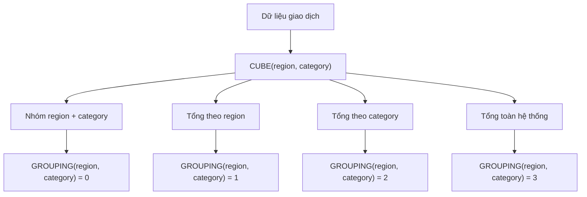

# GROUPING và nhận diện hàng tổng cộng trong PostgreSQL

Khi một báo cáo PostgreSQL cần hiển thị doanh thu chi tiết, tổng theo khu vực và tổng toàn hệ thống, các hàng kết quả có thể trông rất giống nhau. Một cột `region` bằng `NULL` có thể mang nghĩa **chưa biết khu vực của giao dịch**; cũng có thể mang nghĩa **dòng tổng tất cả khu vực**, bởi vì cột `region` đã bị loại khỏi cấp nhóm đó. Chỉ nhìn giá trị `NULL` sẽ không phân biệt được hai trường hợp.

Hàm đặc biệt **`GROUPING()`** giải quyết vấn đề này. Nó cho biết một biểu thức nhóm có **tham gia grouping set đang tạo ra hàng hiện tại** hay đã được lược đi để tính subtotal hoặc grand total. Kết hợp `GROUPING()` với `ROLLUP`, `CUBE` và `GROUPING SETS`, chúng ta có thể xác định cấp độ của từng dòng tổng hợp, tạo nhãn có ý nghĩa, sắp xếp báo cáo theo cấu trúc phân cấp và tránh tính toán trùng lặp.

Bài học thuộc chương **Tổng hợp dữ liệu** và tập trung vào **nhận diện hàng tổng cộng**; những ví dụ phía dưới dùng bộ dữ liệu bán hàng nhỏ để giải thích đầy đủ ngữ nghĩa và cách áp dụng trong truy vấn thực tế.

## 1. Khi nào cần nhận diện hàng tổng cộng?

Giả sử báo cáo bán hàng có các chiều dữ liệu:

- `region`: khu vực bán hàng.
- `category`: nhóm sản phẩm.
- `sale_year`: năm phát sinh giao dịch.

Chỉ tổng hợp theo `region` và `category`:

```sql
SELECT region, category, SUM(amount) AS revenue
FROM report_lab.sales
GROUP BY region, category;
```

Kết quả là các nhóm chi tiết theo hai chiều. Nhưng người quản lý muốn thấy cả:

1. Doanh thu mỗi nhóm sản phẩm trong mỗi khu vực.
2. Tổng doanh thu của mỗi khu vực, bất kể nhóm sản phẩm.
3. Tổng doanh thu của mỗi nhóm sản phẩm trên mọi khu vực.
4. Tổng doanh thu toàn hệ thống.

PostgreSQL có thể tạo các cấp này bằng:

```sql
SELECT region, category, SUM(amount) AS revenue
FROM report_lab.sales
GROUP BY CUBE (region, category);
```

Vấn đề là ở những cấp không còn phân biệt `region` hoặc `category`, PostgreSQL hiển thị `NULL` cho cột bị lược. Mặt khác, dữ liệu nguồn có thể chứa `NULL` thật. Cần một cách nhận diện đáng tin cậy hơn `IS NULL`.



**Ý chính:** `NULL` cho biết giá trị hiện ra ở cột; `GROUPING()` cho biết **cột đó có thuộc cấp nhóm hiện tại hay không**.

## 2. Tạo bộ dữ liệu minh họa

Các ví dụ dùng schema riêng trong một database thực hành. Không chạy lệnh `CREATE`/`INSERT` của bài học trên schema nghiệp vụ đang dùng trong production.

```sql
CREATE SCHEMA IF NOT EXISTS report_lab;

CREATE TABLE report_lab.sales (
    sale_id integer PRIMARY KEY,
    sale_year integer NOT NULL,
    region text,
    category text NOT NULL,
    channel text NOT NULL,
    amount numeric(12, 2) NOT NULL CHECK (amount >= 0)
);

INSERT INTO report_lab.sales
    (sale_id, sale_year, region, category, channel, amount)
VALUES
    (1, 2025, 'North', 'Books',   'Online', 100.00),
    (2, 2025, 'North', 'Books',   'Store',   50.00),
    (3, 2025, 'North', 'Tech',    'Online', 300.00),
    (4, 2025, 'South', 'Books',   'Online',  80.00),
    (5, 2025, 'South', 'Tech',    'Store',  200.00),
    (6, 2026, 'North', 'Books',   'Online', 120.00),
    (7, 2026, 'South', 'Tech',    'Online', 250.00),
    (8, 2026, NULL,    'Books',  'Online',  40.00);
```

Dòng `sale_id = 8` cố ý có `region IS NULL`: giao dịch chưa được gán khu vực. Đây là **dữ liệu nguồn thiếu giá trị**, không phải một dòng grand total.

Kiểm tra tổng gốc:

```sql
SELECT COUNT(*) AS transaction_count,
       SUM(amount) AS total_revenue
FROM report_lab.sales;
```

Bộ dữ liệu có **8 giao dịch**, tổng doanh thu **1140.00**. Các tổng theo khu vực là North = **570.00**, South = **530.00**, khu vực chưa xác định = **40.00**. Theo nhóm sản phẩm: Books = **390.00**, Tech = **750.00**.

Các giá trị này sẽ giúp đọc đúng kết quả khi nhiều cấp tổng hợp xuất hiện cùng nhau.

## 3. Cơ chế của GROUPING()

Cú pháp:

```sql
GROUPING(grouping_expression [, ...])
```

`GROUPING()` trả về **số nguyên dạng bitmask**, cho biết biểu thức nào trong các đối số đã bị lược ra khỏi grouping set được dùng để tạo hàng hiện tại.

Với một đối số:

- `GROUPING(region) = 0`: `region` **được dùng** để chia nhóm ở hàng này.
- `GROUPING(region) = 1`: `region` **không được dùng** ở hàng này; nó đã được cuộn lên cấp tổng.

Ví dụ:

```sql
SELECT
    region,
    GROUPING(region) AS is_all_regions,
    SUM(amount) AS revenue
FROM report_lab.sales
GROUP BY ROLLUP (region)
ORDER BY GROUPING(region), region NULLS LAST;
```

Kết quả về mặt ý nghĩa:

| region | is_all_regions | revenue | Loại dòng |
| --- | ---: | ---: | --- |
| North | 0 | 570.00 | Khu vực North |
| South | 0 | 530.00 | Khu vực South |
| NULL | 0 | 40.00 | Khu vực **chưa xác định trong dữ liệu nguồn** |
| NULL | 1 | 1140.00 | **Tổng mọi khu vực** |

Hai dòng cuối có cùng giá trị hiển thị ở cột `region`, nhưng `GROUPING(region)` khác nhau. Vì thế:

```sql
-- Không đúng nếu muốn nhận diện riêng dòng tổng:
WHERE region IS NULL
```

không thể được dùng như một phép thử thay thế cho `GROUPING(region) = 1`.

### 3.1. GROUPING không đếm số dòng và không kiểm tra NULL

Các cách hiểu sai thường gặp:

- `GROUPING(region) = 1` **không có nghĩa** “có một vùng” hay “một dòng dữ liệu”.
- `GROUPING(region) = 0` **không có nghĩa** “giá trị region khác NULL”.
- `GROUPING(region)` **không giống** `region IS NULL`.

Hàm này trả lời một câu hỏi khác: *Biểu thức region có nằm trong khóa nhóm của grouping set tạo ra hàng này không?*

### 3.2. GROUPING là cấu trúc SQL đặc biệt

Trong PostgreSQL, `GROUPING()` có cú pháp giống hàm, nhưng không phải một hàm scalar thông thường gọi độc lập trên bất kỳ cột nào. Nó được sử dụng trong truy vấn tổng hợp, với đối số phải khớp biểu thức nhóm ở tầng truy vấn hiện hành.

Ví dụ hợp lệ:

```sql
SELECT
    region,
    category,
    GROUPING(region) AS region_rolled_up,
    GROUPING(category) AS category_rolled_up,
    SUM(amount) AS revenue
FROM report_lab.sales
GROUP BY ROLLUP (region, category);
```

Không thể thay đổi tùy tiện đối số thành biểu thức chưa có trong các khóa nhóm:

```sql
-- Không đúng cách: upper(region) không phải biểu thức khóa nhóm
-- đã khai báo cho truy vấn này.
SELECT GROUPING(upper(region)), SUM(amount)
FROM report_lab.sales
GROUP BY ROLLUP (region);
```

Nếu bạn muốn nhóm theo `upper(region)`, chính biểu thức đó cần xuất hiện phù hợp trong `GROUP BY`. Cách làm giúp tránh việc một cột hiển thị bị nhầm với một khóa nhóm có ngữ nghĩa khác.

## 4. GROUPING với hai đối số: giải mã bitmask 0, 1, 2, 3

`GROUPING(region, category)` kết hợp trạng thái của hai biểu thức thành một số nguyên.

Giá trị bit được gán **từ phải qua trái**:

- Đối số cuối `category` có trọng số **1** (bit thấp nhất).
- Đối số đứng trước `region` có trọng số **2**.
- Bit bằng 0 nghĩa là biểu thức có trong grouping set.
- Bit bằng 1 nghĩa là biểu thức bị lược.

Có thể tự tính:

\[
\operatorname{GROUPING}(region,category)
= 2\times\operatorname{GROUPING}(region)
+ \operatorname{GROUPING}(category).
\]

| GROUPING(region) | GROUPING(category) | Bitmask nhị phân | Mã số | Cấp tổng hợp |
| ---: | ---: | --- | ---: | --- |
| 0 | 0 | `00` | 0 | Theo region và category |
| 0 | 1 | `01` | 1 | Tổng theo region |
| 1 | 0 | `10` | 2 | Tổng theo category |
| 1 | 1 | `11` | 3 | Grand total |

Truy vấn minh họa:

```sql
SELECT
    region,
    category,
    GROUPING(region) AS g_region,
    GROUPING(category) AS g_category,
    GROUPING(region, category) AS grouping_mask,
    SUM(amount) AS revenue
FROM report_lab.sales
GROUP BY CUBE (region, category)
ORDER BY
    grouping_mask,
    region NULLS LAST,
    category NULLS LAST;
```

Trong `CUBE(region, category)` có đủ bốn cấp nên bạn có thể gặp cả bốn mã 0, 1, 2 và 3.

### 4.1. Bảng kết quả có cả NULL thật và NULL tổng hợp

Với dữ liệu mẫu, các dòng sau mô tả toàn bộ các nhóm:

| region | category | grouping_mask | revenue | Ý nghĩa |
| --- | --- | ---: | ---: | --- |
| North | Books | 0 | 270.00 | Chi tiết North / Books |
| North | Tech | 0 | 300.00 | Chi tiết North / Tech |
| South | Books | 0 | 80.00 | Chi tiết South / Books |
| South | Tech | 0 | 450.00 | Chi tiết South / Tech |
| NULL | Books | 0 | 40.00 | Books, khu vực thiếu dữ liệu thật |
| North | NULL | 1 | 570.00 | Tổng mọi category của North |
| South | NULL | 1 | 530.00 | Tổng mọi category của South |
| NULL | NULL | 1 | 40.00 | Tổng mọi category của region NULL thật |
| NULL | Books | 2 | 390.00 | Tổng Books của mọi region |
| NULL | Tech | 2 | 750.00 | Tổng Tech của mọi region |
| NULL | NULL | 3 | 1140.00 | Grand total |

Nhìn riêng `(region, category) = (NULL, NULL)`, có **hai dòng** khác mã:

- Mã **1**: `region` vẫn là chiều được nhóm; đây là nhóm region có giá trị NULL thật.
- Mã **3**: cả region và category đều bị lược; đây mới là **grand total**.

Nhìn riêng `(NULL, Books)`, cũng có **hai dòng** khác mã:

- Mã **0**: giao dịch thuộc Books nhưng chưa biết region.
- Mã **2**: tất cả giao dịch Books trên mọi region.

Nếu ứng dụng gom hai dòng trên thành một chỉ bằng các giá trị cột hiển thị, báo cáo sẽ sai.

### 4.2. Đổi thứ tự đối số làm đổi mã

`GROUPING(category, region)` và `GROUPING(region, category)` cùng mô tả hai biểu thức nhưng **khác trọng số bit**.

```sql
SELECT
    region,
    category,
    GROUPING(region, category) AS region_first_mask,
    GROUPING(category, region) AS category_first_mask,
    SUM(amount) AS revenue
FROM report_lab.sales
GROUP BY CUBE (region, category);
```

Đối với dòng tổng theo region, `GROUPING(region, category) = 1` nhưng `GROUPING(category, region) = 2`. Vì vậy, một DTO Java hoặc API giải mã bitmask phải có **thứ tự đối số cố định và được ghi rõ**, không chỉ biết tên hai chiều.

## 5. Nhận diện subtotal và grand total của ROLLUP

`ROLLUP(region, category)` tạo ba grouping sets:

```text
(region, category)  -- theo hai chiều
(region)            -- subtotal khu vực
()                  -- grand total
```

Vì không tạo grouping set `(category)` nên mã `GROUPING(region, category) = 2` không xuất hiện trong ví dụ này.

```sql
SELECT
    region,
    category,
    GROUPING(region, category) AS grouping_mask,
    SUM(amount) AS revenue
FROM report_lab.sales
GROUP BY ROLLUP (region, category)
ORDER BY
    GROUPING(region),
    region NULLS LAST,
    GROUPING(category),
    category NULLS LAST;
```

Các mã có thể có:

| grouping_mask | Loại dòng |
| ---: | --- |
| 0 | Nhóm chi tiết region/category |
| 1 | Subtotal theo region |
| 3 | Grand total toàn bảng |

Lưu ý: **mã 3 không phải “dòng thứ ba”**. Nó là biểu diễn nhị phân `11` của hai biểu thức đã bị lược.

### 5.1. Nhận diện hàng tổng khi có ba chiều

`ROLLUP(sale_year, region, category)` tạo:

```text
(sale_year, region, category)
(sale_year, region)
(sale_year)
()
```

Dùng:

```sql
SELECT
    sale_year,
    region,
    category,
    GROUPING(sale_year, region, category) AS grouping_mask,
    SUM(amount) AS revenue
FROM report_lab.sales
GROUP BY ROLLUP (sale_year, region, category)
ORDER BY
    sale_year NULLS LAST,
    grouping_mask,
    region NULLS LAST,
    category NULLS LAST;
```

Trọng số các bit tương ứng **4, 2, 1**:

| grouping_mask | Nhị phân | Cấp tổng hợp |
| ---: | --- | --- |
| 0 | `000` | Theo năm, khu vực, category |
| 1 | `001` | Subtotal theo năm + khu vực |
| 3 | `011` | Tổng của từng năm |
| 7 | `111` | Tổng tất cả các năm |

Trong dữ liệu mẫu, tổng năm 2025 là **730.00**, năm 2026 là **410.00** và tổng toàn bộ là **1140.00**.

Không dùng quy tắc “`grouping_mask > 0` thì là grand total”; các mã 1 và 3 ở đây là **subtotal**, còn mã 7 mới là grand total của ba chiều.

### 5.2. Thứ tự chiều quyết định cấp có mặt

`ROLLUP(category, region)` tạo `(category, region)`, `(category)` và `()`. Khi đó:

- Mã 0 là nhóm hai chiều.
- Mã **1** khi gọi `GROUPING(category, region)` đại diện subtotal theo category, vì `region` là đối số cuối có trọng số bit 1 và đã bị lược khỏi grouping set.
- Mã 3 là grand total.

Điểm mấu chốt là **đọc chính xác thứ tự đối số được dùng trong `GROUPING()`**, không suy từ cột nào có tên ở vị trí đầu trên màn hình. Với `GROUPING(category, region)`, một dòng tổng category có `GROUPING(category)=0`, `GROUPING(region)=1`, nên mã đúng là **1**.

## 6. Nhận diện các cấp tùy chọn của GROUPING SETS

`GROUPING SETS` cho phép chọn chính xác các tổ hợp:

```sql
SELECT
    region,
    category,
    GROUPING(region, category) AS grouping_mask,
    SUM(amount) AS revenue
FROM report_lab.sales
GROUP BY GROUPING SETS (
    (region, category),
    (category),
    ()
)
ORDER BY grouping_mask, region NULLS LAST, category NULLS LAST;
```

Ở đây mã được tạo là **0, 2, 3**, không có mã 1 vì không tính subtotal riêng theo region.

Đó là điểm quan trọng khi xây dựng logic hiển thị:

- **Không giả định** một tập bitmask cố định luôn có mọi mã.
- Dựa vào **những grouping sets thực tế được khai báo**.
- Một mã có nghĩa dựa trên **thứ tự đối số**, độc lập với việc bạn gọi kỹ thuật `ROLLUP`, `CUBE` hay `GROUPING SETS`.

Nếu chỉ cần tổng nhóm category và grand total, có thể dùng:

```sql
GROUP BY GROUPING SETS ((category), ())
```

và đọc `GROUPING(category)`: 0 là category, 1 là grand total theo chiều đang quan sát.

### 6.1. GROUPING SETS trùng có thể tạo dòng trùng

`GROUPING SETS ((region), (region))` mô tả cùng một cấp hai lần. Tùy cú pháp và cách kết hợp, PostgreSQL có thể sinh ra những dòng tổng hợp lặp lại có cùng mã và số liệu. `GROUPING()` **không biến chúng thành các cấp khác nhau**.

Vì vậy, không sử dụng bitmask như một khóa duy nhất của **mỗi hàng**. Một bitmask chỉ xác định **cấp tổng hợp**; nhiều hàng region khác nhau sẽ có cùng mã 1, và grouping sets lặp còn có thể tạo hàng trùng hoàn toàn. Để định danh dòng kết quả, thường cần cả **mã cấp nhóm + giá trị các chiều còn được giữ**.

## 7. Tạo nhãn “Tổng cộng” mà không nhầm NULL thật

Một cách làm sai là:

```sql
SELECT
    COALESCE(region, 'Tất cả khu vực') AS region_label,
    category,
    SUM(amount)
FROM report_lab.sales
GROUP BY ROLLUP (region, category);
```

Truy vấn này gán nhãn `Tất cả khu vực` cho cả:

- Những giao dịch nguồn có `region IS NULL`.
- Dòng grand total thực sự đã lược `region`.

Cách đúng là ưu tiên `GROUPING()`:

```sql
SELECT
    CASE
        WHEN GROUPING(region) = 1 THEN 'Tất cả khu vực'
        WHEN region IS NULL THEN 'Chưa xác định khu vực'
        ELSE region
    END AS region_label,
    CASE
        WHEN GROUPING(category) = 1 THEN 'Tất cả nhóm hàng'
        ELSE category
    END AS category_label,
    GROUPING(region, category) AS grouping_mask,
    SUM(amount) AS revenue
FROM report_lab.sales
GROUP BY CUBE (region, category)
ORDER BY
    grouping_mask,
    region_label,
    category_label;
```

Hai điều kiện không được đảo tùy ý:

1. `GROUPING(region) = 1`: giá trị NULL do chiều region bị lược.
2. `region IS NULL`: region vẫn được nhóm nhưng dữ liệu nguồn thiếu giá trị.
3. Ngược lại: hiển thị tên khu vực có thật.

Nếu một nhãn thật trong dữ liệu cũng là `'Tất cả khu vực'`, **tên hiển thị** có thể vẫn trùng nhãn tổng. Do đó, API và tầng ứng dụng nên giữ thêm bitmask hoặc cờ Boolean, không dùng nhãn văn bản làm định danh cấp.

### 7.1. Gắn loại dòng riêng thay vì suy từ nhãn

```sql
SELECT
    region,
    category,
    GROUPING(region, category) AS grouping_mask,
    CASE GROUPING(region, category)
        WHEN 0 THEN 'DETAIL'
        WHEN 1 THEN 'REGION_SUBTOTAL'
        WHEN 2 THEN 'CATEGORY_SUBTOTAL'
        WHEN 3 THEN 'GRAND_TOTAL'
    END AS row_type,
    SUM(amount) AS revenue
FROM report_lab.sales
GROUP BY CUBE (region, category)
ORDER BY grouping_mask, region NULLS LAST, category NULLS LAST;
```

Giá trị `row_type` phản ánh trực tiếp cấp nhóm, thuận tiện cho frontend chọn cách trình bày, tô đậm hoặc xuất Excel.

Trong trường hợp có nhiều hơn hai chiều, đừng sao chép nguyên các mã 0–3. Định nghĩa lại các mức theo thứ tự đối số mới.

## 8. Lọc cấp tổng bằng HAVING hoặc truy vấn ngoài

Giả sử bạn muốn tính `CUBE(region, category)` nhưng chỉ trả **subtotal theo region** và **grand total**.

Dùng `HAVING`:

```sql
SELECT
    region,
    category,
    GROUPING(region, category) AS grouping_mask,
    SUM(amount) AS revenue
FROM report_lab.sales
GROUP BY CUBE (region, category)
HAVING GROUPING(region, category) IN (1, 3)
ORDER BY grouping_mask, region NULLS LAST;
```

Kết quả có tổng North, South, region NULL thật và grand total; không có các dòng chi tiết hai chiều hoặc tổng category.

Cũng có thể tạo một query level trung gian:

```sql
WITH grouped AS (
    SELECT
        region,
        category,
        GROUPING(region, category) AS grouping_mask,
        SUM(amount) AS revenue
    FROM report_lab.sales
    GROUP BY CUBE (region, category)
)
SELECT region, category, grouping_mask, revenue
FROM grouped
WHERE grouping_mask IN (1, 3)
ORDER BY grouping_mask, region NULLS LAST;
```

Ở truy vấn **bên ngoài**, `grouping_mask` đã trở thành cột đầu vào từ CTE nên có thể lọc bằng `WHERE`.

### 8.1. Vì sao không dùng GROUPING() trực tiếp trong WHERE cùng tầng?

`WHERE` lọc dữ liệu **trước khi** tạo các nhóm tổng hợp. `GROUPING()` nói về grouping set đang dùng để tạo **hàng tổng hợp**, nên không có ý nghĩa để đặt trực tiếp ở `WHERE` của cùng tầng:

```sql
-- Không hợp lệ về vị trí sử dụng GROUPING().
SELECT region, SUM(amount)
FROM report_lab.sales
WHERE GROUPING(region) = 1
GROUP BY ROLLUP (region);
```

Hãy dùng `HAVING GROUPING(region) = 1`, hoặc tính bitmask trong CTE rồi lọc bên ngoài.

### 8.2. HAVING số liệu khác HAVING cấp nhóm

Hai điều kiện sau phục vụ hai mục tiêu khác nhau:

```sql
HAVING SUM(amount) >= 200
```

lọc **nhóm có doanh thu ít nhất 200**; còn:

```sql
HAVING GROUPING(region, category) IN (1, 3)
```

lọc **loại nhóm**. Có thể kết hợp:

```sql
SELECT
    region,
    category,
    GROUPING(region, category) AS grouping_mask,
    SUM(amount) AS revenue
FROM report_lab.sales
GROUP BY CUBE (region, category)
HAVING GROUPING(region, category) IN (1, 3)
   AND SUM(amount) >= 200
ORDER BY grouping_mask, revenue DESC;
```

Lưu ý: `HAVING` loại bớt **những hàng báo cáo** sau khi tính aggregate. Nó không tự tính lại subtotal từ những dòng chi tiết được hiển thị còn lại.

## 9. Sắp xếp subtotal đúng vị trí

`ROLLUP` **không tự bảo đảm** các dòng subtotal xuất hiện ngay sau những dòng chi tiết của từng nhóm. Không có `ORDER BY` thì thứ tự kết quả SQL không được cam kết.

Một cách sắp xếp theo cây đối với `ROLLUP(region, category)`:

```sql
SELECT
    region,
    category,
    GROUPING(region) AS region_rolled_up,
    GROUPING(category) AS category_rolled_up,
    GROUPING(region, category) AS grouping_mask,
    SUM(amount) AS revenue
FROM report_lab.sales
GROUP BY ROLLUP (region, category)
ORDER BY
    GROUPING(region),
    region NULLS LAST,
    GROUPING(category),
    category NULLS LAST;
```

Cách này có ý nghĩa:

1. Các region chi tiết xuất hiện trước grand total vì `GROUPING(region)=0` đứng trước 1.
2. Trong từng region, các dòng category chi tiết có `GROUPING(category)=0` xuất hiện trước subtotal có `GROUPING(category)=1`.
3. Giá trị `region IS NULL` thật vẫn được đặt gần cuối nhóm region chi tiết, **không** bị đồng nhất với grand total.

Nếu báo cáo cần subtotal trước chi tiết, đảo thứ tự sắp của cờ grouping tương ứng. Nếu cần thứ tự doanh thu, thêm `SUM(amount)` hoặc alias revenue vào `ORDER BY` theo yêu cầu hiển thị, nhưng đảm bảo không vô tình trộn các cấp tổng.

### 9.1. Sorting theo mask không giống sorting theo cây

`ORDER BY GROUPING(region, category)` với CUBE sẽ đưa toàn bộ mã 0 trước, rồi 1, 2, 3. Nó tiện khi muốn hiển thị các **khối cấp tổng hợp** riêng biệt.

Nhưng trong bảng trình bày phân cấp, bạn thường muốn:

- North/Books
- North/Tech
- Tổng North
- South/Books
- South/Tech
- Tổng South
- ...
- Grand total

Lúc này hãy sắp theo chiều cha rồi mới theo cờ cuộn của chiều con. Cùng một mã bitmask có thể phục vụ nhiều cách hiển thị, nhưng **thứ tự cột sắp xếp** phải phản ánh cấu trúc bạn cần.

## 10. Xử lý cấp nhóm với ba chiều trở lên

Với ba chiều `sale_year`, `region`, `category`:

```sql
SELECT
    sale_year,
    region,
    category,
    GROUPING(sale_year, region, category) AS grouping_mask,
    SUM(amount) AS revenue
FROM report_lab.sales
GROUP BY CUBE (sale_year, region, category);
```

CUBE có thể tạo tất cả tám mã 0–7, mỗi mã ứng với tập chiều bị lược khác nhau:

| Mã | Nhị phân | Những chiều bị lược | Những chiều còn nhóm |
| ---: | --- | --- | --- |
| 0 | `000` | Không có | year, region, category |
| 1 | `001` | category | year, region |
| 2 | `010` | region | year, category |
| 3 | `011` | region, category | year |
| 4 | `100` | year | region, category |
| 5 | `101` | year, category | region |
| 6 | `110` | year, region | category |
| 7 | `111` | year, region, category | Không có — grand total |

Với `ROLLUP(sale_year, region, category)` chỉ xuất hiện các mã **0, 1, 3, 7**. Những mã còn lại đại diện các tổ hợp không có trong chuỗi phân cấp này.

### 10.1. Kiểm tra bit bằng phép toán

Thay vì liệt kê mọi mã, có thể kiểm tra bit:

```sql
WITH grouped AS (
    SELECT
        sale_year,
        region,
        category,
        GROUPING(sale_year, region, category) AS grouping_mask,
        SUM(amount) AS revenue
    FROM report_lab.sales
    GROUP BY CUBE (sale_year, region, category)
)
SELECT
    sale_year,
    region,
    category,
    revenue,
    grouping_mask,
    (grouping_mask & 4) <> 0 AS all_years,
    (grouping_mask & 2) <> 0 AS all_regions,
    (grouping_mask & 1) <> 0 AS all_categories
FROM grouped
ORDER BY grouping_mask, sale_year, region, category;
```

PostgreSQL hỗ trợ toán tử `&` trên số nguyên để tính AND theo bit. Ở đây:

- `(grouping_mask & 4) <> 0`: chiều year bị lược.
- `(grouping_mask & 2) <> 0`: chiều region bị lược.
- `(grouping_mask & 1) <> 0`: chiều category bị lược.

Khi thay đổi thứ tự đối số trong `GROUPING(...)`, **các trọng số bit cũng phải thay đổi**. Đây là lý do nên định nghĩa nhất quán hợp đồng dữ liệu giữa SQL và ứng dụng.

### 10.2. Không đánh đồng số bit 1 với cấp “cao hơn” trong mọi mô hình

Với `ROLLUP` theo một cây phân cấp, các mã 0, 1, 3, 7 thể hiện tiến dần lên các mức tổng rộng hơn. Với `CUBE`, mã 3 và mã 4 không tạo một quan hệ cấp bậc duy nhất; chúng nhóm theo **tập chiều khác nhau**.

Ví dụ `grouping_mask = 3` tổng theo năm; `grouping_mask = 4` tổng theo region/category (mọi năm). Không thể nói chắc nhóm nào là cấp “cao hơn” nếu chưa định nghĩa phân cấp nghiệp vụ.

Do đó, với báo cáo đa chiều độc lập, dùng **tập các chiều còn nhóm** thay vì chỉ sắp mask theo độ lớn số học để diễn giải ý nghĩa.

## 11. Đếm hàng chi tiết và hàng tổng: tránh cộng đôi

Một truy vấn ROLLUP hoặc CUBE trả về **nhiều cấp tổng hợp của cùng dữ liệu nguồn**. Nếu client lấy toàn bộ kết quả rồi tính:

```text
sum(revenue of every returned row)
```

sẽ **đếm lại doanh thu nhiều lần**.

Ví dụ `ROLLUP(region, category)` chứa:

- Các dòng chi tiết có tổng cộng **1140.00**.
- Các dòng subtotal theo region có tổng cộng **1140.00**.
- Một grand total **1140.00**.

Nếu cộng mọi hàng, kết quả thành **3420.00**, không phải doanh thu thực. Với CUBE hai chiều, có bốn cấp phân hoạch và mỗi cấp có tổng **1140.00**, nên cộng tất cả hàng có thể ra **4560.00**.

Cách đúng phụ thuộc mục tiêu:

- Muốn tổng doanh thu: dùng **duy nhất dòng grand total**.
- Muốn tổng theo khu vực: lấy **chỉ các dòng region subtotal**.
- Muốn hiển thị chi tiết: lấy các dòng mask 0.
- Không cộng các cấp khác nhau vào cùng một chỉ số.

```sql
WITH grouped AS (
    SELECT
        region,
        category,
        GROUPING(region, category) AS grouping_mask,
        SUM(amount) AS revenue
    FROM report_lab.sales
    GROUP BY CUBE (region, category)
)
SELECT
    SUM(revenue) FILTER (WHERE grouping_mask = 0) AS sum_detail,
    SUM(revenue) FILTER (WHERE grouping_mask = 1) AS sum_region_subtotals,
    SUM(revenue) FILTER (WHERE grouping_mask = 2) AS sum_category_subtotals,
    MAX(revenue) FILTER (WHERE grouping_mask = 3) AS grand_total
FROM grouped;
```

Với dữ liệu mẫu, cả bốn trường trên đều là **1140.00**. Bốn trường là những góc nhìn cùng một doanh thu, **không phải bốn khoản doanh thu khác nhau**.

### 11.1. SUM, AVG và DISTINCT có quy tắc tổng hợp khác nhau

Không phải chỉ số nào cũng có thể cộng từ các dòng subtotal:

- `SUM(amount)` có thể cộng giữa các nhóm **không chồng lấn** để tạo tổng rộng hơn.
- `COUNT(*)` có thể cộng khi các nhóm tạo thành một phân hoạch không chồng lấn.
- `AVG(amount)` không thể lấy trung bình đơn giản của AVG từng khu vực khi số giao dịch khác nhau.
- `COUNT(DISTINCT customer_id)` không thể cộng từ các khu vực nếu một khách có giao dịch ở nhiều khu vực.

`GROUPING()` chỉ nhận diện **cấp nhóm**, không bảo đảm measure là **additive**. Hãy thiết kế cả nhãn cấp nhóm lẫn cách tổng hợp measure.

## 12. Nhận diện tổng cộng khi dùng COUNT(*), FILTER và dữ liệu rỗng

Ví dụ một báo cáo tính số giao dịch Online và Store theo các cấp nhóm:

```sql
SELECT
    region,
    category,
    GROUPING(region, category) AS grouping_mask,
    COUNT(*) AS transaction_count,
    COUNT(*) FILTER (WHERE channel = 'Online') AS online_count,
    SUM(amount) FILTER (WHERE channel = 'Online') AS online_revenue
FROM report_lab.sales
GROUP BY ROLLUP (region, category)
ORDER BY grouping_mask, region NULLS LAST, category NULLS LAST;
```

`FILTER` giới hạn dữ liệu cho **riêng aggregate đó**. `GROUPING()` vẫn phản ánh grouping set của hàng; số lượng và doanh thu được tính trên các giao dịch phù hợp với mỗi nhóm.

Nếu một nhóm có giao dịch nhưng không có giao dịch Online:

- `COUNT(*) FILTER (WHERE channel = 'Online')` là **0**.
- `SUM(amount) FILTER (WHERE channel = 'Online')` là **NULL** vì không có giá trị đầu vào cho SUM.

Có thể dùng `COALESCE(..., 0)` nếu nghiệp vụ muốn hiển thị 0. Nhưng **không** dùng `COALESCE(region, 'All')` để nhận diện subtotal.

### 12.1. Trường hợp tập dữ liệu đầu vào rỗng

`GROUPING SETS (())` chỉ định một nhóm tổng của toàn bộ đầu vào:

```sql
SELECT
    GROUPING(sale_year) AS year_rolled_up,
    COUNT(*) AS transaction_count,
    SUM(amount) AS revenue
FROM report_lab.sales
WHERE sale_year = 1900
GROUP BY GROUPING SETS ((sale_year), ());
```

Với dữ liệu mẫu không có năm 1900, grouping set `(sale_year)` không tạo nhóm nào; grouping set rỗng `()` vẫn có thể trả một hàng tổng với `transaction_count = 0`, `revenue = NULL` và `year_rolled_up = 1`.

Điều này có nghĩa **dòng grand total vẫn có thể tồn tại dù không có giao dịch**. Không nên coi mọi dòng `GROUPING(...) = 1` là bằng chứng hệ thống có dữ liệu thật. Để hiển thị “không phát sinh giao dịch”, xem thêm `COUNT(*)` hoặc measure được chọn.

## 13. Tỷ trọng doanh thu theo cấp: dùng đúng dòng mẫu số

Khi muốn hiển thị tỷ trọng của từng khu vực so với grand total, không lấy tổng tất cả hàng `CUBE` làm mẫu số.

Một cách đúng:

```sql
WITH grouped AS (
    SELECT
        region,
        category,
        GROUPING(region, category) AS grouping_mask,
        SUM(amount) AS revenue
    FROM report_lab.sales
    GROUP BY ROLLUP (region, category)
)
SELECT
    region,
    revenue,
    ROUND(
        revenue * 100 /
        NULLIF(
            (SELECT revenue
             FROM grouped
             WHERE grouping_mask = 3),
            0
        ),
        2
    ) AS percentage_of_total
FROM grouped
WHERE grouping_mask = 1
ORDER BY region NULLS LAST;
```

Kết quả tỷ trọng:

| region | revenue | Tỷ trọng |
| --- | ---: | ---: |
| North | 570.00 | 50.00% |
| South | 530.00 | 46.49% |
| NULL (chưa xác định) | 40.00 | 3.51% |

Tổng ba nhóm khu vực là 1140.00; các tỷ trọng xấp xỉ 100% sau làm tròn. `NULLIF(..., 0)` tránh chia cho 0 nếu doanh thu grand total bằng 0.

Trường hợp báo cáo bị lọc theo năm:

```sql
WHERE sale_year = 2026
```

ở **bên trong CTE** thì mọi subtotal và grand total phải được hiểu trong **năm 2026**, không còn là tổng toàn bộ bảng. Không gắn nhãn “tổng mọi năm” cho dòng đã chịu bộ lọc năm.

## 14. Phân biệt bộ lọc WHERE và HAVING

`WHERE` lọc dữ liệu giao dịch **trước khi nhóm**. `HAVING` lọc **những hàng tổng hợp** sau khi nhóm đã được tạo.

Ví dụ báo cáo riêng giao dịch Online:

```sql
SELECT
    region,
    GROUPING(region) AS is_grand_total,
    SUM(amount) AS online_revenue
FROM report_lab.sales
WHERE channel = 'Online'
GROUP BY ROLLUP (region)
ORDER BY is_grand_total, region NULLS LAST;
```

Dòng grand total ở đây là **doanh thu Online**, không phải tổng doanh thu của cả Online lẫn Store.

Ngược lại, một `HAVING GROUPING(region) = 1` chỉ chọn **dòng tổng** sau khi đã tính dữ liệu đầu vào:

```sql
SELECT
    region,
    GROUPING(region) AS is_grand_total,
    SUM(amount) AS revenue
FROM report_lab.sales
GROUP BY ROLLUP (region)
HAVING GROUPING(region) = 1;
```

Truy vấn này trả một dòng grand total bằng 1140.00. Nó không lấy các dòng giao dịch có region bằng NULL; hai khái niệm rất khác nhau.

## 15. Bitmask là một phần của hợp đồng dữ liệu cho ứng dụng

Các API, dashboard hoặc báo cáo xuất CSV nên cung cấp thêm metadata cấp tổng hợp. Ví dụ truy vấn:

```sql
SELECT
    region,
    category,
    GROUPING(region, category) AS grouping_mask,
    (GROUPING(region) = 1) AS all_regions,
    (GROUPING(category) = 1) AS all_categories,
    SUM(amount) AS revenue
FROM report_lab.sales
GROUP BY CUBE (region, category)
ORDER BY grouping_mask, region NULLS LAST, category NULLS LAST;
```

Tầng API có thể cung cấp:

- `groupingMask`: mã dùng cho mục đích giải mã và lọc.
- `allRegions`: `true` khi region bị lược.
- `allCategories`: `true` khi category bị lược.
- `region` và `category`: giá trị chiều gốc hoặc NULL.
- `revenue`: chỉ số tổng hợp.

Ví dụ DTO Java:

```java
import java.math.BigDecimal;

public record SalesAggregateRow(
        String region,
        String category,
        int groupingMask,
        BigDecimal revenue
) {
    public boolean isAllRegions() {
        return (groupingMask & 2) != 0;
    }

    public boolean isAllCategories() {
        return (groupingMask & 1) != 0;
    }

    public boolean isGrandTotal() {
        return groupingMask == 3;
    }

    public boolean isRegionSubtotal() {
        return groupingMask == 1;
    }

    public boolean isCategorySubtotal() {
        return groupingMask == 2;
    }

    public boolean isDetail() {
        return groupingMask == 0;
    }
}
```

Mã trên đúng với `GROUPING(region, category)` có **hai đối số theo đúng thứ tự đó**. Nếu thêm `sale_year` hoặc đổi thứ tự đối số, cần cập nhật logic bit và cách nhận diện grand total.

### 15.1. Đọc từ JDBC

```java
import java.sql.ResultSet;
import java.sql.SQLException;

public SalesAggregateRow toRow(ResultSet rs) throws SQLException {
    return new SalesAggregateRow(
        rs.getString("region"),
        rs.getString("category"),
        rs.getInt("grouping_mask"),
        rs.getBigDecimal("revenue")
    );
}
```

`ResultSet.getString` trả `null` khi SQL value là `NULL`. Nhưng Java `null` không nói được đó là NULL thật hay rollup; cần **`groupingMask`** để quyết định.

Cũng không nên biến `region == null` thành `isGrandTotal()`. Bộ dữ liệu ví dụ có dòng `region == null` và `groupingMask == 0`, hoàn toàn không phải grand total.

### 15.2. Khi frontend cần nhãn và định dạng

Một frontend có thể hiển thị:

- `isDetail()`: dòng bình thường.
- `isRegionSubtotal()`: in đậm, nhãn “Tổng khu vực”.
- `isCategorySubtotal()`: nhãn “Tổng nhóm hàng”.
- `isGrandTotal()`: dòng cuối cùng, nhãn “Tổng cộng”.
- `region == null` nhưng `!isAllRegions()`: “Chưa xác định khu vực”.

Phân biệt **mã máy đọc** và **nhãn người đọc** giúp hệ thống hỗ trợ đa ngôn ngữ, thay đổi cách trình bày mà không làm sai phép tính.

## 16. Các tình huống phức tạp cần lưu ý

### 16.1. Tên dimension trùng nhãn “Tổng cộng”

Giả sử dữ liệu thật có `region = 'Tổng cộng'`, còn bạn cũng đặt nhãn subtotal là “Tổng cộng”. Hai dòng có thể trông giống nhau nhưng vẫn là các thực thể khác nhau về cấp nhóm. Vì thế, **không dùng nhãn hiển thị làm khóa dữ liệu**.

Một khóa nhận diện hàng báo cáo có thể gồm:

```text
(grouping_mask, region, category)
```

và phải có quy tắc xử lý NULL cho các chiều còn nhóm. Nếu cần lưu kết quả trong bảng summary, cân nhắc thêm biểu diễn rõ cấp, phạm vi thời gian và khóa chiều để tránh unique constraint có semantics NULL không như mong đợi.

### 16.2. NULL từ JOIN trước khi GROUP BY

Nếu trước khi tổng hợp, bạn dùng `LEFT JOIN` làm xuất hiện các giá trị `NULL` ở cột phía phải, thì với `GROUPING(category) = 0`, category có thể vẫn là `NULL` bởi vì **dữ liệu sau join** thiếu đối tác.

Ví dụ về ngữ nghĩa:

```sql
SELECT
    c.region,
    p.category,
    GROUPING(c.region, p.category) AS grouping_mask,
    COUNT(*) AS joined_rows
FROM report_lab.customers AS c
LEFT JOIN report_lab.purchases AS p
    ON p.customer_id = c.customer_id
GROUP BY ROLLUP (c.region, p.category);
```

`report_lab.customers` và `report_lab.purchases` trong ví dụ này là **các bảng giả định** để minh họa, không nằm trong bộ dữ liệu tạo ở phần 2.

`GROUPING()` phân biệt **cột có bị lược khỏi cấp nhóm hay không**, nhưng không phân biệt được liệu `NULL` còn trong cấp nhóm xuất phát từ cột nguồn, từ outer join hay từ một phép tính trước đó. Muốn biết nguyên nhân dữ liệu thiếu, cần thiết kế thêm nguồn/cờ metadata hoặc phân tích quan hệ.

### 16.3. Biểu thức khóa nhóm và cách gọi GROUPING

Nếu dùng biểu thức thay vì cột nguyên dạng:

```sql
SELECT
    COALESCE(region, 'Unknown') AS normalized_region,
    GROUPING(COALESCE(region, 'Unknown')) AS is_all_regions,
    SUM(amount) AS revenue
FROM report_lab.sales
GROUP BY ROLLUP (COALESCE(region, 'Unknown'));
```

Đối số của `GROUPING(...)` khớp với biểu thức trong `ROLLUP`. Tuy nhiên, biểu thức `COALESCE` làm các giá trị region NULL thật trở thành chuỗi `'Unknown'`; nếu dữ liệu thật cũng có region mang tên đó, hai nhóm được nhập làm một. Hãy cân nhắc ý nghĩa nghiệp vụ trước khi chuẩn hóa giá trị nhóm.

### 16.4. Phân biệt cấp nhóm với phạm vi bảo mật

Một grand total trên dữ liệu đã bị lọc theo quyền truy cập vẫn là “tổng” của **tập dữ liệu được phép nhìn**, không phải tự động là tổng toàn công ty.

Ví dụ với `WHERE tenant_id = ?` hoặc chính sách Row-Level Security, `GROUPING(...) = all-ones` chỉ nói rằng mọi chiều đã chỉ định đều được lược trong **phạm vi những hàng mà truy vấn có thể tổng hợp**.

Đừng lấy cờ grand total làm bằng chứng API đã tổng hợp được toàn bộ dữ liệu của mọi tenant.

### 16.5. CUBE có nhiều cấp chồng lấn

Với `CUBE(sale_year, region, category)`, một giao dịch có thể đóng góp vào:

- Nhóm năm/khu vực/category cụ thể.
- Tổng theo năm/khu vực.
- Tổng theo năm/category.
- Tổng theo khu vực/category.
- Những tổng một chiều và grand total.

Điều này là **đúng theo định nghĩa của CUBE**. Nhưng nếu hệ thống chuyển từng dòng tổng hợp thành một event “doanh thu mới” rồi cộng lại, số liệu sẽ bị nhân lên. Metadata cấp nhóm phải luôn đi cùng measure.

## 17. Thử nghiệm số liệu và trạng thái với truy vấn độc lập

Khi thiết kế báo cáo mới, nên đối chiếu ý nghĩa của các cấp nhóm bằng những truy vấn đơn giản trên cùng bộ lọc.

Tổng theo region:

```sql
SELECT region, SUM(amount) AS revenue
FROM report_lab.sales
GROUP BY region
ORDER BY region NULLS LAST;
```

Tổng theo category:

```sql
SELECT category, SUM(amount) AS revenue
FROM report_lab.sales
GROUP BY category
ORDER BY category;
```

Grand total:

```sql
SELECT SUM(amount) AS revenue
FROM report_lab.sales;
```

Các câu này không dùng `GROUPING()`, nhưng giúp người học hiểu những cấp nào được tổng hợp. Trong hệ thống production, chi phí chạy lại các phép tổng hợp phải được cân nhắc theo khối lượng dữ liệu; có thể đối chiếu trên bản sao hoặc tập dữ liệu đại diện.

Một bảng tổng hợp nhiều cấp không tự làm sai số liệu; điều gây sai thường là **đọc sai cấp của hàng** hoặc **cộng các cấp chồng lên nhau**.

## 18. Những lỗi phổ biến khi dùng GROUPING

| Sai lầm | Vì sao sai | Cách khắc phục |
| --- | --- | --- |
| `region IS NULL` nghĩa là grand total | NULL có thể là dữ liệu thật hoặc do join | Dùng `GROUPING(region) = 1` |
| `COALESCE(region, 'All')` nhận diện tổng | Gộp NULL thật với NULL rollup | Dùng `CASE WHEN GROUPING(region)=1 ...` |
| `GROUPING(a,b)` trả số cấp | Trả bitmask biểu thức bị lược, không đếm cấp | Đọc trọng số bit từ phải qua trái |
| Bitmask luôn có đủ mã 0–3 | ROLLUP/GROUPING SETS có thể thiếu một số cấp | Dựa trên grouping sets thực tế |
| `GROUPING(a,b)` và `GROUPING(b,a)` giống nhau | Bit trọng số phụ thuộc thứ tự đối số | Cố định thứ tự trong SQL và DTO |
| Mã càng lớn thì luôn “cao hơn” | CUBE chứa các tổ hợp chiều không theo một cây | Xem danh sách chiều còn nhóm |
| `HAVING SUM(...)` làm lại subtotal | HAVING chỉ lọc các nhóm đã tính | Đừng cộng các dòng còn hiển thị để suy lại tổng |
| `ORDER BY grouping_mask` luôn có thứ tự cây | Mã sắp theo cấp, không gắn từng subtotal cạnh chi tiết | Sắp theo khóa cha rồi cờ GROUPING của con |
| Cộng mọi dòng từ ROLLUP/CUBE | Mỗi giao dịch xuất hiện trong nhiều cấp | Chỉ chọn một cấp hoặc dòng grand total |
| `GROUPING()` dùng được ở WHERE cùng cấp | WHERE chạy trước tổng hợp | Dùng HAVING hoặc query ngoài |
| Mã mask là khóa duy nhất mỗi dòng | Nhiều region có cùng mask; cấp có thể lặp | Dùng mask + các giá trị dimension |
| `NULL` tổng hợp luôn có nghĩa doanh thu 0 | SUM của nhóm rỗng có thể NULL | Xem COUNT và quy tắc COALESCE |
| PostgreSQL có hàm `GROUPING_ID()` giống mọi RDBMS khác | Không nên giả định PostgreSQL có cùng tên hàm với hệ khác | Dùng `GROUPING(...)` để nhận bitmask |

## 19. Bài thực hành tổng hợp

Các bài thực hành dùng schema `report_lab` ở phần 2.

### Bài 1 — Phân biệt NULL thật với grand total

```sql
SELECT
    region,
    GROUPING(region) AS rollup_flag,
    SUM(amount) AS revenue
FROM report_lab.sales
GROUP BY ROLLUP(region)
ORDER BY rollup_flag, region NULLS LAST;
```

Hãy tìm hai hàng có `region IS NULL`, xác định hàng nào là dữ liệu nguồn chưa có khu vực và hàng nào là grand total. Đọc doanh thu và giải thích ý nghĩa.

### Bài 2 — Giải mã đủ bốn mã trong CUBE

```sql
SELECT
    region,
    category,
    GROUPING(region, category) AS grouping_mask,
    SUM(amount) AS revenue
FROM report_lab.sales
GROUP BY CUBE(region, category)
ORDER BY grouping_mask, region NULLS LAST, category NULLS LAST;
```

Hãy mô tả sự khác nhau giữa các mã 0, 1, 2, 3 và tìm các dòng doanh thu 390.00, 750.00, 1140.00.

### Bài 3 — Nhãn tổng đúng nghĩa

Từ truy vấn bài 2, thêm hai cột `region_label` và `category_label` sao cho:

- Mã bit region bị lược: hiển thị “Tất cả khu vực”.
- Region vẫn được nhóm nhưng giá trị thật NULL: hiển thị “Chưa xác định khu vực”.
- Category bị lược: hiển thị “Tất cả nhóm hàng”.
- Các trường hợp khác: hiển thị giá trị nguồn.

Giải thích vì sao không thể làm đầy đủ yêu cầu chỉ bằng `COALESCE`.

### Bài 4 — Lọc duy nhất các hàng tổng region

```sql
SELECT
    region,
    GROUPING(region, category) AS grouping_mask,
    SUM(amount) AS revenue
FROM report_lab.sales
GROUP BY CUBE(region, category)
HAVING GROUPING(region, category) = 1
ORDER BY region NULLS LAST;
```

Dự đoán số hàng và doanh thu. Nếu đổi thành `= 3`, kết quả thay đổi thế nào?

### Bài 5 — ROLLUP ba chiều

```sql
SELECT
    sale_year,
    region,
    category,
    GROUPING(sale_year, region, category) AS grouping_mask,
    SUM(amount) AS revenue
FROM report_lab.sales
GROUP BY ROLLUP(sale_year, region, category)
ORDER BY
    sale_year NULLS LAST,
    grouping_mask,
    region NULLS LAST,
    category NULLS LAST;
```

Tìm mã 0, 1, 3 và 7. Xác định hai dòng subtotal năm (2025 = 730.00; 2026 = 410.00) và một grand total = 1140.00.

### Bài 6 — Giải mã mask bằng toán tử bit

Dùng CTE ở phần 10 với `GROUPING(sale_year, region, category)`. Lọc ở tầng ngoài để lấy những dòng **không phân biệt khu vực** bằng `(grouping_mask & 2) <> 0`. Giải thích vì sao điều này khác `region IS NULL`.

### Bài 7 — Không tính trùng doanh thu

Chạy CUBE hai chiều và tính `SUM(revenue)` trên **mọi dòng kết quả**. Vì sao con số lớn hơn 1140.00? Sau đó chỉ lấy `grouping_mask = 3` để thu được doanh thu toàn bảng.

### Bài 8 — Thiết kế DTO cho dashboard

Thiết kế một DTO chứa `region`, `category`, `groupingMask`, `revenue` và các phương thức xác định `isDetail`, `isRegionSubtotal`, `isCategorySubtotal`, `isGrandTotal`. Kiểm tra riêng trường hợp `region = null` nhưng `groupingMask = 0` để đảm bảo không gắn nhãn “Tổng cộng” sai.

## 20. Ghi nhớ cốt lõi

- `GROUPING(expr)` trả **0** khi biểu thức được dùng để nhóm và **1** khi biểu thức bị lược để tính tổng. Nó **không** kiểm tra giá trị `NULL` thực tế của biểu thức.
- `GROUPING(a,b,...)` trả **bitmask**; đối số cuối chiếm bit thấp nhất. Thứ tự đối số phải được duy trì nhất quán giữa SQL, API và logic frontend.
- `ROLLUP` tạo các cấp theo chuỗi phân cấp; `CUBE` tạo mọi tổ hợp; `GROUPING SETS` chọn những cấp được chỉ định. Do đó, các mã mask xuất hiện phụ thuộc đúng cấu trúc `GROUP BY`.
- Để phân biệt “Tất cả khu vực” với “Khu vực chưa xác định”, dùng `GROUPING(region)` trước khi xét `region IS NULL`.
- Dùng `HAVING GROUPING(...)` để lọc các cấp trong cùng truy vấn tổng hợp, hoặc xuất mask vào CTE và dùng `WHERE` ở tầng ngoài.
- Dùng `ORDER BY` theo chiều cha cùng cờ GROUPING để đặt subtotal đúng vị trí; không giả định ROLLUP tự sắp thứ tự cây.
- Không cộng các hàng thuộc **nhiều cấp tổng hợp**. Một giao dịch có thể đóng góp cho chi tiết, các subtotal và grand total cùng lúc.
- Luôn kèm metadata cấp nhóm trong DTO hoặc kết quả báo cáo. Nhãn “Tổng cộng” là cách hiển thị, không phải định danh dữ liệu.

Hiểu `GROUPING()` là hiểu **một con số tổng hợp được tạo theo những chiều nào**. Khi biết cách phân biệt dòng chi tiết, subtotal, grand total và giá trị thiếu thật, bạn có thể xây dựng báo cáo PostgreSQL rõ ràng, tránh nhầm lẫn và giảm đáng kể rủi ro tính sai dữ liệu khi đưa kết quả sang ứng dụng.
