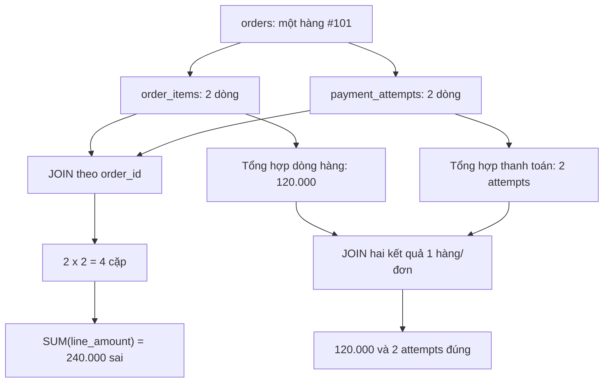

# Tổng hợp sau JOIN và tránh đếm trùng trong PostgreSQL

Các báo cáo SQL thường cần thông tin từ nhiều bảng: khách hàng, đơn hàng, dòng sản phẩm, thanh toán và vận chuyển. Một câu `JOIN` có thể kết hợp các bảng này rất dễ dàng, nhưng **tổng hợp sau khi JOIN** là nơi thường phát sinh lỗi số liệu khó nhận biết.

Ví dụ: một đơn hàng có **hai dòng sản phẩm** và **hai lần thử thanh toán**. Nếu nối trực tiếp cả hai bảng con vào đơn rồi tính `SUM(quantity * unit_price)`, mỗi dòng sản phẩm có thể bị lặp hai lần. Tổng tiền trong báo cáo khi đó **gấp đôi giá trị thật** dù câu SQL chạy hoàn toàn không báo lỗi.

Bài học này tập trung vào **độ hạt của dữ liệu (grain)**, **bội số của phép JOIN (fan-out)** và các chiến lược chống đếm trùng khi tổng hợp trong PostgreSQL. Ta sẽ phân biệt:

- `COUNT(*)`, `COUNT(column)` và `COUNT(DISTINCT column)`.
- Vì sao `SUM(DISTINCT amount)` **không phải** cách sửa một phép JOIN nhân dòng.
- Tổng hợp từng bảng con trước bằng **CTE, subquery hoặc `LATERAL`**.
- Cách giữ cả đối tượng không có bản ghi con với `LEFT JOIN` và `COALESCE`.
- Sử dụng `FILTER (WHERE ...)` và `HAVING` sau khi xác định đúng tập hàng.
- Dùng `DISTINCT ON`, window function và JSON aggregation trong những bài toán cần chọn hoặc trình bày nhiều bản ghi con.
- Kiểm tra kết quả và hiệu năng bằng SQL và `EXPLAIN`.

Mục tiêu cuối cùng không phải thêm `DISTINCT` vào mọi báo cáo, mà là **xác định chính xác một hàng của kết quả đang đại diện cho thực thể gì** và đảm bảo mỗi đại lượng được tính **đúng một lần tại độ hạt phù hợp**.

## 1. Trước khi JOIN, hãy xác định độ hạt của từng bảng

**Độ hạt (grain)** là ý nghĩa của **một hàng** trong một bảng hoặc một kết quả trung gian.

Ví dụ trong hệ thống bán hàng:

| Bảng | Một hàng đại diện cho | Khóa xác định hàng |
| --- | --- | --- |
| `customers` | Một khách hàng | `customer_id` |
| `orders` | Một đơn hàng | `order_id` |
| `order_items` | Một dòng sản phẩm trong đơn | `item_id` hoặc `(order_id, line_no)` |
| `payment_attempts` | Một lần thử thanh toán | `attempt_id` |
| Báo cáo doanh thu theo khách | Một khách và các chỉ số tổng hợp | `customer_id` |
| Báo cáo doanh thu theo tháng | Một tháng trong múi giờ nghiệp vụ | Mốc tháng |

Nếu muốn trả **một hàng cho một đơn**, bảng `orders` vốn đã có độ hạt phù hợp. Nhưng khi nối `order_items`, đơn có hai sản phẩm sẽ xuất hiện hai lần, vì kết quả bây giờ có độ hạt **một dòng sản phẩm của một đơn**.

Đó không phải lỗi. Đó chính là ý nghĩa của phép JOIN một–nhiều. Lỗi chỉ xảy ra khi người viết **tiếp tục tính số đơn hoặc doanh thu như thể vẫn còn một hàng cho mỗi đơn**.

### 1.1. Các câu hỏi phải trả lời trước khi tổng hợp

1. Một hàng ở bảng gốc đại diện cho gì?
2. Mỗi hàng phía trái có thể khớp **tối đa bao nhiêu** hàng phía phải?
3. Khóa JOIN có thực sự độc nhất ở phía dự kiến hay không?
4. Chỉ số đang tính thuộc về **đơn, dòng đơn hay lần thanh toán**?
5. Sau JOIN, chỉ số đó có bị lặp theo các quan hệ khác không?
6. Kết quả cuối cần **một hàng mỗi khách, mỗi đơn, mỗi ngày** hay một mức khác?

Khi câu trả lời cho câu 2 là “nhiều hơn một”, hãy đặc biệt cẩn thận trước khi viết `COUNT(*)` hoặc `SUM(...)`.

## 2. JOIN một–nhiều và nhiều nhánh một–nhiều

Giả sử:

```text
Order #101
  ├── Item #1: 60.000
  ├── Item #2: 60.000
  ├── Payment attempt #1001: FAILED
  └── Payment attempt #1002: SUCCEEDED
```

**Giá trị hàng hóa đúng của đơn 101 = 120.000**. Đơn có **hai** dòng hàng và **hai** lần thử thanh toán.

Khi nối:

```sql
FROM orders AS o
JOIN order_items AS i ON i.order_id = o.order_id
JOIN payment_attempts AS p ON p.order_id = o.order_id
```

thì một dòng của `order_items` được kết hợp với **mọi** lần thanh toán có cùng `order_id`:

| order_id | item_id | line_amount | attempt_id |
| ---: | ---: | ---: | ---: |
| 101 | 1 | 60000 | 1001 |
| 101 | 1 | 60000 | 1002 |
| 101 | 2 | 60000 | 1001 |
| 101 | 2 | 60000 | 1002 |

Kết quả có **2 × 2 = 4 hàng**. Nếu cộng `line_amount` của cả bốn hàng, kết quả là **240.000**, sai gấp đôi so với 120.000.



Đây thường được gọi là **JOIN fan-out**, **row multiplication** hoặc **phép nối nhân bội**. Nếu hai bảng con có lần lượt `m` và `n` hàng phù hợp cho một bản ghi cha, INNER JOIN có thể tạo **`m × n`** hàng. Với `LEFT JOIN`, cần tính thêm trường hợp không có hàng khớp và hàng được bổ sung NULL, nhưng nguy cơ nhân bội vẫn tồn tại.

**Lưu ý:** JOIN nhân dòng không nhất thiết là lỗi. Nếu muốn liệt kê **mọi cặp dòng hàng–lần thanh toán**, bốn hàng là kết quả đúng. Nhưng nếu muốn báo cáo **tổng tiền của một đơn**, đó là sai độ hạt.

## 3. Tạo môi trường thực hành trên PostgreSQL

Sử dụng **database học tập riêng**, không chạy DDL này lên hệ thống sản xuất. Các lệnh dưới đây giả định schema và các bảng demo chưa tồn tại.

### 3.1. Bảng khách hàng và đơn hàng

```sql
CREATE SCHEMA IF NOT EXISTS join_aggregate_lab;

CREATE TABLE join_aggregate_lab.customers (
    customer_id INTEGER PRIMARY KEY,
    full_name   TEXT NOT NULL,
    city        TEXT NOT NULL
);

CREATE TABLE join_aggregate_lab.orders (
    order_id    INTEGER PRIMARY KEY,
    customer_id INTEGER NOT NULL
        REFERENCES join_aggregate_lab.customers (customer_id),
    order_date  DATE NOT NULL,
    status      TEXT NOT NULL
        CHECK (status IN ('PAID', 'PENDING', 'CANCELLED'))
);
```

Đối với bài này, một đơn có một trạng thái tổng quát. Hệ thống thật có thể cần trạng thái chi tiết cho đặt hàng, thu tiền, vận chuyển, hoàn tiền và các sự kiện riêng; không dùng một trạng thái đơn làm bằng chứng duy nhất của giao dịch tài chính khi đối soát thực tế.

### 3.2. Bảng dòng đơn hàng

```sql
CREATE TABLE join_aggregate_lab.order_items (
    item_id    BIGINT GENERATED ALWAYS AS IDENTITY PRIMARY KEY,
    order_id   INTEGER NOT NULL
        REFERENCES join_aggregate_lab.orders (order_id),
    line_no    INTEGER NOT NULL CHECK (line_no > 0),
    sku        TEXT NOT NULL,
    quantity   INTEGER NOT NULL CHECK (quantity > 0),
    unit_price NUMERIC(12, 2) NOT NULL CHECK (unit_price >= 0),
    CONSTRAINT uq_order_items_line
        UNIQUE (order_id, line_no)
);
```

`unit_price` là giá chốt trong dòng đơn, vì giá sản phẩm tại thời điểm hiện tại có thể đã khác. Mỗi `item_id` là một dòng hàng riêng; một đơn có thể có nhiều dòng.

### 3.3. Bảng các lần thử thanh toán

```sql
CREATE TABLE join_aggregate_lab.payment_attempts (
    attempt_id        INTEGER PRIMARY KEY,
    order_id          INTEGER NOT NULL
        REFERENCES join_aggregate_lab.orders (order_id),
    gateway_reference TEXT NOT NULL UNIQUE,
    attempt_status    TEXT NOT NULL
        CHECK (attempt_status IN ('INITIATED', 'FAILED', 'SUCCEEDED')),
    requested_amount  NUMERIC(12, 2) NOT NULL
        CHECK (requested_amount > 0),
    attempted_at      TIMESTAMPTZ NOT NULL
);
```

Một đơn có thể có nhiều lần thử thanh toán, bao gồm cả thất bại và thành công. Vì `payment_attempts.order_id` **không unique**, nối trực tiếp sang bảng này có thể nhân thêm số hàng.

`requested_amount` là **số tiền được yêu cầu ở một lần thử**, không được cộng tất cả các lần thử để suy ra doanh thu: một lần thất bại và một lần retry có thể cùng yêu cầu đúng một số tiền.

### 3.4. Nạp khách hàng và đơn hàng

```sql
INSERT INTO join_aggregate_lab.customers
    (customer_id, full_name, city)
VALUES
    (1, 'An', 'Hà Nội'),
    (2, 'Bình', 'TP. Hồ Chí Minh'),
    (3, 'Chi', 'Hà Nội'),
    (4, 'Dũng', 'Huế'),
    (5, 'Em', 'TP. Hồ Chí Minh');

INSERT INTO join_aggregate_lab.orders
    (order_id, customer_id, order_date, status)
VALUES
    (101, 1, DATE '2026-01-05', 'PAID'),
    (102, 1, DATE '2026-01-06', 'PAID'),
    (103, 2, DATE '2026-01-15', 'PAID'),
    (104, 3, DATE '2026-01-17', 'PENDING'),
    (105, 3, DATE '2026-02-03', 'PAID'),
    (106, 4, DATE '2026-02-05', 'CANCELLED');
```

Khách **Em** chưa có đơn. Chi có một đơn PENDING và một đơn PAID, giúp minh họa sự khác nhau giữa tổng mọi đơn và tổng đơn đã thanh toán.

### 3.5. Nạp dòng hàng

```sql
INSERT INTO join_aggregate_lab.order_items
    (order_id, line_no, sku, quantity, unit_price)
VALUES
    (101, 1, 'NOTE-A5',   2, 30000),
    (101, 2, 'PEN-BLUE',  3, 20000),
    (102, 1, 'NOTE-A5',   1, 50000),
    (103, 1, 'MUG-WHITE', 3, 30000),
    (104, 1, 'NOTE-A5',   1, 50000),
    (105, 1, 'PEN-BLUE',  2, 20000),
    (105, 2, 'MUG-WHITE', 1, 30000),
    (106, 1, 'MUG-WHITE', 1, 30000);
```

Hai dòng của đơn 101 **cùng có số tiền 60.000**, dù là hai sản phẩm khác nhau. Đây là dữ liệu cố ý để chứng minh vì sao `SUM(DISTINCT line_amount)` có thể làm mất tiền hợp lệ.

Giá trị chính xác của từng đơn:

| order_id | Số dòng hàng | Giá trị hàng hóa đúng | status |
| ---: | ---: | ---: | --- |
| 101 | 2 | 120000 | PAID |
| 102 | 1 | 50000 | PAID |
| 103 | 1 | 90000 | PAID |
| 104 | 1 | 50000 | PENDING |
| 105 | 2 | 70000 | PAID |
| 106 | 1 | 30000 | CANCELLED |

Tổng giá trị hàng hóa **mọi trạng thái** = **410.000**. Tổng giá trị hàng hóa của các đơn **PAID** = **330.000**. Đây là hai chỉ số khác nhau, không nên gọi cùng một tên “doanh thu” nếu nghiệp vụ chưa làm rõ.

### 3.6. Nạp các lần thử thanh toán

```sql
INSERT INTO join_aggregate_lab.payment_attempts
    (
        attempt_id,
        order_id,
        gateway_reference,
        attempt_status,
        requested_amount,
        attempted_at
    )
VALUES
    (1001, 101, 'GW-101-A', 'FAILED',    120000,
     TIMESTAMPTZ '2026-01-05 09:00:00+07'),
    (1002, 101, 'GW-101-B', 'SUCCEEDED', 120000,
     TIMESTAMPTZ '2026-01-05 09:03:00+07'),
    (1003, 102, 'GW-102-A', 'SUCCEEDED',  50000,
     TIMESTAMPTZ '2026-01-06 10:00:00+07'),
    (1004, 103, 'GW-103-A', 'FAILED',     90000,
     TIMESTAMPTZ '2026-01-15 11:00:00+07'),
    (1005, 103, 'GW-103-B', 'SUCCEEDED',  90000,
     TIMESTAMPTZ '2026-01-15 11:02:00+07'),
    (1006, 105, 'GW-105-A', 'SUCCEEDED',  70000,
     TIMESTAMPTZ '2026-02-03 12:00:00+07'),
    (1007, 106, 'GW-106-A', 'FAILED',     30000,
     TIMESTAMPTZ '2026-02-05 13:00:00+07');
```

Số lần thử thanh toán theo đơn:

| order_id | Attempts | Succeeded |
| ---: | ---: | ---: |
| 101 | 2 | 1 |
| 102 | 1 | 1 |
| 103 | 2 | 1 |
| 104 | 0 | 0 |
| 105 | 1 | 1 |
| 106 | 1 | 0 |

Tổng cộng có **7 lần thử thanh toán**. Lưu ý đây không phải **7 lần bán hàng**, càng không phải 7 khoản doanh thu độc lập.

## 4. Báo cáo sai khi JOIN hai bảng con trước khi GROUP BY

Thử truy vấn sau:

```sql
SELECT
    o.order_id,
    COUNT(*) AS joined_rows,
    COUNT(i.item_id) AS counted_items,
    COUNT(p.attempt_id) AS counted_attempts,
    SUM(i.quantity * i.unit_price) AS reported_total
FROM join_aggregate_lab.orders AS o
LEFT JOIN join_aggregate_lab.order_items AS i
  ON i.order_id = o.order_id
LEFT JOIN join_aggregate_lab.payment_attempts AS p
  ON p.order_id = o.order_id
GROUP BY o.order_id
ORDER BY o.order_id;
```

Một phần kết quả đáng chú ý:

| order_id | joined_rows | counted_items | counted_attempts | reported_total |
| ---: | ---: | ---: | ---: | ---: |
| 101 | 4 | 4 | 4 | 240000 |
| 102 | 1 | 1 | 1 | 50000 |
| 103 | 2 | 2 | 2 | 180000 |
| 104 | 1 | 1 | 0 | 50000 |
| 105 | 2 | 2 | 2 | 70000 |
| 106 | 1 | 1 | 1 | 30000 |

Ở đơn 101, cả số dòng hàng, số attempts và tổng tiền đều bị **đếm theo các cặp JOIN**, không còn theo đối tượng gốc:

- `COUNT(i.item_id) = 4` nhưng chỉ có **2 item**.
- `COUNT(p.attempt_id) = 4` nhưng chỉ có **2 attempts**.
- `SUM(i.quantity * i.unit_price) = 240000` nhưng tổng đúng là **120000**.

Ở đơn 103, một dòng hàng ghép với hai lần thử thanh toán khiến tổng 90.000 bị tính thành **180.000**.

Ở đơn 105, hai dòng hàng ghép với một attempt, nên tổng tình cờ vẫn đúng. **Việc một số đơn đúng không chứng minh truy vấn đúng**; sai số phụ thuộc số bản ghi con thực tế.

Nếu cộng toàn bộ `reported_total` sai của sáu đơn, được **620.000**, trong khi tổng tiền hàng đúng chỉ **410.000**.

### 4.1. Vì sao LEFT JOIN không ngăn nhân bội?

`LEFT JOIN` chỉ bảo đảm hàng phía trái vẫn xuất hiện khi **không tìm thấy** hàng khớp phía phải. Nó không đặt giới hạn “chỉ một hàng bên phải”.

Với hai nhánh con:

```text
orders
  LEFT JOIN order_items        -- 1 đơn -> 1..N item
  LEFT JOIN payment_attempts   -- 1 đơn -> 0..N attempt
```

những tổ hợp item–attempt vẫn được tạo ra cho mỗi đơn. Nếu một nhánh không có hàng, hàng được bổ sung NULL; ví dụ đơn 104 không có payment attempt nên `COUNT(p.attempt_id) = 0`, nhưng vẫn có một hàng item.

### 4.2. Lỗi xảy ra trước HAVING và SUM

`GROUP BY o.order_id` chỉ gom **các hàng đã được JOIN**. Nó không nhận biết một item bị xuất hiện nhiều lần do cùng ghép với các payment attempts.

Do đó, thêm:

```sql
HAVING SUM(i.quantity * i.unit_price) >= 200000
```

có thể giữ đơn 101 vì tổng sai 240.000 vượt ngưỡng, dù tiền hàng thực của đơn chỉ 120.000. `HAVING` không tự sửa được **độ hạt của tập đầu vào**.

## 5. COUNT(*) không phải COUNT(thực thể)

`COUNT(*)` đếm **mọi hàng kết quả của JOIN trong nhóm**, kể cả hàng chứa các cột NULL do `LEFT JOIN` sinh ra.

Ba hàm đếm phổ biến:

| Biểu thức | Đếm gì? |
| --- | --- |
| `COUNT(*)` | Mỗi hàng trong tập kết quả hiện tại |
| `COUNT(i.item_id)` | Mỗi hàng có `item_id IS NOT NULL`, **có thể đếm trùng một item** nếu JOIN nhân hàng |
| `COUNT(DISTINCT i.item_id)` | Mỗi giá trị item_id không NULL khác nhau, **không đếm lặp cùng item** |

Với khóa chính `item_id`, `COUNT(DISTINCT i.item_id)` có thể khôi phục số lượng **item riêng biệt** sau JOIN nhân hàng. Nhưng hãy nhớ giá trị này là **số dòng hàng**, không phải tổng số lượng sản phẩm: một item có thể có `quantity = 3`.

### 5.1. Sử dụng COUNT(DISTINCT ...) để đếm đúng khóa

```sql
SELECT
    o.order_id,
    COUNT(DISTINCT i.item_id) AS real_item_count,
    COUNT(DISTINCT p.attempt_id) AS real_attempt_count
FROM join_aggregate_lab.orders AS o
LEFT JOIN join_aggregate_lab.order_items AS i
  ON i.order_id = o.order_id
LEFT JOIN join_aggregate_lab.payment_attempts AS p
  ON p.order_id = o.order_id
GROUP BY o.order_id
ORDER BY o.order_id;
```

Kết quả:

| order_id | real_item_count | real_attempt_count |
| ---: | ---: | ---: |
| 101 | 2 | 2 |
| 102 | 1 | 1 |
| 103 | 1 | 2 |
| 104 | 1 | 0 |
| 105 | 2 | 1 |
| 106 | 1 | 1 |

Đây là cách **đúng cho hai chỉ số đếm thực thể** vì mỗi bảng có một khóa ổn định. Tuy nhiên, query vẫn tạo các cặp item–attempt trung gian. Trên dữ liệu lớn, việc tạo nhiều hàng rồi thực hiện DISTINCT có thể tốn bộ nhớ và CPU.

### 5.2. Đếm số đơn sau JOIN cũng cần đúng khóa

Ví dụ đếm số đơn theo khách khi đã JOIN tới dòng hàng:

```sql
SELECT
    o.customer_id,
    COUNT(*) AS joined_line_rows,
    COUNT(DISTINCT o.order_id) AS true_order_count
FROM join_aggregate_lab.orders AS o
JOIN join_aggregate_lab.order_items AS i
  ON i.order_id = o.order_id
GROUP BY o.customer_id
ORDER BY o.customer_id;
```

An có hai đơn nhưng có **ba dòng hàng**, nên:

```text
joined_line_rows = 3
true_order_count = 2
```

**Không** dùng `COUNT(DISTINCT o.customer_id)` để đếm đơn, vì một khách có thể có nhiều đơn. Luôn đặt `DISTINCT` lên **đúng khóa của thực thể cần đếm**.

### 5.3. COUNT(DISTINCT ...) có giới hạn

`COUNT(DISTINCT key)` rất hữu ích, nhưng không nên dùng như một cách sửa tất cả các phép tổng hợp:

- Nó chỉ loại **các khóa lặp** trong phép đếm đang thực hiện.
- Nó không tự đảm bảo `SUM(amount)` hoặc `AVG(amount)` được tính đúng.
- Nó có thể tạo thêm chi phí deduplication và memory/sort/hash.
- Nó không sửa được lỗi JOIN nhầm thực thể do điều kiện khóa thiếu.

Điểm mấu chốt là **đếm đúng khóa**; không phải thêm DISTINCT vào mọi biểu thức rồi tin rằng báo cáo sẽ đúng.

## 6. Vì sao SUM(DISTINCT amount) có thể làm sai doanh thu?

Một phản xạ thường gặp sau khi thấy `SUM(...)` bị nhân đôi là đổi thành:

```sql
SUM(DISTINCT i.quantity * i.unit_price)
```

Điều đó **không có nghĩa “mỗi item được cộng đúng một lần”**. Nó có nghĩa “mỗi **giá trị tiền khác nhau** được cộng một lần”.

Với đơn 101:

| item_id | line_no | quantity | unit_price | line_amount |
| --- | ---: | ---: | ---: | ---: |
| Item A | 1 | 2 | 30000 | 60000 |
| Item B | 2 | 3 | 20000 | 60000 |

Hai dòng là **hai giao dịch hàng hóa hợp lệ**, dù số tiền bằng nhau. Tổng đúng:

```text
60000 + 60000 = 120000
```

Nhưng:

```text
SUM(DISTINCT line_amount) = 60000
```

**Một giá trị 60.000 đã bị loại sai chỉ vì nó bằng giá trị của dòng khác.**

### 6.1. Chứng minh bằng PostgreSQL

```sql
SELECT
    o.order_id,
    SUM(i.quantity * i.unit_price) AS sum_after_join,
    SUM(DISTINCT i.quantity * i.unit_price) AS sum_distinct_amount
FROM join_aggregate_lab.orders AS o
JOIN join_aggregate_lab.order_items AS i
  ON i.order_id = o.order_id
JOIN join_aggregate_lab.payment_attempts AS p
  ON p.order_id = o.order_id
WHERE o.order_id = 101
GROUP BY o.order_id;
```

Kết quả:

| order_id | sum_after_join | sum_distinct_amount |
| ---: | ---: | ---: |
| 101 | 240000 | 60000 |

Một cách cho kết quả **quá lớn**, cách còn lại cho kết quả **quá nhỏ**. Tổng thực là **120.000**.

**Quy tắc:** `SUM(DISTINCT value)` chỉ phù hợp khi nghiệp vụ thực sự muốn **mỗi giá trị khác nhau được cộng một lần**. Nó không thay thế việc tổng hợp đúng theo khóa bản ghi.

### 6.2. Cũng không tùy tiện dùng DISTINCT trên toàn SELECT

`SELECT DISTINCT o.order_id, i.quantity, i.unit_price` có thể gộp hai item hợp lệ nếu chúng có cùng quantity và giá. Nếu thêm `item_id` để không gộp nhầm, ta vẫn phải đảm bảo chỉ xuất hiện **một hàng cho mỗi item** trước khi cộng.

Do đó giải pháp có thể là một bước deduplicate theo **khóa item** rồi tính `SUM`. Nhưng trong hầu hết báo cáo nhiều nhánh 1:N, cách dễ hiểu và an toàn hơn là **tổng hợp từng bảng con trước**.

## 7. Giải pháp chính: tổng hợp từng bảng con trước khi JOIN

Thay vì nối mọi item với mọi attempt rồi mới tính toán, ta xây dựng:

```text
order_items:
    1..N hàng / order
    -> GROUP BY order_id
    -> 1 hàng / order

payment_attempts:
    0..N hàng / order
    -> GROUP BY order_id
    -> 1 hàng / order

orders:
    1 hàng / order
    LEFT JOIN item_totals (1 hàng / order)
    LEFT JOIN payment_stats (0..1 hàng / order)
    -> 1 hàng / order
```

Đây là chiến lược **pre-aggregation** (*tổng hợp trước*).

### 7.1. Tổng hợp dòng đơn thành một hàng mỗi order_id

```sql
SELECT
    order_id,
    COUNT(*) AS item_count,
    SUM(quantity) AS unit_count,
    SUM(quantity * unit_price) AS items_total
FROM join_aggregate_lab.order_items
GROUP BY order_id
ORDER BY order_id;
```

Kết quả:

| order_id | item_count | unit_count | items_total |
| ---: | ---: | ---: | ---: |
| 101 | 2 | 5 | 120000 |
| 102 | 1 | 1 | 50000 |
| 103 | 1 | 3 | 90000 |
| 104 | 1 | 1 | 50000 |
| 105 | 2 | 3 | 70000 |
| 106 | 1 | 1 | 30000 |

Giờ mỗi `order_id` chỉ xuất hiện **một lần**. Không có payment attempts trong đầu vào để nhân đôi item.

### 7.2. Tổng hợp payment attempts thành một hàng mỗi order_id

```sql
SELECT
    order_id,
    COUNT(*) AS attempt_count,
    COUNT(*) FILTER (WHERE attempt_status = 'SUCCEEDED')
        AS successful_attempts,
    COUNT(*) FILTER (WHERE attempt_status = 'FAILED')
        AS failed_attempts,
    MAX(attempted_at) AS last_attempt_at
FROM join_aggregate_lab.payment_attempts
GROUP BY order_id
ORDER BY order_id;
```

Kết quả theo đơn:

| order_id | attempt_count | successful_attempts | failed_attempts |
| ---: | ---: | ---: | ---: |
| 101 | 2 | 1 | 1 |
| 102 | 1 | 1 | 0 |
| 103 | 2 | 1 | 1 |
| 105 | 1 | 1 | 0 |
| 106 | 1 | 0 | 1 |

Không có hàng nào cho đơn **104** vì đơn đó chưa có lần thử thanh toán. Sau `LEFT JOIN`, có thể dùng `COALESCE` để hiển thị các số đếm bằng 0.

### 7.3. JOIN hai nguồn đã tổng hợp bằng CTE

```sql
WITH item_totals AS (
    SELECT
        order_id,
        COUNT(*) AS item_count,
        SUM(quantity) AS unit_count,
        SUM(quantity * unit_price) AS items_total
    FROM join_aggregate_lab.order_items
    GROUP BY order_id
),
payment_stats AS (
    SELECT
        order_id,
        COUNT(*) AS attempt_count,
        COUNT(*) FILTER (WHERE attempt_status = 'SUCCEEDED')
            AS successful_attempts
    FROM join_aggregate_lab.payment_attempts
    GROUP BY order_id
)
SELECT
    o.order_id,
    o.status,
    COALESCE(i.item_count, 0) AS item_count,
    COALESCE(i.unit_count, 0) AS unit_count,
    COALESCE(i.items_total, 0) AS items_total,
    COALESCE(p.attempt_count, 0) AS attempt_count,
    COALESCE(p.successful_attempts, 0) AS successful_attempts
FROM join_aggregate_lab.orders AS o
LEFT JOIN item_totals AS i
  ON i.order_id = o.order_id
LEFT JOIN payment_stats AS p
  ON p.order_id = o.order_id
ORDER BY o.order_id;
```

Kết quả:

| order_id | status | item_count | unit_count | items_total | attempt_count | successful_attempts |
| ---: | --- | ---: | ---: | ---: | ---: | ---: |
| 101 | PAID | 2 | 5 | 120000 | 2 | 1 |
| 102 | PAID | 1 | 1 | 50000 | 1 | 1 |
| 103 | PAID | 1 | 3 | 90000 | 2 | 1 |
| 104 | PENDING | 1 | 1 | 50000 | 0 | 0 |
| 105 | PAID | 2 | 3 | 70000 | 1 | 1 |
| 106 | CANCELLED | 1 | 1 | 30000 | 1 | 0 |

Mỗi hàng kết quả giờ thật sự đại diện cho **một đơn**. Việc kết hợp với payment stats không thể nhân `items_total` vì mỗi bảng con đã được giảm về tối đa **một hàng trên mỗi `order_id`**.

### 7.4. CTE không đồng nghĩa luôn tạo bảng tạm vật lý

`WITH ... AS (...)` tạo **CTE** để tổ chức truy vấn. Trong PostgreSQL hiện đại, planner có thể inline hoặc materialize CTE tùy tính chất và cách sử dụng; không nên mặc định rằng mọi CTE được chạy riêng và ghi xuống đĩa.

Điều làm truy vấn đúng ở ví dụ trên là **`GROUP BY order_id` tạo đúng một hàng mỗi đơn**, không phải bản thân từ khóa `WITH`.

## 8. Tổng hợp bằng subquery trong JOIN

Không bắt buộc dùng CTE. Có thể viết trực tiếp:

```sql
SELECT
    o.order_id,
    COALESCE(i.items_total, 0) AS items_total,
    COALESCE(p.attempt_count, 0) AS attempt_count
FROM join_aggregate_lab.orders AS o
LEFT JOIN (
    SELECT
        order_id,
        SUM(quantity * unit_price) AS items_total
    FROM join_aggregate_lab.order_items
    GROUP BY order_id
) AS i
  ON i.order_id = o.order_id
LEFT JOIN (
    SELECT
        order_id,
        COUNT(*) AS attempt_count
    FROM join_aggregate_lab.payment_attempts
    GROUP BY order_id
) AS p
  ON p.order_id = o.order_id
ORDER BY o.order_id;
```

Ý nghĩa giống chiến lược trước: **biến mỗi quan hệ một–nhiều thành một–một theo khóa order_id**, rồi mới JOIN.

### 8.1. Vì sao không dùng GROUP BY sau JOIN thay cho subquery?

Nếu chỉ viết:

```sql
SELECT o.order_id, SUM(i.quantity * i.unit_price)
FROM join_aggregate_lab.orders AS o
JOIN join_aggregate_lab.order_items AS i
  ON i.order_id = o.order_id
JOIN join_aggregate_lab.payment_attempts AS p
  ON p.order_id = o.order_id
GROUP BY o.order_id;
```

thì `GROUP BY` diễn ra trên **các cặp item–attempt**. Khóa nhóm giống nhau không đủ để biết item nào đã được lặp. Vì thế lỗi vẫn tồn tại.

### 8.2. Có thể tổng hợp ngay trên một nhánh khi chưa có fan-out khác

Trường hợp chỉ cần tổng dòng hàng cho một đơn, query sau là đúng:

```sql
SELECT
    o.order_id,
    SUM(i.quantity * i.unit_price) AS items_total
FROM join_aggregate_lab.orders AS o
JOIN join_aggregate_lab.order_items AS i
  ON i.order_id = o.order_id
GROUP BY o.order_id;
```

Mỗi item nối tới đúng một order nhờ khóa chính/khóa ngoại, và chưa có nhánh khác nhân item. Không cần thiết thêm CTE chỉ vì thấy `JOIN`; cần nhìn vào **cardinality thực tế của tất cả nguồn**.

## 9. LEFT JOIN LATERAL: tổng hợp có tương quan theo từng đơn

PostgreSQL hỗ trợ `LATERAL`, cho phép subquery ở phía phải sử dụng cột của bảng phía trái. Đây là một lựa chọn thuận tiện khi lọc **một tập đơn nhỏ** và muốn tính chỉ số riêng cho từng đơn.

```sql
SELECT
    o.order_id,
    COALESCE(i.item_count, 0) AS item_count,
    COALESCE(i.items_total, 0) AS items_total,
    COALESCE(p.attempt_count, 0) AS attempt_count
FROM join_aggregate_lab.orders AS o
LEFT JOIN LATERAL (
    SELECT
        COUNT(*) AS item_count,
        SUM(oi.quantity * oi.unit_price) AS items_total
    FROM join_aggregate_lab.order_items AS oi
    WHERE oi.order_id = o.order_id
) AS i ON TRUE
LEFT JOIN LATERAL (
    SELECT COUNT(*) AS attempt_count
    FROM join_aggregate_lab.payment_attempts AS pa
    WHERE pa.order_id = o.order_id
) AS p ON TRUE
WHERE o.order_id IN (101, 102, 104)
ORDER BY o.order_id;
```

Kết quả:

| order_id | item_count | items_total | attempt_count |
| ---: | ---: | ---: | ---: |
| 101 | 2 | 120000 | 2 |
| 102 | 1 | 50000 | 1 |
| 104 | 1 | 50000 | 0 |

Mỗi subquery aggregate **không có GROUP BY** nên với một giá trị `o.order_id` nó tạo đúng **một hàng tổng hợp**, kể cả khi không có payment attempts: `COUNT(*)` bằng 0 còn `SUM(...)` có thể là NULL.

### 9.1. LATERAL có phải luôn nhanh hơn CTE?

**Không.** Với vài đơn được lọc rất chọn lọc và có index trên khóa FK, PostgreSQL có thể dùng truy vấn tương quan hiệu quả. Nhưng nếu trả hàng triệu đơn và mỗi đơn lại phải dò bảng con, cách pre-aggregation hàng loạt có thể rẻ hơn.

Chọn theo:

- Số bản ghi cha cần báo cáo.
- Mức độ chọn lọc của `WHERE` phía cha.
- Index phía con, ví dụ `order_items(order_id)`.
- Kích thước và phân bố dữ liệu.
- Kế hoạch `EXPLAIN (ANALYZE, BUFFERS)` thực tế.

**Độ đúng** phải được thiết kế trước, sau đó mới đo để chọn cách triển khai nhanh hơn.

## 10. Subquery tương quan trong SELECT

Một cách khác là tính mỗi chỉ số bằng subquery tương quan:

```sql
SELECT
    o.order_id,
    (
        SELECT COUNT(*)
        FROM join_aggregate_lab.order_items AS i
        WHERE i.order_id = o.order_id
    ) AS item_count,
    (
        SELECT COALESCE(SUM(i.quantity * i.unit_price), 0)
        FROM join_aggregate_lab.order_items AS i
        WHERE i.order_id = o.order_id
    ) AS items_total,
    (
        SELECT COUNT(*)
        FROM join_aggregate_lab.payment_attempts AS p
        WHERE p.order_id = o.order_id
    ) AS attempt_count
FROM join_aggregate_lab.orders AS o
ORDER BY o.order_id;
```

Ưu điểm: các phép tính độc lập, mỗi subquery hoạt động ở **độ hạt của riêng nguồn** nên không bị fan-out giữa item và payment.

Nhược điểm: có thể lặp truy cập nguồn, đặc biệt nếu cần nhiều chỉ số cùng bảng. `LATERAL` cho phép gom nhiều aggregate của một bảng vào một subquery; pre-aggregation cho phép xử lý hàng loạt. PostgreSQL có thể tối ưu một số trường hợp, nhưng không nên dựa vào giả định rằng ba subquery luôn được hợp nhất tự động.

## 11. Từ số liệu đúng mỗi đơn sang số liệu đúng mỗi khách

Khi đã có **một hàng mỗi đơn**, ta có thể tổng hợp lần nữa để có **một hàng mỗi khách** mà không đếm nhầm.

### 11.1. Truy vấn hai tầng tổng hợp

```sql
WITH item_totals AS (
    SELECT
        order_id,
        SUM(quantity * unit_price) AS items_total
    FROM join_aggregate_lab.order_items
    GROUP BY order_id
),
order_facts AS (
    SELECT
        o.order_id,
        o.customer_id,
        o.status,
        COALESCE(i.items_total, 0) AS items_total
    FROM join_aggregate_lab.orders AS o
    LEFT JOIN item_totals AS i
      ON i.order_id = o.order_id
)
SELECT
    c.customer_id,
    c.full_name,
    COUNT(f.order_id) AS all_orders,
    COUNT(f.order_id) FILTER (WHERE f.status = 'PAID')
        AS paid_orders,
    COALESCE(
        SUM(f.items_total) FILTER (WHERE f.status = 'PAID'),
        0
    ) AS paid_items_total
FROM join_aggregate_lab.customers AS c
LEFT JOIN order_facts AS f
  ON f.customer_id = c.customer_id
GROUP BY c.customer_id, c.full_name
ORDER BY c.customer_id;
```

Kết quả:

| customer_id | full_name | all_orders | paid_orders | paid_items_total |
| ---: | --- | ---: | ---: | ---: |
| 1 | An | 2 | 2 | 170000 |
| 2 | Bình | 1 | 1 | 90000 |
| 3 | Chi | 2 | 1 | 70000 |
| 4 | Dũng | 1 | 0 | 0 |
| 5 | Em | 0 | 0 | 0 |

Tổng các giá trị `paid_items_total` là **330.000**, đúng với dữ liệu mẫu.

### 11.2. Vì sao chọn COUNT(f.order_id) thay vì COUNT(*)?

`LEFT JOIN` giữ khách Em dù không có đơn. Với Em, PostgreSQL tạo một hàng kết quả **có các cột của `order_facts` là NULL**. Do đó:

```text
COUNT(*)          = 1  -- đếm hàng do LEFT JOIN tạo
COUNT(f.order_id) = 0  -- không có order_id thực
```

Khi đếm số bản ghi con có thể không tồn tại, dùng `COUNT(khóa_không_NULL_của_bảng_con)` thường đúng hơn.

### 11.3. Vì sao không GROUP BY tên khách?

Hai khách có thể cùng tên. Nếu chỉ:

```sql
GROUP BY c.full_name
```

thì những khách khác nhau có cùng `full_name` có thể bị gộp thành một nhóm. Nên group theo **khóa định danh ổn định** như `customer_id`, hoặc theo `(tenant_id, customer_id)` trong hệ thống nhiều tenant.

## 12. WHERE, ON, FILTER và HAVING sau khi JOIN

Khi tạo báo cáo, có bốn chỗ thường gặp để viết điều kiện; mỗi nơi có tác dụng khác nhau.

| Vị trí | Tác động | Ví dụ |
| --- | --- | --- |
| `ON` | Quy định hàng phía phải nào được nối; với LEFT JOIN còn bảo toàn hàng trái không khớp | `ON o.customer_id=c.customer_id AND o.status='PAID'` |
| `WHERE` | Lọc **hàng kết quả của FROM/JOIN** trước GROUP BY | `WHERE o.order_date >= DATE '2026-01-01'` |
| `FILTER (WHERE ...)` | Lọc hàng đầu vào của **một aggregate cụ thể** | `COUNT(*) FILTER (WHERE status='PAID')` |
| `HAVING` | Chọn **nhóm** sau khi aggregate | `HAVING COUNT(o.order_id) >= 2` |

### 12.1. Khi cần giữ khách không có đơn

**Đúng:** lọc trạng thái ở `ON` để vẫn giữ mọi khách.

```sql
SELECT
    c.customer_id,
    c.full_name,
    COUNT(o.order_id) AS paid_order_count
FROM join_aggregate_lab.customers AS c
LEFT JOIN join_aggregate_lab.orders AS o
  ON o.customer_id = c.customer_id
 AND o.status = 'PAID'
GROUP BY c.customer_id, c.full_name
ORDER BY c.customer_id;
```

Em và Dũng vẫn xuất hiện với `paid_order_count = 0`.

**Khác nghĩa:** đặt trạng thái ở `WHERE`.

```sql
SELECT
    c.customer_id,
    c.full_name,
    COUNT(o.order_id) AS paid_order_count
FROM join_aggregate_lab.customers AS c
LEFT JOIN join_aggregate_lab.orders AS o
  ON o.customer_id = c.customer_id
WHERE o.status = 'PAID'
GROUP BY c.customer_id, c.full_name
ORDER BY c.customer_id;
```

Hàng Em/Dũng có `o.status IS NULL` hoặc chỉ có trạng thái CANCELLED; điều kiện trong `WHERE` loại chúng. Báo cáo không còn “tất cả khách” như yêu cầu.

### 12.2. Khi cần cả số đơn và số đơn PAID

```sql
SELECT
    c.customer_id,
    c.full_name,
    COUNT(o.order_id) AS all_orders,
    COUNT(o.order_id) FILTER (WHERE o.status = 'PAID')
        AS paid_orders
FROM join_aggregate_lab.customers AS c
LEFT JOIN join_aggregate_lab.orders AS o
  ON o.customer_id = c.customer_id
GROUP BY c.customer_id, c.full_name
ORDER BY c.customer_id;
```

Ở đây chỉ JOIN **một bảng con orders** có độ hạt một đơn, nên việc đếm đơn đúng bằng `COUNT(o.order_id)`. Nếu muốn cộng tiền từ dòng đơn, cần tiền tổng hợp dòng đơn theo order để tránh fan-out khi còn nhánh khác.

### 12.3. Lọc nhóm có tổng PAID trên một ngưỡng

Khi đã có `order_facts` một hàng mỗi đơn:

```sql
WITH order_totals AS (
    SELECT
        order_id,
        SUM(quantity * unit_price) AS items_total
    FROM join_aggregate_lab.order_items
    GROUP BY order_id
)
SELECT
    o.customer_id,
    COALESCE(
        SUM(t.items_total) FILTER (WHERE o.status = 'PAID'),
        0
    ) AS paid_total
FROM join_aggregate_lab.orders AS o
LEFT JOIN order_totals AS t
  ON t.order_id = o.order_id
GROUP BY o.customer_id
HAVING COALESCE(
    SUM(t.items_total) FILTER (WHERE o.status = 'PAID'),
    0
) >= 100000
ORDER BY o.customer_id;
```

Kết quả chỉ có **An** với **170.000**. Bình = 90.000, Chi = 70.000, Dũng = 0 nên không đạt.

`HAVING` ở đây được áp dụng **sau khi số tiền mỗi đơn đã được tính đúng**. Không có cách nào để `HAVING` tự sửa một tổng tiền bị JOIN nhân bội ở tầng trước.

## 13. COUNT(DISTINCT ...) và chỉ số đa cột

Trong PostgreSQL, có những bản ghi được xác định bởi **khóa ghép**, ví dụ:

```text
(tenant_id, order_id)
```

Nếu hai tenant đều có `order_id = 500`, `COUNT(DISTINCT order_id)` có thể **đếm thiếu** trong báo cáo xuyên tenant.

### 13.1. Đếm khóa ghép

PostgreSQL có thể đếm các giá trị row constructor khác nhau:

```sql
WITH demo_orders(tenant_id, order_id) AS (
    VALUES
        (1, 500),
        (1, 501),
        (2, 500)
)
SELECT
    COUNT(DISTINCT order_id) AS distinct_local_ids,
    COUNT(DISTINCT (tenant_id, order_id)) AS distinct_scoped_orders
FROM demo_orders;
```

Kết quả:

| distinct_local_ids | distinct_scoped_orders |
| ---: | ---: |
| 2 | 3 |

Hai tenant có thể sử dụng cùng một mã đơn địa phương. Để biết số đơn thực, phải xác định đúng **khóa nghiệp vụ toàn phạm vi**.

### 13.2. Khóa JOIN cũng phải gồm đầy đủ các cột

Nếu bảng con được định danh theo cặp:

```text
orders(tenant_id, order_id)
order_items(tenant_id, order_id, line_no)
```

thì JOIN nên dùng:

```sql
ON i.tenant_id = o.tenant_id
AND i.order_id = o.order_id
```

Nếu chỉ nối theo `order_id`, một item của tenant 1 có thể ghép với đơn 500 của tenant 2. Đó là lỗi **quan hệ JOIN**; `COUNT(DISTINCT ...)` có thể làm số đếm có vẻ hợp lý nhưng **không bảo đảm giá trị được gắn đúng tenant**.

### 13.3. Không đếm theo nhãn có thể trùng

Tương tự:

```sql
COUNT(DISTINCT customer_name)
```

không nhất thiết bằng số khách thật vì hai người có thể cùng tên. Dùng khóa `customer_id` hoặc khóa ghép thay vì một trường hiển thị.

## 14. Khi chỉ cần biết có bản ghi con: EXISTS

Nếu câu hỏi là **“có bao nhiêu khách đã từng đặt đơn?”**, không nhất thiết cần JOIN rồi COUNT DISTINCT. Có thể dùng `EXISTS` để xác định mỗi khách có ít nhất một đơn.

```sql
SELECT COUNT(*) AS customers_with_orders
FROM join_aggregate_lab.customers AS c
WHERE EXISTS (
    SELECT 1
    FROM join_aggregate_lab.orders AS o
    WHERE o.customer_id = c.customer_id
);
```

Kết quả = **4** (An, Bình, Chi, Dũng).

Tương đương về số khách:

```sql
SELECT COUNT(DISTINCT o.customer_id) AS customers_with_orders
FROM join_aggregate_lab.orders AS o;
```

Trong mô hình mẫu `orders.customer_id NOT NULL` và có FK đến khách, câu này cũng ra 4. Tuy nhiên, `EXISTS` diễn đạt rõ “có ít nhất một quan hệ”, đặc biệt khi cần thêm điều kiện hoặc phân quyền trên bảng khách.

### 14.1. Tìm khách chưa có đơn

```sql
SELECT
    c.customer_id,
    c.full_name
FROM join_aggregate_lab.customers AS c
WHERE NOT EXISTS (
    SELECT 1
    FROM join_aggregate_lab.orders AS o
    WHERE o.customer_id = c.customer_id
);
```

Kết quả là khách Em. Không cần `GROUP BY ... HAVING COUNT(...) = 0` khi yêu cầu chỉ hỏi sự tồn tại. `EXISTS`/`NOT EXISTS` thường tránh tạo nhiều cặp JOIN không cần thiết.

## 15. Chọn đúng một bản ghi con bằng DISTINCT ON

Không phải lúc nào cũng cần **đếm hoặc cộng tất cả** bản ghi con. Có lúc cần **lần thử thanh toán gần nhất** của mỗi đơn.

Nếu JOIN toàn bộ payment attempts, những đơn có nhiều lần thử sẽ xuất hiện nhiều hàng. Với PostgreSQL, `DISTINCT ON` có thể chọn **một hàng đầu tiên theo thứ tự đã chỉ định** cho mỗi nhóm:

```sql
SELECT DISTINCT ON (p.order_id)
    p.order_id,
    p.attempt_id,
    p.attempt_status,
    p.attempted_at
FROM join_aggregate_lab.payment_attempts AS p
ORDER BY
    p.order_id,
    p.attempted_at DESC,
    p.attempt_id DESC;
```

Mỗi `order_id` có **một hàng payment attempt mới nhất**. `attempt_id DESC` làm **tie-breaker** khi hai attempts có cùng thời điểm. Nếu không có `ORDER BY` xác định rõ, “hàng đầu tiên” của `DISTINCT ON` không đảm bảo đúng bản ghi mong đợi.

### 15.1. JOIN danh sách mới nhất về orders

```sql
WITH latest_attempt AS (
    SELECT DISTINCT ON (order_id)
        order_id,
        attempt_id,
        attempt_status,
        attempted_at
    FROM join_aggregate_lab.payment_attempts
    ORDER BY order_id, attempted_at DESC, attempt_id DESC
)
SELECT
    o.order_id,
    o.status AS order_status,
    p.attempt_id,
    p.attempt_status
FROM join_aggregate_lab.orders AS o
LEFT JOIN latest_attempt AS p
  ON p.order_id = o.order_id
ORDER BY o.order_id;
```

Đơn 104 vẫn xuất hiện với payment columns NULL. Mỗi đơn có nhiều nhất một hàng từ `latest_attempt`, nên không nhân bản đơn.

**Quan trọng:** “attempt gần nhất” không tự đồng nghĩa **trạng thái thanh toán cuối cùng hợp lệ**, vì callback có thể về trễ, có refund, capture nhiều lần, hoặc trạng thái giao dịch được cập nhật bất đồng bộ. Cần định nghĩa nguồn sự thật của nghiệp vụ tài chính.

### 15.2. DISTINCT ON không phải cách tính doanh thu

Nếu chỉ chọn một dòng hàng mới nhất mỗi đơn bằng `DISTINCT ON (order_id)` rồi `SUM`, bạn sẽ bỏ sót các dòng hàng còn lại. `DISTINCT ON` phù hợp khi yêu cầu là **chọn một đại diện** (ví dụ lần thử mới nhất), không phù hợp để tự động xử lý tổng nhiều dòng.

## 16. ROW_NUMBER() và LATERAL LIMIT 1

Hai cách khác để lấy một bản ghi con đại diện:

### 16.1. Window function ROW_NUMBER

```sql
WITH ranked_attempts AS (
    SELECT
        p.*,
        ROW_NUMBER() OVER (
            PARTITION BY order_id
            ORDER BY attempted_at DESC, attempt_id DESC
        ) AS rn
    FROM join_aggregate_lab.payment_attempts AS p
)
SELECT
    order_id,
    attempt_id,
    attempt_status
FROM ranked_attempts
WHERE rn = 1
ORDER BY order_id;
```

`ROW_NUMBER()` gán thứ tự trong từng nhóm order. Muốn lọc `rn = 1`, dùng **CTE/subquery** vì window function không được dùng trực tiếp trong `WHERE` của cùng tầng SELECT.

### 16.2. LEFT JOIN LATERAL ORDER BY ... LIMIT 1

```sql
SELECT
    o.order_id,
    last_payment.attempt_id,
    last_payment.attempt_status
FROM join_aggregate_lab.orders AS o
LEFT JOIN LATERAL (
    SELECT
        p.attempt_id,
        p.attempt_status
    FROM join_aggregate_lab.payment_attempts AS p
    WHERE p.order_id = o.order_id
    ORDER BY p.attempted_at DESC, p.attempt_id DESC
    LIMIT 1
) AS last_payment ON TRUE
ORDER BY o.order_id;
```

Mỗi đơn có tối đa một attempt được chọn; đơn không có attempt nhận NULL. Cách này có thể tận dụng index phù hợp trên `payment_attempts(order_id, attempted_at DESC, attempt_id DESC)`, đặc biệt khi query chỉ chọn ít đơn.

Lưu ý: **chọn một hàng đại diện** và **tổng hợp mọi hàng con** là hai yêu cầu khác nhau. Đừng dùng `LIMIT 1` để làm mất dữ liệu chỉ vì báo cáo hiện bị nhân dòng.

## 17. Dữ liệu danh sách: JSON aggregation sau JOIN

Một API thường muốn **một đơn với danh sách các dòng hàng** dưới dạng JSON, thay vì một hàng kết quả lặp metadata cho mỗi item.

PostgreSQL có thể tổng hợp thành mảng:

```sql
SELECT
    o.order_id,
    COALESCE(
        jsonb_agg(
            jsonb_build_object(
                'lineNo', i.line_no,
                'sku', i.sku,
                'quantity', i.quantity,
                'unitPrice', i.unit_price
            )
            ORDER BY i.line_no
        ) FILTER (WHERE i.item_id IS NOT NULL),
        '[]'::jsonb
    ) AS items
FROM join_aggregate_lab.orders AS o
LEFT JOIN join_aggregate_lab.order_items AS i
  ON i.order_id = o.order_id
GROUP BY o.order_id
ORDER BY o.order_id;
```

Kết quả có **một hàng mỗi đơn**, và `items` chứa JSON array của các dòng hàng. `FILTER (WHERE i.item_id IS NOT NULL)` tránh tạo một phần tử JSON chứa các giá trị NULL từ hàng được `LEFT JOIN` bổ sung khi đơn chưa có item.

### 17.1. Đừng JOIN payment_attempts vào cùng aggregation một cách vô ý

Nếu mở rộng:

```sql
FROM orders o
LEFT JOIN order_items i ON i.order_id = o.order_id
LEFT JOIN payment_attempts p ON p.order_id = o.order_id
```

rồi `jsonb_agg(i...)`, mỗi item có thể bị đưa vào mảng nhiều lần theo số payment attempts.

Giải pháp là **tạo mảng item và mảng payment độc lập** ở hai CTE/`LATERAL` rồi JOIN về đơn. Một `jsonb_agg(DISTINCT jsonb_build_object(...))` có thể xóa trùng về mặt cấu trúc JSON, nhưng vẫn có nguy cơ gộp hai bản ghi nghiệp vụ khác nhau có nội dung giống nhau và không giải quyết tận gốc fan-out.

### 17.2. JSON array có cần ORDER BY?

Thứ tự phần tử trong aggregate không nên được suy luận từ thứ tự scan/JSON output tình cờ. Khi thứ tự dòng đơn có ý nghĩa, đặt `ORDER BY i.line_no` **bên trong `jsonb_agg(...)`** như ví dụ để có danh sách ổn định.

## 18. Tổng hợp theo nhiều cấp: ngày, tháng, thành phố

Khi số liệu đã đúng ở cấp đơn, có thể chuyển sang mức thống kê khác.

### 18.1. Doanh thu hàng hóa theo tháng cho đơn PAID

```sql
WITH item_totals AS (
    SELECT
        order_id,
        SUM(quantity * unit_price) AS items_total
    FROM join_aggregate_lab.order_items
    GROUP BY order_id
)
SELECT
    date_trunc('month', o.order_date::timestamp)::date
        AS month_start,
    COUNT(*) AS paid_order_count,
    SUM(i.items_total) AS paid_items_total
FROM join_aggregate_lab.orders AS o
JOIN item_totals AS i
  ON i.order_id = o.order_id
WHERE o.status = 'PAID'
GROUP BY date_trunc('month', o.order_date::timestamp)::date
ORDER BY month_start;
```

Kết quả:

| month_start | paid_order_count | paid_items_total |
| --- | ---: | ---: |
| 2026-01-01 | 3 | 260000 |
| 2026-02-01 | 1 | 70000 |

Vì `item_totals` có **một hàng mỗi đơn**, `COUNT(*)` ở query này thực sự đếm số **đơn PAID có item**. Trong schema thực tế cho phép đơn PAID chưa có dòng (hoặc dữ liệu lỗi), INNER JOIN sẽ loại đơn đó. Nếu muốn đếm tất cả đơn PAID bất kể có dòng không, sử dụng `LEFT JOIN` và xử lý NULL phù hợp.

### 18.2. Doanh thu theo thành phố

```sql
WITH item_totals AS (
    SELECT
        order_id,
        SUM(quantity * unit_price) AS items_total
    FROM join_aggregate_lab.order_items
    GROUP BY order_id
)
SELECT
    c.city,
    COUNT(o.order_id) FILTER (WHERE o.status = 'PAID')
        AS paid_order_count,
    COALESCE(
        SUM(i.items_total) FILTER (WHERE o.status = 'PAID'),
        0
    ) AS paid_items_total
FROM join_aggregate_lab.customers AS c
LEFT JOIN join_aggregate_lab.orders AS o
  ON o.customer_id = c.customer_id
LEFT JOIN item_totals AS i
  ON i.order_id = o.order_id
GROUP BY c.city
ORDER BY c.city;
```

Kết quả theo dữ liệu mẫu:

| city | paid_order_count | paid_items_total |
| --- | ---: | ---: |
| Hà Nội | 3 | 240000 |
| Huế | 0 | 0 |
| TP. Hồ Chí Minh | 1 | 90000 |

Tại Hà Nội, An có hai đơn PAID (170.000) và Chi có một đơn PAID (70.000), tổng **240.000**. Thành phố Huế vẫn xuất hiện nhờ `LEFT JOIN` từ customers, dù Dũng chỉ có đơn CANCELLED.

### 18.3. Chọn đúng múi giờ khi nhóm theo ngày

Dữ liệu ví dụ dùng `DATE`. Khi thực tế dùng `TIMESTAMPTZ`, cùng một thời điểm có thể thuộc hai ngày/tháng khác nhau tùy múi giờ hiển thị. Báo cáo kinh doanh cần xác định **múi giờ của kỳ báo cáo**; không mặc định cast `TIMESTAMPTZ::date` có ý nghĩa thống nhất giữa các session với các thiết lập `TimeZone` khác nhau.

Với báo cáo theo múi giờ nghiệp vụ đã xác nhận, PostgreSQL có thể sử dụng biểu thức `AT TIME ZONE` phù hợp trước khi trích ngày/tháng. Nhưng khi chọn index/partition, cần xem khả năng tối ưu của biểu thức, tránh cast tùy tiện trên cột lọc khiến truy vấn kém hiệu quả.

## 19. HAVING chỉ đúng khi dữ liệu đầu vào đã đúng

`HAVING` dùng để lọc **nhóm đã được tổng hợp**. Nó không biết rằng một bản ghi con từng bị nhân lên trong JOIN.

Ví dụ muốn tìm khách có **giá trị đơn PAID từ 100.000 trở lên**. Cách đúng là tính giá trị mỗi đơn trước:

```sql
WITH order_totals AS (
    SELECT
        order_id,
        SUM(quantity * unit_price) AS items_total
    FROM join_aggregate_lab.order_items
    GROUP BY order_id
)
SELECT
    c.customer_id,
    c.full_name,
    COALESCE(
        SUM(t.items_total) FILTER (WHERE o.status = 'PAID'),
        0
    ) AS paid_total
FROM join_aggregate_lab.customers AS c
LEFT JOIN join_aggregate_lab.orders AS o
  ON o.customer_id = c.customer_id
LEFT JOIN order_totals AS t
  ON t.order_id = o.order_id
GROUP BY c.customer_id, c.full_name
HAVING COALESCE(
    SUM(t.items_total) FILTER (WHERE o.status = 'PAID'),
    0
) >= 100000
ORDER BY c.customer_id;
```

Kết quả: chỉ **An (170.000)**. Các khách khác dưới ngưỡng.

### 19.1. Phân biệt ba câu hỏi nghiệp vụ

| Câu hỏi | Logic đúng |
| --- | --- |
| Những đơn PAID nào được tính vào báo cáo? | `WHERE o.status='PAID'` hoặc `FILTER` tùy có cần giữ các trạng thái khác |
| Mỗi đơn có giá trị bao nhiêu? | Tổng hợp `order_items` **theo `order_id`** |
| Khách nào có tổng PAID ít nhất 100.000? | Tổng hợp các đơn của khách rồi `HAVING SUM(...) >= 100000` |

Trộn ba câu hỏi vào một phép JOIN khổng lồ rồi thêm `HAVING` dễ tạo SQL chạy được nhưng kết quả sai.

## 20. Hiệu năng: giảm fan-out trước khi tối ưu index

Một báo cáo JOIN nhiều bảng có thể chậm vì phải tạo ra số lượng **cặp hàng trung gian** rất lớn.

Giả sử một đơn có:

- 15 dòng hàng.
- 8 payment attempts.
- 4 shipment events.

Nếu JOIN trực tiếp cả ba nhánh con:

```text
15 × 8 × 4 = 480 hàng trung gian / một đơn
```

Nếu có hàng trăm nghìn đơn tương tự, số hàng phải tổng hợp có thể tăng rất mạnh. Một `COUNT(DISTINCT ...)` sau cùng có thể cho số đếm đúng nhưng database vẫn phải **xử lý hàng đã nhân bội**.

Pre-aggregation theo từng bảng con giúp giới hạn một hàng trên mỗi khóa cha trước khi kết hợp:

```text
items        -> 1 hàng / order
attempts     -> 1 hàng / order
shipments    -> 1 hàng / order
JOIN về đơn  -> 1 hàng / order
```

### 20.1. Có phải luôn phải pre-aggregate mọi bảng?

Không. PostgreSQL planner có thể thực hiện truy vấn đơn giản rất hiệu quả, và việc aggregate trước toàn bộ bảng con có thể tốn công nếu truy vấn chỉ chọn vài đơn. Cần phân biệt:

- **Đúng về logic:** không cho một thước đo bị lặp bởi quan hệ không liên quan.
- **Nhanh về thực thi:** chọn thứ tự và cách truy cập thích hợp với filter, index và phân bố dữ liệu.

Khi cần một số rất ít đơn, `LEFT JOIN LATERAL` hoặc subquery tương quan có thể phù hợp. Khi báo cáo hàng loạt, pre-aggregate từng nhánh trước thường dễ đảm bảo kết quả đúng và có thể giảm fan-out.

### 20.2. Index nên có ở đâu?

PostgreSQL tạo index cho `PRIMARY KEY`/`UNIQUE`, nhưng **không tự động tạo index ở mọi cột foreign key phía bảng con**.

Trong schema mẫu, các index sau có thể hỗ trợ truy vấn:

```sql
CREATE INDEX idx_agg_orders_customer
ON join_aggregate_lab.orders (customer_id);

CREATE INDEX idx_agg_items_order
ON join_aggregate_lab.order_items (order_id);

CREATE INDEX idx_agg_payment_order_time
ON join_aggregate_lab.payment_attempts
   (order_id, attempted_at DESC, attempt_id DESC);
```

Những index đó phù hợp khi cần tìm đơn theo khách, dòng hàng theo đơn và payment attempt mới nhất theo đơn. Tuy nhiên, chúng cũng tăng dung lượng và chi phí ghi; hãy đo trên workload thật trước khi triển khai production.

### 20.3. Dùng EXPLAIN để nhìn bội số hàng

```sql
EXPLAIN
SELECT
    o.order_id,
    SUM(i.quantity * i.unit_price)
FROM join_aggregate_lab.orders AS o
LEFT JOIN join_aggregate_lab.order_items AS i
  ON i.order_id = o.order_id
LEFT JOIN join_aggregate_lab.payment_attempts AS p
  ON p.order_id = o.order_id
GROUP BY o.order_id;
```

Lệnh này cho biết kế hoạch ước tính. Muốn xem số hàng **thực tế** của từng node:

```sql
EXPLAIN (ANALYZE, BUFFERS)
SELECT
    o.order_id,
    SUM(i.quantity * i.unit_price)
FROM join_aggregate_lab.orders AS o
LEFT JOIN join_aggregate_lab.order_items AS i
  ON i.order_id = o.order_id
LEFT JOIN join_aggregate_lab.payment_attempts AS p
  ON p.order_id = o.order_id
GROUP BY o.order_id;
```

Quan sát:

- Số hàng ở các node JOIN so với số đơn gốc.
- `estimated rows` so với `actual rows`, có thể phản ánh sai lệch thống kê.
- Node `HashAggregate`, `GroupAggregate` và các bước sort/hash.
- Memory/buffer usage và dấu hiệu spill nếu plan báo.
- Thời gian thực thi và ảnh hưởng của bộ lọc.

**`EXPLAIN ANALYZE` thực thi câu SQL thực tế**; trên ví dụ này là SELECT an toàn tương đối. Đối với câu ghi dữ liệu hoặc báo cáo quá nặng trên production, cần kiểm soát tác động và không chạy tùy tiện chỉ vì muốn xem plan.

### 20.4. Planner không thể sửa mọi lỗi nghiệp vụ

PostgreSQL có thể tối ưu thứ tự JOIN, đưa điều kiện xuống các node thấp hơn hoặc dùng các thuật toán Hash Join/Merge Join/Nested Loop tùy nhu cầu. Nhưng **planner phải bảo toàn ngữ nghĩa của câu SQL bạn viết**.

Nếu SQL của bạn bảo “nối mọi item với mọi payment attempt rồi SUM từng cặp”, planner không thể tự ý suy đoán rằng bạn muốn cộng mỗi item đúng một lần. Đó là **lỗi biểu đạt phép tính**, không phải thiếu index.

## 21. Kiểm chứng báo cáo bằng các bất biến số liệu

Khi làm báo cáo tổng hợp, không nên chỉ nhìn vài dòng output rồi kết luận đúng. Một cách thực hành hữu ích là đối chiếu với nguồn có độ hạt thấp nhất phù hợp.

### 21.1. Tổng trực tiếp từ dòng đơn: chuẩn đối chiếu

```sql
SELECT
    COUNT(*) AS raw_item_rows,
    SUM(quantity * unit_price) AS raw_items_total
FROM join_aggregate_lab.order_items;
```

Kết quả mong đợi:

```text
raw_item_rows   = 8
raw_items_total = 410000
```

Nếu một báo cáo không có điều kiện loại trừ hay thêm dòng mà trả tổng khác **410.000**, cần kiểm tra ngay việc JOIN và lọc.

### 21.2. Tổng đơn PAID trực tiếp theo item + order

```sql
SELECT
    COUNT(DISTINCT o.order_id) AS paid_order_count,
    SUM(i.quantity * i.unit_price) AS paid_items_total
FROM join_aggregate_lab.orders AS o
JOIN join_aggregate_lab.order_items AS i
  ON i.order_id = o.order_id
WHERE o.status = 'PAID';
```

Vì mỗi item có đúng một order, và không có nhánh khác nhân item, kết quả đúng:

```text
paid_order_count = 4
paid_items_total = 330000
```

Đây là một chuẩn đối chiếu tốt với báo cáo nhiều nhánh có cùng phạm vi trạng thái.

### 21.3. Đếm attempts trực tiếp từ bảng gốc

```sql
SELECT
    COUNT(*) AS all_attempts,
    COUNT(*) FILTER (WHERE attempt_status = 'SUCCEEDED')
        AS successful_attempts
FROM join_aggregate_lab.payment_attempts;
```

Kết quả:

```text
all_attempts        = 7
successful_attempts = 4
```

Nếu query sau JOIN item trả 10 attempts, không được kết luận hệ thống đã có 10 giao dịch thanh toán: đó là **số lần một hàng attempt xuất hiện trong kết quả JOIN**.

### 21.4. Tìm đơn có số lượng item bất thường

```sql
SELECT
    o.order_id,
    COUNT(DISTINCT i.item_id) AS true_item_count,
    COUNT(i.item_id) AS joined_item_rows
FROM join_aggregate_lab.orders AS o
LEFT JOIN join_aggregate_lab.order_items AS i
  ON i.order_id = o.order_id
LEFT JOIN join_aggregate_lab.payment_attempts AS p
  ON p.order_id = o.order_id
GROUP BY o.order_id
HAVING COUNT(i.item_id) > COUNT(DISTINCT i.item_id)
ORDER BY o.order_id;
```

Trên dữ liệu mẫu, query phát hiện các đơn **101 và 103** có item bị lặp trong kết quả JOIN. Đây là cách **chẩn đoán fan-out của câu truy vấn đang chạy**, không phải bằng chứng rằng dữ liệu item trong bảng nguồn đã bị nhân đôi.

### 21.5. Đối chiếu tiền sau JOIN với tiền nguồn

```sql
WITH raw_per_order AS (
    SELECT
        order_id,
        SUM(quantity * unit_price) AS source_amount
    FROM join_aggregate_lab.order_items
    GROUP BY order_id
),
joined_per_order AS (
    SELECT
        o.order_id,
        SUM(i.quantity * i.unit_price) AS joined_amount
    FROM join_aggregate_lab.orders AS o
    LEFT JOIN join_aggregate_lab.order_items AS i
      ON i.order_id = o.order_id
    LEFT JOIN join_aggregate_lab.payment_attempts AS p
      ON p.order_id = o.order_id
    GROUP BY o.order_id
)
SELECT
    j.order_id,
    r.source_amount,
    j.joined_amount
FROM joined_per_order AS j
JOIN raw_per_order AS r
  ON r.order_id = j.order_id
WHERE j.joined_amount IS DISTINCT FROM r.source_amount
ORDER BY j.order_id;
```

Kết quả phát hiện đơn **101** và **103**, nơi tổng sau JOIN lớn hơn tổng nguồn. `IS DISTINCT FROM` là phép so sánh null-safe, hữu ích nếu hai giá trị có thể NULL.

## 22. Đúng dữ liệu tại một thời điểm: MVCC và báo cáo nhiều câu SQL

Một báo cáo có thể dùng nhiều câu SQL để tải các chỉ số riêng biệt. Khi ứng dụng chạy trong nhiều transaction hoặc trong isolation level `READ COMMITTED`, mỗi statement có thể nhìn một snapshot dữ liệu đã commit **khác nhau**.

Ví dụ:

1. Statement A đếm số đơn theo khách.
2. Một transaction khác chèn một đơn mới và commit.
3. Statement B cộng tiền từ bảng dòng đơn.

Hai số liệu có thể được lấy tại **hai thời điểm khác nhau**, gây khó đối chiếu dù mỗi câu SQL đơn lẻ đều đúng.

### 22.1. Một câu SQL với nhiều CTE có cùng ngữ cảnh snapshot

Việc tính các nguồn trong **một statement** giúp PostgreSQL thực thi truy vấn dựa trên snapshot nhất quán theo cơ chế MVCC thích hợp. Đây là lợi thế của một truy vấn nhiều CTE hoặc JOIN các kết quả aggregate đã thiết kế đúng.

### 22.2. Nhiều statement cần snapshot ổn định

Khi workflow có nhiều query cần cùng một mốc dữ liệu, có thể cân nhắc transaction với isolation level `REPEATABLE READ` theo yêu cầu nghiệp vụ:

```sql
BEGIN TRANSACTION ISOLATION LEVEL REPEATABLE READ READ ONLY;

-- Các câu SELECT báo cáo cần cùng snapshot trong transaction.
SELECT COUNT(*) FROM join_aggregate_lab.orders;

SELECT SUM(quantity * unit_price)
FROM join_aggregate_lab.order_items;

COMMIT;
```

Trong PostgreSQL, snapshot của transaction `REPEATABLE READ` được thiết lập theo quy tắc tại statement thích hợp đầu tiên và được duy trì cho những truy vấn sau trong transaction. Tuy nhiên, transaction đọc kéo dài có thể cản trở việc dọn phiên bản cũ theo MVCC và ảnh hưởng vận hành; không giữ transaction mở hàng giờ chỉ để người dùng xem dashboard.

**Ghi nhớ:** snapshot nhất quán không tự sửa **JOIN fan-out**. Nó xử lý vấn đề dữ liệu thay đổi giữa các lần đọc, còn độ hạt/COUNT/SUM là vấn đề logic của truy vấn.

## 23. Những sai lầm phổ biến và cách tránh

| Sai lầm | Vì sao sai | Cách xử lý |
| --- | --- | --- |
| JOIN hai bảng con 1:N rồi `SUM` dữ liệu một nhánh | Mỗi dòng nhánh đó lặp theo nhánh kia | Tổng hợp riêng từng nhánh trước |
| `COUNT(*)` sau JOIN để đếm đơn | Đếm số cặp kết quả, không đếm khóa đơn | `COUNT(DISTINCT order_id)` hoặc bắt đầu từ độ hạt một đơn |
| `COUNT(item_id)` sau JOIN payment | Một item xuất hiện nhiều lần | `COUNT(DISTINCT item_id)` hoặc pre-aggregate |
| `SUM(DISTINCT amount)` để bỏ dòng nhân | Gộp hai giao dịch độc lập có cùng giá trị tiền | Tổng hợp đúng theo item/order key |
| `SELECT DISTINCT` sau cùng | Có thể xóa dữ liệu hợp lệ hoặc không sửa sai số aggregate | Sửa JOIN/grain trước aggregate |
| Đếm payment attempts như số đơn bán | Một đơn có thể retry nhiều lần | Phân biệt attempt, order và successful payment |
| Cộng `requested_amount` của mọi attempts thành doanh thu | Một lần thất bại rồi retry sẽ tính tiền lặp | Dùng nguồn ghi nhận tiền thực/đã đối soát |
| Dùng `COUNT(*)` sau LEFT JOIN để đếm con | Hàng null-extended cũng được đếm | `COUNT(child.id)` |
| Đặt điều kiện con ở WHERE sau LEFT JOIN khi muốn giữ cha | Loại mất cha không có con phù hợp | Đặt điều kiện ở ON hoặc dùng FILTER |
| Chọn `LIMIT 1` từ bảng item để tránh nhiều dòng | Mất những dòng hàng hợp lệ khác | Aggregate tất cả item theo đơn |
| Dùng `DISTINCT ON` mà không có thứ tự rõ | Hàng được chọn có thể không xác định | `ORDER BY` và tie-breaker ổn định |
| Dùng `jsonb_agg` sau JOIN nhiều bảng con | JSON array có phần tử lặp | Aggregate từng collection riêng |
| Nối theo tên khách/SKU không unique | Ghép nhầm hoặc nhân nhiều hàng | JOIN theo PK/FK hoặc khóa nghiệp vụ unique đúng |
| JOIN thiếu `tenant_id` trong khóa ghép | Trộn dữ liệu giữa các tenant | JOIN đủ các cột khóa, bảo vệ thêm bằng FK/RLS |
| GROUP BY tên khách thay vì customer_id | Hai khách cùng tên bị gộp | Dùng định danh ổn định |
| GROUP BY thêm cột status không chủ đích | Tạo nhiều hàng mỗi khách | Xác định rõ grain cuối |
| HAVING trên số liệu đã nhân bội | Nhóm bị chọn sai theo tổng sai | Sửa grain và pre-aggregation trước |
| Tin rằng optimizer sẽ tự tính đúng doanh thu | Planner phải giữ ngữ nghĩa SQL đã viết | Diễn đạt phép tính đúng ngay trong truy vấn |
| Chỉ kiểm tra một đơn có một item/attempt | Test không lộ fan-out | Dùng dữ liệu có 2×2, giá trị tiền trùng, hàng con thiếu |
| Cho rằng có index là số đếm đúng | Index ảnh hưởng đường truy cập, không tự sửa logic | Thiết kế SQL đúng, sau đó tối ưu |

## 24. Quy trình kiểm tra khi nhận một query báo cáo phức tạp

Một cách thực tế để xem xét câu SQL có nhiều JOIN và aggregate:

1. **Ghi rõ độ hạt đầu ra.** Ví dụ “một hàng mỗi khách” hay “một hàng mỗi đơn”.
2. **Liệt kê độ hạt từng bảng.** Item, payment, shipment, refund, event đều là những thực thể có thể nhiều hàng trên một cha.
3. **Vẽ sơ đồ cardinality.** Mỗi đường nối là 1:1, N:1 hay 1:N?
4. **Xác nhận khóa JOIN.** Có thiếu một phần khóa ghép/tenant? Có dùng cột không unique?
5. **Chạy kiểm tra COUNT trực tiếp trên bảng nguồn.** Đếm riêng orders, items, attempts.
6. **Xem số hàng ngay sau mỗi JOIN.** Một JOIN mới làm số hàng tăng bao nhiêu lần?
7. **Xác định thước đo thuộc grain nào.** Số lượng item phải tính theo item, giá trị đơn phải tính theo đơn, payment attempts phải tính theo attempt.
8. **Tổng hợp nhánh 1:N về grain phù hợp.** Dùng CTE, derived table, LATERAL hoặc subquery.
9. **JOIN các kết quả đã có khóa duy nhất theo cha.** Mỗi nhánh cần tối đa một hàng trên khóa nối nếu kết quả cuối phải một hàng trên cha.
10. **Xử lý OUTER JOIN và NULL có chủ đích.** `COUNT(child.id)`, `COALESCE(SUM(...), 0)` khi nghiệp vụ muốn 0.
11. **Áp FILTER/WHERE/HAVING đúng phạm vi.** Phải biết điều kiện lọc hàng, aggregate hay nhóm.
12. **Đối chiếu với dữ liệu biên.** Ít nhất một đơn có 2 items × 2 attempts, hai item cùng số tiền, một đơn không có attempt và một khách không có đơn.
13. **Đọc EXPLAIN trên dữ liệu đại diện.** Chỉ tối ưu sau khi tổng số đúng; kiểm tra index, hash/sort và số hàng tại node JOIN.
14. **Xác định snapshot và độ mới của dữ liệu.** Cân nhắc replica lag, cache và transaction khi báo cáo phải nhất quán tại một mốc.
15. **Ghi lại quy tắc nghiệp vụ.** “Doanh thu” là tổng đơn PAID, số tiền capture hay số tiền sau hoàn? Một truy vấn đúng cú pháp không thay thế định nghĩa chỉ số.

Đây là trình tự tư duy áp dụng khi tự thiết kế báo cáo; nó không biến một câu SQL sai thành đúng chỉ bằng thao tác định dạng hoặc thêm index.

## 25. Bài tập thực hành

Sử dụng các bảng trong schema `join_aggregate_lab` đã tạo tại mục 3. Mỗi bài cần ghi rõ **độ hạt** của kết quả dự kiến.

1. **Nhận diện grain.** Với `customers`, `orders`, `order_items` và `payment_attempts`, cho biết một hàng của mỗi bảng đại diện cho điều gì và khóa nào đảm bảo định danh.
2. **JOIN một nhánh.** Nối `orders` với `order_items`, đếm số hàng kết quả. Giải thích vì sao có 8 hàng thay vì 6 đơn.
3. **JOIN hai nhánh.** Thêm `LEFT JOIN payment_attempts` vào truy vấn bài 2. Đếm số hàng toàn bộ; vì sao kết quả trở thành **11**?
4. **Nhân bội đơn 101.** Liệt kê `item_id` và `attempt_id` của đơn 101. Giải thích vì sao có bốn cặp.
5. **Số item.** Viết query trả `COUNT(i.item_id)` và `COUNT(DISTINCT i.item_id)` sau JOIN hai nhánh. Với đơn 101, kết quả khác nhau thế nào?
6. **Số attempts.** Viết query trả `COUNT(p.attempt_id)` và `COUNT(DISTINCT p.attempt_id)` sau JOIN hai nhánh. Với đơn 105, kết quả có thể là bao nhiêu?
7. **Doanh thu sai.** Tính `SUM(i.quantity*i.unit_price)` sau khi JOIN cả payment attempts. Chỉ ra đơn 101 và 103 bị cộng thừa thế nào.
8. **SUM DISTINCT sai.** Dùng `SUM(DISTINCT i.quantity*i.unit_price)` cho đơn 101. Giải thích tại sao nhận 60.000 thay vì 120.000.
9. **Tiền tổng hợp dòng.** Viết CTE `item_totals` một hàng mỗi order_id với `item_count`, `unit_count` và `items_total`. Đối chiếu sáu tổng đơn với bảng ở mục 3.
10. **Tiền tổng hợp thanh toán.** Viết CTE `payment_stats` có số attempts, số thành công, số thất bại và thời điểm gần nhất cho mỗi order_id.
11. **JOIN hai CTE.** Kết hợp hai CTE ở bài 9 và 10 về orders. Bảo đảm vẫn có đúng sáu hàng và order 104 có `attempt_count=0`.
12. **Thay CTE bằng subquery.** Viết phiên bản dùng hai derived tables trong `LEFT JOIN`, so kết quả.
13. **Dùng LATERAL.** Tính item totals và attempt count cho các đơn 101, 102, 104 bằng hai `LEFT JOIN LATERAL` có tổng hợp tương quan.
14. **Báo cáo khách hàng.** Lấy mọi khách, số đơn mọi trạng thái, số đơn PAID và tổng hàng hóa PAID. Kết quả khách Em phải là `0,0,0`, An là `2,2,170000`.
15. **COUNT trên LEFT JOIN.** Giải thích khác biệt `COUNT(*)` và `COUNT(o.order_id)` đối với khách Em, rồi sửa truy vấn trả số đơn đúng.
16. **WHERE/ON/FILTER.** Viết ba cách đếm đơn PAID theo khách; chỉ ra cách nào loại khách không có đơn PAID khỏi kết quả.
17. **HAVING.** Tìm những khách có tổng tiền hàng PAID ít nhất 100.000. Vì sao phải tính số tiền đơn chính xác trước khi áp điều kiện?
18. **Theo thành phố.** Tính số đơn PAID và tổng hàng hóa PAID theo thành phố. Kiểm tra Hà Nội = 240.000, TP. Hồ Chí Minh = 90.000, Huế = 0.
19. **Theo tháng.** Tính tiền hàng PAID cho tháng 1 và tháng 2/2026; xác nhận lần lượt là 260.000 và 70.000.
20. **JSON array.** Tạo một mảng JSON của các item mỗi đơn bằng `jsonb_agg`. Sau đó thử JOIN thêm payment attempts và mô tả nguyên nhân các phần tử có thể lặp; sửa bằng CTE/`LATERAL`.
21. **Payment mới nhất.** Lấy một attempt gần nhất mỗi đơn bằng `DISTINCT ON` hoặc `ROW_NUMBER()`. Vì sao phải có `attempt_id` để xử lý trường hợp trùng timestamp?
22. **Khóa ghép theo tenant.** Dùng CTE hai tenant có cùng order_id, thử `COUNT(DISTINCT order_id)` và `COUNT(DISTINCT (tenant_id,order_id))`. Giải thích vì sao kết quả khác nhau.
23. **Phân biệt số đơn và số tiền.** Nếu chỉ cần biết có bao nhiêu khách từng mua, dùng `EXISTS` để đếm khách. Tại sao không cần JOIN mọi order_items?
24. **EXPLAIN.** Chạy `EXPLAIN (ANALYZE, BUFFERS)` trên một SELECT join hai nhánh và so với query pre-aggregate. Chú ý số hàng tại join/aggregate và chi phí thực tế trên dữ liệu đủ đại diện.
25. **Thử edge cases.** Thêm trong database thử nghiệm một đơn chưa có item/attempt và một khách chưa có đơn. Kiểm tra `COUNT(*)`, `COUNT(child.id)` và `COALESCE(SUM(...),0)`; ghi lại ngữ nghĩa của việc hiển thị 0.
26. **Một đơn nhiều lần thử.** Nếu payment FAILED rồi retry SUCCEEDED cùng `requested_amount`, tại sao `SUM(requested_amount)` không phải tiền đã thu?
27. **Thiết kế báo cáo mới.** Bảng `projects` có nhiều `tasks` và nhiều `time_entries` trên từng task. Bạn muốn tổng số task và tổng giờ theo project. Vẽ grain, đề xuất điểm pre-aggregate và viết SQL tránh nhân bội nếu có thêm bảng `task_comments`.
28. **Tính nhất quán.** Giải thích sự khác nhau giữa báo cáo sai vì JOIN fan-out và báo cáo không khớp vì hai câu SELECT đọc ở hai snapshot khác nhau. Đề xuất giải pháp phù hợp cho mỗi vấn đề.
29. **Đánh giá query code review.** Với câu SQL có năm JOIN, lập checklist ghi khóa nối, bội số hàng, thước đo, GROUP BY, DISTINCT, NULL, điều kiện tenant và các trường hợp kiểm thử.

## 26. Tổng kết

**Tổng hợp sau JOIN** chỉ đáng tin cậy khi bạn kiểm soát được **độ hạt của dữ liệu**. Nhìn một phép nối qua các bảng con:

```text
orders 1 ─── N order_items
   |
   +──────── N payment_attempts

JOIN trực tiếp các nhánh:
    N item × M attempt
    -> có thể nhân hàng
    -> COUNT/SUM trên nguồn gốc có thể sai

Phương án ưu tiên khi cần số liệu:
    GROUP BY order_id trong order_items
    GROUP BY order_id trong payment_attempts
    JOIN các kết quả 1 hàng / order
    -> GROUP BY customer_id / month / city nếu cần
```

Hãy ghi nhớ:

- **`COUNT(DISTINCT id)`** hữu ích khi cần đếm các bản ghi theo một khóa ổn định sau JOIN, nhưng có chi phí và không tự sửa các phép tính khác.
- **`SUM(DISTINCT amount)` không đồng nghĩa cộng mỗi giao dịch một lần**; hai giao dịch khác nhau có cùng số tiền vẫn phải được cộng đầy đủ.
- **Pre-aggregate mỗi nhánh 1:N về đúng khóa cha** là cách dễ đọc, dễ chứng minh tính đúng cho báo cáo nhiều nguồn; `LATERAL` và subquery tương quan là những lựa chọn khác khi phù hợp.
- **`LEFT JOIN` giữ hàng cha nhưng không hạn chế số hàng con**; `COUNT(child.id)` và `COALESCE` cần được dùng đúng ngữ nghĩa khi có NULL.
- **`FILTER` và `HAVING`** giải quyết việc lọc aggregate và lọc nhóm, nhưng chỉ đúng khi các hàng đầu vào không bị nhân bội sai.
- **EXPLAIN giúp hiểu hiệu năng**, còn tính đúng của phép tổng hợp phải xuất phát từ mô hình khóa và quan hệ.

Quy tắc thực hành cốt lõi là: **tính đại lượng tại độ hạt mà nó thuộc về, rồi mới kết hợp và nâng lên độ hạt báo cáo**. Làm đúng điều đó sẽ giúp các báo cáo PostgreSQL không vô tình biến hai dòng hàng và hai lần thanh toán thành bốn giao dịch kinh doanh.
