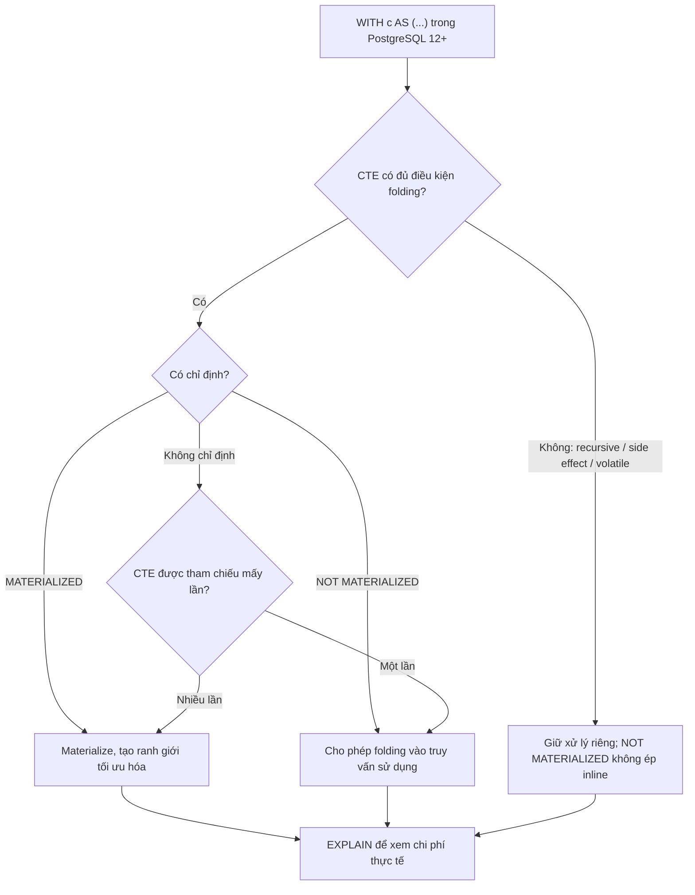

# MATERIALIZED, NOT MATERIALIZED và kế hoạch thực thi CTE

Trong PostgreSQL, Common Table Expression (**CTE**) được khai báo bằng `WITH` thường giúp chia một câu SQL phức tạp thành những phần có tên, dễ đọc và tái sử dụng. Tuy nhiên, cùng một CTE có thể dẫn đến những **kế hoạch thực thi rất khác nhau** tùy PostgreSQL được phép đưa truy vấn con vào truy vấn cha (**folding/inlining**) hay phải giữ kết quả CTE như một tập trung gian (**materialization**).

Từ **PostgreSQL 12**, ta có hai từ khóa quan trọng:

- **`MATERIALIZED`**: yêu cầu giữ CTE dưới dạng kết quả trung gian, tạo một ranh giới tối ưu hóa ở những trường hợp CTE được phép áp dụng cơ chế này.
- **`NOT MATERIALIZED`**: yêu cầu PostgreSQL có thể gộp phần định nghĩa CTE vào truy vấn sử dụng nó, kể cả khi CTE được tham chiếu nhiều lần, **nếu CTE đủ điều kiện gộp**.

Chúng không phải tùy chọn “bật cache cho nhanh” và “tắt cache cho chậm”. Có trường hợp `MATERIALIZED` rất có lợi vì tránh tính lại biểu thức nặng; có trường hợp nó lại làm PostgreSQL phải đọc nhiều hàng không cần thiết và không thể tận dụng điều kiện lọc hoặc index của truy vấn ngoài.

Bài học trong chương **Truy vấn nâng cao** này trình bày:

1. CTE là gì và khác subquery, view, materialized view như thế nào.
2. Quy tắc mặc định của PostgreSQL 12+ khi CTE được tham chiếu một lần hoặc nhiều lần.
3. Khi nào `MATERIALIZED` giúp tránh tính lại; khi nào `NOT MATERIALIZED` giúp đẩy predicate và tối ưu index.
4. Cách đọc `EXPLAIN`, `CTE Scan`, `Hash Join`, `Nested Loop`, chi phí và dấu hiệu spill ra disk.
5. Những ngoại lệ của CTE đệ quy, hàm `VOLATILE` và CTE có câu lệnh thay đổi dữ liệu.
6. Cách benchmark có kiểm soát, tối ưu an toàn và đưa quyết định vào code SQL/JDBC.

Các ví dụ sử dụng PostgreSQL hiện đại, SQL thực hành trên schema riêng. **Không áp dụng các câu tạo/xóa bảng, tạo index hoặc thay cấu hình vào production nếu chưa review và có kế hoạch thay đổi.**

## 1. Bắt đầu từ một CTE bình thường

Một CTE là một **kết quả truy vấn được đặt tên trong phạm vi một statement**:

```sql
WITH paid_orders AS (
    SELECT
        order_id,
        customer_id,
        amount,
        ordered_at
    FROM demo_cte.sales_order
    WHERE status = 'PAID'
)
SELECT
    customer_id,
    COUNT(*) AS paid_order_count,
    SUM(amount) AS paid_amount
FROM paid_orders
GROUP BY customer_id
ORDER BY customer_id;
```

Phần `paid_orders AS (...)` làm cho câu truy vấn có cấu trúc:

- Bước logic thứ nhất: chọn đơn có `status = 'PAID'`.
- Bước logic thứ hai: tổng hợp số lượng và tiền theo khách.

Tại đây **“bước logic” không nhất thiết là “bước thực thi vật lý”**. PostgreSQL có thể tối ưu các phần thành một kế hoạch thống nhất thay vì thực hiện toàn bộ CTE, lưu kết quả rồi mới chạy câu ngoài.

### 1.1. CTE có tên nhưng không phải bảng lưu bền

Kết quả CTE:

- Chỉ có ý nghĩa trong **statement** dùng `WITH` đó.
- Không tự trở thành bảng trong `pg_class` để client khác SELECT.
- Không có chính sách refresh định kỳ.
- Không tồn tại sau statement để truy vấn sau tái sử dụng.
- Không có index riêng tự tạo trên tập kết quả trung gian.
- Có thể được planner gộp vào truy vấn cha hoặc được đánh giá qua tuplestore theo kế hoạch.

**`MATERIALIZED` trên CTE không có nghĩa tạo một `MATERIALIZED VIEW`.** Hai khái niệm có cùng chữ “materialized” nhưng khác vòng đời và cách quản trị.

### 1.2. WITH giúp cấu trúc câu SQL, không mặc định giúp nhanh

```sql
WITH candidates AS (
    SELECT *
    FROM demo_cte.sales_order
)
SELECT *
FROM candidates
WHERE customer_id = 42;
```

Nếu đủ điều kiện folding, cách viết trên có thể có kế hoạch gần với:

```sql
SELECT *
FROM demo_cte.sales_order
WHERE customer_id = 42;
```

Đừng nghĩ PostgreSQL luôn buộc phải quét toàn bộ bảng cho CTE trước rồi mới lọc khách. Từ PostgreSQL 12, những CTE SELECT đơn giản thường được **inline** khi chỉ dùng một lần.

Ngược lại, cũng đừng nghĩ dùng `WITH` tự động tốt hơn subquery. Cấu trúc nào thích hợp phụ thuộc tính đúng của SQL và kế hoạch thực thi.

## 2. Kiểm tra phiên bản trước khi dùng hai từ khóa

Cú pháp `AS MATERIALIZED` và `AS NOT MATERIALIZED` được đưa vào PostgreSQL từ **phiên bản 12**.

```sql
SHOW server_version;

SELECT current_setting('server_version_num')::integer AS version_number;
```

Quy tắc phiên bản rất quan trọng:

| Phiên bản PostgreSQL | Cơ chế CTE SELECT thường gặp |
|---|---|
| PostgreSQL 11 trở về trước | CTE thường đóng vai trò ranh giới tối ưu hóa; cú pháp `MATERIALIZED`/`NOT MATERIALIZED` chưa hỗ trợ |
| PostgreSQL 12 trở lên | CTE SELECT không đệ quy, không có side effect có thể được gộp; có thể dùng `MATERIALIZED` hoặc `NOT MATERIALIZED` |
| Các phiên bản mới hơn | Planner được cải tiến, nhưng vẫn phải đọc `EXPLAIN` thực tế; không suy ra kế hoạch chỉ từ phiên bản |

Một CTE có tên giống nhau có thể cho hiệu năng khác giữa PostgreSQL 11 và 12, ngay cả khi **không thay đổi text SQL**. Đây là một điểm cần kiểm tra sau khi nâng cấp PostgreSQL.

**Lưu ý vận hành:** không sử dụng `NOT MATERIALIZED` trên hệ thống PostgreSQL 11. Server sẽ không hiểu cú pháp này.

## 3. Ba cách khai báo quan trọng

### 3.1. Mặc định: không chỉ định

```sql
WITH filtered_orders AS (
    SELECT *
    FROM demo_cte.sales_order
    WHERE status = 'PAID'
)
SELECT *
FROM filtered_orders
WHERE customer_id = 42;
```

PostgreSQL tự quyết định theo các quy tắc folding/materialization và điều kiện của CTE.

### 3.2. Ép MATERIALIZED

```sql
WITH filtered_orders AS MATERIALIZED (
    SELECT *
    FROM demo_cte.sales_order
    WHERE status = 'PAID'
)
SELECT *
FROM filtered_orders
WHERE customer_id = 42;
```

Tập trung gian trở thành một ranh giới tối ưu hóa. Planner của truy vấn ngoài không thể tự do đẩy `customer_id = 42` xuyên qua CTE theo cùng cách nó làm khi inline.

### 3.3. Yêu cầu NOT MATERIALIZED

```sql
WITH filtered_orders AS NOT MATERIALIZED (
    SELECT *
    FROM demo_cte.sales_order
    WHERE status = 'PAID'
)
SELECT *
FROM filtered_orders
WHERE customer_id = 42;
```

Với một CTE đủ điều kiện, PostgreSQL có thể gộp định nghĩa CTE vào truy vấn ngoài và tối ưu hai điều kiện cùng nhau:

```sql
WHERE status = 'PAID'
  AND customer_id = 42
```

**`NOT MATERIALIZED` không phải cam kết rằng kế hoạch chắc chắn dùng index**, không phải bảo đảm mọi biểu thức chỉ tính một lần và cũng không ép mọi kiểu CTE phải inline. Nó là một chỉ dẫn về cách xử lý CTE trong phạm vi những trường hợp hợp lệ.

## 4. Quy tắc mặc định trong PostgreSQL 12+

Với một CTE **không đệ quy, side-effect-free**, điển hình là `SELECT` không chứa hàm `VOLATILE`, PostgreSQL áp dụng quy tắc mặc định quan trọng:

- CTE được **tham chiếu một lần** thường được **fold vào truy vấn cha**.
- CTE được **tham chiếu hơn một lần** thường được **materialize**, nhằm tránh tính lại phần định nghĩa nhiều lần.
- Dùng `MATERIALIZED` có thể ngăn folding dù chỉ tham chiếu một lần.
- Dùng `NOT MATERIALIZED` có thể cho phép folding ngay cả khi có nhiều tham chiếu, với trade-off tính toán có thể lặp lại.

Sơ đồ:



Đây là **quy tắc chung để hiểu hành vi planner**, không phải thuật toán giải thích hết mọi trường hợp đặc biệt. Ví dụ, CTE tham chiếu bằng các query block khác nhau hoặc có thêm yếu tố làm thay đổi khả năng folding cần được nhìn từ kế hoạch thực tế.

### 4.1. “Một lần” nghĩa là số tham chiếu đến tên CTE

```sql
WITH paid AS (
    SELECT order_id, customer_id, amount
    FROM demo_cte.sales_order
    WHERE status = 'PAID'
)
SELECT COUNT(*) FROM paid;
```

Tên `paid` xuất hiện ở một vị trí `FROM`, nên đây là một tham chiếu.

```sql
WITH paid AS (
    SELECT order_id, customer_id, amount
    FROM demo_cte.sales_order
    WHERE status = 'PAID'
)
SELECT
    (SELECT COUNT(*) FROM paid WHERE customer_id = 42) AS customer_42,
    (SELECT COUNT(*) FROM paid WHERE customer_id = 43) AS customer_43;
```

Ở câu thứ hai, `paid` được tham chiếu **hai lần** dù chỉ có một `WITH paid AS (...)`. Đây là khác biệt khiến mặc định thường đổi sang materialization.

### 4.2. Một CTE có thể là dependency của CTE khác

```sql
WITH
base AS (
    SELECT order_id, customer_id, status, amount
    FROM demo_cte.sales_order
),
paid AS (
    SELECT *
    FROM base
    WHERE status = 'PAID'
)
SELECT *
FROM paid
WHERE customer_id = 42;
```

`base` và `paid` là hai cấp tên logic. PostgreSQL có thể fold các CTE đủ điều kiện để tạo kế hoạch gần một SELECT trực tiếp. Việc có hai lớp `WITH` không tự yêu cầu hai lần ghi tập trung gian.

Nếu buộc `base AS MATERIALIZED`, planner có thể mất cơ hội đẩy điều kiện bên ngoài xuống bảng gốc. Vì thế khi đọc SQL nhiều tầng, cần xem **nơi nào đặt ranh giới materialization**, không chỉ đếm số CTE.

## 5. Chuẩn bị dữ liệu thực hành và chỉ mục

Tạo schema riêng `demo_cte`. Các ví dụ dưới đây dùng dữ liệu sinh có quy luật, đủ nhỏ để học nhưng lớn hơn vài hàng nhằm nhìn thấy sự khác nhau trong kế hoạch.

### 5.1. Tạo bảng khách và đơn

```sql
CREATE SCHEMA IF NOT EXISTS demo_cte;

CREATE TABLE demo_cte.customer (
    customer_id INTEGER PRIMARY KEY,
    customer_name TEXT NOT NULL,
    segment TEXT NOT NULL
);

CREATE TABLE demo_cte.sales_order (
    order_id BIGINT GENERATED ALWAYS AS IDENTITY PRIMARY KEY,
    customer_id INTEGER NOT NULL,
    status TEXT NOT NULL,
    amount NUMERIC(12, 2) NOT NULL,
    ordered_at TIMESTAMPTZ NOT NULL,
    CONSTRAINT fk_sales_order_customer
        FOREIGN KEY (customer_id)
        REFERENCES demo_cte.customer(customer_id),
    CONSTRAINT ck_sales_order_status
        CHECK (status IN ('NEW', 'PAID', 'CANCELLED')),
    CONSTRAINT ck_sales_order_amount
        CHECK (amount >= 0)
);
```

### 5.2. Sinh dữ liệu nhất quán

```sql
INSERT INTO demo_cte.customer (customer_id, customer_name, segment)
SELECT
    g,
    'Customer ' || g::text,
    CASE
        WHEN g % 5 = 0 THEN 'ENTERPRISE'
        ELSE 'STANDARD'
    END
FROM generate_series(1, 2000) AS g;

INSERT INTO demo_cte.sales_order
    (customer_id, status, amount, ordered_at)
SELECT
    ((g - 1) % 2000) + 1,
    CASE
        WHEN g % 10 = 0 THEN 'CANCELLED'
        WHEN g % 3 = 0 THEN 'PAID'
        ELSE 'NEW'
    END,
    ((g % 500) + 1) * 1000.00,
    TIMESTAMPTZ '2026-01-01 00:00:00+00'
        + (g % 300) * INTERVAL '1 day'
FROM generate_series(1, 50000) AS g;
```

Ta có 2.000 khách và 50.000 đơn trên một môi trường lab mới. `status` và `customer_id` có phân phối có quy luật; chúng giúp tái hiện các ví dụ, **không được xem là dữ liệu benchmark đại diện cho production**.

Chèn nhiều lần sẽ tạo thêm đơn mới và có thể ảnh hưởng kết quả, nên chỉ chạy setup một lần nếu muốn so sánh các plan trên cùng bộ dữ liệu.

### 5.3. Tạo index và thống kê

```sql
CREATE INDEX idx_demo_cte_order_customer_status
ON demo_cte.sales_order (customer_id, status);

CREATE INDEX idx_demo_cte_order_status_customer
ON demo_cte.sales_order (status, customer_id);

CREATE INDEX idx_demo_cte_order_customer_time
ON demo_cte.sales_order (customer_id, ordered_at DESC);

ANALYZE demo_cte.customer;
ANALYZE demo_cte.sales_order;
```

Ba index ở đây dùng để minh họa những hướng truy cập khác nhau. **Không sao chép nguyên ba index vào một bảng thật** mà không đo workload; chúng có thể chồng lấp chức năng và tăng chi phí INSERT/UPDATE, WAL, dung lượng, VACUUM.

Kiểm tra kích thước và phân phối:

```sql
SELECT
    COUNT(*) AS total_orders,
    COUNT(*) FILTER (WHERE status = 'PAID') AS paid_orders,
    COUNT(DISTINCT customer_id) AS customers_with_orders
FROM demo_cte.sales_order;

SELECT status, COUNT(*) AS row_count
FROM demo_cte.sales_order
GROUP BY status
ORDER BY status;
```

## 6. Một tham chiếu: điều kiện ngoài được đẩy xuống trong trường hợp folding

Xét yêu cầu: tìm tối đa 20 đơn PAID gần đây của khách 42.

```sql
WITH paid_orders AS (
    SELECT order_id, customer_id, amount, ordered_at
    FROM demo_cte.sales_order
    WHERE status = 'PAID'
)
SELECT order_id, amount, ordered_at
FROM paid_orders
WHERE customer_id = 42
ORDER BY ordered_at DESC
LIMIT 20;
```

Ở PostgreSQL 12+ với CTE phù hợp, planner thường có thể gộp:

```sql
SELECT order_id, amount, ordered_at
FROM demo_cte.sales_order
WHERE status = 'PAID'
  AND customer_id = 42
ORDER BY ordered_at DESC
LIMIT 20;
```

Lợi ích tiềm năng:

- `customer_id = 42` được xem cùng `status = 'PAID'` ngay ở tầng bảng gốc.
- PostgreSQL có thể dùng index trên `(customer_id,status)` hoặc một đường truy cập khác phù hợp.
- Không cần sinh trước một tập lớn chứa đơn PAID của mọi khách.
- Planner có thể phối hợp `ORDER BY`, `LIMIT` và thống kê trên một kế hoạch chung.

### 6.1. EXPLAIN để quan sát folding

```sql
EXPLAIN
WITH paid_orders AS (
    SELECT order_id, customer_id, amount, ordered_at
    FROM demo_cte.sales_order
    WHERE status = 'PAID'
)
SELECT order_id, amount, ordered_at
FROM paid_orders
WHERE customer_id = 42
ORDER BY ordered_at DESC
LIMIT 20;
```

Nếu CTE được fold hoàn toàn, kế hoạch có thể không hiển thị node `CTE Scan` của `paid_orders`. Bạn có thể thấy `Index Scan`, `Bitmap Heap Scan`, `Seq Scan`, `Sort` hoặc `Limit` tùy chi phí.

**Không mặc định “có Index Scan mới đúng”**. Với bảng nhỏ, thống kê hoặc bộ lọc ít chọn lọc, `Seq Scan` có thể rẻ hơn; điều quan trọng là kế hoạch đáp ứng query với chi phí phù hợp.

### 6.2. CTE chỉ tham chiếu một lần nhưng có thể materialize khi yêu cầu

```sql
EXPLAIN
WITH paid_orders AS MATERIALIZED (
    SELECT order_id, customer_id, amount, ordered_at
    FROM demo_cte.sales_order
    WHERE status = 'PAID'
)
SELECT order_id, amount, ordered_at
FROM paid_orders
WHERE customer_id = 42
ORDER BY ordered_at DESC
LIMIT 20;
```

Đây là cách **chủ động ngăn folding**. Planner của CTE bên trong có thể chỉ thấy `status = 'PAID'`, còn filter `customer_id = 42` nằm trên `CTE Scan` phía ngoài.

So sánh hai plan để thấy điều kiện nào được đặt ở node truy cập bảng gốc và điều kiện nào nằm trên node dùng kết quả CTE.

## 7. MATERIALIZED là “optimization fence” trong tình huống này

**Optimization fence** là ranh giới khiến một số phép biến đổi tối ưu của truy vấn cha không thể tự do đi sâu qua CTE như khi inline.

```text
WITH filtered AS MATERIALIZED (
    SELECT ...
    FROM sales_order
    WHERE status = 'PAID'
)
SELECT ...
FROM filtered
WHERE customer_id = 42;

           ┌────────────────────┐
           │   CTE producer     │
           │ WHERE status=PAID  │
           │ tạo tập trung gian │
           └─────────┬──────────┘
                     │
                     ▼
           ┌────────────────────┐
           │      CTE Scan      │
           │ WHERE customer=42  │
           └────────────────────┘
```

Trong dạng query này, **predicate của truy vấn ngoài không được đẩy vào producer như khi fold**. Kết quả có thể là:

- PostgreSQL đọc/xử lý nhiều hàng PAID của các khách khác.
- Kết quả trung gian chiếm bộ nhớ hoặc spill ra temp file.
- Một điều kiện lẽ ra có thể tìm nhanh qua index không được dùng ở vị trí sớm nhất.
- Kế hoạch tổng thể trở nên tốn chi phí hơn.

Tuy vậy, `MATERIALIZED` không có nghĩa PostgreSQL **luôn** phải thực hiện toàn bộ CTE trước khi bên ngoài đọc hàng đầu tiên. PostgreSQL có cơ chế đánh giá CTE theo nhu cầu trong những kế hoạch phù hợp; `LIMIT` ở trên có thể khiến việc đọc dừng sớm. Nếu truy vấn ngoài có `ORDER BY` cần xem hết dữ liệu, join hoặc aggregate, nhiều trường hợp vẫn phải tiêu thụ đầy đủ tập CTE.

**Điểm chính:** fence hạn chế cách planner tối ưu xuyên CTE, chứ không nhất thiết là một lệnh “ghi toàn bộ kết quả ra disk ngay lập tức”.

### 7.1. Vì sao có người vẫn chủ động dùng fence?

Có lý do chính đáng:

- Cần tránh tính lại một biểu thức đắt khi CTE dùng nhiều lần.
- Muốn giữ một hình dạng kế hoạch đã kiểm chứng trong một workload cụ thể.
- Muốn kiểm soát phần nào việc optimizer thay đổi cách kết hợp câu SQL qua một ranh giới.
- Một bước xử lý trung gian mang tính toán nặng được tái dùng nhiều nơi.

Nhưng **MATERIALIZED không phải cơ chế ổn định kế hoạch tuyệt đối**; planner vẫn có quyền chọn các phép quét, join, sort bên trong CTE và ở ngoài. Không nên dùng nó như giải pháp thay thế việc thiết kế index, cập nhật thống kê hay viết điều kiện đúng.

## 8. Hai tham chiếu: vì sao mặc định có thể materialize?

Xét yêu cầu đếm số đơn PAID của hai khách khác nhau từ cùng một tập logic:

```sql
WITH paid_orders AS (
    SELECT order_id, customer_id, amount
    FROM demo_cte.sales_order
    WHERE status = 'PAID'
)
SELECT
    (SELECT COUNT(*) FROM paid_orders WHERE customer_id = 42) AS paid_42,
    (SELECT COUNT(*) FROM paid_orders WHERE customer_id = 43) AS paid_43;
```

`paid_orders` được tham chiếu hai lần nên PostgreSQL 12+ thường giữ kết quả CTE chung. Cách này giúp producer chỉ cần đánh giá một lần, nhưng có vấn đề tiềm ẩn:

- Producer lọc toàn bộ đơn PAID của **mọi khách**.
- Hai consumer mỗi bên đọc/tìm những hàng thuộc một khách.
- Điều kiện riêng `customer_id = 42` và `= 43` không được tự đưa ngược vào producer như hai truy vấn index độc lập.

### 8.1. Tự xem kế hoạch mặc định

```sql
EXPLAIN
WITH paid_orders AS (
    SELECT order_id, customer_id, amount
    FROM demo_cte.sales_order
    WHERE status = 'PAID'
)
SELECT
    (SELECT COUNT(*) FROM paid_orders WHERE customer_id = 42) AS paid_42,
    (SELECT COUNT(*) FROM paid_orders WHERE customer_id = 43) AS paid_43;
```

Nếu được materialize, plan có thể có phần:

```text
CTE paid_orders
  -> ... scan sales_order ... status = 'PAID'
...
-> Aggregate
     -> CTE Scan on paid_orders ... customer_id = 42
-> Aggregate
     -> CTE Scan on paid_orders ... customer_id = 43
```

Đây là **minh họa hình dạng plan**, không phải kết quả EXPLAIN đo từ một server cụ thể. Tên node, thời gian và thứ tự có thể khác.

### 8.2. NOT MATERIALIZED khi mỗi consumer cần một tập nhỏ

```sql
EXPLAIN
WITH paid_orders AS NOT MATERIALIZED (
    SELECT order_id, customer_id, amount
    FROM demo_cte.sales_order
    WHERE status = 'PAID'
)
SELECT
    (SELECT COUNT(*) FROM paid_orders WHERE customer_id = 42) AS paid_42,
    (SELECT COUNT(*) FROM paid_orders WHERE customer_id = 43) AS paid_43;
```

Khi CTE đủ điều kiện folding, PostgreSQL có thể tạo hai phần truy cập bảng gốc, mỗi phần tối ưu độc lập với bộ lọc của nó.

Ví dụ một hướng plan có thể là:

```text
Aggregate
  -> Index Only Scan / Index Scan
       Index Cond: (customer_id = 42, status = 'PAID')
Aggregate
  -> Index Only Scan / Index Scan
       Index Cond: (customer_id = 43, status = 'PAID')
```

Nếu mỗi khách chỉ có ít đơn, việc đọc một số trang liên quan ở bảng gốc hai lần **có thể rẻ hơn** tính toàn bộ hàng PAID rồi quét tập trung gian hai lượt.

### 8.3. Trade-off không có đáp án luôn đúng

| Tình huống | Materialize có thể tốt | NOT MATERIALIZED có thể tốt |
|---|---|---|
| Tập CTE nhỏ, dùng nhiều lần | Chia sẻ một kết quả trung gian | Có thể vẫn ổn, tùy kế hoạch |
| Tập CTE lớn, mỗi consumer lọc rất ít hàng khác nhau | Có thể tốn nhiều hàng không cần | Pushdown/index có thể tiết kiệm mạnh |
| CTE tính biểu thức CPU đắt và mỗi consumer cần hầu hết hàng | Tránh tính lại | Có thể tính biểu thức nhiều lần |
| CTE chỉ dùng một lần, đủ điều kiện inline | Mất cơ hội tối ưu nếu ép fence | Folding thường hợp lý |
| CTE dùng dữ liệu chọn lọc rất khác nhau ở từng nhánh | Consumer phải lọc sau fence | Mỗi nhánh được tối ưu độc lập |
| CTE chứa VOLATILE hoặc recursive | Có thể không fold bất kể lựa chọn | Chỉ định NOT MATERIALIZED có thể bị bỏ qua |

**Không chọn theo số lần tham chiếu một cách máy móc.** Hai tham chiếu không nhất thiết có nghĩa materialization luôn thắng; chính việc mỗi consumer sử dụng bao nhiêu dữ liệu mới là yếu tố quan trọng.

## 9. Mặt trái của NOT MATERIALIZED: có thể tính biểu thức đắt nhiều lần

Câu chuyện ngược lại: CTE có phép tính chi phí cao, và nhiều consumer cần chính kết quả phép tính đó.

Dùng một biểu thức băm văn bản tương đối tốn CPU hơn phép đọc cột đơn giản:

```sql
WITH transformed AS MATERIALIZED (
    SELECT
        order_id,
        customer_id,
        md5(repeat(order_id::text, 200)) AS fingerprint
    FROM demo_cte.sales_order
    WHERE order_id BETWEEN 1 AND 1000
)
SELECT COUNT(*)
FROM transformed AS left_part
JOIN transformed AS right_part
  ON left_part.fingerprint = right_part.fingerprint;
```

Nếu materialized, `fingerprint` của mỗi hàng do producer tạo ra có thể được sử dụng bởi nhiều lần tham chiếu `transformed`, thay vì nhất thiết lặp lại phép băm ở mỗi nơi.

Thử viết:

```sql
WITH transformed AS NOT MATERIALIZED (
    SELECT
        order_id,
        customer_id,
        md5(repeat(order_id::text, 200)) AS fingerprint
    FROM demo_cte.sales_order
    WHERE order_id BETWEEN 1 AND 1000
)
SELECT COUNT(*)
FROM transformed AS left_part
JOIN transformed AS right_part
  ON left_part.fingerprint = right_part.fingerprint;
```

Vì CTE đủ điều kiện folding, biểu thức `md5(repeat(...))` có thể xuất hiện ở nhiều nhánh kế hoạch. Chi phí đánh giá thực tế còn tùy optimizer: có thể đẩy, bỏ bớt hoặc tái cấu trúc biểu thức theo nhu cầu. Do vậy **không kết luận số lần gọi hàm chỉ bằng việc đọc SQL text**; phải xem `EXPLAIN (ANALYZE, BUFFERS)` và đo thời gian trong lab.

### 9.1. Lưu ý về function volatility

Trong PostgreSQL, function có phân loại như `IMMUTABLE`, `STABLE` và `VOLATILE`. Biểu thức như `md5(repeat(...))` phù hợp để minh họa một phép tính thuần, không dựa trên side effect. Nó cho planner cơ hội fold.

Nếu một CTE chứa hàm `VOLATILE` như `random()`, câu chuyện khác: dù người viết ghi `NOT MATERIALIZED`, PostgreSQL không tùy tiện fold nó vì điều đó có thể làm thay đổi số lần thực thi và kết quả.

**Tính đắt và tính volatile là hai khái niệm khác nhau.** Một hàm tính toán tốn CPU nhưng pure/immutable vẫn có thể fold; một hàm rẻ nhưng volatile vẫn bị ràng buộc bởi ngữ nghĩa side effect/biến đổi kết quả.

## 10. CTE có hàm VOLATILE: NOT MATERIALIZED không ép inline

Xét:

```sql
WITH values_with_random AS (
    SELECT
        order_id,
        random() AS random_value
    FROM demo_cte.sales_order
    WHERE order_id BETWEEN 1 AND 5
)
SELECT
    a.order_id,
    a.random_value AS value_a,
    b.random_value AS value_b
FROM values_with_random AS a
JOIN values_with_random AS b USING (order_id)
ORDER BY a.order_id;
```

`random()` là `VOLATILE`. Với một CTE được dùng nhiều lần, việc chia sẻ kết quả có ý nghĩa: mỗi hàng do CTE producer tạo có một `random_value`, các consumer có thể đọc lại giá trị đó.

Thử cùng cấu trúc nhưng thêm chỉ dẫn:

```sql
WITH values_with_random AS NOT MATERIALIZED (
    SELECT
        order_id,
        random() AS random_value
    FROM demo_cte.sales_order
    WHERE order_id BETWEEN 1 AND 5
)
SELECT
    a.order_id,
    a.random_value AS value_a,
    b.random_value AS value_b
FROM values_with_random AS a
JOIN values_with_random AS b USING (order_id)
ORDER BY a.order_id;
```

Trong PostgreSQL, **`NOT MATERIALIZED` bị bỏ qua nếu CTE không đủ điều kiện folding**, điển hình là CTE SELECT chứa volatile function. Không kỳ vọng hai tham chiếu sẽ nhận hai lần random độc lập chỉ vì ghi từ khóa đó.

Những ví dụ hàm volatile:

- `random()`: số ngẫu nhiên có thể thay đổi ở từng lời gọi.
- `clock_timestamp()`: thời gian đồng hồ thực có thể thay đổi ngay trong statement.
- `nextval(...)`: làm thay đổi sequence, có side effect.
- Function do người dùng tự viết được khai báo `VOLATILE`.

Không lạm dụng `nextval()` hoặc các function gây side effect để “đo” inlining: chúng có thể thay đổi dữ liệu/sequence ngay cả khi transaction sau đó rollback (sequence có quy tắc riêng).

### 10.1. STABLE không đồng nghĩa VOLATILE

`now()` hay `CURRENT_TIMESTAMP` theo quy tắc PostgreSQL trả thời điểm bắt đầu transaction và thường được phân loại ổn định theo transaction, khác `clock_timestamp()`.

Một CTE SELECT chỉ dùng các phép toán và hàm phù hợp (không chứa `VOLATILE`) **có thể đủ điều kiện folding**, dù giá trị không phải literal trong SQL. Không tự đánh đồng “có function” với “phải materialize”.

### 10.2. Vì sao PostgreSQL cẩn thận với volatile function?

Nếu CTE chứa phép gọi random hoặc một function ảnh hưởng trạng thái, gộp một CTE được tham chiếu hai lần vào hai nhánh có thể làm hàm được gọi số lần khác hoặc trong thứ tự khác, từ đó đổi kết quả quan sát được.

Cơ chế hạn chế folding giúp giữ ngữ nghĩa đánh giá CTE phù hợp. Vì vậy `NOT MATERIALIZED` là **khả năng tối ưu có điều kiện**, không phải quyền phá mọi ràng buộc ngữ nghĩa.

## 11. CTE đệ quy: mô hình thực thi khác CTE SELECT thông thường

CTE đệ quy thường được viết:

```sql
WITH RECURSIVE seq(n) AS (
    VALUES (1)
    UNION ALL
    SELECT n + 1
    FROM seq
    WHERE n < 10
)
SELECT n
FROM seq
ORDER BY n;
```

Kết quả: các số 1 đến 10.

PostgreSQL sử dụng cơ chế đánh giá đệ quy với tập làm việc (working table) theo bước, không đơn giản gộp toàn bộ `seq` vào một biểu thức SELECT phẳng như CTE nonrecursive.

Trong `EXPLAIN`, có thể thấy:

- `Recursive Union`.
- `WorkTable Scan`.
- `CTE Scan` hoặc những node phù hợp để đọc kết quả.
- `Sort` nếu truy vấn ngoài yêu cầu thứ tự.

### 11.1. NOT MATERIALIZED không làm biến mất recursion

Một CTE **recursive** không đủ điều kiện cho cơ chế folding bình thường. Nếu người viết thêm `NOT MATERIALIZED` vào một CTE recursive theo cú pháp phiên bản hỗ trợ, chỉ dẫn ấy không biến toàn bộ recursion thành inline SQL.

Với recursion, câu hỏi hiệu năng thường nằm ở:

- Điều kiện dừng có đúng không?
- `UNION ALL` hay `UNION` có phù hợp với yêu cầu loại trùng?
- Dữ liệu có vòng lặp (cycle) không?
- Số bước/độ sâu có thể phình lớn không?
- Bước đệ quy có index cho quan hệ nối không?
- Kết quả cần sort, distinct hoặc aggregate ở ngoài không?

Đừng dùng `NOT MATERIALIZED` như phương thuốc cho truy vấn đệ quy không kết thúc hoặc bùng nổ số hàng.

### 11.2. LIMIT ngoài có thể dừng sớm trong lab nhưng không phải biện pháp an toàn

Trong một số truy vấn đệ quy, PostgreSQL chỉ đánh giá đủ số hàng mà truy vấn ngoài cần. Vì thế một `LIMIT` ngoài có thể giúp thăm dò. Tuy nhiên, khi truy vấn ngoài có `ORDER BY`, `JOIN` hoặc aggregate cần toàn bộ đầu vào, nó có thể buộc recursion tạo nhiều hoặc toàn bộ hàng.

**Luôn đặt điều kiện dừng logic trong phần đệ quy**; không dựa vào `LIMIT` ngoài để ngăn một vòng lặp vô hạn ở production.

## 12. Data-modifying CTE: WITH có INSERT, UPDATE, DELETE, MERGE

PostgreSQL hỗ trợ `WITH` chứa câu lệnh thay đổi dữ liệu trong những ngữ cảnh hợp lệ, thường thông qua `RETURNING` để truyền dữ liệu sang truy vấn chính hoặc CTE khác.

Ví dụ trên một bảng lab:

```sql
CREATE TABLE demo_cte.audit_event (
    audit_id BIGINT GENERATED ALWAYS AS IDENTITY PRIMARY KEY,
    event_code TEXT NOT NULL,
    created_at TIMESTAMPTZ NOT NULL DEFAULT now()
);
```

Một thao tác có `INSERT ... RETURNING`:

```sql
WITH inserted AS (
    INSERT INTO demo_cte.audit_event (event_code)
    VALUES ('DEMO-CREATE')
    RETURNING audit_id, event_code, created_at
)
SELECT *
FROM inserted;
```

`inserted` không phải một SELECT thuần side-effect-free; nó là một data-modifying CTE.

Quy tắc quan trọng:

- Data-modifying CTE có ngữ nghĩa thực thi riêng, **không được inline tùy ý** như CTE SELECT thông thường.
- Trong PostgreSQL, các data-modifying statement của `WITH` được thực thi **một lần và đến hoàn tất** theo ngữ nghĩa của chúng, không phụ thuộc đơn thuần vào việc truy vấn ngoài đọc bao nhiêu hàng trả về.
- `RETURNING` là cách truyền hàng kết quả từ câu DML sang phần khác của statement.
- Những substatement DML trong cùng `WITH` dùng các quy tắc snapshot và thực thi đồng thời theo PostgreSQL; **không nên giả định thứ tự cập nhật giữa chúng** nếu có tác động lẫn nhau.
- Tránh thiết kế hai nhánh DML sửa cùng một hàng trong một statement; kết quả có thể không xác định như mong muốn.
- DML trong CTE có điều kiện vị trí và quyền; không thể chèn tùy ý vào mọi loại subquery rồi coi nó là SELECT.

### 12.1. DML CTE chạy ngay cả khi consumer không dùng mọi hàng

Ví dụ:

```sql
BEGIN;

WITH updated AS (
    UPDATE demo_cte.sales_order
    SET status = 'CANCELLED'
    WHERE order_id BETWEEN 1 AND 3
    RETURNING order_id
)
SELECT COUNT(*)
FROM updated;

ROLLBACK;
```

Đây là bài thực hành có **thay đổi dữ liệu thật trong transaction**, rồi rollback để không lưu sự thay đổi. Nó chỉ minh họa cách DML CTE trả `RETURNING`.

Không dùng `MATERIALIZED` hoặc `NOT MATERIALIZED` như cách hứa rằng một câu `UPDATE` trong CTE “chỉ chạy khi được đọc”. Quy tắc side effect của DML khác CTE SELECT thuần.

### 12.2. Đừng nhầm tối ưu CTE với thao tác materialized view

Một `MATERIALIZED VIEW` là đối tượng persistent:

```sql
CREATE MATERIALIZED VIEW demo_cte.mv_paid_order_count AS
SELECT customer_id, COUNT(*) AS paid_count
FROM demo_cte.sales_order
WHERE status = 'PAID'
GROUP BY customer_id;
```

Sau khi tạo, nó có dữ liệu lưu riêng và có thể được đọc trong **statement khác**:

```sql
SELECT * FROM demo_cte.mv_paid_order_count
WHERE customer_id = 42;
```

Khi bảng nguồn thay đổi, materialized view **không tự phản ánh mọi thay đổi ngay**; cần cơ chế `REFRESH MATERIALIZED VIEW`, có quy tắc khóa, index và lịch refresh riêng.

Ngược lại, `WITH c AS MATERIALIZED (...)` chỉ có kết quả trong phạm vi **statement hiện tại** và không tạo view nào để refresh. Không dùng hai thuật ngữ thay thế nhau.

## 13. Materialization ở bộ nhớ và khả năng spill ra disk

Khi PostgreSQL materialize CTE SELECT, kết quả trung gian thường được quản lý trong cơ chế tuplestore/buffer nội bộ. Tùy lượng dữ liệu và tài nguyên, phần lưu này có thể:

- Nằm trong bộ nhớ trong phạm vi phù hợp.
- Dùng file tạm khi vượt ngưỡng tương ứng.
- Được đọc lại bởi nhiều `CTE Scan` trong cùng statement.
- Tạo thêm I/O và chi phí truy cập trung gian.

Đừng diễn giải `MATERIALIZED` là “ghi chắc chắn ra ổ cứng”. Từ này mô tả **quyết định giữ kết quả trung gian** chứ không buộc PostgreSQL luôn ghi disk.

### 13.1. work_mem và file tạm

`work_mem` ảnh hưởng mức bộ nhớ cho các operation nhất định như sort/hash và lưu trung gian phù hợp, bao gồm những trường hợp tuplestore. Nếu kết quả hoặc operation vượt khả năng giữ trong bộ nhớ, PostgreSQL có thể phải dùng file tạm.

Kiểm tra:

```sql
SHOW work_mem;
SHOW temp_file_limit;
SHOW log_temp_files;
```

Không tăng `work_mem` toàn cụm một cách vội vàng chỉ vì thấy CTE materialization dùng file tạm. Một truy vấn có thể có nhiều operation dùng bộ nhớ, và nhiều connection chạy đồng thời có thể làm tổng tiêu thụ RAM rất lớn.

### 13.2. Quan sát trong EXPLAIN

```sql
EXPLAIN (ANALYZE, BUFFERS, VERBOSE)
WITH all_paid AS MATERIALIZED (
    SELECT *
    FROM demo_cte.sales_order
    WHERE status = 'PAID'
)
SELECT
    COUNT(*),
    SUM(amount)
FROM all_paid;
```

`EXPLAIN ANALYZE` thật sự chạy câu `SELECT` và đo các node. Bạn có thể thấy:

- `CTE all_paid`, phần producer.
- `CTE Scan on all_paid`, phần consumer.
- Thông tin thời gian/rows/loops.
- `Buffers`, có thể gồm `temp read`/`temp written` nếu có hoạt động file tạm.

**Không phải cứ có `CTE Scan` là chắc chắn có temp file**, và không phải cứ có temp read/write là chỉ do CTE. Sort, hash join và các node khác cũng có thể dùng file tạm. Cần xem toàn bộ plan và hệ thống log temp để xác định.

### 13.3. LOG TEMP FILES hỗ trợ chẩn đoán

PostgreSQL có tham số `log_temp_files` để ghi những file tạm đủ điều kiện theo ngưỡng. Khi điều tra CTE lớn, dữ liệu log về file tạm có thể hỗ trợ tìm áp lực I/O.

Thay đổi logging trên production đòi hỏi quyền, chính sách bảo mật và ngân sách log. Bài này không yêu cầu thay cấu hình server để chứng minh ý tưởng; bắt đầu từ `EXPLAIN` trên dữ liệu lab là đủ.

## 14. Đọc CTEScan và phần producer trong kế hoạch

Một plan minh họa cho materialized CTE có thể trông như:

```text
Aggregate
  CTE paid_orders
    -> Seq Scan on sales_order
         Filter: (status = 'PAID')
  -> CTE Scan on paid_orders
       Filter: (customer_id = 42)
```

Đây là **sơ đồ minh họa**, không phải stdout thực của PostgreSQL.

Cách đọc:

1. **`CTE paid_orders`:** phần kế hoạch tạo các hàng cho CTE.
2. **Node scan bên trong:** cách lấy dữ liệu từ bảng thật.
3. **`CTE Scan on paid_orders`:** phần đọc kết quả trung gian.
4. **Filter ở CTE Scan:** điều kiện được áp dụng sau khi đọc CTE, có thể không được đưa xuống scan của bảng thật.

Ngược lại, plan khi folding có thể gọn như:

```text
Index Scan on sales_order
  Index Cond: (customer_id = 42 ...)
  Filter: (status = 'PAID' ...)
```

Không nhìn thấy `CTE Scan` là tín hiệu có thể đã fold, nhưng phải đọc toàn plan đúng phiên bản để biết các điều kiện được áp dụng ở đâu. Một số trường hợp có Subquery Scan hay node khác vẫn có thể đáp ứng cùng ngữ nghĩa.

### 14.1. Rows Removed by Filter

Nếu một materialized CTE rất lớn được quét để giữ ít hàng, `EXPLAIN ANALYZE` có thể cho số `Rows Removed by Filter` cao trên `CTE Scan`. Đây là gợi ý rằng nhiều hàng trung gian đã được sinh/đọc nhưng bị loại ở consumer.

Nên xem:

- Producer tạo bao nhiêu hàng?
- Consumer giữ lại bao nhiêu?
- Filter nằm ở producer hay chỉ ở consumer?
- Có bao nhiêu `CTE Scan` cùng đọc một tập?
- Các consumer có điều kiện gần giống nhau hay rất khác nhau?
- Có khả năng index ở bảng gốc giúp đưa filter xuống sớm không?

Một chỉ số riêng lẻ không đủ kết luận; phải kết hợp thời gian, buffer và kích thước dữ liệu.

## 15. Hash Join, Nested Loop và vai trò của CTE

CTE xuất hiện trong một query có join có thể ảnh hưởng lựa chọn join order và hình dạng kế hoạch.

### 15.1. Folding cho planner nhiều tự do hơn

```sql
WITH paid AS NOT MATERIALIZED (
    SELECT order_id, customer_id, amount
    FROM demo_cte.sales_order
    WHERE status = 'PAID'
)
SELECT c.customer_id, c.customer_name, SUM(p.amount)
FROM demo_cte.customer AS c
JOIN paid AS p
  ON p.customer_id = c.customer_id
WHERE c.segment = 'ENTERPRISE'
GROUP BY c.customer_id, c.customer_name;
```

Nếu fold, planner có thể cân nhắc kết hợp lọc segment của customer với điều kiện đơn PAID và các đường join, từ đó chọn hash join, nested loop hay chiến lược khác.

### 15.2. MATERIALIZED có thể thay đổi join order hợp lệ

```sql
WITH paid AS MATERIALIZED (
    SELECT order_id, customer_id, amount
    FROM demo_cte.sales_order
    WHERE status = 'PAID'
)
SELECT c.customer_id, c.customer_name, SUM(p.amount)
FROM demo_cte.customer AS c
JOIN paid AS p
  ON p.customer_id = c.customer_id
WHERE c.segment = 'ENTERPRISE'
GROUP BY c.customer_id, c.customer_name;
```

Producer CTE có thể phải chọn dữ liệu PAID mà chưa biết tất cả ràng buộc bên ngoài, còn consumer join với customer Enterprise sau đó. Điều này đôi khi tốn hơn; trong một số trường hợp khác, việc cố định tập PAID chung lại tiện nếu nó được dùng nhiều lần.

Không kết luận chỉ bằng ý kiến “planner càng tự do càng tốt”. Materialization có thể phòng tránh một số kế hoạch xấu hoặc duplication không mong muốn, nhưng phải chứng minh bằng phép đo phù hợp.

## 16. Predicate pushdown: kỹ thuật cần nhận ra

**Predicate pushdown** là khả năng đưa bộ lọc xuống càng gần nguồn dữ liệu càng tốt, nhằm giảm lượng hàng phải xử lý ở các bước sau.

Ví dụ:

```sql
WITH all_orders AS MATERIALIZED (
    SELECT order_id, customer_id, status, amount
    FROM demo_cte.sales_order
)
SELECT *
FROM all_orders
WHERE customer_id = 42
  AND status = 'PAID';
```

Đây là trường hợp ép materialized rất rộng: CTE producer lấy mọi đơn, còn hai điều kiện hẹp xuất hiện ở ngoài.

Viết lại với folding:

```sql
WITH all_orders AS NOT MATERIALIZED (
    SELECT order_id, customer_id, status, amount
    FROM demo_cte.sales_order
)
SELECT *
FROM all_orders
WHERE customer_id = 42
  AND status = 'PAID';
```

Khi đủ điều kiện, PostgreSQL có thể đưa cả hai predicate xuống scan của `sales_order` và chọn index phù hợp.

### 16.1. Một cách khác: đặt điều kiện ngay trong CTE

Nếu CTE chỉ dùng cho khách 42, có thể viết:

```sql
WITH customer_orders AS MATERIALIZED (
    SELECT order_id, customer_id, status, amount
    FROM demo_cte.sales_order
    WHERE customer_id = 42
      AND status = 'PAID'
)
SELECT *
FROM customer_orders;
```

Ngay cả khi materialized, producer cũng đã thấy bộ lọc hẹp. Điều này có thể tránh đọc nhiều dữ liệu không cần thiết.

Tuy nhiên, nếu CTE cần phục vụ **nhiều consumer với các điều kiện khác nhau**, đưa một filter cố định vào CTE có thể làm sai nghĩa hoặc giảm khả năng tái sử dụng. Khi đó `NOT MATERIALIZED` hoặc tách CTE thành các phần thích hợp có thể tốt hơn.

### 16.2. Projection pushdown: chỉ lấy cột cần dùng

Không nên viết `SELECT *` trong CTE lớn một cách máy móc:

```sql
WITH orders AS MATERIALIZED (
    SELECT *
    FROM demo_cte.sales_order
)
SELECT COUNT(*)
FROM orders
WHERE customer_id = 42;
```

Tập trung gian có thể giữ các cột mà consumer không cần, tùy khả năng tối ưu và nhu cầu biểu thức. Viết rõ các cột đầu ra giúp giảm độ rộng trung gian và làm ý định dễ kiểm tra:

```sql
WITH orders AS MATERIALIZED (
    SELECT customer_id, order_id
    FROM demo_cte.sales_order
)
SELECT COUNT(*)
FROM orders
WHERE customer_id = 42;
```

Nếu mục tiêu chỉ là đếm đơn theo khách, một query trực tiếp không CTE cũng có thể đơn giản hơn. **MATERIALIZED không chữa được vấn đề CTE giữ quá nhiều dữ liệu hoặc logic không cần thiết.**

## 17. Aggregate trong CTE và ảnh hưởng của materialization

Một CTE tổng hợp có thể tạo tập kết quả nhỏ để tái sử dụng:

```sql
WITH customer_totals AS MATERIALIZED (
    SELECT
        customer_id,
        COUNT(*) AS order_count,
        SUM(amount) AS total_amount
    FROM demo_cte.sales_order
    GROUP BY customer_id
)
SELECT
    c.customer_id,
    c.customer_name,
    t.order_count,
    t.total_amount
FROM demo_cte.customer AS c
JOIN customer_totals AS t
  ON t.customer_id = c.customer_id
WHERE c.segment = 'ENTERPRISE';
```

CTE producer có thể tổng hợp đơn của **tất cả khách** rồi consumer chỉ giữ Enterprise.

Nếu viết `NOT MATERIALIZED` hoặc bỏ chỉ dẫn cho CTE dùng một lần:

```sql
WITH customer_totals AS NOT MATERIALIZED (
    SELECT
        customer_id,
        COUNT(*) AS order_count,
        SUM(amount) AS total_amount
    FROM demo_cte.sales_order
    GROUP BY customer_id
)
SELECT
    c.customer_id,
    c.customer_name,
    t.order_count,
    t.total_amount
FROM demo_cte.customer AS c
JOIN customer_totals AS t
  ON t.customer_id = c.customer_id
WHERE c.segment = 'ENTERPRISE';
```

Planner có thể có thêm lựa chọn tái cấu trúc/join/pushdown, nhưng **không có bảo đảm rằng mọi filter phía ngoài đều có thể di chuyển xuyên một bước `GROUP BY`**. Một số phép biến đổi thay đổi ngữ nghĩa tổng hợp hoặc cần điều kiện đặc biệt mới hợp lệ.

Vì vậy cần phân biệt:

- **Folding CTE:** đưa cấu trúc query con vào phạm vi tối ưu chung.
- **Predicate pushdown qua aggregate:** chỉ hợp lệ khi không làm thay đổi kết quả nhóm.
- **Thiết kế truy vấn khác:** đôi khi phải thay đổi logic SQL (ví dụ lọc khách trước, rồi tổng hợp đơn của tập khách được chọn) mới giảm thật sự số hàng cần xử lý.

Không coi `NOT MATERIALIZED` là phép màu tự động tối ưu mọi phép tổng hợp.

## 18. CTE dùng ORDER BY, LIMIT, DISTINCT

Những mệnh đề này có ý nghĩa riêng và có thể hạn chế hoặc thay đổi một số phép biến đổi tối ưu.

### 18.1. ORDER BY trong CTE không bảo đảm thứ tự cuối

```sql
WITH recent_orders AS (
    SELECT order_id, ordered_at
    FROM demo_cte.sales_order
    ORDER BY ordered_at DESC
)
SELECT *
FROM recent_orders;
```

Nếu kết quả cuối cùng cần thứ tự, hãy đặt `ORDER BY` **ở SELECT ngoài cùng**:

```sql
WITH recent_orders AS (
    SELECT order_id, ordered_at
    FROM demo_cte.sales_order
)
SELECT *
FROM recent_orders
ORDER BY ordered_at DESC, order_id DESC;
```

Một `ORDER BY` bên trong có thể mang ý nghĩa khi đi cùng `LIMIT`/`OFFSET` hoặc trong những cấu trúc cụ thể, nhưng không nên xem nó là một hợp đồng thứ tự lâu dài của kết quả cuối sau join/aggregate/folding.

### 18.2. LIMIT trong CTE thay đổi tập kết quả

```sql
WITH top_ten AS MATERIALIZED (
    SELECT order_id, customer_id, ordered_at
    FROM demo_cte.sales_order
    ORDER BY ordered_at DESC, order_id DESC
    LIMIT 10
)
SELECT *
FROM top_ten
WHERE customer_id = 42;
```

Đây là câu hỏi: **trong 10 đơn mới nhất toàn hệ thống, có đơn của khách 42 không?**

Nó **khác**:

```sql
SELECT order_id, customer_id, ordered_at
FROM demo_cte.sales_order
WHERE customer_id = 42
ORDER BY ordered_at DESC, order_id DESC
LIMIT 10;
```

Câu thứ hai hỏi **10 đơn mới nhất của khách 42**.

Không được đẩy điều kiện khách qua `LIMIT` theo cách làm thay đổi nghĩa. Một optimization fence có thể làm khác kế hoạch, nhưng quan trọng nhất vẫn là ranh giới logic của `LIMIT`.

### 18.3. DISTINCT có thể thay đổi lựa chọn nhưng không chặn mọi folding

```sql
WITH distinct_customers AS (
    SELECT DISTINCT customer_id
    FROM demo_cte.sales_order
    WHERE status = 'PAID'
)
SELECT *
FROM distinct_customers
WHERE customer_id BETWEEN 1 AND 100;
```

Planner có thể fold query block nhưng vẫn phải tôn trọng ngữ nghĩa `DISTINCT`. Tùy cấu trúc, filter có thể được áp dụng sớm hoặc không; kiểm tra `EXPLAIN` thay vì suy ra chỉ từ có/không có `DISTINCT`.

## 19. So sánh CTE, derived table, LATERAL và view

Các cấu trúc này có thể trông giống nhau nhưng không hoàn toàn cùng mục đích.

| Cấu trúc | Mục đích thường gặp | Điểm cần nhớ |
|---|---|---|
| `WITH cte AS (...)` | Đặt tên và tổ chức query block trong một statement | Có quy tắc folding/materialization |
| `WITH cte AS MATERIALIZED (...)` | Buộc một kết quả trung gian cho CTE đủ điều kiện | Có thể là optimization fence |
| `WITH cte AS NOT MATERIALIZED (...)` | Cho phép gộp query block vào nơi dùng | Có thể lặp tính toán khi nhiều tham chiếu |
| `FROM (SELECT ...) AS x` | Derived table dùng ngay tại vị trí FROM | Planner có các quy tắc flatten/pushdown riêng |
| `JOIN LATERAL (...)` | Subquery tham chiếu hàng của FROM item trước nó | Hữu ích cho truy vấn top-N theo từng hàng ngoài |
| `CREATE VIEW` | Định nghĩa query tái sử dụng qua nhiều statement | View thường không lưu kết quả |
| `CREATE MATERIALIZED VIEW` | Lưu kết quả riêng của view | Cần refresh, có index/quyền/vòng đời riêng |
| Bảng tạm `CREATE TEMP TABLE` | Lưu dữ liệu giữa nhiều statement trong session | Có DDL, index/stats/cleanup riêng |

### 19.1. Khi cần top-N theo từng khách

Ví dụ lấy 3 đơn gần nhất của mỗi khách:

```sql
SELECT
    c.customer_id,
    c.customer_name,
    o.order_id,
    o.ordered_at
FROM demo_cte.customer AS c
LEFT JOIN LATERAL (
    SELECT order_id, ordered_at
    FROM demo_cte.sales_order AS o
    WHERE o.customer_id = c.customer_id
    ORDER BY ordered_at DESC, order_id DESC
    LIMIT 3
) AS o ON TRUE
ORDER BY c.customer_id, o.ordered_at DESC, o.order_id DESC;
```

Đây là bài toán phù hợp với `LATERAL` vì mỗi khách cần top-3 riêng. Chỉ thêm `MATERIALIZED` vào một CTE chứa toàn bộ đơn sẽ không tự biến truy vấn thành top-N theo từng khách.

### 19.2. Khi cần tái sử dụng kết quả qua nhiều statement

Nếu một tập tổng hợp được đọc bởi nhiều câu SQL khác nhau trong ngày, `WITH ... MATERIALIZED` không lưu kết quả để tái sử dụng giữa các statement.

Hãy đánh giá:

- Materialized view và lịch refresh.
- Bảng tạm trong một session.
- Bảng tổng hợp được duy trì bởi ETL/job.
- Cache ở ứng dụng hoặc hệ thống riêng.
- Query trực tiếp có index phù hợp.

Chọn cơ chế theo yêu cầu **độ mới dữ liệu, phạm vi tái sử dụng, transaction và chi phí bảo trì**, không chỉ vì có từ “materialized”.

## 20. Materialized CTE có thực sự luôn chạy đúng một lần?

Một CTE materialized thường **không bị tính lại riêng biệt mỗi khi tên của nó được tham chiếu** trong cùng statement. Đó là lợi ích chính với nhiều consumer.

Tuy nhiên, cần phân biệt:

1. **Producer CTE:** phần tạo dữ liệu trung gian.
2. **Consumer CTE Scan:** một hoặc nhiều nơi đọc dữ liệu trung gian.
3. **Loops của plan node:** số lượt node được thực thi/đọc, có thể lớn hơn 1.
4. **Đánh giá từng hàng/biểu thức:** tùy thực thi, điều kiện và số hàng mà parent yêu cầu.

Một `CTE Scan` bị scan lại không tự đồng nghĩa producer đã chạy lại từ đầu. PostgreSQL có thể tái dùng kết quả đang giữ, với chi phí đọc lại.

Ngược lại, `NOT MATERIALIZED` trên CTE đa tham chiếu có thể làm phần tính toán được thể hiện ở **nhiều nhánh kế hoạch**. Nhưng không nhất thiết mọi biểu thức sẽ được đánh giá hai lần nếu optimizer loại bỏ được phần không cần thiết.

**Đo bằng plan và số liệu thực tế thay vì đếm chữ trong SQL.**

## 21. LIMIT ở truy vấn ngoài: evaluation theo nhu cầu và ngoại lệ

Một ngộ nhận là materialization luôn có nghĩa PostgreSQL tính toàn bộ CTE trước khi trả hàng nào.

Ví dụ:

```sql
WITH numbers AS MATERIALIZED (
    SELECT g
    FROM generate_series(1, 1000000) AS g
)
SELECT *
FROM numbers
LIMIT 5;
```

Với kiểu truy vấn phù hợp, PostgreSQL có thể chỉ yêu cầu đủ năm hàng từ producer để hoàn thành `LIMIT 5`.

Nhưng nếu truy vấn ngoài phải sắp xếp:

```sql
WITH numbers AS MATERIALIZED (
    SELECT g
    FROM generate_series(1, 1000000) AS g
)
SELECT *
FROM numbers
ORDER BY g DESC
LIMIT 5;
```

để biết năm giá trị lớn nhất, kế hoạch sắp xếp có thể phải tiêu thụ toàn bộ tập đầu vào. `LIMIT` không còn bảo đảm chỉ năm hàng được sinh.

Tương tự, join/hash/aggregate/`DISTINCT` ở consumer có thể buộc đọc một phần lớn hoặc toàn bộ CTE.

**Không dựa vào `LIMIT` ngoài để đảm bảo an toàn cho CTE đệ quy hoặc function có side effect.**

## 22. Multi-reference với hai cách sử dụng khác nhau

Hãy xem CTE chứa toàn bộ đơn và hai consumer:

- Consumer A lấy số lượng đơn của khách 42.
- Consumer B tính tổng tiền đơn khách 1988.

```sql
WITH order_base AS MATERIALIZED (
    SELECT order_id, customer_id, status, amount
    FROM demo_cte.sales_order
)
SELECT
    (SELECT COUNT(*) FROM order_base WHERE customer_id = 42) AS order_count_42,
    (SELECT SUM(amount) FROM order_base WHERE customer_id = 1988) AS amount_1988;
```

Vì CTE materialize toàn bộ bảng, cả hai consumer lọc ở tầng CTE Scan.

Thử:

```sql
WITH order_base AS NOT MATERIALIZED (
    SELECT order_id, customer_id, status, amount
    FROM demo_cte.sales_order
)
SELECT
    (SELECT COUNT(*) FROM order_base WHERE customer_id = 42) AS order_count_42,
    (SELECT SUM(amount) FROM order_base WHERE customer_id = 1988) AS amount_1988;
```

Hai nhánh có thể được tối ưu hóa với predicate riêng. Nếu mỗi khách có vài chục đơn trên 50.000 hàng và có index phù hợp, việc truy cập theo khóa có thể tiết kiệm đáng kể.

### 22.1. Vì sao không thể luôn “thêm WHERE vào CTE”?

Nếu viết:

```sql
WITH order_base AS MATERIALIZED (
    SELECT *
    FROM demo_cte.sales_order
    WHERE customer_id = 42
)
...
```

thì consumer B yêu cầu khách 1988 sẽ không còn nhận đúng dữ liệu. Một CTE dùng chung nhiều mục đích có thể cần giữ tập rộng; đó là lúc **folding theo consumer** có giá trị.

### 22.2. Khi hai consumer cần toàn bộ cùng một tập

Nếu cả A và B đều xử lý phần lớn tập đơn PAID và phải tính một trường phức tạp như fingerprint, materialization có thể tốt hơn vì chia sẻ kết quả đã tính. Hãy đánh giá **mức trùng lặp công việc** và **mức giảm hàng nhờ filter** cùng lúc.

## 23. Ví dụ CTE nhiều tầng: đặt fence ở đâu?

```sql
WITH
base AS MATERIALIZED (
    SELECT
        order_id, customer_id, status, amount, ordered_at
    FROM demo_cte.sales_order
),
paid AS NOT MATERIALIZED (
    SELECT *
    FROM base
    WHERE status = 'PAID'
),
recent AS NOT MATERIALIZED (
    SELECT *
    FROM paid
    WHERE ordered_at >= TIMESTAMPTZ '2026-09-01 00:00:00+00'
)
SELECT COUNT(*)
FROM recent
WHERE customer_id = 42;
```

Dù `paid` và `recent` được viết `NOT MATERIALIZED`, **`base AS MATERIALIZED` vẫn là ranh giới**. Việc gộp các CTE phía trên không xuyên qua fence của `base` để tự đưa mọi filter vào scan bảng gốc như một query phẳng hoàn toàn.

Nếu mọi lớp đều đủ điều kiện folding và không có fence, planner có thể tối ưu sâu hơn:

```sql
WITH
base AS NOT MATERIALIZED (
    SELECT
        order_id, customer_id, status, amount, ordered_at
    FROM demo_cte.sales_order
),
paid AS NOT MATERIALIZED (
    SELECT *
    FROM base
    WHERE status = 'PAID'
),
recent AS NOT MATERIALIZED (
    SELECT *
    FROM paid
    WHERE ordered_at >= TIMESTAMPTZ '2026-09-01 00:00:00+00'
)
SELECT COUNT(*)
FROM recent
WHERE customer_id = 42;
```

Trong code có nhiều CTE, **một fence quá sớm** có thể làm mất cơ hội tối ưu cho những tầng phía sau.

Tuy nhiên, không nhất thiết thêm `NOT MATERIALIZED` vào **mọi** CTE; với các CTE đủ điều kiện và một tham chiếu, PostgreSQL 12+ vốn thường fold mặc định. Hãy chỉ đặt từ khóa khi muốn mô tả quyết định có chủ đích.

## 24. Giới hạn của NOT MATERIALIZED

`NOT MATERIALIZED` không phải chỉ dẫn thay đổi tùy ý ngữ nghĩa. Những trường hợp cần biết:

| Loại CTE | Có thể folding bình thường? | Lưu ý |
|---|---|---|
| `SELECT` không đệ quy, không có volatile function, một tham chiếu | Thường có | Folding mặc định trên PG12+ |
| `SELECT` không đệ quy, side-effect-free, nhiều tham chiếu | Có thể khi `NOT MATERIALIZED` | Có nguy cơ lặp tính toán |
| CTE `SELECT` chứa `random()` hoặc function `VOLATILE` | Không theo cơ chế folding thông thường | `NOT MATERIALIZED` bị bỏ qua |
| CTE đệ quy | Không theo cơ chế folding nonrecursive | Phải dùng thuật toán recursive |
| CTE có câu DML thay đổi dữ liệu | Không xem như SELECT thuần | Quy tắc thực thi và side effect riêng |
| CTE `SELECT` có `GROUP BY`, `DISTINCT`, `LIMIT` nhưng không volatile | Có thể đủ điều kiện về mặt CTE | Những phép biến đổi bên trong vẫn phải giữ đúng ngữ nghĩa |
| CTE `SELECT` chỉ có `now()`/hàm ổn định phù hợp | Có thể đủ điều kiện | Không đồng nhất STABLE với VOLATILE |

Ở hàng cuối cùng, việc CTE có function không đủ để kết luận folding bị cấm. Cần xét **volatility thực sự** và side effect.

### 24.1. Đừng tự gắn nhãn IMMUTABLE cho hàm có side effect để ép folding

Khi tạo function do ứng dụng quản lý, khai báo `IMMUTABLE`, `STABLE` hoặc `VOLATILE` phải phản ánh đúng hành vi thực. Cố gắn nhãn `IMMUTABLE` cho hàm đọc dữ liệu thay đổi hoặc sinh ngẫu nhiên chỉ để planner inline có thể gây kết quả sai, nhất là với caching/reuse trong query plan.

Đây không phải mẹo tối ưu hợp lệ. Tính đúng dữ liệu và contract của function phải được bảo đảm trước.

## 25. Đo hiệu năng một cách có ý nghĩa

Để so sánh các cách CTE, cần đo trên **cùng dữ liệu, cùng thống kê, cùng các điều kiện và môi trường tải tương đối ổn định**.

### 25.1. Ba biến thể để đối chiếu

**A — Mặc định:**

```sql
EXPLAIN (ANALYZE, BUFFERS)
WITH paid AS (
    SELECT order_id, customer_id, amount
    FROM demo_cte.sales_order
    WHERE status = 'PAID'
)
SELECT COUNT(*)
FROM paid
WHERE customer_id = 42;
```

**B — MATERIALIZED:**

```sql
EXPLAIN (ANALYZE, BUFFERS)
WITH paid AS MATERIALIZED (
    SELECT order_id, customer_id, amount
    FROM demo_cte.sales_order
    WHERE status = 'PAID'
)
SELECT COUNT(*)
FROM paid
WHERE customer_id = 42;
```

**C — NOT MATERIALIZED:**

```sql
EXPLAIN (ANALYZE, BUFFERS)
WITH paid AS NOT MATERIALIZED (
    SELECT order_id, customer_id, amount
    FROM demo_cte.sales_order
    WHERE status = 'PAID'
)
SELECT COUNT(*)
FROM paid
WHERE customer_id = 42;
```

Ở đây CTE được dùng một lần nên A và C **có thể cho kế hoạch giống nhau**. B giúp nhìn thấy ý nghĩa fence.

### 25.2. Ghi nhận điều gì từ plan?

| Trường quan sát | Câu hỏi |
|---|---|
| `Execution Time` | Tổng thời gian thực tế của câu SELECT đo được |
| `Planning Time` | Chi phí lập kế hoạch có thay đổi đáng kể không? |
| `actual rows` | Từng node phải xử lý bao nhiêu hàng? |
| `loops` | Node có chạy/được đọc lại nhiều lần không? |
| `Index Cond` | Điều kiện nào thực sự được dùng để tìm trong index? |
| `Filter` | Điều kiện nào chỉ lọc sau khi đã lấy hàng? |
| `Rows Removed by Filter` | Có lọc bỏ quá nhiều hàng sau một bước đắt không? |
| `Buffers: shared hit/read` | Mức truy cập buffer/cache và đọc dữ liệu |
| `Buffers: temp read/written` | Có I/O tạm liên quan operation nào? |
| `CTE Scan` | Có tập trung gian cần đọc không? |

**Không so sánh chỉ một lần chạy rồi khẳng định một biến thể luôn tốt hơn**. Cache, I/O nền, autovacuum, contention và parallelism có thể thay đổi giữa các lần đo.

### 25.3. Không lấy ép enable_seqscan=off làm bằng chứng

PostgreSQL có các tham số planner như `enable_seqscan` phục vụ điều tra kế hoạch, nhưng tắt/bật chúng có thể ép kế hoạch phi thực tế. Một cấu hình ép plan trong session thử nghiệm không phản ánh hệ thống mặc định.

Trước khi dùng các cờ planner, hãy kiểm tra schema, phân phối dữ liệu, index, thống kê và predicate. Đừng thay đổi tham số planner toàn server chỉ để làm đẹp một ảnh chụp `EXPLAIN`.

### 25.4. Độ trễ ứng dụng khác Execution Time của server

Câu SQL dùng JDBC có thể chịu:

- Thời gian nhận connection từ pool.
- Kết nối mạng.
- Server parse/plan/execute.
- Truyền dữ liệu kết quả.
- Mapping object, serialization và logic nghiệp vụ.

`EXPLAIN ANALYZE` hữu ích để hiểu server plan, nhưng không thay thế end-to-end latency. Sau khi tối ưu CTE, vẫn cần kiểm tra ứng dụng có thực sự cải thiện hay không.

## 26. Trường hợp plan nhanh hơn nhưng kết quả sai

Tối ưu không được làm thay đổi ý nghĩa truy vấn.

Ví dụ:

```sql
WITH top_orders AS MATERIALIZED (
    SELECT order_id, customer_id, amount
    FROM demo_cte.sales_order
    ORDER BY amount DESC, order_id DESC
    LIMIT 100
)
SELECT COUNT(*)
FROM top_orders
WHERE customer_id = 42;
```

Đây là số đơn của khách 42 **trong 100 đơn có amount lớn nhất toàn hệ thống**.

Nếu viết lại:

```sql
SELECT COUNT(*)
FROM (
    SELECT order_id, customer_id, amount
    FROM demo_cte.sales_order
    WHERE customer_id = 42
    ORDER BY amount DESC, order_id DESC
    LIMIT 100
) AS top_customer_orders;
```

đó là số đơn **trong 100 đơn amount lớn nhất của chính khách 42**. Kết quả khác là đúng vì yêu cầu khác.

Khi tối ưu CTE bằng cách đưa `WHERE` vào trong hoặc ra ngoài, cần đặc biệt cẩn thận nếu có:

- `LIMIT`/`OFFSET`.
- `GROUP BY`/`HAVING`.
- `DISTINCT`.
- Window function.
- Outer join.
- Các function không ổn định hoặc có side effect.

Đừng coi việc hai plan đều chạy nhanh là chứng minh hai câu SQL tương đương về mặt dữ liệu.

## 27. CTE với window function

Xét xếp hạng đơn theo thời điểm trong từng khách:

```sql
WITH ranked AS (
    SELECT
        order_id,
        customer_id,
        amount,
        ordered_at,
        ROW_NUMBER() OVER (
            PARTITION BY customer_id
            ORDER BY ordered_at DESC, order_id DESC
        ) AS rn
    FROM demo_cte.sales_order
)
SELECT order_id, customer_id, amount
FROM ranked
WHERE rn <= 3
  AND customer_id = 42
ORDER BY rn;
```

Đây là top-3 đơn của khách 42. Với CTE được fold, planner có thể có cơ hội tối ưu một số điều kiện theo cấu trúc window; tuy nhiên `ROW_NUMBER()` phải được tính đúng trên partition có thứ tự hợp lệ.

Nếu ép:

```sql
WITH ranked AS MATERIALIZED (
    SELECT
        order_id,
        customer_id,
        amount,
        ordered_at,
        ROW_NUMBER() OVER (
            PARTITION BY customer_id
            ORDER BY ordered_at DESC, order_id DESC
        ) AS rn
    FROM demo_cte.sales_order
)
SELECT order_id, customer_id, amount
FROM ranked
WHERE rn <= 3
  AND customer_id = 42;
```

producer CTE có thể xếp hạng nhiều hoặc tất cả khách trước khi consumer chỉ chọn khách 42. Đó có thể là một chi phí lớn hơn so với truy vấn được tối ưu chung.

Nhưng **đẩy filter vào trong window không phải lúc nào cũng hợp lệ**. Ví dụ, nếu window `ROW_NUMBER()` xếp hạng **toàn hệ thống** chứ không partition theo customer, lọc khách trước sẽ đổi thứ hạng. Chỉ tối ưu khi bảo toàn ngữ nghĩa.

## 28. Điều kiện an toàn về MVCC, transaction và isolation

Folding hay materialization là lựa chọn **kế hoạch thực thi của cùng một statement**, không tạo một cấp transaction độc lập cho CTE.

Trong PostgreSQL, một SELECT bình thường đọc dữ liệu dựa trên snapshot phù hợp với mức isolation đang dùng:

- Ở `READ COMMITTED`, mỗi statement thường lấy snapshot mới.
- Ở `REPEATABLE READ`, các statement trong transaction theo snapshot phù hợp với mức đó.
- CTE SELECT trong statement tuân theo ngữ nghĩa visibility của statement/transaction; `MATERIALIZED` không tự làm CTE nhìn thấy một snapshot khác so với truy vấn cha.

Vì vậy **không chọn `MATERIALIZED` để “khóa ảnh dữ liệu khỏi thay đổi đồng thời”**. Muốn kiểm soát tính nhất quán giữa nhiều statement, cần thiết kế transaction/isolation, khóa hoặc ràng buộc thích hợp.

### 28.1. Một CTE có thể tạo dữ liệu trung gian không phải snapshot bền

Tuplestore của CTE chỉ là kết quả đã tính trong phạm vi statement. Nó không phải ảnh backup, snapshot xuất ra cho hệ thống khác hay bản sao để truy vấn ở transaction tiếp theo.

`NOT MATERIALIZED` cũng không có nghĩa PostgreSQL đọc dữ liệu **nhiều snapshot khác nhau** chỉ vì biểu thức bị gộp nhiều lần trong cùng SELECT. Khả năng biến đổi kế hoạch phải giữ semantics của statement.

## 29. Benchmark có tham số và prepared statements

Trong ứng dụng Java/JDBC, điều kiện khách thường là tham số:

```java
String sql = """
    WITH paid AS NOT MATERIALIZED (
        SELECT order_id, customer_id, amount
        FROM demo_cte.sales_order
        WHERE status = 'PAID'
    )
    SELECT COUNT(*) AS paid_count
    FROM paid
    WHERE customer_id = ?
    """;

try (PreparedStatement statement = connection.prepareStatement(sql)) {
    statement.setInt(1, customerId);

    try (ResultSet rs = statement.executeQuery()) {
        if (rs.next()) {
            long paidCount = rs.getLong("paid_count");
            System.out.println(paidCount);
        }
    }
}
```

Với CTE dùng một lần, `NOT MATERIALIZED` có thể thừa trên PostgreSQL 12+, nhưng ví dụ giúp minh họa cú pháp JDBC.

### 29.1. Generic plan và custom plan có thể khác nhau

PostgreSQL có cơ chế custom/generic plan cho prepared statements trong các trường hợp phù hợp. Nếu phân phối dữ liệu lệch mạnh giữa các `customer_id`, kế hoạch hợp lý cho khách có vài đơn có thể khác khách có hàng triệu đơn.

Khi benchmark:

- Kiểm tra có đang dùng literal, bind parameter hay prepared statement tái sử dụng không.
- So sánh kế hoạch trên các tham số đại diện.
- Kiểm tra ngưỡng thống kê và tình trạng `ANALYZE`.
- Không chỉ đo ID 42 nếu dữ liệu production có nhóm khách cực lớn.
- Đừng suy ra `NOT MATERIALIZED` bảo đảm cùng plan tối ưu với mọi parameter.

### 29.2. plan_cache_mode chỉ để điều tra có kiểm soát

Ở môi trường phù hợp, PostgreSQL có `plan_cache_mode` để hỗ trợ hiểu custom/generic plan. Đây là tham số planner ở session, không phải một chế độ cần đổi toàn cụm để “làm CTE nhanh hơn”.

Không sử dụng nó trên production theo hướng ép plan khi chưa có chẩn đoán rõ. Trước tiên hãy dùng `EXPLAIN` với query và tham số thực tế.

## 30. Những lỗi thường gặp

| Hiện tượng | Nguyên nhân có thể | Hướng xử lý |
|---|---|---|
| Sau nâng cấp PostgreSQL 11 → 12, query CTE đổi hiệu năng | CTE SELECT một tham chiếu có thể fold thay vì fence mặc định | Đọc `EXPLAIN` trước/sau; nếu cần fence, đánh giá `MATERIALIZED` |
| CTE dùng một lần nhưng scan nhiều hàng PAID trước khi lọc một khách | Có `MATERIALIZED` hoặc ranh giới tối ưu khác | Bỏ fence khi đúng ngữ nghĩa, hoặc đưa filter phù hợp vào producer |
| CTE dùng hai lần và có nhiều `CTE Scan` | Mặc định materialization khi nhiều tham chiếu | So sánh `NOT MATERIALIZED` nếu mỗi consumer cần rất ít hàng |
| NOT MATERIALIZED chậm hơn MATERIALIZED | Biểu thức nặng bị tính nhiều lần hoặc join plan kém hơn | Kiểm tra thời gian, node và số lần tính toán |
| NOT MATERIALIZED không làm biến mất CTE Scan | CTE recursive, chứa `VOLATILE` hoặc không đủ điều kiện folding | Xem tính chất CTE, không cố ép |
| File tạm tăng sau khi ép MATERIALIZED | Kết quả trung gian lớn, có thể spill | Giảm hàng/cột, xem work_mem và plan; tránh chỉnh global vội |
| Plan không dùng index dù đã NOT MATERIALIZED | Index không phù hợp, selectivity thấp, bảng nhỏ hoặc thống kê cũ | `ANALYZE`, xem `Index Cond` và chi phí |
| Kết quả thay đổi sau khi đưa filter vào CTE | `LIMIT`/aggregate/window/outer join đổi ngữ nghĩa | Xác nhận lại điều kiện và tập kết quả |
| EXPLAIN ANALYZE làm thay đổi dữ liệu | Dùng với DML hoặc function có side effect | Không chạy trên production; dùng `EXPLAIN` khi chỉ cần plan |
| CTE chỉ tên `foo` nhưng không thấy node foo trong EXPLAIN | CTE có thể đã fold | Đây có thể là hành vi mong đợi |
| CTE có COUNT(*) trong EXISTS trả TRUE khi không có hàng nguồn | Aggregate không GROUP BY vẫn trả một hàng | Dùng `EXISTS (SELECT 1 FROM ... WHERE ...)` |
| CTE dùng VOLATILE được gọi trong nhiều consumer nhưng nghĩ luôn hai giá trị mới | CTE không được fold theo NOT MATERIALIZED | Phân biệt side-effect-free với volatile |
| ORM/BI chậm nhưng EXPLAIN SQL literal nhanh | Parameter, plan, network, cache hoặc workload khác | Đo thực tế với bind và điều kiện giống production |

## 31. Quy trình thực tế để quyết định MATERIALIZED hay NOT MATERIALIZED

### Bước 1 — xác nhận phiên bản

```sql
SELECT version();
```

Nếu đang ở PostgreSQL 11, cú pháp mới không hợp lệ. Khi nâng cấp, coi thay đổi cơ chế CTE folding là một yếu tố cần kiểm tra ở các truy vấn quan trọng.

### Bước 2 — xác định mục đích CTE

CTE giúp:

- Đọc SQL dễ hơn?
- Dùng lại một phép tính chung?
- Giữ một tập trung gian nhỏ?
- Cần ràng buộc không tính lại một expression?
- Tách một phần của truy vấn đệ quy?
- Truyền `RETURNING` của DML?

Không tất cả CTE đều có cùng nhu cầu.

### Bước 3 — đánh giá đủ điều kiện folding

- Có recursive không?
- Có câu INSERT/UPDATE/DELETE/MERGE không?
- Có function `VOLATILE` không?
- Có subquery hay biểu thức gây side effect không?
- Có bao nhiêu chỗ dùng tên CTE?

Nếu không đủ điều kiện, `NOT MATERIALIZED` không phải công cụ giải quyết.

### Bước 4 — xem điều kiện của từng consumer

Mỗi nơi dùng CTE cần:

- Phần lớn tập hay chỉ vài hàng?
- Các filter khác nhau?
- Các cột khác nhau?
- Một kết quả tính toán đắt được dùng lại?
- Có index ở nguồn hỗ trợ filter không?

Nếu nhiều consumer chỉ dùng từng phần rất nhỏ và khác nhau, folding có thể lợi. Nếu tất cả consumer dùng toàn bộ một phép tính đắt, materialization có thể lợi.

### Bước 5 — chạy EXPLAIN trước khi tối ưu

```sql
EXPLAIN
WITH ... AS MATERIALIZED (...)
SELECT ...;
```

```sql
EXPLAIN
WITH ... AS NOT MATERIALIZED (...)
SELECT ...;
```

Hai đoạn trên là **mẫu cú pháp**, chưa có truy vấn hoàn chỉnh. Với SQL thật, thay `...` bằng định nghĩa và SELECT hợp lệ.

Kiểm tra node `CTE Scan`, filter, index conditions, estimated rows/cost và join order.

### Bước 6 — đo trên dữ liệu đại diện

```sql
EXPLAIN (ANALYZE, BUFFERS)
WITH ... AS NOT MATERIALIZED (...)
SELECT ...;
```

Chỉ dùng cách đo này trên SELECT an toàn hoặc trong môi trường được phép. Một lần chạy chưa đủ để kết luận.

### Bước 7 — chọn cấu trúc đơn giản nhất đáp ứng mục tiêu

Nếu CTE chỉ dùng một lần và đủ điều kiện fold, **để mặc định** thường đã ổn. Nếu buộc fence để bảo toàn một kế hoạch đã đo, ghi chú lý do.

Nếu dùng `NOT MATERIALIZED` cho multi-reference, tài liệu ngắn nên nêu rõ vì sao cho phép tính lại — ví dụ “mỗi consumer lọc một customer_id nên index lookup ít tốn hơn materialize toàn bộ paid orders”.

### Bước 8 — theo dõi sau deploy

Theo dõi latency, row estimates, temp I/O, bloat/index stats và những thay đổi phân phối dữ liệu. Một lựa chọn tối ưu với 50.000 đơn có thể không còn phù hợp khi có 50 triệu đơn hoặc một khách chiếm phần lớn dữ liệu.

## 32. Câu hỏi ôn tập có lời giải

### Câu 1 — CTE chỉ có một tham chiếu

```sql
WITH t AS (
    SELECT *
    FROM demo_cte.sales_order
    WHERE status = 'PAID'
)
SELECT *
FROM t
WHERE customer_id = 42;
```

**Hỏi:** ở PostgreSQL 12+, CTE có nhất thiết materialize không?

**Đáp án:** không. Nếu CTE SELECT không đệ quy, không side effect và đủ điều kiện, PostgreSQL thường fold nó vào truy vấn ngoài. Kiểm tra `EXPLAIN` để thấy plan cụ thể.

### Câu 2 — buộc optimization fence

```sql
WITH t AS MATERIALIZED (
    SELECT *
    FROM demo_cte.sales_order
    WHERE status = 'PAID'
)
SELECT *
FROM t
WHERE customer_id = 42;
```

**Hỏi:** hậu quả tiềm năng?

**Đáp án:** filter `customer_id = 42` không được push vào producer theo cách của folding, có thể phải xử lý nhiều đơn PAID không thuộc khách này trước khi lọc ở CTE Scan.

### Câu 3 — NOT MATERIALIZED với hai tham chiếu

```sql
WITH t AS NOT MATERIALIZED (
    SELECT order_id, customer_id
    FROM demo_cte.sales_order
)
SELECT
    (SELECT COUNT(*) FROM t WHERE customer_id = 1),
    (SELECT COUNT(*) FROM t WHERE customer_id = 2);
```

**Hỏi:** vì sao có thể nhanh hơn materialized?

**Đáp án:** mỗi nhánh có thể tối ưu theo một `customer_id` và dùng index để đọc ít hàng; tránh dựng tập trung gian toàn bộ đơn. Đổi lại, một phần phép tính/đọc bảng có thể lặp.

### Câu 4 — CTE tính toán nặng

Một CTE có biểu thức thuần rất đắt, được dùng ba lần với gần như cùng toàn bộ tập hàng.

**Hướng giải:** `MATERIALIZED` có thể tránh tính lại kết quả đắt; cần đo chi phí tuplestore/temp file và thời gian đọc nhiều lần. Không tự động chọn `NOT MATERIALIZED` chỉ vì nó cho phép thêm tối ưu.

### Câu 5 — VOLATILE

```sql
WITH r AS NOT MATERIALIZED (
    SELECT random() AS x
)
SELECT a.x, b.x
FROM r AS a
CROSS JOIN r AS b;
```

**Hỏi:** có chắc hai cột được tính bằng hai lời gọi `random()` độc lập?

**Đáp án:** không. `random()` volatile làm CTE không đủ điều kiện folding theo cơ chế này; `NOT MATERIALIZED` không ép hai lời gọi riêng. Khi producer trả một hàng và hai consumer đọc lại hàng đó, họ có thể thấy cùng giá trị được tạo.

### Câu 6 — CTE đệ quy

```sql
WITH RECURSIVE n(x) AS (
    VALUES (1)
    UNION ALL
    SELECT x + 1 FROM n WHERE x < 5
)
SELECT * FROM n;
```

**Hỏi:** thêm `NOT MATERIALIZED` có làm bỏ qua `Recursive Union`?

**Đáp án:** không. CTE đệ quy cần cơ chế đánh giá recursive và không fold theo quy tắc CTE SELECT nonrecursive.

### Câu 7 — Hai materialization khác nhau

**Hỏi:** `WITH x AS MATERIALIZED (...)` có giữ kết quả để statement khác SELECT không?

**Đáp án:** không. CTE chỉ trong statement hiện tại. Muốn tái sử dụng giữa các statement, đánh giá materialized view, temp table hoặc bảng cache có vòng đời riêng.

### Câu 8 — temp read/written

Trong `EXPLAIN (ANALYZE, BUFFERS)`, query materialized có `temp written` lớn.

**Giải thích:** có thể tồn tại các bước dùng file tạm; CTE tuplestore là một khả năng nhưng sort/hash cũng có thể dùng temp. Cần xem node tương ứng và cấu hình memory, không kết luận temp I/O do CTE duy nhất.

### Câu 9 — CTE chứa LIMIT

```sql
WITH top_all AS MATERIALIZED (
    SELECT *
    FROM demo_cte.sales_order
    ORDER BY amount DESC
    LIMIT 10
)
SELECT *
FROM top_all
WHERE customer_id = 42;
```

**Hỏi:** có tương đương lọc customer trước rồi LIMIT 10 không?

**Đáp án:** không. Câu đầu lọc khách trong top-10 toàn hệ thống, câu sau là top-10 của khách đó. Thay đổi thứ tự filter và LIMIT có thể đổi kết quả.

### Câu 10 — materialize vì sợ dữ liệu concurrent đổi

**Hỏi:** `MATERIALIZED` có cho một snapshot độc lập, kéo dài qua nhiều statement không?

**Đáp án:** không. Materialization liên quan kế hoạch và kết quả trung gian của statement. Visibility chịu quy tắc MVCC và isolation của PostgreSQL.

### Câu 11 — EXPLAIN không hiện CTE Scan

**Hỏi:** một CTE trong SQL không xuất hiện như node CTE Scan trong plan. Có phải server đã bỏ qua logic CTE?

**Đáp án:** không. Nó có thể được fold vào node scan/join khác. Logic SQL phải được bảo toàn, chỉ hình dạng thực thi khác.

### Câu 12 — chọn mặc định

Một CTE SELECT đơn giản không volatile, chỉ dùng một lần; không có vấn đề hiệu năng.

**Hướng giải:** không cần chỉ định `MATERIALIZED` hay `NOT MATERIALIZED` chỉ để “tối ưu”. Hãy để planner quyết định, giữ SQL dễ đọc; chỉ thêm chỉ dẫn khi có lý do và số liệu.

## 33. Bài tập SQL thực hành

### Bài 1 — so sánh scan theo khách

Viết ba biến thể mặc định, MATERIALIZED và NOT MATERIALIZED cho câu hỏi:

> Tổng tiền đơn PAID của khách 100 là bao nhiêu?

Gợi ý:

```sql
EXPLAIN (ANALYZE, BUFFERS)
WITH paid AS MATERIALIZED (
    SELECT customer_id, amount
    FROM demo_cte.sales_order
    WHERE status = 'PAID'
)
SELECT COALESCE(SUM(amount), 0) AS paid_amount
FROM paid
WHERE customer_id = 100;
```

Thay `MATERIALIZED` bằng `NOT MATERIALIZED` hoặc bỏ chỉ dẫn. Quan sát điều kiện lọc nằm ở scan bảng gốc hay `CTE Scan`.

**Lưu ý về dữ liệu:** với bộ dữ liệu sinh bằng modulo, có thể một số khách không có đơn PAID; `COALESCE` chỉ chuyển kết quả tổng NULL thành 0 để hiển thị, không thay đổi định nghĩa status.

### Bài 2 — hai consumer dùng chung CTE

Yêu cầu: tính số đơn PAID của khách 100 và 101 trong **một statement**.

```sql
WITH paid AS NOT MATERIALIZED (
    SELECT customer_id, order_id
    FROM demo_cte.sales_order
    WHERE status = 'PAID'
)
SELECT
    (SELECT COUNT(*) FROM paid WHERE customer_id = 100) AS count_100,
    (SELECT COUNT(*) FROM paid WHERE customer_id = 101) AS count_101;
```

Đối chiếu `MATERIALIZED` bằng `EXPLAIN`. Không chỉ so thời gian tổng mà cần xem liệu PostgreSQL dùng hai đường truy cập theo customer hay quét một tập paid chung.

### Bài 3 — logic không phụ thuộc vào planner

```sql
WITH paid AS MATERIALIZED (
    SELECT customer_id, amount
    FROM demo_cte.sales_order
    WHERE status = 'PAID'
)
SELECT customer_id, SUM(amount)
FROM paid
GROUP BY customer_id
ORDER BY customer_id;
```

Đổi `MATERIALIZED` thành `NOT MATERIALIZED`. Hai câu phải giữ **cùng ngữ nghĩa kết quả** trên cùng snapshot nếu CTE đủ điều kiện và không có các yếu tố side effect. Sự khác biệt mong đợi nằm ở plan và chi phí, không phải một tập tiền tổng khác.

### Bài 4 — tìm CTE fence quá sớm

Cho câu:

```sql
WITH
all_orders AS MATERIALIZED (
    SELECT order_id, customer_id, status, amount
    FROM demo_cte.sales_order
),
paid AS (
    SELECT * FROM all_orders WHERE status = 'PAID'
)
SELECT COUNT(*)
FROM paid
WHERE customer_id = 42;
```

**Yêu cầu:** xác định tầng nào làm filter không đến được bảng gốc theo cơ chế folding.

**Đáp án:** `all_orders AS MATERIALIZED` là fence. Thay nó bằng CTE đủ điều kiện folding (hoặc bỏ CTE không cần thiết) để PostgreSQL có thể xem bộ lọc status/customer trong kế hoạch chung.

### Bài 5 — chọn kế hoạch cho một phép tính đắt

Viết CTE tính fingerprint từ 500 hàng, tham chiếu hai lần. Dùng `EXPLAIN (ANALYZE, BUFFERS)` so `MATERIALIZED` và `NOT MATERIALIZED`.

**Gợi ý:** tham khảo `md5(repeat(order_id::text, 200))` ở mục 9. Không tạo hàm UDF có side effect chỉ để đo; hãy bắt đầu từ biểu thức thuần.

### Bài 6 — phân biệt VIEW và CTE materialized

```sql
CREATE MATERIALIZED VIEW demo_cte.mv_customer_count AS
SELECT customer_id, COUNT(*) AS order_count
FROM demo_cte.sales_order
GROUP BY customer_id;
```

**Câu hỏi:** sau khi INSERT thêm đơn mới, câu `SELECT` trên `mv_customer_count` có tự thấy số đếm mới ngay không?

**Đáp án:** không, cần refresh phù hợp. Đó là điểm khác với CTE `MATERIALIZED`, vốn được đánh giá trong statement riêng và không lưu kết quả bền giữa các statement.

### Bài 7 — nhận biết giới hạn NOT MATERIALIZED

Viết CTE có `random()` tham chiếu hai lần với `NOT MATERIALIZED`. Quan sát plan và so kết quả hai phía. Giải thích vì sao không thể kỳ vọng hai lần random độc lập.

**Đáp án định hướng:** CTE có volatile function không đủ điều kiện folding theo cơ chế này, nên `NOT MATERIALIZED` không ép inline.

### Bài 8 — kiểm soát thứ tự

Tạo CTE có `ORDER BY ordered_at DESC`, truy vấn ngoài lại join với customer. Hỏi thứ tự trả về cuối cùng có được đảm bảo không.

**Đáp án:** không nên dựa vào thứ tự bên trong. Đặt `ORDER BY` rõ ràng ở SELECT ngoài cùng nếu consumer cần một thứ tự xác định, kèm cột tiebreaker khi cần.

## 34. Checklist khi review CTE trên production

1. **PostgreSQL version?** `MATERIALIZED`/`NOT MATERIALIZED` cần PostgreSQL 12+.
2. **CTE dùng mấy lần?** Một tham chiếu thường fold, nhiều tham chiếu thường materialize theo mặc định nếu đủ điều kiện.
3. **Có recursion/volatile/DML?** Nếu có, `NOT MATERIALIZED` có thể không áp dụng như mong đợi.
4. **Mỗi consumer lọc bao nhiêu hàng?** Nếu chỉ cần một lát rất nhỏ, materialize tập lớn có thể tốn.
5. **Có biểu thức CPU/I/O đắt được tái dùng?** Materialize có thể tránh tính lại.
6. **Có WHERE từ truy vấn ngoài cần đẩy vào bảng gốc?** Xem predicate pushdown và index.
7. **CTE có mang quá nhiều cột không?** Giảm độ rộng trung gian khi phù hợp.
8. **Có LIMIT/OFFSET/GROUP BY/window/outer join?** Không viết lại SQL làm đổi tập kết quả.
9. **Có CTE Scan trong EXPLAIN?** Đọc node producer và consumer cùng nhau.
10. **Có temp I/O không?** Phân biệt CTE tuplestore với sort/hash.
11. **Đã cập nhật statistics?** `ANALYZE` khi dữ liệu đã thay đổi lớn và phù hợp quy trình.
12. **Có prepared statements với tham số lệch?** Kiểm tra plan trên nhiều giá trị.
13. **Có logic ghi/side effect?** Không dùng EXPLAIN ANALYZE vô ý trên DML production.
14. **Có regression sau upgrade?** Folding mặc định thay đổi từ PostgreSQL 12.
15. **Có số liệu để biện minh chỉ dẫn?** Một từ khóa tối ưu nên có lý do, không phải mê tín.

## 35. Bảng ghi nhớ cuối cùng

| Câu hỏi | Kết luận ngắn |
|---|---|
| `WITH` luôn tạo bảng trung gian? | **Không.** CTE side-effect-free có thể được fold. |
| `MATERIALIZED` là view lưu bền? | **Không.** Chỉ là kết quả CTE trong statement. |
| PostgreSQL 12+ mặc định với một tham chiếu? | Thường fold CTE SELECT đủ điều kiện. |
| PostgreSQL 12+ mặc định với nhiều tham chiếu? | Thường materialize CTE SELECT đủ điều kiện. |
| Vì sao `MATERIALIZED` có thể chậm? | Ranh giới tối ưu, giảm predicate pushdown/index, kết quả trung gian lớn. |
| Vì sao `NOT MATERIALIZED` có thể chậm? | Phép tính/đọc nguồn có thể lặp ở nhiều nhánh. |
| `NOT MATERIALIZED` ép inline mọi CTE? | **Không.** Recursive/volatile/DML có quy tắc riêng. |
| Có `CTE Scan` nghĩa là luôn ghi disk? | **Không.** Có thể ở RAM; temp I/O tùy kế hoạch/tải. |
| Không có `CTE Scan` nghĩa là CTE không chạy? | **Không.** Có thể đã được gộp vào plan. |
| `EXPLAIN ANALYZE` có an toàn với UPDATE? | **Không mặc định.** Nó thực thi câu lệnh. |
| `MATERIALIZED` có khóa snapshot qua nhiều statement? | **Không.** Snapshot theo MVCC/transaction. |
| Nếu chỉ cần lấy dữ liệu một lần, có phải luôn ghi `NOT MATERIALIZED`? | **Không cần.** Mặc định thường đã cho folding. |

### Sơ đồ quyết định

```text
                  Có một CTE trong WITH
                           │
                           ▼
                PostgreSQL >= 12?
                    ┌──────┴──────┐
                    │             │
                   Không          Có
                    │             │
                    ▼             ▼
              Không có cú pháp   CTE đủ điều kiện
              MATERIALIZED/      folding không?
              NOT MATERIALIZED       │
                                  ┌───┴────┐
                                  │        │
                                Không      Có
                                  │        │
                                  ▼        ▼
                           Không ép      Một hay nhiều
                           inline được   tham chiếu?
                                            │
                                      ┌─────┴─────┐
                                      │           │
                                    Một          Nhiều
                                      │           │
                                      ▼           ▼
                                Mặc định fold  Mặc định materialize
                                      │           │
                                      ▼           ▼
                                Cần fence?     Consumer lọc rất ít
                                      │         và khác nhau?
                                  ┌───┴───┐       │
                                  │       │       ▼
                                 Có      Không  Cân nhắc NOT MATERIALIZED
                                  │       │       │
                                  ▼       ▼       ▼
                              MATERIALIZED  Giữ mặc định
                                      └───────┬───┘
                                              ▼
                                  EXPLAIN + số liệu thực tế
                                              │
                                              ▼
                                 Giữ đúng ngữ nghĩa nghiệp vụ
```

## 36. Tổng kết

CTE trong PostgreSQL là công cụ **tổ chức truy vấn**, còn `MATERIALIZED` và `NOT MATERIALIZED` là cách điều khiển một phần **ranh giới tối ưu hóa** của CTE trong các trường hợp đủ điều kiện.

Năm điểm quan trọng nhất:

1. **Từ PostgreSQL 12, một CTE SELECT không đệ quy, không side effect và chỉ dùng một lần thường được fold.** Viết `WITH` không mặc định ép PostgreSQL tạo một bảng trung gian.
2. **`MATERIALIZED` hữu ích khi muốn giữ kết quả để nhiều consumer cùng dùng hoặc tránh tính lại một phần đắt**, nhưng có thể cản predicate pushdown, làm xử lý nhiều hàng và tốn bộ nhớ/file tạm.
3. **`NOT MATERIALIZED` hữu ích khi các consumer có filter khác nhau và cần tối ưu độc lập với bảng/index gốc**, nhưng có thể làm phép tính trung gian lặp lại; nó không có quyền gộp CTE recursive hoặc chứa volatile function theo ý muốn.
4. **`EXPLAIN` mới cho biết hình dạng kế hoạch.** Hãy đọc producer, `CTE Scan`, `Index Cond`, `Filter`, rows, loops, buffer và temp I/O thay vì dự đoán chắc chắn chỉ từ SQL text.
5. **Tính đúng dữ liệu đứng trước tốc độ.** Không đổi vị trí `LIMIT`, aggregate, window hay filter một cách vô thức; không nhầm materialized CTE với materialized view, không dùng optimization hint thay cho ràng buộc, index hoặc transaction hợp lý.

Cách thực hành bền vững nhất là bắt đầu bằng **CTE rõ nghĩa, không gắn chỉ dẫn khi chưa cần**. Khi đo thấy bottleneck, so sánh chính xác `MATERIALIZED` và `NOT MATERIALIZED` trên dữ liệu/điều kiện đại diện, rồi giữ lựa chọn có bằng chứng và ghi chú lý do trong code. Như vậy CTE vừa giúp SQL dễ đọc, vừa cho PostgreSQL đủ cơ hội chọn kế hoạch tốt mà không đánh đổi sự đúng đắn của nghiệp vụ.
