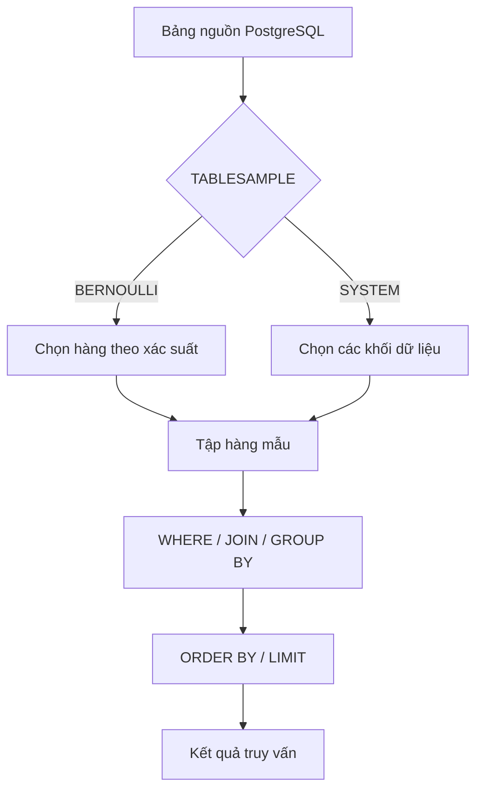

# TABLESAMPLE và giới hạn của lấy mẫu trong PostgreSQL

Trong nhiều hệ thống PostgreSQL, một bảng sự kiện hoặc nhật ký có thể chứa hàng chục triệu đến hàng tỷ dòng. Khi cần xem nhanh một phần dữ liệu để khám phá cấu trúc, ước lượng phân bố hoặc kiểm tra giả thuyết, việc đọc toàn bộ bảng đôi khi tốn nhiều tài nguyên. Mệnh đề **`TABLESAMPLE`** cho phép yêu cầu PostgreSQL lấy một mẫu hàng từ bảng nguồn trước khi áp dụng những phép xử lý tiếp theo của truy vấn.

Tuy nhiên, lấy mẫu **không đồng nghĩa với truy vấn nhanh trong mọi trường hợp**, không bảo đảm chính xác một số dòng cố định và không tự đảm bảo mẫu đại diện cho mọi nhóm nghiệp vụ. Đặc biệt, `BERNOULLI` và `SYSTEM` khác nhau về đơn vị được chọn, hiệu năng và tính biến động của kết quả.

Bài học này trình bày cú pháp `TABLESAMPLE`, hai phương pháp mặc định, cơ chế `REPEATABLE`, các giới hạn về thống kê, `WHERE`, `JOIN`, `LIMIT` và những quyết định khi sử dụng với PostgreSQL từ ứng dụng Java.

## 1. TABLESAMPLE giải quyết bài toán gì?

Giả sử bảng `events` có 20 triệu dòng. Bạn muốn xem một tỷ lệ nhỏ để:

- Quan sát vài ví dụ về dữ liệu mới được nhập.
- Ước lượng sơ bộ tỷ lệ một loại sự kiện.
- Khám phá những giá trị thường gặp trước khi viết truy vấn phân tích đầy đủ.
- Kiểm tra giao diện hiển thị dữ liệu hoặc quy trình thử nghiệm không yêu cầu đủ mọi dòng.

Mệnh đề `TABLESAMPLE` được gắn với **một bảng ở phần `FROM`**:

```sql
SELECT *
FROM some_table TABLESAMPLE BERNOULLI (5);
```

Ý nghĩa: yêu cầu lấy mẫu khoảng **5%** số hàng theo phương pháp `BERNOULLI`. Đây không phải cú pháp lấy đúng 5 hàng và cũng không phải một cam kết kết quả có chính xác 5% số hàng.

Cần phân biệt ba mục tiêu:

| Mục tiêu | Công cụ thường phù hợp |
| --- | --- |
| Lấy một mẫu theo tỷ lệ để khảo sát | `TABLESAMPLE BERNOULLI` hoặc `SYSTEM` |
| Lấy chính xác tối đa `N` hàng bất kỳ | `LIMIT N`, nhưng không ngẫu nhiên và có thể không ổn định nếu thiếu thứ tự |
| Lấy `N` hàng ngẫu nhiên từ toàn bộ kết quả phù hợp điều kiện | `ORDER BY random() LIMIT N` hoặc thuật toán/giải pháp lấy mẫu phù hợp, với chi phí tương ứng |

Không nên xem ba thao tác trên là những cách viết tương đương.

### TABLESAMPLE nằm ở đâu trong mô hình logic?

`TABLESAMPLE` thuộc phần đọc **quan hệ nguồn trong `FROM`**. Mẫu được hình thành trước khi một điều kiện `WHERE` ở cùng cấp truy vấn lọc các dòng đã được chọn.



Sơ đồ giải thích ý nghĩa SQL, không thay thế cho kế hoạch thực thi vật lý do planner lựa chọn. Khi có nhiều bảng, thứ tự join và phép xử lý có thể được tối ưu theo các quy tắc của PostgreSQL.

## 2. Tạo dữ liệu thực hành đủ lớn để quan sát mẫu

Thực hành trên một database riêng. Ví dụ tạo bảng `sample_lab.events` với 20.000 dòng. Đây là bộ dữ liệu tổng hợp, không chứa thông tin cá nhân thật.

```sql
CREATE SCHEMA IF NOT EXISTS sample_lab;

CREATE TABLE sample_lab.events (
    event_id bigint PRIMARY KEY,
    region text NOT NULL,
    event_type text NOT NULL,
    amount numeric(12, 2) NOT NULL,
    occurred_at timestamptz NOT NULL
);

INSERT INTO sample_lab.events
    (event_id, region, event_type, amount, occurred_at)
SELECT
    g,
    CASE
        WHEN g % 10 < 7 THEN 'North'
        WHEN g % 10 < 9 THEN 'South'
        ELSE 'Central'
    END,
    CASE
        WHEN g % 20 = 0 THEN 'purchase'
        ELSE 'view'
    END,
    (g % 1000 + 1)::numeric(12, 2),
    TIMESTAMPTZ '2026-01-01 00:00:00+00'
        + g * INTERVAL '1 minute'
FROM generate_series(1, 20000) AS g;

ANALYZE sample_lab.events;
```

Bảng cố tình có vùng `Central` ít hơn `North` và loại sự kiện `purchase` hiếm hơn `view`. Khi lấy một mẫu nhỏ, một số phân nhóm có thể biến động mạnh về tỷ lệ hoặc thậm chí vắng mặt.

Trước khi lấy mẫu, xem số liệu đầy đủ làm mốc:

```sql
SELECT
    COUNT(*) AS total_rows,
    COUNT(*) FILTER (WHERE event_type = 'purchase') AS purchases,
    MIN(event_id) AS min_id,
    MAX(event_id) AS max_id
FROM sample_lab.events;
```

Trong bộ dữ liệu được tạo bằng `generate_series`, có **20.000 dòng** và **1.000 giao dịch purchase**. Vì cứ 20 ID có một purchase, tỷ lệ purchase trong toàn bộ dữ liệu bằng 5%.

Phân bố theo khu vực:

```sql
SELECT region, COUNT(*) AS row_count
FROM sample_lab.events
GROUP BY region
ORDER BY region;
```

Kỳ vọng: North **14.000**, South **4.000**, Central **2.000**. Những con số này sẽ là mốc kiểm tra khi kết quả mẫu khác giữa các lần chạy.

## 3. Cú pháp TABLESAMPLE trong PostgreSQL

Dạng phổ biến:

```sql
SELECT selected_columns
FROM schema_name.table_name
     TABLESAMPLE sampling_method (argument)
     [REPEATABLE (seed)]
WHERE some_condition;
```

Dòng `[REPEATABLE (seed)]` trong ví dụ cú pháp là ký hiệu mô tả phần tùy chọn, **không phải** các dấu ngoặc vuông cần gõ trong SQL thực tế.

Hai phương pháp có sẵn thường gặp là:

```sql
SELECT *
FROM sample_lab.events TABLESAMPLE BERNOULLI (5);

SELECT *
FROM sample_lab.events TABLESAMPLE SYSTEM (5);
```

Đối số `5` nghĩa là **5 phần trăm**, không phải năm dòng và không phải xác suất 5 lần.

Một số lưu ý về đối số:

- Tỷ lệ của `BERNOULLI` và `SYSTEM` nằm trong phạm vi **0 đến 100**, có thể là số thập phân như `0.5`.
- `0` nghĩa là yêu cầu lấy 0%; `100` là toàn bộ theo ý nghĩa phương pháp lấy mẫu thông thường.
- `TABLESAMPLE ... (1)` nghĩa là 1%, **không phải 100%**.
- `REPEATABLE (seed)` là tùy chọn nhằm yêu cầu cùng phương thức, hạt giống và dữ liệu ổn định tạo cùng mẫu, trong giới hạn sẽ giải thích ở phần sau.
- Các phương pháp lấy mẫu khác có thể được cài đặt qua extension, với đối số và khả năng `REPEATABLE` khác hai phương pháp mặc định.

Ví dụ lấy 0,5%:

```sql
SELECT COUNT(*) AS sampled_rows
FROM sample_lab.events
     TABLESAMPLE BERNOULLI (0.5);
```

Trên 20.000 dòng, kỳ vọng trung bình là khoảng 100 dòng, nhưng số dòng thực tế của một lần chạy có thể nhỏ hơn hoặc lớn hơn 100.

## 4. BERNOULLI: xác suất chọn cho từng hàng

`TABLESAMPLE BERNOULLI (p)` sử dụng cách lấy mẫu theo hàng: về mặt mô hình, **mỗi hàng đủ điều kiện nhìn thấy có xác suất khoảng `p/100` được đưa vào mẫu**, độc lập với việc những hàng khác có được chọn hay không.

```sql
SELECT event_id, region, event_type, amount
FROM sample_lab.events TABLESAMPLE BERNOULLI (5);
```

Nếu bảng có 20.000 hàng, số hàng được chọn `K` biến động theo từng lần chạy. Trong mô hình Bernoulli lý tưởng:

\[
E[K] = Np,\qquad
\operatorname{Var}(K) = Np(1-p),
\]

với `p` là xác suất dạng số thập phân từ 0 đến 1. Ở đây `N = 20.000`, `p = 0,05`, nên:

\[
E[K] = 1000,\qquad
\operatorname{SD}(K)
= \sqrt{20000 \times 0.05 \times 0.95}
\approx 30.8.
\]

Điều này không có nghĩa lần nào cũng có 1.000 hàng. Ngay cả khi bảng không thay đổi, số hàng mẫu vẫn có thể dao động đáng kể.

### 4.1. Mỗi hàng có cơ hội được chọn, nhưng phải đọc bảng

Một đặc điểm quan trọng của cách lấy mẫu theo hàng là PostgreSQL thường cần **đi qua các khối chứa hàng** để quyết định chọn từng hàng hay không. Vì thế, `BERNOULLI (1)` không đồng nghĩa với chỉ phải đọc 1% số trang dữ liệu.

Trên bảng lớn, phương pháp này thường giúp giảm **số hàng được đưa lên các bước tiếp theo hoặc truyền về client**, nhưng không nhất thiết giảm tương ứng chi phí I/O của việc đọc bảng. Nó phù hợp khi cần xác suất chọn hàng gần đồng đều hơn so với lấy mẫu theo block.

### 4.2. Mẫu BERNOULLI có thể rỗng

Nếu tỷ lệ quá nhỏ hoặc bảng có rất ít hàng, hoàn toàn có thể thu được 0 dòng:

```sql
SELECT COUNT(*)
FROM sample_lab.events TABLESAMPLE BERNOULLI (0.001);
```

Trên 20.000 hàng, kỳ vọng chỉ khoảng 0,2 hàng. Phần lớn lần chạy có thể không lấy được dòng nào. Một kết quả rỗng không chứng minh bảng gốc rỗng.

### 4.3. Dùng BERNOULLI để khảo sát phân bố

```sql
SELECT
    region,
    COUNT(*) AS sampled_rows
FROM sample_lab.events TABLESAMPLE BERNOULLI (5)
GROUP BY region
ORDER BY region;
```

Mẫu lý tưởng có kỳ vọng khoảng 700 North, 200 South, 100 Central. Nhưng từng nhóm dao động độc lập theo tỷ lệ được chọn và số hàng thực tế của nhóm.

Nếu báo cáo cần tỷ lệ nhóm chính xác, hãy tổng hợp toàn bộ dữ liệu hoặc dùng phương pháp thống kê với mức sai số được tính toán rõ ràng. Lấy mẫu chỉ cho ước lượng, không phải chân lý tuyệt đối về dân số dữ liệu.

## 5. SYSTEM: lấy mẫu theo khối dữ liệu

`TABLESAMPLE SYSTEM (p)` chọn **các block/page lưu trữ** thay vì quyết định cho từng hàng riêng lẻ. Các hàng nhìn thấy trong những block được chọn trở thành mẫu.

```sql
SELECT event_id, region, event_type, amount
FROM sample_lab.events TABLESAMPLE SYSTEM (5);
```

Đặc điểm:

- Có thể chỉ cần đọc một tỷ lệ nhỏ các block, nên **thường nhanh hơn BERNOULLI trên bảng rất lớn** khi lấy tỷ lệ nhỏ.
- Các hàng nằm cùng một block thường được chọn hoặc bị loại **cùng nhau**.
- Số hàng thu được phụ thuộc mật độ hàng trên các block và cách dữ liệu được phân bố vật lý.
- Một vài block mang nội dung tương tự nhau có thể khiến mẫu phản ánh quá nhiều hoặc quá ít một nhóm nghiệp vụ.

### 5.1. Vì sao SYSTEM có thể không đại diện cho từng nhóm?

Giả sử dữ liệu được nhập theo thứ tự:

```text
Block 1 .. 500   : North
Block 501 .. 700 : South
Block 701 .. 710 : Central
```

Một mẫu `SYSTEM (1)` chọn block ngẫu nhiên có thể không chọn block nào của Central, dù dữ liệu Central vẫn có trong bảng. Vì tất cả hàng của một block được lấy cùng lúc, các quan sát trong mẫu có mức tương quan theo block.

Đó là hình thức **cluster sampling** theo vị trí vật lý. Nó có thể làm **phương sai ước lượng lớn hơn** so với lấy mẫu hàng độc lập, đặc biệt khi các hàng cùng block giống nhau về vùng, thời điểm hoặc loại sự kiện. Không nên phát biểu rằng mọi phép ước lượng bằng SYSTEM luôn bị lệch một cách toán học; vấn đề là **tính đại diện và sai số phụ thuộc cấu trúc block**, nên phải đánh giá bằng dữ liệu và giả định thống kê thực tế.

### 5.2. Bảng nhỏ có thể trả 0 dòng ngay cả với tỷ lệ không quá nhỏ

Nếu bảng chỉ có một vài block, `SYSTEM (1)` có thể không chọn block nào. Khi chọn một block, nó có thể trả một nhóm nhiều hàng cùng lúc. Số hàng không tăng dần mượt theo tỷ lệ chỉ định.

Ví dụ:

```sql
SELECT COUNT(*) AS selected
FROM sample_lab.events TABLESAMPLE SYSTEM (1);
```

Chạy nhiều lần có thể thấy chênh lệch rõ hơn `BERNOULLI (1)`. Điều này càng dễ nhận thấy trên bảng nhỏ hoặc khi tỷ lệ mẫu rất thấp.

### 5.3. Tốc độ không được bảo đảm

`SYSTEM` có thể tiết kiệm I/O đáng kể, nhưng không luôn là lựa chọn nhanh hơn trong mọi tình huống: bảng đã nằm trong cache, tỷ lệ mẫu cao, planner, tải đồng thời, mật độ block và chi phí xử lý phần sau đều ảnh hưởng kết quả.

Không nên dùng `SYSTEM` để phục vụ những ước lượng cần mức tin cậy thống kê cao chỉ vì một phép đo trên bảng mẫu cho thấy nó nhanh.

## 6. So sánh BERNOULLI và SYSTEM

| Tiêu chí | `BERNOULLI` | `SYSTEM` |
| --- | --- | --- |
| Đơn vị chọn mẫu | Hàng | Block/page |
| Xác suất với mỗi hàng | Theo tỷ lệ `p` với lựa chọn theo hàng | Hàng được chọn nếu block chứa nó được chọn |
| Tương quan giữa các hàng gần nhau trên đĩa | Thấp hơn, theo mô hình chọn hàng | Cao hơn: hàng cùng block thường đi cùng nhau |
| I/O trên bảng lớn | Thường phải đọc nhiều/đa số block | Có thể đọc ít block hơn |
| Độ biến động số hàng của mẫu | Gần với mô hình Bernoulli theo hàng | Có thể lớn và phụ thuộc mật độ block |
| Nguy cơ mất nhóm nhỏ | Có, nếu mẫu quá ít | Có thể đáng kể khi nhóm bị tập trung trên ít block |
| Dùng cho khảo sát sơ bộ | Phù hợp khi cần mẫu theo hàng | Phù hợp khi ưu tiên đọc nhanh và chấp nhận ảnh hưởng vật lý |
| Cam kết số hàng chính xác | Không | Không |

**Quy tắc thực hành:** ưu tiên `BERNOULLI` khi điều quan trọng là cơ hội chọn của từng hàng và chất lượng mẫu theo hàng; cân nhắc `SYSTEM` khi cần nhanh và hiểu được những nguy cơ do tính cục bộ vật lý của dữ liệu. Cả hai đều không thay thế thiết kế lấy mẫu thống kê có kiểm chứng nếu kết quả dùng cho quyết định quan trọng.

## 7. REPEATABLE: lặp lại mẫu với seed

Phần mở rộng `REPEATABLE (seed)` giúp yêu cầu một phương pháp lấy mẫu xác định trả cùng tập hàng khi chạy lại trên **cùng bảng không thay đổi**, với cùng seed và các điều kiện thực thi thích hợp.

```sql
SELECT event_id
FROM sample_lab.events
     TABLESAMPLE BERNOULLI (5) REPEATABLE (2026)
ORDER BY event_id;
```

Chạy lại câu SQL trên cùng snapshot/dữ liệu có thể nhận cùng `event_id`. Với `SYSTEM`:

```sql
SELECT event_id
FROM sample_lab.events
     TABLESAMPLE SYSTEM (5) REPEATABLE (2026)
ORDER BY event_id;
```

`REPEATABLE` **không biến SYSTEM thành BERNOULLI**, và không đảm bảo cùng một tập hàng khi so sánh hai phương pháp hoặc thay tỷ lệ mẫu.

### 7.1. Những gì seed không bảo đảm

`REPEATABLE` không phải lời hứa có thể tái tạo kết quả bất chấp mọi thay đổi:

- Khi bảng thêm, xóa hoặc cập nhật hàng, kết quả mẫu và dữ liệu được lấy có thể khác.
- Việc thay đổi cách bố trí vật lý của bảng (ví dụ rewrite hoặc một số tác vụ bảo trì) có thể đặc biệt ảnh hưởng mẫu `SYSTEM`.
- Snapshot/MVCC và mức hiển thị dữ liệu khác nhau có thể làm hàng được nhìn thấy thay đổi.
- `REPEATABLE` không làm thứ tự trình bày kết quả ổn định nếu thiếu `ORDER BY`.
- Nếu biểu thức truy vấn còn dùng hàm biến động như `random()` hoặc `now()` theo ngữ cảnh, phần ngoài sampling vẫn có thể cho kết quả khác nhau.
- Các phương pháp lấy mẫu do extension cung cấp có thể có giới hạn riêng về tính lặp lại.

Seed giống nhau là **điều kiện hỗ trợ tái lập**, không phải cơ chế đóng băng dataset hay snapshot.

### 7.2. Seed không làm thay đổi tính ngẫu nhiên thống kê của phương pháp

Dùng một seed cố định hữu ích cho demo, debug hoặc so sánh hai phép biến đổi trên cùng mẫu. Nhưng chỉ khảo sát **một mẫu cố định** không cho biết mức dao động giữa các mẫu.

Muốn ước lượng độ ổn định của một chỉ số, hãy dùng nhiều mẫu độc lập với các seed khác nhau hoặc kỹ thuật thống kê phù hợp; đừng kết luận sai số là 0 chỉ vì mỗi lần chạy seed 2026 cho cùng một kết quả.

### 7.3. Seed và sự ổn định của thứ tự kết quả

`REPEATABLE` chỉ liên quan tới lựa chọn hàng. Nếu muốn đầu ra có thứ tự cố định:

```sql
SELECT event_id, amount
FROM sample_lab.events
     TABLESAMPLE BERNOULLI (5) REPEATABLE (99)
ORDER BY event_id;
```

Không có `ORDER BY`, SQL không đảm bảo thứ tự hàng được trả về, dù tập hàng mẫu có thể được giữ nguyên.

## 8. TABLESAMPLE không lấy chính xác N hàng

Một trong những nhầm lẫn lớn nhất là xem:

```sql
SELECT *
FROM sample_lab.events TABLESAMPLE BERNOULLI (5);
```

là cách lấy đúng 5% của 20.000 = 1.000 hàng. Trên thực tế, tỷ lệ được dùng như **mức xác suất**, nên số hàng thực tế biến động.

Tương tự:

```sql
SELECT *
FROM sample_lab.events TABLESAMPLE SYSTEM (1)
LIMIT 100;
```

không đảm bảo lấy **100 hàng**. Nếu sample chỉ có 60 hàng, kết quả chỉ có 60; nếu có trên 100, `LIMIT` cắt xuống 100. `LIMIT` còn có thể làm thay đổi tính chất mẫu cuối cùng nếu PostgreSQL chỉ cần lấy những hàng đầu tiên từ kết quả sample theo thứ tự thực thi.

### 8.1. Nếu thật sự cần N hàng ngẫu nhiên

Với tập dữ liệu không quá lớn, một mẫu ngẫu nhiên đúng số lượng tối đa N có thể viết:

```sql
SELECT event_id, region, amount
FROM sample_lab.events
ORDER BY random()
LIMIT 100;
```

Đây là cách thông dụng để lấy tối đa 100 hàng theo thứ tự ngẫu nhiên của toàn bộ tập kết quả. Tuy nhiên, PostgreSQL thường phải xem xét **rất nhiều hoặc tất cả hàng** để tạo khóa ngẫu nhiên và chọn top-N; truy vấn có thể tốn CPU/sort trên bảng khổng lồ.

Nếu bảng có ít hơn 100 hàng, truy vấn trả số hàng thực tế. Nếu `WHERE` giới hạn tập ứng viên, số hàng cũng phụ thuộc tập sau lọc.

Một hướng khác là thuật toán reservoir sampling, sample theo khóa phân tán, hoặc phương pháp mở rộng dành riêng cho trường hợp cần số hàng. Mỗi phương pháp có giả định và chi phí khác nhau; không tồn tại một cú pháp built-in `TABLESAMPLE BERNOULLI (N ROWS)` theo ý nghĩa cố định N.

### 8.2. Extension lấy số hàng hoặc theo thời gian

Các extension `tsm_system_rows` và `tsm_system_time` cung cấp các phương pháp lấy mẫu bổ sung trong những môi trường PostgreSQL có cài đặt:

```sql
-- Cần extension và quyền cài đặt phù hợp.
CREATE EXTENSION IF NOT EXISTS tsm_system_rows;

-- Phương pháp SYSTEM_ROWS chọn theo mục tiêu số hàng.
SELECT *
FROM sample_lab.events
     TABLESAMPLE SYSTEM_ROWS (100);
```

`SYSTEM_ROWS` dựa trên lấy mẫu theo block và nhằm trả số hàng yêu cầu khi có đủ hàng thích hợp, nhưng **không phải lựa chọn đều độc lập giữa mọi hàng**, và không nên coi kết quả tương đương `ORDER BY random() LIMIT 100`.

`tsm_system_time` lấy mẫu trong giới hạn thời gian đọc mục tiêu, thường tính theo mili giây, nên số hàng càng không cố định. Các phương pháp này có các hạn chế riêng về `REPEATABLE`; không được giả định mọi extension chấp nhận mệnh đề này. Việc có thể cài extension còn phụ thuộc phiên bản, quyền database và môi trường được quản lý.

## 9. WHERE được áp dụng sau TABLESAMPLE

Xét mục tiêu lấy mẫu các sự kiện mua hàng:

```sql
SELECT event_id, event_type, amount
FROM sample_lab.events
     TABLESAMPLE BERNOULLI (5)
WHERE event_type = 'purchase';
```

Về ngữ nghĩa, `TABLESAMPLE` lấy khoảng 5% từ **toàn bộ bảng `events`**; sau đó `WHERE` chỉ giữ những hàng trong mẫu có `event_type = 'purchase'`.

Vì bảng có 1.000 purchase, số purchase trong mẫu có kỳ vọng khoảng 50 nhưng có thể khác nhiều giữa các lần chạy.

Không được hiểu rằng PostgreSQL sẽ trước hết chọn toàn bộ 1.000 purchase rồi bắt buộc trả khoảng 5% của số đó theo một cơ chế sample trên tập con đã được lọc. Xét về xác suất chọn hàng của Bernoulli, mỗi purchase vẫn có xác suất chọn tương ứng `p`, nhưng **mẫu không đảm bảo một quota riêng cho loại purchase**.

### 9.1. Khi nhóm hiếm có thể biến mất

Giả sử trong bảng thực có một loại sự kiện chỉ xuất hiện 5 lần. Với `BERNOULLI (1)`, xác suất cả 5 hàng đều không được chọn là:

\[
(1-0.01)^5 = 0.99^5 \approx 95.1\%.
\]

Do đó, trong phần lớn lần chạy, loại sự kiện hiếm đó **không xuất hiện trong mẫu**, dù tồn tại trong dữ liệu thật.

Kết luận “không thấy sự kiện hiếm” không tương đương “không có sự kiện hiếm”.

Đây là rủi ro lớn khi dùng sample để kiểm tra:

- Có còn bản ghi vi phạm ràng buộc hay không.
- Có dữ liệu nhạy cảm không phù hợp hay không.
- Có lỗi dữ liệu hiếm hoặc chuỗi bất thường không.
- Một hệ thống có thực sự không phát sinh sự kiện quan trọng hay không.

Nếu cần chứng minh sự kiện **không tồn tại**, phải thực hiện truy vấn xác minh phù hợp trên tập dữ liệu cần kiểm tra, không dựa duy nhất vào mẫu nhỏ.

### 9.2. Muốn lọc trước khi lấy mẫu có được không?

Không thể gắn trực tiếp `TABLESAMPLE` vào một subquery bất kỳ theo cách:

```sql
-- Không phải cú pháp TABLESAMPLE hợp lệ cho một derived table:
SELECT *
FROM (
    SELECT * FROM sample_lab.events
    WHERE event_type = 'purchase'
) AS filtered
TABLESAMPLE BERNOULLI (5);
```

`TABLESAMPLE` gắn với quan hệ bảng hỗ trợ nó, không tự động áp dụng cho kết quả của một subquery/CTE hoặc toàn bộ join như một bảng lưu trữ vật lý.

Những lựa chọn khi muốn lấy mẫu sau lọc gồm:

1. Dùng `WHERE predicate AND random() < 0.05` trên tập ứng viên, với chi phí quét/lọc tương ứng.
2. Chọn ngẫu nhiên trong tập đã lọc bằng `ORDER BY random() LIMIT N` khi cần N hàng và quy mô cho phép.
3. Đưa tập đã lọc vào một **temporary table** trong môi trường cho phép, rồi áp dụng `TABLESAMPLE` lên bảng tạm đó. Cách này tốn công tạo/lưu tập trung gian.
4. Thiết kế dữ liệu vật lý, partition hoặc phương pháp lấy mẫu phù hợp với yêu cầu vận hành.

Ví dụ đơn giản cho cách 1:

```sql
SELECT event_id, event_type, amount
FROM sample_lab.events
WHERE event_type = 'purchase'
  AND random() < 0.05;
```

`random()` là hàm biến động, cho lựa chọn xác suất theo hàng trong kết quả điều kiện; nhưng cách này **không tránh được chi phí tìm các hàng purchase trước khi xét biểu thức**, và không đảm bảo số hàng cố định.

## 10. JOIN với TABLESAMPLE: bạn đang lấy mẫu bảng nào?

`TABLESAMPLE` lấy mẫu **từng bảng được chỉ định**, không mặc nhiên lấy mẫu trên tập kết quả cuối cùng của một phép join.

Giả sử có bảng tham chiếu khu vực:

```sql
CREATE TABLE sample_lab.regions (
    region_code text PRIMARY KEY,
    manager_name text NOT NULL
);

INSERT INTO sample_lab.regions (region_code, manager_name)
VALUES
    ('North', 'Manager N'),
    ('South', 'Manager S'),
    ('Central', 'Manager C');
```

Muốn lấy mẫu sự kiện rồi gắn thông tin người quản lý:

```sql
SELECT
    e.event_id,
    e.region,
    r.manager_name
FROM sample_lab.events AS e
     TABLESAMPLE BERNOULLI (5)
JOIN sample_lab.regions AS r
    ON r.region_code = e.region;
```

Ở đây mẫu được chọn từ `events`; bảng `regions` được join để bổ sung thông tin.

### 10.1. Lấy mẫu parent khác với lấy mẫu fact

Nếu lấy mẫu **khách hàng** rồi join tất cả đơn hàng của những khách đó, một khách hàng có 1.000 đơn sẽ đóng góp rất nhiều dòng, còn khách khác có một đơn chỉ đóng góp một dòng. Kết quả join không nhất thiết là mẫu ngẫu nhiên theo **đơn hàng**.

Phân biệt hai mục tiêu:

- **Lấy mẫu entity:** chọn khách hàng ngẫu nhiên, sau đó xem toàn bộ hoạt động của các khách đã chọn.
- **Lấy mẫu event/fact:** chọn từng đơn hàng hoặc sự kiện theo xác suất, rồi join dimension của chúng.

Hai phương pháp tạo các tập quan sát khác nhau. Nếu cần ước lượng tỷ lệ *đơn hàng*, nên lựa chọn đơn vị lấy mẫu là đơn hàng và xem cách tính trọng số cho phù hợp. Nếu cần khảo sát hành vi *khách hàng*, có thể chọn khách hàng làm đơn vị mẫu rồi quan sát phân bố số đơn hàng.

### 10.2. Sampling hai bảng trước JOIN

```sql
-- Chỉ là minh họa cú pháp; mẫu ở cả hai phía có thể mất nhiều cặp join.
SELECT e.event_id, r.manager_name
FROM sample_lab.events AS e TABLESAMPLE BERNOULLI (5)
JOIN sample_lab.regions AS r TABLESAMPLE BERNOULLI (50)
    ON r.region_code = e.region;
```

Việc sample cả `regions` có thể khiến một khu vực không được chọn, làm **toàn bộ sự kiện mẫu thuộc khu vực đó biến mất sau INNER JOIN**. Từ đó phát sinh sai số khác với việc chỉ sample `events`.

Khi dimension table nhỏ và cần thông tin đầy đủ, thường không có lý do tốt để sample dimension trong ví dụ này.

## 11. Ước lượng bằng mẫu: tỷ lệ, tổng và sai số

Một mẫu Bernoulli có xác suất chọn `p` biết trước cho phép xây dựng một số **ước lượng**. Ví dụ, với mỗi hàng có xác suất được chọn là 5%, tổng số hàng có thể ước tính:

\[
\widehat N = \frac{K}{p},
\]

trong đó `K` là số hàng mẫu và `p = 0.05`.

```sql
WITH sampled AS (
    SELECT event_id
    FROM sample_lab.events
         TABLESAMPLE BERNOULLI (5) REPEATABLE (2026)
)
SELECT
    COUNT(*) AS sampled_rows,
    COUNT(*) / 0.05 AS estimated_total_rows
FROM sampled;
```

Nếu mẫu có 980 hàng, `estimated_total_rows` bằng 19.600, nhưng bảng thật có 20.000 hàng. Sai khác là một hệ quả bình thường của sampling, **không phải lỗi PostgreSQL**.

Nếu mọi hàng có cùng xác suất chọn và measure đủ ổn định, tổng `amount` có thể ước tính theo nguyên tắc tương tự:

```sql
SELECT
    SUM(amount) AS sample_amount_sum,
    SUM(amount) / 0.05 AS estimated_population_amount
FROM sample_lab.events
     TABLESAMPLE BERNOULLI (5) REPEATABLE (2026);
```

Tuy nhiên, phép ước lượng này chưa đi kèm khoảng tin cậy, chưa đánh giá biến động của measure và không xử lý mọi đặc điểm của dữ liệu thật. Không nên gán nhãn doanh thu chính thức cho con số ước lượng bằng cách nhân ngược tỷ lệ.

### 11.1. Tỷ lệ mẫu có thể khác tỷ lệ tổng thể

```sql
SELECT
    COUNT(*) AS sampled_rows,
    COUNT(*) FILTER (WHERE event_type = 'purchase') AS purchase_rows,
    ROUND(
        COUNT(*) FILTER (WHERE event_type = 'purchase')::numeric
        / NULLIF(COUNT(*), 0) * 100,
        2
    ) AS purchase_percent
FROM sample_lab.events
     TABLESAMPLE BERNOULLI (5) REPEATABLE (2026);
```

Tỷ lệ purchase mẫu có thể không đúng 5,00% dù toàn bộ bảng có đúng 5%. Khi mẫu nhỏ, nhóm hiếm biến động mạnh. Nếu `COUNT(*) = 0`, phép chia được bảo vệ bằng `NULLIF` và tỷ lệ sẽ là `NULL` thay vì lỗi chia cho 0.

### 11.2. Không suy trực tiếp sai số BERNOULLI sang SYSTEM

Với `SYSTEM`, các hàng trong cùng block có xu hướng được chọn chung. Mô hình `K` như tổng các phép thử Bernoulli độc lập theo hàng không còn mô tả đầy đủ độ biến động. Nếu muốn khoảng tin cậy thống kê, cần cân nhắc **cấu trúc cluster/block**, phân bố dữ liệu và thiết kế chọn mẫu.

Với các báo cáo chính thức, có thể cần lấy mẫu phân tầng (stratified sampling), kỹ thuật ước lượng trọng số và phương pháp đánh giá phương sai phù hợp. `TABLESAMPLE SYSTEM` không tự tạo một thiết kế khảo sát đại diện theo từng tenant hoặc nhóm kinh doanh.

## 12. Lấy mẫu phân tầng và phân nhóm quan trọng

Khi cần chắc chắn quan sát đủ mỗi `region` hoặc mỗi loại sự kiện, một tỷ lệ cố định trên toàn bảng có thể không phù hợp.

### 12.1. Lấy tối đa N hàng ngẫu nhiên từ mỗi nhóm

PostgreSQL có thể dùng window function:

```sql
WITH ranked AS (
    SELECT
        event_id,
        region,
        event_type,
        amount,
        ROW_NUMBER() OVER (
            PARTITION BY region
            ORDER BY random()
        ) AS rn
    FROM sample_lab.events
)
SELECT
    event_id,
    region,
    event_type,
    amount
FROM ranked
WHERE rn <= 20
ORDER BY region, rn;
```

Cách này chọn tối đa 20 hàng cho mỗi region. Nó phù hợp để **khám phá dữ liệu mỗi nhóm**, nhưng khác với mẫu tỷ lệ đều toàn bảng: North, South và Central đều được cho số lượng quan sát gần bằng nhau dù quy mô khác nhau.

Vì thế, không được dùng tỷ lệ từ mẫu mỗi nhóm như thể nó đại diện tự nhiên cho tỷ lệ chung của toàn bộ bảng. Muốn ước lượng tổng thể, phải cân nhắc **trọng số theo quy mô từng nhóm**.

Ngoài ra, `ROW_NUMBER() ... ORDER BY random()` phải xếp thứ tự ứng viên của từng nhóm, có thể tốn tài nguyên trên dữ liệu rất lớn.

### 12.2. Tỷ lệ riêng cho từng nhóm

Có thể đặt xác suất lấy mẫu phụ thuộc vào nhóm để tăng cơ hội thấy sự kiện hiếm:

```sql
SELECT event_id, event_type, amount
FROM sample_lab.events
WHERE random() <
    CASE
        WHEN event_type = 'purchase' THEN 0.50
        ELSE 0.02
    END;
```

Cách này lấy khoảng 50% các purchase và 2% các view. Đó là một **mẫu có xác suất khác nhau theo nhóm**. Thống kê trực tiếp `COUNT(*)` từ mẫu sẽ phóng đại tỷ trọng purchase so với bảng thật.

Khi cần ước lượng tỷ lệ tổng thể, phải dùng các trọng số nghịch đảo của xác suất chọn hoặc thiết kế ước lượng phù hợp, ví dụ mỗi purchase được chọn có trọng số 2 và mỗi view được chọn có trọng số 50 trong phép ước lượng tổng số hàng. Các trọng số này là ý nghĩa của ví dụ, không phải bảo đảm một khoảng tin cậy chính xác.

### 12.3. Lấy mẫu và dữ liệu có tổ chức theo thời gian

Bảng sự kiện thường có dữ liệu được thêm gần như theo `occurred_at`. Khi dùng `SYSTEM`, những page gần nhau có thể chứa những thời điểm gần nhau. Một mẫu page có thể bỏ qua hoàn toàn một khoảng thời gian nhỏ hoặc một đợt lỗi chỉ xuất hiện trong vài page.

Với mục tiêu kiểm tra sự kiện sau một bản phát hành cụ thể, tốt hơn nên **lọc khoảng thời gian phù hợp** và kiểm tra có mục tiêu, thay vì dựa hoàn toàn vào một mẫu block nhỏ của toàn bộ lịch sử.

## 13. TABLESAMPLE không thay cho thống kê chính thức

Có những câu hỏi cần kết quả chính xác:

- Tổng số hóa đơn cần quyết toán.
- Số giao dịch vi phạm ràng buộc.
- Số người dùng đồng ý một lựa chọn cụ thể.
- Số bản ghi cần migration hoặc xóa có kiểm soát.
- Có còn orphan row trước khi thêm `FOREIGN KEY` hay không.

Dùng `TABLESAMPLE` để trả lời những câu hỏi này có thể khiến hệ thống **bỏ sót dữ liệu hiếm** hoặc ghi nhận sai số liệu. Nên dùng một truy vấn đầy đủ với điều kiện và index thích hợp, hoặc hệ thống tổng hợp chính thức có quy trình đối soát.

Ví dụ phát hiện số lượng bản ghi sai không nên chỉ dùng:

```sql
-- Không đủ để chứng minh không còn dữ liệu sai:
SELECT COUNT(*)
FROM sample_lab.events TABLESAMPLE SYSTEM (1)
WHERE amount < 0;
```

Ngay cả khi trả 0, không thể kết luận toàn bộ bảng không có giá trị âm. Cần kiểm tra trên tập dữ liệu đầy đủ hoặc dựa vào ràng buộc `CHECK (amount >= 0)` được đảm bảo và xác thực.

### 13.1. TABLESAMPLE không bảo vệ tính riêng tư

Một tập con ngẫu nhiên **vẫn có thể chứa thông tin nhạy cảm**. Lấy mẫu 1% dữ liệu khách hàng không làm các bản ghi cá nhân trong mẫu trở thành dữ liệu vô danh.

Nếu dùng sample để chia sẻ cho nhóm phát triển/kiểm thử, cần các biện pháp riêng như kiểm soát quyền, ẩn danh, tổng hợp, dữ liệu tổng hợp giả lập và chính sách lưu trữ phù hợp. Đừng coi chọn ngẫu nhiên ít hàng là thay thế cho bảo vệ dữ liệu.

## 14. Hạn chế liên quan đến bảng nguồn, truy vấn con và tính biến động

### 14.1. TABLESAMPLE gắn với quan hệ bảng

Trong PostgreSQL, mệnh đề `TABLESAMPLE` được đặt cùng một mục bảng hỗ trợ lấy mẫu trong `FROM`:

```sql
SELECT e.event_id
FROM sample_lab.events AS e
     TABLESAMPLE SYSTEM (2);
```

Nó không phải một hàm tổng quát chèn sau mọi subquery, CTE hoặc phép `JOIN` để lấy mẫu kết quả tùy ý. Muốn lấy mẫu trên kết quả của một truy vấn phức tạp, phải thay đổi thiết kế truy vấn hoặc dùng một cách lấy mẫu sau lọc phù hợp như `ORDER BY random()`/`random()` predicate.

### 14.2. Không giả định TABLESAMPLE bỏ qua các quy tắc MVCC

PostgreSQL dùng cơ chế MVCC để quyết định những phiên bản hàng mà một statement có thể thấy. `TABLESAMPLE` không có quyền đọc mọi phiên bản hàng vô hình với snapshot hiện tại. Trong giao dịch đồng thời, kết quả lấy mẫu có thể thay đổi khi dữ liệu nhìn thấy thay đổi.

`REPEATABLE (seed)` không có tác dụng thay đổi mức isolation hay tự giữ snapshot qua nhiều transaction.

### 14.3. Không có cam kết thứ tự

`TABLESAMPLE` trả một tập hàng, không phải một danh sách có thứ tự nghiệp vụ.

```sql
SELECT event_id, occurred_at
FROM sample_lab.events
     TABLESAMPLE SYSTEM (5)
ORDER BY occurred_at DESC, event_id DESC;
```

Ở đây `ORDER BY` chỉ sắp xếp **những hàng đã được lấy mẫu**, không chọn “5% sự kiện mới nhất”. Nếu cần lấy các sự kiện mới nhất, phải thay đổi logic chọn dữ liệu, ví dụ dùng `WHERE occurred_at >= ...` để giới hạn phạm vi thời gian hoặc `ORDER BY occurred_at DESC LIMIT ...` cho yêu cầu top-N.

### 14.4. Tỷ lệ 100 không làm mọi truy vấn trở thành giống nhau về hiệu năng

`TABLESAMPLE BERNOULLI (100)` có ý nghĩa chọn toàn bộ hàng đủ điều kiện, nhưng cách PostgreSQL lập kế hoạch truy vấn có `TABLESAMPLE` vẫn có thể khác với một `SELECT` không dùng nó. Không dùng `TABLESAMPLE (100)` như một thủ thuật tối ưu hóa hoặc như dấu hiệu xác nhận query đã hết lấy mẫu.

## 15. EXPLAIN: đo I/O thật, không đo bằng tỷ lệ tự suy đoán

Cách đáng tin cậy để so sánh `BERNOULLI` và `SYSTEM` trên môi trường thử nghiệm là quan sát kế hoạch và số buffer đã đọc.

```sql
EXPLAIN (ANALYZE, BUFFERS)
SELECT COUNT(*)
FROM sample_lab.events
     TABLESAMPLE BERNOULLI (5) REPEATABLE (77);
```

```sql
EXPLAIN (ANALYZE, BUFFERS)
SELECT COUNT(*)
FROM sample_lab.events
     TABLESAMPLE SYSTEM (5) REPEATABLE (77);
```

Tùy phiên bản, kích thước bảng và kế hoạch, bạn có thể thấy node liên quan tới `Sample Scan`. Những thông số đáng chú ý:

- **Actual rows**: số hàng thực tế đọc/chọn đi qua node.
- **Buffers shared hit/read**: số buffer phục vụ bằng cache hoặc cần đọc từ hệ lưu trữ.
- **Execution Time**: thời gian thực thi trong bối cảnh đo.
- **Planning Time**: chi phí lập kế hoạch.
- **Rows Removed by Filter**: một số node có thể báo số hàng bị loại do điều kiện lọc.

Đặc biệt, so sánh **buffer/page** giữa hai phương pháp có thể cho thấy `SYSTEM` tiết kiệm I/O đến mức nào. Nhưng bảng 20.000 dòng đủ nhỏ để nhiều page nằm sẵn trong cache; kết quả benchmark ở đây không đại diện ngay cho bảng hàng tỷ dòng.

`EXPLAIN (ANALYZE, BUFFERS)` thực sự chạy statement. Với SELECT trên bảng thử nghiệm thường không làm thay đổi dữ liệu, nhưng vẫn tiêu tốn tài nguyên; không chạy phép đo nặng trên production mà không có kế hoạch.

### 15.1. Kiểm tra số hàng và độ biến động

Thử cùng một tỷ lệ với các seed khác nhau:

```sql
SELECT 'seed_10' AS experiment, COUNT(*)
FROM sample_lab.events
     TABLESAMPLE BERNOULLI (5) REPEATABLE (10)

UNION ALL

SELECT 'seed_20', COUNT(*)
FROM sample_lab.events
     TABLESAMPLE BERNOULLI (5) REPEATABLE (20)

UNION ALL

SELECT 'seed_30', COUNT(*)
FROM sample_lab.events
     TABLESAMPLE BERNOULLI (5) REPEATABLE (30);
```

Từng seed có thể cho một kích thước mẫu khác nhau. Lặp lại với `SYSTEM` để quan sát độ biến động theo block. Một vài lần thử chỉ mang tính minh họa, không đủ để thiết lập phân phối sai số đáng tin cậy.

## 16. Gọi TABLESAMPLE từ Java/JDBC

Trong ứng dụng Java, chỉ nên dùng sampling khi nhu cầu thực sự cho phép kết quả gần đúng. Ví dụ một công cụ nội bộ cho phép lấy tỷ lệ nhỏ các event để xem mẫu dữ liệu:

```java
import java.sql.Connection;
import java.sql.PreparedStatement;
import java.sql.ResultSet;
import java.sql.SQLException;
import java.util.ArrayList;
import java.util.List;

public class EventSampler {
    public List<Long> sampleEventIds(
            Connection connection,
            double percent,
            double seed
    ) throws SQLException {
        if (!Double.isFinite(percent) || percent < 0 || percent > 100) {
            throw new IllegalArgumentException("percent must be 0..100");
        }
        if (!Double.isFinite(seed)) {
            throw new IllegalArgumentException("seed must be finite");
        }

        String sql = """
            SELECT event_id
            FROM sample_lab.events
                 TABLESAMPLE BERNOULLI (?)
                 REPEATABLE (?)
            ORDER BY event_id
            """;

        List<Long> ids = new ArrayList<>();
        try (PreparedStatement ps = connection.prepareStatement(sql)) {
            ps.setDouble(1, percent);
            ps.setDouble(2, seed);
            try (ResultSet rs = ps.executeQuery()) {
                while (rs.next()) {
                    ids.add(rs.getLong("event_id"));
                }
            }
        }
        return ids;
    }
}
```

Ví dụ này dùng `PreparedStatement` để tách tham số khỏi chuỗi SQL và kiểm tra giá trị tỷ lệ trước khi gửi. PostgreSQL nhận các biểu thức đối số sampling thích hợp; khi driver hoặc phiên bản có yêu cầu kiểu cụ thể, cần điều chỉnh binding theo kiểu server mong đợi.

Một vài điểm vận hành:

- Giới hạn tỷ lệ tối đa trong công cụ nội bộ nếu chỉ được phép lấy dữ liệu khảo sát.
- Dùng `ORDER BY` khi API mong đợi thứ tự ổn định, nhưng nhớ rằng sort cũng có chi phí.
- Không lấy một sample nhỏ để làm quyết định phân quyền, thanh toán hoặc tuân thủ.
- Áp dụng quyền truy cập và bảo vệ dữ liệu giống như với truy vấn bảng bình thường; sampling không tự giảm phạm vi quyền.
- Nếu seed cố định được truyền từ client, kết quả có thể lặp lại trong những điều kiện nhất định; không sử dụng seed như bí mật bảo mật.

### 16.1. API nên diễn đạt kết quả là sample

Khi trả kết quả ra API, nên ghi rõ metadata:

```json
{
  "samplingMethod": "BERNOULLI",
  "requestedPercent": 5.0,
  "seed": 2026,
  "sampledRows": 987,
  "isExactPopulationReport": false
}
```

Con số `987` chỉ là **ví dụ định dạng phản hồi**, không phải một kết quả được cam kết bởi PostgreSQL. Đừng đặt tên field như `totalOrders` nếu nó thực chất là số hàng của mẫu; dùng `sampledRows` hoặc `estimatedOrders` với metadata giả định thống kê phù hợp.

## 17. So sánh với các kỹ thuật “lấy nhanh một ít dữ liệu”

| Kỹ thuật | Đặc điểm chính | Giới hạn cần nhớ |
| --- | --- | --- |
| `LIMIT N` | Trả tối đa N hàng theo kế hoạch/trình tự đã xác định | Không ngẫu nhiên, không được bảo đảm thứ tự nếu không `ORDER BY` |
| `ORDER BY random() LIMIT N` | Chọn top-N theo khóa random từ tập ứng viên | Có thể đòi hỏi xử lý gần toàn bộ ứng viên, tốn CPU/sort |
| `WHERE random() < p` | Chọn theo xác suất sau điều kiện lọc của truy vấn | Có thể quét nhiều hàng, số hàng không cố định |
| `TABLESAMPLE BERNOULLI(p)` | Lấy mẫu theo hàng từ bảng nguồn | Thường vẫn phải đọc các block; không bảo đảm N |
| `TABLESAMPLE SYSTEM(p)` | Lấy mẫu theo block | Có thể nhanh nhưng độ biến động nhóm lớn, phụ thuộc phân bố vật lý |
| `TABLESAMPLE ... REPEATABLE(seed)` | Hỗ trợ lặp lại cùng mẫu khi dữ liệu/điều kiện ổn định | Không đóng băng dữ liệu, snapshot hay thứ tự hiển thị |
| `SYSTEM_ROWS(N)` qua extension | Lấy mẫu theo mục tiêu số hàng | Phụ thuộc extension, lấy theo block, không đồng nghĩa mẫu theo hàng độc lập |
| Lấy mẫu phân tầng | Chọn lượng mẫu riêng theo từng nhóm | Cần định nghĩa xác suất/trọng số khi ước lượng tổng thể |

**Không có phương pháp tốt nhất cho mọi mục đích.** Đơn vị quan sát và câu hỏi nghiệp vụ quan trọng hơn việc chọn cú pháp ngắn nhất.

## 18. Những hiểu nhầm phổ biến

| Hiểu nhầm | Vì sao sai | Cách nhìn đúng |
| --- | --- | --- |
| `BERNOULLI(5)` trả đúng 5 hàng | Đối số là tỷ lệ phần trăm | 5% theo xác suất chọn hàng |
| `BERNOULLI(5)` luôn trả đúng 5% số hàng | Kích thước mẫu biến động | Số hàng kỳ vọng gần 5%, không cố định |
| `SYSTEM(1)` luôn có dữ liệu | Có thể không chọn page nào | Với bảng ít block có thể trả mẫu rỗng |
| `BERNOULLI(1)` chỉ đọc 1% disk | Quyết định theo hàng thường cần xét nhiều block | Không suy I/O từ số hàng trả về |
| `SYSTEM` là mẫu đại diện tuyệt đối | Hàng cùng block có tương quan | Cần xét phân bố vật lý và sai số |
| `REPEATABLE` giống snapshot cố định | Dữ liệu, vật lý bảng hoặc visibility có thể đổi | Seed chỉ hỗ trợ tính lặp lại trong điều kiện tương ứng |
| `TABLESAMPLE ... WHERE` là “lọc rồi sample” | TABLESAMPLE thuộc bảng nguồn ở FROM | WHERE cùng cấp lọc những hàng đã được chọn |
| Sample customer rồi join orders là mẫu order ngẫu nhiên | Customer có số orders khác nhau | Phải chọn đơn vị lấy mẫu đúng mục tiêu |
| `LIMIT` khiến TABLESAMPLE có đủ N dòng | Mẫu có thể ít hơn N | LIMIT chỉ cắt tối đa N hàng |
| Không thấy lỗi trong mẫu nghĩa là bảng sạch | Lỗi hiếm dễ bị bỏ sót | Dùng kiểm tra đầy đủ/ràng buộc cho tính đúng đắn |
| Sample nhỏ nên không lộ dữ liệu nhạy cảm | Hàng được lấy vẫn có dữ liệu thật | Áp dụng quyền, ẩn danh và kiểm soát riêng |
| Có thể cộng ngược `SUM(sample)/p` và coi là báo cáo chính thức | Đó chỉ là một ước lượng có sai số | Ghi nhãn estimate, xác định giả định và độ bất định |
| `ORDER BY` sau sample chọn mẫu các hàng mới nhất | Nó chỉ sắp những hàng đã được sample | Muốn top-N mới nhất, đặt mục tiêu chọn hàng đúng |

## 19. Bài thực hành theo tình huống

Các bài sử dụng bảng `sample_lab.events` và `sample_lab.regions` đã tạo trong bài học.

### Bài 1 — Quan sát tỷ lệ và kích thước mẫu

Chạy các truy vấn:

```sql
SELECT COUNT(*) AS n_bernoulli
FROM sample_lab.events TABLESAMPLE BERNOULLI (5);

SELECT COUNT(*) AS n_system
FROM sample_lab.events TABLESAMPLE SYSTEM (5);
```

Lặp lại một vài lần và so sánh với 20.000 dòng thật. Giải thích vì sao cả hai không cam kết trả 1.000 hàng và vì sao SYSTEM có thể dao động mạnh hơn.

### Bài 2 — Dùng REPEATABLE

```sql
SELECT event_id
FROM sample_lab.events
     TABLESAMPLE BERNOULLI (1) REPEATABLE (171)
ORDER BY event_id;
```

Chạy hai lần với bảng không thay đổi; kiểm tra các ID có trùng nhau không. Đổi seed thành 172 và giải thích tại sao tập mẫu có thể thay đổi. Sau đó mô tả vì sao `REPEATABLE` không thay thế transaction snapshot khi có ghi đồng thời.

### Bài 3 — Nhóm hiếm và khả năng bỏ sót

```sql
SELECT
    event_type,
    COUNT(*) AS sampled_count
FROM sample_lab.events
     TABLESAMPLE BERNOULLI (0.1)
GROUP BY event_type
ORDER BY event_type;
```

Tính kỳ vọng số purchase trong mẫu. Với 1.000 purchase và xác suất `0.001`, số purchase kỳ vọng là **1**. Lấy ít hàng không chứng minh không có purchase nếu query trả 0.

### Bài 4 — So sánh lọc và lấy mẫu

```sql
SELECT COUNT(*)
FROM sample_lab.events
     TABLESAMPLE BERNOULLI (5)
WHERE event_type = 'purchase';

SELECT COUNT(*)
FROM sample_lab.events
WHERE event_type = 'purchase'
  AND random() < 0.05;
```

Hai truy vấn đều có ý nghĩa chọn purchase với xác suất khoảng 5% trong điều kiện bình thường, nhưng dùng cấu trúc khác nhau và có thể có chi phí thực thi khác nhau. Giải thích vị trí logic của `TABLESAMPLE` và `WHERE`.

### Bài 5 — Sample fact rồi join dimension

```sql
SELECT
    r.manager_name,
    COUNT(*) AS sampled_events
FROM sample_lab.events AS e
     TABLESAMPLE BERNOULLI (5)
JOIN sample_lab.regions AS r
    ON r.region_code = e.region
GROUP BY r.manager_name
ORDER BY r.manager_name;
```

Từ kết quả, xác định liệu bạn đã lấy mẫu ở bảng `events` hay `regions`. Tại sao không cần sample bảng `regions` nhỏ trong tình huống này?

### Bài 6 — Lấy đúng tối đa 20 hàng mỗi region

Viết truy vấn dùng `ROW_NUMBER() OVER (PARTITION BY region ORDER BY random())` rồi lọc `rn <= 20` ở tầng ngoài. So sánh tỷ lệ nhóm trong kết quả với phân bố thật 70%/20%/10%. Vì sao một sample cân bằng giữa các nhóm không thể được hiểu như mẫu đại diện theo tỷ lệ toàn bảng?

### Bài 7 — Benchmark đọc block

```sql
EXPLAIN (ANALYZE, BUFFERS)
SELECT COUNT(*)
FROM sample_lab.events TABLESAMPLE BERNOULLI (1);

EXPLAIN (ANALYZE, BUFFERS)
SELECT COUNT(*)
FROM sample_lab.events TABLESAMPLE SYSTEM (1);
```

So sánh buffers và actual rows. Nếu số liệu trên bộ dữ liệu nhỏ không thể hiện chênh lệch rõ, mô tả cần thay đổi điều gì trong môi trường thử nghiệm để phép đo có ý nghĩa hơn (kích thước bảng, cache, số lần chạy, độ chọn lọc).

### Bài 8 — Quyết định có nên dùng sampling

Với mỗi yêu cầu, hãy chọn hoặc từ chối `TABLESAMPLE`:

1. Xem vài ví dụ event để hiểu dữ liệu.
2. Kiểm tra còn khách hàng không có foreign key hợp lệ trước migration.
3. Ước lượng sơ bộ tỷ lệ nhóm trước khi xây dashboard.
4. Tính doanh thu chính xác cho báo cáo tài chính.
5. Chọn 100 khách hàng ngẫu nhiên cho một khảo sát cần sampling frame rõ ràng.
6. Lấy ba sự kiện mới nhất theo `occurred_at`.

Giải thích lựa chọn dựa trên **đơn vị lấy mẫu, sai số chấp nhận được, yêu cầu số dòng và chi phí truy vấn**, không chỉ dựa vào cú pháp.

## 20. Nguyên tắc ghi nhớ

- `TABLESAMPLE` chọn mẫu tại quan hệ bảng nguồn; phần trăm là **tỷ lệ yêu cầu**, không phải số hàng cố định.
- `BERNOULLI` chọn theo hàng và có đặc tính thống kê thuận tiện hơn cho một số ước lượng, nhưng thường vẫn cần đọc nhiều block.
- `SYSTEM` chọn theo block; có thể giảm I/O nhưng chịu ảnh hưởng của cấu trúc dữ liệu vật lý, clustering và kích thước bảng.
- `REPEATABLE(seed)` giúp lặp lại mẫu trong điều kiện phù hợp, **không** đóng băng dữ liệu, snapshot hoặc thứ tự hiển thị.
- `WHERE` và `JOIN` được hiểu trên dữ liệu mẫu theo ngữ nghĩa truy vấn; chọn mẫu sai bảng có thể làm thay đổi đơn vị quan sát và phân bố kết quả.
- `LIMIT` không đảm bảo có đủ `N` hàng sau sampling; `ORDER BY random() LIMIT N` là một chiến lược khác với chi phí khác.
- Mẫu nhỏ dễ bỏ sót nhóm hiếm. **Không dùng sample để chứng minh không có lỗi dữ liệu, để ra số liệu tài chính chính thức hoặc thay thế việc kiểm tra ràng buộc.**
- Khi dùng sample để ước lượng, cần trình bày rõ phương pháp, tỷ lệ, seed, kích thước mẫu, giả định và độ bất định.
- Dùng `EXPLAIN (ANALYZE, BUFFERS)` trên môi trường phù hợp để đo hiệu năng thực tế, thay vì tự suy ra I/O từ phần trăm lấy mẫu.

`TABLESAMPLE` là công cụ hữu ích để **khám phá và khảo sát dữ liệu**, nhưng giá trị của nó nằm ở việc sử dụng đúng mục tiêu. Phân biệt ngẫu nhiên theo hàng, ngẫu nhiên theo block, mẫu có thể lặp và dữ liệu cần độ chính xác tuyệt đối là nền tảng để viết truy vấn PostgreSQL nâng cao mà không đánh đổi tính đúng đắn của kết quả.
