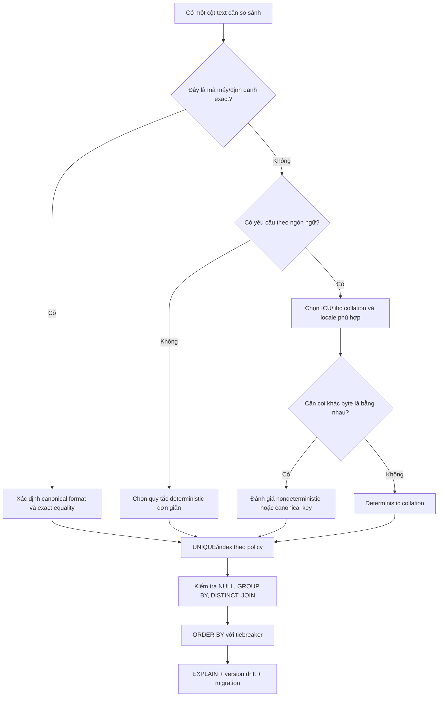

# Collation, Unicode và tính nhất quán của phép so sánh

Trong PostgreSQL, hai chuỗi nhìn giống nhau trên màn hình **không nhất thiết bằng nhau**, và hai chuỗi được xem là bằng nhau trong một quy tắc so sánh **không nhất thiết có cùng dãy byte**. Chỉ cần thay *collation* (quy tắc đối chiếu/sắp xếp), một hệ thống có thể thay đổi kết quả `ORDER BY`, `=`, `DISTINCT`, `GROUP BY`, `UNIQUE`, JOIN hoặc việc sử dụng chỉ mục.

Ví dụ, những giá trị sau đặt ra nhiều câu hỏi khác nhau:

- `'Alice'` và `'alice'` có phải cùng tên đăng nhập?
- `'résumé'` và `'resume'` có phải một từ khi tìm kiếm không?
- Chữ `é` biểu diễn bằng một code point có bằng chữ `e` cộng dấu sắc tổ hợp không?
- Thứ tự `'A'`, `'a'`, `'Á'`, `'Z'` có phụ thuộc ngôn ngữ không?
- Sau khi nâng cấp ICU hoặc hệ điều hành, index sắp xếp theo collation cũ có còn đáng tin không?

Câu trả lời không nằm riêng ở toán tử `=`. Ta phải xem **encoding**, **chuẩn hóa Unicode**, **provider collation**, **deterministic/nondeterministic**, loại toán tử và **chính sách dữ liệu** của ứng dụng.

Bài học thuộc chương **Hàm và biểu thức** của module PostgreSQL. Mục tiêu là hiểu cơ chế so sánh văn bản một cách có thể kiểm chứng, viết SQL đúng nghĩa, lựa chọn collation phù hợp với dữ liệu đa ngôn ngữ và duy trì kết quả ổn định sau migration hoặc nâng cấp.

Các ví dụ được thiết kế cho PostgreSQL hiện đại. **ICU và một số tính năng phụ thuộc phiên bản/build server**; phần tương ứng được đánh dấu rõ. Chỉ thao tác trên database thử nghiệm khi chạy DDL.

## 1. Bản đồ khái niệm: năm lớp không nên trộn lẫn

```text
  Dữ liệu từ người dùng / API / file
                 │
                 ▼
  1. ENCODING
     UTF-8 biểu diễn Unicode bằng byte
                 │
                 ▼
  2. UNICODE REPRESENTATION
     code point, ký tự tổ hợp, NFC/NFD...
                 │
                 ▼
  3. COLLATION
     quy tắc đối chiếu/sắp xếp theo locale/provider
                 │
                 ▼
  4. SQL OPERATORS
     =, <, >, ORDER BY, DISTINCT, GROUP BY, UNIQUE...
                 │
                 ▼
  5. INDEX / QUERY PLAN / APPLICATION CONTRACT
     B-tree, thống kê, uniqueness, tìm kiếm, JDBC
```

Một lỗi phổ biến là xử lý nhầm lớp:

- Muốn tìm không phân biệt hoa thường nhưng lại chỉ đổi `client_encoding` sang UTF8.
- Muốn hai biểu diễn Unicode tương đương nhưng chỉ dùng `lower()`.
- Muốn username duy nhất không phân biệt case nhưng chỉ kiểm tra ở Java, không thêm constraint/index tương ứng ở database.
- Đổi locale/ICU rồi cho rằng index cũ tự được sắp xếp lại.
- Dùng `ORDER BY` dựa trên ngôn ngữ ở một nơi, nhưng phân trang/so sánh ở nơi khác dùng byte order.

Hãy đặt câu hỏi: **đang cần lưu byte đúng, chuẩn hóa văn bản, so sánh tương đương, sắp xếp cho người đọc hay bảo đảm duy nhất theo nghiệp vụ?** Năm mục tiêu có thể cần năm cơ chế phối hợp.

## 2. UTF-8 và collation là hai khái niệm độc lập

**Encoding** quyết định cách các ký tự được mã hóa thành byte. **Collation** quyết định cách các chuỗi được so sánh và sắp xếp trong các ngữ cảnh có ý nghĩa ngôn ngữ.

Trong database PostgreSQL thường dùng `UTF8`, các ký tự Unicode được lưu dưới dạng UTF-8. Nhưng cùng dữ liệu UTF-8 có thể được sắp xếp khác nhau theo collation:

- `"C"`: thứ tự đơn giản dựa trên byte, hữu ích khi cần quy tắc kỹ thuật ổn định, không dành cho thứ tự từ điển tự nhiên.
- Collation theo `libc`: sử dụng khả năng locale của thư viện hệ điều hành.
- Collation theo `ICU`: dùng bộ quy tắc collation Unicode của ICU, có nhiều lựa chọn locale và mức độ phân biệt.

**UTF-8 không tự làm tìm kiếm trở nên không phân biệt dấu/hoa thường.** UTF-8 chỉ giúp biểu diễn ký tự.

### 2.1. Kiểm tra encoding của server và client

```sql
SHOW server_encoding;
SHOW client_encoding;

SELECT
    current_database() AS database_name,
    pg_encoding_to_char(encoding) AS database_encoding,
    datcollate,
    datctype
FROM pg_database
WHERE datname = current_database();
```

Hai cột `datcollate` và `datctype` phản ánh một phần cấu hình locale của database; với các database sử dụng provider khác nhau, cần xem cả metadata provider/locale phù hợp ở phiên bản PostgreSQL đang chạy.

Trong `psql`:

```text
\encoding
\encoding UTF8
```

Dòng thứ hai là meta-command đổi client encoding trong `psql`, không phải SQL. Đặt `client_encoding` phù hợp giúp client và server chuyển đổi ký tự đúng; nó **không thay đổi collation** dùng để so sánh hay sắp xếp.

### 2.2. Tránh nhầm hiển thị lỗi encoding với lỗi collation

Nếu một chữ tiếng Việt thành `?` hoặc chuỗi ký tự bị vỡ trên client, nguyên nhân có thể là chuyển mã, đọc file sai encoding, font, hoặc dữ liệu đã bị biến đổi trước khi vào PostgreSQL.

Nếu chữ hiển thị đúng nhưng `ORDER BY` “lạ” hoặc `UNIQUE` cho phép/cấm cặp tên không mong muốn, hãy xem **collation và chính sách equality**.

Một hệ thống có thể đồng thời gặp cả hai loại lỗi, nhưng không thể sửa encoding bằng `COLLATE` hoặc sửa Unicode normalization bằng cách đổi font.

## 3. Unicode: code point, ký tự hiển thị và byte

Unicode định nghĩa các code point. Một ký tự người dùng nhìn thấy có thể gồm **một hoặc nhiều code point**, và một code point có thể chiếm **nhiều byte UTF-8**.

Ví dụ hai cách biểu diễn chữ “é”:

1. Ký tự dựng sẵn: `U+00E9`.
2. Chữ `e` (`U+0065`) theo sau dấu sắc tổ hợp `U+0301`.

Cả hai thường hiển thị rất giống nhau, nhưng chuỗi code point khác nhau.

### 3.1. Dựng hai chuỗi tương đương về hình thức

PostgreSQL hỗ trợ Unicode escape string `U&'...'`:

```sql
SELECT
    U&'\00E9' AS composed_e_acute,
    U&'\0065\0301' AS decomposed_e_acute,
    length(U&'\00E9') AS composed_length,
    length(U&'\0065\0301') AS decomposed_length,
    octet_length(U&'\00E9') AS composed_bytes,
    octet_length(U&'\0065\0301') AS decomposed_bytes;
```

Với UTF-8:

| Biểu diễn | Số code point (length) | Byte UTF-8 (octet_length) |
|---|---:|---:|
| `U&'\00E9'` | 1 | 2 |
| `U&'\0065\0301'` | 2 | 3 |

`length(text)` đếm ký tự theo cách xử lý text của PostgreSQL, về mặt thực hành với chuỗi Unicode này là số code point. Nó **không phải bộ đếm grapheme cluster** hoàn chỉnh theo cách người dùng nhìn thấy; một emoji ghép nhiều code point hoặc chuỗi có dấu kết hợp có thể có `length` lớn hơn số ký tự hiển thị.

`octet_length` đếm byte. Các giới hạn theo byte (như độ dài identifier mặc định) và theo code point/ký tự không nên đánh đồng.

### 3.2. Kiểm tra byte để nhìn thấy khác biệt

```sql
SELECT
    encode(convert_to(U&'\00E9', 'UTF8'), 'hex') AS nfc_like_hex,
    encode(convert_to(U&'\0065\0301', 'UTF8'), 'hex') AS decomposed_hex;
```

Kỳ vọng hex khác nhau:

- `U+00E9` → `c3a9`.
- `U+0065 U+0301` → `65cc81`.

Vì byte khác, nếu ứng dụng dùng chữ ký, hash byte, cache key hoặc giao thức cần tính chính xác từng byte thì không thể xem hai biểu diễn hoàn toàn giống nhau một cách ngầm định.

**Collation có thể coi chúng tương đương khi so sánh**, nhưng không tự viết lại byte được lưu trong bảng.

## 4. Các dạng chuẩn hóa Unicode: NFC, NFD, NFKC, NFKD

Unicode normalization biến đổi chuỗi về một **dạng chuẩn** để xử lý những cách biểu diễn tương đương.

| Dạng | Ý tưởng | Ghi chú |
|---|---|---|
| **NFC** | Canonical decomposition rồi composition | Thường được chọn để chuẩn hóa văn bản được lưu |
| **NFD** | Canonical decomposition | Có thể tạo nhiều code point kết hợp |
| **NFKC** | Compatibility decomposition rồi composition | Có thể gộp các hình thức tương thích có khác biệt ngữ nghĩa/hiển thị |
| **NFKD** | Compatibility decomposition | Phân rã tương thích, cần cân nhắc tác động dữ liệu |

PostgreSQL có hàm `normalize(text, form)` trong các phiên bản hỗ trợ và database mã hóa UTF8.

```sql
SELECT
    normalize(U&'\00E9', NFC) AS composed,
    normalize(U&'\0065\0301', NFC) AS normalized_decomposed,
    normalize(U&'\0065\0301', NFC) =
        normalize(U&'\00E9', NFC) AS same_after_nfc;
```

Kỳ vọng biểu thức cuối là `TRUE` dưới so sánh deterministic bình thường, vì cả hai đã được chuẩn hóa về cùng biểu diễn.

### 4.1. Chuẩn hóa không phải chuyển thành chữ thường

`normalize(..., NFC)` **không** có nghĩa:

- Biến `A` thành `a`.
- Xóa dấu tiếng Việt.
- Chuyển mọi chữ của mọi hệ viết thành Latin.
- Xóa ký tự điều khiển hoặc ký tự ẩn.
- Đảm bảo hai chuỗi nhìn giống nhau là một (các ký tự *confusable* vẫn có thể khác).
- Kiểm tra tính hợp lệ của email, username hoặc tên người.

Hai yêu cầu “đồng nhất dạng Unicode” và “không phân biệt hoa thường” phải được thiết kế riêng.

### 4.2. Vì sao không áp NFKC cho mọi dữ liệu?

NFKC có thể đưa các ký tự tương thích về dạng chung, ví dụ một số ký tự có hình thức đặc biệt, chữ số trình bày khác hoặc dạng fullwidth. Điều này hữu ích cho một số trường định danh nhưng có thể **làm mất phân biệt mà người dùng/miền nghiệp vụ muốn giữ**.

Không nên tự normalize toàn bộ nội dung pháp lý, văn bản lưu trữ, mật khẩu đã được thiết kế dưới một chính sách khác hoặc mã sản phẩm tùy ý chỉ vì “Unicode chuẩn hơn”.

**Quy tắc:** xác định rõ cột nào cần normalization; tài liệu hóa hình thức lưu trữ, cách xử lý input cũ và ảnh hưởng tới uniqueness.

## 5. Collation quyết định điều gì?

Collation là tập quy tắc liên quan đến **so sánh và thứ tự** của dữ liệu kiểu có thể áp collation, thường là `text`, `varchar`, `char` cùng một số biểu thức văn bản.

Những câu lệnh có thể chịu ảnh hưởng:

```sql
SELECT name FROM people ORDER BY name;

SELECT * FROM people WHERE name = 'Alice';

SELECT DISTINCT name FROM people;

SELECT name, COUNT(*) FROM people GROUP BY name;

CREATE UNIQUE INDEX ... ON people (name);
```

Mức độ ảnh hưởng của equality phụ thuộc loại collation, nhất là **deterministic** và **nondeterministic**. Không phải cứ đổi một locale deterministic là PostgreSQL tự coi `'Alice'` và `'alice'` bằng nhau.

### 5.1. Collation không làm thay đổi bytes đã lưu

Nếu cột lưu chuỗi có hai dạng `U+00E9` và `U+0065 U+0301`, chọn một collation có thể thay đổi kết quả so sánh nhưng không tự cập nhật hàng thành một dạng Unicode mới.

Có hai chiến lược khác nhau:

1. **Lưu dạng chuẩn hóa**, ví dụ luôn NFC cho khóa tìm kiếm.
2. **Dùng collation nondeterministic** để so sánh các biểu diễn nhất định như tương đương.

Chúng có thể phối hợp, nhưng không thay thế nhau trong mọi trường hợp: một hệ thống lưu dữ liệu cho chữ ký/hashing chính xác theo byte vẫn cần chính sách normalization độc lập với collation.

### 5.2. Những khái niệm hay đi chung

| Khái niệm | Câu hỏi |
|---|---|
| Encoding | Chuỗi lưu/trao đổi bằng byte gì? |
| Unicode normalization | Hai chuỗi tương đương về biểu diễn có cùng dạng code point chưa? |
| Collation provider | Quy tắc locale do libc, ICU hay provider được hỗ trợ nào thực hiện? |
| Determinism | Hai chuỗi khác byte có thể so sánh bằng nhau ở collation này không? |
| Case sensitivity | Có phân biệt hoa/thường không? |
| Accent sensitivity | Có phân biệt dấu không? |
| Sorting | Các chuỗi được sắp theo thứ tự nào? |
| Equality | Hai chuỗi có thuộc cùng lớp tương đương theo toán tử không? |
| Index support | Index có cùng quy tắc so sánh với truy vấn không? |
| Collation version | Quy tắc đang dùng có thay đổi sau cập nhật thư viện không? |

## 6. Những provider collation trong PostgreSQL

PostgreSQL hỗ trợ các provider collation khác nhau tùy phiên bản và cách build; phổ biến nhất là:

- **libc**: sử dụng khả năng locale của thư viện C/hệ điều hành.
- **ICU**: International Components for Unicode, hỗ trợ nhiều locale và các lựa chọn tinh vi cho thứ tự ngôn ngữ.
- Một số phiên bản mới có các collation/provider built-in cụ thể. Khi cần dùng, phải tra trên server thật thay vì giả định tên/provider giống giữa mọi môi trường.

### 6.1. Liệt kê collation có sẵn

```sql
SELECT
    n.nspname AS schema_name,
    c.collname AS collation_name,
    c.collprovider AS provider,
    c.collisdeterministic AS deterministic,
    c.collversion AS recorded_version
FROM pg_collation AS c
JOIN pg_namespace AS n
    ON n.oid = c.collnamespace
ORDER BY n.nspname, c.collname
LIMIT 100;
```

Cột `collisdeterministic` được hỗ trợ trong các phiên bản hiện đại có nondeterministic collations. Với những bản PostgreSQL cũ hơn, cần dùng truy vấn catalog đúng phiên bản.

Các mã provider trong catalog có thể được biểu diễn dạng ký tự; đọc metadata phù hợp server, không hardcode mọi tên ICU mặc định từ ví dụ trong môi trường khác.

### 6.2. C và POSIX: quy tắc kỹ thuật

`"C"` và `"POSIX"` thường được dùng khi muốn thứ tự không theo ngôn ngữ tự nhiên.

```sql
SELECT
    value
FROM (
    VALUES ('A'), ('a'), ('Á'), ('Z'), ('0')
) AS t(value)
ORDER BY value COLLATE "C";
```

Kết quả chịu quy tắc `"C"`, không phải bảng chữ cái tiếng Việt. Đây là lựa chọn thích hợp cho nhiều **mã kỹ thuật** cần hành vi sắp xếp đơn giản, nhưng không nên dùng cho tên người trong giao diện người dùng khi muốn thứ tự tự nhiên theo locale.

**Không tuyên bố `"C"` là một “Unicode collation đa ngôn ngữ tối ưu”.** Nó đơn giản và có ích cho dữ liệu máy, không biết cách sắp xếp chữ có dấu theo kỳ vọng của từng ngôn ngữ.

## 7. Collation của database, cột và biểu thức

PostgreSQL có thể chọn collation ở nhiều cấp:

1. Database có cấu hình collation/locale mặc định.
2. Cột kiểu collatable có thể chỉ định collation riêng.
3. Một biểu thức có thể dùng `COLLATE` tường minh.
4. Khi nhiều biểu thức kết hợp, PostgreSQL áp dụng quy tắc suy diễn collation; những explicit collation xung đột có thể gây lỗi.

### 7.1. Collation theo cột

Ví dụ DDL minh họa:

```sql
CREATE TABLE demo_unicode.sort_sample (
    id INTEGER PRIMARY KEY,
    machine_code TEXT COLLATE "C" NOT NULL,
    display_name TEXT NOT NULL
);
```

Cột `machine_code` dùng `"C"`, còn `display_name` mặc định theo database nếu không chỉ định thêm. Hai cột trong cùng bảng có thể mang những quy tắc khác nhau.

### 7.2. Collation theo biểu thức

```sql
SELECT display_name
FROM demo_unicode.sort_sample
ORDER BY display_name COLLATE "C", id;
```

`COLLATE "C"` ở đây áp cho **biểu thức sắp xếp**, không thay collation mặc định của cột và không cập nhật dữ liệu.

### 7.3. Collation tường minh trong điều kiện

```sql
SELECT *
FROM demo_unicode.sort_sample
WHERE (display_name COLLATE "C") = 'Alice';
```

Trong câu trên, phép so sánh dùng collation tường minh theo quy tắc suy diễn của biểu thức.

Nếu bạn viết hai biểu thức có explicit collation khác nhau trong cùng phép so sánh mà không thể hòa giải, PostgreSQL có thể báo lỗi *collation mismatch*. Hãy chọn một quy tắc có chủ đích, không “chữa” lỗi bằng cách bỏ bừa từ khóa.

### 7.4. Collation đi cùng kiểu dữ liệu nào?

`text`, `varchar` và `char` thuộc nhóm thường dùng collation. Các cột numeric, integer, boolean không có ý nghĩa sắp xếp theo ngôn ngữ.

Đừng kỳ vọng:

```sql
ORDER BY order_id COLLATE "C"
```

hoạt động trên `order_id` kiểu integer. `COLLATE` không phải một hàm ép mọi kiểu sang text. Nếu bạn thật sự ép integer sang text, thứ tự lexicographic của `'10'` và `'2'` có thể khác thứ tự numeric 10 và 2.

## 8. Dữ liệu lab cho Unicode và so sánh

Tạo schema và bảng độc lập, không phụ thuộc ICU để các ví dụ cơ bản chạy được ở nhiều PostgreSQL build.

```sql
CREATE SCHEMA IF NOT EXISTS demo_unicode;

CREATE TABLE demo_unicode.person (
    person_id INTEGER PRIMARY KEY,
    display_name TEXT NOT NULL,
    login_name TEXT,
    region_code TEXT
);
```

Thêm dữ liệu:

```sql
INSERT INTO demo_unicode.person
    (person_id, display_name, login_name, region_code)
VALUES
    (1, 'Alice',   'Alice',      'US'),
    (2, 'alice',   'alice',      'US'),
    (3, 'Ánh',     'anh',        'VN'),
    (4, 'Anh',     'ANH',        'VN'),
    (5, 'Émile',   'emile',      'FR'),
    (6, 'Emile',   'EMILE',      'FR'),
    (7, U&'\00E9', 'composed_e', 'FR'),
    (8, U&'\0065\0301', 'decomposed_e', 'FR'),
    (9, 'Zoe',     'zoe',        NULL),
    (10, 'Zoë',    'zoe_umlaut', NULL);
```

Dữ liệu chứa:

- Cặp khác chữ hoa/thường `Alice/alice`.
- Cặp có/không dấu `Ánh/Anh` hoặc `Émile/Emile`.
- Cặp biểu diễn `é` theo NFC/NFD-like.
- Những chuỗi có dấu phụ mà các locale có thể xếp thứ tự khác nhau.

**Đây là dữ liệu mẫu cho phân biệt ngữ nghĩa**, không phải chính sách chuẩn hóa tên người. Tên hiển thị của người dùng không nên tự xóa dấu hoặc ép về một dạng không phản ánh tên được chọn.

### 8.1. Kiểm tra so sánh ở cấu hình hiện tại

```sql
SELECT
    person_id,
    display_name,
    length(display_name) AS text_length,
    octet_length(display_name) AS utf8_bytes
FROM demo_unicode.person
ORDER BY person_id;
```

```sql
SELECT
    (SELECT display_name FROM demo_unicode.person WHERE person_id = 7)
        = (SELECT display_name FROM demo_unicode.person WHERE person_id = 8)
        AS same_by_database_collation;
```

Kết quả của phép bằng phụ thuộc collation được dùng. Nếu database dùng deterministic collation thông thường, hai cách biểu diễn khác byte không được coi bằng nhau theo quy tắc so sánh deterministic.

Không nên tự giả định tên database chứa chuỗi `UTF8` nghĩa là mọi Unicode canonically equivalent đều bằng nhau.

## 9. Deterministic và nondeterministic collations

Đây là phân biệt trung tâm khi muốn so sánh không phân biệt case/dấu hoặc xử lý các dạng Unicode tương đương.

### 9.1. Deterministic collation

Với collation **deterministic**, PostgreSQL dùng cơ chế bổ sung phân biệt các chuỗi khác byte ngay cả nếu provider xem chúng có cùng trọng số ở mức so sánh ngôn ngữ. Vì thế, hai chuỗi khác byte vẫn được phân biệt ở phép equality theo cơ chế này.

Ưu điểm:

- Giữ ranh giới equality rõ khi cần định danh khác byte là khác.
- Thích hợp cho nhiều khóa kỹ thuật và ứng dụng phụ thuộc sự phân biệt chính xác.
- Có thể có khả năng hỗ trợ các toán tử pattern matching rộng hơn tùy phiên bản/collation.

Nhưng deterministic **không đồng nghĩa** mọi thứ phải được sắp xếp theo byte `"C"`. Một ICU collation deterministic vẫn có thể sắp xếp theo ngôn ngữ ở thứ tự chính; phần phân biệt byte đóng vai trò tiebreaker khi provider cho cùng trọng số.

### 9.2. Nondeterministic collation

Với collation **nondeterministic**, PostgreSQL cho phép xem các chuỗi khác byte là bằng nhau **nếu bộ quy tắc collation xem chúng tương đương**.

Nhờ đó có thể thiết kế:

- Case-insensitive comparison.
- Accent-insensitive comparison.
- So sánh không phân biệt những dạng Unicode nhất định theo quy tắc ICU.
- UNIQUE theo lớp tương đương ngôn ngữ, không chỉ theo byte.

Đổi lại có những trade-off:

- Một số operation và tối ưu index có hạn chế hoặc đặc điểm riêng.
- B-tree có thể không dùng deduplication theo cách như deterministic collation.
- Khả năng pattern matching với nondeterministic collation **phụ thuộc phiên bản PostgreSQL và loại toán tử**.
- Collation của ICU có thể đổi khi thư viện/locale được nâng cấp, cần quản lý index và tính nhất quán.
- Các cặp tên có thể trở thành “trùng” theo nghiệp vụ dù byte khác, làm migration/UNIQUE cần kiểm tra kỹ.

**Nondeterministic không có nghĩa kết quả truy vấn ngẫu nhiên.** Tên gọi đề cập tới quy tắc phân biệt chuỗi ở tie-break byte, không phải random sorting.

## 10. Tạo ICU collation theo ý định

Các ví dụ phần này **chỉ chạy nếu PostgreSQL được build với ICU và role có quyền tạo collation**. Có thể kiểm tra các ICU collation hiện có:

```sql
SELECT
    collname,
    collprovider
FROM pg_collation
WHERE collprovider = 'i'
ORDER BY collname
LIMIT 20;
```

Nếu server không có ICU, không cố chạy DDL bên dưới; có thể tiếp tục phần Unicode normalization và quy tắc deterministic `"C"`, rồi thực hành ICU ở môi trường tương thích.

### 10.1. Locale ICU ngôn ngữ trung lập

ICU hỗ trợ cú pháp locale có biến thể strength. Hai ví dụ minh họa:

```sql
CREATE COLLATION demo_unicode.und_primary (
    provider = icu,
    locale = 'und-u-ks-level1',
    deterministic = false
);

CREATE COLLATION demo_unicode.und_secondary (
    provider = icu,
    locale = 'und-u-ks-level2',
    deterministic = false
);
```

Ý nghĩa thường dùng của mức strength:

- `level1` (*primary strength*): so sánh theo trọng số chính, thường bỏ qua nhiều khác biệt về dấu và hoa/thường.
- `level2` (*secondary strength*): phân biệt nhiều khác biệt về dấu hơn, nhưng thường vẫn không phân biệt hoa/thường.
- `level3` (*tertiary strength*): thường xét thêm khác biệt hoa/thường và các trọng số khác.

Các hành vi cụ thể phụ thuộc dữ liệu, locale, phiên bản ICU và tùy chọn cấu hình. **Đừng khẳng định level1 phù hợp cho mọi ngôn ngữ hoặc mọi loại định danh** chỉ vì một vài ví dụ tiếng Anh hoạt động.

### 10.2. Kiểm tra equality với ICU nondeterministic

```sql
SELECT
    ('Alice' COLLATE demo_unicode.und_secondary)
        = 'alice' AS same_case_insensitive,
    ('resume' COLLATE demo_unicode.und_primary)
        = 'résumé' AS same_accent_insensitive,
    (U&'\00E9' COLLATE demo_unicode.und_secondary)
        = U&'\0065\0301' AS same_unicode_representation;
```

Kỳ vọng các cặp tương ứng có thể được xem là tương đương theo quy tắc collation đã chọn. Với so sánh dữ liệu thật, nên kiểm tra nhiều ký tự đặc biệt ngoài ASCII và xác nhận trên **phiên bản ICU của server đang sử dụng**.

### 10.3. COLLATE chỉ áp cho biểu thức muốn so sánh

```sql
SELECT person_id, display_name
FROM demo_unicode.person
WHERE (display_name COLLATE demo_unicode.und_secondary) = 'alice'
ORDER BY person_id;
```

Câu trên có thể tìm cả `Alice` và `alice` dù dữ liệu được lưu dưới hai chuỗi byte khác nhau.

Đây chỉ thay đổi **quy tắc so sánh của biểu thức**, không làm `person.display_name` biến thành chữ thường trong database.

### 10.4. Cẩn thận tên collation và môi trường deploy

Collation được tạo là một **đối tượng database có tên**. Nếu cùng SQL chạy ở một server không có ICU, hoặc ICU có phiên bản/quy tắc khác, kết quả và hành vi có thể thay đổi.

Cần quản lý DDL collation trong migration giống những schema objects khác; không tạo một collation thử nghiệm thủ công trên production rồi để code phụ thuộc vào nó mà không có migration.

## 11. So sánh bằng, khác và thứ tự khi có collation

### 11.1. Dùng equality theo đúng quy tắc

```sql
SELECT
    ('Alice' COLLATE demo_unicode.und_secondary) = 'alice'
        AS eq_case_insensitive,
    ('Alice' COLLATE "C") = 'alice'
        AS eq_binary_style;
```

Ở ICU secondary nondeterministic, case-insensitive equality có thể cho TRUE; theo `"C"`, hai chuỗi khác chữ hoa/thường không bằng nhau.

### 11.2. IS DISTINCT FROM cũng dựa trên phép so sánh phù hợp

`IS DISTINCT FROM` bổ sung semantics `NULL` cho phép so sánh:

```sql
SELECT
    ('Alice' COLLATE demo_unicode.und_secondary)
        IS NOT DISTINCT FROM 'alice' AS same_under_ci,
    (NULL::text COLLATE demo_unicode.und_secondary)
        IS NOT DISTINCT FROM NULL::text AS both_null,
    (NULL::text COLLATE demo_unicode.und_secondary)
        IS DISTINCT FROM 'Alice' AS null_vs_value;
```

Quy tắc NULL:

- Hai NULL không bị coi khác nhau.
- Một NULL và một giá trị thật bị coi khác nhau.
- Hai giá trị không NULL được so theo ngữ nghĩa equality/collation phù hợp.

**Không dùng `IS DISTINCT FROM` như cách sửa collation.** Nó giải quyết logic nullable, còn collation vẫn quyết định các trường hợp chuỗi không NULL.

### 11.3. ORDER BY chịu ảnh hưởng collation

```sql
SELECT person_id, display_name
FROM demo_unicode.person
ORDER BY display_name COLLATE "C", person_id;
```

Nếu có ICU:

```sql
SELECT person_id, display_name
FROM demo_unicode.person
ORDER BY display_name COLLATE demo_unicode.und_secondary,
         person_id;
```

Hai kết quả có thể cho thứ tự khác nhau. Không ghi cứng thứ tự tên có dấu mà không xét locale/provider.

**Một lưu ý quan trọng:** với nondeterministic collation, nhiều chuỗi khác byte có thể được xem là bằng nhau ở thứ tự chính. Nếu không có cột tiebreaker `person_id`, thứ tự giữa các hàng trong cùng lớp tương đương có thể không xác định giữa các lần chạy/kế hoạch.

## 12. Tính nhất quán khi sắp xếp và phân trang

Giả sử ứng dụng hiển thị danh sách khách theo tên:

```sql
SELECT person_id, display_name
FROM demo_unicode.person
ORDER BY display_name COLLATE demo_unicode.und_secondary;
```

Nếu `Alice` và `alice` được xem tương đương dưới collation đang dùng, hai hàng có thể có vị trí tương đối không được bảo đảm.

Để kết quả ổn định hơn trong **cùng quy tắc collation**:

```sql
SELECT person_id, display_name
FROM demo_unicode.person
ORDER BY
    display_name COLLATE demo_unicode.und_secondary,
    person_id;
```

`person_id` là khóa duy nhất giúp có một thứ tự tổng thể cho những hàng được collation xem là tương đương.

### 12.1. Offset pagination

```sql
SELECT person_id, display_name
FROM demo_unicode.person
ORDER BY
    display_name COLLATE demo_unicode.und_secondary,
    person_id
LIMIT 10 OFFSET 20;
```

Nếu không có tiebreaker duy nhất, các trang có thể bị lặp/bỏ sót hàng ngay cả khi dữ liệu không đổi do planner không phải giữ thứ tự ổn định giữa các chuỗi đồng hạng.

Ngay cả khi đã có tiebreaker, **dữ liệu thay đổi đồng thời hoặc collation version thay đổi** vẫn có thể làm offset pagination trượt trang. Với dữ liệu lớn, keyset pagination có thể thích hợp hơn; phải dùng cùng biểu thức ORDER BY, cùng collation và key tiebreaker trong cursor.

### 12.2. Keyset pagination phải dùng cùng collation

Ví dụ logic cho các cột sort tương ứng:

```sql
SELECT person_id, display_name
FROM demo_unicode.person
WHERE
    (display_name COLLATE demo_unicode.und_secondary)
        > ('Alice'::text COLLATE demo_unicode.und_secondary)
    OR (
        (display_name COLLATE demo_unicode.und_secondary)
            = ('Alice'::text COLLATE demo_unicode.und_secondary)
        AND person_id > 1
    )
ORDER BY display_name COLLATE demo_unicode.und_secondary,
         person_id
LIMIT 10;
```

Đây là ví dụ cursor tại khóa `('Alice',1)` trong cùng collation. Không sao chép nguyên query vào hệ thống thật nếu text có thể NULL hoặc nếu cursor phải mã hóa phiên bản collation; cần thiết kế xử lý NULL, update, consistency và snapshot.

**Cốt lõi:** so sánh cursor phải có cùng semantics như ORDER BY. Nếu cursor phía Java dùng `String.compareTo` nhưng server ORDER BY bằng ICU, hai bên có thể không đồng nhất.

## 13. DISTINCT, GROUP BY và COUNT(DISTINCT)

Collation không chỉ ảnh hưởng thứ tự hiển thị. Với nondeterministic collation, hai chuỗi được xem tương đương có thể cùng một nhóm trong `GROUP BY` hoặc bị loại trùng bởi `DISTINCT`.

### 13.1. DISTINCT dưới case-insensitive collation

```sql
SELECT DISTINCT
    display_name COLLATE demo_unicode.und_secondary AS key_name
FROM demo_unicode.person
ORDER BY key_name;
```

Nếu `Alice` và `alice` so sánh bằng nhau theo collation, `DISTINCT` có thể chỉ giữ một giá trị đại diện của nhóm đó.

**Giá trị đại diện được hiển thị không phải luôn do bạn quyết định** khi nhiều chuỗi khác byte thuộc một lớp tương đương. Nếu cần chọn dạng trình bày cụ thể, hãy quy định nguồn/display_name chuẩn hoặc chọn đại diện bằng một quy tắc có `ORDER BY` và khóa rõ ràng.

### 13.2. GROUP BY và uniqueness theo collation

```sql
SELECT
    display_name COLLATE demo_unicode.und_secondary AS name_group,
    COUNT(*) AS person_count
FROM demo_unicode.person
GROUP BY display_name COLLATE demo_unicode.und_secondary
ORDER BY name_group;
```

`Alice` và `alice` có thể được nhóm chung. Đây là **ngữ nghĩa thống kê theo một equivalence class**; không nên hiểu rằng hai người có cùng tên là cùng một người.

Nếu group cần phân biệt byte chính xác, sử dụng một chính sách so sánh phù hợp, ví dụ collation deterministic `"C"` cho biểu thức cần thiết. Đừng trộn group theo case-insensitive ở một báo cáo và group theo byte ở báo cáo khác rồi kỳ vọng số nhóm giống nhau.

### 13.3. COUNT(DISTINCT) cũng chịu lựa chọn tương đương

```sql
SELECT
    COUNT(DISTINCT display_name COLLATE "C")
        AS distinct_byte_oriented_names,
    COUNT(DISTINCT display_name COLLATE demo_unicode.und_secondary)
        AS distinct_icu_names
FROM demo_unicode.person;
```

Hai số có thể khác nhau. Không sử dụng số `COUNT(DISTINCT)` như một dữ kiện khách quan ngoài chính sách collation; đó là **số lớp tương đương theo quy tắc đã chọn**.

## 14. UNIQUE và khóa nghiệp vụ: collation quyết định “trùng”

Đây là nơi sai lầm collation có thể trở thành lỗi dữ liệu khó sửa.

Giả sử ứng dụng yêu cầu **login_name duy nhất không phân biệt hoa thường**.

Nếu chỉ tạo:

```sql
CREATE TABLE demo_unicode.account_basic (
    account_id BIGINT GENERATED ALWAYS AS IDENTITY PRIMARY KEY,
    login_name TEXT NOT NULL UNIQUE
);
```

trên cấu hình deterministic thông thường, `'Alice'` và `'alice'` là hai chuỗi khác nhau và có thể cùng tồn tại. Chỉ xử lý check unique trong Java không an toàn dưới concurrency.

### 14.1. Dùng unique index với ICU collation

Với ICU nondeterministic đã tạo ở phần 10:

```sql
CREATE TABLE demo_unicode.account_ci (
    account_id BIGINT GENERATED ALWAYS AS IDENTITY PRIMARY KEY,
    login_name TEXT COLLATE demo_unicode.und_secondary NOT NULL,
    CONSTRAINT uq_account_ci_login_name UNIQUE (login_name)
);
```

Thử:

```sql
INSERT INTO demo_unicode.account_ci (login_name)
VALUES ('Alice');

-- CHỦ Ý GÂY LỖI UNIQUE nếu collation coi hai tên bằng nhau:
INSERT INTO demo_unicode.account_ci (login_name)
VALUES ('alice');
```

Khi collation xem hai tên tương đương, unique constraint bảo vệ chính sách dưới concurrency.

**Lưu ý:** một collation case-insensitive dùng cho tên đăng nhập cần được xác nhận với nhiều chữ viết và ký tự đặc biệt. ICU secondary thường phân biệt dấu, nhưng tính phù hợp chính xác với chính sách của tổ chức cần được kiểm thử. Không dùng một locale chung để quyết định hợp pháp của mọi username mà không có quy tắc đầu vào.

### 14.2. Unique index theo expression/collation

Nếu muốn giữ collation mặc định của cột cho những truy vấn khác nhưng áp một unique rule riêng:

```sql
CREATE TABLE demo_unicode.account_expression (
    account_id BIGINT GENERATED ALWAYS AS IDENTITY PRIMARY KEY,
    login_name TEXT NOT NULL
);

CREATE UNIQUE INDEX uq_account_expression_login_ci
ON demo_unicode.account_expression
    (login_name COLLATE demo_unicode.und_secondary);
```

Đây là unique index sử dụng collation tường minh cho key. Những phép truy vấn muốn hưởng lợi từ index nên viết biểu thức/collation tương thích.

**Unique index khác unique constraint về khả năng khai báo và dependency trong một số thao tác DDL/ORM**, nhưng cả hai có thể thực thi quy tắc duy nhất trong phạm vi được tạo.

### 14.3. Kiểm tra dữ liệu trùng trước khi đổi policy

Nếu bảng cũ có cả `Alice` và `alice`, tạo unique index case-insensitive có thể thất bại.

Có thể tìm nhóm nghi vấn với chính sách mới:

```sql
SELECT
    login_name COLLATE demo_unicode.und_secondary AS normalized_group,
    COUNT(*) AS rows_in_group,
    array_agg(account_id ORDER BY account_id) AS account_ids
FROM demo_unicode.account_expression
GROUP BY login_name COLLATE demo_unicode.und_secondary
HAVING COUNT(*) > 1;
```

Truy vấn này chỉ phát hiện **các hàng tương đương theo collation đang chọn**. Quyết định gộp account, đổi tên hay giữ tách biệt phải do nghiệp vụ xác nhận; không xóa một hàng chỉ vì index mới báo trùng.

## 15. Thực tế phức tạp: tên người, email, mã máy và khóa tài chính

Không có một collation duy nhất đúng cho tất cả trường text.

| Dữ liệu | Quy tắc thường nên cân nhắc | Vì sao |
|---|---|---|
| Tên hiển thị người dùng | Collation theo locale/ngôn ngữ | Sắp xếp dễ đọc |
| Username | Normalization + case policy rõ, unique ở DB | Định danh và chống đăng ký trùng |
| Mã sản phẩm/SKU | Quy tắc kỹ thuật chính xác | Không vô tình gộp hai mã khác nhau |
| Quốc gia ISO dạng mã | Canonical uppercase/validation | Quy tắc mã, không phải ngôn ngữ tự nhiên |
| Hash/chữ ký/token | So sánh/biểu diễn byte chính xác | Không được thay nghĩa bằng locale |
| Email | Chính sách riêng cho local part/domain và normalization | Email có các quy tắc kỹ thuật riêng |
| Nội dung mô tả | Lưu nguyên và hỗ trợ tìm kiếm | Đừng mất dấu hoặc dạng ký tự người dùng nhập |
| Mật khẩu | Theo chính sách xác thực/Unicode cụ thể trước khi hash | Thay đổi normalization có thể làm mất khả năng đăng nhập |

### 15.1. Đừng áp case-insensitive lên mọi mã

Nếu sản phẩm `AB12` và `ab12` là hai mã khác nhau theo hợp đồng bên ngoài, dùng ICU nondeterministic case-insensitive làm unique key có thể vô tình cấm một mã hợp lệ.

Ngược lại, nếu mã theo chuẩn bắt buộc uppercase, tốt hơn có thể là chuẩn hóa input thành uppercase theo bộ ký tự cho phép, thêm `CHECK` về định dạng và unique constraint theo chính sách xác định.

### 15.2. Email không đơn giản là lower() toàn bộ

Phần domain của email có quy tắc case-insensitive phù hợp, còn local part về mặt tiêu chuẩn có những sắc thái riêng; trên thực tế, từng nhà cung cấp có thể áp quy tắc chuẩn hóa khác. Ngoài ra còn tên miền IDN và biểu diễn quốc tế hóa.

Một hệ thống người dùng thường chọn chính sách canonical email để tìm đăng nhập, nhưng **phải định nghĩa cụ thể**. Không mặc định `lower(email)`, collation ICU bất kỳ hoặc xóa dấu là chính xác cho mọi địa chỉ email trong mọi hệ thống.

## 16. lower(), upper(), ILIKE và CITEXT không đồng nghĩa ICU nondeterministic

### 16.1. lower() và upper()

```sql
SELECT
    lower('Alice') AS lower_name,
    upper('Alice') AS upper_name;
```

Các hàm chuyển case phụ thuộc quy tắc locale/collation/Unicode của PostgreSQL và có thể không tương đương một thuật toán **Unicode case folding đầy đủ** cho mọi ngôn ngữ.

Ví dụ:

```sql
SELECT *
FROM demo_unicode.person
WHERE lower(display_name) = lower('ALICE');
```

Có thể dùng cho một số nhu cầu case-insensitive, nhưng:

- Không tự loại dấu.
- Không tự gộp mọi dạng Unicode canonically equivalent.
- Có thể chịu vấn đề ngữ nghĩa trong ngôn ngữ có case đặc biệt.
- Nếu dùng expression trong predicate, index trên cột gốc có thể không hỗ trợ tốt như index expression tương ứng.

### 16.2. Index cho biểu thức lower()

```sql
CREATE INDEX idx_person_display_name_lower
ON demo_unicode.person (lower(display_name));
```

Truy vấn:

```sql
SELECT person_id, display_name
FROM demo_unicode.person
WHERE lower(display_name) = lower('ALICE');
```

có cơ hội tận dụng expression index tùy selectivity, thống kê, collation và kế hoạch. **Không tạo index rồi khẳng định PostgreSQL chắc chắn dùng nó** trên bảng 10 hàng.

### 16.3. ILIKE

`ILIKE` là toán tử pattern matching không phân biệt hoa thường theo khả năng xử lý locale của PostgreSQL:

```sql
SELECT person_id, display_name
FROM demo_unicode.person
WHERE display_name ILIKE 'ali%'
ORDER BY person_id;
```

Trong nhiều cấu hình, câu này tìm `Alice` và `alice`. Nhưng `ILIKE` **không đồng nghĩa “so sánh không phân biệt toàn bộ Unicode, mọi dấu và mọi dạng tương đương”**.

Đối với collation nondeterministic, hỗ trợ của các toán tử pattern matching có thay đổi theo phiên bản. Không giả định mọi biến thể `ILIKE` hoặc regex đều hoạt động với mọi nondeterministic collation; cần kiểm tra tính tương thích trên server mục tiêu.

### 16.4. CITEXT extension

`citext` là extension cung cấp kiểu text so sánh không phân biệt case theo cơ chế của nó.

```sql
-- Chỉ chạy nếu extension có sẵn và role được phép:
CREATE EXTENSION IF NOT EXISTS citext;
```

Ví dụ minh họa:

```sql
CREATE TABLE demo_unicode.account_citext (
    account_id BIGINT GENERATED ALWAYS AS IDENTITY PRIMARY KEY,
    login_name citext NOT NULL UNIQUE
);
```

Kiểu `citext` thường tiện cho trường hợp case-insensitive không muốn lặp `lower()` khắp query. Nhưng cần hiểu giới hạn:

- Dựa trên logic chuyển case tương ứng; không phải một collation nondeterministic có đầy đủ mọi mức so sánh ICU.
- Không tự bảo đảm accent-insensitive.
- Phụ thuộc vào cấu hình locale và tính tương thích môi trường.
- Các phép toán/hàm và khả năng index có chi tiết riêng.
- Không thay thế chính sách Unicode normalization của ứng dụng khi cần.

**Chọn `citext`, unique expression index hoặc ICU nondeterministic theo luật dữ liệu**, không chỉ vì một cú pháp trông ngắn hơn.

## 17. LIKE, ILIKE, SIMILAR TO và regular expression: kiểm tra phiên bản

Pattern matching có quy tắc khác equality và ordering. Đây là một điểm dễ gây lỗi khi chuyển cột từ deterministic sang nondeterministic collation.

- `LIKE`: khớp mẫu với `%` và `_`.
- `ILIKE`: biến thể case-insensitive của PostgreSQL.
- `SIMILAR TO`: biểu thức mẫu theo cú pháp SQL.
- `~`, `~*`: POSIX regular expression.

### 17.1. Pattern matching không tự dùng cùng khái niệm “bằng nhau”

```sql
SELECT
    'Alice' LIKE 'Ali%' AS matches_prefix,
    'Alice' ILIKE 'ali%' AS matches_ignoring_case;
```

Kết quả điển hình: TRUE và TRUE với các chuỗi ASCII này.

Tuy nhiên khi dùng collation nondeterministic, không thể suy ra mọi pattern operator hoạt động y hệt `=`. Trong các bản PostgreSQL trước khi mở rộng hỗ trợ, có những phép pattern matching không hỗ trợ nondeterministic collations. Các bản mới, đặc biệt từ PostgreSQL 18, có hỗ trợ cải thiện cho `LIKE` trong trường hợp này, nhưng không đồng nghĩa mọi regex/`ILIKE` đều hỗ trợ như nhau.

**Quy tắc an toàn:** kiểm tra phiên bản PostgreSQL, toán tử và collation cụ thể trên môi trường mục tiêu. Nếu query báo “nondeterministic collations are not supported for ...”, đó là giới hạn của operation/phiên bản, không phải bằng chứng dữ liệu bị hỏng.

### 17.2. Khi cần search không phân biệt dấu

Một giải pháp có thể là chuẩn hóa một **search key riêng** theo chính sách nghiệp vụ: NFC, case folding đã chọn, bỏ dấu theo yêu cầu và xử lý các trường hợp đặc biệt. Có thể cân nhắc extension `unaccent` khi phù hợp.

```sql
-- Chỉ minh họa; cần extension và quyền tương ứng.
CREATE EXTENSION IF NOT EXISTS unaccent;

SELECT unaccent('Đường Nguyễn Trãi') AS search_example;
```

`unaccent` dựa trên từ điển/rules và không phải thuật toán chuẩn hóa Unicode/case folding tổng quát bảo đảm mọi ngôn ngữ. Không tự đánh dấu một wrapper gọi unaccent là `IMMUTABLE` chỉ để tạo index nếu nguồn dữ liệu hoặc cấu hình dictionary có thể thay đổi.

Đối với tìm kiếm toàn văn, prefix search và fuzzy matching, cần cân nhắc **full-text search**, `pg_trgm` hoặc search engine phù hợp. Collation một mình không thay thế mọi kỹ thuật tìm kiếm.

## 18. Index B-tree và collation phải tương thích truy vấn

Index trên `text` dùng một chiến lược so sánh xác định. Nếu query yêu cầu collation khác với index, PostgreSQL có thể **không thể dùng index đó để đáp ứng thứ tự/điều kiện trực tiếp** như người viết mong đợi.

### 18.1. Index theo collation mặc định

```sql
CREATE INDEX idx_person_display_default
ON demo_unicode.person (display_name);
```

Truy vấn:

```sql
SELECT person_id, display_name
FROM demo_unicode.person
ORDER BY display_name;
```

có thể tận dụng index để trả thứ tự theo collation tương ứng nếu planner thấy phù hợp.

### 18.2. Index theo ICU collation tường minh

```sql
CREATE INDEX idx_person_display_icu
ON demo_unicode.person
    (display_name COLLATE demo_unicode.und_secondary);
```

Và query:

```sql
SELECT person_id, display_name
FROM demo_unicode.person
WHERE (display_name COLLATE demo_unicode.und_secondary) = 'alice'
ORDER BY display_name COLLATE demo_unicode.und_secondary,
         person_id;
```

Index có thể giúp so sánh theo cùng collation. Nhưng việc dùng hay không dùng phụ thuộc:

- Số lượng và phân phối hàng.
- Tỷ lệ điều kiện khớp.
- Bảng có được `ANALYZE` không.
- Khả năng đáp ứng đủ ORDER BY (ở đây còn có `person_id`).
- Kiểu index/opclass.
- Phiên bản PostgreSQL và implementation của toán tử.
- Chi phí truy cập heap, cache và visibility.

Không có bảo đảm query sẽ dùng `Index Only Scan` hoặc tránh `Sort` chỉ vì đã tạo index trên cột text.

### 18.3. ORDER BY đa cột và tiebreaker

Nếu thường phân trang theo `display_name` rồi `person_id`:

```sql
CREATE INDEX idx_person_display_icu_id
ON demo_unicode.person
    (display_name COLLATE demo_unicode.und_secondary, person_id);
```

Index này có thể phù hợp hơn cho thứ tự kép. Nhưng tránh giữ nhiều index gần trùng nhau như `idx_person_display_icu` và `idx_person_display_icu_id` nếu không có workload chứng minh sự cần thiết.

Trên production, lựa chọn index phải tính đến write amplification, WAL, bloat, VACUUM và chi phí duy trì sau update.

## 19. Pattern index, collation và prefix search

Một B-tree index dùng để sắp xếp ngôn ngữ không nhất thiết tối ưu cho `LIKE 'abc%'` ở mọi locale.

Ví dụ:

```sql
SELECT *
FROM demo_unicode.person
WHERE display_name LIKE 'Ali%';
```

Trong một số cấu hình, PostgreSQL có thể cần operator class phục vụ pattern matching, chẳng hạn `text_pattern_ops`, hoặc một index/giải pháp chuyên dụng. Nhưng đây không phải quy tắc bắt buộc cho mọi server/collation.

```sql
-- Ví dụ minh họa trên cột text với collation phù hợp:
CREATE INDEX idx_person_display_pattern
ON demo_unicode.person
    (display_name text_pattern_ops);
```

Không tự áp `text_pattern_ops` lên một cột sử dụng nondeterministic collation rồi mong pattern matching hoạt động đầy đủ. Cần đối chiếu khả năng operator class, collation, phiên bản và các câu query cụ thể.

Nếu yêu cầu là contains-search:

```sql
WHERE display_name ILIKE '%ali%'
```

B-tree prefix index thường không giải quyết trực tiếp trường hợp wildcard ở đầu. Có thể cân nhắc `pg_trgm`/GIN/GiST khi phù hợp, nhưng phải bảo đảm semantics tìm kiếm không mâu thuẫn với chính sách Unicode.

**Tối ưu phải giữ nguyên nghĩa của phép tìm kiếm.** Một index làm query nhanh nhưng chuyển từ accent-insensitive sang byte-sensitive có thể tạo lỗi sản phẩm nghiêm trọng.

## 20. EXPLAIN để kiểm tra đường truy cập

```sql
ANALYZE demo_unicode.person;

EXPLAIN
SELECT person_id
FROM demo_unicode.person
WHERE (display_name COLLATE demo_unicode.und_secondary) = 'alice';
```

Nếu muốn đo trong lab:

```sql
EXPLAIN (ANALYZE, BUFFERS)
SELECT person_id
FROM demo_unicode.person
WHERE (display_name COLLATE demo_unicode.und_secondary) = 'alice';
```

Vì chỉ có mười hàng, `Seq Scan` có thể rẻ hơn index. Đừng kết luận index “không hoạt động” từ một bộ dữ liệu quá nhỏ.

Một số mục cần xem:

| Phần EXPLAIN | Ý nghĩa |
|---|---|
| `Index Cond` | Điều kiện có thể dùng để tra cứu trong index |
| `Filter` | Điều kiện được kiểm tra sau khi lấy hàng từ node |
| `Sort Key` | Biểu thức và collation liên quan tới sắp xếp |
| `Rows Removed by Filter` | Số hàng bị loại khi lọc ở node |
| `actual rows` | Số hàng thực trả trong node khi dùng ANALYZE |
| `Buffers` | Mức truy cập buffer và I/O |
| `Execution Time` | Thời gian thực thi server có instrumentation |

`EXPLAIN ANALYZE` **chạy SQL**, nên không dùng nó với các lệnh thay đổi dữ liệu trên production chỉ để xem kế hoạch khi chưa chuẩn bị transaction an toàn.

## 21. Tính nhất quán giữa JOIN và GROUP BY

Một lỗi khó nhận ra là join bằng quy tắc này rồi group bằng quy tắc khác.

Ví dụ hai bảng lưu tên tương đương nhưng byte khác:

```sql
CREATE TABLE demo_unicode.alias_source (
    source_id INTEGER PRIMARY KEY,
    alias_name TEXT NOT NULL
);

CREATE TABLE demo_unicode.alias_target (
    target_id INTEGER PRIMARY KEY,
    canonical_name TEXT NOT NULL
);

INSERT INTO demo_unicode.alias_source VALUES
    (1, 'Alice'),
    (2, 'alice');

INSERT INTO demo_unicode.alias_target VALUES
    (10, 'ALICE');
```

Join case-insensitive:

```sql
SELECT s.source_id, t.target_id
FROM demo_unicode.alias_source AS s
JOIN demo_unicode.alias_target AS t
  ON (s.alias_name COLLATE demo_unicode.und_secondary)
      = t.canonical_name
ORDER BY s.source_id;
```

Có thể match cả hai hàng source với một target vì collation xem các tên tương đương.

Nếu tiếp theo group theo `s.alias_name COLLATE "C"` thì `Alice` và `alice` thành hai nhóm; nếu group theo ICU nondeterministic, chúng có thể thành một nhóm. Hai kết quả không mâu thuẫn về SQL, nhưng **đang nói về hai loại “cùng tên” khác nhau**.

### 21.1. Không dùng tên người làm khóa JOIN

Tên hiển thị không phải một định danh thực thể đáng tin. Hai người có thể cùng tên ngay cả khi collation coi tất cả ký tự bằng nhau; ngược lại, một người có thể đổi cách viết tên.

Nên join bằng khóa nghiệp vụ/PK-FK ổn định. Dùng collation cho **tìm kiếm, sắp xếp hoặc luật định danh được định nghĩa rõ**; không dùng nó để suy đoán hai người là một.

### 21.2. GROUP BY dưới nondeterministic cần mục tiêu báo cáo rõ

Nếu báo cáo muốn số **chuỗi tên khác biệt theo case**, dùng deterministic policy. Nếu báo cáo muốn số **nhãn người dùng không phân biệt case**, dùng collation/normalization tương ứng.

Viết rõ chính sách ở tài liệu phân tích, không để hai dashboard cùng nhãn “unique names” nhưng sử dụng hai loại equality khác nhau.

## 22. Collation và NULL

`NULL` không phải một chuỗi văn bản để collation sắp chữ. `COLLATE` không biến NULL thành empty string hay một giá trị đứng cuối mặc định theo nghiệp vụ.

```sql
SELECT person_id, region_code
FROM demo_unicode.person
ORDER BY region_code COLLATE "C" NULLS LAST,
         person_id;
```

`NULLS FIRST` và `NULLS LAST` quyết định vị trí NULL, độc lập với thứ tự các giá trị text không NULL.

### 22.1. IS NULL và IS NOT NULL

```sql
SELECT person_id
FROM demo_unicode.person
WHERE region_code IS NULL
ORDER BY person_id;
```

Truy vấn này không cần chọn collation vì chỉ hỏi **giá trị có thiếu không**.

### 22.2. COALESCE có thể vô tình đổi ngữ nghĩa

```sql
SELECT
    COALESCE(region_code, 'UNKNOWN') AS region_group,
    COUNT(*)
FROM demo_unicode.person
GROUP BY COALESCE(region_code, 'UNKNOWN');
```

Dùng sentinel `'UNKNOWN'` có nguy cơ gộp dữ liệu thật bằng chuỗi ấy với NULL. Nên kiểm tra domain và cân nhắc group riêng theo `IS NULL` nếu cần phân biệt chính xác.

Khi kết hợp các biểu thức text có collation tường minh khác nhau trong `COALESCE`, `CASE` hoặc phép nối chuỗi, cần hiểu quy tắc suy diễn collation của PostgreSQL; tránh để một điều kiện so sánh về sau dùng một collation không mong muốn.

## 23. Unicode confusables: giống mắt không đồng nghĩa giống dữ liệu

Unicode có những ký tự từ các hệ chữ khác nhau **trông gần như giống nhau**. Ví dụ chữ Latin `a` và một ký tự thuộc bảng chữ cái khác có hình dạng tương tự có thể không cùng code point.

NFC/NFD thường **không** biến chúng thành nhau, và một ICU collation có thể có quy tắc xử lý khác nhau tùy locale. Đây là vấn đề bảo mật khi dùng Unicode trong:

- Username và tên miền.
- Tên quyền/role hiển thị trong giao diện.
- Mã coupon, mã giao dịch do người dùng nhập.
- URL slug hoặc đường dẫn nguồn tài nguyên.
- Thông báo xác minh danh tính.

### 23.1. Hai danh tính nhìn giống có thể là hai tài khoản

Không nên cho rằng “không có unique violation” nghĩa là username không thể gây nhầm lẫn thị giác. Ngược lại, không nên gộp tất cả các tên gần giống chỉ vì lo giả mạo; điều đó có thể làm cấm tên hợp lệ trong nhiều ngôn ngữ.

Các hệ thống có yêu cầu chống giả mạo thường cần **chính sách identifier riêng**:

- Bộ ký tự/những script được phép.
- Unicode normalization cụ thể.
- Case folding theo profile đã chọn.
- Kiểm tra confusable nếu phù hợp.
- Hiển thị rõ định danh ổn định và đường xác minh.
- Duy trì uniqueness tại DB theo canonical key.

Collation là một phần nhỏ của chiến lược, không phải cơ chế chống phishing hoàn chỉnh.

### 23.2. Dấu điều khiển và ký tự vô hình

Chuỗi có thể chứa zero-width character hoặc dấu điều khiển ảnh hưởng hiển thị và tìm kiếm. Một số ký tự hợp lệ cho ngôn ngữ cụ thể; một số bị cấm trong mã kỹ thuật.

Không “xóa hết ký tự vô hình” trên toàn bộ text của người dùng. Hãy chọn profile theo loại dữ liệu và giữ thông tin chẩn đoán khi cần điều tra.

## 24. Unicode normalization trong ứng dụng Java

Java `String` dùng UTF-16 code units, còn PostgreSQL UTF8 dùng byte UTF-8 để lưu. Vì vậy:

- `String.length()` đếm UTF-16 code units.
- `length(text)` của PostgreSQL đếm theo đơn vị ký tự/code point trong nhiều trường hợp.
- `octet_length(text)` đếm byte UTF-8.
- Số ký tự người dùng nhìn thấy có thể khác tất cả các số trên nếu có grapheme cluster nhiều code point.

Ví dụ Java chuẩn hóa:

```java
import java.text.Normalizer;

String raw = inputFromUser;
String normalized = Normalizer.normalize(raw, Normalizer.Form.NFC);
```

Đây là một phần của **chính sách dữ liệu**, không phải thao tác bắt buộc cho mọi chuỗi. Nếu hệ thống chọn NFC cho username, cần áp dụng nhất quán ở mọi điểm vào: REST API, import CSV, job nền, tool admin và migration.

### 24.1. Không dùng Java compareTo cho phân trang theo ICU PostgreSQL

```java
int relation = left.compareTo(right);
```

`String.compareTo` không mặc định thực hiện cùng quy tắc như ICU collation của PostgreSQL trong `ORDER BY`. Nếu ứng dụng dùng so sánh Java để tạo cursor phân trang trong khi SQL dùng ICU, các trang có thể lệch.

Lựa chọn an toàn hơn là để PostgreSQL so sánh theo cùng collation cho cả `ORDER BY` và điều kiện cursor. Nếu phải so sánh ở client, dùng một bộ so sánh được cấu hình/version phù hợp và kiểm chứng kết quả; không giả định hai engine mặc định tương đương.

### 24.2. JDBC truyền giá trị, không truyền collation

```java
String sql = """
    SELECT person_id, display_name
    FROM demo_unicode.person
    WHERE (display_name COLLATE demo_unicode.und_secondary) = ?
    ORDER BY person_id
    """;

try (PreparedStatement ps = connection.prepareStatement(sql)) {
    ps.setString(1, requestedName);
    try (ResultSet rs = ps.executeQuery()) {
        while (rs.next()) {
            System.out.println(rs.getInt("person_id"));
        }
    }
}
```

Dấu `?` bind **giá trị văn bản**; collation là một phần của SQL/schema, không thể bind như string value để thay tên identifier/collation trong cú pháp SQL thông thường.

Nếu cho người dùng chọn ngôn ngữ sắp xếp, cần whitelist những collation/locale được phép và cấu trúc SQL an toàn. Không ghép trực tiếp tên collation từ input vào SQL.

## 25. Collation version: vì sao nâng cấp thư viện có thể ảnh hưởng dữ liệu?

PostgreSQL lưu hoặc theo dõi version metadata của các collation được hỗ trợ, vì quy tắc so sánh do ICU/libc triển khai có thể thay đổi qua nâng cấp.

Giả sử một B-tree index từng được xây khi `A` và `B` có quan hệ thứ tự theo thư viện cũ. Sau nâng cấp, thư viện có thể thay đổi quy tắc sắp xếp của một số cặp ký tự. Khi đó:

- Các key trong index đã được sắp theo quy tắc trước đó.
- Planner dùng toán tử/index theo quy tắc hiện tại.
- Một số tìm kiếm theo range/ORDER BY hoặc kiểm tra uniqueness có thể không còn có cùng giả định.
- Truy vấn trên bảng có thể khác kết quả dùng index nếu thứ tự/equality thay đổi đủ lớn.

Đây là **rủi ro nhất quán index**, không chỉ chuyện chữ nào đứng trước trong giao diện.

### 25.1. Xem version đã ghi và version thực tế

```sql
SELECT
    n.nspname AS schema_name,
    c.collname,
    c.collprovider,
    c.collversion AS recorded_version,
    pg_collation_actual_version(c.oid) AS actual_version
FROM pg_collation AS c
JOIN pg_namespace AS n
    ON n.oid = c.collnamespace
WHERE n.nspname = 'demo_unicode'
ORDER BY c.collname;
```

Hàm `pg_collation_actual_version` và metadata liên quan có trong các phiên bản PostgreSQL hỗ trợ theo dõi version collation. Các provider hoặc collation có thể không cung cấp version theo cùng cách; giá trị NULL không tự có nghĩa “an toàn với mọi thay đổi”.

Một query phát hiện chênh lệch khả dụng:

```sql
SELECT
    c.oid::regcollation AS collation_name,
    c.collversion AS recorded_version,
    pg_collation_actual_version(c.oid) AS current_version
FROM pg_collation AS c
WHERE c.collversion IS NOT NULL
  AND pg_collation_actual_version(c.oid) IS NOT NULL
  AND c.collversion IS DISTINCT FROM
      pg_collation_actual_version(c.oid);
```

Đây là bước phát hiện **metadata mismatch**. Không thể chỉ dựa vào query này để khẳng định toàn bộ index liên quan đã được rebuild hoặc mọi rủi ro đã được xử lý.

### 25.2. Database default collation cũng cần xem xét

Nếu database default collation chịu thay đổi version, PostgreSQL có cơ chế metadata và câu lệnh liên quan tới database, chẳng hạn `ALTER DATABASE ... REFRESH COLLATION VERSION` ở các phiên bản hỗ trợ.

Không giả định rà soát chỉ các custom collations trong `pg_collation` là đủ. Đối tượng dùng **database default collation** cũng có thể bị ảnh hưởng.

## 26. REFRESH COLLATION VERSION không rebuild index

Đây là cảnh báo vận hành quan trọng:

> **`ALTER COLLATION ... REFRESH VERSION` cập nhật metadata version; nó không tự xây lại các index phụ thuộc.**

Ví dụ với một collation cụ thể:

```sql
-- Không chạy trong lab chỉ vì xem thấy ví dụ:
ALTER COLLATION demo_unicode.und_secondary
REFRESH VERSION;
```

Câu lệnh trên **không phải quy trình hoàn chỉnh để khắc phục thay đổi thứ tự ICU**.

Quy trình có kiểm soát thường cần:

1. Xác định phiên bản cũ/mới và phạm vi collation bị ảnh hưởng.
2. Liệt kê đối tượng phụ thuộc: index, unique constraints, expression indexes, các cấu trúc có lưu/suy ra thứ tự so sánh.
3. Sao lưu và lập kế hoạch bảo trì, ảnh hưởng khóa, WAL, replication.
4. Rebuild các index/đối tượng phù hợp bằng `REINDEX` hoặc quy trình chuyên biệt.
5. Kiểm tra dữ liệu trùng dưới equality policy mới trước/ trong migration.
6. Cập nhật metadata collation version **sau khi xử lý các đối tượng phụ thuộc** theo quy trình phù hợp.
7. Xác nhận kế hoạch truy vấn, dữ liệu và log không còn cảnh báo liên quan.

### 26.1. REINDEX trong môi trường kiểm soát

Ví dụ cú pháp:

```sql
REINDEX INDEX demo_unicode.idx_person_display_icu;
```

Với hệ thống lớn, có thể cần cân nhắc `REINDEX CONCURRENTLY` nếu phiên bản, loại đối tượng và yêu cầu vận hành cho phép, cùng các hạn chế transaction và thời gian chạy của nó.

Không chạy `REINDEX DATABASE` trên production một cách tùy tiện chỉ vì có cảnh báo version. Phải xác định phạm vi, dung lượng, quyền, khóa và tác động replication.

### 26.2. Unique index có thể phát hiện trùng sau thay đổi collation

Khi nâng version ICU, hai chuỗi trước đây được xem khác nhau có thể trở nên **tương đương** theo quy tắc mới. Một unique index rebuild có thể thất bại vì phát hiện duplicates.

Đó là vấn đề **dữ liệu và luật nghiệp vụ**, không phải sự cố được giải quyết bằng “REFRESH VERSION cho mất cảnh báo”. Cần phân tích các giá trị trùng mới và có chính sách xử lý trước khi hoàn tất nâng cấp.

### 26.3. Không chỉ index trên cột text hiển thị rõ ràng

Một index expression `lower(name)`, một unique key theo collation, hoặc các cấu trúc SQL khác phụ thuộc thứ tự/equality có thể bị ảnh hưởng. Đừng chỉ tìm index tên chứa `icu`; tên index không phải bằng chứng đầy đủ cho dependency thực tế.

PostgreSQL có catalog dependency và công cụ DBA để tìm đối tượng liên quan, nhưng một quy trình nâng cấp phải xét cả collation của cột, index expressions, database default và downstream consumers.

## 27. Dùng catalog để quan sát collation của cột

Một query từ `pg_attribute`, `pg_class`, `pg_namespace` và `pg_collation`:

```sql
SELECT
    n.nspname AS schema_name,
    rel.relname AS table_name,
    att.attname AS column_name,
    coll.collname AS column_collation,
    coll.collprovider,
    coll.collisdeterministic
FROM pg_attribute AS att
JOIN pg_class AS rel
    ON rel.oid = att.attrelid
JOIN pg_namespace AS n
    ON n.oid = rel.relnamespace
JOIN pg_collation AS coll
    ON coll.oid = att.attcollation
WHERE n.nspname = 'demo_unicode'
  AND rel.relkind IN ('r', 'p')
  AND att.attnum > 0
  AND NOT att.attisdropped
ORDER BY rel.relname, att.attnum;
```

Truy vấn hiển thị collation ghi ở metadata cột. Với index có collation riêng trên key hoặc expression, cần xem **định nghĩa index**, không suy ra index luôn dùng đúng collation của cột.

```sql
SELECT
    schemaname,
    tablename,
    indexname,
    indexdef
FROM pg_indexes
WHERE schemaname = 'demo_unicode'
ORDER BY tablename, indexname;
```

Trong `psql`:

```text
\d+ demo_unicode.person
\d+ demo_unicode.account_ci
```

Các lệnh bắt đầu `\` thuộc `psql`, không gửi trực tiếp qua JDBC như SQL chuẩn.

## 28. Migration từ so sánh deterministic sang case-insensitive

Giả sử một ứng dụng ban đầu cho phép hai username `Alice` và `alice` nhưng sau này quyết định **không cho phép hai account có cùng tên không phân biệt case**.

Đây không đơn giản là một `ALTER COLUMN COLLATE` rồi xong.

### 28.1. Bước 1 — định nghĩa hợp đồng mới

Trả lời trước:

- Có phân biệt dấu không? `Anh` và `Ánh` có giống nhau không?
- Có phân biệt case không?
- Hai dạng NFC/NFD có phải tương đương không?
- Có cho Unicode ngoài Latin không?
- Có xử lý khoảng trắng đầu/cuối không?
- Có ký tự nào bị cấm vì confusable hoặc bảo mật không?
- Dữ liệu lịch sử sẽ được giữ dưới display form nào?

Không có quyết định này, chưa thể chọn ICU locale, normalization hoặc unique index đúng.

### 28.2. Bước 2 — phát hiện xung đột

Tạo collation thử nghiệm tương ứng rồi tìm nhóm trùng:

```sql
SELECT
    login_name COLLATE demo_unicode.und_secondary AS policy_key,
    COUNT(*) AS duplicated_count,
    array_agg(account_id ORDER BY account_id) AS matching_accounts
FROM demo_unicode.account_expression
GROUP BY login_name COLLATE demo_unicode.und_secondary
HAVING COUNT(*) > 1;
```

Nếu hai account của hai người khác nhau bị gom thành một key, cần quy trình xử lý nghiệp vụ (đổi username, thông báo người dùng, lịch chuyển tiếp). Không tự động xóa hoặc merge chỉ vì muốn UNIQUE thành công.

### 28.3. Bước 3 — xử lý đường ghi

Trong quá trình chuyển đổi, ứng dụng cũ có thể còn cho đăng ký tên trùng theo luật mới. Phải cập nhật các writer hoặc có cơ chế khóa/trung gian để chặn việc phát sinh xung đột mới trước khi unique constraint có hiệu lực.

Một lần `SELECT` tìm trùng rồi `INSERT` không thể thay thế unique constraint dưới concurrency.

### 28.4. Bước 4 — xây index/constraint và theo dõi tác động

Khi dữ liệu đã đáp ứng luật mới, tạo unique index/cột theo chính sách mong muốn. Trên bảng lớn cần cân nhắc thao tác concurrent, thời gian build, xử lý conflict xuất hiện trong lúc build, locks, WAL và replica lag.

Một migration tạo index không thành công có thể để lại đối tượng index không hợp lệ trong một số tình huống. Quy trình deploy phải có cách kiểm tra catalog và dọn dẹp/khởi chạy lại an toàn.

### 28.5. Bước 5 — xác minh mọi consumer

Các thành phần cần kiểm tra:

- API đăng nhập và đăng ký.
- Query tìm account.
- ORM mapping và prepared statements.
- Báo cáo `GROUP BY`/`DISTINCT`.
- Cache key, search index, external integrations.
- Cơ chế phân trang và thứ tự danh sách.
- Backup/restore và khả năng dựng lại collation trên môi trường mới.
- Hệ thống multi-region có ICU/libc versions khác nhau.

Một luật equality không nhất quán giữa Java, PostgreSQL và cache có thể gây “database cho trùng nhưng API cấm” hoặc ngược lại.

## 29. Tình huống đa ngôn ngữ: thứ tự tên cho từng người dùng

Một ứng dụng quốc tế có thể cần hiển thị danh sách tên theo ngôn ngữ mà người dùng chọn. Một collation mặc định của database chưa chắc đáp ứng mọi locale.

Có thể cân nhắc:

- Các ICU collation được tạo/duyệt sẵn cho một số locale được hỗ trợ.
- ORDER BY theo collation chọn qua query xây dựng an toàn.
- Tiebreaker bằng một khóa duy nhất.
- Đảm bảo keyset cursor và cache theo locale/version.
- Tránh áp collation ngôn ngữ tự nhiên vào PK/FK định danh kỹ thuật nếu không cần.

Ví dụ tạo một collation sắp xếp deterministic theo tiếng Anh (nếu ICU có sẵn):

```sql
CREATE COLLATION demo_unicode.en_sort (
    provider = icu,
    locale = 'en-US',
    deterministic = true
);
```

Và truy vấn:

```sql
SELECT person_id, display_name
FROM demo_unicode.person
ORDER BY display_name COLLATE demo_unicode.en_sort,
         person_id;
```

Đừng suy ra collation `en-US` phù hợp cho mọi tên Việt, Thụy Điển hay Thổ Nhĩ Kỳ. Một ứng dụng hỗ trợ đa ngôn ngữ cần quyết định: **sort theo ngôn ngữ người dùng, ngôn ngữ của dữ liệu, hay một quy tắc thống nhất cho toàn bộ hệ thống?**

### 29.1. Thứ tự ổn định qua thời gian không tự được bảo đảm

Ngay cả khi cùng một tên collation, **sự thay đổi version ICU** có thể đổi thứ tự một số ký tự. Nếu yêu cầu ổn định thứ tự để ký dữ liệu, tính checksum, tạo ID có thứ tự hay đồng bộ giữa region, cần một chiến lược kỹ thuật khác thay vì dựa vào sort locale mặc định.

## 30. COPY, import CSV và chuẩn hóa nhất quán

Một file CSV có thể chứa cùng một tên theo nhiều cách Unicode:

```text
record_id,name
1,é
2,é
```

Hai dòng có thể nhìn giống nhau nhưng lưu byte khác nhau. Khi import:

```text
\copy demo_unicode.import_staging(record_id, name) FROM 'names.csv' WITH (FORMAT csv, HEADER true, ENCODING 'UTF8')
```

Lệnh trên chỉ là mẫu cú pháp; bảng `demo_unicode.import_staging` chưa được tạo trong lab. Cần tạo bảng staging với kiểu cột thích hợp trước khi chạy.

Đặt `ENCODING 'UTF8'` giúp diễn giải file theo encoding phù hợp, **không tự normalize NFC**.

### 30.1. Chiến lược staging

Một luồng dữ liệu có thể là:

```text
File UTF-8 / API input
        │
        ▼
Bảng staging: dữ liệu gốc + metadata nguồn
        │
        ▼
Kiểm tra encoding, loại dữ liệu, canonical policy
        │
        ▼
Cột canonical search key + display/original text
        │
        ▼
Constraint/unique index theo policy đã chọn
        │
        ▼
Bảng nghiệp vụ và đối soát dữ liệu
```

Không bắt buộc mọi hệ thống phải lưu cả bản gốc và bản chuẩn hóa; quyết định tùy mục tiêu tìm kiếm, audit, quyền riêng tư và dung lượng. Nhưng nếu chính sách normalization có thể thay đổi, giữ đủ dữ liệu nguồn để giải thích/khôi phục thường hữu ích.

### 30.2. Một mô hình lưu cả tên hiển thị và khóa chuẩn

```sql
CREATE TABLE demo_unicode.user_profile (
    user_id BIGINT GENERATED ALWAYS AS IDENTITY PRIMARY KEY,
    display_name TEXT NOT NULL,
    username_key TEXT NOT NULL UNIQUE,
    created_at TIMESTAMPTZ NOT NULL DEFAULT now()
);
```

Ứng dụng có thể lưu:

- `display_name`: cách người dùng muốn hiển thị.
- `username_key`: giá trị canonical được tính theo profile đặt tên đã tài liệu hóa.

Nếu chọn mô hình này, phải giữ một nguồn sự thật khi tạo và thay đổi `username_key`, đồng thời đảm bảo unique index dùng cùng so sánh dự kiến. Nếu key cần casefold/normalization phức tạp ở Java, hãy quản lý version của thuật toán và backfill khi đổi policy.

## 31. Chú ý về quyền và đối tượng collation

Collation là object có namespace, owner và quyền sử dụng liên quan tới cơ chế quản trị schema. Tạo ICU collation trong schema ứng dụng không nhất thiết yêu cầu quyền superuser, nhưng phải có provider được hỗ trợ và quyền `CREATE` thích hợp.

Không dùng `public` làm nơi mọi service tùy ý tạo collation mà những query quan trọng của nhau phụ thuộc.

### 31.1. Đừng xây SQL với tên collation do user nhập

Câu sau là **mẫu nguy hiểm**, không nên thực hiện:

```java
String sql = "SELECT ... ORDER BY name COLLATE " + request.getParameter("collation");
```

Tên collation là **SQL identifier**, không thể bind bằng `PreparedStatement#setString` như một giá trị. Nếu cần chuyển collation, server ứng dụng phải map lựa chọn từ danh sách chấp nhận:

```java
String collationSql = switch (requestedLocale) {
    case "en" -> "demo_unicode.en_sort";
    case "machine" -> "\"C\"";
    default -> throw new IllegalArgumentException("Unsupported sort locale");
};

String sql = "SELECT person_id, display_name "
        + "FROM demo_unicode.person "
        + "ORDER BY display_name COLLATE " + collationSql
        + ", person_id";
```

Đây là ví dụ minh họa **whitelist cố định**. Không nhận trực tiếp chuỗi locale/identifier của client rồi ghép vào câu SQL.

## 32. Bài tập thực hành 1: Unicode không cùng byte

Chạy:

```sql
SELECT
    length(U&'\00E9') AS len_a,
    length(U&'\0065\0301') AS len_b,
    octet_length(U&'\00E9') AS bytes_a,
    octet_length(U&'\0065\0301') AS bytes_b,
    encode(convert_to(U&'\00E9', 'UTF8'), 'hex') AS hex_a,
    encode(convert_to(U&'\0065\0301', 'UTF8'), 'hex') AS hex_b;
```

**Câu hỏi:** vì sao hai chuỗi nhìn giống nhau mà `length` và hex khác?

**Đáp án:** chúng có sequence code point khác; một chuỗi dùng ký tự dựng sẵn `U+00E9`, một chuỗi dùng `U+0065` cộng `U+0301`. UTF-8 mã hóa các sequence đó thành byte khác nhau.

## 33. Bài tập thực hành 2: chuẩn hóa NFC

```sql
SELECT
    normalize(U&'\0065\0301', NFC)
        = normalize(U&'\00E9', NFC) AS same_nfc,
    encode(
        convert_to(normalize(U&'\0065\0301', NFC), 'UTF8'),
        'hex'
    ) AS normalized_hex;
```

**Đáp án:** sau NFC, hai chuỗi có cùng biểu diễn canonical trong ví dụ; hex của chuỗi decomposed sau normalization tương ứng `c3a9`.

**Bài học:** chuẩn hóa giá trị không giống đổi collation. Nó thật sự biến đổi chuỗi khi được dùng để lưu/so sánh.

## 34. Bài tập thực hành 3: so sánh hai collation

Chỉ chạy phần ICU nếu server hỗ trợ:

```sql
SELECT
    ('Alice' COLLATE "C") = 'alice' AS equal_c,
    ('Alice' COLLATE demo_unicode.und_secondary)
        = 'alice' AS equal_ci;
```

**Đáp án:** theo `"C"`, hai chuỗi khác nhau; ICU nondeterministic secondary thường coi chúng tương đương không phân biệt case theo cấu hình đã tạo.

**Câu hỏi phụ:** có nên dùng collation case-insensitive như vậy cho một mã bí mật dùng phân biệt chữ hoa/thường?

**Không.** Mã bí mật/token thường cần chính sách so sánh chính xác phù hợp với định dạng bảo mật, không dùng locale ngôn ngữ tùy ý.

## 35. Bài tập thực hành 4: DISTINCT phụ thuộc quy tắc bằng nhau

```sql
SELECT DISTINCT
    display_name COLLATE demo_unicode.und_secondary
FROM demo_unicode.person;
```

**Câu hỏi:** có nhất thiết giữ cả `Alice` và `alice` không?

**Đáp án:** không, nếu chúng thuộc cùng equivalence class theo ICU nondeterministic secondary. `DISTINCT` không chỉ là so hai chuỗi bằng byte rồi loại trùng trong mọi collation.

## 36. Bài tập thực hành 5: xử lý trùng username

Một bảng có:

```text
account_id | login_name
-----------+-----------
1          | Alice
2          | alice
3          | ALICE
```

Nghiệp vụ quyết định username **không phân biệt hoa thường**.

**Hướng giải:**

1. Chọn chính sách Unicode/case chính xác.
2. Dựng collation hoặc canonical key tương ứng trong môi trường thử.
3. Group theo equality mới và tìm các tài khoản trùng.
4. Xác minh/cấp tên khác cho những người bị xung đột theo quy trình nghiệp vụ.
5. Cập nhật mọi writer rồi áp UNIQUE constraint/index theo policy mới.
6. Kiểm tra rollback, lookup, cache và khả năng build index trong lúc có ghi.

Không chạy `DELETE FROM ... WHERE ...` xóa bừa hai account để tạo được unique index.

## 37. Bài tập thực hành 6: ORDER BY có tiebreaker

```sql
SELECT person_id, display_name
FROM demo_unicode.person
ORDER BY
    display_name COLLATE demo_unicode.und_secondary,
    person_id;
```

**Câu hỏi:** tại sao cần `person_id`?

**Đáp án:** nhiều tên khác byte có thể được collation xem bằng nhau; `person_id` tạo thứ tự phụ xác định giữa các hàng tương đương và giúp pagination ổn định hơn trong cùng dữ liệu/collation version.

## 38. Bài tập thực hành 7: chẩn đoán index sau đổi collation

Một hệ thống nâng ICU, PostgreSQL báo collation version mismatch, nhóm vận hành định chạy duy nhất:

```sql
ALTER COLLATION demo_unicode.und_secondary REFRESH VERSION;
```

**Câu hỏi:** đã đủ an toàn chưa?

**Đáp án:** chưa. Câu lệnh cập nhật version metadata, không tự rebuild index phụ thuộc. Cần xác định đối tượng bị ảnh hưởng, xử lý/rebuild phù hợp, kiểm tra unique conflicts và sau đó cập nhật metadata/giám sát.

## 39. Bài tập thực hành 8: tìm kiếm khác uniqueness

Ứng dụng muốn:

- Username duy nhất không phân biệt case.
- Tìm tên người không phân biệt dấu.
- Hiển thị đúng tên có dấu người dùng nhập.
- Mã sản phẩm phân biệt case.

**Gợi ý thiết kế:** không gắn một nondeterministic collation chung cho cả bốn loại dữ liệu. Dùng canonical username key/unique index theo policy riêng, search key hoặc ICU level phù hợp cho tìm kiếm, giữ display_name nguyên ý nghĩa, và dùng quy tắc chính xác cho SKU.

Đây là minh họa vì sao **schema phải mô tả nghiệp vụ**, không chỉ phản ánh một cấu hình locale toàn database.

## 40. Bài tập thực hành 9: điểm khác giữa Java và SQL

Giả sử Java dùng:

```java
"alice".compareTo("Alice")
```

nhưng PostgreSQL query:

```sql
ORDER BY display_name COLLATE demo_unicode.und_secondary
```

**Câu hỏi:** có thể dùng `String.compareTo` để xác định “hàng tiếp theo” cho cursor không?

**Đáp án:** không nên. Hai bộ quy tắc không được đảm bảo tương đương. Cursor nên dùng chính phép so sánh/colllation của SQL và một khóa tiebreaker nhất quán.

## 41. Bài tập thực hành 10: phân biệt Unicode normalization và unaccent

```sql
SELECT
    normalize(U&'\0065\0301', NFC) AS nfc_example;
```

So với:

```sql
SELECT unaccent('résumé') AS unaccent_example;
```

Lệnh thứ hai chỉ chạy khi extension `unaccent` đã được cài. **Câu hỏi:** hai thao tác có cùng mục tiêu không?

**Đáp án:** không. NFC chuẩn hóa biểu diễn Unicode theo canonical equivalence; unaccent biến đổi chuỗi theo quy tắc từ điển bỏ dấu để hỗ trợ nhu cầu tìm kiếm cụ thể. Unaccent không tự thay thế NFC hoặc đầy đủ Unicode case folding.

## 42. Checklist review collation cho một bảng mới

Trước khi tạo một cột text có yêu cầu tìm kiếm/sắp xếp/unique, hãy kiểm tra:

1. **Dữ liệu thuộc loại nào?** Tên hiển thị, mã máy, username, email, token hay nội dung tự do?
2. **Encoding server/client là gì?** Có hỗ trợ đầy đủ ký tự cần thiết không?
3. **Có cần chuẩn hóa Unicode khi lưu?** NFC hay profile riêng, vì sao?
4. **Equality mong muốn là gì?** Phân biệt hoa thường, dấu, dạng tương đương?
5. **Sort mong muốn là gì?** Theo locale người dùng, ngôn ngữ của dữ liệu hay kỹ thuật?
6. **Collation deterministic hay nondeterministic?** Điều gì được xem là trùng?
7. **Provider có sẵn trên mọi môi trường?** ICU/libc versions có đồng nhất không?
8. **UNIQUE có cùng quy tắc với lookup không?** Đã xử lý concurrency và dữ liệu trùng lịch sử chưa?
9. **GROUP BY/DISTINCT/JOIN có cùng equivalence policy không?** Không tạo báo cáo mâu thuẫn.
10. **ORDER BY có tiebreaker duy nhất không?** Nhất là khi phân trang.
11. **Pattern matching có được hỗ trợ?** Kiểm tra LIKE/ILIKE/regex ở phiên bản mục tiêu.
12. **Index có collation phù hợp với query không?** Đừng tạo index không được dùng vì query collate khác.
13. **Có rủi ro version drift không?** Lập kế hoạch REINDEX và theo dõi metadata.
14. **Java/ETL/search service có cùng chính sách?** Không so SQL ICU bằng Java compareTo một cách ngầm định.
15. **Có kế hoạch migration/rollback?** Một thay đổi equality có thể trở thành lỗi UNIQUE hoặc làm mất khả năng đăng nhập.

## 43. Sơ đồ quyết định thực hành



Không dùng sơ đồ này như một phép chọn tự động. Với tên người, username quốc tế hóa và quy tắc pháp lý, cần xác định cụ thể ký tự/locale/phạm vi dữ liệu trước khi chốt policy.

## 44. Bảng ghi nhớ các công cụ

| Công cụ | Công dụng | Không tự giải quyết |
|---|---|---|
| `server_encoding / client_encoding` | Biểu diễn/truyền byte văn bản | Case-insensitive equality |
| `normalize(text, NFC)` | Chuẩn hóa biểu diễn canonical | Xóa mọi dấu/hoa thường |
| `COLLATE "C"` | Quy tắc so sánh/sắp xếp kỹ thuật | Thứ tự ngôn ngữ tự nhiên |
| ICU deterministic | Sắp xếp theo locale, tie-break phân biệt byte | Equality bỏ case/dấu theo yêu cầu |
| ICU nondeterministic | Cho phép lớp tương đương theo ICU | Chữ ký byte, bảo mật confusable |
| `lower()` | Chuyển case theo quy tắc có sẵn | Toàn bộ Unicode case folding/normalization |
| `ILIKE` | Pattern matching không phân biệt case theo hỗ trợ | Mọi loại tìm kiếm bỏ dấu |
| `citext` | Kiểu text so sánh case-insensitive tiện dụng | Mọi nuance Unicode/ICU |
| `unaccent` | Bỏ dấu theo từ điển extension | NFC và universal transliteration |
| `IS DISTINCT FROM` | So sánh hai giá trị có thể NULL | Tự chọn policy collation |
| `UNIQUE`/unique index | Cưỡng chế duy nhất tại database | Quyết định luật nghiệp vụ thay người dùng |
| `EXPLAIN` | Quan sát kế hoạch truy vấn | Đảm bảo query đúng nghĩa nghiệp vụ |
| `REINDEX` | Rebuild index theo môi trường hiện tại | Tự giải quyết các xung đột dữ liệu |
| `REFRESH COLLATION VERSION` | Đồng bộ version metadata đã kiểm soát | Rebuild index |

## 45. Tổng kết

Collation và Unicode không phải chỉ là chuyện **sắp chữ có dấu cho đẹp**. Chúng ảnh hưởng tới **ý nghĩa của phép bằng**, dữ liệu được xem là trùng, cách nhóm thống kê, kết quả JOIN, thứ tự phân trang, khả năng dùng index và tính nhất quán của database sau nâng cấp.

Năm nguyên tắc cần ghi nhớ:

1. **UTF-8, Unicode normalization và collation là ba lớp khác nhau.** UTF-8 mã hóa ký tự; NFC/NFD chuẩn hóa cách biểu diễn; collation định nghĩa quy tắc so sánh và sắp xếp.
2. **Deterministic và nondeterministic có hệ quả tới equality.** Khi dùng ICU nondeterministic, những chuỗi khác byte có thể được xem tương đương; vì vậy `DISTINCT`, `GROUP BY` và `UNIQUE` cần được review theo chính sách mới.
3. **Không có một luật text cho mọi cột.** Tên hiển thị, username, email, mã sản phẩm và token có các yêu cầu so sánh khác nhau; chọn collation/normalization theo nghiệp vụ.
4. **Query và index phải cùng ngữ nghĩa.** `ORDER BY`, điều kiện cursor, `JOIN` và index theo collation nào thì các consumer cũng phải hiểu cùng quy tắc. Dùng tiebreaker duy nhất khi cần thứ tự xác định.
5. **Collation là dependency vận hành có version.** Nâng cấp ICU/libc có thể làm thay đổi thứ tự/equality; xử lý bằng kế hoạch kiểm tra dependency, REINDEX phù hợp và chỉ refresh version metadata khi các đối tượng liên quan đã được xử lý.

Khi gặp lỗi **“hai chuỗi nhìn giống nhau nhưng không bằng nhau”**, hãy kiểm tra code point/byte và normalization trước, rồi xét collation của biểu thức. Khi gặp lỗi **“UNIQUE hoặc ORDER BY thay đổi sau nâng cấp”**, hãy xem provider/version, các index phụ thuộc và chính sách dữ liệu. Cách tiếp cận này giúp phép so sánh trong PostgreSQL nhất quán giữa SQL, ứng dụng và vận hành lâu dài.
