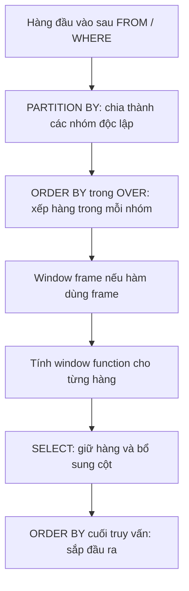

# OVER, PARTITION BY và ORDER BY trong cửa sổ của PostgreSQL

Trong PostgreSQL, **hàm cửa sổ (window function)** giúp tính toán trên một tập hàng có liên quan đến hàng hiện tại mà **không bắt buộc gộp các hàng thành một dòng** như `GROUP BY`. Chẳng hạn, ta có thể hiển thị từng đơn hàng cùng tổng doanh thu của người bán, số thứ tự đơn theo thời gian, thứ hạng đơn theo giá trị và tổng doanh thu lũy kế.

Ba thành phần quyết định cách hàm cửa sổ nhìn dữ liệu là:

- **`OVER`**: chỉ định rằng hàm được tính theo một cửa sổ thay vì theo cách aggregate thông thường.
- **`PARTITION BY`**: chia các hàng thành những phân vùng độc lập; mỗi hàng chỉ được so với những hàng trong phân vùng của mình.
- **`ORDER BY` bên trong `OVER`**: xác định thứ tự logic của các hàng trong mỗi phân vùng; rất quan trọng đối với `ROW_NUMBER`, `RANK`, `LAG`, `LEAD` và các phép tính lũy kế.

Ngoài ba thành phần trên, khái niệm **window frame** cần được hiểu ngay từ đầu: nếu viết `ORDER BY` trong cửa sổ, nhiều hàm tổng hợp cửa sổ sẽ sử dụng **frame mặc định**, và kết quả có thể khác kỳ vọng “tổng toàn bộ phân vùng”.

Bài học sử dụng những ví dụ SQL PostgreSQL tự chứa, một bộ dữ liệu đơn hàng và cách tổ chức truy vấn để bạn có thể phân biệt rõ **phân vùng**, **thứ tự**, **frame** và **thứ tự trình bày kết quả**.

## 1. Hàm cửa sổ khác GROUP BY như thế nào?

Giả sử có bảng chứa nhiều đơn hàng của mỗi người bán. Bạn cần biết tổng tiền mỗi người bán.

Cách dùng `GROUP BY`:

```sql
SELECT seller_id, SUM(amount) AS seller_total
FROM window_lab.orders
GROUP BY seller_id;
```

Kết quả chỉ có **một hàng cho mỗi `seller_id`**. Các `order_id` riêng lẻ không còn xuất hiện trừ khi được gom/tổng hợp theo cách phù hợp.

Cách dùng cửa sổ:

```sql
SELECT
    order_id,
    seller_id,
    amount,
    SUM(amount) OVER (PARTITION BY seller_id) AS seller_total
FROM window_lab.orders
ORDER BY seller_id, order_id;
```

Kết quả vẫn giữ **mỗi đơn hàng là một hàng**. Cột `seller_total` lặp cùng giá trị ở tất cả các đơn của một người bán.

| Đặc điểm | `GROUP BY` | Window function |
| --- | --- | --- |
| Số hàng kết quả | Thường giảm thành một hàng mỗi nhóm | Thường giữ số hàng đầu vào của tầng tính cửa sổ |
| Mục tiêu | Tổng hợp thành nhóm | Bổ sung thông tin liên quan cho từng hàng |
| Cách khai báo | `GROUP BY seller_id` | `OVER (PARTITION BY seller_id)` |
| Có thể hiển thị `order_id` chi tiết? | Không nếu chưa xử lý phù hợp với quy tắc nhóm | Có |
| Có thể tính tổng lũy kế từng đơn? | Không trực tiếp chỉ bằng GROUP BY thông thường | Có với `ORDER BY` và frame thích hợp |

Hàm cửa sổ không tự thay thế mọi nhu cầu `GROUP BY`. Hai cơ chế có thể kết hợp: tổng hợp dữ liệu trước, sau đó tính xếp hạng hoặc tỷ trọng trên những dòng tổng hợp.

## 2. Cú pháp tổng quát của OVER

Dạng phổ biến:

```sql
window_function(arguments)
OVER (
    PARTITION BY partition_expression [, ...]
    ORDER BY sort_expression [ASC | DESC] [NULLS FIRST | NULLS LAST] [, ...]
    ROWS BETWEEN frame_start AND frame_end
)
```

Phần `PARTITION BY`, `ORDER BY` và `ROWS ...` đều có thể tùy chọn tùy loại hàm. Cũng có thể dùng tên cửa sổ đã khai báo bằng `WINDOW`:

```sql
window_function(arguments) OVER window_name
```

Các thành phần phục vụ những câu hỏi khác nhau:

| Thành phần | Câu hỏi nó trả lời |
| --- | --- |
| `OVER (...)` | Hàm này có đang hoạt động theo một cửa sổ không? |
| `PARTITION BY seller_id` | Hàng hiện tại được so với những hàng của người bán nào? |
| `ORDER BY booked_at, order_id` | Thứ tự các đơn hàng trong phân vùng là gì? |
| `ROWS BETWEEN ...` | Những hàng nào thuộc frame để hàm xử lý ở vị trí hiện tại? |
| `ORDER BY` cuối truy vấn | Các hàng được **hiển thị** theo thứ tự nào? |

Hai `ORDER BY` trong cùng một câu SQL có thể có ý nghĩa **hoàn toàn khác nhau**. `ORDER BY` bên trong `OVER` phục vụ phép tính cửa sổ; `ORDER BY` ở cuối `SELECT` phục vụ thứ tự đầu ra.



Đây là sơ đồ ngữ nghĩa để học SQL, **không phải** cam kết PostgreSQL phải chạy theo đúng thứ tự vật lý đó. Planner có thể chọn sort, index scan hoặc các bước thực thi khác, miễn vẫn giữ ý nghĩa của truy vấn.

## 3. Bộ dữ liệu đơn hàng dùng xuyên suốt

Tạo schema và bảng trên một PostgreSQL dành cho thực hành:

```sql
CREATE SCHEMA IF NOT EXISTS window_lab;

CREATE TABLE window_lab.orders (
    order_id integer PRIMARY KEY,
    seller_id integer NOT NULL,
    region text NOT NULL,
    booked_at timestamptz NOT NULL,
    amount numeric(12, 2) NOT NULL CHECK (amount >= 0),
    status text NOT NULL
        CHECK (status IN ('paid', 'pending', 'cancelled'))
);

INSERT INTO window_lab.orders
    (order_id, seller_id, region, booked_at, amount, status)
VALUES
    (101, 1, 'North', '2026-01-01 09:00:00+07', 100.00, 'paid'),
    (102, 1, 'North', '2026-01-01 09:00:00+07',  50.00, 'paid'),
    (103, 1, 'North', '2026-01-03 10:00:00+07',  80.00, 'pending'),
    (104, 2, 'South', '2026-01-02 11:00:00+07', 200.00, 'paid'),
    (105, 2, 'South', '2026-01-02 11:00:00+07', 200.00, 'paid'),
    (106, 2, 'South', '2026-01-04 09:00:00+07',  40.00, 'cancelled'),
    (107, 3, 'North', '2026-01-01 12:00:00+07',  70.00, 'paid'),
    (108, 3, 'North', '2026-01-05 08:00:00+07', 130.00, 'paid'),
    (109, 4, 'Central','2026-01-03 08:00:00+07', 90.00, 'pending'),
    (110, 4, 'Central','2026-01-06 10:00:00+07', 30.00, 'paid'),
    (111, 5, 'North', '2026-01-07 09:00:00+07', 60.00, 'paid'),
    (112, 5, 'North', '2026-01-07 09:00:00+07', 90.00, 'paid');
```

Dữ liệu có những **thời điểm trùng nhau** (`101` và `102`; `104` và `105`; `111` và `112`). Đây là trường hợp quan trọng khi học `ORDER BY`, peer rows và frame mặc định.

Kiểm tra dữ liệu:

```sql
SELECT
    COUNT(*) AS order_count,
    SUM(amount) AS amount_all_statuses,
    COUNT(*) FILTER (WHERE status = 'paid') AS paid_count,
    SUM(amount) FILTER (WHERE status = 'paid') AS paid_amount
FROM window_lab.orders;
```

Kỳ vọng: 12 đơn, tổng mọi trạng thái 1140.00, 9 đơn đã thanh toán, tổng tiền đơn đã thanh toán 930.00.

Tổng theo người bán:

| seller_id | Số đơn | Tổng mọi trạng thái |
| ---: | ---: | ---: |
| 1 | 3 | 230.00 |
| 2 | 3 | 440.00 |
| 3 | 2 | 200.00 |
| 4 | 2 | 120.00 |
| 5 | 2 | 150.00 |

Từ đây, mọi ví dụ cửa sổ có thể được giải thích bằng các hàng cụ thể thay vì chỉ bằng định nghĩa trừu tượng.

## 4. OVER (): một cửa sổ không chia phân vùng

Khi viết `OVER ()`, toàn bộ tập hàng mà hàm cửa sổ nhận ở tầng truy vấn đó là **một phân vùng**:

```sql
SELECT
    order_id,
    seller_id,
    amount,
    SUM(amount) OVER () AS global_total,
    COUNT(*) OVER () AS global_order_count
FROM window_lab.orders
ORDER BY order_id;
```

Mỗi hàng hiển thị:

- `global_total = 1140.00`.
- `global_order_count = 12`.

Bất kể hàng hiện tại thuộc người bán nào, tổng và số lượng vẫn là của **toàn bộ tập hàng được đưa vào cửa sổ**.

### 4.1. OVER () không đồng nghĩa toàn bộ bảng trong mọi truy vấn

Nếu có `WHERE`:

```sql
SELECT
    order_id,
    status,
    amount,
    SUM(amount) OVER () AS paid_total
FROM window_lab.orders
WHERE status = 'paid'
ORDER BY order_id;
```

`paid_total` lúc này là **930.00** vì `WHERE` đã lọc bỏ các đơn `pending` và `cancelled` trước tầng tính window.

Vì vậy, “toàn bộ phân vùng” luôn có nghĩa là **toàn bộ các hàng còn lại tại tầng truy vấn đang tính cửa sổ**, không nhất thiết là mọi dòng trong bảng vật lý.

### 4.2. OVER () không chỉ dùng cho SUM

```sql
SELECT
    order_id,
    amount,
    AVG(amount) OVER () AS average_amount,
    MIN(amount) OVER () AS smallest_amount,
    MAX(amount) OVER () AS largest_amount
FROM window_lab.orders
ORDER BY order_id;
```

Các aggregate thông thường như `SUM`, `AVG`, `MIN`, `MAX`, `COUNT` có thể được dùng như hàm cửa sổ khi có mệnh đề `OVER` thích hợp.

## 5. PARTITION BY: chia hàng thành các cửa sổ độc lập

`PARTITION BY` định nghĩa khóa phân vùng. Mỗi phân vùng chứa những hàng có cùng giá trị của biểu thức phân vùng; phép tính window không đi qua ranh giới đó.

```sql
SELECT
    order_id,
    seller_id,
    amount,
    SUM(amount) OVER (PARTITION BY seller_id) AS seller_total,
    COUNT(*) OVER (PARTITION BY seller_id) AS seller_order_count
FROM window_lab.orders
ORDER BY seller_id, order_id;
```

Ví dụ:

| order_id | seller_id | amount | seller_total | seller_order_count |
| ---: | ---: | ---: | ---: | ---: |
| 101 | 1 | 100.00 | 230.00 | 3 |
| 102 | 1 | 50.00 | 230.00 | 3 |
| 103 | 1 | 80.00 | 230.00 | 3 |
| 104 | 2 | 200.00 | 440.00 | 3 |
| 105 | 2 | 200.00 | 440.00 | 3 |
| 106 | 2 | 40.00 | 440.00 | 3 |

Mỗi hàng giữ nguyên `order_id` riêng; chỉ có cột tổng và số đơn lặp theo seller.

### 5.1. Phân vùng theo nhiều cột

Nếu mỗi người bán có thể hoạt động ở nhiều khu vực, bạn có thể chọn:

```sql
SELECT
    order_id,
    seller_id,
    region,
    amount,
    SUM(amount) OVER (
        PARTITION BY seller_id, region
    ) AS seller_region_total
FROM window_lab.orders
ORDER BY seller_id, region, order_id;
```

Phân vùng được xác định bởi **tổ hợp `(seller_id, region)`**. Không phải có một phép tổng theo seller rồi phép tổng khác theo region: đó là một cửa sổ với khóa hai cột.

Có thể dùng các biểu thức phù hợp:

```sql
SELECT
    order_id,
    booked_at,
    SUM(amount) OVER (
        PARTITION BY date_trunc('month', booked_at)
    ) AS total_in_month
FROM window_lab.orders;
```

Ở truy vấn thực tế có nhiều múi giờ, `date_trunc('month', booked_at)` trên `timestamptz` chịu ảnh hưởng múi giờ được dùng để xác định tháng lịch. Hãy chuẩn hóa phạm vi thời gian theo yêu cầu báo cáo trước khi nhóm.

### 5.2. PARTITION BY không phải là partitioning vật lý của bảng

Hai thuật ngữ này khác nhau:

- **Window partition:** tập hàng logic do `PARTITION BY` trong `OVER` xác định cho việc tính toán.
- **Table partitioning:** chia dữ liệu vật lý thành các partition bằng `PARTITION BY` trong `CREATE TABLE` và quy tắc phân vùng tương ứng.

Hàm cửa sổ dùng được trên bảng thường, partitioned table, view hoặc kết quả join; nó **không yêu cầu bảng đã được partition vật lý**. Ngược lại, một bảng được partition vật lý theo ngày cũng không tự khiến `SUM(...) OVER (...)` chia theo ngày nếu bạn không yêu cầu.

### 5.3. NULL ở khóa phân vùng

Nếu khóa phân vùng cho phép `NULL`, những hàng có cùng kết quả khóa là `NULL` thuộc cùng phân vùng trong ngữ nghĩa nhóm/cửa sổ. Điều này không biến phép so sánh SQL `NULL = NULL` thành `TRUE`; cơ chế phân nhóm có quy tắc xử lý giá trị thiếu của riêng nó.

Với nhiều cột, phải xem toàn bộ tổ hợp khóa phân vùng. Một `seller_id` không null và `region` null vẫn có thể tạo phân vùng riêng so với `region = 'North'`.

## 6. ORDER BY trong OVER: định nghĩa trình tự tính toán

Muốn đánh số các đơn của từng người bán theo thời gian:

```sql
SELECT
    order_id,
    seller_id,
    booked_at,
    ROW_NUMBER() OVER (
        PARTITION BY seller_id
        ORDER BY booked_at, order_id
    ) AS order_sequence
FROM window_lab.orders
ORDER BY seller_id, order_sequence;
```

Cách đọc:

1. `PARTITION BY seller_id`: mỗi người bán có một chuỗi riêng.
2. `ORDER BY booked_at, order_id`: đơn cũ trước đơn mới; `order_id` giải quyết trường hợp thời điểm bằng nhau.
3. `ROW_NUMBER()`: đánh số 1, 2, 3... theo thứ tự vừa định nghĩa.

Với người bán 1: order 101 có số 1, 102 có số 2, 103 có số 3. Với người bán 2: order 104 có số 1, 105 có số 2, 106 có số 3.

### 6.1. Bỏ PARTITION BY thì số thứ tự không reset

```sql
SELECT
    order_id,
    seller_id,
    ROW_NUMBER() OVER (
        ORDER BY booked_at, order_id
    ) AS global_sequence
FROM window_lab.orders
ORDER BY global_sequence;
```

Không có `PARTITION BY`, tất cả đơn được đánh số trong một chuỗi duy nhất. Đây là trường hợp phù hợp khi muốn xếp tất cả sự kiện trên toàn hệ thống theo thời gian.

### 6.2. Bỏ ORDER BY có nghĩa gì?

```sql
SELECT
    order_id,
    seller_id,
    ROW_NUMBER() OVER (
        PARTITION BY seller_id
    ) AS unspecified_sequence
FROM window_lab.orders;
```

Truy vấn vẫn có thể hợp lệ, nhưng trong một phân vùng, **không có tiêu chí thứ tự được cam kết** để xác định order nào được `ROW_NUMBER = 1`. Kết quả phụ thuộc kế hoạch thực thi và có thể thay đổi giữa các lần chạy.

Nếu số thứ tự có ý nghĩa nghiệp vụ (đơn đầu tiên, đơn gần nhất, lượt phục vụ thứ N), hãy luôn chỉ định `ORDER BY` với tiêu chí đủ rõ để phá hòa.

### 6.3. ASC, DESC và NULLS FIRST/LAST

```sql
SELECT
    order_id,
    seller_id,
    booked_at,
    ROW_NUMBER() OVER (
        PARTITION BY seller_id
        ORDER BY booked_at DESC NULLS LAST, order_id DESC
    ) AS latest_first
FROM window_lab.orders
ORDER BY seller_id, latest_first;
```

Trong ví dụ này, cột `booked_at NOT NULL` nên `NULLS LAST` không tạo khác biệt; nhưng với cột có thể thiếu dữ liệu, vị trí `NULL` ảnh hưởng thứ tự trong cửa sổ.

Quy tắc mặc định trong PostgreSQL: `ASC` có `NULLS LAST` và `DESC` có `NULLS FIRST`. Hãy đặt tường minh khi việc xếp giá trị thiếu có ý nghĩa nghiệp vụ.

## 7. ORDER BY trong cửa sổ không sắp xếp kết quả cuối cùng

Một lỗi thường gặp:

```sql
SELECT
    order_id,
    seller_id,
    ROW_NUMBER() OVER (
        PARTITION BY seller_id
        ORDER BY booked_at DESC, order_id DESC
    ) AS rn
FROM window_lab.orders;
```

Bạn không được kết luận rằng hàng đầu tiên sẽ là đơn mới nhất hay các người bán xuất hiện liên tiếp theo thứ tự. `ORDER BY` trong `OVER` dùng để tính `rn`, **không bảo đảm thứ tự các hàng đầu ra**.

Muốn xem theo thứ tự dễ đọc:

```sql
SELECT
    order_id,
    seller_id,
    ROW_NUMBER() OVER (
        PARTITION BY seller_id
        ORDER BY booked_at DESC, order_id DESC
    ) AS rn
FROM window_lab.orders
ORDER BY seller_id, rn;
```

Hoặc xếp kết quả cuối theo thứ tự khác mà vẫn giữ cùng `rn`:

```sql
SELECT
    order_id,
    seller_id,
    amount,
    ROW_NUMBER() OVER (
        PARTITION BY seller_id
        ORDER BY booked_at DESC, order_id DESC
    ) AS rn
FROM window_lab.orders
ORDER BY amount DESC, order_id;
```

Ở truy vấn thứ hai, thứ tự hiển thị theo `amount`; số `rn` vẫn tính theo thời gian trong từng người bán.

**Nguyên tắc:** muốn bảo đảm thứ tự trả về cho API hoặc phân trang, dùng `ORDER BY` ở cấp truy vấn xuất kết quả. Đừng dựa vào thứ tự hiện ra một cách tình cờ từ `WindowAgg` hoặc `Sort` trong execution plan.

## 8. Peer rows: khi các khóa ORDER BY bằng nhau

Trong một phân vùng, hai hàng có cùng các giá trị của toàn bộ biểu thức `ORDER BY` trong cửa sổ được gọi là **peers**.

Xét hai đơn seller 2:

| order_id | seller_id | booked_at | amount |
| ---: | ---: | --- | ---: |
| 104 | 2 | 2026-01-02 11:00+07 | 200.00 |
| 105 | 2 | 2026-01-02 11:00+07 | 200.00 |

Nếu chỉ sắp theo `booked_at`, hai dòng là peers:

```sql
SELECT
    order_id,
    seller_id,
    booked_at,
    ROW_NUMBER() OVER (
        PARTITION BY seller_id
        ORDER BY booked_at
    ) AS rn,
    RANK() OVER (
        PARTITION BY seller_id
        ORDER BY booked_at
    ) AS rnk,
    DENSE_RANK() OVER (
        PARTITION BY seller_id
        ORDER BY booked_at
    ) AS dense_rnk
FROM window_lab.orders
WHERE seller_id = 2
ORDER BY booked_at, order_id;
```

`RANK` và `DENSE_RANK` cho các peers cùng hạng; `ROW_NUMBER` vẫn cần gán số khác nhau cho từng dòng, nhưng khi thiếu khóa phá hòa, việc dòng 104 hay 105 nhận số 1 có thể không ổn định.

### 8.1. ROW_NUMBER, RANK và DENSE_RANK

| Hàm | Hành vi khi trùng khóa ORDER BY |
| --- | --- |
| `ROW_NUMBER()` | Mỗi hàng số khác nhau; thứ tự giữa peers có thể không xác định |
| `RANK()` | Cùng hạng cho peers, có **khoảng trống** ở hạng tiếp theo |
| `DENSE_RANK()` | Cùng hạng cho peers, **không** để khoảng trống |

Ví dụ seller 2 khi `ORDER BY amount DESC`: các amount lần lượt 200, 200, 40.

| order_id | amount | ROW_NUMBER (không thêm tiebreak) | RANK | DENSE_RANK |
| ---: | ---: | --- | ---: | ---: |
| 104 | 200.00 | 1 hoặc 2 | 1 | 1 |
| 105 | 200.00 | 1 hoặc 2 | 1 | 1 |
| 106 | 40.00 | 3 | 3 | 2 |

Nếu bạn thêm `order_id` vào chính `ORDER BY` của `RANK`, hai dòng amount 200 không còn peers; thứ hạng sẽ khác. Vì thế:

- Khi muốn **xếp hạng theo amount và giữ các giá trị đồng hạng**, chỉ dùng `ORDER BY amount DESC` trong `RANK`.
- Khi muốn **chọn một dòng duy nhất theo quy tắc rõ ràng**, dùng `ROW_NUMBER() OVER (... ORDER BY amount DESC, order_id)`.

## 9. Window frame: phạm vi hàng thực sự được tổng hợp

Đây là phần thường gây hiểu nhầm nhất. **Partition** xác định nhóm lớn mà một hàng thuộc về; **frame** xác định một phần của nhóm đó tại vị trí hiện tại để một số hàm tính toán.

Ví dụ:

```sql
SELECT
    order_id,
    seller_id,
    amount,
    SUM(amount) OVER (
        PARTITION BY seller_id
    ) AS full_partition_total
FROM window_lab.orders;
```

Không có `ORDER BY` hay frame tường minh, frame mặc định bao gồm **toàn bộ partition**; vì vậy seller 1 luôn có tổng 230.00 trên cả ba hàng.

Nhưng khi thêm `ORDER BY`:

```sql
SELECT
    order_id,
    seller_id,
    booked_at,
    amount,
    SUM(amount) OVER (
        PARTITION BY seller_id
        ORDER BY booked_at
    ) AS cumulative_by_time
FROM window_lab.orders
ORDER BY seller_id, booked_at, order_id;
```

Với một aggregate như `SUM`, cửa sổ có `ORDER BY` dùng **frame mặc định** tương đương:

```sql
RANGE BETWEEN UNBOUNDED PRECEDING AND CURRENT ROW
```

Với `RANGE` và `CURRENT ROW`, frame bao gồm cả **các peer có cùng giá trị ORDER BY**, không chỉ duy nhất hàng hiện tại.

### 9.1. Khác biệt giữa “tổng toàn phân vùng” và “tổng lũy kế”

| Câu SQL trong OVER | Ý nghĩa với SUM |
| --- | --- |
| `PARTITION BY seller_id` | Tổng toàn bộ người bán, lặp trên mỗi dòng |
| `PARTITION BY seller_id ORDER BY booked_at` | Tổng lũy kế theo thứ tự thời gian và peers, theo frame mặc định |
| `PARTITION BY seller_id ORDER BY booked_at ROWS BETWEEN UNBOUNDED PRECEDING AND UNBOUNDED FOLLOWING` | Tổng toàn bộ người bán dù có ORDER BY |
| `PARTITION BY seller_id ORDER BY booked_at, order_id ROWS BETWEEN UNBOUNDED PRECEDING AND CURRENT ROW` | Tổng lũy kế theo **từng hàng** với thứ tự đã phá hòa |

Khi cần tổng toàn bộ partition, cách ngắn nhất thường là **không thêm ORDER BY**:

```sql
SUM(amount) OVER (PARTITION BY seller_id)
```

Nếu phải dùng thứ tự vì những hàm cửa sổ khác, bạn vẫn có thể chỉ rõ frame toàn partition, nhưng hãy chọn cách dễ đọc nhất.

## 10. ROWS và RANGE khi có thời điểm trùng nhau

Để quan sát sự khác biệt, xét seller 2 có hai đơn 200.00 cùng `booked_at`.

### 10.1. RANGE mặc định tính cả nhóm peers

```sql
SELECT
    order_id,
    booked_at,
    amount,
    SUM(amount) OVER (
        ORDER BY booked_at
    ) AS running_range
FROM window_lab.orders
WHERE seller_id = 2
ORDER BY booked_at, order_id;
```

Hai đơn 104 và 105 có cùng thời điểm. Vì frame mặc định `RANGE ... CURRENT ROW` bao gồm peers, **cả hai đều có `running_range = 400.00`**. Dòng 106 (40.00) có `running_range = 440.00`.

Đây không phải lỗi cộng dồn; hai hàng cùng khóa sort được xử lý như một nhóm peer tại điểm kết thúc frame.

### 10.2. ROWS tính theo vị trí từng hàng

```sql
SELECT
    order_id,
    booked_at,
    amount,
    SUM(amount) OVER (
        ORDER BY booked_at, order_id
        ROWS BETWEEN UNBOUNDED PRECEDING AND CURRENT ROW
    ) AS running_rows
FROM window_lab.orders
WHERE seller_id = 2
ORDER BY booked_at, order_id;
```

Kết quả:

| order_id | amount | running_rows |
| ---: | ---: | ---: |
| 104 | 200.00 | 200.00 |
| 105 | 200.00 | 400.00 |
| 106 | 40.00 | 440.00 |

Vì thứ tự có `order_id` làm khóa phụ, kết quả lũy kế được xác định rõ ràng.

**Cảnh báo:** nếu dùng `ROWS` nhưng chỉ `ORDER BY booked_at`, hai hàng trùng thời điểm có thể đổi thứ tự giữa các lần thực thi. Khi đó một trong hai hàng nhận tổng 200 và hàng còn lại nhận 400, nhưng không bảo đảm ID nào nhận giá trị nào.

### 10.3. So sánh trực tiếp trong một truy vấn

```sql
SELECT
    order_id,
    booked_at,
    amount,
    SUM(amount) OVER (
        ORDER BY booked_at
    ) AS cumulative_range_default,
    SUM(amount) OVER (
        ORDER BY booked_at, order_id
        ROWS BETWEEN UNBOUNDED PRECEDING AND CURRENT ROW
    ) AS cumulative_rows_deterministic
FROM window_lab.orders
WHERE seller_id = 2
ORDER BY booked_at, order_id;
```

Đây là ví dụ quan trọng để hiểu rằng **`ORDER BY` trong cửa sổ không chỉ ảnh hưởng thứ tự; nó còn ảnh hưởng frame mặc định khi hàm có sử dụng frame**.

## 11. ROWS, RANGE và GROUPS: ba cách định nghĩa frame

PostgreSQL hỗ trợ ba đơn vị frame thường gặp:

| Đơn vị | Dựa vào | Khi nào hữu ích |
| --- | --- | --- |
| `ROWS` | Số hàng vật lý tương đối trong thứ tự cửa sổ | Lũy kế từng hàng, trung bình N hàng gần nhất |
| `RANGE` | Khoảng **giá trị khóa ORDER BY**, có xử lý peers | Tổng trong khoảng thời gian/giá trị, lũy kế theo nhóm cùng khóa |
| `GROUPS` | Số **nhóm peers** trong thứ tự cửa sổ | Tính trên N nhóm giá trị thứ tự gần nhất |

Một frame được viết trong `OVER`, ví dụ:

```sql
SUM(amount) OVER (
    PARTITION BY seller_id
    ORDER BY booked_at, order_id
    ROWS BETWEEN 2 PRECEDING AND CURRENT ROW
)
```

Ở đây, frame gồm tối đa **ba hàng**: hàng hiện tại và hai hàng trước đó trong cùng seller. Khi chưa đủ hai hàng trước, frame nhỏ hơn ba.

### 11.1. Trung bình trượt ba đơn gần nhất

```sql
SELECT
    seller_id,
    order_id,
    amount,
    AVG(amount) OVER (
        PARTITION BY seller_id
        ORDER BY booked_at, order_id
        ROWS BETWEEN 2 PRECEDING AND CURRENT ROW
    ) AS moving_avg_last_3_orders
FROM window_lab.orders
ORDER BY seller_id, booked_at, order_id;
```

Với seller 1:

- Đơn 101: trung bình 100.
- Đơn 102: trung bình của 100 và 50 = 75.
- Đơn 103: trung bình của 100, 50, 80 = 76.666...

Trong ví dụ này, `AVG` trên `numeric` trả giá trị số chính xác có thể có nhiều chữ số thập phân; hãy dùng `ROUND(..., 2)` khi cần hiển thị hai chữ số.

### 11.2. RANGE theo một khoảng thời gian

Giả sử bạn muốn doanh thu **trong 1 ngày tính tới thời điểm của đơn hiện tại**:

```sql
SELECT
    seller_id,
    order_id,
    booked_at,
    amount,
    SUM(amount) OVER (
        PARTITION BY seller_id
        ORDER BY booked_at
        RANGE BETWEEN INTERVAL '1 day' PRECEDING AND CURRENT ROW
    ) AS revenue_in_previous_day
FROM window_lab.orders
ORDER BY seller_id, booked_at, order_id;
```

Với `RANGE` có offset thời gian như trên, `ORDER BY` cần phù hợp với quy tắc về **một biểu thức sắp xếp có thể dùng offset**, ở đây là `timestamptz`. Không thể tùy tiện thêm nhiều khóa `ORDER BY` vào cùng một frame `RANGE` có offset và kỳ vọng cú pháp luôn hợp lệ.

Với hai hàng có cùng `booked_at`, cả hai nằm trong khoảng thời gian của nhau và được tính vào kết quả tương ứng theo semantics `RANGE`.

### 11.3. GROUPS theo nhóm peers

```sql
SELECT
    seller_id,
    order_id,
    booked_at,
    amount,
    SUM(amount) OVER (
        PARTITION BY seller_id
        ORDER BY booked_at
        GROUPS BETWEEN 1 PRECEDING AND CURRENT ROW
    ) AS current_and_previous_time_group
FROM window_lab.orders
ORDER BY seller_id, booked_at, order_id;
```

Nếu một timestamp có nhiều order, chúng tạo **một nhóm peers** theo `booked_at`. Frame trên cộng dữ liệu của nhóm timestamp hiện tại và nhóm timestamp trước đó, không phải chỉ “một hàng trước”.

`GROUPS` được PostgreSQL hỗ trợ trong các phiên bản hiện đại; với những hệ thống rất cũ, cần kiểm tra khả năng hỗ trợ của server. Đừng áp dụng một tính năng frame mới mà chưa xác nhận môi trường.

## 12. LAST_VALUE: lỗi dễ mắc do frame mặc định

`FIRST_VALUE` và `LAST_VALUE` hoạt động trên **window frame**, không mặc nhiên trên toàn bộ phân vùng.

Ví dụ người viết muốn hiển thị số tiền đơn cuối cùng của mỗi seller:

```sql
SELECT
    seller_id,
    order_id,
    amount,
    LAST_VALUE(amount) OVER (
        PARTITION BY seller_id
        ORDER BY booked_at, order_id
    ) AS last_value_default
FROM window_lab.orders
ORDER BY seller_id, booked_at, order_id;
```

Vì có `ORDER BY` và không ghi frame, frame mặc định kết thúc tại hàng hiện tại (cộng các peer khi có). Với khóa `(booked_at, order_id)` duy nhất trong seller, `LAST_VALUE(amount)` thường chỉ trả **chính amount của hàng hiện tại**, thay vì amount của đơn cuối cùng của seller.

Để thực sự lấy đơn cuối trong **toàn bộ partition**, hãy mở rộng frame:

```sql
SELECT
    seller_id,
    order_id,
    amount,
    LAST_VALUE(amount) OVER (
        PARTITION BY seller_id
        ORDER BY booked_at, order_id
        ROWS BETWEEN UNBOUNDED PRECEDING AND UNBOUNDED FOLLOWING
    ) AS last_amount_in_partition
FROM window_lab.orders
ORDER BY seller_id, booked_at, order_id;
```

Trong bộ dữ liệu mẫu, seller 1 nhận last amount 80.00, seller 2 nhận 40.00, seller 3 nhận 130.00, seller 4 nhận 30.00, seller 5 nhận 90.00.

Bảng tóm tắt:

| Biểu thức | Hành vi thường thấy |
| --- | --- |
| `LAST_VALUE(amount) OVER (PARTITION BY seller_id ORDER BY booked_at, order_id)` | Hàng cuối **frame mặc định**; với khóa unique thường là hàng hiện tại |
| `LAST_VALUE(amount) OVER (... ROWS BETWEEN UNBOUNDED PRECEDING AND UNBOUNDED FOLLOWING)` | Hàng cuối của **toàn bộ partition** theo thứ tự đã chọn |

`NTH_VALUE` cũng phụ thuộc frame. Ngược lại, `LAG` và `LEAD` tra vị trí tương đối trong partition theo thứ tự cửa sổ và không sử dụng frame theo cùng cách aggregate/`LAST_VALUE`.

## 13. LAG và LEAD: nhìn sang hàng trước/sau trong partition

`LAG` trả giá trị của hàng đứng trước theo thứ tự cửa sổ; `LEAD` trả giá trị của hàng đứng sau.

```sql
SELECT
    seller_id,
    order_id,
    booked_at,
    amount,
    LAG(amount) OVER (
        PARTITION BY seller_id
        ORDER BY booked_at, order_id
    ) AS previous_amount,
    LEAD(amount) OVER (
        PARTITION BY seller_id
        ORDER BY booked_at, order_id
    ) AS next_amount
FROM window_lab.orders
ORDER BY seller_id, booked_at, order_id;
```

Với seller 1:

| order_id | amount | previous_amount | next_amount |
| ---: | ---: | ---: | ---: |
| 101 | 100.00 | NULL | 50.00 |
| 102 | 50.00 | 100.00 | 80.00 |
| 103 | 80.00 | 50.00 | NULL |

`LAG` và `LEAD` mặc định dùng offset 1; có thể truyền offset và giá trị mặc định:

```sql
SELECT
    seller_id,
    order_id,
    LAG(amount, 2, 0) OVER (
        PARTITION BY seller_id
        ORDER BY booked_at, order_id
    ) AS amount_two_orders_ago
FROM window_lab.orders;
```

Giá trị `0` được trả khi không tồn tại hàng ở offset 2; nó không có nghĩa rằng đơn trước đó thực sự có `amount = 0`. Hãy chọn giá trị mặc định theo yêu cầu nghiệp vụ, có thể giữ `NULL` nếu muốn biểu thị “không có hàng trước”.

### 13.1. Tính chênh lệch giữa hai đơn liên tiếp

```sql
SELECT
    seller_id,
    order_id,
    booked_at,
    amount,
    amount - LAG(amount) OVER (
        PARTITION BY seller_id
        ORDER BY booked_at, order_id
    ) AS delta_from_previous_order
FROM window_lab.orders
ORDER BY seller_id, booked_at, order_id;
```

Đơn đầu tiên của mỗi seller có delta `NULL` vì không có đơn trước. Không nên tự động quy về 0 nếu báo cáo cần phân biệt “không có dữ liệu để so sánh” với “không thay đổi”.

### 13.2. LAG/LEAD không tự mang ý nghĩa thời gian thực tế

`LAG(amount)` trả **hàng trước đó theo ORDER BY**, không phải “hàng cách đúng một ngày”. Nếu cần so sánh đúng các ngày lịch liên tiếp, hãy chuẩn hóa thời gian, tổng hợp theo ngày và xác định cách xử lý ngày không có giao dịch.

Đặc biệt, nếu dùng `ORDER BY booked_at` mà nhiều hàng trùng thời điểm, quan hệ “trước/sau” giữa các peers có thể không ổn định. Thêm `order_id` hoặc khóa phá hòa phù hợp.

## 14. Lọc “đơn mới nhất của mỗi seller”: tại sao cần tầng truy vấn ngoài?

Một yêu cầu thường gặp: mỗi người bán chỉ lấy **một đơn mới nhất**.

Không thể lọc trực tiếp alias `rn` trong `WHERE` cùng tầng:

```sql
-- Sai: rn chưa tồn tại ở WHERE cùng cấp.
SELECT
    order_id,
    seller_id,
    ROW_NUMBER() OVER (
        PARTITION BY seller_id
        ORDER BY booked_at DESC, order_id DESC
    ) AS rn
FROM window_lab.orders
WHERE rn = 1;
```

Cũng không được đưa window function vào `WHERE` trực tiếp tại tầng đó.

Dùng CTE:

```sql
WITH ranked_orders AS (
    SELECT
        order_id,
        seller_id,
        booked_at,
        amount,
        ROW_NUMBER() OVER (
            PARTITION BY seller_id
            ORDER BY booked_at DESC, order_id DESC
        ) AS rn
    FROM window_lab.orders
)
SELECT
    seller_id,
    order_id,
    booked_at,
    amount
FROM ranked_orders
WHERE rn = 1
ORDER BY seller_id;
```

Kết quả với dữ liệu mẫu:

| seller_id | order_id | Giải thích |
| ---: | ---: | --- |
| 1 | 103 | Thời gian muộn nhất của seller 1 |
| 2 | 106 | Thời gian muộn nhất của seller 2 |
| 3 | 108 | Thời gian muộn nhất của seller 3 |
| 4 | 110 | Thời gian muộn nhất của seller 4 |
| 5 | 112 | Đồng thời điểm với 111, ID 112 lớn hơn |

Truy vấn trong CTE tạo `rn`; với truy vấn ngoài, `rn` đã là một cột đầu vào hợp lệ để lọc.

### 14.1. Chọn top 2 thay vì top 1

Thay `WHERE rn = 1` bằng:

```sql
WHERE rn <= 2
```

thì mỗi seller có tối đa hai đơn. Nếu mục tiêu là lấy **mọi đơn đồng hạng trong top 2 giá trị amount**, `RANK`/`DENSE_RANK` có thể phù hợp hơn `ROW_NUMBER`, nhưng số hàng trả về mỗi seller có thể lớn hơn hai do đồng hạng.

### 14.2. WHERE trước và sau cửa sổ khác nhau

Truy vấn A chỉ xếp hạng các đơn đã thanh toán:

```sql
WITH ranked_paid AS (
    SELECT
        order_id,
        seller_id,
        status,
        booked_at,
        ROW_NUMBER() OVER (
            PARTITION BY seller_id
            ORDER BY booked_at DESC, order_id DESC
        ) AS rn
    FROM window_lab.orders
    WHERE status = 'paid'
)
SELECT *
FROM ranked_paid
WHERE rn = 1
ORDER BY seller_id;
```

Truy vấn B xếp hạng **mọi đơn**, rồi lọc dòng mới nhất chỉ khi nó đã thanh toán:

```sql
WITH ranked_all AS (
    SELECT
        order_id,
        seller_id,
        status,
        booked_at,
        ROW_NUMBER() OVER (
            PARTITION BY seller_id
            ORDER BY booked_at DESC, order_id DESC
        ) AS rn
    FROM window_lab.orders
)
SELECT *
FROM ranked_all
WHERE rn = 1
  AND status = 'paid'
ORDER BY seller_id;
```

Với seller 1, order mới nhất là 103 nhưng `pending`. Truy vấn A trả order paid mới nhất 102; truy vấn B **không trả seller 1**. Với seller 2, order mới nhất 106 là `cancelled`; truy vấn A trả 105, còn truy vấn B không trả seller 2.

Hai truy vấn giải quyết **hai yêu cầu nghiệp vụ khác nhau**. Vị trí của `WHERE` so với cửa sổ là một phần ý nghĩa, không chỉ là một cách tối ưu hóa.

## 15. Vị trí hợp lệ của window function trong SELECT

Trong PostgreSQL, window function được dùng ở các vị trí phù hợp trong **danh sách `SELECT` và `ORDER BY`** của tầng truy vấn. Không dùng trực tiếp trong `WHERE`, `GROUP BY` hoặc `HAVING` cùng tầng vì các mệnh đề đó được xử lý về mặt logic trước khi kết quả cửa sổ tồn tại.

Ví dụ hợp lệ:

```sql
SELECT
    order_id,
    seller_id,
    ROW_NUMBER() OVER (
        PARTITION BY seller_id ORDER BY booked_at, order_id
    ) AS rn
FROM window_lab.orders
ORDER BY
    ROW_NUMBER() OVER (
        PARTITION BY seller_id ORDER BY booked_at, order_id
    ),
    seller_id;
```

Dùng alias trong `ORDER BY` thường dễ đọc hơn:

```sql
SELECT
    order_id,
    seller_id,
    ROW_NUMBER() OVER (
        PARTITION BY seller_id ORDER BY booked_at, order_id
    ) AS rn
FROM window_lab.orders
ORDER BY rn, seller_id;
```

Không thể lồng trực tiếp một window function bên trong window function khác ở cùng tầng truy vấn. Khi cần hai bước như “tính tổng mỗi người bán → xếp hạng tổng người bán”, hãy dùng query level hoặc kết hợp aggregate/window theo đúng quy tắc.

## 16. Kết hợp GROUP BY và window functions

Các window functions được tính sau khi `GROUP BY` và `HAVING` đã hình thành/lọc những hàng kết quả tổng hợp ở tầng truy vấn đó. Vì vậy, chúng có thể **xếp hạng các nhóm**.

```sql
WITH seller_totals AS (
    SELECT
        seller_id,
        SUM(amount) AS seller_revenue
    FROM window_lab.orders
    WHERE status = 'paid'
    GROUP BY seller_id
)
SELECT
    seller_id,
    seller_revenue,
    RANK() OVER (
        ORDER BY seller_revenue DESC
    ) AS revenue_rank
FROM seller_totals
ORDER BY revenue_rank, seller_id;
```

Bước trong CTE tạo một hàng mỗi seller; bước ngoài xếp hạng các hàng tổng hợp này. Đây không phải xếp hạng từng order.

PostgreSQL cũng cho phép viết aggregate nằm trong đối số window aggregate ở tình huống hợp lệ:

```sql
SELECT
    region,
    seller_id,
    SUM(amount) AS seller_revenue,
    SUM(SUM(amount)) OVER (
        PARTITION BY region
    ) AS region_revenue
FROM window_lab.orders
GROUP BY region, seller_id
ORDER BY region, seller_id;
```

Cách đọc:

1. `GROUP BY region, seller_id` tạo một hàng doanh thu cho mỗi seller trong mỗi region.
2. `SUM(SUM(amount)) OVER (PARTITION BY region)` tính tổng các hàng seller vừa tổng hợp trong cùng region.

Đây là trường hợp **aggregate lồng trong window aggregate** hợp lệ vì hai phép tổng hợp hoạt động ở hai giai đoạn logic khác nhau. Không đồng nghĩa với việc được lồng trực tiếp **hai window functions** vào nhau.

## 17. Đặt tên cửa sổ bằng WINDOW

Khi nhiều biểu thức dùng cùng `PARTITION BY` và `ORDER BY`, lặp lại toàn bộ `OVER (...)` làm SQL dài và dễ viết thiếu một khóa.

PostgreSQL hỗ trợ khai báo named window trong mệnh đề `WINDOW`:

```sql
SELECT
    seller_id,
    order_id,
    amount,
    ROW_NUMBER() OVER seller_timeline AS seq_no,
    LAG(amount) OVER seller_timeline AS previous_amount,
    LEAD(amount) OVER seller_timeline AS next_amount
FROM window_lab.orders
WINDOW seller_timeline AS (
    PARTITION BY seller_id
    ORDER BY booked_at, order_id
)
ORDER BY seller_id, seq_no;
```

Ý nghĩa: ba hàm sử dụng cùng định nghĩa partition/order. `WINDOW` được viết **sau `HAVING` và trước `ORDER BY` cuối truy vấn** trong cấu trúc `SELECT` PostgreSQL.

### 17.1. Tái sử dụng định nghĩa, thêm frame cho một phép tổng

Giả sử muốn cùng lúc đánh số và tính tổng trượt hai đơn:

```sql
SELECT
    seller_id,
    order_id,
    amount,
    ROW_NUMBER() OVER seller_timeline AS seq_no,
    SUM(amount) OVER (
        seller_timeline
        ROWS BETWEEN 1 PRECEDING AND CURRENT ROW
    ) AS last_two_amount
FROM window_lab.orders
WINDOW seller_timeline AS (
    PARTITION BY seller_id
    ORDER BY booked_at, order_id
)
ORDER BY seller_id, seq_no;
```

Ở đây, named window xác định partition và order; biểu thức `SUM` **mở rộng** thêm frame `ROWS`.

Cần chú ý quy tắc PostgreSQL khi tham chiếu named window:

- Có thể dùng `OVER window_name` trực tiếp.
- Có thể dùng `OVER (window_name ... )` để bổ sung một số phần khi được phép.
- Không thể tùy tiện **ghi đè** `PARTITION BY` hoặc `ORDER BY` đã có của cửa sổ được tham chiếu.
- Nếu named window đã có frame, việc sao chép/mở rộng bằng dạng có ngoặc có giới hạn; hãy định nghĩa các named window khác nhau khi cần các frame độc lập.

Đặt tên cửa sổ giúp tránh chênh lệch ngoài ý muốn giữa `ROW_NUMBER`, `LAG` và phép tính lũy kế.

## 18. FILTER với window aggregate

Trong PostgreSQL, một số aggregate có thể có mệnh đề `FILTER (WHERE ...)`, kể cả khi được sử dụng với `OVER`.

Ví dụ, giữ **tất cả orders** nhưng tính tổng tiền các đơn `paid` trong từng seller:

```sql
SELECT
    order_id,
    seller_id,
    status,
    amount,
    SUM(amount) FILTER (WHERE status = 'paid')
        OVER (PARTITION BY seller_id) AS paid_total_for_seller
FROM window_lab.orders
ORDER BY seller_id, order_id;
```

Ở đây:

- Tập hàng kết quả vẫn có 12 orders.
- `PARTITION BY seller_id` phân nhóm theo người bán.
- `FILTER (WHERE status = 'paid')` chỉ xác định **những hàng đóng góp cho aggregate SUM**, không loại các hàng `pending`/`cancelled` khỏi đầu ra.

Tổng paid theo seller:

| seller_id | paid_total_for_seller |
| ---: | ---: |
| 1 | 150.00 |
| 2 | 400.00 |
| 3 | 200.00 |
| 4 | 30.00 |
| 5 | 150.00 |

So sánh với:

```sql
SELECT
    order_id,
    seller_id,
    SUM(amount) OVER (
        PARTITION BY seller_id
    ) AS paid_partition_total
FROM window_lab.orders
WHERE status = 'paid';
```

Truy vấn thứ hai **chỉ giữ những hàng paid**, nên không còn các hàng có trạng thái khác. Dù giá trị tổng theo seller paid giống ở đây, tập hàng kết quả và mục tiêu báo cáo không giống nhau.

**Lưu ý:** `FILTER` là cú pháp của aggregate hỗ trợ FILTER, không phải tùy chọn áp dụng cho mọi hàm cửa sổ như `ROW_NUMBER` hay `LAG`.

## 19. Phân biệt ROWS, PARTITION và kết quả sau JOIN

Khi truy vấn có `JOIN`, đầu vào của window function có thể chứa **nhiều hàng hơn bảng nguồn**. Ví dụ một đơn hàng có ba dòng sản phẩm; join từ orders sang order_lines sẽ tạo ba dòng mang cùng `order_id`.

Nếu viết:

```sql
SELECT
    o.seller_id,
    o.order_id,
    COUNT(*) OVER (
        PARTITION BY o.seller_id
    ) AS joined_rows_of_seller
FROM window_lab.orders AS o
JOIN window_lab.order_lines AS l
    ON l.order_id = o.order_id;
```

thì `COUNT(*) OVER (...)` đếm **hàng sau JOIN**, không nhất thiết là số đơn hàng riêng biệt. Bảng `window_lab.order_lines` ở đây là **bảng giả định** chưa được tạo trong phần dữ liệu thực hành; SQL minh họa việc join có thể làm tăng số hàng.

Nếu mục tiêu là đếm đơn duy nhất, hãy tổng hợp đúng `order_id` hoặc tạo một tầng query chuẩn hóa về một hàng trên một đơn trước khi tính cửa sổ.

### 19.1. LEFT JOIN và hàng không khớp

Với `LEFT JOIN`, một bản ghi bên trái không có đối tác vẫn có thể tạo một hàng với cột bên phải bằng `NULL`. Vì thế:

- `COUNT(*) OVER (PARTITION BY ...)` có thể tính cả hàng null-extended.
- `COUNT(right_table.id) OVER (...)` không tính giá trị ID NULL.
- Thêm `WHERE right_table.some_col = ...` sau `LEFT JOIN` có thể loại bỏ hàng không khớp trước khi window function chạy.

Đặt điều kiện của bảng bên phải vào `ON` hoặc `WHERE` phải dựa trên yêu cầu giữ hay loại những hàng không có đối tác.

## 20. Hiệu năng và index khi dùng PARTITION BY / ORDER BY

Window functions có thể yêu cầu PostgreSQL tổ chức hàng theo partition và thứ tự cửa sổ. Với bảng lớn, đây có thể là một thao tác tốn CPU, bộ nhớ và I/O.

Ví dụ:

```sql
EXPLAIN
SELECT
    seller_id,
    order_id,
    ROW_NUMBER() OVER (
        PARTITION BY seller_id
        ORDER BY booked_at DESC, order_id DESC
    ) AS rn
FROM window_lab.orders;
```

Trong execution plan, có thể xuất hiện node `WindowAgg` và `Sort` hoặc các cách truy cập hàng đã có thứ tự phù hợp. PostgreSQL không hứa rằng mọi hàm cửa sổ đều quét bảng đúng một lần, hay rằng chỉ một sort đủ cho mọi cửa sổ với các thứ tự khác nhau.

### 20.1. Index phù hợp có thể giảm chi phí sắp xếp

Với truy vấn thường xuyên lấy các order theo seller rồi theo thời gian mới nhất, có thể cân nhắc:

```sql
CREATE INDEX idx_orders_seller_booked_id
ON window_lab.orders (
    seller_id,
    booked_at DESC,
    order_id DESC
);
```

Index này có thể hỗ trợ đường đọc theo thứ tự phù hợp, nhưng **không bảo đảm** planner luôn dùng index thay sort. Kế hoạch phụ thuộc vào số hàng, độ chọn lọc của `WHERE`, cache, chi phí đọc heap, thống kê và PostgreSQL version.

Trong một số truy vấn, PostgreSQL có thể dùng `Incremental Sort` khi đầu vào đã được sắp theo tiền tố của khóa sort. Không nên thiết kế index chỉ dựa vào sự xuất hiện của một node trong `EXPLAIN` trên bảng 12 dòng.

### 20.2. Nhiều thứ tự cửa sổ có thể tăng số lần sort

```sql
SELECT
    order_id,
    seller_id,
    ROW_NUMBER() OVER (
        PARTITION BY seller_id ORDER BY booked_at
    ) AS by_time,
    ROW_NUMBER() OVER (
        PARTITION BY seller_id ORDER BY amount DESC
    ) AS by_amount
FROM window_lab.orders;
```

Hai window definitions yêu cầu hai cách sắp khác nhau. Planner có thể cần các bước sắp/đánh giá riêng; đừng giả định viết chúng chung một `SELECT` luôn tiết kiệm hơn mọi giải pháp khác.

### 20.3. EXPLAIN ANALYZE đo được gì?

```sql
EXPLAIN (ANALYZE, BUFFERS)
SELECT
    seller_id,
    order_id,
    SUM(amount) OVER (
        PARTITION BY seller_id
        ORDER BY booked_at, order_id
        ROWS BETWEEN UNBOUNDED PRECEDING AND CURRENT ROW
    ) AS running_amount
FROM window_lab.orders;
```

`ANALYZE` thực sự chạy câu truy vấn để ghi nhận số hàng và thời gian. Với truy vấn `SELECT` trên dữ liệu thử nghiệm thường không làm thay đổi dữ liệu, nhưng vẫn tiêu tốn tài nguyên. Nếu áp dụng cho statement ghi dữ liệu, tác động thực thi phải được kiểm soát riêng.

Khi xử lý hàng triệu hàng, còn cần quan sát thời gian sort, bộ nhớ, temp files, thiết kế partition/order và các phép join trước window. Không có một quy tắc “thêm index vào mọi cột PARTITION BY” luôn đúng.

## 21. Cửa sổ và phân trang: thứ tự nào quyết định trang?

Giả sử API cần 20 đơn có giá trị cao nhất, nhưng cũng hiển thị vị trí thời gian của đơn trong từng seller:

```sql
SELECT
    order_id,
    seller_id,
    amount,
    ROW_NUMBER() OVER (
        PARTITION BY seller_id
        ORDER BY booked_at, order_id
    ) AS seller_sequence
FROM window_lab.orders
ORDER BY amount DESC, order_id
LIMIT 20;
```

`seller_sequence` tính trên **tập hàng của tầng truy vấn trước khi `LIMIT` ngoài cùng cắt đầu ra**, còn `LIMIT 20` chọn 20 hàng theo `amount DESC, order_id`. Vì vậy, với một seller, `seller_sequence` có thể là 3 dù hai đơn trước đó không nằm trong 20 dòng hiển thị.

Nếu muốn **chỉ đánh số trong 20 dòng top amount đã chọn**, cần giới hạn tập hàng ở **query level bên trong**, rồi mới chạy window function ở query ngoài:

```sql
WITH top_orders AS (
    SELECT
        order_id, seller_id, booked_at, amount
    FROM window_lab.orders
    ORDER BY amount DESC, order_id
    LIMIT 20
)
SELECT
    order_id,
    seller_id,
    amount,
    ROW_NUMBER() OVER (
        PARTITION BY seller_id
        ORDER BY booked_at, order_id
    ) AS sequence_within_top_20
FROM top_orders
ORDER BY amount DESC, order_id;
```

Hai truy vấn có ý nghĩa khác nhau: một truy vấn tính vị trí trong **tập đơn toàn bộ**, truy vấn kia tính vị trí trong **tập 20 đơn đã chọn**.

`ORDER BY` cuối cùng cần được đặt rõ vì thứ tự trả về từ CTE không tự được cam kết cho query ngoài.

## 22. Ví dụ dùng từ ứng dụng Java/JDBC

Khi JDBC đọc một truy vấn có window function, kết quả vẫn là một `ResultSet` thông thường; mỗi hàng có thêm các cột được tính.

```sql
SELECT
    order_id,
    seller_id,
    amount,
    ROW_NUMBER() OVER (
        PARTITION BY seller_id
        ORDER BY booked_at DESC, order_id DESC
    ) AS seller_rank,
    SUM(amount) OVER (
        PARTITION BY seller_id
    ) AS seller_total
FROM window_lab.orders
WHERE status = 'paid'
ORDER BY seller_id, seller_rank;
```

Có thể ánh xạ vào một Java record:

```java
import java.math.BigDecimal;

public record SellerOrderRow(
        long orderId,
        long sellerId,
        BigDecimal amount,
        long sellerRank,
        BigDecimal sellerTotal
) {
}
```

Đọc các trường từ JDBC:

```java
import java.sql.ResultSet;
import java.sql.SQLException;

public SellerOrderRow mapOrder(ResultSet rs) throws SQLException {
    return new SellerOrderRow(
        rs.getLong("order_id"),
        rs.getLong("seller_id"),
        rs.getBigDecimal("amount"),
        rs.getLong("seller_rank"),
        rs.getBigDecimal("seller_total")
    );
}
```

Với các cột `order_id` và `seller_id` trong bảng mẫu là `NOT NULL`/PK, `getLong` không làm mất trạng thái NULL trong ví dụ. Nếu bảng thật dùng ID nullable hoặc kết quả outer join, Java cần xử lý `wasNull()` hoặc dùng kiểu wrapper phù hợp.

### 22.1. Tham số hóa bộ lọc

Ví dụ tìm hai đơn paid mới nhất của một seller:

```sql
WITH ranked AS (
    SELECT
        order_id,
        seller_id,
        amount,
        booked_at,
        ROW_NUMBER() OVER (
            PARTITION BY seller_id
            ORDER BY booked_at DESC, order_id DESC
        ) AS rn
    FROM window_lab.orders
    WHERE seller_id = ?
      AND status = 'paid'
)
SELECT order_id, seller_id, amount, booked_at
FROM ranked
WHERE rn <= 2
ORDER BY rn;
```

Dấu `?` là placeholder dùng qua `PreparedStatement` ở JDBC. Phải bind `seller_id` như tham số, không nối input người dùng vào chuỗi SQL. Cần hiểu rằng kết quả này lấy **hai đơn paid mới nhất của seller**, không phải hai đơn mới nhất bất kỳ rồi mới chọn paid.

### 22.2. Trả đúng ngữ nghĩa qua API

Nếu API trả `sellerRank` hoặc `sellerSequence`, cần mô tả rõ:

- Hạng tính theo **amount** hay theo **booked_at**?
- Có phân vùng theo seller, region hoặc toàn hệ thống?
- Những status nào được giữ trước khi đánh số?
- Khi timestamp trùng, dùng khóa phá hòa nào?
- Khi user yêu cầu phân trang, hạng tính trên toàn bộ tập phù hợp hay trên từng trang?

Tên như `rank`, `rowNumber` hoặc `latest` mà không xác định quy tắc rất dễ dẫn đến frontend và backend diễn giải khác nhau.

## 23. Những lỗi hiểu nhầm phổ biến

| Hiểu nhầm | Điều có thể xảy ra | Cách xử lý |
| --- | --- | --- |
| `OVER ()` giống `GROUP BY` | Không biết vì sao số hàng vẫn giữ nguyên | Window bổ sung giá trị trên từng hàng |
| `PARTITION BY` phải khớp với partition vật lý | Thiết kế index/bảng không cần thiết | Partition trong window là phân nhóm logic |
| `ORDER BY` trong `OVER` sắp kết quả cuối | API trả thứ tự không ổn định | Dùng `ORDER BY` ngoài cùng |
| `ROW_NUMBER()` ổn định khi timestamp trùng | ID được đánh số trước có thể thay đổi | Thêm khóa tiebreak độc nhất, hợp ngữ nghĩa |
| `RANK` và `DENSE_RANK` giống nhau | Không hiểu khoảng trống thứ hạng | RANK có gap; DENSE_RANK không gap |
| `SUM(...) OVER (PARTITION BY seller_id ORDER BY booked_at)` là tổng toàn seller | Kết quả thành tổng lũy kế theo frame mặc định | Bỏ ORDER BY hoặc đặt frame toàn partition |
| `ROWS` và `RANGE` giống nhau | Tổng lũy kế ở peers khác nhau | ROWS theo hàng, RANGE theo giá trị/peer |
| `LAST_VALUE` luôn trả hàng cuối partition | Chỉ nhận giá trị cuối frame mặc định | Mở frame tới `UNBOUNDED FOLLOWING` |
| Có thể lọc `ROW_NUMBER()` trong WHERE cùng cấp | PostgreSQL báo lỗi | Dùng CTE/subquery rồi lọc bên ngoài |
| `WHERE status='paid'` không ảnh hưởng tổng cửa sổ | Tổng/partition thực tế chỉ xét hàng paid | Định nghĩa rõ điểm lọc trước hay sau window |
| `COUNT(*) OVER` sau join là số entity gốc | Đếm cả các dòng được nhân qua join | Xác định grain của tập hàng trước khi dùng window |
| `LIMIT` trước/sau window luôn tương đương | Rank có thể được tính trên tập hàng khác | Sắp xếp và đặt LIMIT đúng query level |
| Index trên seller bảo đảm không cần sort | Planner vẫn có thể chọn sort/scan khác | Kiểm tra `EXPLAIN` và dữ liệu đại diện |
| `FILTER` dùng được với `ROW_NUMBER()` | Sai loại hàm hỗ trợ FILTER | Dùng FILTER cho aggregate phù hợp |
| Thay `ORDER BY amount DESC` bằng `amount DESC, order_id` trong RANK không đổi đồng hạng | Peers bị tách thành hạng riêng | Chọn tiêu chí hạng và tiebreak theo yêu cầu |

## 24. Bài thực hành có hướng dẫn

Các bài sau dùng bảng `window_lab.orders` đã tạo trong phần 3. Hãy dự đoán kết quả trước khi chạy để hiểu sự khác biệt về partition, thứ tự và frame.

### Bài 1 — Tổng toàn bộ và tổng theo seller

```sql
SELECT
    order_id,
    seller_id,
    amount,
    SUM(amount) OVER () AS grand_total,
    SUM(amount) OVER (PARTITION BY seller_id) AS seller_total
FROM window_lab.orders
ORDER BY seller_id, order_id;
```

Tại sao mỗi hàng đều có `grand_total = 1140.00`, nhưng `seller_total` thay đổi theo `seller_id`? So sánh số hàng kết quả với `GROUP BY seller_id`.

### Bài 2 — Đánh số đơn theo thời gian

```sql
SELECT
    seller_id,
    order_id,
    booked_at,
    ROW_NUMBER() OVER (
        PARTITION BY seller_id
        ORDER BY booked_at, order_id
    ) AS seq_no
FROM window_lab.orders
ORDER BY seller_id, seq_no;
```

Hãy tìm các `seq_no` của seller 1 và 2. Bỏ `order_id` khỏi `ORDER BY` bên trong `OVER` rồi giải thích vì sao những đơn trùng thời điểm có thể đổi số thứ tự.

### Bài 3 — Hạng theo giá trị và đồng hạng

```sql
SELECT
    order_id,
    seller_id,
    amount,
    RANK() OVER (
        PARTITION BY seller_id
        ORDER BY amount DESC
    ) AS amount_rank,
    DENSE_RANK() OVER (
        PARTITION BY seller_id
        ORDER BY amount DESC
    ) AS dense_amount_rank
FROM window_lab.orders
WHERE seller_id = 2
ORDER BY amount DESC, order_id;
```

Tại sao seller 2 có hai order hạng 1, nhưng order 106 có `amount_rank = 3` và `dense_amount_rank = 2`?

### Bài 4 — Tổng lũy kế và peers

So sánh hai phép tính:

```sql
SELECT
    order_id,
    booked_at,
    amount,
    SUM(amount) OVER (
        ORDER BY booked_at
    ) AS default_range_sum,
    SUM(amount) OVER (
        ORDER BY booked_at, order_id
        ROWS BETWEEN UNBOUNDED PRECEDING AND CURRENT ROW
    ) AS row_by_row_sum
FROM window_lab.orders
WHERE seller_id = 2
ORDER BY booked_at, order_id;
```

Dự đoán kết quả của hai đơn 104 và 105. Vì sao cả hai có `default_range_sum = 400` nhưng `row_by_row_sum` lần lượt là 200 và 400?

### Bài 5 — LAST_VALUE và frame

```sql
SELECT
    seller_id,
    order_id,
    amount,
    LAST_VALUE(amount) OVER (
        PARTITION BY seller_id
        ORDER BY booked_at, order_id
    ) AS default_last,
    LAST_VALUE(amount) OVER (
        PARTITION BY seller_id
        ORDER BY booked_at, order_id
        ROWS BETWEEN UNBOUNDED PRECEDING AND UNBOUNDED FOLLOWING
    ) AS real_partition_last
FROM window_lab.orders
ORDER BY seller_id, booked_at, order_id;
```

Tìm hai cột khác nhau ở những order nào, rồi giải thích bằng định nghĩa frame mặc định.

### Bài 6 — Lấy top 1 và top 2 mỗi seller

Viết một CTE dùng `ROW_NUMBER() OVER (PARTITION BY seller_id ORDER BY booked_at DESC, order_id DESC)`. Lấy:

1. Chỉ `rn = 1`.
2. Hai dòng gần nhất `rn <= 2`.

Tìm order được chọn của seller 5 khi hai order cùng thời điểm. Thử chuyển sang `RANK()` chỉ sắp theo timestamp và giải thích vì sao số dòng top 1 có thể nhiều hơn một.

### Bài 7 — So sánh bộ lọc trước/sau cửa sổ

Tính đơn mới nhất của từng seller trong tất cả các status rồi giữ những dòng `paid`. Sau đó so với việc chỉ lọc `paid` trước khi tính `ROW_NUMBER`. Đối chiếu seller 1 và 2, nơi đơn mới nhất hiện tại không phải `paid`.

### Bài 8 — Tổng theo nhóm và thứ hạng nhóm

Tạo tổng `SUM(amount)` theo seller cho các đơn `paid`, sau đó dùng `RANK() OVER (ORDER BY seller_revenue DESC)` để xếp hạng seller. Giải thích vì sao seller 1 và 5 có thể đồng hạng nếu tổng paid đều bằng 150.

### Bài 9 — Cửa sổ có tên và trung bình trượt

Sử dụng:

```sql
WINDOW w AS (PARTITION BY seller_id ORDER BY booked_at, order_id)
```

để viết một `SELECT` có `ROW_NUMBER() OVER w` và `AVG(amount) OVER (w ROWS BETWEEN 1 PRECEDING AND CURRENT ROW)`. Dự đoán trung bình hai đơn gần nhất của seller 1.

### Bài 10 — Quan sát hiệu năng

Dùng `EXPLAIN` cho truy vấn `ROW_NUMBER() OVER (PARTITION BY seller_id ORDER BY booked_at DESC, order_id DESC)`. Tìm xem PostgreSQL có node `Sort` hoặc `WindowAgg` hay không. Nếu bảng nhỏ dùng sequential scan, vì sao không thể kết luận index là vô dụng trong mọi workload?

## 25. Tổng kết

- **`OVER`** đưa một hàm vào ngữ cảnh cửa sổ, cho phép trả thông tin liên quan trên mỗi hàng mà không tự gộp thành một hàng mỗi nhóm.
- **`PARTITION BY`** xác định các nhóm độc lập trong cửa sổ; không phải table partitioning vật lý.
- **`ORDER BY` trong `OVER`** xác định trình tự tính xếp hạng, đánh số, truy cập hàng trước/sau và nhiều phép tổng lũy kế. Nó **không thay thế `ORDER BY` cuối truy vấn**.
- **Peer rows** là những hàng có cùng giá trị các biểu thức ORDER BY của cửa sổ. Khi cần kết quả từng hàng ổn định, chọn thêm một khóa phá hòa phù hợp; khi cần giữ đồng hạng, không vô tình thêm tiebreak vào tiêu chí xếp hạng.
- **Window frame** có thể nhỏ hơn partition. Khi một window aggregate có `ORDER BY` nhưng không chỉ rõ frame, PostgreSQL mặc định frame `RANGE UNBOUNDED PRECEDING ... CURRENT ROW`, gồm các peers của hàng hiện tại.
- **`ROWS`, `RANGE` và `GROUPS`** diễn đạt ba đơn vị frame khác nhau: theo số hàng, theo khoảng giá trị và theo nhóm peers.
- **`LAST_VALUE`** dễ gây nhầm nếu bỏ qua frame mặc định; muốn giá trị cuối toàn partition, thường cần frame kéo dài tới `UNBOUNDED FOLLOWING`.
- **`WHERE` của cùng tầng hoạt động trước window function**. Để lọc theo `ROW_NUMBER`, `RANK` hoặc kết quả window, dùng CTE/subquery rồi lọc bên ngoài.
- **`WINDOW`** giúp đặt tên và tái sử dụng định nghĩa cửa sổ; `FILTER` áp dụng cho các window aggregate phù hợp.
- Khi truy vấn lớn, đánh giá thứ tự phân vùng, index, join, frame, nhiều cửa sổ và kế hoạch thực thi bằng `EXPLAIN` thay vì dựa vào suy đoán.

Hiểu đúng `OVER`, `PARTITION BY` và `ORDER BY` giúp biến một truy vấn PostgreSQL từ danh sách hàng đơn thuần thành báo cáo có ngữ cảnh theo từng hàng: tổng theo nhóm, thứ tự, thứ hạng, chênh lệch và tổng lũy kế. **Luôn xác định rõ tập hàng đầu vào, cách phân vùng, thứ tự và frame** trước khi kết luận ý nghĩa của một giá trị cửa sổ.
