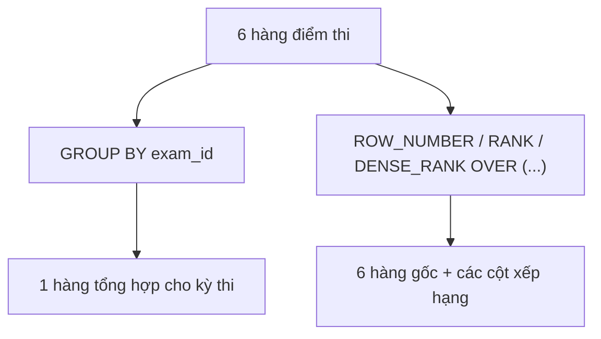

# row_number, rank, dense_rank và xử lý đồng hạng trong PostgreSQL

Khi lập bảng xếp hạng điểm thi, sản phẩm bán chạy, nhân viên có doanh số cao hoặc giao dịch gần nhất của từng tài khoản, câu hỏi thường không chỉ là **“sắp xếp hàng nào đứng trước?”** mà còn là **“hai hàng bằng điểm có được cùng hạng không?”**.

PostgreSQL cung cấp ba hàm cửa sổ rất quan trọng:

- `ROW_NUMBER()`: đánh số thứ tự **riêng biệt cho từng hàng**, kể cả khi nhiều hàng có cùng giá trị sắp xếp.
- `RANK()`: các hàng đồng hạng nhận **cùng số hạng**, sau đó thứ hạng có thể **nhảy số**.
- `DENSE_RANK()`: các hàng đồng hạng nhận **cùng số hạng**, nhưng thứ hạng tiếp theo **không nhảy số**.

Chúng đều thuộc nhóm **window functions – hàm cửa sổ**. Thay vì gộp nhiều hàng thành một như `GROUP BY`, chúng **giữ mỗi hàng trong kết quả** và tính thêm một giá trị dựa trên những hàng cùng nhóm (*partition*) và quy tắc sắp xếp trong cửa sổ.

Ví dụ, với điểm từ cao đến thấp:

```text
Học viên    Điểm    ROW_NUMBER    RANK    DENSE_RANK
An           95         1          1          1
Bình         95         2          1          1
Chi          90         3          3          2
Dũng         90         4          3          2
Em           90         5          3          2
Giang        75         6          6          3
```

**Cùng sáu người, ba cột cho ba ý nghĩa khác nhau.** Chọn nhầm hàm có thể khiến một người đồng hạng bị loại khỏi Top N, hoặc khiến vị trí hiển thị bị hiểu nhầm là thứ hạng thi đấu.

Bài học sẽ giải thích cú pháp, khái niệm *peer group* (nhóm đồng hạng), `PARTITION BY` và `ORDER BY`, cách chọn Top N có hoặc không bao gồm đồng hạng, quy tắc xử lý `NULL`, lựa chọn tie-breaker, hiệu năng PostgreSQL và các bài tập SQL thực hành.

## 1. Hàm cửa sổ khác GROUP BY ra sao?

Một câu truy vấn tổng hợp:

```sql
SELECT exam_id, COUNT(*) AS participant_count
FROM exam_results
GROUP BY exam_id;
```

trả **một hàng cho mỗi exam_id**. Thông tin từng học viên không còn xuất hiện riêng trong kết quả.

Trong khi đó:

```sql
SELECT
    exam_id,
    candidate_id,
    score,
    ROW_NUMBER() OVER (
        PARTITION BY exam_id
        ORDER BY score DESC
    ) AS row_no
FROM exam_results;
```

vẫn trả **mỗi bài thi/học viên một hàng**, đồng thời gắn số thứ tự cho từng học viên **trong kỳ thi tương ứng**.

Hai câu trên dùng tên bảng `exam_results` như **mô hình khái niệm**. Bộ dữ liệu có thể chạy thực tế sẽ được tạo trong schema `ranking_lab` ở mục 3.

### 1.1. Cấu trúc OVER

Hàm cửa sổ dùng cú pháp:

```sql
window_function() OVER (
    PARTITION BY partition_column
    ORDER BY sort_expression DESC
)
```

| Thành phần | Ý nghĩa |
| --- | --- |
| `ROW_NUMBER()` / `RANK()` / `DENSE_RANK()` | Phép tính số thứ tự hoặc thứ hạng |
| `OVER (...)` | Chỉ rõ cửa sổ áp dụng cho hàm |
| `PARTITION BY exam_id` | Chia hàng thành những nhóm độc lập; đánh số lại từ đầu ở mỗi nhóm |
| `ORDER BY score DESC` | Xác định thứ tự dùng để xếp hạng **bên trong mỗi nhóm** |
| `ORDER BY ...` ngoài cùng | Quy định **thứ tự hiển thị** các hàng kết quả cuối cùng |

**Không có `PARTITION BY`**: toàn bộ tập hàng tham gia được xem là một partition. **Không có `ORDER BY` trong `OVER`**: hàm không có tiêu chí sắp xếp rõ ràng; đối với `RANK` và `DENSE_RANK`, mọi hàng trong cùng partition là một nhóm đồng hạng, còn thứ tự `ROW_NUMBER` không được xác định ổn định.

### 1.2. Window function không nhất thiết làm giảm số hàng



Đó là lý do window functions phù hợp với báo cáo vừa muốn hiển thị từng người, từng đơn hoặc từng sản phẩm, vừa muốn biết **vị trí tương đối trong nhóm**.

## 2. Ba quy tắc đánh số cần nhớ

Giả sử một kỳ thi có 6 học viên, điểm lần lượt:

```text
95, 95, 90, 90, 90, 75
```

Khi xếp điểm **giảm dần**:

| Giá trị | Số hàng cùng điểm | `ROW_NUMBER` | `RANK` | `DENSE_RANK` |
| ---: | ---: | --- | --- | --- |
| 95 | 2 | 1, 2 | 1, 1 | 1, 1 |
| 90 | 3 | 3, 4, 5 | 3, 3, 3 | 2, 2, 2 |
| 75 | 1 | 6 | 6 | 3 |

Diễn giải chính xác:

**`ROW_NUMBER()`**

- Luôn cấp số nguyên dương **khác nhau** cho mỗi hàng trong một partition.
- Dãy số liên tục `1, 2, 3, ...`, không có trùng hoặc nhảy số.
- Hai người cùng 95 vẫn phải nhận hai số khác nhau, ví dụ 1 và 2.
- Nếu điều kiện `ORDER BY` chưa đủ để phân biệt hai người, **ai nhận 1 hay 2 có thể không ổn định**.

**`RANK()`**

- Những hàng được xem là **đồng hạng theo toàn bộ biểu thức `ORDER BY` của cửa sổ** nhận cùng rank.
- Thứ hạng kế tiếp bằng **1 + số hàng đứng trước có giá trị xếp hạng tốt hơn**.
- Hai người hạng 1 cùng 95 chiếm hai vị trí; nhóm 90 bắt đầu ở **hạng 3**, không phải hạng 2.
- Năm người ở hai nhóm 95 và 90 chiếm năm vị trí; người 75 có **hạng 6**.

**`DENSE_RANK()`**

- Những hàng đồng hạng cũng có cùng rank.
- Thứ hạng kế tiếp bằng **1 + số nhóm giá trị xếp hạng tốt hơn**.
- Sau nhóm điểm 95 hạng 1, nhóm 90 nhận **hạng 2**, bất kể nhóm 95 có bao nhiêu người.
- Nhóm 75 nhận **hạng 3**, không phải hạng 6.

Một mẹo nhớ:

```text
ROW_NUMBER: số thứ tự từng người
RANK:       hạng thi đấu; có khoảng trống sau đồng hạng
DENSE_RANK: hạng các mức điểm; không có khoảng trống
```

## 3. Dữ liệu PostgreSQL để thực hành

Các ví dụ tiếp theo sử dụng **một database thử nghiệm**, không thao tác trên dữ liệu thực của người dùng. Tạo schema riêng `ranking_lab` và hai bảng kỳ thi – kết quả thi.

### 3.1. Bảng kỳ thi

```sql
CREATE SCHEMA IF NOT EXISTS ranking_lab;

CREATE TABLE ranking_lab.exams (
    exam_id   INTEGER PRIMARY KEY,
    exam_name TEXT NOT NULL
);
```

### 3.2. Bảng kết quả

```sql
CREATE TABLE ranking_lab.results (
    exam_id        INTEGER NOT NULL
        REFERENCES ranking_lab.exams (exam_id),
    candidate_id   INTEGER NOT NULL,
    candidate_name TEXT NOT NULL,
    score          NUMERIC(5, 2),
    graded_at      TIMESTAMPTZ,
    CONSTRAINT pk_exam_results
        PRIMARY KEY (exam_id, candidate_id),
    CONSTRAINT chk_exam_score
        CHECK (score BETWEEN 0 AND 100),
    CONSTRAINT chk_exam_grade_state
        CHECK (
            (score IS NULL AND graded_at IS NULL)
            OR
            (score IS NOT NULL AND graded_at IS NOT NULL)
        )
);
```

Giải thích:

- `(exam_id, candidate_id)` là **khóa ghép**: một học viên chỉ có một dòng kết quả trong cùng kỳ thi ở mô hình này.
- `score NUMERIC(5,2)` cho phép các giá trị 0–100 và điểm thập phân.
- `score IS NULL` nghĩa là **chưa chấm hoặc chưa có điểm**, không mặc định là 0.
- `graded_at` lưu mốc thời gian được ghi nhận cho kết quả; trong ví dụ nó còn được dùng làm **tiêu chí phụ** khi cần chọn một hàng đại diện.
- Ràng buộc trạng thái bảo đảm score và graded_at **cùng có hoặc cùng thiếu**.

Mô hình học tập này giả định **mỗi kỳ thi mỗi học viên có một kết quả**. Nếu nghiệp vụ cho phép nhiều lần thi lại, bảng nên có `attempt_id` và một quy tắc riêng để xác định lần thi được xếp hạng. Không tự xóa các lần thi khác chỉ để ép dữ liệu phù hợp với hàm cửa sổ.

### 3.3. Thêm kỳ thi

```sql
INSERT INTO ranking_lab.exams (exam_id, exam_name)
VALUES
    (101, 'Nền tảng SQL'),
    (102, 'PostgreSQL thực hành'),
    (103, 'Kỳ thi chưa có kết quả');
```

Kỳ thi 103 **chưa có bản ghi kết quả**. Nó giúp minh họa sự khác biệt giữa **partition không được tạo ra** và **hàng có điểm NULL**.

### 3.4. Thêm kết quả có chủ đích đồng hạng

```sql
INSERT INTO ranking_lab.results
    (exam_id, candidate_id, candidate_name, score, graded_at)
VALUES
    (101, 1, 'An',    95, TIMESTAMPTZ '2026-04-01 09:10:00+07'),
    (101, 2, 'Bình',  95, TIMESTAMPTZ '2026-04-01 09:05:00+07'),
    (101, 3, 'Chi',   90, TIMESTAMPTZ '2026-04-01 09:20:00+07'),
    (101, 4, 'Dũng',  90, TIMESTAMPTZ '2026-04-01 09:15:00+07'),
    (101, 5, 'Em',    90, TIMESTAMPTZ '2026-04-01 09:25:00+07'),
    (101, 6, 'Giang', 75, TIMESTAMPTZ '2026-04-01 09:30:00+07'),
    (101, 7, 'Hòa', NULL, NULL),

    (102, 8,  'Hà',    100, TIMESTAMPTZ '2026-04-02 10:01:00+07'),
    (102, 9,  'Khoa',   98, TIMESTAMPTZ '2026-04-02 10:03:00+07'),
    (102, 10, 'Lan',    98, TIMESTAMPTZ '2026-04-02 10:02:00+07'),
    (102, 11, 'Minh',   88, TIMESTAMPTZ '2026-04-02 10:04:00+07'),
    (102, 12, 'Ngọc',   80, TIMESTAMPTZ '2026-04-02 10:06:00+07'),
    (102, 13, 'Phúc',   80, TIMESTAMPTZ '2026-04-02 10:05:00+07'),
    (102, 14, 'Quỳnh', NULL, NULL);
```

Dữ liệu có **14 hàng** ở hai kỳ thi: **12 người đã có điểm** và **2 người chưa có điểm**.

Tóm tắt điểm đã chấm:

| exam_id | Điểm từ cao đến thấp | Số người có điểm | Số mức điểm khác nhau |
| ---: | --- | ---: | ---: |
| 101 | 95, 95, 90, 90, 90, 75 | 6 | 3 |
| 102 | 100, 98, 98, 88, 80, 80 | 6 | 4 |
| 103 | Chưa có kết quả | 0 | 0 |

**Không nhầm hai người chưa chấm với hai người 0 điểm.** Điểm 0 là một giá trị đo được và có thể được xếp hạng; `NULL` trong bảng này biểu thị chưa có số liệu chấm.

### 3.5. Xem dữ liệu gốc

```sql
SELECT
    exam_id,
    candidate_id,
    candidate_name,
    score,
    graded_at
FROM ranking_lab.results
ORDER BY exam_id, candidate_id;
```

Việc truy vấn có `ORDER BY exam_id, candidate_id` ở đây chỉ để hiển thị dữ liệu gốc dễ đọc. Nó **không tạo thứ hạng**, và cũng không thay thế `ORDER BY` trong cửa sổ khi tính rank.

## 4. Ba hàm trên cùng một bảng kết quả

Đầu tiên chỉ xếp hạng những người **đã có điểm**:

```sql
SELECT
    exam_id,
    candidate_id,
    candidate_name,
    score,
    ROW_NUMBER() OVER (
        PARTITION BY exam_id
        ORDER BY score DESC, candidate_id ASC
    ) AS row_no,
    RANK() OVER (
        PARTITION BY exam_id
        ORDER BY score DESC
    ) AS competition_rank,
    DENSE_RANK() OVER (
        PARTITION BY exam_id
        ORDER BY score DESC
    ) AS dense_rank
FROM ranking_lab.results
WHERE score IS NOT NULL
ORDER BY exam_id, row_no;
```

Kết quả cho kỳ thi **101**:

| candidate_id | candidate_name | score | row_no | competition_rank | dense_rank |
| ---: | --- | ---: | ---: | ---: | ---: |
| 1 | An | 95 | 1 | 1 | 1 |
| 2 | Bình | 95 | 2 | 1 | 1 |
| 3 | Chi | 90 | 3 | 3 | 2 |
| 4 | Dũng | 90 | 4 | 3 | 2 |
| 5 | Em | 90 | 5 | 3 | 2 |
| 6 | Giang | 75 | 6 | 6 | 3 |

Kết quả cho kỳ thi **102**:

| candidate_id | candidate_name | score | row_no | competition_rank | dense_rank |
| ---: | --- | ---: | ---: | ---: | ---: |
| 8 | Hà | 100 | 1 | 1 | 1 |
| 9 | Khoa | 98 | 2 | 2 | 2 |
| 10 | Lan | 98 | 3 | 2 | 2 |
| 11 | Minh | 88 | 4 | 4 | 3 |
| 12 | Ngọc | 80 | 5 | 5 | 4 |
| 13 | Phúc | 80 | 6 | 5 | 4 |

### 4.1. Vì sao ROW_NUMBER có candidate_id còn RANK không?

Đây là điểm quan trọng nhất của truy vấn:

```sql
ROW_NUMBER() OVER (
    PARTITION BY exam_id
    ORDER BY score DESC, candidate_id ASC
)
```

với `candidate_id` phụ giúp **chọn một thứ tự xác định cho hai người cùng điểm**. Hai giá trị `score = 95` sẽ được đánh số theo `candidate_id = 1, 2`.

Nhưng:

```sql
RANK() OVER (
    PARTITION BY exam_id
    ORDER BY score DESC
)
```

chỉ xét điểm, nên An và Bình **thật sự đồng hạng 1**. Nếu thêm `candidate_id` vào `ORDER BY` của `RANK`, hai người không còn là peers và sẽ **không còn đồng hạng**. Phân biệt **thứ tự để hiển thị ổn định** với **tiêu chí quyết định hạng**.

### 4.2. Cùng một partition có thể có nhiều WINDOW khác nhau

Một truy vấn được phép gọi nhiều window functions với những quy tắc `ORDER BY` khác nhau:

- `ROW_NUMBER` theo điểm và ID để lấy thứ tự duy nhất.
- `RANK` theo điểm để giữ đồng hạng.
- `DENSE_RANK` theo điểm để đánh số mức điểm.

Không bắt buộc tất cả hàm cửa sổ trong một `SELECT` dùng cùng danh sách cột sắp xếp.

## 5. Peer group: thế nào là đồng hạng?

Trong PostgreSQL, các hàng có giá trị **bằng nhau đối với mọi biểu thức `ORDER BY` của cửa sổ** được gọi là **peers**. Với:

```sql
ORDER BY score DESC
```

An và Bình là peers vì cùng score 95. Chi, Dũng và Em là một peer group vì cùng score 90.

Nhưng với:

```sql
ORDER BY score DESC, candidate_id ASC
```

không còn hai hàng nào có cùng toàn bộ cặp `(score, candidate_id)` trong bảng mẫu, nên **không có đồng hạng** theo cấu hình cửa sổ đó.

`RANK` và `DENSE_RANK` dựa trên **peer groups**, không chỉ dựa vào một cột tên là `score`. Nếu business rule nói “đồng hạng khi cùng score”, hãy giữ **chính score** làm tiêu chí của window ranking.

### 5.1. Công thức ý nghĩa

Xét một nhóm có tất cả học viên đã có điểm:

- **`ROW_NUMBER`:** số thứ tự hàng từ 1 đến N theo một thứ tự xác định.
- **`RANK`:** `1 + số hàng có giá trị xếp hạng tốt hơn hàng đang xét`.
- **`DENSE_RANK`:** `1 + số mức giá trị xếp hạng khác nhau tốt hơn hàng đang xét`.

Trong kỳ thi 101:

- Điểm 90 có **2 người điểm tốt hơn** → `RANK = 1 + 2 = 3`.
- Chỉ có **1 mức điểm tốt hơn** là 95 → `DENSE_RANK = 1 + 1 = 2`.
- Điểm 75 có **5 người điểm tốt hơn** → `RANK = 6`; nhưng chỉ có **2 mức điểm tốt hơn** là 95 và 90 → `DENSE_RANK = 3`.

### 5.2. RANK có “lỗ hổng” hay không?

Đúng hơn nên gọi là **khoảng trống thứ hạng do đồng hạng chiếm vị trí**. Không phải dữ liệu bị mất:

```text
RANK:
1, 1, 3, 3, 3, 6

DENSE_RANK:
1, 1, 2, 2, 2, 3
```

Khi có hai người hạng nhất, hạng kế tiếp trong quy tắc **competition ranking** là hạng ba. Với dense ranking, thứ hạng biểu diễn **thứ tự các mức điểm**, nên đi từ hạng một sang hạng hai.

## 6. PARTITION BY: đánh số lại theo từng nhóm

`PARTITION BY exam_id` chia tập hàng thành các nhóm độc lập:

```text
exam_id = 101 -> ROW_NUMBER 1..6
exam_id = 102 -> ROW_NUMBER 1..6
```

Nếu bỏ `PARTITION BY`:

```sql
SELECT
    exam_id,
    candidate_name,
    score,
    ROW_NUMBER() OVER (
        ORDER BY score DESC, exam_id, candidate_id
    ) AS global_row_no,
    RANK() OVER (
        ORDER BY score DESC
    ) AS global_rank
FROM ranking_lab.results
WHERE score IS NOT NULL
ORDER BY global_row_no;
```

thì toàn bộ 12 người đã có điểm ở cả hai kỳ thi được xếp trong **một bảng chung**. Điểm 100 của kỳ 102 đứng trước điểm 95 của kỳ 101, nhưng việc so điểm ở hai bài thi khác nhau có hợp lệ hay không là **quyết định nghiệp vụ**, không phải tính chất mặc định của SQL.

### 6.1. PARTITION BY không bắt buộc giống khóa chính

Bạn có thể phân nhóm theo lớp học, chi nhánh, phòng ban hoặc năm:

```sql
PARTITION BY region_id, report_month
```

Partition khi đó được xác định bởi **tổ hợp hai cột**. Các hàm `ROW_NUMBER`/`RANK`/`DENSE_RANK` đều bắt đầu lại từ 1 với mỗi tổ hợp giá trị partition khác nhau.

Nếu chỉ `PARTITION BY region_id` mà quên tháng, thứ hạng của tháng trước và tháng sau sẽ **trộn vào cùng một partition**. Đây là lỗi tương tự quên `tenant_id` trong khóa ghép khi nối dữ liệu.

### 6.2. Partition không tạo ra hàng thiếu dữ liệu

Kỳ thi 103 tồn tại trong `ranking_lab.exams` nhưng **không có kết quả** trong `ranking_lab.results`. Truy vấn chỉ đọc từ `results` **không thể tự tạo** một nhóm thứ hạng cho exam 103.

Muốn hiện cả kỳ thi chưa có người tham gia, cần bắt đầu từ bảng `exams` rồi `LEFT JOIN` thống kê hoặc bảng xếp hạng đã tính.

## 7. ORDER BY trong OVER khác ORDER BY cuối truy vấn

Hai vị trí `ORDER BY` phục vụ hai việc:

```sql
SELECT
    exam_id,
    candidate_name,
    score,
    ROW_NUMBER() OVER (
        PARTITION BY exam_id
        ORDER BY score DESC, candidate_id
    ) AS row_no
FROM ranking_lab.results
WHERE score IS NOT NULL
ORDER BY exam_id, candidate_name;
```

- `ORDER BY score DESC, candidate_id` **bên trong `OVER`** quyết định số `row_no`.
- `ORDER BY exam_id, candidate_name` **ngoài cùng** quyết định thứ tự người dùng thấy trong bảng kết quả.

Vì vậy, khi bảng được sắp xếp theo tên, cột `row_no` có thể hiện thứ tự 2, 3, 1, 4… tùy tên. **Không phải hàm đánh số sai**: thứ tự hiển thị đã khác thứ tự xếp hạng.

Muốn bảng kết quả được hiển thị đúng thứ tự hạng, nên viết:

```sql
ORDER BY exam_id, row_no
```

Không có `ORDER BY` ở mức truy vấn ngoài, PostgreSQL **không bảo đảm thứ tự cuối của các hàng** dù window có khai báo `ORDER BY`.

### 7.1. ROW_NUMBER không có tiêu chí phụ có ổn định không?

```sql
ROW_NUMBER() OVER (
    PARTITION BY exam_id
    ORDER BY score DESC
)
```

Với An và Bình cùng 95, một lần thực thi có thể đánh số An 1, Bình 2; một kế hoạch truy vấn khác có thể đảo lại. PostgreSQL **không hứa thứ tự xác định giữa peers** khi khóa sắp xếp không phân biệt chúng.

Nếu API cần phân trang, chọn người thắng duy nhất, hoặc lưu một danh sách theo vị trí, hãy dùng **tie-breaker ổn định**, chẳng hạn:

```sql
ORDER BY score DESC, graded_at ASC, candidate_id ASC
```

Ở dữ liệu mẫu, Bình đạt 95 được chấm lúc 09:05, trước An lúc 09:10, nên Bình có thể đứng đầu theo tiêu chí phụ **thời điểm chấm sớm hơn**.

**Chỉ dùng `graded_at` như tiêu chí ưu tiên nếu quy tắc nghiệp vụ thật sự muốn người được chấm sớm hơn xếp trước.** Nếu đây chỉ là thời điểm hệ thống xử lý chấm bài, nó có thể không công bằng. Khi chỉ cần ổn định kỹ thuật, dùng một định danh unique như `candidate_id` nhưng không gọi nó là tiêu chí thắng cuộc.

## 8. Phân biệt tie-breaker kỹ thuật và tiêu chí phân hạng

Có hai nhu cầu thường bị trộn lẫn:

**Nhu cầu A: giữ đồng hạng theo điểm**, nhưng danh sách hiển thị không bị xáo trộn.

```sql
SELECT
    exam_id,
    candidate_id,
    candidate_name,
    score,
    RANK() OVER (
        PARTITION BY exam_id
        ORDER BY score DESC
    ) AS official_rank,
    ROW_NUMBER() OVER (
        PARTITION BY exam_id
        ORDER BY score DESC, candidate_id
    ) AS display_position
FROM ranking_lab.results
WHERE score IS NOT NULL
ORDER BY exam_id, display_position;
```

An và Bình vẫn cùng `official_rank = 1`, nhưng `display_position` là 1 và 2.

**Nhu cầu B: thực sự phân thắng–thua bằng điểm, rồi thời gian hoàn thành**.

```sql
SELECT
    exam_id,
    candidate_name,
    score,
    graded_at,
    RANK() OVER (
        PARTITION BY exam_id
        ORDER BY score DESC, graded_at ASC
    ) AS score_time_rank
FROM ranking_lab.results
WHERE score IS NOT NULL
ORDER BY exam_id, score_time_rank, candidate_id;
```

Với dữ liệu mẫu, Bình và An đều có 95 nhưng **khác `graded_at`**, nên theo tiêu chí mới họ **không còn đồng hạng**.

Đừng tự động thêm `candidate_id` vào `RANK() OVER(ORDER BY score DESC, ...)` chỉ để plan hoặc kết quả ổn định. Nếu ID là unique, điều đó biến đa số thứ hạng thành số tuần tự, làm mất tính đồng hạng mà người dùng mong đợi.

### 8.1. Nếu vẫn đồng hạng ở tiêu chí phụ thì sao?

Giả sử hai thí sinh có cùng điểm **và** cùng thời gian xét hạng. Khi `RANK() OVER(ORDER BY score DESC, finished_at ASC)`, họ vẫn là peers. Nếu cần hiển thị cố định, tạo thêm `ROW_NUMBER()` với khóa unique trong một window riêng; không nhất thiết thêm khóa đó vào official rank.

### 8.2. Không có cách “đúng nhất” cho đồng hạng

Các chính sách hợp lệ khác nhau:

- **Thi đấu:** hai người bằng điểm cùng hạng, hạng kế tiếp nhảy số → `RANK`.
- **Bậc năng lực hoặc nhóm mức điểm:** các giá trị điểm khác nhau nhận mức 1, 2, 3… → `DENSE_RANK`.
- **Chọn đúng một vị trí duy nhất để cấp quà:** cần tie-breaker rõ và `ROW_NUMBER`.
- **Chọn mọi người đạt các vị trí trao thưởng có đồng hạng:** `RANK` hoặc một ngưỡng điểm được định nghĩa cụ thể.

Hàm SQL nên phản ánh **quy chế được thống nhất**, không phải ngược lại.

## 9. Top 1 mỗi nhóm: chọn một người hay toàn bộ người đồng hạng?

Câu hỏi **“lấy người đứng đầu từng kỳ thi”** có thể được hiểu theo hai cách.

### 9.1. Lấy đúng một hàng cho mỗi exam

Dùng `ROW_NUMBER` với tiêu chí sắp xếp xác định:

```sql
WITH numbered AS (
    SELECT
        exam_id,
        candidate_id,
        candidate_name,
        score,
        ROW_NUMBER() OVER (
            PARTITION BY exam_id
            ORDER BY score DESC, candidate_id ASC
        ) AS rn
    FROM ranking_lab.results
    WHERE score IS NOT NULL
)
SELECT
    exam_id, candidate_id, candidate_name, score
FROM numbered
WHERE rn = 1
ORDER BY exam_id;
```

Kết quả:

| exam_id | candidate_name | score |
| ---: | --- | ---: |
| 101 | An | 95 |
| 102 | Hà | 100 |

Kỳ 101 có hai người bằng 95 nhưng `candidate_id ASC` chọn An làm **hàng đại diện đầu tiên**. Điều đó **không chứng minh Bình kém hạng**; đây chỉ là chính sách chọn một hàng.

### 9.2. Lấy tất cả những người đồng hạng nhất

Dùng `RANK`:

```sql
WITH ranked AS (
    SELECT
        exam_id,
        candidate_id,
        candidate_name,
        score,
        RANK() OVER (
            PARTITION BY exam_id
            ORDER BY score DESC
        ) AS rnk
    FROM ranking_lab.results
    WHERE score IS NOT NULL
)
SELECT
    exam_id, candidate_id, candidate_name, score
FROM ranked
WHERE rnk = 1
ORDER BY exam_id, candidate_id;
```

Kết quả:

| exam_id | candidate_name | score |
| ---: | --- | ---: |
| 101 | An | 95 |
| 101 | Bình | 95 |
| 102 | Hà | 100 |

**Hai người đồng hạng nhất đều được giữ.** Ở tiêu chí `rank = 1`, `DENSE_RANK() = 1` cũng cho cùng tập kết quả; khác biệt giữa hai hàm thể hiện rõ hơn khi chọn Top 2, Top 3 hoặc các mức tiếp theo.

## 10. Top N với ROW_NUMBER: đúng N hàng nếu đủ dữ liệu

Ví dụ chọn **hai người đầu tiên mỗi kỳ thi**, áp tie-breaker bằng `candidate_id`:

```sql
WITH numbered AS (
    SELECT
        exam_id,
        candidate_id,
        candidate_name,
        score,
        ROW_NUMBER() OVER (
            PARTITION BY exam_id
            ORDER BY score DESC, candidate_id
        ) AS rn
    FROM ranking_lab.results
    WHERE score IS NOT NULL
)
SELECT
    exam_id, candidate_name, score, rn
FROM numbered
WHERE rn <= 2
ORDER BY exam_id, rn;
```

Kết quả:

| exam_id | candidate_name | score | rn |
| ---: | --- | ---: | ---: |
| 101 | An | 95 | 1 |
| 101 | Bình | 95 | 2 |
| 102 | Hà | 100 | 1 |
| 102 | Khoa | 98 | 2 |

Lan cùng 98 với Khoa **không được lấy**, vì `ROW_NUMBER` cho cô vị trí 3 theo tie-breaker. Nếu sản phẩm yêu cầu **luôn tối đa hai người mỗi kỳ thi**, điều đó có thể là hành vi đúng. Nhưng nếu muốn **không loại người bằng điểm ở ranh giới Top 2**, phải dùng quy tắc khác.

### 10.1. Khi partition có ít hơn N hàng

Nếu một kỳ thi chỉ có một người có điểm và lọc `rn <= 3`, kết quả sẽ có một hàng, không tự sinh thêm hai hàng rỗng. Nếu kỳ thi chưa có bản ghi nào, truy vấn từ bảng kết quả sẽ không trả hàng cho kỳ đó.

`ROW_NUMBER` bảo đảm **tối đa N hàng mỗi partition**, không bảo đảm luôn có đúng N hàng.

## 11. Top N với RANK: tính theo vị trí thi đấu

Ví dụ lấy tất cả học viên có **hạng thi đấu không lớn hơn 2**:

```sql
WITH ranked AS (
    SELECT
        exam_id,
        candidate_id,
        candidate_name,
        score,
        RANK() OVER (
            PARTITION BY exam_id
            ORDER BY score DESC
        ) AS competition_rank
    FROM ranking_lab.results
    WHERE score IS NOT NULL
)
SELECT
    exam_id, candidate_name, score, competition_rank
FROM ranked
WHERE competition_rank <= 2
ORDER BY exam_id, competition_rank, candidate_id;
```

Kết quả:

| exam_id | candidate_name | score | competition_rank |
| ---: | --- | ---: | ---: |
| 101 | An | 95 | 1 |
| 101 | Bình | 95 | 1 |
| 102 | Hà | 100 | 1 |
| 102 | Khoa | 98 | 2 |
| 102 | Lan | 98 | 2 |

Tại kỳ thi **101**, hai người đồng hạng nhất đã **chiếm hai vị trí đầu**. Hạng tiếp theo là **3**, nên truy vấn `competition_rank <= 2` **không lấy nhóm 90 điểm**.

Tại kỳ thi **102**, Hà đứng hạng 1, Khoa và Lan cùng hạng 2, nên truy vấn trả **ba người** cho Top 2.

Điều này thể hiện chính sách “mọi người có hạng thi đấu 1 hoặc 2 được nhận giải”.

## 12. Top N với DENSE_RANK: N mức điểm tốt nhất

Ví dụ chọn **hai mức điểm cao nhất** ở mỗi kỳ thi:

```sql
WITH ranked AS (
    SELECT
        exam_id,
        candidate_id,
        candidate_name,
        score,
        DENSE_RANK() OVER (
            PARTITION BY exam_id
            ORDER BY score DESC
        ) AS score_level
    FROM ranking_lab.results
    WHERE score IS NOT NULL
)
SELECT
    exam_id, candidate_name, score, score_level
FROM ranked
WHERE score_level <= 2
ORDER BY exam_id, score_level, candidate_id;
```

Kết quả:

| exam_id | candidate_name | score | score_level |
| ---: | --- | ---: | ---: |
| 101 | An | 95 | 1 |
| 101 | Bình | 95 | 1 |
| 101 | Chi | 90 | 2 |
| 101 | Dũng | 90 | 2 |
| 101 | Em | 90 | 2 |
| 102 | Hà | 100 | 1 |
| 102 | Khoa | 98 | 2 |
| 102 | Lan | 98 | 2 |

Kỳ 101 trả **năm người** vì có **hai mức điểm** 95 và 90. Đây **không phải Top 2 người**, cũng không phải Top 2 vị trí thi đấu. Đó là **Top 2 giá trị điểm khác nhau**.

### 12.1. Bảng quyết định Top N

| Yêu cầu nghiệp vụ | Hàm thường phù hợp | Kỳ 101 với N = 2 |
| --- | --- | --- |
| Đúng tối đa 2 người, tie-breaker xác định | `ROW_NUMBER() <= 2` | An, Bình |
| Tất cả người có hạng thi đấu không quá 2 | `RANK() <= 2` | An, Bình |
| Tất cả người thuộc 2 mức điểm cao nhất | `DENSE_RANK() <= 2` | An, Bình, Chi, Dũng, Em |

Với kỳ 102, `ROW_NUMBER() <= 2` chỉ trả Hà và Khoa, còn hai cách có đồng hạng đều trả thêm Lan. Đây là ví dụ để kiểm tra yêu cầu “Top 2” có **chấp nhận nhiều hơn hai dòng không**.

## 13. Có đồng hạng ở ranh giới Top N thì sao?

Hãy xét điểm kỳ thi 102:

```text
100  -> Hà
98   -> Khoa
98   -> Lan
88   -> Minh
80   -> Ngọc
80   -> Phúc
```

Nếu chọn “**2 người đầu**”, phải chọn một trong Khoa/Lan làm người thứ hai theo tiêu chí phụ.

Nếu chọn “**2 vị trí có tính đồng hạng**”, Hà hạng 1 và cả Khoa/Lan hạng 2 đều được lấy.

Nếu chọn “**2 mức điểm cao nhất**”, ở kỳ này cũng lấy 100 và 98, tức ba người; nhưng ở kỳ 101, cách này lấy tới năm người do mức 95 và 90.

**Không có công thức SQL nào tự biết ban tổ chức muốn phát 2 phần thưởng, phát thưởng cho mọi người đồng hạng ranh giới, hay phát thưởng cho mỗi mức điểm.** Cần ghi rõ tiêu chí trước khi lập query.

### 13.1. Cẩn thận với từ “WITH TIES”

PostgreSQL hỗ trợ cú pháp giới hạn kết quả và **giữ các hàng đồng hạng tại ranh giới**:

```sql
SELECT
    candidate_id,
    candidate_name,
    score
FROM ranking_lab.results
WHERE exam_id = 102
  AND score IS NOT NULL
ORDER BY score DESC
FETCH FIRST 2 ROWS WITH TIES;
```

Ở PostgreSQL hỗ trợ `FETCH FIRST ... WITH TIES`, kết quả có **ba người**: Hà 100, Khoa và Lan 98. Cú pháp này dựa trên **toàn bộ danh sách ORDER BY ở mức truy vấn**, không tự tạo Top N cho từng partition.

Nếu thêm `candidate_id` vào `ORDER BY`:

```sql
ORDER BY score DESC, candidate_id
FETCH FIRST 2 ROWS WITH TIES
```

thì mỗi cặp `(score, candidate_id)` là riêng biệt trong dữ liệu mẫu; Khoa và Lan **không còn là ties theo ORDER BY**, kết quả chỉ có đúng hai hàng. Đây là cùng một vấn đề về **tie-breaker làm vỡ đồng hạng** như với `RANK()`.

### 13.2. Top N mỗi nhóm cần PARTITION BY

`FETCH FIRST 2 ROWS WITH TIES` giới hạn **toàn kết quả** của một truy vấn như trên, không tự giới hạn riêng cho exam 101 và exam 102.

Muốn Top N **trong từng exam** với đồng hạng, phương pháp rõ ràng là tính `RANK() OVER(PARTITION BY exam_id ORDER BY score DESC)` trong CTE/subquery rồi lọc ở tầng ngoài.

## 14. Vì sao phải dùng CTE hoặc subquery để lọc rank?

Window functions được tính ở bước logic sau khi `WHERE`, `GROUP BY` và `HAVING` của **cùng tầng truy vấn** đã xử lý đầu vào. Do đó, bạn **không thể đặt một window function trực tiếp trong `WHERE`** của chính câu SELECT đó.

Ví dụ không hợp lệ:

```sql
-- KHÔNG chạy: window function không được dùng trực tiếp
-- trong WHERE cùng tầng truy vấn.
SELECT exam_id, candidate_name, score
FROM ranking_lab.results
WHERE ROW_NUMBER() OVER (
    PARTITION BY exam_id
    ORDER BY score DESC
) <= 2;
```

Giải pháp:

```sql
WITH numbered AS (
    SELECT
        exam_id,
        candidate_name,
        candidate_id,
        score,
        ROW_NUMBER() OVER (
            PARTITION BY exam_id
            ORDER BY score DESC, candidate_id
        ) AS rn
    FROM ranking_lab.results
    WHERE score IS NOT NULL
)
SELECT exam_id, candidate_name, score, rn
FROM numbered
WHERE rn <= 2
ORDER BY exam_id, rn;
```

Ở query ngoài, `rn` **đã trở thành một cột đầu ra của CTE**, nên dùng nó trong `WHERE` hợp lệ.

### 14.1. Có thể dùng derived table

```sql
SELECT
    r.exam_id,
    r.candidate_name,
    r.score,
    r.rnk
FROM (
    SELECT
        exam_id,
        candidate_name,
        candidate_id,
        score,
        RANK() OVER (
            PARTITION BY exam_id
            ORDER BY score DESC
        ) AS rnk
    FROM ranking_lab.results
    WHERE score IS NOT NULL
) AS r
WHERE r.rnk <= 2
ORDER BY r.exam_id, r.rnk, r.candidate_id;
```

Ý nghĩa tương tự CTE. Dùng CTE khi muốn đặt tên các giai đoạn rõ ràng; dùng subquery khi yêu cầu đơn giản và codebase thích cách viết gọn.

### 14.2. WHERE bên trong và bên ngoài không tương đương

`WHERE score IS NOT NULL` **bên trong** CTE loại người chưa chấm **trước khi xếp hạng**, nên chỉ người có điểm được đánh số.

`WHERE rnk <= 2` **bên ngoài** CTE chọn những người đã được gán rank.

Nếu đặt điều kiện `status = 'PAID'`, `region = ...` hoặc `score >= ...` ở những tầng khác nhau, cần xem nó có **thay đổi tập người cạnh tranh trong partition** hay chỉ là lọc kết quả hiển thị. Một bộ lọc thay đổi đầu vào ranking có thể làm **thay đổi tất cả thứ hạng**.

## 15. NULL trong ORDER BY: ai được xếp trước?

PostgreSQL có quy tắc mặc định đáng nhớ:

- `ORDER BY score ASC` mặc định đặt `NULL` ở **cuối**.
- `ORDER BY score DESC` mặc định đặt `NULL` ở **đầu**.

Vì vậy, nếu viết:

```sql
SELECT
    exam_id,
    candidate_name,
    score,
    ROW_NUMBER() OVER (
        PARTITION BY exam_id
        ORDER BY score DESC
    ) AS rn
FROM ranking_lab.results
ORDER BY exam_id, rn;
```

thì trong mỗi exam, người **chưa có điểm** có thể được gán `rn = 1`, vì `score NULL` đứng trước các điểm số khi sắp xếp `DESC` mặc định. Điều này thường **sai nghiệp vụ bảng xếp hạng**.

### 15.1. Cách 1: loại người chưa có điểm

```sql
SELECT
    exam_id,
    candidate_name,
    score,
    RANK() OVER (
        PARTITION BY exam_id
        ORDER BY score DESC
    ) AS rnk
FROM ranking_lab.results
WHERE score IS NOT NULL;
```

Đây là cách phù hợp nếu chỉ người đã được chấm điểm mới được xếp hạng.

### 15.2. Cách 2: giữ hàng nhưng xếp NULL xuống cuối

```sql
SELECT
    exam_id,
    candidate_name,
    score,
    RANK() OVER (
        PARTITION BY exam_id
        ORDER BY score DESC NULLS LAST
    ) AS rnk
FROM ranking_lab.results
ORDER BY exam_id, rnk, candidate_id;
```

Với kỳ thi 101, sau những người đã có điểm sẽ là Hòa, có rank **7** vì đứng sau sáu người được chấm. Quỳnh ở kỳ 102 cũng đứng sau sáu người có điểm, rank 7.

**Nhưng:** xếp `NULL` cuối không có nghĩa “chưa chấm” nên được nhận một thứ hạng hợp lệ. Nếu ứng dụng muốn hiển thị người chưa chấm mà không gán hạng, có thể kết hợp `CASE`:

```sql
SELECT
    exam_id,
    candidate_name,
    score,
    CASE
        WHEN score IS NOT NULL THEN
            RANK() OVER (
                PARTITION BY exam_id
                ORDER BY score DESC NULLS LAST
            )
        ELSE NULL
    END AS official_rank
FROM ranking_lab.results
ORDER BY exam_id, official_rank NULLS LAST, candidate_id;
```

Ở trường hợp này, `RANK` vẫn được tính trên mọi hàng trong partition, nhưng người chưa chấm được **hiển thị rank NULL**. Điều đó giúp tránh diễn giải nhầm “hạng 7” là một thành tích.

### 15.3. Nhiều NULL sẽ đồng hạng khi dùng RANK

Nếu một exam có ba hàng `score IS NULL` và xếp `NULLS LAST`, cả ba được xem là peers theo score và có thể nhận **cùng một RANK/DENSE_RANK**.

Để phân biệt từng người cần thứ tự riêng, `ROW_NUMBER ... ORDER BY score DESC NULLS LAST, candidate_id` đánh số riêng biệt. Tuy nhiên, các hàng chưa chấm thường không nên được đưa vào “bảng điểm chính thức” nếu chưa định nghĩa chính sách.

### 15.4. Đừng tự COALESCE NULL thành 0 nếu 0 là điểm hợp lệ

```sql
ORDER BY COALESCE(score, 0) DESC
```

sẽ coi người chưa chấm tương đương người **thi được 0 điểm**. Hai trường hợp khác nhau về nghiệp vụ; việc hợp nhất chúng có thể khiến báo cáo sai trạng thái.

Ưu tiên `WHERE score IS NOT NULL`, `NULLS LAST` hoặc tách khu vực “chưa chấm” theo yêu cầu.

## 16. ASC, DESC và việc xác định “tốt hơn”

Không phải thước đo nào lớn hơn cũng tốt hơn:

| Chỉ số | Hướng thường dùng | Ví dụ |
| --- | --- | --- |
| Điểm thi | `ORDER BY score DESC` | 100 tốt hơn 90 |
| Doanh số | `ORDER BY revenue DESC` | 1 tỷ cao hơn 500 triệu |
| Thời gian hoàn thành cuộc chạy | `ORDER BY duration_ms ASC` | 45.000 ms tốt hơn 60.000 ms |
| Tỷ lệ lỗi | `ORDER BY error_rate ASC` | 0,1% tốt hơn 1% |
| Khoảng cách tới mục tiêu | `ORDER BY distance ASC` | Gần mục tiêu hơn xếp trước |

Ví dụ xếp hạng thời gian:

```sql
WITH race_times(name, duration_ms) AS (
    VALUES
        ('An', 45000),
        ('Bình', 45000),
        ('Chi', 48000),
        ('Dũng', 49000)
)
SELECT
    name,
    duration_ms,
    RANK() OVER (ORDER BY duration_ms ASC) AS race_rank,
    DENSE_RANK() OVER (ORDER BY duration_ms ASC) AS time_level
FROM race_times
ORDER BY race_rank, name;
```

Kết quả:

| name | duration_ms | race_rank | time_level |
| --- | ---: | ---: | ---: |
| An | 45000 | 1 | 1 |
| Bình | 45000 | 1 | 1 |
| Chi | 48000 | 3 | 2 |
| Dũng | 49000 | 4 | 3 |

Nếu nhầm `DESC`, người chạy chậm nhất sẽ được xếp hạng 1. Độ ưu tiên và hàm xếp hạng không sửa được việc chọn sai chiều sắp xếp.

## 17. Xếp hạng theo nhiều tiêu chí có chủ đích

Giả sử quy chế:

> Điểm cao hơn thắng. Nếu bằng điểm, người hoàn thành sớm hơn thắng. Nếu cùng điểm và cùng thời gian, hai người **vẫn đồng hạng**.

Khi đó:

```sql
RANK() OVER (
    PARTITION BY exam_id
    ORDER BY score DESC, graded_at ASC
)
```

phù hợp với chính sách **hai tiêu chí xét hạng**. Hai hàng chỉ đồng hạng khi **cả score và graded_at đều bằng nhau** theo quy tắc so sánh.

Nếu quy chế chỉ nói:

> Điểm bằng nhau luôn đồng hạng. Thời điểm chấm và mã học viên chỉ dùng để hiển thị.

thì chính sách khác:

```sql
RANK() OVER (
    PARTITION BY exam_id
    ORDER BY score DESC
)
```

và để danh sách ổn định:

```sql
ROW_NUMBER() OVER (
    PARTITION BY exam_id
    ORDER BY score DESC, graded_at ASC, candidate_id ASC
)
```

**Không có xung đột giữa hai hàm**: chúng đo những khái niệm khác nhau. Có thể trả cả `official_rank` và `display_position` trong cùng một query.

### 17.1. So sánh số thực và điểm được làm tròn

Một lỗi khác: điểm được lưu với độ chính xác cao nhưng UI chỉ hiển thị một chữ số thập phân. Ví dụ 89,94 và 89,96 có thể cùng hoặc khác mức hiển thị tùy quy tắc làm tròn.

Nếu quy chế **xếp hạng theo điểm gốc**, dùng:

```sql
ORDER BY raw_score DESC
```

Nếu quy chế **xếp hạng theo điểm đã làm tròn đến một chữ số**, dùng biểu thức:

```sql
ORDER BY round(raw_score, 1) DESC
```

Ví dụ trên là **mảnh SQL giả định cột `raw_score` tồn tại**. Điều quan trọng là lưu riêng và định nghĩa rõ **điểm gốc**, **điểm hiển thị** và **điểm dùng xét đồng hạng**. Không tự làm tròn trong truy vấn ranking chỉ để có nhiều hoặc ít nhóm đồng hạng hơn.

## 18. Tính thứ hạng từ số liệu đã tổng hợp

Hàm xếp hạng thường được dùng **sau khi tổng hợp doanh thu, lượt mua hoặc điểm từ nhiều bản ghi**.

Giả sử bảng giao dịch bán hàng có nhiều dòng cho cùng sản phẩm. Nếu dùng:

```sql
RANK() OVER (ORDER BY amount DESC)
```

trực tiếp trên từng giao dịch, bạn sẽ xếp hạng **từng giao dịch**, không phải **tổng doanh thu theo sản phẩm**.

### 18.1. Tổng hợp trước, xếp hạng sau

```sql
WITH sale_lines(product_id, amount) AS (
    VALUES
        (10, 100000::numeric),
        (10, 50000::numeric),
        (20, 150000::numeric),
        (30, 90000::numeric),
        (40, 20000::numeric)
),
product_totals AS (
    SELECT
        product_id,
        SUM(amount) AS total_revenue
    FROM sale_lines
    GROUP BY product_id
)
SELECT
    product_id,
    total_revenue,
    RANK() OVER (
        ORDER BY total_revenue DESC
    ) AS revenue_rank,
    DENSE_RANK() OVER (
        ORDER BY total_revenue DESC
    ) AS revenue_level
FROM product_totals
ORDER BY revenue_rank, product_id;
```

Kết quả:

| product_id | total_revenue | revenue_rank | revenue_level |
| ---: | ---: | ---: | ---: |
| 10 | 150000 | 1 | 1 |
| 20 | 150000 | 1 | 1 |
| 30 | 90000 | 3 | 2 |
| 40 | 20000 | 4 | 3 |

Hai sản phẩm 10 và 20 có **tổng doanh thu bằng nhau**, dù sản phẩm 10 có hai dòng giao dịch còn sản phẩm 20 chỉ có một. Kết quả phản ánh đúng **một hàng mỗi sản phẩm**, nhờ tổng hợp trước.

### 18.2. Tránh JOIN fan-out trước khi tính tổng

Nếu sản phẩm có nhiều dòng bán hàng và nhiều lượt đánh giá, JOIN trực tiếp hai bảng con có thể **nhân dòng** và làm doanh thu bị cộng lặp. Cần tổng hợp mỗi nhánh tới **đúng độ hạt của sản phẩm** trước khi JOIN và RANK.

`RANK` hay `DENSE_RANK` chỉ xếp thứ tự theo số liệu mà nó nhận được; **không tự phát hiện tổng tiền sai do JOIN**.

## 19. PARTITION BY nhiều cột: Top N theo tenant và tháng

Trong hệ thống nhiều tenant, cùng một mã sản phẩm địa phương có thể tồn tại ở những tenant khác nhau. Nếu cần Top sản phẩm theo **tenant và tháng**, partition phải gồm **cả hai chiều**.

Ví dụ độc lập:

```sql
WITH monthly_sales(tenant_id, month_start, product_id, revenue) AS (
    VALUES
        (1, DATE '2026-01-01', 10, 100000::numeric),
        (1, DATE '2026-01-01', 20, 100000::numeric),
        (1, DATE '2026-01-01', 30,  50000::numeric),
        (1, DATE '2026-02-01', 10, 180000::numeric),
        (1, DATE '2026-02-01', 20, 140000::numeric),
        (2, DATE '2026-01-01', 10,  30000::numeric),
        (2, DATE '2026-01-01', 20,  90000::numeric)
),
ranked AS (
    SELECT
        tenant_id,
        month_start,
        product_id,
        revenue,
        RANK() OVER (
            PARTITION BY tenant_id, month_start
            ORDER BY revenue DESC
        ) AS rnk
    FROM monthly_sales
)
SELECT
    tenant_id,
    month_start,
    product_id,
    revenue,
    rnk
FROM ranked
WHERE rnk = 1
ORDER BY tenant_id, month_start, product_id;
```

Kết quả:

| tenant_id | month_start | product_id | revenue | rnk |
| ---: | --- | ---: | ---: | ---: |
| 1 | 2026-01-01 | 10 | 100000 | 1 |
| 1 | 2026-01-01 | 20 | 100000 | 1 |
| 1 | 2026-02-01 | 10 | 180000 | 1 |
| 2 | 2026-01-01 | 20 | 90000 | 1 |

Tenant 1 tháng 1 có **hai sản phẩm cùng hạng nhất**. Tháng 2 là một partition mới nên rank bắt đầu lại từ 1. Tenant 2 tháng 1 cũng là một partition riêng.

Nếu chỉ dùng `PARTITION BY month_start`, hai tenant sẽ cạnh tranh chung trong một tháng – điều đó có thể vừa sai báo cáo vừa gây lộ thông tin nhạy cảm giữa tenant.

**Khóa ghép và RLS/phân quyền là hai việc khác nhau.** Partition đúng giúp xếp hạng đúng phạm vi; nó không tự bảo đảm người dùng không thể xem dữ liệu tenant khác nếu role có quyền SELECT rộng.

## 20. Khi muốn có đúng một hàng đại diện: DISTINCT ON

Trong PostgreSQL, `DISTINCT ON` là một cú pháp hữu ích khi cần **lấy một hàng đầu tiên mỗi nhóm**.

Ví dụ lấy **một học viên có điểm cao nhất từng kỳ thi**, ưu tiên ID nhỏ hơn khi bằng điểm:

```sql
SELECT DISTINCT ON (exam_id)
    exam_id,
    candidate_id,
    candidate_name,
    score
FROM ranking_lab.results
WHERE score IS NOT NULL
ORDER BY
    exam_id,
    score DESC,
    candidate_id ASC;
```

Kết quả là An của kỳ 101 và Hà của kỳ 102.

### 20.1. So sánh DISTINCT ON và ROW_NUMBER

| Mục tiêu | Cách phù hợp |
| --- | --- |
| Lấy một hàng đầu tiên mỗi nhóm | `DISTINCT ON (group_key)` hoặc `ROW_NUMBER() = 1` |
| Lấy N hàng đầu mỗi nhóm | `ROW_NUMBER() <= N` |
| Lấy mọi người đồng hạng nhất | `RANK() = 1` hoặc `DENSE_RANK() = 1` |
| Lấy hai mức điểm cao nhất | `DENSE_RANK() <= 2` |
| Hiển thị tất cả người và hạng tương ứng | Các window functions |

`DISTINCT ON` chỉ giữ **một hàng đại diện**, không thể tự trả tất cả người đồng hạng. Nếu dùng nó để xây dựng danh sách người đoạt hạng nhất có đồng hạng, bạn có thể **bỏ sót người đủ điều kiện**.

### 20.2. Quy tắc ORDER BY với DISTINCT ON

Các biểu thức của `DISTINCT ON` phải khớp với phần **bên trái** của `ORDER BY` theo yêu cầu PostgreSQL. Vì vậy:

```sql
DISTINCT ON (exam_id)
...
ORDER BY exam_id, score DESC, candidate_id
```

thể hiện rõ “chia theo exam, trong mỗi exam chọn điểm tốt nhất, rồi ID nhỏ nhất”. Không có `ORDER BY` xác định, hàng được chọn là **không ổn định**.

## 21. Một cách khác để giữ tất cả đồng hạng nhất: MAX(score)

Nếu chỉ muốn điểm cao nhất của mỗi kỳ thi và **mọi người có điểm đó**, có thể dùng hai bước:

```sql
WITH max_scores AS (
    SELECT
        exam_id,
        MAX(score) AS best_score
    FROM ranking_lab.results
    WHERE score IS NOT NULL
    GROUP BY exam_id
)
SELECT
    r.exam_id,
    r.candidate_id,
    r.candidate_name,
    r.score
FROM ranking_lab.results AS r
JOIN max_scores AS m
  ON m.exam_id = r.exam_id
 AND m.best_score = r.score
ORDER BY r.exam_id, r.candidate_id;
```

Kết quả: An và Bình ở exam 101, Hà ở exam 102.

So với `RANK() = 1`:

- Cách `MAX(score) + JOIN` diễn đạt trực tiếp “mọi hàng bằng điểm cao nhất”.
- `RANK()` thuận tiện khi cần thêm **hạng 2, 3, Top N** hoặc hiển thị hạng của tất cả người.
- Cả hai đều phải xác định rõ **cách xử lý NULL** và nhóm không có điểm.

### 21.1. Khi dùng MAX với nhóm toàn NULL

`MAX(score)` trả NULL nếu nhóm không có score khác NULL. Điều kiện `m.best_score = r.score` sẽ không ghép hai NULL như một cặp bằng nhau. Trong bảng kết quả học tập, thường nên loại người chưa chấm trước khi tìm người đứng đầu.

Không nên “sửa” bằng cách coi NULL là 0 khi 0 là điểm hợp lệ.

## 22. Người chưa có điểm và kỳ thi chưa có kết quả

Cần phân biệt:

1. **Hòa** thuộc kỳ 101 và **Quỳnh** thuộc kỳ 102: có hàng trong `results` nhưng `score IS NULL`.
2. **Kỳ 103**: có hàng trong `exams`, nhưng **không có bất kỳ hàng nào** trong `results`.

Hai trường hợp này yêu cầu báo cáo khác nhau.

### 22.1. Đếm số người đã chấm và chưa chấm

```sql
SELECT
    e.exam_id,
    e.exam_name,
    COUNT(r.candidate_id) AS registered_candidates,
    COUNT(r.score) AS graded_candidates,
    COUNT(r.candidate_id) - COUNT(r.score)
        AS ungraded_candidates
FROM ranking_lab.exams AS e
LEFT JOIN ranking_lab.results AS r
  ON r.exam_id = e.exam_id
GROUP BY e.exam_id, e.exam_name
ORDER BY e.exam_id;
```

Kết quả:

| exam_id | registered_candidates | graded_candidates | ungraded_candidates |
| ---: | ---: | ---: | ---: |
| 101 | 7 | 6 | 1 |
| 102 | 7 | 6 | 1 |
| 103 | 0 | 0 | 0 |

`COUNT(r.candidate_id)` đếm người đã có bản ghi kết quả. Không dùng `COUNT(*)` để đếm người đăng ký sau `LEFT JOIN` nếu muốn kỳ 103 trả 0: hàng exam 103 vẫn tồn tại trong kết quả nối với phía result NULL, nên `COUNT(*)` có thể bằng 1.

### 22.2. Hiện exam chưa có kết quả trong bảng xếp hạng

```sql
WITH ranked AS (
    SELECT
        exam_id,
        candidate_id,
        candidate_name,
        score,
        RANK() OVER (
            PARTITION BY exam_id
            ORDER BY score DESC
        ) AS rnk
    FROM ranking_lab.results
    WHERE score IS NOT NULL
)
SELECT
    e.exam_id,
    e.exam_name,
    r.candidate_name,
    r.score,
    r.rnk
FROM ranking_lab.exams AS e
LEFT JOIN ranked AS r
  ON r.exam_id = e.exam_id
 AND r.rnk = 1
ORDER BY e.exam_id, r.candidate_id;
```

Kết quả bao gồm hạng nhất của exam 101 và 102, **đồng thời một hàng exam 103** với các cột người dự thi và rank là NULL.

**Đặt bộ lọc `r.rnk = 1` trong `ON` của LEFT JOIN** giúp giữ exam không có kết quả. Nếu chuyển bộ lọc này xuống `WHERE` ngoài cùng, exam 103 sẽ bị loại vì `r.rnk IS NULL`.

### 22.3. Đừng tính rank trên hàng NULL do LEFT JOIN tạo ra

Một bẫy:

```sql
SELECT
    e.exam_id,
    r.candidate_id,
    RANK() OVER (
        PARTITION BY e.exam_id
        ORDER BY r.score DESC NULLS LAST
    ) AS rnk
FROM ranking_lab.exams AS e
LEFT JOIN ranking_lab.results AS r
  ON r.exam_id = e.exam_id;
```

Kỳ thi 103 có **một hàng được bổ sung NULL bởi LEFT JOIN**; nếu tính `RANK` ngay trên tập đó, hàng giả lập này vẫn có thể nhận `rnk = 1`, dù không hề có thí sinh.

Muốn phân biệt không có kết quả, hãy **xếp hạng trên tập results hợp lệ trước**, rồi LEFT JOIN về bảng exams như ví dụ 22.2.

## 23. Tên, kiểu dữ liệu và collation cũng có thể tạo đồng hạng

Xếp hạng không giới hạn ở số. PostgreSQL có thể `ORDER BY` trên chuỗi, ngày giờ hoặc những biểu thức có toán tử so sánh và thứ tự phù hợp.

Ví dụ:

```sql
SELECT
    candidate_name,
    RANK() OVER (
        ORDER BY candidate_name ASC
    ) AS name_rank
FROM ranking_lab.results
WHERE exam_id = 101;
```

Thứ tự tên có thể phụ thuộc **collation**, quy tắc chữ hoa/thường và Unicode của database/column. Nếu một nghiệp vụ yêu cầu phân hạng theo text, cần xác định collation và cách chuẩn hóa.

### 23.1. Các giá trị hiển thị giống nhau chưa chắc so bằng nhau

Ví dụ hai điểm gốc:

```text
89.94
89.96
```

Nếu UI hiển thị mỗi số với **một chữ số thập phân**, việc người xem thấy chúng gần nhau không có nghĩa hai giá trị gốc bằng nhau. `RANK() OVER(ORDER BY raw_score DESC)` chỉ đồng hạng khi kết quả so sánh/ORDER BY coi chúng là peers.

Tương tự với tên/chuỗi: hai chuỗi được trình bày giống nhau về mặt hình thức nhưng có khác biệt normalization Unicode hoặc collation có thể không được xử lý như kỳ vọng nếu thiết kế thiếu nhất quán.

### 23.2. NULLS FIRST và NULLS LAST

Đừng dựa vào mặc định khi chính sách nhạy cảm:

```sql
ORDER BY score DESC NULLS LAST
```

thể hiện rõ “điểm cao trước, giá trị chưa có ở cuối”.

Ngoài thứ hạng, một tie-breaker cũng có thể nullable. Ví dụ:

```sql
ORDER BY score DESC NULLS LAST,
         graded_at ASC NULLS LAST,
         candidate_id ASC
```

Thứ tự này rõ nghĩa hơn khi cần xử lý đồng thời score và timestamp thiếu dữ liệu.

## 24. Percent rank, cume_dist và ntile: mở rộng khái niệm xếp hạng

PostgreSQL còn có các hàm cửa sổ liên quan:

| Hàm | Ý nghĩa |
| --- | --- |
| `PERCENT_RANK()` | Tỷ lệ dựa trên thứ hạng theo công thức `(rank - 1) / (N - 1)`, với nhóm một hàng trả 0 |
| `CUME_DIST()` | Tỷ lệ số hàng đứng **không sau** vị trí peer hiện tại trong thứ tự sắp xếp, chia cho N |
| `NTILE(k)` | Phân các hàng thành k bucket có số hàng tương đối cân bằng |

Ví dụ:

```sql
SELECT
    exam_id,
    candidate_name,
    score,
    RANK() OVER (
        PARTITION BY exam_id ORDER BY score DESC
    ) AS rnk,
    PERCENT_RANK() OVER (
        PARTITION BY exam_id ORDER BY score DESC
    ) AS percent_rank_value,
    CUME_DIST() OVER (
        PARTITION BY exam_id ORDER BY score DESC
    ) AS cume_dist_value
FROM ranking_lab.results
WHERE score IS NOT NULL
ORDER BY exam_id, score DESC, candidate_id;
```

Với exam 101 có 6 người được chấm:

- Điểm 95 có `rank = 1`, nên `percent_rank = 0`.
- Điểm 90 có `rank = 3`, nên `percent_rank = (3 - 1)/(6 - 1) = 0.4`.
- Với `CUME_DIST` theo score DESC, nhóm 95 chiếm 2/6 hàng đứng ở hoặc trước nhóm đó; nhóm 90 chiếm 5/6.

**Lưu ý:** các giá trị này không phải “phần trăm điểm thi”. Chúng là **thước đo vị trí tương đối của hàng** trong một tập được sắp xếp.

### 24.1. NTILE không bảo vệ đồng hạng theo điểm

`NTILE(3)` chia số hàng thành ba bucket theo thứ tự. Nếu một peer group nằm ngang ranh giới bucket, các học viên **cùng điểm** có thể nằm ở **các bucket khác nhau**.

Vì vậy, nếu nghiệp vụ yêu cầu **mọi người bằng điểm phải cùng nhóm năng lực**, không nên dùng `NTILE` như thể nó tự bảo toàn ties. Có thể cần nhóm theo các mức điểm trước hoặc dùng `DENSE_RANK` và chính sách chia các mức điểm.

## 25. Window frame không quyết định RANK và DENSE_RANK

Trong hàm cửa sổ PostgreSQL, bạn có thể thấy những khái niệm như:

```sql
ROWS BETWEEN UNBOUNDED PRECEDING AND CURRENT ROW
```

Đó là **window frame**. Nó rất quan trọng với nhiều hàm như `SUM(...) OVER(...)`, `FIRST_VALUE` hoặc `LAST_VALUE`, vì nó giới hạn một phạm vi hàng bên trong partition được dùng cho phép tính.

Nhưng **`ROW_NUMBER`, `RANK` và `DENSE_RANK` lấy ý nghĩa từ partition và thứ tự/peer groups, không phải từ giới hạn frame**.

Ví dụ:

```sql
SELECT
    exam_id,
    candidate_name,
    score,
    RANK() OVER (
        PARTITION BY exam_id
        ORDER BY score DESC
        ROWS BETWEEN UNBOUNDED PRECEDING AND CURRENT ROW
    ) AS rnk_with_frame
FROM ranking_lab.results
WHERE score IS NOT NULL
ORDER BY exam_id, score DESC, candidate_id;
```

Thêm frame như vậy **không làm RANK biến thành ROW_NUMBER** và không thay đổi đồng hạng theo điểm.

**Không suy rộng:** nếu sau đó bạn dùng `LAST_VALUE(score) OVER(ORDER BY score DESC)`, frame mặc định hoặc frame do bạn chỉ định có thể ảnh hưởng rất lớn đến kết quả. Mỗi nhóm window function có quy tắc sử dụng frame riêng.

## 26. Những giá trị tính ra từ window function không phải dữ liệu bất biến

Thứ hạng được tính theo **tập dữ liệu hiện có**. Nếu một người mới được thêm với điểm 99 vào exam 101:

```text
99
95, 95
90, 90, 90
75
```

thì:

- Nhóm 99 sẽ đứng hạng 1.
- Nhóm 95 đổi từ hạng 1 sang hạng 2.
- Nhóm 90 đổi từ hạng 3 sang hạng 4 theo `RANK`.
- Nhóm 75 đổi từ hạng 6 sang hạng 7 theo `RANK`.

Vì vậy, việc lưu một cột `current_rank` cố định trong bảng kết quả **có thể trở nên sai** ngay khi điểm hoặc tập thí sinh thay đổi.

### 26.1. Thông thường nên tính rank khi truy vấn

Ưu điểm:

- Phản ánh dữ liệu đã commit ở snapshot tương ứng.
- Không cần cập nhật thứ hạng của nhiều người mỗi lần có điểm mới.
- Dễ thay đổi quy chế giữa `RANK` và `DENSE_RANK` mà không sửa bảng gốc.

Đánh đổi:

- Query xếp hạng lớn có thể tốn sorting và window computation.
- Nếu bảng xếp hạng được truy cập rất thường xuyên, cần tối ưu index hoặc cache/materialization đúng cách.

### 26.2. Khi nào lưu thứ hạng?

Một cuộc thi đã **chốt kết quả và phát thưởng** có thể cần bản ghi thứ hạng chính thức để audit. Khi đó không nên chỉ lưu số rank; cần lưu cả:

- Phiên bản quy chế và tiêu chí tie-break.
- Tập kết quả được sử dụng, mốc chốt và snapshot/phiên bản dữ liệu.
- Thời điểm phê duyệt và người có quyền duyệt.
- Quy trình sửa/thu hồi nếu kết quả bị thay đổi sau khi chốt.

Thứ hạng chính thức là **một quyết định nghiệp vụ đã được chốt**, khác với thứ hạng tính động trong dashboard.

## 27. Đọc EXPLAIN: PostgreSQL tính window ra sao?

PostgreSQL thường sử dụng các node plan như `WindowAgg`, `Sort`, `Incremental Sort` và các node truy xuất dữ liệu, tùy phiên bản, dữ liệu và kế hoạch tối ưu.

Thử:

```sql
EXPLAIN
SELECT
    exam_id,
    candidate_id,
    score,
    RANK() OVER (
        PARTITION BY exam_id
        ORDER BY score DESC
    ) AS rnk
FROM ranking_lab.results
WHERE score IS NOT NULL;
```

Các khái niệm cần đọc:

| Thành phần kế hoạch | Ý nghĩa |
| --- | --- |
| `Seq Scan` | Quét tuần tự bảng khi planner thấy phù hợp |
| `Index Scan` / `Index Only Scan` | Đường đọc qua index nếu có điều kiện và dữ liệu phù hợp |
| `Sort` | Tạo thứ tự theo các khóa cần cho window |
| `Incremental Sort` | Tận dụng một phần thứ tự đã có để sắp xếp bổ sung khi thích hợp |
| `WindowAgg` | Tính các window functions trên luồng hàng đã được tổ chức phù hợp |
| `Filter` | Điều kiện WHERE hoặc filter ở node khác tùy cách planner biểu diễn |

Kế hoạch **không cố định**. Với bảng demo chỉ 14 hàng, PostgreSQL có thể chọn `Seq Scan + Sort` là hợp lý dù đã có index. Không xem việc thấy `Seq Scan` là một lỗi bắt buộc phải sửa.

### 27.1. Đo thực tế

```sql
EXPLAIN (ANALYZE, BUFFERS)
SELECT
    exam_id,
    candidate_id,
    score,
    ROW_NUMBER() OVER (
        PARTITION BY exam_id
        ORDER BY score DESC, candidate_id
    ) AS rn
FROM ranking_lab.results
WHERE score IS NOT NULL;
```

`EXPLAIN ANALYZE` **thực thi truy vấn** để thu thập thời gian, số hàng và thông tin thực tế. Trên ví dụ SELECT nhỏ có thể dùng để học, nhưng trên báo cáo nhiều triệu hàng trong production cần cân nhắc ảnh hưởng về CPU, I/O, sort và kết nối.

### 27.2. Index phù hợp với partition và thứ tự

Với nhu cầu xếp hạng theo exam và điểm:

```sql
CREATE INDEX idx_ranking_results_exam_score
ON ranking_lab.results
    (exam_id, score DESC NULLS LAST, candidate_id)
WHERE score IS NOT NULL;
```

Index này có thể hữu ích vì:

- `exam_id` là khóa partition/lọc.
- `score DESC NULLS LAST` tương ứng cách sắp xếp điểm.
- `candidate_id` giúp cung cấp thứ tự ổn định cho `ROW_NUMBER` nếu query dùng cùng tiêu chí.
- Predicate `WHERE score IS NOT NULL` giới hạn index cho những người có điểm.

Tuy nhiên, có index **không bảo đảm** PostgreSQL luôn bỏ Sort hoặc dùng Index Scan; planner cân nhắc kích thước dữ liệu, thống kê, chi phí đọc heap và nhiều yếu tố khác. Query cũng cần có predicate tương thích với partial index và điều kiện order phù hợp.

### 27.3. Một query có nhiều thứ tự cửa sổ

Trong bài, `ROW_NUMBER` có thể dùng:

```sql
ORDER BY score DESC, candidate_id
```

trong khi `RANK` dùng:

```sql
ORDER BY score DESC
```

PostgreSQL có thể cần tổ chức luồng dữ liệu tương ứng cho các window khác nhau; không nên mặc định một index giải quyết mọi Sort trong mọi plan. Hãy đo với `EXPLAIN (ANALYZE, BUFFERS)` khi hiệu năng thật sự quan trọng.

### 27.4. Có thể xếp hạng chỉ những người liên quan

Ví dụ nếu chỉ cần exam 101:

```sql
SELECT
    candidate_name,
    score,
    RANK() OVER (ORDER BY score DESC) AS rnk
FROM ranking_lab.results
WHERE exam_id = 101
  AND score IS NOT NULL
ORDER BY rnk, candidate_id;
```

Lọc `exam_id` trước window sẽ giảm tập hàng phải xử lý nếu index và dữ liệu phù hợp. Nhưng nếu bài toán là “xếp hạng toàn bộ hệ thống rồi chỉ hiển thị exam 101”, không được đẩy một bộ lọc có thể thay đổi phạm vi cạnh tranh vào trước ranking mà không xem lại ngữ nghĩa.

## 28. Transaction, snapshot và tính ổn định của thứ hạng

PostgreSQL sử dụng **MVCC** để các truy vấn đọc dữ liệu theo snapshot phù hợp với isolation level.

Giả sử:

1. Lần truy vấn A trả kết quả exam 101 với An/Bình đồng hạng nhất.
2. Giao dịch khác cập nhật điểm hoặc thêm một thí sinh rồi commit.
3. Lần truy vấn B tính lại bảng xếp hạng.

Kết quả B có thể có rank khác kết quả A. Đây là hành vi bình thường khi dữ liệu thay đổi.

### 28.1. Một statement tính nhiều window trên cùng dữ liệu

Trong cùng một câu `SELECT`, các cột `ROW_NUMBER`, `RANK`, `DENSE_RANK` được tính trên dữ liệu đọc theo snapshot của statement; điều này giúp các chỉ số có thể đối chiếu nhất quán trong cùng kết quả.

### 28.2. Nhiều statement cần cùng snapshot

Nếu một workflow gồm nhiều SELECT riêng và cần cùng một mốc dữ liệu, có thể cân nhắc transaction:

```sql
BEGIN TRANSACTION ISOLATION LEVEL REPEATABLE READ READ ONLY;

SELECT COUNT(*)
FROM ranking_lab.results
WHERE exam_id = 101 AND score IS NOT NULL;

SELECT
    candidate_name,
    score,
    RANK() OVER (ORDER BY score DESC) AS rnk
FROM ranking_lab.results
WHERE exam_id = 101 AND score IS NOT NULL;

COMMIT;
```

Với PostgreSQL, transaction `REPEATABLE READ` sử dụng snapshot ổn định theo quy tắc thiết lập snapshot của nó. Tuy nhiên, transaction đọc kéo dài có thể ảnh hưởng quản lý phiên bản dữ liệu và VACUUM; không giữ transaction mở lâu chỉ để người dùng nhìn một dashboard.

**Snapshot ổn định không bảo đảm thứ tự ROW_NUMBER giữa peers** nếu ORDER BY thiếu khóa phân biệt. Đó là hai vấn đề khác nhau:

- Snapshot: **những hàng nào** được đọc.
- Tie-breaker: **hàng nào đứng trước** giữa các giá trị xếp hạng bằng nhau.

## 29. Các sai lầm thường gặp khi xếp hạng

| Sai lầm | Hậu quả | Cách xử lý |
| --- | --- | --- |
| Coi `ROW_NUMBER` là hạng có đồng hạng | Hai người bằng điểm bị gán hạng khác nhau | Dùng `RANK` hoặc `DENSE_RANK` nếu nghiệp vụ muốn đồng hạng |
| Coi `RANK` và `DENSE_RANK` là giống nhau | Top N sai khi nhóm trước có nhiều người | Hiểu quy tắc nhảy số và không nhảy số |
| Dùng `RANK() OVER(ORDER BY score DESC, candidate_id)` để xếp hạng theo điểm | Candidate ID phá vỡ đồng hạng | Chỉ ORDER BY score trong official rank, tie-breaker cho vị trí riêng |
| Không có tie-breaker trong `ROW_NUMBER` | Hàng được chọn Top 1 có thể thay đổi | Thêm khóa unique vào ORDER BY của ROW_NUMBER |
| Quên `PARTITION BY exam_id` | Trộn kết quả các kỳ thi | Chia partition theo đúng phạm vi cạnh tranh |
| Phân nhóm theo tên thay vì ID | Hai người cùng tên bị gộp hoặc phân nhóm nhầm | Dùng khóa định danh ổn định |
| Bỏ `NULLS LAST` với `ORDER BY score DESC` | Người chưa có điểm có thể đứng đầu | Lọc NULL hoặc chỉ rõ NULLS LAST |
| Dùng `COALESCE(score,0)` không xét ý nghĩa | Lẫn chưa chấm với 0 điểm | Tách trạng thái thiếu dữ liệu |
| Tin rằng ORDER BY trong OVER tự sắp xếp output cuối | Kết quả hiển thị lộn xộn | Viết ORDER BY ở truy vấn ngoài |
| Viết window function trong WHERE cùng tầng | SQL lỗi | Dùng CTE/subquery rồi lọc |
| Dùng `LIMIT N` để lấy Top N mỗi exam | Chỉ giới hạn toàn kết quả | Dùng PARTITION BY rồi lọc rn/rank |
| Dùng `FETCH FIRST N WITH TIES` với khóa unique ở cuối ORDER BY | Ties bị phá vỡ | Tách tiêu chí xác định đồng hạng khỏi vị trí hiển thị |
| Nghĩ `RANK <= 2` là hai mức điểm cao nhất | Có thể bỏ mức điểm thứ hai vì nhảy số | Dùng `DENSE_RANK <= 2` |
| Nghĩ `DENSE_RANK <= 2` trả tối đa hai người | Có thể trả rất nhiều hàng cùng điểm | Dùng `ROW_NUMBER <= 2` nếu cần giới hạn số người |
| Dùng `DISTINCT ON` để giữ mọi người đồng hạng nhất | Chỉ chọn một hàng mỗi nhóm | Dùng `RANK = 1` hoặc MAX(score)+JOIN |
| Dùng `NTILE` và nghĩ không chia đồng hạng | Peers có thể rơi vào bucket khác nhau | Thiết kế phân nhóm theo mức điểm riêng |
| Xếp hạng từng giao dịch khi cần xếp hạng tổng doanh thu sản phẩm | Xếp sai đối tượng | GROUP BY đúng grain trước window |
| SUM sau JOIN nhiều nhánh con rồi RANK | Xếp hạng theo tiền đã nhân bội | Pre-aggregate từng nhánh trước |
| Tính rank ngay sau LEFT JOIN exams→results | Kỳ thi chưa có kết quả có thể hiện rank 1 | Rank trên results trước rồi LEFT JOIN về exams |
| Sử dụng timestamp hệ thống làm tiêu chí thắng mà chưa có quy chế | Không công bằng, thay đổi kết quả nghiệp vụ | Tách tiêu chí chính thức và thứ tự kỹ thuật |
| Lưu rank cố định nhưng không cập nhật khi điểm đổi | Thứ hạng bị lỗi thời | Tính động hoặc chốt phiên bản snapshot chính thức |
| Tin rằng có index thì không cần Sort | Planner vẫn có thể sắp xếp | Đọc EXPLAIN và đo trên dữ liệu thực |
| Dùng kết quả xếp hạng để thay kiểm soát quyền tenant | Có thể lộ dữ liệu giữa các tenant | Tenant scoping, quyền phù hợp và RLS khi cần |

## 30. Quy trình thiết kế một bảng xếp hạng đáng tin cậy

Khi nhận yêu cầu “Top N theo nhóm”, hãy làm rõ các quyết định:

1. **Thực thể được xếp hạng:** người, sản phẩm, cửa hàng, đơn hàng hay giao dịch?
2. **Độ hạt đầu vào:** dữ liệu đã là một hàng cho một thực thể hay phải tổng hợp trước?
3. **Phạm vi cạnh tranh:** toàn hệ thống, từng kỳ thi, từng tenant, từng tháng?
4. **Thước đo:** điểm, doanh số, thời gian, tỷ lệ lỗi; lớn hay nhỏ thì tốt hơn?
5. **Cách xử lý NULL:** loại khỏi ranking, đặt cuối hay hiển thị “chưa có dữ liệu”?
6. **Chính sách đồng hạng:** cùng điểm có cùng hạng không? Có nhảy số hay không?
7. **Tie-breaker:** khi cần một hàng duy nhất, dùng tiêu chí nghiệp vụ hay ID để ổn định kỹ thuật?
8. **Ý nghĩa Top N:** N người, N vị trí thi đấu hay N mức điểm khác nhau?
9. **Cách lọc:** tính window ở truy vấn trong rồi lọc `rn/rnk` ở truy vấn ngoài.
10. **Tính ổn định:** ORDER BY của window có đủ phân biệt nếu cần kết quả xác định?
11. **Đối chiếu dữ liệu biên:** hai người cùng hạng nhất, ba người cùng hạng tiếp theo, người 0 điểm, NULL và nhóm không có kết quả.
12. **Hiệu năng:** partition/sort/index có phù hợp với kích thước và phân bố dữ liệu thật?
13. **Phân quyền:** người xem có được phép thấy mọi partition và mọi người dự thi không?
14. **Mốc kết quả:** xếp hạng động hay đã chốt, có cần lưu phiên bản/audit không?

Nếu thiếu câu trả lời ở các mục 5–8, một query SQL có thể đúng cú pháp nhưng **không phù hợp quy chế trao thưởng hoặc báo cáo**.

## 31. Bài tập thực hành

Sử dụng hai bảng `ranking_lab.exams` và `ranking_lab.results` ở mục 3. Trước khi chạy, hãy dự đoán số hàng và thứ hạng của các nhóm đồng điểm.

1. **Cơ bản:** viết query trả `candidate_name`, `score` và `ROW_NUMBER()` cho riêng exam 101, sắp xếp theo điểm giảm dần rồi candidate_id tăng dần.
2. **Đồng hạng:** thêm `RANK()` và `DENSE_RANK()` theo score DESC. Vì sao An/Bình cùng hạng 1 nhưng Chi có `RANK = 3` và `DENSE_RANK = 2`?
3. **Mức điểm:** giải thích vì sao Giang có `RANK = 6` nhưng `DENSE_RANK = 3` ở exam 101.
4. **Kỳ thi thứ hai:** liệt kê rank của Hà, Khoa, Lan, Minh, Ngọc và Phúc. Vì sao Minh hạng 4 theo RANK nhưng hạng 3 theo DENSE_RANK?
5. **PARTITION:** thêm `PARTITION BY exam_id` để xếp hạng cả exam 101 và 102 trong một query. Cột nào trở về 1 khi sang exam mới?
6. **Xếp hạng toàn cục:** bỏ PARTITION BY. Vì sao các kỳ thi bị trộn và kết quả có thể không còn ý nghĩa nghiệp vụ?
7. **Không có tie-breaker:** chỉ dùng `ROW_NUMBER() OVER(ORDER BY score DESC)`. Vì sao không thể bảo đảm An luôn đứng trước Bình giữa các lần thực thi?
8. **Tie-breaker kỹ thuật:** thêm candidate_id vào ROW_NUMBER, nhưng giữ RANK chỉ theo score. Giải thích hai cột trả lời hai câu hỏi khác nhau thế nào.
9. **Tie-breaker nghiệp vụ:** xếp hạng theo score DESC, graded_at ASC. Ở exam 101, ai đứng trước giữa hai người cùng 95 nếu thời điểm được dùng để phân thắng–thua?
10. **Top 1 một người:** dùng ROW_NUMBER lấy đúng một người có điểm cao nhất mỗi kỳ, kết quả kỳ 101 phải là An nếu tie-breaker là candidate_id ASC.
11. **Top 1 đồng hạng:** dùng RANK = 1 lấy tất cả người cùng đứng đầu. Kết quả có bao nhiêu người ở exam 101 và 102?
12. **Top 2 người:** dùng ROW_NUMBER <= 2. Ở exam 102, Lan có được lấy không? Giải thích.
13. **Top 2 vị trí:** dùng RANK <= 2. So sánh số người ở hai kỳ thi.
14. **Top 2 mức điểm:** dùng DENSE_RANK <= 2. Vì sao exam 101 trả năm người?
15. **WITH TIES:** chạy `FETCH FIRST 2 ROWS WITH TIES` cho exam 102 theo score DESC. Sau đó thêm candidate_id vào ORDER BY; quan sát vì sao số người thay đổi.
16. **WHERE của window:** thử viết ROW_NUMBER trực tiếp trong WHERE, ghi nhận lỗi rồi sửa bằng CTE.
17. **ORDER BY cuối truy vấn:** tính row_no theo score nhưng hiển thị theo candidate_name. Vì sao thứ tự row_no trên màn hình không nhất thiết là 1, 2, 3…?
18. **NULL mặc định:** dùng score DESC không có NULLS LAST để xếp hạng cả người chưa chấm. Hòa và Quỳnh xuất hiện ở đâu?
19. **NULLS LAST:** dùng `ORDER BY score DESC NULLS LAST`. Hòa có RANK bao nhiêu ở exam 101? Có nên gọi đó là hạng chính thức không?
20. **Giữ chưa chấm nhưng không cho rank:** viết CASE trả NULL official_rank cho những người có score NULL, còn các người khác dùng RANK theo score.
21. **Nhóm không có kết quả:** dùng LEFT JOIN exams với results để đếm số người được chấm. Vì sao COUNT(*) sai cho exam 103?
22. **Hiển thị kỳ thi rỗng:** tính RANK trong CTE chỉ trên các kết quả đã chấm, sau đó LEFT JOIN về exams để vẫn hiện exam 103.
23. **DISTINCT ON:** lấy một người có điểm cao nhất mỗi kỳ bằng `DISTINCT ON (exam_id)`. So sánh với ROW_NUMBER = 1.
24. **MAX(score) + JOIN:** lấy tất cả người đạt điểm cao nhất mỗi kỳ mà không dùng window function. So sánh với RANK = 1.
25. **Xếp hạng từ số tổng:** sử dụng CTE sale_lines ở mục 18, tổng hợp doanh thu mỗi sản phẩm rồi dùng RANK và DENSE_RANK. Vì sao sản phẩm 10 và 20 đồng hạng?
26. **Phân vùng nhiều chiều:** dùng dữ liệu monthly_sales ở mục 19; viết Top 1 theo `(tenant_id, month_start)`. Điều gì xảy ra nếu bỏ tenant_id khỏi PARTITION BY?
27. **Thời gian chạy:** sử dụng CTE race_times ở mục 16 và xếp `duration_ms ASC`. Giải thích vì sao người 45.000 ms có hạng 1.
28. **Percent rank:** với exam 101 có sáu người đã chấm, tính PERCENT_RANK của nhóm điểm 90 và xác minh giá trị 0.4.
29. **CUME_DIST:** tính CUME_DIST của nhóm điểm 95 trong exam 101. Vì sao giá trị là 2/6 chứ không phải 1/6?
30. **NTILE:** chia exam 101 thành ba bucket theo score DESC, candidate_id. Quan sát có hay không người bằng điểm bị chia khác bucket; giải thích vì sao NTILE không phải cơ chế đồng hạng.
31. **EXPLAIN:** chạy EXPLAIN trên truy vấn RANK theo exam_id, score DESC. Xác định các node liên quan đến sort/window nếu xuất hiện trong plan.
32. **Index:** thử tạo index `(exam_id, score DESC NULLS LAST, candidate_id) WHERE score IS NOT NULL`. Vì sao index có thể giúp nhưng không bảo đảm planner bỏ Sort?
33. **Dữ liệu thay đổi:** thêm một kết quả 99 điểm vào exam 101 trong môi trường thử nghiệm. Dự đoán RANK của nhóm 95 và 90 sẽ thay đổi thế nào trước khi chạy query.
34. **Chốt kết quả:** thiết kế quy trình đóng bảng xếp hạng để phát thưởng, gồm thời điểm chốt, quy chế đồng hạng, dữ liệu nguồn và quyền phê duyệt. Vì sao chỉ lưu số rank không đủ cho audit?
35. **Thiết kế API Top N:** viết hợp đồng phản hồi gồm `officialRank`, `displayPosition`, `score` và `isGraded`. Nêu khác biệt giữa vị trí hiển thị và thứ hạng chính thức.
36. **Kiểm thử dữ liệu biên:** tạo một kỳ thi có một người, một kỳ thi có ba người đồng điểm và một kỳ thi không có kết quả. Dự đoán ROW_NUMBER, RANK, DENSE_RANK và số hàng khi lọc Top 2.

## 32. Tổng kết

Ba hàm cửa sổ có cùng hình thức:

```sql
ROW_NUMBER() OVER (PARTITION BY group_key ORDER BY metric DESC)
RANK()       OVER (PARTITION BY group_key ORDER BY metric DESC)
DENSE_RANK() OVER (PARTITION BY group_key ORDER BY metric DESC)
```

nhưng khác biệt cốt lõi là:

```text
Điểm:          95  95  90  90  90  75
ROW_NUMBER:     1   2   3   4   5   6
RANK:           1   1   3   3   3   6
DENSE_RANK:     1   1   2   2   2   3
```

Hãy ghi nhớ:

- **`ROW_NUMBER` cho một vị trí duy nhất mỗi hàng.** Muốn kết quả ổn định khi bằng điểm, cần tie-breaker phù hợp.
- **`RANK` giữ người đồng hạng và có khoảng trống sau nhóm đồng hạng.** Nó phản ánh thứ hạng thi đấu với các vị trí đã được “chiếm” bởi người bằng điểm.
- **`DENSE_RANK` giữ người đồng hạng nhưng không nhảy số.** Nó phản ánh thứ tự của các mức giá trị khác nhau.
- **`PARTITION BY` xác định ai cạnh tranh với ai.** Thiếu partition có thể trộn các kỳ thi, tháng hoặc tenant.
- **`ORDER BY` trong cửa sổ quyết định thứ hạng; `ORDER BY` ngoài cùng quyết định thứ tự hiển thị.** Một khóa phụ unique trong `RANK` có thể phá vỡ đồng hạng.
- **Top N có nhiều nghĩa.** N người, N vị trí thi đấu và N mức điểm có thể trả số hàng rất khác nhau.
- **Xử lý NULL có chủ đích.** Với điểm thi, thường loại người chưa chấm hoặc giữ họ riêng mà không gán rank chính thức.
- **Tổng hợp đúng dữ liệu trước khi xếp hạng.** Window function không tự sửa số liệu sai do JOIN nhân bội hoặc phạm vi cạnh tranh bị chọn nhầm.

Khi xác định đúng **thực thể, phạm vi partition, tiêu chí sắp xếp và chính sách đồng hạng**, bạn có thể dùng `ROW_NUMBER()`, `RANK()` và `DENSE_RANK()` để tạo bảng xếp hạng PostgreSQL vừa chính xác, vừa có khả năng giải thích rõ ràng cho người dùng và người kiểm tra kết quả.
