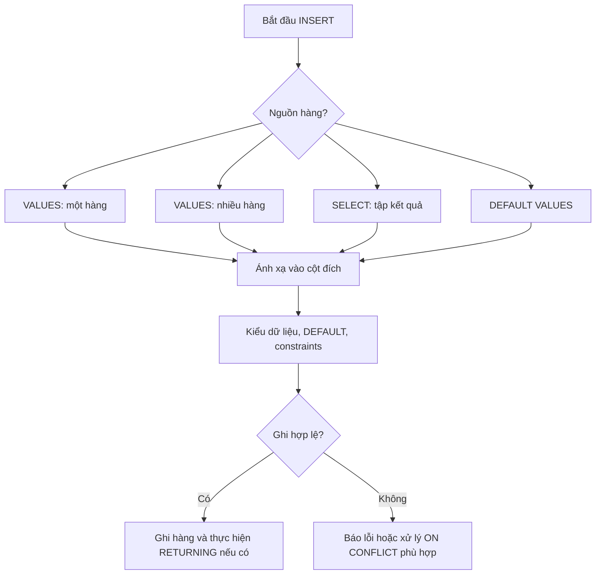

# INSERT một hàng, nhiều hàng và từ kết quả SELECT trong PostgreSQL

Trong PostgreSQL, `INSERT` là câu lệnh SQL dùng để thêm hàng mới vào bảng. Cùng một câu lệnh có thể tạo **một hàng bằng `VALUES`**, **nhiều hàng bằng danh sách `VALUES`**, hoặc **một tập hàng được tạo từ kết quả `SELECT`**. Ba hình thức có chung yêu cầu quan trọng: dữ liệu phải khớp kiểu cột, đáp ứng các ràng buộc của bảng và được ghi trong phạm vi giao dịch phù hợp.

Các tình huống thực tế:

- Đăng ký một khách hàng mới và nhận lại `customer_id` vừa sinh.
- Nhập một loạt sản phẩm từ một biểu mẫu hoặc một batch của ứng dụng.
- Gán tất cả khách hàng VIP vào một chiến dịch bằng `INSERT ... SELECT`.
- Sao chép dữ liệu từ staging vào bảng nghiệp vụ sau khi kiểm tra và chuyển kiểu.
- Tạo đơn hàng cùng những dòng chi tiết bằng dữ liệu trả về từ một `INSERT` trước đó.

Bài học tập trung vào **`INSERT một hàng, nhiều hàng và từ kết quả SELECT`** trong chương **Thay đổi dữ liệu**, đồng thời giải thích những thành phần cần dùng thường xuyên: danh sách cột, `DEFAULT`, `NULL`, `RETURNING`, ràng buộc, `ON CONFLICT`, transaction và Java/JDBC.

## 1. Cú pháp tổng quan và ba nguồn dữ liệu của INSERT

Cấu trúc chung:

```sql
INSERT INTO schema_name.table_name (column_1, column_2, ...)
VALUES (value_1, value_2, ...);
```

Thay phần `VALUES` bằng nhiều bộ giá trị:

```sql
INSERT INTO schema_name.table_name (column_1, column_2)
VALUES
    (value_1a, value_2a),
    (value_1b, value_2b),
    (value_1c, value_2c);
```

Hoặc sử dụng kết quả truy vấn:

```sql
INSERT INTO schema_name.destination_table (column_1, column_2)
SELECT expression_1, expression_2
FROM schema_name.source_table
WHERE some_condition;
```

Ba dạng khác nhau ở **nguồn sinh hàng**:

| Dạng | Nguồn dữ liệu | Khi nên dùng |
| --- | --- | --- |
| `INSERT ... VALUES (...)` | Một bộ biểu thức được viết rõ | Ghi một thực thể từ API hoặc form |
| `INSERT ... VALUES (...), (...)` | Nhiều bộ biểu thức cùng cấu trúc | Ghi batch nhỏ hoặc trung bình trong một statement |
| `INSERT ... SELECT ...` | Các hàng do truy vấn tạo ra | Sao chép, tổng hợp, lọc và chuyển đổi dữ liệu ngay trên database |
| `INSERT ... DEFAULT VALUES` | Giá trị mặc định của toàn bộ cột | Tạo hàng mà mọi cột bắt buộc đều có default hoặc được hệ thống sinh |

Trong PostgreSQL, `INSERT` cũng có các tùy chọn như `ON CONFLICT` để xử lý xung đột duy nhất, `RETURNING` để trả dữ liệu thực sự được ghi và `WITH` để tổ chức thao tác phức tạp.



Sơ đồ mô tả ngữ nghĩa. PostgreSQL có thể chọn kế hoạch thực thi khác nhau cho `INSERT ... SELECT`, đặc biệt khi phần `SELECT` có `JOIN`, `GROUP BY` hoặc các subquery.

## 2. Chuẩn bị cơ sở dữ liệu thực hành

Tất cả ví dụ sau dùng một schema riêng tên `insert_lab`. Chỉ chạy trên database học tập. Không tự tạo lại schema có sẵn ở production hoặc chèn dữ liệu mẫu vào bảng đang phục vụ khách hàng thật.

### 2.1. Bảng customers

```sql
CREATE SCHEMA IF NOT EXISTS insert_lab;

CREATE TABLE insert_lab.customers (
    customer_id bigint GENERATED ALWAYS AS IDENTITY PRIMARY KEY,
    email text NOT NULL UNIQUE,
    full_name text NOT NULL,
    customer_tier text NOT NULL DEFAULT 'standard'
        CHECK (customer_tier IN ('standard', 'vip')),
    joined_at timestamptz NOT NULL DEFAULT now()
);
```

Những quy tắc quan trọng:

- `customer_id` được PostgreSQL tự sinh bằng `IDENTITY`; ứng dụng thông thường **không truyền** ID.
- `email` bắt buộc, không được trùng.
- `full_name` bắt buộc.
- `customer_tier` có mặc định `'standard'` và chỉ nhận `'standard'`/`'vip'`.
- `joined_at` mặc định nhận thời điểm hiện tại của transaction khi `now()` được dùng.

### 2.2. Bảng products

```sql
CREATE TABLE insert_lab.products (
    sku text PRIMARY KEY,
    product_name text NOT NULL,
    unit_price numeric(12, 2) NOT NULL CHECK (unit_price >= 0),
    is_active boolean NOT NULL DEFAULT TRUE,
    updated_at timestamptz NOT NULL DEFAULT now()
);
```

`sku` là mã sản phẩm dùng làm khóa chính. `unit_price` sử dụng `numeric(12,2)` thay vì kiểu dấu chấm động để lưu giá tiền có độ chính xác thập phân.

### 2.3. Bảng orders và order_items

```sql
CREATE TABLE insert_lab.orders (
    order_id bigint GENERATED ALWAYS AS IDENTITY PRIMARY KEY,
    customer_id bigint NOT NULL
        REFERENCES insert_lab.customers(customer_id),
    status text NOT NULL DEFAULT 'draft'
        CHECK (status IN ('draft', 'confirmed', 'cancelled')),
    source text NOT NULL DEFAULT 'web',
    placed_at timestamptz NOT NULL DEFAULT now()
);

CREATE TABLE insert_lab.order_items (
    line_id bigint GENERATED ALWAYS AS IDENTITY PRIMARY KEY,
    order_id bigint NOT NULL
        REFERENCES insert_lab.orders(order_id),
    sku text NOT NULL
        REFERENCES insert_lab.products(sku),
    quantity integer NOT NULL CHECK (quantity > 0),
    sold_unit_price numeric(12, 2) NOT NULL
        CHECK (sold_unit_price >= 0),
    CONSTRAINT uq_order_item_sku UNIQUE (order_id, sku)
);
```

`sold_unit_price` là giá tại thời điểm ghi dòng đơn hàng, được lưu riêng thay vì luôn đọc giá hiện tại của `products`. Khi giá niêm yết thay đổi, giá trong đơn hàng cũ vẫn cần giữ đúng lịch sử nghiệp vụ.

Trong các phần dưới, những ví dụ tạo dữ liệu được thiết kế cho quá trình thực hành theo thứ tự. **Không chạy lặp lại các lệnh INSERT không có xử lý xung đột** trên cùng dữ liệu nếu không muốn gặp lỗi unique/primary key.

## 3. INSERT một hàng bằng VALUES

Câu lệnh cơ bản:

```sql
INSERT INTO insert_lab.customers (email, full_name)
VALUES ('alice@example.test', 'Alice Nguyen');
```

PostgreSQL tạo một hàng mới:

- `email` lấy `'alice@example.test'`.
- `full_name` lấy `'Alice Nguyen'`.
- `customer_id` được sinh tự động.
- `customer_tier` lấy `'standard'` do `DEFAULT`.
- `joined_at` lấy thời điểm của `now()`.

Nếu chạy bằng công cụ SQL, lệnh thường có command tag dạng `INSERT 0 1`, trong đó số cuối cho biết số hàng được chèn. Muốn lấy ID thật thay vì suy từ command tag, dùng `RETURNING` như phần sau.

### 3.1. Luôn nêu tên cột đích

Nên viết:

```sql
INSERT INTO insert_lab.customers
    (email, full_name, customer_tier)
VALUES
    ('bob@example.test', 'Bob Tran', 'vip');
```

Tránh phụ thuộc vị trí khai báo cột kiểu:

```sql
-- Không khuyến khích: phụ thuộc cấu trúc và thứ tự cột.
INSERT INTO insert_lab.products
VALUES ('BOOK-001', 'PostgreSQL Guide', 150.00, TRUE, now());
```

Nếu schema thay đổi, thêm cột hoặc đổi thứ tự cột trong quá trình tạo lại bảng, dạng không có danh sách cột dễ trở nên sai nghĩa hoặc thất bại.

Với danh sách cột tường minh, **giá trị thứ nhất ánh xạ vào cột đầu tiên trong danh sách**, không phụ thuộc thứ tự cột vật lý trong bảng.

### 3.2. DEFAULT khác NULL

`DEFAULT` được sử dụng khi cột bị bỏ khỏi danh sách `INSERT` hoặc khi viết từ khóa `DEFAULT` ở vị trí giá trị:

```sql
INSERT INTO insert_lab.customers
    (email, full_name, customer_tier)
VALUES
    ('carol@example.test', 'Carol Le', DEFAULT);
```

Tương đương về giá trị `customer_tier` với việc không nêu cột này trong `INSERT`.

Nhưng:

```sql
-- Câu minh họa lỗi: vi phạm NOT NULL.
INSERT INTO insert_lab.customers
    (email, full_name, customer_tier)
VALUES
    ('invalid@example.test', 'Invalid Example', NULL);
```

Câu trên không áp dụng `DEFAULT 'standard'`. Nó cố lưu **SQL NULL** vào cột `NOT NULL` và bị từ chối.

Quy tắc:

| Tình huống | Cách PostgreSQL chọn giá trị |
| --- | --- |
| Bỏ cột trong danh sách INSERT | Dùng default của cột; nếu không có default thì NULL |
| Viết `DEFAULT` trong `VALUES` | Dùng default của cột |
| Viết `NULL` tường minh | Dùng NULL, không thay bằng default |
| Gửi biểu thức có kết quả NULL | Vẫn là NULL, phải qua ràng buộc NOT NULL |
| Cột `IDENTITY` tự sinh | Sinh ID khi không có giá trị ID tường minh được phép |

Cột `NOT NULL` không có default phải nhận một giá trị hợp lệ. Không nên dựa vào giá trị mặc định để che giấu dữ liệu ứng dụng chưa cung cấp.

### 3.3. DEFAULT VALUES khi không truyền cột nào

Nếu mọi cột bắt buộc đều có default hoặc được tự sinh, PostgreSQL có thể tạo một hàng bằng:

```sql
CREATE TABLE insert_lab.import_runs (
    run_id bigint GENERATED ALWAYS AS IDENTITY PRIMARY KEY,
    started_at timestamptz NOT NULL DEFAULT now(),
    state text NOT NULL DEFAULT 'started'
);

INSERT INTO insert_lab.import_runs
DEFAULT VALUES;
```

Với `customers`, `DEFAULT VALUES` không phù hợp vì `email` và `full_name` không có default nhưng lại `NOT NULL`.

### 3.4. Kiểu dữ liệu và ép kiểu đầu vào

Literal chuỗi `'199.50'` có thể được diễn giải theo kiểu cột `numeric` trong `INSERT`:

```sql
INSERT INTO insert_lab.products
    (sku, product_name, unit_price)
VALUES
    ('BOOK-001', 'PostgreSQL Guide', '150.00');
```

Dù được nhập dưới dấu nháy, giá trị thực lưu trong `unit_price` là `numeric(12,2)`.

Không có nghĩa mọi chuỗi đều hợp lệ:

```sql
-- Lỗi chuyển kiểu; minh họa, không chạy trong batch dữ liệu thật.
INSERT INTO insert_lab.products
    (sku, product_name, unit_price)
VALUES
    ('BAD-PRICE', 'Invalid price', 'one hundred');
```

PostgreSQL phải chuyển giá trị sang kiểu đích và kiểm tra ràng buộc trước khi hoàn tất chèn. Đừng dựa vào việc “database tự hiểu” với các giá trị nhập không nhất quán.

## 4. INSERT nhiều hàng với một mệnh đề VALUES

Thay vì gọi một `INSERT` cho từng sản phẩm, chúng ta có thể đưa nhiều bộ giá trị vào **một statement**:

```sql
INSERT INTO insert_lab.products
    (sku, product_name, unit_price)
VALUES
    ('PEN-002', 'Ballpoint Pen', 10.00),
    ('BAG-003', 'Canvas Bag', 90.00),
    ('USB-004', 'USB Cable', 45.00);
```

Mỗi hàng trong danh sách `VALUES` phải có **cùng số lượng biểu thức** tương ứng danh sách cột đích. Các biểu thức ở cùng vị trí phải có kiểu có thể chuyển về kiểu cột tương ứng.

Ví dụ hai hàng khách hàng:

```sql
INSERT INTO insert_lab.customers
    (email, full_name, customer_tier)
VALUES
    ('dana@example.test', 'Dana Pham', 'vip'),
    ('eva@example.test', 'Eva Vo', DEFAULT);
```

Cả hai hàng được chèn trong một câu SQL. `DEFAULT` có thể xuất hiện ở vị trí của từng hàng; Dana nhận `vip`, Eva nhận `standard`.

### 4.1. Một lỗi trong multi-row INSERT ảnh hưởng cả statement

Giả sử gửi:

```sql
-- Dự kiến lỗi: dòng thứ hai trùng email với Alice đã tồn tại.
INSERT INTO insert_lab.customers (email, full_name)
VALUES
    ('frank@example.test', 'Frank'),
    ('alice@example.test', 'Another Alice');
```

Nếu không có xử lý xung đột phù hợp, PostgreSQL từ chối **toàn bộ statement** vì vi phạm `UNIQUE(email)`; hàng Frank cũng **không được chèn từ statement thất bại này**.

Đó là tính **atomicity của một câu lệnh**: không phải từng tuple `VALUES` là một transaction độc lập. Khi nhiều statement được chạy trong cùng một transaction, cách xử lý lỗi và `ROLLBACK` còn phụ thuộc trạng thái của transaction đó.

### 4.2. INSERT một statement khác với nhiều statement riêng

So sánh:

```sql
INSERT INTO insert_lab.customers (email, full_name)
VALUES ('gwen@example.test', 'Gwen');

INSERT INTO insert_lab.customers (email, full_name)
VALUES ('hank@example.test', 'Hank');
```

và:

```sql
INSERT INTO insert_lab.customers (email, full_name)
VALUES
    ('gwen@example.test', 'Gwen'),
    ('hank@example.test', 'Hank');
```

Hai đoạn có thể chèn cùng dữ liệu trong database sạch, nhưng khác ở số statement, số lượt giao tiếp client–server, cách xử lý lỗi và phạm vi atomicity khi client bật auto-commit.

Trong PostgreSQL, **multi-row `VALUES` thường hiệu quả hơn nhiều lệnh `INSERT` một hàng** vì giảm round trip và overhead lập kế hoạch/thực thi. Tuy nhiên, không có con số batch-size tối ưu cố định cho mọi workload.

### 4.3. Số lượng hàng lớn và giới hạn thực tế

Một statement `INSERT ... VALUES` quá lớn có thể:

- Tạo SQL dài, chiếm bộ nhớ parse/plan.
- Gây áp lực lên network và tài nguyên transaction.
- Khi có lỗi, phải xử lý lại cả statement lớn.
- Chạm giới hạn số bind parameters của driver/protocol hoặc giới hạn kích thước câu lệnh.

Trong ứng dụng, nên **chia batch hợp lý** hoặc dùng `COPY` khi nhập khối lượng rất lớn. Chọn batch-size bằng đo lường trên môi trường thực tế, không lấy một số “1000 hàng” như chuẩn bắt buộc cho mọi hệ thống.

## 5. RETURNING: lấy dữ liệu thực sự được ghi

PostgreSQL có mệnh đề `RETURNING` để trả về giá trị từ các hàng được chèn mà **không cần viết thêm SELECT dựa trên suy đoán ID**.

```sql
INSERT INTO insert_lab.customers
    (email, full_name, customer_tier)
VALUES
    ('iris@example.test', 'Iris Do', 'vip')
RETURNING customer_id, email, customer_tier, joined_at;
```

`customer_id` được sinh theo `IDENTITY`. `joined_at` là giá trị default đã được áp dụng. `RETURNING` rất hữu ích cho API tạo thực thể hoặc khi cần dùng ID mới ở thao tác tiếp theo.

### 5.1. RETURNING với nhiều hàng

```sql
INSERT INTO insert_lab.customers
    (email, full_name)
VALUES
    ('jack@example.test', 'Jack'),
    ('kate@example.test', 'Kate')
RETURNING customer_id, email;
```

Mệnh đề trả một hàng kết quả cho mỗi hàng thực sự được chèn. Không nên dựa vào thứ tự các hàng trong kết quả `RETURNING` như một hợp đồng ánh xạ với thứ tự phần `VALUES`, trừ khi đã thiết kế một khóa nối rõ ràng. Trong ứng dụng, có thể dùng `email` hoặc khóa tự nhiên phù hợp để gắn ID sinh ra với đối tượng đầu vào.

### 5.2. RETURNING biểu thức

```sql
INSERT INTO insert_lab.products
    (sku, product_name, unit_price)
VALUES
    ('NOTE-005', 'Notebook', 35.00)
RETURNING
    sku,
    unit_price,
    unit_price * 1.10 AS price_plus_ten_percent;
```

`RETURNING` có thể trả biểu thức tính toán từ các giá trị của hàng được ghi. Tên cột và biểu thức có thể được dùng để tạo payload ứng dụng; không phải thêm một cột lưu trữ mới.

### 5.3. RETURNING * cần cân nhắc

```sql
INSERT INTO insert_lab.products
    (sku, product_name, unit_price)
VALUES
    ('CASE-006', 'Tablet Case', 75.00)
RETURNING *;
```

`RETURNING *` tiện khi khám phá schema, nhưng ứng dụng production thường nên chỉ định các cột cần dùng, tránh trả dữ liệu không cần thiết và tránh thay đổi contract khi schema được mở rộng.

## 6. INSERT ... SELECT: chèn các hàng do truy vấn tạo ra

Dạng tổng quát:

```sql
INSERT INTO destination_table (target_a, target_b, ...)
SELECT source_expression_a, source_expression_b, ...
FROM source_table
WHERE condition;
```

PostgreSQL thực hiện phần `SELECT` để xác định các hàng dữ liệu và ánh xạ **theo vị trí cột** sang bảng đích, sau đó kiểm tra ràng buộc và ghi.

Đây không phải cú pháp “chạy SELECT để hiển thị rồi copy thủ công”: toàn bộ quá trình diễn ra trong **một SQL statement**, với tính atomicity của statement đó.

### 6.1. Ví dụ: thêm khách hàng VIP vào danh sách chiến dịch

Tạo bảng đích:

```sql
CREATE TABLE insert_lab.campaign_members (
    campaign_code text NOT NULL,
    customer_id bigint NOT NULL
        REFERENCES insert_lab.customers(customer_id),
    enrolled_at timestamptz NOT NULL DEFAULT now(),
    PRIMARY KEY (campaign_code, customer_id)
);
```

Sau đó chèn các khách hàng VIP:

```sql
INSERT INTO insert_lab.campaign_members
    (campaign_code, customer_id)
SELECT
    'WELCOME_2026',
    c.customer_id
FROM insert_lab.customers AS c
WHERE c.customer_tier = 'vip'
RETURNING campaign_code, customer_id, enrolled_at;
```

Đây là mẫu rất thường gặp:

- `campaign_code` là một literal áp dụng cho mọi hàng được chọn.
- `c.customer_id` đến từ bảng nguồn.
- `WHERE` quyết định **những khách hàng được đưa vào chiến dịch**.
- `enrolled_at` không được truyền, nên nhận default.
- `RETURNING` trả các thành viên được chèn.

Nếu phần `SELECT` trả 0 hàng, statement thành công nhưng không chèn hàng nào. Đó là kết quả hợp lệ, cần được phân biệt với lỗi SQL.

### 6.2. Nếu SELECT trả nhiều hàng thì INSERT chèn nhiều hàng

```sql
SELECT c.customer_id
FROM insert_lab.customers AS c
WHERE c.customer_tier = 'vip';
```

Giả sử có ba khách VIP trong dữ liệu hiện tại, `INSERT ... SELECT` sẽ thử chèn ba hàng, trừ những trường hợp bị loại bởi xử lý xung đột hoặc phát sinh lỗi ràng buộc.

Chính vì thế, khi dùng `INSERT ... SELECT` để ghi những thay đổi có hậu quả lớn, hãy kiểm tra **số hàng kỳ vọng** và tính đúng đắn của điều kiện `WHERE`; không mặc định một truy vấn có `WHERE` luôn chọn đúng một hàng.

### 6.3. Chèn với phép biến đổi dữ liệu

Dùng `SELECT` cho phép tạo giá trị đích từ biểu thức:

```sql
CREATE TABLE insert_lab.customer_labels (
    customer_id bigint PRIMARY KEY
        REFERENCES insert_lab.customers(customer_id),
    display_label text NOT NULL,
    prepared_at timestamptz NOT NULL DEFAULT now()
);

INSERT INTO insert_lab.customer_labels
    (customer_id, display_label)
SELECT
    c.customer_id,
    upper(c.full_name) || ' <' || c.email || '>'
FROM insert_lab.customers AS c
WHERE c.customer_tier = 'vip';
```

Ở đây `upper` và `||` tính một chuỗi nhãn từ dữ liệu khách hàng. Dù biểu thức hợp lệ, không nên dùng kết quả nhãn này như khóa nghiệp vụ hay thay cho dữ liệu gốc đã có kiểu riêng.

### 6.4. Chèn dữ liệu từ JOIN

`INSERT ... SELECT` cũng có thể chọn từ nhiều bảng:

```sql
CREATE TABLE insert_lab.order_export_queue (
    order_id bigint PRIMARY KEY
        REFERENCES insert_lab.orders(order_id),
    recipient_email text NOT NULL,
    queued_at timestamptz NOT NULL DEFAULT now()
);

INSERT INTO insert_lab.order_export_queue
    (order_id, recipient_email)
SELECT
    o.order_id,
    c.email
FROM insert_lab.orders AS o
JOIN insert_lab.customers AS c
    ON c.customer_id = o.customer_id
WHERE o.status = 'confirmed';
```

Chỉ các đơn `confirmed` có khách hàng khớp mới được chèn. Nếu chưa có đơn `confirmed` trong bộ dữ liệu tại thời điểm chạy, kết quả là **0 hàng**; điều này không phải lỗi.

Khi `JOIN` làm **một hàng nguồn nhân thành nhiều hàng**, `INSERT` cũng sẽ thử ghi từng hàng kết quả. Nếu bảng đích có unique key, truy vấn có thể báo lỗi trùng khóa. Do đó, phải hiểu mức độ chi tiết (grain) của phần `SELECT` trước khi chèn.

## 7. Cột SELECT phải khớp với cột INSERT

Đối với:

```sql
INSERT INTO insert_lab.campaign_members
    (campaign_code, customer_id)
SELECT 'WELCOME_2026', c.customer_id
FROM insert_lab.customers AS c;
```

mỗi hàng `SELECT` có hai biểu thức; chúng lần lượt được gán vào `campaign_code` và `customer_id`.

Ví dụ lỗi về số lượng:

```sql
-- Sai: bảng đích được chỉ định hai cột nhưng SELECT chỉ trả một cột.
INSERT INTO insert_lab.campaign_members
    (campaign_code, customer_id)
SELECT customer_id
FROM insert_lab.customers;
```

Ví dụ lỗi về thứ tự dữ liệu:

```sql
-- Không đúng ngữ nghĩa: biểu thức đầu là bigint,
-- nhưng cột đích đầu là campaign_code (text).
INSERT INTO insert_lab.campaign_members
    (campaign_code, customer_id)
SELECT c.customer_id, 'WELCOME_2026'
FROM insert_lab.customers AS c;
```

Ngay cả khi có chuyển kiểu cho một vị trí, biểu thức thứ hai vẫn có thể không hợp lệ khi gán chuỗi không phải số vào `customer_id bigint`. **PostgreSQL ánh xạ theo thứ tự, không tự khớp bằng tên alias**.

### 7.1. Tránh SELECT * khi chèn sang bảng khác

Không nên viết:

```sql
-- Mong manh khi schema thay đổi:
INSERT INTO some_destination
SELECT *
FROM some_source;
```

Nếu nguồn/đích thêm cột, thay đổi thứ tự cột hoặc không có kiểu tương thích, statement có thể thất bại hoặc gán sai ý nghĩa. Hãy liệt kê danh sách cột đích và biểu thức `SELECT` tương ứng.

### 7.2. Cast trong INSERT ... SELECT

Giả sử staging lưu giá ở dạng văn bản:

```sql
CREATE TABLE insert_lab.staging_products (
    load_id bigint GENERATED ALWAYS AS IDENTITY PRIMARY KEY,
    sku text NOT NULL,
    product_name text NOT NULL,
    price_text text NOT NULL,
    active_text text NOT NULL,
    received_at timestamptz NOT NULL DEFAULT now()
);

INSERT INTO insert_lab.staging_products
    (sku, product_name, price_text, active_text)
VALUES
    ('BOOK-001', 'PostgreSQL Guide, edition 2', '165.00', 'true'),
    ('MOUSE-007', 'Wireless Mouse', '210.00', 'true');
```

Một phép chuyển có chủ đích:

```sql
SELECT
    sku,
    product_name,
    price_text::numeric(12, 2) AS unit_price,
    active_text::boolean AS is_active
FROM insert_lab.staging_products;
```

Có thể đưa các biểu thức đó vào `INSERT ... SELECT`. **Chỉ thực hiện khi dữ liệu staging đã được kiểm tra**: chuỗi giá sai định dạng hoặc giá trị Boolean không hợp lệ khiến statement thất bại. `COALESCE` không tự bắt lỗi cast.

Với dữ liệu có nhiều bản cập nhật cùng SKU, nên giải quyết việc trùng nguồn trước khi upsert (phần 10).

## 8. INSERT ... SELECT với GROUP BY và DISTINCT

Một phần `SELECT` có thể dùng `GROUP BY` để tạo **hàng tổng hợp** cho bảng đích. Ví dụ, lập bảng số đơn hàng của mỗi khách:

```sql
CREATE TABLE insert_lab.customer_order_stats (
    customer_id bigint PRIMARY KEY
        REFERENCES insert_lab.customers(customer_id),
    order_count integer NOT NULL,
    calculated_at timestamptz NOT NULL DEFAULT now()
);

INSERT INTO insert_lab.customer_order_stats
    (customer_id, order_count)
SELECT
    c.customer_id,
    COUNT(o.order_id)::integer
FROM insert_lab.customers AS c
LEFT JOIN insert_lab.orders AS o
    ON o.customer_id = c.customer_id
GROUP BY c.customer_id;
```

Điểm đáng chú ý:

- `LEFT JOIN` giúp cả khách hàng chưa có đơn xuất hiện.
- `COUNT(o.order_id)` trả 0 khi không có order khớp; `COUNT(*)` có thể trả 1 từ hàng null-extended.
- `COUNT` trả kiểu `bigint`; cast về `integer` chỉ hợp lý khi số lượng thực tế chắc chắn nằm trong phạm vi của kiểu đích. Với bảng thống kê rất lớn, nên khai báo `order_count bigint`.
- Vì `customer_id` là khóa chính ở bảng đích, mỗi khách hàng chỉ được chèn tối đa một hàng trong statement.

Nếu join thêm `order_items` vào phần thống kê, một order có nhiều dòng sản phẩm có thể xuất hiện nhiều lần. Khi đó `COUNT(o.order_id)` không còn là số order; có thể cần `COUNT(DISTINCT o.order_id)` hoặc tổng hợp ở cấp order trước.

### 8.1. SELECT DISTINCT để tránh dòng trùng

Giả sử nguồn staging chứa nhiều dòng cùng mã khách hàng. `DISTINCT` giúp loại các bản sao **hoàn toàn giống nhau trên các cột được chọn**:

```sql
SELECT DISTINCT email
FROM insert_lab.customers
WHERE customer_tier = 'vip';
```

Nhưng `DISTINCT(email, name)` theo ý tưởng (viết đúng SQL là `SELECT DISTINCT email, name`) **không** đảm bảo email chỉ có một dòng nếu name khác nhau. Khi cần “bản ghi mới nhất cho mỗi khóa”, PostgreSQL hỗ trợ `DISTINCT ON` với `ORDER BY` xác định hàng được giữ:

```sql
SELECT DISTINCT ON (sku)
    sku, product_name, price_text, active_text
FROM insert_lab.staging_products
ORDER BY sku, received_at DESC, load_id DESC;
```

Điều kiện `ORDER BY` ở đây dùng `load_id DESC` làm tiêu chí phá hòa khi hai lần nhập có cùng thời điểm. Dữ liệu được chọn có một dòng trên mỗi SKU, phù hợp với khóa chính `products.sku`.

## 9. INSERT ... SELECT từ cùng bảng và từ CTE

PostgreSQL cho phép câu `INSERT ... SELECT` đọc từ cùng bảng đích trong phạm vi một statement.

Ví dụ chỉ mang tính minh họa:

```sql
-- Ví dụ giả định có bảng insert_lab.message_templates
-- với các cột template_code, language_code, body.
INSERT INTO insert_lab.message_templates
    (template_code, language_code, body)
SELECT
    template_code || '_copy',
    language_code,
    body
FROM insert_lab.message_templates
WHERE template_code = 'welcome';
```

`insert_lab.message_templates` **không được tạo** trong bộ dữ liệu thực hành. Nếu sử dụng mẫu này trên bảng có thật, cần xét khóa duy nhất, điều kiện nguồn và việc tạo mã mới để tránh chèn trùng vô hạn mỗi lần chạy.

Có thể dùng CTE để tổ chức việc chọn nguồn:

```sql
WITH vip_customers AS (
    SELECT customer_id
    FROM insert_lab.customers
    WHERE customer_tier = 'vip'
)
INSERT INTO insert_lab.campaign_members
    (campaign_code, customer_id)
SELECT 'LOYALTY_2026', customer_id
FROM vip_customers
RETURNING campaign_code, customer_id;
```

Một CTE `SELECT` không nhất thiết được materialize thành bảng tạm; PostgreSQL có thể tối ưu theo cách phù hợp. `WITH` trước `INSERT` chủ yếu giúp phân chia logic thành các phần dễ đọc.

## 10. Trùng khóa và ON CONFLICT

Khi chèn hàng có cùng giá trị khóa chính hoặc unique key với hàng đã tồn tại, PostgreSQL bình thường báo lỗi `23505 unique_violation`. Có hai cách xử lý phổ biến:

### 10.1. DO NOTHING: bỏ qua hàng xung đột

```sql
INSERT INTO insert_lab.campaign_members
    (campaign_code, customer_id)
SELECT
    'WELCOME_2026',
    c.customer_id
FROM insert_lab.customers AS c
WHERE c.customer_tier = 'vip'
ON CONFLICT (campaign_code, customer_id) DO NOTHING
RETURNING campaign_code, customer_id;
```

Ví dụ này có thể chạy lại sau khi chiến dịch đã có thành viên. Những cặp khóa đã tồn tại sẽ bị bỏ qua; các cặp mới có thể được chèn.

`RETURNING` chỉ trả những hàng **thực sự được chèn** trong statement có `DO NOTHING`, không trả những hàng đã bị bỏ qua.

**Không coi `DO NOTHING` là giải pháp chung cho mọi lỗi**: nó chủ yếu xử lý xung đột ràng buộc unique/exclusion phù hợp. Lỗi `NOT NULL`, `CHECK`, `FOREIGN KEY` hoặc dữ liệu sai kiểu vẫn có thể xảy ra.

### 10.2. DO UPDATE: upsert

Với sản phẩm có `sku` là primary key, một upsert có thể chèn mới hoặc cập nhật hàng đã tồn tại:

```sql
INSERT INTO insert_lab.products
    (sku, product_name, unit_price, is_active)
VALUES
    ('BOOK-001', 'PostgreSQL Guide, edition 2', 165.00, TRUE)
ON CONFLICT (sku) DO UPDATE
SET
    product_name = EXCLUDED.product_name,
    unit_price = EXCLUDED.unit_price,
    is_active = EXCLUDED.is_active,
    updated_at = now()
RETURNING sku, product_name, unit_price, updated_at;
```

`EXCLUDED` đại diện cho giá trị **đã được đề xuất chèn** trước khi xung đột được xử lý. Nó không phải một bảng thật để truy vấn độc lập.

Nếu `sku = 'BOOK-001'` đã tồn tại, PostgreSQL cập nhật hàng đó. Nếu chưa tồn tại, PostgreSQL chèn mới. `ON CONFLICT (sku) DO UPDATE` yêu cầu có unique index/constraint phù hợp để làm conflict arbiter.

### 10.3. Upsert từ kết quả SELECT

Dùng nguồn staging đã tạo ở phần 7, có thể chọn bản ghi mới nhất cho mỗi SKU rồi upsert:

```sql
WITH latest_per_sku AS (
    SELECT DISTINCT ON (sku)
        sku,
        product_name,
        price_text,
        active_text
    FROM insert_lab.staging_products
    ORDER BY sku, received_at DESC, load_id DESC
)
INSERT INTO insert_lab.products
    (sku, product_name, unit_price, is_active)
SELECT
    s.sku,
    s.product_name,
    s.price_text::numeric(12, 2),
    s.active_text::boolean
FROM latest_per_sku AS s
WHERE TRUE
ON CONFLICT (sku) DO UPDATE
SET
    product_name = EXCLUDED.product_name,
    unit_price = EXCLUDED.unit_price,
    is_active = EXCLUDED.is_active,
    updated_at = now()
RETURNING sku, product_name, unit_price;
```

Các chi tiết đáng chú ý:

1. `DISTINCT ON (sku)` chọn **một hàng** cho mỗi SKU theo thứ tự đã định nghĩa.
2. `WHERE TRUE` trong `SELECT` là điều kiện luôn đúng. Với cú pháp `INSERT ... SELECT ... ON CONFLICT`, nó cũng giúp trình phân tích cú pháp nhận rõ `ON CONFLICT` là phần của `INSERT` thay vì nhầm với một `JOIN ... ON`.
3. `ON CONFLICT (sku) DO UPDATE` xử lý xung đột với bảng `products`.
4. `RETURNING` trả những hàng được chèn **hoặc được cập nhật**.

Nếu phần `SELECT` trả nhiều hàng cùng một SKU cho `ON CONFLICT DO UPDATE`, PostgreSQL có thể báo lỗi vì một statement không được cập nhật cùng một hàng đích hai lần. Vì vậy, kiểm soát trùng **ngay ở nguồn** rất quan trọng.

### 10.4. Idempotency không tự có nếu không thiết kế khóa

Một `INSERT ... SELECT` thuần túy có thể tạo bản sao mới mỗi lần chạy. Nếu hệ thống cần retry an toàn, hãy quyết định:

- Khóa nào nhận diện bản ghi nguồn đã được nhập?
- Khi trùng khóa nên bỏ qua, cập nhật hay báo lỗi?
- Trường hợp cùng khóa nhưng nội dung khác nhau cần ghi nhận thế nào?
- Có cần lưu `source_event_id`, `batch_id` hoặc dấu phiên bản nguồn để tránh nhập trùng không?

`ON CONFLICT` là công cụ SQL để thực thi một phần chính sách đó, nhưng không thay thế quyết định nghiệp vụ về cách xử lý dữ liệu trùng hoặc dữ liệu đến muộn.

## 11. Kết hợp INSERT và RETURNING trong một CTE ghi dữ liệu

Một tình huống thực tế: tạo một đơn hàng rồi tạo các dòng chi tiết, nhưng `order_id` do PostgreSQL tự sinh nên chưa biết trước.

Có thể dùng **data-modifying CTE**:

```sql
WITH new_order AS (
    INSERT INTO insert_lab.orders
        (customer_id, status, source)
    SELECT
        c.customer_id,
        'draft',
        'training'
    FROM insert_lab.customers AS c
    WHERE c.email = 'alice@example.test'
    RETURNING order_id
)
INSERT INTO insert_lab.order_items
    (order_id, sku, quantity, sold_unit_price)
SELECT
    no.order_id,
    p.sku,
    lines.quantity,
    p.unit_price
FROM new_order AS no
CROSS JOIN (
    VALUES
        ('BOOK-001'::text, 2),
        ('PEN-002'::text, 3)
) AS lines(sku, quantity)
JOIN insert_lab.products AS p
    ON p.sku = lines.sku
RETURNING order_id, sku, quantity, sold_unit_price;
```

Diễn giải:

1. CTE `new_order` tạo **một order** cho email Alice và trả lại `order_id`.
2. `VALUES` dạng bảng dẫn xuất tạo hai dòng sản phẩm đề xuất.
3. `JOIN products` tra SKU hợp lệ và lấy giá niêm yết hiện tại để ghi snapshot.
4. `INSERT ... SELECT` tạo hai dòng `order_items` với `order_id` vừa sinh.
5. Toàn bộ là **một SQL statement**; khi statement thất bại, các thay đổi của statement không được commit một phần.

### 11.1. Cảnh báo khi JOIN làm thiếu dòng chi tiết

Nếu một SKU trong `VALUES` không có ở bảng `products`, `INNER JOIN` có thể **loại dòng đó** thay vì báo lỗi. Ví dụ, gõ nhầm `'PEN-999'` có thể dẫn tới order được tạo nhưng chỉ có dòng BOOK.

Trong hệ thống thực, phải kiểm tra danh sách SKU trước hoặc dùng một truy vấn/logic có thể phát hiện số dòng không khớp; không chỉ dựa vào foreign key của `order_items` để phát hiện SKU đã bị loại trong `JOIN`.

Một phương án dễ kiểm soát là kiểm tra trước:

```sql
SELECT v.sku
FROM (VALUES
    ('BOOK-001'::text),
    ('PEN-002'::text)
) AS v(sku)
LEFT JOIN insert_lab.products AS p
    ON p.sku = v.sku
WHERE p.sku IS NULL;
```

Nếu có dòng trả về, ít nhất một SKU không tồn tại. Trong môi trường ghi đồng thời, kiểm tra trước và chèn sau là hai thời điểm khác nhau; vẫn cần transaction, ràng buộc và xử lý lỗi nếu dữ liệu nền thay đổi.

### 11.2. CTE có ghi dữ liệu không giống CTE chỉ SELECT

Với data-modifying CTE, `RETURNING` là **cầu nối dữ liệu** giữa các thao tác. Không nên giả định có thể tham chiếu trực tiếp hàng vừa thêm trong một phần truy vấn khác chỉ bằng cách đọc lại bảng nền theo thứ tự thực thi tưởng tượng.

Các câu DML trong một statement có quy tắc snapshot và thứ tự đánh giá riêng; chỉ dùng giá trị `RETURNING` để liên kết những thao tác có quan hệ dữ liệu rõ ràng. Không thiết kế nhiều DML CTE cùng sửa một hàng rồi dựa vào một thứ tự thực thi cụ thể.

## 12. INSERT nhiều hàng từ SELECT có thể sử dụng dữ liệu tổng hợp

Giả sử hệ thống có nhu cầu lưu snapshot doanh thu từng khách hàng vào một bảng summary:

```sql
CREATE TABLE insert_lab.customer_revenue_snapshot (
    snapshot_date date NOT NULL,
    customer_id bigint NOT NULL
        REFERENCES insert_lab.customers(customer_id),
    revenue numeric(14, 2) NOT NULL,
    PRIMARY KEY (snapshot_date, customer_id)
);
```

Lấy dữ liệu từ các dòng đơn hàng:

```sql
INSERT INTO insert_lab.customer_revenue_snapshot
    (snapshot_date, customer_id, revenue)
SELECT
    CURRENT_DATE,
    o.customer_id,
    COALESCE(SUM(oi.quantity * oi.sold_unit_price), 0)
FROM insert_lab.orders AS o
LEFT JOIN insert_lab.order_items AS oi
    ON oi.order_id = o.order_id
WHERE o.status <> 'cancelled'
GROUP BY o.customer_id
ON CONFLICT (snapshot_date, customer_id) DO UPDATE
SET revenue = EXCLUDED.revenue
RETURNING snapshot_date, customer_id, revenue;
```

Bài toán này khác chèn từng entity một: một hàng summary được tính từ **nhiều dòng nghiệp vụ**.

Cần xác định các điểm sau:

- `WHERE o.status <> 'cancelled'` quyết định những order được đưa vào doanh thu. Trong hệ thống thật, có thể chỉ tính `confirmed` hoặc các trạng thái khác theo quy tắc kế toán.
- `LEFT JOIN` giữ các order chưa có item; `SUM` có thể trả NULL cho nhóm không có giá, nên `COALESCE(..., 0)` biểu diễn doanh thu bằng 0 trong ví dụ.
- Khách hàng **chưa có order** không có trong kết quả vì truy vấn bắt đầu từ `orders`, không phải `customers`.
- Snapshot này chỉ phản ánh dữ liệu tại thời điểm statement chạy; nếu cần đồng bộ lịch sử hoặc chốt sổ, phải xây quy trình riêng.

`CURRENT_DATE` phụ thuộc múi giờ của session trong việc xác định ngày theo ngữ cảnh thời gian. Với báo cáo đa múi giờ, cần quy định ngày nghiệp vụ rõ ràng.

## 13. RETURNING không thay thế kiểm tra số hàng ảnh hưởng

Một statement thành công có thể ghi ít hàng hơn dự kiến:

- Phần `SELECT` không chọn được hàng nào.
- `ON CONFLICT DO NOTHING` bỏ qua hàng trùng.
- `INNER JOIN` loại hàng không tìm được đối tác.
- `WHERE` hoặc `HAVING` quá chặt.
- Logic lọc tenant, trạng thái hoặc thời gian không đúng.

Ví dụ:

```sql
INSERT INTO insert_lab.campaign_members
    (campaign_code, customer_id)
SELECT 'EMPTY_CAMPAIGN', c.customer_id
FROM insert_lab.customers AS c
WHERE c.customer_tier = 'not-a-valid-tier'
RETURNING customer_id;
```

Truy vấn sẽ không tạo thành viên nào trên dữ liệu mẫu vì không có tier đó. Nó không sai cú pháp, không vi phạm constraint, nhưng có thể **sai yêu cầu nghiệp vụ**.

Trong ứng dụng, cần kiểm tra số hàng `RETURNING` hoặc update count của JDBC khi nhiệm vụ yêu cầu một số hàng cụ thể. Với thao tác cần “all or nothing” trên cả batch và số hàng kỳ vọng, nên thiết kế câu SQL/transaction kèm bước xác minh phù hợp.

## 14. Transaction và tính nguyên tử khi có nhiều INSERT

Một câu `INSERT` đơn lẻ là một statement có tính nguyên tử. Nhưng một quy trình nghiệp vụ thường gồm **nhiều statement**:

1. Tạo order.
2. Tạo order items.
3. Ghi nhật ký/audit.
4. Cập nhật trạng thái hoặc số dư liên quan.

Nếu các bước phải thành công hoặc thất bại cùng nhau, chúng nên nằm trong một transaction:

```sql
BEGIN;

INSERT INTO insert_lab.orders
    (customer_id, status, source)
SELECT customer_id, 'draft', 'manual'
FROM insert_lab.customers
WHERE email = 'bob@example.test'
RETURNING order_id;

-- Các statement tiếp theo phải dùng đúng order_id đã trả về
-- qua ứng dụng hoặc một data-modifying CTE phù hợp.

COMMIT;
```

Đây là **khung transaction**, chưa phải ví dụ hoàn chỉnh tạo order items vì ứng dụng còn phải nhận và truyền `order_id`. Nếu bất kỳ statement nào phát sinh lỗi trong transaction PostgreSQL, transaction thường chuyển sang trạng thái lỗi và cần `ROLLBACK` (trừ những trường hợp sử dụng savepoint để xử lý có kiểm soát).

### 14.1. Savepoint khi cần xử lý lỗi có chọn lọc

```sql
BEGIN;

SAVEPOINT before_optional_insert;

-- Một statement tùy chọn có thể gặp lỗi.
-- Nếu lỗi xảy ra: ROLLBACK TO SAVEPOINT before_optional_insert;
-- Sau đó có thể quyết định tiếp tục transaction.

RELEASE SAVEPOINT before_optional_insert;
COMMIT;
```

Đây là ví dụ về cấu trúc transaction, không nên chạy nguyên văn để suy ra tự động xử lý lỗi: lệnh `ROLLBACK TO SAVEPOINT` cần được thực hiện khi lỗi xảy ra, sau khi ứng dụng nhận lỗi SQL.

### 14.2. Một multi-row INSERT lỗi thì không chèn một phần

Trong:

```sql
INSERT INTO insert_lab.products
    (sku, product_name, unit_price)
VALUES
    ('OK-100', 'Good Item', 5.00),
    ('BAD-200', 'Invalid Item', -1.00);
```

dòng thứ hai vi phạm `CHECK (unit_price >= 0)`. Không có `ON CONFLICT` nào xử lý lỗi CHECK đó, nên statement không thêm cả dòng thứ nhất. Đây là cơ chế bảo vệ toàn vẹn dữ liệu quan trọng khi nhập batch.

### 14.3. Concurrent inserts và unique constraint

Hai transaction có thể đồng thời cố chèn cùng `email` hoặc `sku`. Một truy vấn:

```sql
SELECT 1
FROM insert_lab.customers
WHERE email = 'same@example.test';
```

chạy trước `INSERT` **không đủ bảo đảm** sẽ không có xung đột vì transaction khác có thể chèn sau lúc kiểm tra. Ràng buộc `UNIQUE` và `ON CONFLICT` là lớp kiểm soát đúng ở database cho tính đồng thời.

Không dùng mô hình “SELECT để chắc chưa tồn tại, sau đó INSERT” như biện pháp duy nhất chống trùng. Ứng dụng vẫn phải xử lý unique violation hoặc sử dụng upsert theo chính sách đã định.

## 15. Các ràng buộc có thể làm INSERT thất bại

| Mã SQLSTATE thường gặp | Loại lỗi | Ví dụ |
| --- | --- | --- |
| `23502` | `not_null_violation` | Không truyền `full_name` bắt buộc |
| `23505` | `unique_violation` | Chèn email/SKU đã tồn tại |
| `23503` | `foreign_key_violation` | `order_items.order_id` không tồn tại ở `orders` |
| `23514` | `check_violation` | `quantity <= 0` hoặc giá âm |
| `22P02` | `invalid_text_representation` | Cast chuỗi không phải số thành `numeric` |
| `22003` | `numeric_value_out_of_range` | Giá trị vượt miền kiểu số đích |

Khi gặp lỗi:

- Đọc thông báo và SQLSTATE, không chỉ nhìn dòng stack trace đầu tiên.
- Xác định dữ liệu nguồn nào gây lỗi, đặc biệt trong multi-row `VALUES` hoặc `INSERT ... SELECT`.
- Không vô hiệu hóa constraint chỉ để “chèn cho xong”.
- Sửa dữ liệu đầu vào, cách ánh xạ cột hoặc chính sách upsert phù hợp.
- Giữ toàn bộ thay đổi nghiệp vụ liên quan trong transaction nhất quán.

### 15.1. INSERT từ SELECT có thể gặp dữ liệu bẩn

Ví dụ staging có `price_text = 'invalid'`, câu:

```sql
INSERT INTO insert_lab.products
    (sku, product_name, unit_price)
SELECT sku, product_name, price_text::numeric(12, 2)
FROM insert_lab.staging_products;
```

sẽ thất bại khi phải cast một giá trị sai. Dùng `COALESCE(price_text::numeric, 0)` **không** khắc phục lỗi vì phép cast xảy ra trước khi `COALESCE` nhận kết quả.

Trong ETL, nên có giai đoạn **kiểm tra/chỉ định quy tắc dữ liệu** và tách dòng lỗi để xử lý. Một regex kiểm tra chữ số cũng chưa chắc bảo đảm không overflow hay mọi định dạng số đều hợp lệ.

## 16. INSERT và IDENTITY/SEQUENCE

Với:

```sql
customer_id bigint GENERATED ALWAYS AS IDENTITY PRIMARY KEY
```

PostgreSQL sinh ID khi chèn hàng mà không cung cấp `customer_id`. Cách này tránh phải tính `MAX(customer_id) + 1` trong ứng dụng.

Không nên viết:

```sql
-- Sai về thiết kế đồng thời; MAX(id)+1 có thể xung đột khi có ghi song song.
INSERT INTO insert_lab.customers
    (customer_id, email, full_name)
SELECT
    COALESCE(MAX(customer_id), 0) + 1,
    'manual-id@example.test',
    'Manual ID'
FROM insert_lab.customers;
```

Với `GENERATED ALWAYS AS IDENTITY`, cung cấp ID tường minh bình thường còn bị ràng buộc cơ chế identity từ chối nếu không dùng tùy chọn override được phép.

### 16.1. OVERRIDING SYSTEM VALUE cho import đặc biệt

Trong những migration có kiểm soát, PostgreSQL hỗ trợ:

```sql
INSERT INTO insert_lab.customers
    (customer_id, email, full_name)
OVERRIDING SYSTEM VALUE
VALUES
    (9001, 'legacy-9001@example.test', 'Legacy Customer')
RETURNING customer_id;
```

Cú pháp này cho phép chỉ định giá trị cho cột `GENERATED ALWAYS AS IDENTITY` trong trường hợp import đặc biệt. Không nên sử dụng nó cho luồng tạo khách hàng bình thường.

**Lưu ý:** chèn ID tường minh không đồng nghĩa sequence tạo ID sau đó tự động được đưa lên vượt ID mới. Migration có ID tùy chỉnh cần xem xét điều chỉnh trạng thái identity sequence và tránh trùng ID ở những lần chèn sau; làm theo kế hoạch riêng, không tùy tiện đặt giá trị sequence trên production.

### 16.2. Sequence có thể có khoảng trống

Đừng kỳ vọng các ID được sinh:

- Luôn liên tiếp, không có lỗ hổng.
- Phản ánh chính xác thứ tự commit của các transaction.
- Tăng đúng một theo thứ tự các hàng được trả trong `RETURNING`.

Sequence có thể tiêu thụ giá trị ngay cả khi statement sau đó thất bại hoặc transaction rollback. ID dùng để định danh, không phải một số thứ tự nghiệp vụ bảo đảm liên tục.

## 17. Hiệu năng: multi-row VALUES, INSERT SELECT và COPY

### 17.1. Multi-row VALUES

Phù hợp cho một batch tạo mới có dữ liệu từ ứng dụng. Nó thường giảm round trip so với gọi từng hàng, đồng thời giúp transaction dễ kiểm soát.

```sql
INSERT INTO insert_lab.products
    (sku, product_name, unit_price)
VALUES
    ('A-101', 'Product A', 10),
    ('B-102', 'Product B', 20),
    ('C-103', 'Product C', 30);
```

Tuy nhiên, không nên tự ghép giá trị người dùng vào chuỗi SQL để xây batch; ưu tiên bind parameters qua driver hoặc API batch.

### 17.2. INSERT ... SELECT

Phù hợp khi dữ liệu nguồn **đã nằm trong PostgreSQL** và cần lọc, join, tính toán hoặc sao chép vào bảng khác. Nó tránh vòng lặp tải mọi hàng về Java rồi gửi trở lại database.

```sql
INSERT INTO insert_lab.campaign_members
    (campaign_code, customer_id)
SELECT 'SECOND_WAVE', customer_id
FROM insert_lab.customers
WHERE customer_tier = 'standard'
ON CONFLICT (campaign_code, customer_id) DO NOTHING;
```

Phần `SELECT` càng phức tạp thì chi phí query càng lớn; phải xem kế hoạch và số hàng phù hợp, không giả định `INSERT SELECT` tự nhanh hơn mọi phương án.

### 17.3. COPY cho import lớn

Khi tải dữ liệu từ file, PostgreSQL có lệnh `COPY` và công cụ `psql` có `\copy`:

```sql
-- Ví dụ cú pháp COPY; file và quyền đọc file thuộc phía server.
COPY insert_lab.staging_products
    (sku, product_name, price_text, active_text)
FROM '/path/on/database/server/products.csv'
WITH (FORMAT csv, HEADER true);
```

`COPY FROM '/path/...'` là thao tác đọc file trên **server PostgreSQL** và yêu cầu quyền thích hợp. `\copy` là lệnh của **psql client**, đọc file trên máy client và truyền qua kết nối.

Nên import vào **staging** để kiểm tra dữ liệu rồi dùng `INSERT ... SELECT`/upsert vào bảng nghiệp vụ. `COPY` cũng phải tuân thủ ràng buộc của bảng đích; không phải cơ chế bỏ qua constraints.

### 17.4. Các ảnh hưởng ghi dữ liệu

Mọi cách INSERT trên bảng có index, foreign key hoặc trigger đều có chi phí:

- Cập nhật index liên quan.
- Kiểm tra NOT NULL/UNIQUE/CHECK/FK và xử lý trigger nếu có.
- Ghi WAL theo cấu hình của PostgreSQL.
- Giữ khóa và tiêu thụ tài nguyên transaction.
- Có thể tăng độ trễ của giao dịch khác khi batch quá lớn.

Hãy đo throughput/latency trên dữ liệu đại diện và cân nhắc chia batch, staging, index, transaction boundaries và thời điểm thực hiện.

## 18. INSERT từ Java bằng JDBC PreparedStatement

Trong ứng dụng Java, việc tạo từng entity nên dùng câu SQL có placeholder để tách **cấu trúc SQL** khỏi **dữ liệu đầu vào**.

Ví dụ tạo khách hàng và nhận ID:

```java
import java.sql.Connection;
import java.sql.PreparedStatement;
import java.sql.ResultSet;
import java.sql.SQLException;

public long createCustomer(
        Connection connection,
        String email,
        String fullName,
        String tier
) throws SQLException {
    String sql = """
        INSERT INTO insert_lab.customers
            (email, full_name, customer_tier)
        VALUES (?, ?, ?)
        RETURNING customer_id
        """;

    try (PreparedStatement ps = connection.prepareStatement(sql)) {
        ps.setString(1, email);
        ps.setString(2, fullName);
        ps.setString(3, tier);

        try (ResultSet rs = ps.executeQuery()) {
            if (!rs.next()) {
                throw new SQLException("INSERT returned no customer_id");
            }
            return rs.getLong("customer_id");
        }
    }
}
```

Điểm cần chú ý:

- `ps.setString` bind đúng các giá trị do client cung cấp.
- `RETURNING` lấy ID do PostgreSQL tạo ra, không dùng `SELECT MAX(customer_id)`.
- Unique violation vẫn có thể xảy ra khi email bị trùng; ứng dụng cần xử lý và trả thông điệp phù hợp.
- Ràng buộc ở database vẫn phải tồn tại kể cả khi Java đã kiểm tra đầu vào.

### 18.1. JDBC batch cho nhiều hàng

Khi cần thêm nhiều khách hàng từ Java:

```java
import java.sql.Connection;
import java.sql.PreparedStatement;
import java.sql.SQLException;
import java.util.List;

public record NewCustomer(String email, String fullName, String tier) {}

public void insertCustomerBatch(
        Connection connection,
        List<NewCustomer> customers
) throws SQLException {
    String sql = """
        INSERT INTO insert_lab.customers
            (email, full_name, customer_tier)
        VALUES (?, ?, ?)
        """;

    // Hàm minh họa giả định sở hữu transaction của connection này.
    boolean oldAutoCommit = connection.getAutoCommit();
    connection.setAutoCommit(false);
    try (PreparedStatement ps = connection.prepareStatement(sql)) {
        for (NewCustomer customer : customers) {
            ps.setString(1, customer.email());
            ps.setString(2, customer.fullName());
            ps.setString(3, customer.tier());
            ps.addBatch();
        }

        ps.executeBatch();
        connection.commit();
    } catch (SQLException ex) {
        connection.rollback();
        throw ex;
    } finally {
        connection.setAutoCommit(oldAutoCommit);
    }
}
```

`executeBatch()` không bắt buộc tạo ra một statement SQL `VALUES(...), (...)` duy nhất; driver có thể gửi/biến đổi batch theo cách riêng. Trong PostgreSQL JDBC có những tùy chọn tối ưu hóa batch, nhưng hành vi cụ thể phụ thuộc phiên bản/cấu hình driver.

Đây là ví dụ dùng trên **connection do phương thức sở hữu**. Trong ứng dụng dùng connection pool, Spring `@Transactional` hoặc transaction manager, không tự ý đổi `autoCommit`/commit/rollback trên connection mà framework đang quản lý; hãy để tầng transaction của ứng dụng quyết định phạm vi.

### 18.2. Nhập nhiều hàng từ SELECT không cần lặp ở Java

Nếu nguồn nằm trong database, thường không cần tải danh sách customer về Java rồi gửi từng INSERT. Có thể chạy một `PreparedStatement` cho `INSERT ... SELECT`:

```java
String sql = """
    INSERT INTO insert_lab.campaign_members
        (campaign_code, customer_id)
    SELECT ?, customer_id
    FROM insert_lab.customers
    WHERE customer_tier = ?
    ON CONFLICT (campaign_code, customer_id) DO NOTHING
    """;

try (PreparedStatement ps = connection.prepareStatement(sql)) {
    ps.setString(1, "AUTUMN_2026");
    ps.setString(2, "vip");

    int inserted = ps.executeUpdate();
    // inserted là số hàng được chèn thực sự theo kết quả statement.
}
```

`executeUpdate()` trả update count, không phải ID của từng hàng. Nếu cần nhận ID, thêm `RETURNING` và dùng `executeQuery()` để đọc `ResultSet`.

### 18.3. Không tự nối chuỗi SQL từ input người dùng

Không nên:

```java
// Dễ sai cú pháp và có nguy cơ SQL injection.
String sql = "INSERT INTO insert_lab.customers (email, full_name) VALUES ('"
        + email + "', '" + fullName + "')";
```

Dùng prepared statement và placeholder cho **giá trị**. Tên bảng/cột không thể được bind như một giá trị thông thường; nếu cần xây SQL động từ tên định danh, phải dùng danh sách cho phép và cơ chế quote identifier đúng, không nhận trực tiếp chuỗi từ người dùng.

## 19. UPSERT, retry và kết quả RETURNING ở ứng dụng

Khi API có thể bị retry vì timeout mạng, một yêu cầu tạo dữ liệu có thể được gửi lại sau khi lần trước đã commit nhưng response bị mất. Nếu ứng dụng chỉ dùng `INSERT` đơn thuần, lần thứ hai có thể gặp `UNIQUE`.

Cách xử lý phải theo mục tiêu:

| Nhu cầu | Cách tiếp cận |
| --- | --- |
| Chèn mới và coi trùng là lỗi | `INSERT` thường + unique constraint + bắt lỗi |
| Chèn nếu chưa tồn tại, giữ nguyên nếu đã có | `ON CONFLICT (...) DO NOTHING` |
| Chèn hoặc cập nhật dữ liệu theo khóa hợp lệ | `ON CONFLICT (...) DO UPDATE` |
| Muốn trả ID của hàng mới | `INSERT ... RETURNING id` |
| Muốn trả dữ liệu sau upsert | `INSERT ... ON CONFLICT ... RETURNING ...` |
| Muốn request idempotent giữa các lần retry | Khóa idempotency/unique constraint và chính sách nghiệp vụ rõ ràng |

Một điều dễ nhầm: khi `ON CONFLICT DO NOTHING` bỏ qua hàng, `RETURNING` không tự trả ID của hàng đã tồn tại. Nếu API cần trả thực thể hiện có khi trùng khóa, phải thiết kế truy vấn/luồng phù hợp có xét concurrency; không giả định `RETURNING` luôn có một hàng.

Ngoài ra, không phải mọi update do `ON CONFLICT DO UPDATE` đều nên ghi đè dữ liệu mới nhất bằng dữ liệu cũ được retry. Với import theo phiên bản hoặc thời gian sự kiện, cần điều kiện cập nhật có chủ đích.

## 20. INSERT từ SELECT và kiểm soát dữ liệu nguồn

Trước một đợt import quan trọng, nên tự trả lời:

1. `SELECT` có trả đúng **số hàng nguồn** mong muốn không?
2. Một khóa đích có thể xuất hiện **nhiều lần** trong nguồn không?
3. Có `INNER JOIN` nào âm thầm loại dữ liệu không khớp không?
4. Có `LEFT JOIN` nào tạo giá trị NULL không hợp lệ tại bảng đích không?
5. Kiểu cột, số tiền, múi giờ và trạng thái đã được chuyển đúng chưa?
6. Có khả năng retry hoặc job chạy trùng không?
7. Có yêu cầu giữ lịch sử hay chỉ lưu trạng thái mới nhất?
8. Nếu một hàng sai gây rollback toàn statement, làm thế nào phát hiện và sửa bản ghi đó?

Ví dụ xem trước dữ liệu sẽ nhập:

```sql
SELECT
    c.customer_id,
    c.email
FROM insert_lab.customers AS c
WHERE c.customer_tier = 'vip'
ORDER BY c.customer_id;
```

Đếm:

```sql
SELECT COUNT(*) AS expected_candidates
FROM insert_lab.customers
WHERE customer_tier = 'vip';
```

Việc xem trước giúp hiểu phạm vi dữ liệu, nhưng **không phải bảo đảm giao dịch** nếu dữ liệu thay đổi giữa lúc xem trước và lúc chèn. Khóa duy nhất, transaction, snapshot/isolation phù hợp và xử lý xung đột vẫn là những phần quan trọng của quy trình.

### 20.1. Không dùng INSERT SELECT làm giải pháp “move” nếu chưa xóa nguồn

`INSERT INTO archive SELECT ... FROM active_table` chỉ **sao chép** hàng sang bảng đích; nó không tự xóa hàng ở bảng nguồn.

Nếu muốn thực sự chuyển hàng, cần thiết kế luồng có tính nguyên tử, kiểm soát FK/trigger và xác nhận mọi dữ liệu đã được sao chép đúng trước khi xóa nguồn. Đối với nhiều hệ thống, đánh dấu trạng thái hoặc dùng bảng lịch sử là cách an toàn hơn thao tác sao chép rồi xóa ngay.

## 21. Các lỗi phổ biến và cách khắc phục

| Hiện tượng | Nguyên nhân | Cách khắc phục |
| --- | --- | --- |
| `INSERT has more expressions than target columns` | Số biểu thức VALUES/SELECT không khớp danh sách cột | Liệt kê và đối chiếu cột theo vị trí |
| `NOT NULL` violation | Bỏ cột bắt buộc không có default hoặc gửi NULL | Truyền giá trị hợp lệ; chỉ dùng default nếu nghiệp vụ cho phép |
| `UNIQUE` violation khi chạy lần thứ hai | Khóa đã có, job không idempotent | Thiết kế `ON CONFLICT` hoặc chính sách retry |
| `FOREIGN KEY` violation | ID tham chiếu không tồn tại | Bảo đảm quan hệ đúng, không tạo bản ghi giả để qua lỗi |
| `CHECK` violation | Số lượng âm/0 hoặc trạng thái sai | Sửa dữ liệu theo quy tắc nghiệp vụ |
| `INSERT SELECT` chèn 0 hàng | WHERE không khớp hoặc JOIN loại nguồn | Kiểm tra phần SELECT và số hàng ứng viên |
| `INSERT SELECT` chèn nhiều hơn dự kiến | JOIN nhân hàng hoặc nguồn trùng khóa | Xác định grain, tổng hợp/deduplicate theo khóa |
| `ON CONFLICT DO UPDATE` lỗi ảnh hưởng một hàng hai lần | Nhiều hàng nguồn cùng xung đột vào một khóa đích | Dedupe nguồn bằng `DISTINCT ON`/`GROUP BY` có quy tắc |
| `RETURNING` không có hàng khi DO NOTHING | Hàng xung đột bị bỏ qua | Thiết kế đường lấy hàng hiện có riêng khi cần |
| Không lấy được ID mới từ Java | Không dùng RETURNING/getGeneratedKeys | Dùng `RETURNING id` với ResultSet |
| Giá sai khi lấy từ staging | Text sai định dạng hoặc cast lỗi | Kiểm tra dữ liệu trước khi cast |
| Batch quá lớn, tăng lock/WAL | Transaction giữ nhiều thay đổi hoặc SQL quá lớn | Chia batch, đo hiệu năng, cân nhắc COPY |
| ID có khoảng trống | Sequence không rollback giá trị đã cấp | Không dùng identity ID làm số thứ tự liên tục |
| Upsert ghi đè dữ liệu mới bằng bản cũ | Không xét phiên bản/timestamp nguồn | Thiết kế điều kiện update và xử lý dữ liệu đến muộn |
| INSERT rồi SELECT MAX(id) lấy nhầm ID | Giao dịch khác cũng ghi dữ liệu | Dùng `RETURNING`/ID do statement trả trực tiếp |

## 22. Bài thực hành

Các bài dùng schema `insert_lab` đã tạo ở phần 2. Thực hiện lần lượt hoặc dùng database thực hành mới để tránh trùng khóa khi chạy lại.

### Bài 1 — Chèn một khách hàng, nhận ID

```sql
INSERT INTO insert_lab.customers (email, full_name)
VALUES ('practice1@example.test', 'Practice One')
RETURNING customer_id, email, customer_tier, joined_at;
```

Giải thích vì sao `customer_tier` bằng `standard` và `customer_id` không cần truyền từ client.

### Bài 2 — Chèn ba sản phẩm trong một statement

```sql
INSERT INTO insert_lab.products
    (sku, product_name, unit_price)
VALUES
    ('PRA-001', 'Practice Item 1', 11.00),
    ('PRA-002', 'Practice Item 2', 22.00),
    ('PRA-003', 'Practice Item 3', 33.00)
RETURNING sku, is_active, unit_price;
```

Hãy dự đoán số hàng `RETURNING` và giá trị `is_active` nếu không truyền cột đó.

### Bài 3 — Một hàng vi phạm CHECK trong batch

```sql
-- Minh họa statement bị từ chối.
INSERT INTO insert_lab.products
    (sku, product_name, unit_price)
VALUES
    ('PRA-004', 'Valid Item', 44.00),
    ('PRA-005', 'Invalid Item', -5.00);
```

Kiểm tra tại sao `PRA-004` cũng không được chèn. So sánh với việc chạy hai statement riêng trong chế độ auto-commit.

### Bài 4 — Từ SELECT vào campaign_members

```sql
INSERT INTO insert_lab.campaign_members
    (campaign_code, customer_id)
SELECT 'PRACTICE_CAMPAIGN', customer_id
FROM insert_lab.customers
WHERE customer_tier = 'vip'
RETURNING campaign_code, customer_id;
```

Giải thích tại sao số hàng được chèn phụ thuộc vào kết quả `SELECT`.

### Bài 5 — Rerun an toàn với DO NOTHING

Chạy lại ý tưởng bài 4 với:

```sql
ON CONFLICT (campaign_code, customer_id) DO NOTHING
```

và kiểm tra `RETURNING`: khi mọi cặp khóa đã có, query có thể trả 0 hàng dù statement thành công.

### Bài 6 — Staging và upsert

Tạo staging từ phần 7; chèn một bản ghi mới cho SKU `'BOOK-001'` có thời điểm `received_at` mới hơn. Dùng `DISTINCT ON (sku)` chọn bản ghi mới nhất rồi `INSERT ... SELECT ... ON CONFLICT (sku) DO UPDATE`. Giải thích vì sao không nên để hai dòng cùng SKU đi vào một `DO UPDATE` trong cùng statement.

### Bài 7 — Tạo đơn hàng và item không hardcode order_id

Sử dụng `WITH new_order AS (INSERT ... RETURNING order_id) INSERT INTO order_items ... SELECT ... FROM new_order ...` ở phần 11. Kiểm tra:

```sql
SELECT
    o.order_id,
    o.status,
    oi.sku,
    oi.quantity,
    oi.sold_unit_price
FROM insert_lab.orders AS o
JOIN insert_lab.order_items AS oi
    ON oi.order_id = o.order_id
WHERE o.source = 'training'
ORDER BY o.order_id DESC, oi.line_id;
```

Dựa trên schema ví dụ, giải thích vai trò của `RETURNING`, `CROSS JOIN (VALUES ...)` và `JOIN products`.

### Bài 8 — Thống kê đơn hàng từ SELECT

Thực hiện câu `INSERT INTO customer_order_stats ... SELECT ... GROUP BY` ở phần 8. Xác định khách chưa có đơn: vì sao số đơn nên là 0 và vì sao phải dùng `COUNT(o.order_id)` thay cho `COUNT(*)` với `LEFT JOIN`?

### Bài 9 — Transaction và lỗi trùng unique

```sql
BEGIN;

INSERT INTO insert_lab.customers (email, full_name)
VALUES ('practice-tx@example.test', 'Practice TX');

-- Thử INSERT cùng email lần nữa để quan sát unique_violation.
-- Sau lỗi, cần ROLLBACK hoặc xử lý savepoint có chủ đích.

ROLLBACK;
```

Hãy mô tả trạng thái transaction sau unique violation, rồi kiểm tra sau `ROLLBACK` rằng hàng chèn trong transaction chưa được commit.

### Bài 10 — Tạo API Java

Viết phương thức Java dùng `PreparedStatement`:

1. Nhận `email`, `fullName`, `tier`.
2. Ghi một khách hàng bằng `INSERT ... RETURNING customer_id`.
3. Trả ID và xử lý trường hợp unique violation.
4. Không tạo SQL bằng cách nối chuỗi dữ liệu người dùng.

Mở rộng thêm một phương thức chạy `INSERT ... SELECT` để gán khách VIP vào chiến dịch, trả số hàng được chèn thực tế.

## 23. Nguyên tắc ghi nhớ

- **`INSERT ... VALUES` một hàng** phù hợp với thao tác tạo thực thể; **nhiều bộ `VALUES`** giúp ghi một batch bằng một statement; **`INSERT ... SELECT`** chèn một tập hàng do truy vấn tạo ra.
- **Nêu rõ danh sách cột đích.** PostgreSQL ánh xạ giá trị/biểu thức `SELECT` vào cột đích **theo vị trí**, không theo alias.
- **`DEFAULT` khác `NULL`.** Bỏ cột hoặc dùng `DEFAULT` có thể kích hoạt mặc định; gửi `NULL` tường minh vẫn phải tuân thủ `NOT NULL`.
- **`RETURNING`** là cách chính xác để lấy identity ID và giá trị vừa chèn; đừng sử dụng `SELECT MAX(id)` để đoán.
- **Một statement là một đơn vị nguyên tử.** Multi-row `INSERT` thất bại vì một hàng không tự chèn phần còn lại, trừ trường hợp được xử lý rõ như `ON CONFLICT`.
- **`INSERT ... SELECT` có thể chèn 0, 1 hoặc nhiều hàng.** Phải hiểu độ chi tiết của nguồn, tác động của `WHERE`/`JOIN` và số hàng kỳ vọng.
- **`ON CONFLICT`** giúp xử lý các xung đột unique phù hợp, nhưng không sửa lỗi dữ liệu sai kiểu, NOT NULL, CHECK hay FOREIGN KEY.
- **Data-modifying CTE với `RETURNING`** cho phép truyền ID vừa sinh từ một `INSERT` sang một `INSERT ... SELECT` khác trong cùng statement.
- Khi nhập lượng dữ liệu lớn, cân nhắc **staging, COPY, batching và transaction** thay vì gửi một SQL quá dài.
- Trong Java/JDBC, **PreparedStatement** và bind parameters giúp truyền dữ liệu an toàn; để transaction manager quản lý commit/rollback khi ứng dụng dùng framework.

Viết `INSERT` đúng không chỉ là đưa giá trị vào bảng. Bạn cần xác định **nguồn hàng**, **ánh xạ cột**, **ràng buộc**, **chính sách trùng khóa**, **phạm vi transaction** và **kết quả ứng dụng cần nhận lại**. Khi làm rõ những yếu tố đó, ba dạng INSERT của PostgreSQL có thể đáp ứng cả thao tác nhỏ từ API lẫn những luồng chuyển đổi dữ liệu hàng loạt một cách nhất quán.
