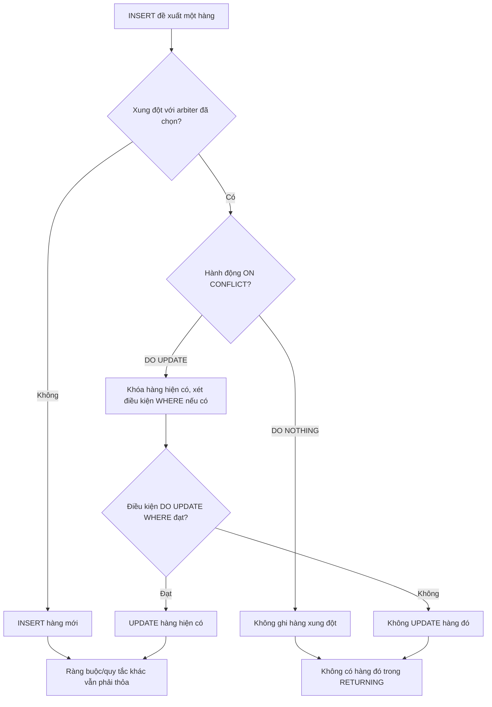
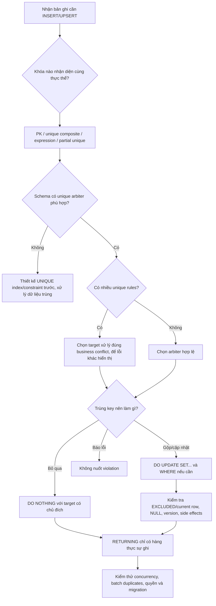

# INSERT ON CONFLICT và lựa chọn khóa xử lý xung đột

Trong PostgreSQL, `INSERT ... ON CONFLICT` cho phép xử lý trường hợp một hàng mới vi phạm **ràng buộc duy nhất** hoặc loại ràng buộc xung đột được hỗ trợ, thay vì để toàn bộ câu `INSERT` lập tức kết thúc bằng lỗi. Hai hành động phổ biến là:

- **`DO NOTHING`:** không ghi hàng gây xung đột.
- **`DO UPDATE`:** cập nhật hàng hiện có đã gây xung đột, thường được gọi là **UPSERT** (*UPDATE hoặc INSERT*).

Nhưng câu hỏi quan trọng nhất không phải “cú pháp UPSERT là gì?” mà là:

> **Xung đột dựa trên khóa nào, và khi khóa đó trùng thì nghiệp vụ thực sự muốn bỏ qua, cập nhật hay báo lỗi?**

Một bảng có thể có khóa chính tự sinh, khóa duy nhất theo mã nghiệp vụ và unique index có điều kiện. Chọn nhầm khóa khiến PostgreSQL xử lý **một loại trùng lặp khác với loại ứng dụng định xử lý**. Thậm chí `ON CONFLICT DO NOTHING` không chỉ rõ mục tiêu có thể âm thầm bỏ qua một lỗi mà ứng dụng cần biết.

Bài học thuộc chương **Thay đổi dữ liệu** của module PostgreSQL. Nội dung tập trung vào ngữ nghĩa ghi dữ liệu, lựa chọn *conflict arbiter* (khóa/index được dùng để nhận diện xung đột), hành vi đồng thời, xử lý dữ liệu nullable, truy vấn trả kết quả và sử dụng trong Java/JDBC.

## 1. UPSERT giải quyết vấn đề gì?

Giả sử bảng khách hàng có khóa duy nhất theo `(tenant_id, email)`:

```sql
CREATE TABLE customer (
    customer_id BIGINT GENERATED ALWAYS AS IDENTITY PRIMARY KEY,
    tenant_id BIGINT NOT NULL,
    email TEXT NOT NULL,
    full_name TEXT NOT NULL,
    CONSTRAINT uq_customer_tenant_email UNIQUE (tenant_id, email)
);
```

Một service nhận lại sự kiện tạo khách có cùng tenant và email. Nếu chỉ chèn:

```sql
INSERT INTO customer (tenant_id, email, full_name)
VALUES (10, 'lan@example.test', 'Lan');
```

lần đầu thành công, lần tiếp theo cùng khóa sẽ gặp `unique_violation` (SQLSTATE `23505`).

Nếu nghiệp vụ quy định “cùng email trong cùng tenant là cùng khách; cập nhật tên khi nhận bản ghi mới”, có thể dùng:

```sql
INSERT INTO customer AS c (tenant_id, email, full_name)
VALUES (10, 'lan@example.test', 'Lan Nguyễn')
ON CONFLICT (tenant_id, email)
DO UPDATE SET
    full_name = EXCLUDED.full_name;
```

Kết quả logic:

- **Chưa có khóa:** chèn một hàng.
- **Đã có khóa:** cập nhật `full_name` trên hàng hiện có.
- **Vi phạm một ràng buộc khác không thuộc mục tiêu đã chọn:** vẫn có thể báo lỗi.

Đây là một cách thực hiện nghiệp vụ “tạo hoặc cập nhật theo khóa”, nhưng không phải giải pháp tự động cho mọi loại đồng bộ, idempotency hay cạnh tranh ghi.

### 1.1. Sơ đồ quyết định



Sơ đồ mô tả luồng logic chính, không phải toàn bộ chi tiết index insertion, row locking, triggers, partition routing hay MVCC của PostgreSQL.

### 1.2. Những gì ON CONFLICT không thay thế

`ON CONFLICT` **không** phải cơ chế sửa mọi lỗi ghi dữ liệu. Nó không tự biến:

- Vi phạm `NOT NULL` thành giá trị mặc định.
- Vi phạm `CHECK` thành giá trị hợp lệ.
- Vi phạm foreign key thành quan hệ có thật.
- Dữ liệu sai kiểu thành dữ liệu đúng.
- Hai sự kiện khác nội dung nhưng cùng khóa thành một giao dịch idempotent an toàn.
- Một thao tác kiểm tra tồn tại trước đó thành khóa bảo đảm không ai khác thay đổi dữ liệu.

Cần hiểu loại constraint nào có thể làm *arbiter*, các constraint nào vẫn được kiểm tra độc lập và business rule nào cần xử lý riêng.

## 2. Cú pháp tổng quát

Dạng cơ bản:

```sql
INSERT INTO table_name [AS alias] (column_1, column_2, ...)
VALUES (...)
ON CONFLICT [conflict_target]
DO NOTHING
[RETURNING ...];
```

Hoặc:

```sql
INSERT INTO table_name [AS alias] (column_1, column_2, ...)
VALUES (...)
ON CONFLICT conflict_target
DO UPDATE SET
    column_1 = expression,
    column_2 = expression
[WHERE condition]
[RETURNING ...];
```

Trong PostgreSQL, conflict target thường có hai kiểu:

1. **Suy luận unique index** từ cột hoặc biểu thức, có thể thêm predicate của partial index.
2. **`ON CONSTRAINT constraint_name`** để chỉ đích danh một constraint có tên phù hợp.

Ví dụ:

```sql
ON CONFLICT (tenant_id, email) DO UPDATE ...

ON CONFLICT ON CONSTRAINT uq_customer_tenant_email DO UPDATE ...
```

**`DO UPDATE` yêu cầu conflict target.** Với `DO NOTHING`, target có thể bỏ qua; nhưng bỏ qua thường có ý nghĩa rộng hơn nhiều và cần được chủ động quyết định.

## 3. Phân biệt các loại khóa: primary key, unique key, natural key

Một bảng thường có nhiều ứng viên nhận diện dữ liệu:

| Loại khóa | Ví dụ | Ý nghĩa |
|---|---|---|
| Khóa chính tự sinh | `customer_id` identity | ID nội bộ ổn định của hàng |
| Unique key nghiệp vụ | `(tenant_id, email)` | Một email duy nhất trong một tenant |
| Unique key toàn cục | `external_event_id` | ID sự kiện đối tác đã xử lý |
| Unique key theo phạm vi | `(warehouse_id, sku)` | Mỗi SKU chỉ có một hàng tồn kho tại mỗi kho |
| Partial unique index | Email duy nhất trong các tài khoản chưa bị xóa | Chỉ kiểm tra uniqueness trên tập hàng thỏa điều kiện |
| Expression unique index | `(tenant_id, lower(email))` | Khóa so sánh được tính từ biểu thức |

Không phải mọi khóa “có vẻ định danh” đều có unique index. PostgreSQL cần một **arbiter được hỗ trợ trong schema**, không phải sự cam kết bằng lời của ứng dụng.

### 3.1. Chọn khóa theo ý nghĩa của yêu cầu

Nếu request gồm `customer_id` đã được xác nhận, có thể UPSERT theo PK khi đó là contract dữ liệu.

Nếu request chỉ gồm `tenant_id` và `email`, mà database cấp `customer_id` mới, UPSERT theo PK **không** nhận diện khách cùng email:

```sql
-- Không phù hợp cho nghiệp vụ tìm khách theo tenant/email:
INSERT INTO customer (tenant_id, email, full_name)
VALUES (10, 'lan@example.test', 'Lan')
ON CONFLICT (customer_id) DO UPDATE
SET full_name = EXCLUDED.full_name;
```

Vì `customer_id` không được cung cấp và do identity sinh mới, thông thường không có conflict PK. Nếu `(tenant_id,email)` đã tồn tại, PostgreSQL báo lỗi unique của khóa nghiệp vụ; câu `DO UPDATE` đã nhắm tới **PK khác**, nên không xử lý xung đột đó.

**Nguyên tắc:** chọn khóa theo cách **request định danh cùng một thực thể**, không theo cột thuận tay nhất để viết SQL.

## 4. Chuẩn bị cơ sở dữ liệu thử nghiệm

Các ví dụ bên dưới sử dụng schema `demo_upsert` trên một database lab. Không chạy trực tiếp trên production. Tạo các bảng một lần trên schema sạch để kết quả có thể dự đoán.

```sql
CREATE SCHEMA IF NOT EXISTS demo_upsert;

CREATE TABLE demo_upsert.customer (
    customer_id BIGINT GENERATED ALWAYS AS IDENTITY PRIMARY KEY,
    tenant_id BIGINT NOT NULL,
    email TEXT NOT NULL,
    full_name TEXT NOT NULL,
    phone TEXT,
    updated_at TIMESTAMPTZ NOT NULL DEFAULT statement_timestamp(),
    CONSTRAINT uq_customer_tenant_email UNIQUE (tenant_id, email),
    CONSTRAINT ck_customer_email_nonblank CHECK (length(btrim(email)) > 0),
    CONSTRAINT ck_customer_name_nonblank CHECK (length(btrim(full_name)) > 0)
);

CREATE TABLE demo_upsert.inventory (
    warehouse_id INTEGER NOT NULL,
    sku TEXT NOT NULL,
    available_qty INTEGER NOT NULL DEFAULT 0,
    updated_at TIMESTAMPTZ NOT NULL DEFAULT statement_timestamp(),
    CONSTRAINT pk_inventory PRIMARY KEY (warehouse_id, sku),
    CONSTRAINT ck_inventory_qty_nonnegative CHECK (available_qty >= 0)
);

CREATE TABLE demo_upsert.api_request (
    tenant_id BIGINT NOT NULL,
    idempotency_key TEXT NOT NULL,
    payload_hash TEXT NOT NULL,
    processed_at TIMESTAMPTZ NOT NULL DEFAULT statement_timestamp(),
    CONSTRAINT pk_api_request PRIMARY KEY (tenant_id, idempotency_key)
);
```

Ba tình huống:

- `customer`: PK tự sinh, nhưng business key là `(tenant_id,email)`.
- `inventory`: khóa ghép `(warehouse_id,sku)`; một SKU có thể ở nhiều kho.
- `api_request`: khóa idempotency phải có **phạm vi tenant**, tránh một request của tenant A chặn nhầm tenant B.

### 4.1. Chèn một vài hàng gốc

```sql
INSERT INTO demo_upsert.customer
    (tenant_id, email, full_name, phone)
VALUES
    (10, 'lan@example.test', 'Lan', NULL),
    (10, 'minh@example.test', 'Minh', '0900000001'),
    (20, 'lan@example.test', 'Lan ở tenant 20', NULL);

INSERT INTO demo_upsert.inventory
    (warehouse_id, sku, available_qty)
VALUES
    (1, 'SKU-BOOK', 12),
    (1, 'SKU-PEN', 30),
    (2, 'SKU-BOOK', 5);
```

Cùng `email` ở tenant 10 và 20 hợp lệ vì uniqueness theo cặp `(tenant_id,email)`. Cùng `SKU-BOOK` ở hai kho cũng hợp lệ.

### 4.2. Quan sát dữ liệu mà không đoán ID identity

```sql
SELECT
    customer_id, tenant_id, email, full_name, phone
FROM demo_upsert.customer
ORDER BY tenant_id, email;

SELECT warehouse_id, sku, available_qty
FROM demo_upsert.inventory
ORDER BY warehouse_id, sku;
```

Không giả định identity ID luôn bắt đầu từ 1 trong một database đã dùng trước hoặc luôn liên tục sau các statement lỗi. Trong bài, nhận diện khách bằng tenant/email để các ví dụ không phụ thuộc ID cụ thể.

## 5. DO NOTHING theo một khóa rõ ràng

Muốn chèn một khách nếu cặp tenant/email chưa tồn tại, và **không sửa khách hiện có**:

```sql
INSERT INTO demo_upsert.customer
    (tenant_id, email, full_name)
VALUES
    (10, 'lan@example.test', 'Tên gửi lần hai')
ON CONFLICT (tenant_id, email)
DO NOTHING
RETURNING customer_id, tenant_id, email, full_name;
```

Hàng này xung đột với `uq_customer_tenant_email` nên không được chèn, cũng không cập nhật tên cũ. `RETURNING` không trả hàng cho đầu vào bị bỏ qua.

Thử email mới:

```sql
INSERT INTO demo_upsert.customer
    (tenant_id, email, full_name)
VALUES
    (10, 'hoa@example.test', 'Hoa')
ON CONFLICT (tenant_id, email)
DO NOTHING
RETURNING customer_id, email, full_name;
```

Lần đầu có thể chèn và trả hàng; chạy lại cùng SQL sẽ bỏ qua và không trả hàng.

### 5.1. DO NOTHING không đồng nghĩa “trả hàng đã tồn tại”

Nếu `DO NOTHING` xảy ra, PostgreSQL không tự trả hàng hiện có trong `RETURNING`. Ứng dụng muốn lấy ID cũ cần có **bước đọc thích hợp** hoặc một thiết kế query/transaction khác.

Không giả định:

```java
if (!rs.next()) {
    // PostgreSQL đã trả customer_id cũ
}
```

Nhánh không có row chỉ cho biết **câu INSERT này không trả hàng được chèn/cập nhật**; không cung cấp ID cũ.

### 5.2. DO NOTHING không chỉ rõ target

```sql
INSERT INTO demo_upsert.customer
    (tenant_id, email, full_name)
VALUES
    (10, 'lan@example.test', 'Tên mới')
ON CONFLICT DO NOTHING;
```

Với `DO NOTHING`, bỏ `conflict_target` là hợp lệ. PostgreSQL có thể xử lý xung đột trên **các unique/index hoặc exclusion constraint đủ điều kiện**, không chỉ một khóa doanh nghiệp mong muốn.

Điều này hữu ích khi yêu cầu thật sự là “hàng nào vi phạm một loại ràng buộc xung đột được hỗ trợ thì bỏ qua”. Nhưng nó **có thể che lỗi dữ liệu** nếu ứng dụng chỉ định bỏ qua trùng email mà không định bỏ qua trùng external ID ở một ràng buộc khác.

Một số lỗi như `CHECK`, `NOT NULL` và foreign key vẫn không được `DO NOTHING` coi là xung đột được phép bỏ qua.

## 6. DO UPDATE: cập nhật đúng hàng gây xung đột

Ví dụ đồng bộ tên và số điện thoại của khách theo tenant/email:

```sql
INSERT INTO demo_upsert.customer AS c
    (tenant_id, email, full_name, phone)
VALUES
    (10, 'lan@example.test', 'Lan Nguyễn', '0900000009')
ON CONFLICT (tenant_id, email)
DO UPDATE SET
    full_name = EXCLUDED.full_name,
    phone = EXCLUDED.phone,
    updated_at = statement_timestamp()
RETURNING
    c.customer_id, c.tenant_id, c.email,
    c.full_name, c.phone, c.updated_at;
```

Trong nhánh `DO UPDATE`:

- `c` là alias của **hàng hiện có trong bảng đích**.
- `EXCLUDED` biểu diễn hàng **đã được đề xuất để INSERT**, nhưng gặp xung đột.
- `EXCLUDED.full_name` là giá trị mới được gửi trong `VALUES`.
- `c.customer_id` vẫn là ID của hàng cũ nếu xung đột business key.

Kết quả về mặt nghiệp vụ: khách Lan tenant 10 được cập nhật, không tạo khách mới.

### 6.1. Vì sao gọi EXCLUDED?

Hàng từ `VALUES` đã bị **loại khỏi đường INSERT trực tiếp** khi phát hiện xung đột. PostgreSQL cho phép tham chiếu các giá trị đề xuất ấy trong nhánh cập nhật qua tên đặc biệt `EXCLUDED`.

```text
Hàng hiện có c:
  tenant_id = 10
  email = lan@example.test
  full_name = Lan

Hàng đề xuất EXCLUDED:
  tenant_id = 10
  email = lan@example.test
  full_name = Lan Nguyễn

Arbiter (tenant_id, email) phát hiện trùng.
DO UPDATE:
  c.full_name = EXCLUDED.full_name

Kết quả:
  cùng customer_id, tên mới = Lan Nguyễn
```

`EXCLUDED` không phải một bảng vật lý, không tồn tại ngoài statement và không cần tạo trong database.

### 6.2. Khi target table tên "excluded"

`EXCLUDED` là tên đặc biệt; nếu bảng đích có tên `excluded`, có thể gây trùng tên khi tham chiếu. PostgreSQL cho phép đặt alias cho target để tránh nhầm:

```sql
INSERT INTO excluded AS e (...) VALUES (...)
ON CONFLICT (...) DO UPDATE SET
    column_name = EXCLUDED.column_name;
```

Đây là **mẫu cú pháp**, không có bảng `excluded` trong lab. Đừng dùng nguyên văn câu trên như ví dụ hoàn chỉnh.

### 6.3. EXCLUDED có thể phản ánh BEFORE INSERT trigger

Trong PostgreSQL, tác động của **row-level BEFORE INSERT trigger** có thể được phản ánh trong các giá trị `EXCLUDED`, vì trigger có thể biến đổi hàng đề xuất trước khi conflict action dùng nó.

Do đó, `EXCLUDED.email` không nhất thiết luôn bằng chính xác chuỗi input ban đầu nếu một trigger chuẩn hóa email hoặc thay đổi dữ liệu.

Cần hiểu toàn bộ chuỗi xử lý gồm default, trigger, constraint và upsert; không xây giả định “EXCLUDED = raw HTTP JSON” khi schema có trigger.

## 7. Lựa chọn conflict target: suy luận index hay ON CONSTRAINT?

PostgreSQL hỗ trợ hai cách phổ biến để chỉ định arbiter.

### 7.1. Suy luận unique index bằng danh sách cột

```sql
INSERT INTO demo_upsert.customer
    (tenant_id, email, full_name)
VALUES
    (10, 'minh@example.test', 'Minh cập nhật')
ON CONFLICT (tenant_id, email)
DO UPDATE SET
    full_name = EXCLUDED.full_name;
```

PostgreSQL tìm unique index phù hợp với danh sách cột/biểu thức đã khai báo để xác định xung đột. Với `uq_customer_tenant_email`, cách này hợp lệ.

Ưu điểm:

- Không phụ thuộc trực tiếp vào **tên constraint** trong SQL ứng dụng.
- Phù hợp với thiết kế tạo/rebuild unique index mà vẫn giữ quy tắc khóa.
- Thể hiện khóa nghiệp vụ ở chính câu SQL.

### 7.2. Chỉ định constraint bằng tên

```sql
INSERT INTO demo_upsert.customer
    (tenant_id, email, full_name)
VALUES
    (10, 'minh@example.test', 'Minh cập nhật lần nữa')
ON CONFLICT ON CONSTRAINT uq_customer_tenant_email
DO UPDATE SET
    full_name = EXCLUDED.full_name;
```

Đây là cách tham chiếu constraint có tên rõ ràng. Nó phù hợp khi muốn gắn contract SQL với một constraint cụ thể.

Tuy nhiên, nếu sau này đổi tên/drop constraint, câu SQL sẽ cần cập nhật. PostgreSQL thường khuyến nghị **unique-index inference** khi muốn linh hoạt thay thế index tương đương trong các migration.

### 7.3. Không dùng tên index tùy ý với ON CONSTRAINT

Một **standalone unique index** tạo bằng `CREATE UNIQUE INDEX` không phải lúc nào cũng có một constraint cùng tên để dùng qua `ON CONSTRAINT`. Đặc biệt, một **partial unique index** hoặc **expression unique index** thường cần được chỉ định thông qua **index inference**, không phải `ON CONSTRAINT index_name`.

Mẹo nhớ:

- `ON CONFLICT (cột, biểu_thức, ...) [WHERE predicate]`: suy luận unique index.
- `ON CONFLICT ON CONSTRAINT tên_constraint`: chỉ đích danh constraint tương thích.
- Không dùng `ON CONSTRAINT` như một cú pháp thay thế `ON INDEX tên_index`; PostgreSQL không có dạng chung như vậy.

## 8. Một bảng có nhiều khóa duy nhất: chọn đúng xung đột

Giả sử cần lưu sản phẩm từ hệ thống đối tác:

```sql
CREATE TABLE demo_upsert.partner_product (
    product_id BIGINT GENERATED ALWAYS AS IDENTITY PRIMARY KEY,
    tenant_id BIGINT NOT NULL,
    sku TEXT NOT NULL,
    external_id TEXT NOT NULL,
    product_name TEXT NOT NULL,
    CONSTRAINT uq_partner_product_tenant_sku UNIQUE (tenant_id, sku),
    CONSTRAINT uq_partner_product_tenant_external UNIQUE (tenant_id, external_id)
);
```

Bảng có ít nhất ba unique rules:

1. `product_id` là PK.
2. `(tenant_id, sku)` duy nhất.
3. `(tenant_id, external_id)` duy nhất.

Tạo một hàng:

```sql
INSERT INTO demo_upsert.partner_product
    (tenant_id, sku, external_id, product_name)
VALUES
    (10, 'SKU-BOOK', 'EXT-100', 'Sách');
```

Nếu nhận:

```sql
INSERT INTO demo_upsert.partner_product
    (tenant_id, sku, external_id, product_name)
VALUES
    (10, 'SKU-BOOK', 'EXT-200', 'Sách đổi mã ngoài')
ON CONFLICT (tenant_id, sku)
DO UPDATE SET
    external_id = EXCLUDED.external_id,
    product_name = EXCLUDED.product_name;
```

Hàng cùng SKU sẽ được cập nhật `external_id` thành `EXT-200`, **miễn** giá trị đó không vi phạm unique theo `(tenant_id, external_id)`.

Nếu nhận một bản ghi cùng `external_id` nhưng khác `sku`:

```sql
-- Cố tình gây xung đột unique KHÁC target:
INSERT INTO demo_upsert.partner_product
    (tenant_id, sku, external_id, product_name)
VALUES
    (10, 'SKU-OTHER', 'EXT-200', 'Bản ghi khác')
ON CONFLICT (tenant_id, sku)
DO UPDATE SET
    product_name = EXCLUDED.product_name;
```

Với dữ liệu sau câu cập nhật trên, câu này vi phạm `uq_partner_product_tenant_external` và có thể báo SQLSTATE `23505`. `ON CONFLICT (tenant_id, sku)` không tự đổi hướng sang external ID.

### 8.1. Vì sao đây là hành vi tốt?

Nếu hai khóa biểu diễn hai cách nhận diện có thể **mâu thuẫn**, tự chọn bất kỳ hàng nào để cập nhật sẽ nguy hiểm:

- Có thể ghép dữ liệu của hai sản phẩm khác nhau.
- Có thể chuyển external ID từ sản phẩm này sang sản phẩm khác.
- Có thể ghi đè một mapping đã đối soát.
- Có thể tạo giao dịch thành công nhưng dữ liệu sai.

PostgreSQL yêu cầu bạn nói rõ **loại xung đột muốn giải quyết**. Một xung đột trên unique rule khác vẫn nên được xem là tín hiệu cần xử lý nghiệp vụ.

### 8.2. DO NOTHING không target có thể che lỗi

```sql
INSERT INTO demo_upsert.partner_product
    (tenant_id, sku, external_id, product_name)
VALUES
    (10, 'SKU-OTHER', 'EXT-200', 'Bản ghi khác')
ON CONFLICT DO NOTHING;
```

Lệnh này có thể âm thầm bỏ hàng vì vướng unique external ID, dù ứng dụng thực sự đang muốn báo lỗi mapping. Đó là lý do **không nên dùng `DO NOTHING` không target như cách chữa mọi `23505`**.

## 9. Khóa ghép: không mất phạm vi tenant hoặc kho

Tồn kho theo từng kho:

```sql
CONSTRAINT pk_inventory PRIMARY KEY (warehouse_id, sku)
```

Đơn nhập thêm 4 cuốn `SKU-BOOK` vào kho 1:

```sql
INSERT INTO demo_upsert.inventory AS i
    (warehouse_id, sku, available_qty)
VALUES
    (1, 'SKU-BOOK', 4)
ON CONFLICT (warehouse_id, sku)
DO UPDATE SET
    available_qty = i.available_qty + EXCLUDED.available_qty,
    updated_at = statement_timestamp()
RETURNING warehouse_id, sku, available_qty;
```

Với dữ liệu ban đầu 12, số lượng mới của kho 1 là 16. Kho 2 vẫn có 5.

Nếu chỉ định khóa là `(sku)` nhưng schema chỉ có PK `(warehouse_id,sku)`, PostgreSQL không thể tìm unique arbiter tương ứng, thường báo:

```text
ERROR: there is no unique or exclusion constraint matching the ON CONFLICT specification
```

Đó là dấu hiệu khóa được chọn **không khớp luật duy nhất thực tế**.

### 9.1. Bỏ tenant_id là lỗi cô lập dữ liệu

Nếu áp uniqueness email toàn cục trong hệ thống đa tenant mà yêu cầu chỉ độc nhất **trong từng tenant**, khách có cùng email ở các tenant khác nhau sẽ bị chặn nhầm.

Ngược lại, nếu luật nghiệp vụ thực sự yêu cầu một email duy nhất toàn hệ thống, target `(tenant_id,email)` có thể cho phép những bản ghi bạn không muốn. Chọn khóa theo **phạm vi định danh thực**, không theo mô hình quen tay.

### 9.2. Key order trong inference

Với suy luận unique index, danh sách cột/biểu thức được đối chiếu không đơn giản là một phép khớp chuỗi theo thứ tự văn bản. PostgreSQL có thể suy luận một unique index phù hợp trên cùng tập key theo các quy tắc inference của nó.

Tuy nhiên, **không suy ra hai index khác thứ tự cột luôn tương đương về hiệu năng**. `(tenant_id,email)` và `(email,tenant_id)` có thể có những chiến lược truy cập khác nhau khi lọc chỉ một thành phần. Chọn định nghĩa index dựa trên cả uniqueness và workload.

## 10. DO UPDATE SET: gán mới hay cộng dồn?

Hai cách cập nhật tưởng giống nhau nhưng khác nghiệp vụ.

### 10.1. Replace: nguồn mới là trạng thái cuối

```sql
INSERT INTO demo_upsert.inventory AS i
    (warehouse_id, sku, available_qty)
VALUES
    (1, 'SKU-PEN', 25)
ON CONFLICT (warehouse_id, sku)
DO UPDATE SET
    available_qty = EXCLUDED.available_qty,
    updated_at = statement_timestamp()
RETURNING available_qty;
```

Hành vi này **ghi đè** số lượng thành 25. Phù hợp nếu sự kiện nguồn là một snapshot số lượng tồn đã kiểm soát.

### 10.2. Increment: sự kiện là số cộng thêm

```sql
INSERT INTO demo_upsert.inventory AS i
    (warehouse_id, sku, available_qty)
VALUES
    (1, 'SKU-PEN', 5)
ON CONFLICT (warehouse_id, sku)
DO UPDATE SET
    available_qty = i.available_qty + EXCLUDED.available_qty,
    updated_at = statement_timestamp()
RETURNING available_qty;
```

Hành vi này **cộng thêm 5** lên giá trị hiện tại. Nó phù hợp nếu sự kiện là một lần nhập hàng **chưa được áp dụng**.

### 10.3. Tại sao increment không tự idempotent?

Nếu cùng một sự kiện “nhập thêm 5” được gửi lại hai lần, câu cộng dồn sẽ cộng hai lần. `ON CONFLICT` làm thao tác cộng lên **đúng hàng** một cách nguyên tử theo xung đột uniqueness, nhưng **không nhận diện hai request là cùng một sự kiện**.

Muốn chống xử lý trùng một sự kiện, cần thiết kế khóa idempotency/sổ sự kiện và cùng transaction với việc cộng tồn kho. Không coi riêng `ON CONFLICT ... SET qty = qty + EXCLUDED.qty` là giải pháp exactly-once.

### 10.4. Đừng dùng UPSERT cộng số lượng để trừ kho thiếu điều kiện

Trừ tồn kho cần bảo đảm đủ hàng:

```sql
UPDATE demo_upsert.inventory AS i
SET available_qty = i.available_qty - 3,
    updated_at = statement_timestamp()
WHERE warehouse_id = 1
  AND sku = 'SKU-BOOK'
  AND i.available_qty >= 3
RETURNING i.warehouse_id, i.sku, i.available_qty;
```

Một statement `UPDATE ... WHERE available_qty >= 3` giúp kiểm tra và trừ trên cùng hàng bị khóa. Cần đọc affected-row count/`RETURNING` để biết có trừ thành công hay không.

Nếu dùng UPSERT với delta âm, nhánh INSERT cho kho/SKU chưa tồn tại có thể vi phạm `CHECK available_qty >= 0` hoặc tạo hành vi không mong muốn. Đừng chọn UPSERT chỉ vì có vẻ bao quát cả insert và update khi bài toán cần kiểm tra tồn kho.

## 11. EXCLUDED khác giá trị hiện tại của bảng

Trong nhánh DO UPDATE, hiểu rõ nguồn dữ liệu:

| Biểu thức | Nguồn |
|---|---|
| `i.available_qty` | Giá trị hiện có ở hàng xung đột |
| `EXCLUDED.available_qty` | Giá trị đề xuất đưa vào INSERT |
| `i.available_qty + EXCLUDED.available_qty` | Kết hợp hai nguồn, nếu nghiệp vụ cho phép |
| `statement_timestamp()` | Thời điểm bắt đầu statement theo PostgreSQL |
| `DEFAULT` trong INSERT | Biểu thức mặc định khi cột bị bỏ hoặc được gán DEFAULT |

Ví dụ:

```sql
INSERT INTO demo_upsert.customer AS c
    (tenant_id, email, full_name, phone)
VALUES
    (10, 'minh@example.test', 'Minh mới', NULL)
ON CONFLICT (tenant_id, email)
DO UPDATE SET
    full_name = EXCLUDED.full_name,
    phone = EXCLUDED.phone;
```

Câu này có thể **xóa số điện thoại cũ** của Minh thành NULL, vì client đề xuất NULL rõ ràng.

Nếu nghiệp vụ nói “phone không được gửi thì giữ giá trị cũ”, không nên tự đánh đồng **không có trường trong JSON** với **client cố tình gửi NULL**. Phải định nghĩa hợp đồng cập nhật.

### 11.1. COALESCE có thể dùng nhưng phải đúng nghĩa

```sql
ON CONFLICT (tenant_id, email)
DO UPDATE SET
    phone = COALESCE(EXCLUDED.phone, c.phone)
```

Ở đây NULL từ request có nghĩa “giữ phone cũ”. Cách viết này **không cho phép client xóa phone bằng NULL**. Nếu nghiệp vụ cần xóa phone, API phải có một dấu hiệu riêng hoặc một lệnh UPDATE khác.

Không có một công thức `COALESCE` đúng cho mọi API PATCH/PUT. Quy tắc cập nhật nullable phải được thiết kế tường minh.

### 11.2. Default chỉ dùng khi request yêu cầu mặc định

Nếu một cột có `DEFAULT 'NEW'`:

- Bỏ cột khỏi `INSERT` → PostgreSQL dùng default.
- Gán `DEFAULT` trong ngữ cảnh cho phép → dùng default.
- Gán `NULL` rõ ràng → **không** tự dùng default; có thể vi phạm NOT NULL.
- Trong `DO UPDATE`, dùng `EXCLUDED.column` sẽ lấy giá trị đề xuất sau quá trình xử lý giá trị mặc định/trigger phù hợp, không có quy tắc “NULL thành DEFAULT” tự động.

Đó là lý do cần xem **SQL thực tế do ORM sinh**, không chỉ xem annotation Java.

## 12. DO UPDATE WHERE: chỉ cập nhật khi thật sự cần

Một optimization thường hữu ích là tránh UPDATE khi dữ liệu mới không khác dữ liệu hiện có:

```sql
INSERT INTO demo_upsert.customer AS c
    (tenant_id, email, full_name, phone)
VALUES
    (10, 'lan@example.test', 'Lan Nguyễn', '0900000009')
ON CONFLICT (tenant_id, email)
DO UPDATE SET
    full_name = EXCLUDED.full_name,
    phone = EXCLUDED.phone,
    updated_at = statement_timestamp()
WHERE
    (c.full_name, c.phone)
    IS DISTINCT FROM
    (EXCLUDED.full_name, EXCLUDED.phone)
RETURNING c.customer_id, c.full_name, c.phone, c.updated_at;
```

`IS DISTINCT FROM` so sánh có xét NULL:

- Hai NULL → không khác.
- Một NULL và một giá trị → khác.
- Hai giá trị khác nhau → khác.

Điều kiện `WHERE` của nhánh `DO UPDATE` chỉ cho UPDATE khi ít nhất một trường thực sự khác theo equality được dùng.

### 12.1. WHERE được đánh giá khi nào?

PostgreSQL đã xác định hàng gây xung đột và có thể **khóa hàng hiện có** trước khi đánh giá điều kiện `WHERE` của `DO UPDATE`. Nếu `WHERE` là FALSE, hàng không được cập nhật nhưng **vẫn có thể đã bị khóa** trong statement/transaction.

Điều này quan trọng dưới concurrency: `DO UPDATE ... WHERE FALSE` không nhất thiết “không tốn tài nguyên” hoặc “không chờ khóa”.

### 12.2. RETURNING khi điều kiện WHERE không đạt

Một hàng đã xung đột nhưng **không được UPDATE vì `WHERE` FALSE** không xuất hiện trong `RETURNING`. Với `DO NOTHING` cũng vậy.

Do đó client không thể hiểu số hàng `RETURNING` ít hơn số input là “tất cả các hàng còn lại đã tồn tại và có cùng dữ liệu”. Cần xét các nhánh logic và số hàng kết quả thật.

### 12.3. Tránh UPDATE vô ích nhưng đừng bỏ qua audit rule

UPDATE có thể kích hoạt trigger, tăng WAL và tạo phiên bản hàng mới dù giá trị không đổi. Điều kiện `IS DISTINCT FROM` có thể giảm những lần ghi này.

Nhưng nếu yêu cầu nghiệp vụ là **ghi lại thời điểm nhận thông điệp dù payload không đổi**, bỏ UPDATE sẽ không cập nhật timestamp hay audit trail. Cần xác định “thay đổi dữ liệu” hay “sự kiện được xử lý” mới là điều cần ghi.

## 13. RETURNING để biết kết quả thực tế

`RETURNING` cho phép nhận dữ liệu của các hàng **được INSERT hoặc UPDATE**:

```sql
INSERT INTO demo_upsert.inventory AS i
    (warehouse_id, sku, available_qty)
VALUES
    (3, 'SKU-BOOK', 7)
ON CONFLICT (warehouse_id, sku)
DO UPDATE SET
    available_qty = EXCLUDED.available_qty
RETURNING
    i.warehouse_id, i.sku, i.available_qty, i.updated_at;
```

Nếu kho 3 chưa có SKU này, hàng được chèn và trả dữ liệu. Nếu đã có, hàng được cập nhật và được trả.

### 13.1. RETURNING không tự cho một cờ inserted/updated di động

Không nên mặc định PostgreSQL luôn cung cấp một cột chuẩn `inserted = true/false` trong mọi phiên bản/driver chỉ vì dùng `ON CONFLICT`.

Một số bài viết dùng các trường hệ thống như `xmax` để suy đoán một hàng vừa được insert hay update. Đây là **mẹo phụ thuộc chi tiết triển khai MVCC**, không nên làm contract lâu dài cho API mà không hiểu phiên bản và thay đổi tương lai.

Nếu ứng dụng cần phân biệt “created” và “updated” chắc chắn, hãy thiết kế cơ chế có chủ đích (chẳng hạn state/event log, workflow ứng dụng hoặc khả năng `RETURNING` của phiên bản cụ thể đã được xác minh).

### 13.2. Đếm số hàng thành công

Với nhiều hàng đầu vào, `RETURNING` có thể trả hàng cho những INSERT/UPDATE được thực hiện, nhưng không trả hàng cho:

- Hàng bị `DO NOTHING` bỏ qua.
- Hàng xung đột bị `DO UPDATE WHERE` loại khỏi việc UPDATE.

Vì vậy số hàng trả về là một **quan sát về những hàng đã được ghi**, không nhất thiết là số request đầu vào hợp lệ hoặc số entity tồn tại sau câu lệnh.

## 14. Chọn khóa suy luận từ expression unique index

Giả sử nghiệp vụ muốn email không phân biệt hoa/thường **trong mỗi tenant**. Unique constraint trực tiếp trên `(tenant_id, email)` của bảng `customer` hiện đang phân biệt theo equality của collation mặc định (nếu deterministic). Ta tạo **bảng lab khác** để không xung đột hai chính sách.

```sql
CREATE TABLE demo_upsert.account (
    account_id BIGINT GENERATED ALWAYS AS IDENTITY PRIMARY KEY,
    tenant_id BIGINT NOT NULL,
    email TEXT NOT NULL,
    display_name TEXT NOT NULL
);

CREATE UNIQUE INDEX ux_account_tenant_lower_email
ON demo_upsert.account (tenant_id, lower(email));
```

Khóa duy nhất thực tế là `(tenant_id, lower(email))`. Câu UPSERT phải suy luận đúng expression:

```sql
INSERT INTO demo_upsert.account AS a
    (tenant_id, email, display_name)
VALUES
    (10, 'LAN@example.test', 'Lan')
ON CONFLICT (tenant_id, (lower(email)))
DO UPDATE SET
    display_name = EXCLUDED.display_name
RETURNING a.account_id, a.email, a.display_name;
```

Gửi lại `lan@example.test`:

```sql
INSERT INTO demo_upsert.account AS a
    (tenant_id, email, display_name)
VALUES
    (10, 'lan@example.test', 'Lan Nguyễn')
ON CONFLICT (tenant_id, (lower(email)))
DO UPDATE SET
    display_name = EXCLUDED.display_name
RETURNING a.account_id, a.email, a.display_name;
```

Nếu expression index đánh giá hai khóa tương đương, hàng cũ được cập nhật. Câu ví dụ **không** thay `a.email`, nên cách viết email ban đầu có thể được giữ; chỉ display name được cập nhật.

### 14.1. ON CONSTRAINT không tham chiếu standalone expression index

Câu kiểu:

```sql
-- KHÔNG dùng khi ux_account_tenant_lower_email chỉ là index:
ON CONFLICT ON CONSTRAINT ux_account_tenant_lower_email
DO UPDATE ...
```

không hợp lệ vì đó là tên **index biểu thức**, không phải tên constraint tương thích. Dùng inference `(tenant_id, (lower(email)))`.

### 14.2. Expression index không là Unicode canonical policy đầy đủ

`lower(email)` không tự giải quyết mọi dạng Unicode, dấu, quy tắc email quốc tế hóa hay bảo mật identifier. Nếu hệ thống cần casefold/normalization cụ thể, phải định nghĩa policy rõ và bảo đảm unique key/truy vấn lookup dùng cùng policy.

Cũng cần chú ý: thay collation hoặc thuật toán normalization có thể làm xuất hiện cặp dữ liệu nay bị coi là trùng; migration phải xử lý trước.

## 15. Partial unique index: bản ghi xóa mềm

Một ứng dụng cho phép nhiều bản ghi lịch sử dùng cùng email, nhưng chỉ cho **một tài khoản active (chưa soft-delete)** trên mỗi tenant/email.

```sql
CREATE TABLE demo_upsert.soft_account (
    account_id BIGINT GENERATED ALWAYS AS IDENTITY PRIMARY KEY,
    tenant_id BIGINT NOT NULL,
    email TEXT NOT NULL,
    full_name TEXT NOT NULL,
    deleted_at TIMESTAMPTZ
);

CREATE UNIQUE INDEX ux_soft_account_active_email
ON demo_upsert.soft_account (tenant_id, lower(email))
WHERE deleted_at IS NULL;
```

Unique index chỉ bao gồm hàng có `deleted_at IS NULL`. Hàng đã soft-delete nằm ngoài tập này.

### 15.1. Tạo tài khoản active

```sql
INSERT INTO demo_upsert.soft_account
    (tenant_id, email, full_name, deleted_at)
VALUES
    (10, 'lan@example.test', 'Lan', NULL);
```

### 15.2. UPSERT đúng partial index

```sql
INSERT INTO demo_upsert.soft_account AS a
    (tenant_id, email, full_name, deleted_at)
VALUES
    (10, 'LAN@example.test', 'Lan Nguyễn', NULL)
ON CONFLICT (tenant_id, (lower(email)))
WHERE deleted_at IS NULL
DO UPDATE SET
    full_name = EXCLUDED.full_name
RETURNING a.account_id, a.email, a.full_name, a.deleted_at;
```

**`WHERE deleted_at IS NULL` ngay sau conflict target** là **predicate dùng cho suy luận arbiter**, không phải điều kiện lọc update.

### 15.3. Hai chỗ WHERE có hai vai trò khác nhau

```sql
INSERT INTO demo_upsert.soft_account AS a
    (tenant_id, email, full_name, deleted_at)
VALUES
    (10, 'LAN@example.test', 'Lan khác', NULL)
ON CONFLICT (tenant_id, (lower(email)))
WHERE deleted_at IS NULL         -- (A) infer partial unique index
DO UPDATE SET
    full_name = EXCLUDED.full_name
WHERE a.full_name IS DISTINCT FROM EXCLUDED.full_name  -- (B) gate UPDATE
RETURNING a.account_id, a.full_name;
```

- **(A)** sau `ON CONFLICT (...)`: giúp chọn **unique index làm arbiter**.
- **(B)** sau `DO UPDATE SET`: quyết định có thật sự **UPDATE hàng hiện có** hay không.

Hai vị trí trông giống nhau nhưng chức năng khác nhau. Đặt sai chỗ có thể làm PostgreSQL không tìm thấy index hoặc cập nhật không đúng mong muốn.

### 15.4. Nên hiểu giới hạn của partial index

Nếu thêm một hàng `deleted_at IS NOT NULL`, nó **không nằm trong partial unique index active** và có thể không gây xung đột với hàng active cùng email. Điều này phù hợp với thiết kế “nhiều bản ghi lịch sử”.

Nhưng nếu mục tiêu là **khôi phục hàng đã xóa mềm** thay vì tạo hàng active mới, một UPSERT theo partial unique key **không tự biết phải cập nhật hàng đã bị soft-delete**: hàng đó không tham gia arbiter.

Phải thiết kế một workflow restore riêng dựa trên `account_id` hoặc khóa/history policy phù hợp.

### 15.5. Non-partial index có thể cũng được suy luận

Khi dùng unique index inference với predicate, PostgreSQL có những quy tắc nhận diện arbiter; một **non-partial unique index** phù hợp cùng tập key cũng có thể được suy luận ngay cả khi target có predicate phù hợp.

Vì thế không nên nghĩ “ghi `WHERE deleted_at IS NULL` thì PostgreSQL chắc chắn bỏ qua mọi unique index khác”. Nếu schema có cả unique toàn phần trên cùng key, luật uniqueness của nó vẫn áp dụng và có thể làm thay đổi khả năng chèn các hàng lịch sử.

**Đọc toàn bộ danh sách unique constraints/indexes**, không suy luận chỉ từ một câu UPSERT.

## 16. UNIQUE và NULL: vì sao “trùng NULL” không tự xảy ra?

Với unique constraint thông thường, PostgreSQL thường coi các giá trị NULL là **khác biệt về mục đích kiểm tra uniqueness**. Điều này có thể dẫn đến nhiều hàng có cùng những key không NULL và cùng một thành phần NULL được chèn hợp lệ, tùy tổ hợp khóa.

Ví dụ:

```sql
CREATE TABLE demo_upsert.external_mapping (
    mapping_id BIGINT GENERATED ALWAYS AS IDENTITY PRIMARY KEY,
    tenant_id BIGINT NOT NULL,
    external_code TEXT,
    source_name TEXT NOT NULL,
    CONSTRAINT uq_external_mapping
        UNIQUE (tenant_id, external_code)
);
```

Chèn:

```sql
INSERT INTO demo_upsert.external_mapping
    (tenant_id, external_code, source_name)
VALUES
    (10, NULL, 'source-A'),
    (10, NULL, 'source-B')
ON CONFLICT (tenant_id, external_code)
DO NOTHING
RETURNING mapping_id, source_name;
```

Với unique mặc định, cả hai hàng **có thể được chèn** vì `external_code` NULL không tạo xung đột unique theo cách nhiều người dự đoán.

### 16.1. UNIQUE NULLS NOT DISTINCT (PostgreSQL 15+)

Khi nghiệp vụ cần NULL được coi là cùng một giá trị cho uniqueness:

```sql
CREATE TABLE demo_upsert.external_mapping_strict (
    mapping_id BIGINT GENERATED ALWAYS AS IDENTITY PRIMARY KEY,
    tenant_id BIGINT NOT NULL,
    external_code TEXT,
    source_name TEXT NOT NULL,
    CONSTRAINT uq_external_mapping_strict
        UNIQUE NULLS NOT DISTINCT (tenant_id, external_code)
);
```

Ở đây, hai hàng cùng `tenant_id=10` và `external_code=NULL` không thể cùng tồn tại theo unique constraint này.

```sql
INSERT INTO demo_upsert.external_mapping_strict
    (tenant_id, external_code, source_name)
VALUES
    (10, NULL, 'source-A');

INSERT INTO demo_upsert.external_mapping_strict
    (tenant_id, external_code, source_name)
VALUES
    (10, NULL, 'source-B')
ON CONFLICT ON CONSTRAINT uq_external_mapping_strict
DO UPDATE SET
    source_name = EXCLUDED.source_name;
```

Lần thứ hai nhận diện xung đột theo constraint và cập nhật hàng nguồn A thành B.

**Cân nhắc nghiệp vụ:** “chưa biết external_code” không nhất thiết nghĩa “tất cả source có external_code chưa biết là cùng một thực thể”. `NULLS NOT DISTINCT` chỉ phù hợp nếu đúng là bạn muốn tối đa một hàng thiếu mã trong mỗi tenant.

### 16.2. Không tự thay NULL bằng chuỗi giả

Một default kiểu `'UNKNOWN'` có thể làm tất cả hàng thiếu mã dùng chung một giá trị, gây collision hoặc tệ hơn làm người đọc tưởng đó là mã thật. Khi cần unique hoặc idempotency, hãy thiết kế khóa có ý nghĩa thật thay vì đưa sentinel tùy tiện.

## 17. Khi không có unique arbiter phù hợp

Một câu:

```sql
ON CONFLICT (tenant_id, email)
DO UPDATE ...
```

chỉ khả thi khi schema có **unique index/constraint thích hợp** cho cặp key đó (theo các quy tắc inference và ràng buộc được hỗ trợ).

Nếu hai cột chỉ có index thường:

```sql
CREATE INDEX idx_customer_tenant_email_nonunique
ON some_table (tenant_id, email);
```

thì đó **không** phải arbiter hợp lệ để xử lý uniqueness. Ví dụ trên là mẫu DDL minh họa, bảng `some_table` không nằm trong schema lab.

### 17.1. Chỉ có CHECK không đủ

```sql
CHECK (length(email) > 0)
```

là ràng buộc tính hợp lệ giá trị, không phải uniqueness. Không dùng `ON CONFLICT (email)` để “bắt” lỗi CHECK.

### 17.2. Foreign key không phải target của ON CONFLICT

Foreign key xác nhận hàng liên quan tồn tại, còn unique arbiter xác định trùng giữa các hàng được chèn/cập nhật vào cùng quan hệ theo key. Vi phạm `23503 foreign_key_violation` không tự chuyển sang `DO UPDATE`.

### 17.3. Exclusion constraint và ON CONFLICT

PostgreSQL có exclusion constraints (ví dụ tránh các khoảng thời gian chồng lấn) với cơ chế xung đột riêng:

- `ON CONFLICT DO NOTHING` có thể xử lý các exclusion constraints phù hợp theo khả năng hỗ trợ của PostgreSQL.
- **`ON CONFLICT DO UPDATE` không hỗ trợ exclusion constraint làm arbiter.**
- Các arbiter cần đáp ứng giới hạn về tính immediate/`NOT DEFERRABLE`; không giả định deferred constraint được dùng như unique arbiter thường.

Nếu bài toán là đặt phòng không được trùng khoảng thời gian, cần thiết kế exclusion constraint và transaction/ứng dụng đúng, không ép UPSERT update một booking bất kỳ khi có khoảng giao nhau.

## 18. Deferrable constraint: kiểm tra thời điểm nào?

Unique constraint có thể được khai báo `DEFERRABLE` trong một số trường hợp, cho phép hoãn kiểm tra uniqueness theo quy tắc transaction. Nhưng `ON CONFLICT` cần biết **ngay lúc ghi** liệu có hàng xung đột nào để chọn nhánh hành động.

Vì vậy PostgreSQL yêu cầu arbiter tương thích ở dạng **immediate/NOT DEFERRABLE**; không thể tùy tiện chọn một constraint đang deferrable làm arbiter cho UPSERT.

### 18.1. Thiết kế theo đúng nhu cầu

Nếu bạn cần đổi chỗ hai giá trị unique trong cùng transaction mà constraint deferrable là một phần thiết kế, đừng tự chuyển sang `ON CONFLICT` và kỳ vọng cùng semantics.

Ngược lại, với idempotent insert/update theo khóa nghiệp vụ, một unique constraint immediate thường là lựa chọn tự nhiên.

## 19. DO UPDATE có thể vi phạm constraint khác

Một UPSERT xung đột theo khóa A rồi cập nhật cột thuộc khóa B. PostgreSQL vẫn kiểm tra khóa B:

```sql
-- Ví dụ dùng bảng partner_product:
INSERT INTO demo_upsert.partner_product AS p
    (tenant_id, sku, external_id, product_name)
VALUES
    (10, 'SKU-BOOK', 'EXT-100', 'Sách mới')
ON CONFLICT (tenant_id, sku)
DO UPDATE SET
    external_id = EXCLUDED.external_id,
    product_name = EXCLUDED.product_name;
```

Nếu `external_id` đã được hàng khác trong cùng tenant sử dụng, nhánh UPDATE vẫn có thể báo unique violation của `uq_partner_product_tenant_external`.

Tương tự, một `DO UPDATE SET available_qty = -1` trên bảng `inventory` sẽ vi phạm CHECK. Không có “vùng miễn kiểm tra constraints” bên trong UPSERT.

### 19.1. Không bảo đảm thứ tự bắt lỗi

Nếu cùng một hàng mới vi phạm nhiều ràng buộc, PostgreSQL có thể báo một lỗi cụ thể trước tùy đường thực thi. Không xây business logic dựa trên suy đoán rằng “constraint A luôn được báo trước constraint B”.

Ứng dụng nên kiểm tra SQLSTATE và, nếu cần, tên constraint được driver cung cấp từ thông tin có cấu trúc, thay vì parse nội dung tiếng Anh của error message.

## 20. Multi-row INSERT: mỗi hàng đề xuất được xét độc lập nhưng có giới hạn

Có thể UPSERT nhiều hàng:

```sql
INSERT INTO demo_upsert.inventory AS i
    (warehouse_id, sku, available_qty)
VALUES
    (1, 'SKU-BOOK', 3),
    (2, 'SKU-PEN', 6),
    (3, 'SKU-ERASER', 10)
ON CONFLICT (warehouse_id, sku)
DO UPDATE SET
    available_qty = i.available_qty + EXCLUDED.available_qty
RETURNING warehouse_id, sku, available_qty;
```

Mỗi hàng đầu vào có thể được chèn hoặc cập nhật theo arbiter. Trên những hàng không có conflict, PostgreSQL thực hiện INSERT thông thường.

### 20.1. Lỗi cardinality khi một hàng đích bị tác động hai lần

PostgreSQL yêu cầu `INSERT ... ON CONFLICT DO UPDATE` không được tác động **cùng một hàng hiện có nhiều hơn một lần trong một statement**.

Ví dụ **cố tình gây lỗi**:

```sql
INSERT INTO demo_upsert.inventory AS i
    (warehouse_id, sku, available_qty)
VALUES
    (1, 'SKU-BOOK', 2),
    (1, 'SKU-BOOK', 3)
ON CONFLICT (warehouse_id, sku)
DO UPDATE SET
    available_qty = i.available_qty + EXCLUDED.available_qty;
```

Hai hàng đầu vào cùng khóa `(1,'SKU-BOOK')`. PostgreSQL có thể báo lỗi:

```text
ERROR: ON CONFLICT DO UPDATE command cannot affect row a second time
HINT: Ensure that no rows proposed for insertion within the same command
      have duplicate constrained values.
SQLSTATE: 21000 (cardinality_violation)
```

Đây không phải lỗi do thiếu index. Nó xảy ra vì **batch chứa các khóa trùng nhau** và câu DO UPDATE không được cập nhật cùng một target row hai lần.

### 20.2. Cách sửa: gộp dữ liệu nguồn trước khi UPSERT

Nếu các hàng biểu diễn lần nhập kho và cần cộng số lượng:

```sql
WITH incoming(warehouse_id, sku, qty_delta) AS (
    VALUES
        (1, 'SKU-BOOK'::text, 2),
        (1, 'SKU-BOOK'::text, 3),
        (2, 'SKU-PEN'::text, 6)
),
aggregated AS (
    SELECT
        warehouse_id,
        sku,
        SUM(qty_delta)::integer AS total_delta
    FROM incoming
    GROUP BY warehouse_id, sku
)
INSERT INTO demo_upsert.inventory AS i
    (warehouse_id, sku, available_qty)
SELECT warehouse_id, sku, total_delta
FROM aggregated
ON CONFLICT (warehouse_id, sku)
DO UPDATE SET
    available_qty = i.available_qty + EXCLUDED.available_qty
RETURNING warehouse_id, sku, available_qty;
```

Tập nguồn giờ chỉ có **một hàng cho mỗi conflict key**, tránh lỗi `21000`. Việc `SUM(...)::integer` cũng phải được kiểm tra về overflow/miền dữ liệu nếu áp dụng cho dữ liệu thật.

### 20.3. INSERT ... SELECT và cú pháp ON CONFLICT

Khi dùng `INSERT ... SELECT`, đôi lúc parser có thể nhầm từ `ON` là phần tiếp theo của `JOIN` trong SELECT nếu cú pháp chưa xác định ranh giới. PostgreSQL khuyến nghị thêm một mệnh đề `WHERE` (có thể `WHERE true`) trong trường hợp cần tránh mơ hồ cú pháp:

```sql
INSERT INTO demo_upsert.inventory
    (warehouse_id, sku, available_qty)
SELECT 5, 'SKU-NEW', 10
WHERE TRUE
ON CONFLICT (warehouse_id, sku)
DO NOTHING;
```

Đây là kỹ thuật cú pháp. Đừng thêm `WHERE true` như một mẹo hiệu năng; ý nghĩa chính là giúp parser nhận diện rõ ranh giới `SELECT` và `ON CONFLICT` trong những truy vấn `INSERT ... SELECT`.

## 21. DO NOTHING với batch trùng khóa

`DO NOTHING` có ngữ nghĩa khác `DO UPDATE` khi nhiều hàng nguồn trùng cùng key: các hàng gây xung đột có thể bị bỏ qua thay vì cùng cập nhật một hàng đích.

```sql
INSERT INTO demo_upsert.inventory
    (warehouse_id, sku, available_qty)
VALUES
    (8, 'SKU-ONE', 2),
    (8, 'SKU-ONE', 3)
ON CONFLICT (warehouse_id, sku)
DO NOTHING
RETURNING warehouse_id, sku, available_qty;
```

Nếu kho 8 chưa có SKU-ONE, một hàng có thể được chèn và hàng trùng bị bỏ qua. **Đừng thiết kế nghiệp vụ dựa trên việc hàng nào “thắng” khi input trùng mà không có quy tắc thứ tự/tiền xử lý rõ ràng**.

Nếu dữ liệu nguồn có các bản ghi khác payload nhưng cùng khóa, hãy quyết định trước:

- Lấy bản ghi mới nhất theo event timestamp?
- Lấy version lớn nhất?
- Cộng số lượng?
- Ưu tiên nguồn nào?
- Báo lỗi và yêu cầu đối soát?

`DO NOTHING` chỉ bỏ qua xung đột, không giải quyết cách hòa giải hai sự kiện cùng khóa.

## 22. ON CONFLICT dưới concurrency: nguyên tử nhưng không giải quyết mọi race

Nếu hai transaction cùng cố chèn khách theo `(tenant_id,email)`, unique index và cơ chế UPSERT của PostgreSQL phối hợp để xử lý cạnh tranh ghi.

Ở mức `READ COMMITTED`, với `INSERT ... ON CONFLICT DO UPDATE`, PostgreSQL bảo đảm một trong hai hướng INSERT/UPDATE được thực hiện theo quy tắc tương ứng trong điều kiện thông thường, ngay cả khi có transaction khác đồng thời tạo khóa. Đây là lợi ích lớn so với mô hình thủ công:

```text
SELECT ... WHERE NOT EXISTS (...)
nếu chưa có → INSERT ...
```

Hai session đều có thể nhìn thấy “chưa có” rồi cùng INSERT, gây unique violation nếu không có UPSERT/unique constraint.

### 22.1. Unique index là điểm bảo vệ thật

Không phải `ON CONFLICT` tự phát minh ra một khóa duy nhất. **Unique constraint/index** thực thi uniqueness. `ON CONFLICT` định nghĩa hành động cho một xung đột do arbiter phù hợp phát hiện.

Nếu business key không được bảo vệ bằng unique index, hai session có thể chèn các hàng trùng về mặt nghiệp vụ mà PostgreSQL không hề biết đó là xung đột.

### 22.2. Concurrency vẫn có lock và wait

UPSERT có thể cần chờ transaction khác đang thao tác trên khóa/hàng liên quan. Nếu có nhiều transaction cập nhật nhiều khóa theo thứ tự khác nhau, vẫn có thể xảy ra deadlock hoặc lỗi serialization trong những mức isolation nhất định.

Không khẳng định “ON CONFLICT không bao giờ cần retry”. Ứng dụng nên có chiến lược retry cho những lỗi như:

- `40001` — serialization failure.
- `40P01` — deadlock detected.

Retry phải bao quanh **toàn transaction nghiệp vụ** khi yêu cầu, với idempotency và backoff phù hợp; không đơn giản replay một câu DML nếu transaction đã thay đổi dữ liệu khác.

### 22.3. Hai transaction cộng tồn kho

Với câu:

```sql
INSERT INTO demo_upsert.inventory AS i
    (warehouse_id, sku, available_qty)
VALUES (1, 'SKU-PEN', 1)
ON CONFLICT (warehouse_id, sku)
DO UPDATE SET available_qty =
    i.available_qty + EXCLUDED.available_qty;
```

Hai session đồng thời có thể cùng tăng tồn kho của một khóa theo cơ chế khóa hàng và update; PostgreSQL không thực hiện hai phép cộng một cách mù quáng dựa trên cùng bản snapshot ứng dụng đã đọc trước đó.

Nhưng một retry của **cùng sự kiện nhập hàng** vẫn có thể tăng hai lần. Đây là khác biệt giữa **atomic increment dưới concurrency** và **exactly-once event processing**.

## 23. Idempotency key: chọn khóa và kiểm tra payload

Đối với API thanh toán hoặc tạo đơn, cùng một request có thể bị gửi lại sau timeout. Một thiết kế thường dùng khóa idempotency theo tenant:

```sql
CONSTRAINT pk_api_request PRIMARY KEY (tenant_id, idempotency_key)
```

Nhận một request:

```sql
INSERT INTO demo_upsert.api_request
    (tenant_id, idempotency_key, payload_hash)
VALUES
    (10, 'REQ-2026-001', 'sha256:example-hash-001')
ON CONFLICT (tenant_id, idempotency_key)
DO NOTHING
RETURNING tenant_id, idempotency_key, payload_hash;
```

Lần đầu, hàng có thể được chèn. Lần gửi lại cùng khóa, `DO NOTHING` bỏ qua.

### 23.1. Cùng key nhưng payload khác là lỗi cần phát hiện

Nếu lần thứ hai client gửi cùng `REQ-2026-001` nhưng payload khác, `DO NOTHING` vẫn có thể bỏ qua mà không cảnh báo.

Một hệ thống idempotency đúng nghĩa thường cần:

1. Quy định key duy nhất trong phạm vi nào (`tenant_id`, user, endpoint...).
2. Lưu hash **canonical payload** hoặc thông tin so sánh request.
3. Kiểm tra replay với cùng key nhưng payload khác và trả lỗi xung đột nghiệp vụ.
4. Lưu trạng thái xử lý/result hoặc response có thể tái sử dụng.
5. Đồng bộ transaction của hiệu ứng nghiệp vụ với trạng thái idempotency.
6. Xử lý crash giữa lúc “đặt chỗ” key và hoàn tất hiệu ứng.
7. Có thời hạn lưu key và chính sách xóa phù hợp.

Một unique index cộng `DO NOTHING` là **nền tảng**, không phải toàn bộ quy trình idempotency của API.

### 23.2. Đọc hàng hiện có cần xét MVCC

Sau khi `DO NOTHING` không trả hàng, ứng dụng có thể cần đọc `payload_hash` của key hiện có:

```sql
SELECT payload_hash, processed_at
FROM demo_upsert.api_request
WHERE tenant_id = 10
  AND idempotency_key = 'REQ-2026-001';
```

Trong cạnh tranh đồng thời, một statement `INSERT ... ON CONFLICT DO NOTHING` ở `READ COMMITTED` đôi khi bỏ qua vì một xung đột liên quan transaction khác mà snapshot của statement chưa thể nhìn thấy hàng tương ứng theo cách một `SELECT` trong cùng statement mong đợi. Một **statement SELECT kế tiếp** ở `READ COMMITTED` thường lấy snapshot mới và có thể thấy hàng đã commit, nhưng vẫn phải thiết kế lock/transaction và xử lý lỗi phù hợp.

Không dựa vào mẹo `WITH ins AS (INSERT ... DO NOTHING RETURNING ...), ... UNION ALL SELECT existing ...` để bảo đảm luôn có hàng trả trong mọi race condition. Cần hiểu quy tắc visibility trước khi dùng vào API quan trọng.

### 23.3. Không dùng dummy UPDATE chỉ để RETURNING ID mà không xét tác động

Một mẹo là:

```sql
ON CONFLICT (...) DO UPDATE
SET some_column = target.some_column
RETURNING id
```

Cách này có thể lấy lại ID qua nhánh UPDATE, nhưng nó **vẫn là thao tác UPDATE** theo PostgreSQL: có thể khóa hàng, sinh WAL/tuple, kích hoạt trigger, thay audit hoặc ảnh hưởng hiệu năng.

Nếu nghiệp vụ không cần cập nhật và chỉ muốn đọc ID, hãy đánh giá một thiết kế rõ ràng thay vì lạm dụng no-op update.

## 24. Lựa chọn DO NOTHING hay DO UPDATE theo sự kiện

| Tình huống | Hướng lựa chọn | Vì sao |
|---|---|---|
| Import danh sách mã bất biến, bản ghi trùng không cần sửa | `DO NOTHING` theo đúng unique key | Không ghi đè dữ liệu đã có |
| Đồng bộ thông tin khách theo khóa có contract “last accepted update wins” | `DO UPDATE` theo business key | Cho phép cập nhật trường được phép |
| Nhập kho thêm số lượng theo một event đã khử trùng | `DO UPDATE SET qty = current + incoming` | Cộng dồn nguyên tử trên hàng |
| Snapshot tồn kho từ nguồn authoritative | `DO UPDATE SET qty = incoming` | Ghi đè giá trị mới khi đúng version |
| Dữ liệu phải bất biến sau lần đầu | `DO NOTHING` hoặc báo conflict | Không vô tình thay sự thật lịch sử |
| Hai business key khác nhau cùng xung đột | Báo lỗi/đối soát | Không tự ghép thực thể |
| Event có version tăng dần | `DO UPDATE ... WHERE incoming.version > current.version` | Tránh cập nhật ngược từ event cũ |
| Hàng active duy nhất, giữ lịch sử soft-delete | Partial unique index + target predicate | Unique trong subset |
| API trả về ID cũ khi duplicate | Thiết kế đọc/transaction phù hợp | `DO NOTHING RETURNING` không trả ID cũ |

Tránh dùng một câu “UPSERT generic” cho mọi bảng vì mỗi loại dữ liệu có quy tắc merge khác nhau.

## 25. Last-write-wins có thể làm mất cập nhật mới hơn

Một điểm quan trọng trong đồng bộ dữ liệu là **đến sau không nhất thiết được tạo sau**. Giả sử nguồn phát sự kiện theo version, nhưng mạng làm event version 5 đến trước version 4.

Nếu UPSERT luôn ghi đè:

```sql
DO UPDATE SET
    status = EXCLUDED.status
```

thì event cũ đến muộn có thể ghi trạng thái lạc hậu.

### 25.1. Sử dụng version để chống cập nhật ngược

```sql
CREATE TABLE demo_upsert.sync_record (
    record_key TEXT PRIMARY KEY,
    data_version BIGINT NOT NULL,
    payload TEXT NOT NULL
);
```

UPSERT có điều kiện:

```sql
INSERT INTO demo_upsert.sync_record AS r
    (record_key, data_version, payload)
VALUES
    ('REC-001', 5, 'value-v5')
ON CONFLICT (record_key)
DO UPDATE SET
    data_version = EXCLUDED.data_version,
    payload = EXCLUDED.payload
WHERE EXCLUDED.data_version > r.data_version
RETURNING record_key, data_version, payload;
```

Nếu sau đó event version 4 đến:

```sql
INSERT INTO demo_upsert.sync_record AS r
    (record_key, data_version, payload)
VALUES
    ('REC-001', 4, 'stale-v4')
ON CONFLICT (record_key)
DO UPDATE SET
    data_version = EXCLUDED.data_version,
    payload = EXCLUDED.payload
WHERE EXCLUDED.data_version > r.data_version
RETURNING record_key, data_version, payload;
```

Hàng version 5 không bị cập nhật về 4, và statement thứ hai không trả hàng qua `RETURNING`.

### 25.2. Version phải có nghĩa nghiệp vụ ổn định

Nếu version được cấp bởi những hệ thống không phối hợp với nhau, “lớn hơn” không tự nghĩa là “mới hơn”. Tương tự, timestamp client có thể bị clock skew và không phải một thứ tự sự kiện an toàn.

Cần xác định:

- Version theo mỗi entity hay toàn nguồn?
- Có thể nhận hai event cùng version khác payload không?
- Có cần báo conflict nếu cùng version nhưng nội dung khác?
- Khi version cao hơn nhưng thiếu trường quan trọng, merge ra sao?

`WHERE EXCLUDED.data_version > r.data_version` giải quyết một điều kiện cụ thể, không tự xác nhận payload.

## 26. ON CONFLICT và partitioned tables

Khi UPSERT vào bảng partitioned, phải lưu ý **unique constraint trên partitioned table** trong PostgreSQL thường cần chứa các cột partition key để uniqueness được bảo đảm theo mô hình partition hiện có. Không giả định có thể tạo một unique index toàn cục tùy ý chỉ trên email mà bỏ partition key.

Ví dụ, nếu bảng phân vùng theo `tenant_id`, business key `(tenant_id,email)` có thể phù hợp. Nếu phân vùng theo thời gian, một unique key chỉ gồm `external_event_id` có thể không áp dụng toàn bảng theo cách mong đợi; cần thiết kế lại uniqueness hoặc một bảng registry chung.

### 26.1. DO UPDATE không tùy tiện di chuyển hàng qua partition

PostgreSQL có hạn chế về `ON CONFLICT DO UPDATE` khi cập nhật partition key của hàng xung đột khiến hàng phải được chuyển sang partition khác. Không giả định nhánh UPDATE sẽ tự làm row movement giống mọi câu `UPDATE` độc lập.

Nếu nhu cầu đổi tenant/partition là thực, phải có workflow phù hợp thay vì dùng generic UPSERT trên khóa phân vùng.

### 26.2. Chọn arbiter theo topology của bảng

Trước khi viết target cho bảng phân vùng, hãy kiểm tra:

- Parent có constraint/index unique nào hợp lệ?
- Các partition key có được bao phủ trong unique key không?
- Insert được route đến partition nào?
- Có trường hợp dữ liệu “trùng nghiệp vụ” nằm ở hai partition khác nhau không?
- Cần khóa idempotency toàn cục hay chỉ trong mỗi partition?

Một thiết kế unique “đúng trên mỗi partition” chưa chắc đáp ứng yêu cầu “duy nhất toàn hệ thống”.

## 27. ON CONFLICT, trigger và audit log

UPSERT có thể tương tác với:

- `BEFORE INSERT` trigger.
- `BEFORE UPDATE` và `AFTER UPDATE` trigger.
- `AFTER INSERT` trigger.
- Generated columns, default expressions.
- Row-level security và quyền truy cập.
- Hệ thống audit hoặc change data capture (CDC).

Nhánh nào được thực thi quyết định tác động cụ thể. Ví dụ nếu `updated_at` được quản lý bằng trigger UPDATE, một UPSERT được coi là UPDATE có thể làm timestamp thay đổi; `DO NOTHING` thì không có row UPDATE tương ứng.

### 27.1. Tránh trigger tự động sửa business key không kiểm soát

Một trigger chuẩn hóa email trước INSERT có thể khiến hai input khác nhau trở thành cùng key, điều này có thể đúng theo policy. Nhưng nếu trigger thay cả tenant_id hoặc external ID, đó là thay đổi identity cần kiểm soát chặt.

Khi chẩn đoán một conflict “không hiểu vì sao xuất hiện”, hãy xem cả dữ liệu sau trigger và unique index thực, không chỉ JSON ban đầu.

### 27.2. Audit một lần xử lý khác audit một thay đổi row

Nếu API nhận lại một request trùng nhưng `DO NOTHING`, bảng dữ liệu chính không thay đổi. Tuy nhiên, nghiệp vụ có thể vẫn muốn audit việc nhận request trùng. Khi đó audit ở tầng event/API hoặc một bảng log riêng phù hợp hơn dựa vào trigger INSERT trên bảng dữ liệu chính.

Không dùng dummy update chỉ để kích hoạt audit nếu hành động nhận request và hành động sửa entity có ý nghĩa khác nhau.

## 28. Quyền SQL và row-level security

`INSERT ... ON CONFLICT DO UPDATE` không chỉ là INSERT. Khi xảy ra conflict, statement phải có quyền phù hợp để **UPDATE** các cột đích và đọc những cột được dùng trong biểu thức/điều kiện/`RETURNING` theo yêu cầu của PostgreSQL.

Trong hệ thống có **Row-Level Security (RLS)**, các chính sách INSERT/UPDATE và kiểm tra visibility/with-check liên quan có thể ảnh hưởng kết quả. Không giả định vì service có quyền INSERT là nó được phép update bất kỳ hàng gây conflict nào.

Ví dụ minh họa cấp quyền cho một role đã tồn tại:

```sql
-- Mẫu quyền, không chạy nguyên văn nếu role chưa tồn tại:
GRANT INSERT, UPDATE ON demo_upsert.customer TO app_writer;
GRANT SELECT ON demo_upsert.customer TO app_writer;
```

Chính sách thực tế nên theo least privilege, cấp đúng cột/chức năng và quản lý sequence/identity cùng RLS phù hợp. Ví dụ cấp quyền rộng chỉ để làm rõ rằng DO UPDATE có nhu cầu quyền khác DO NOTHING.

### 28.1. Conflict target không vượt ranh giới tenant

Nếu service chạy với role dùng chung, query phải mang `tenant_id` từ context đã xác thực, không lấy giá trị tenant do client tùy ý tự khai rồi tin rằng unique key sẽ bảo vệ quyền truy cập.

Unique key chỉ đảm bảo không có hai hàng trùng một cặp, **không cấp quyền sở hữu** một cặp khóa cho người dùng.

## 29. SQLSTATE: xử lý lỗi đúng thay vì nuốt mọi exception

Các mã thường gặp:

| SQLSTATE | Tên lỗi | Tình huống |
|---|---|---|
| `23505` | `unique_violation` | Unique key khác target bị vi phạm, hoặc INSERT không có ON CONFLICT |
| `23502` | `not_null_violation` | NULL vào cột bắt buộc |
| `23514` | `check_violation` | Giá trị không thỏa CHECK |
| `23503` | `foreign_key_violation` | Tham chiếu không hợp lệ |
| `21000` | `cardinality_violation` | Batch UPSERT DO UPDATE cố ảnh hưởng cùng row hai lần |
| `40001` | `serialization_failure` | Transaction không serializable, cần retry transaction |
| `40P01` | `deadlock_detected` | Deadlock dưới concurrency |
| `42P10` | `invalid_column_reference` | Có thể gặp khi conflict target không suy luận được arbiter phù hợp |

Không xây parser đọc câu tiếng Anh “duplicate key value violates...” rồi mặc định mọi lỗi có chữ duplicate là có thể bỏ qua. Driver thường cung cấp SQLSTATE và metadata constraint để phân loại có cấu trúc.

### 29.1. Transaction sau lỗi cần rollback

Trong PostgreSQL, khi một statement trong transaction block lỗi, transaction thông thường chuyển sang trạng thái thất bại. Những lệnh SQL tiếp theo có thể trả:

```text
ERROR: current transaction is aborted, commands ignored
       until end of transaction block
```

Muốn tiếp tục cần `ROLLBACK` transaction hoặc quay về savepoint phù hợp. `ON CONFLICT` không biến một transaction có lỗi trước đó thành transaction dùng được.

## 30. JDBC: UPSERT bằng PreparedStatement và RETURNING

Ví dụ Java sử dụng bind parameter, không ghép dữ liệu user vào câu SQL:

```java
String sql = """
    INSERT INTO demo_upsert.customer AS c
        (tenant_id, email, full_name, phone)
    VALUES (?, ?, ?, ?)
    ON CONFLICT (tenant_id, email)
    DO UPDATE SET
        full_name = EXCLUDED.full_name,
        phone = EXCLUDED.phone,
        updated_at = statement_timestamp()
    WHERE (c.full_name, c.phone)
        IS DISTINCT FROM
          (EXCLUDED.full_name, EXCLUDED.phone)
    RETURNING c.customer_id, c.email, c.full_name, c.phone
    """;

try (PreparedStatement ps = connection.prepareStatement(sql)) {
    ps.setLong(1, tenantId);
    ps.setString(2, email);
    ps.setString(3, fullName);

    if (phone == null) {
        ps.setNull(4, java.sql.Types.VARCHAR);
    } else {
        ps.setString(4, phone);
    }

    try (ResultSet rs = ps.executeQuery()) {
        if (rs.next()) {
            long id = rs.getLong("customer_id");
            String storedEmail = rs.getString("email");
            // Có hàng được INSERT hoặc thực sự UPDATE.
        } else {
            // Có thể conflict nhưng DO UPDATE WHERE không đạt.
            // Không suy luận rằng customer không tồn tại.
        }
    }
}
```

Vì câu SQL có `RETURNING`, dùng `executeQuery()` để nhận result set phù hợp. Nếu không có `RETURNING`, có thể dùng `executeUpdate()` và đọc affected-row count theo driver, nhưng số đếm không cung cấp đầy đủ mọi phân biệt nghiệp vụ.

### 30.1. Bắt lỗi có cấu trúc

```java
try {
    // Thực thi statement và xử lý transaction.
} catch (SQLException ex) {
    String state = ex.getSQLState();

    if ("23505".equals(state)) {
        // Một unique constraint chưa được xử lý bởi target
        // hoặc một nhánh ghi đã vi phạm unique khác.
    } else if ("21000".equals(state)) {
        // Batch chứa hai input cùng arbiter key;
        // cần tiền xử lý lại nguồn dữ liệu.
    } else if ("40001".equals(state) || "40P01".equals(state)) {
        // Retry toàn transaction theo chính sách an toàn.
    } else {
        throw ex;
    }
}
```

Đây là khung minh họa. Mã thực tế phải quản lý `commit/rollback`, connection, retry/backoff, observability và thông báo lỗi cho API.

### 30.2. JDBC placeholder khác SQL identifier

Dấu `?` chỉ bind **giá trị**. Không thể viết:

```sql
ON CONFLICT (?) DO UPDATE ...
```

và truyền một tên cột/index từ client rồi coi đó là conflict target hợp lệ. Conflict target là một phần của cấu trúc SQL, phải được xác định trước theo business contract.

Nếu ứng dụng có nhiều kiểu UPSERT, tạo **những statement đã định nghĩa/whitelist** theo loại entity; không ghép tên constraint tùy ý từ HTTP request.

### 30.3. ORM có thể sinh SQL khác ý định

Với JPA/Hibernate hoặc một thư viện upsert, cần kiểm tra:

- Conflict target thật sự là PK hay business key?
- SQL có bỏ cột hoặc gửi NULL rõ ràng?
- ORM có giữ trường cũ khi request thiếu không?
- Có hỗ trợ partial unique index/expression index không?
- Có đọc `RETURNING`/generated ID đúng không?
- Batch có xử lý hai entity trùng cùng business key không?
- Exception SQLSTATE được giữ hay bị bọc mất metadata?

Một annotation `@Id` không chứng minh nghiệp vụ cần UPSERT theo PK.

## 31. EXPLAIN và hiệu năng UPSERT

Hiệu năng UPSERT phụ thuộc:

- Số lượng unique index phải kiểm tra.
- Tỷ lệ hàng mới so với hàng xung đột.
- Độ phân tán và hotspot của conflict keys.
- Chi phí cập nhật hàng, triggers, WAL và VACUUM.
- Tình trạng bloat/index.
- Các transaction đồng thời chờ cùng khóa.
- Batch size và cách xử lý trùng khóa bên trong batch.
- Tính chọn lọc của unique index, partial/expression arbiter.

### 31.1. EXPLAIN không tự thực thi

```sql
EXPLAIN
INSERT INTO demo_upsert.customer
    (tenant_id, email, full_name)
VALUES
    (99, 'new@example.test', 'Khách thử')
ON CONFLICT (tenant_id, email)
DO NOTHING;
```

`EXPLAIN` không có `ANALYZE` cho biết kế hoạch dự kiến mà không thực hiện DML. Nó có thể hiển thị thông tin liên quan tới arbiter/conflict handling tùy phiên bản và dạng plan.

### 31.2. EXPLAIN ANALYZE thực sự thay đổi dữ liệu

```sql
-- CHỈ chạy trong môi trường lab:
BEGIN;

EXPLAIN (ANALYZE, BUFFERS)
INSERT INTO demo_upsert.customer
    (tenant_id, email, full_name)
VALUES
    (99, 'new@example.test', 'Khách thử')
ON CONFLICT (tenant_id, email)
DO NOTHING;

ROLLBACK;
```

`EXPLAIN ANALYZE` thực thi INSERT. Dùng transaction và rollback trong lab hạn chế lưu thay đổi hàng, nhưng **không bảo đảm mọi side effect đều rollback**, ví dụ sequence có thể đã tiêu thụ số và một số function/external effect có quy tắc khác.

Không chạy kiểu này trên production chỉ để có một con số đẹp. Nếu cần đo transaction thật, phải có môi trường/thời điểm và quyền phù hợp.

### 31.3. Tránh index thừa

Mỗi unique index thêm một luật/chi phí kiểm tra khi ghi. Một bảng có 8 unique indexes không tự “UPSERT mạnh hơn”; có thể làm insert/update đắt, tăng deadlock surface và bảo trì khó.

Chỉ tạo unique index để bảo vệ luật dữ liệu thật sự; sau đó tối ưu các truy vấn đọc bằng index bổ sung dựa trên workload.

## 32. Vì sao ON CONFLICT không hỗ trợ mọi kiểu MERGE?

PostgreSQL hỗ trợ `MERGE` ở những phiên bản hiện đại cho các kịch bản kết hợp dữ liệu đa nhánh. Nhưng `MERGE` và `INSERT ... ON CONFLICT` không có semantics đồng thời và arbiter giống nhau trong mọi trường hợp.

| Nhu cầu | Công cụ thường phù hợp |
|---|---|
| Chèn hoặc cập nhật một hàng theo unique index | `INSERT ... ON CONFLICT DO UPDATE` |
| Chèn nếu chưa có, bỏ qua trùng | `INSERT ... ON CONFLICT DO NOTHING` |
| Nhiều nhánh hành động theo điều kiện từ nguồn/đích | `MERGE` nếu phiên bản và semantics phù hợp |
| Cập nhật hàng đã biết theo PK, không chèn mới | `UPDATE ... WHERE ... RETURNING` |
| Cần xóa/thay đổi dữ liệu nhiều bảng có tính giao dịch | Transaction DML có ràng buộc phù hợp |

Không thay `ON CONFLICT` bằng một `MERGE` chỉ vì cú pháp trông giống, rồi khẳng định chắc chắn có cùng đảm bảo UPSERT atomic dưới concurrency. Cần đọc ngữ nghĩa từng command trên phiên bản PostgreSQL đang dùng.

## 33. Lựa chọn khóa khi có soft delete và nhiều trạng thái

Một hệ thống lưu trạng thái:

```text
user_id
tenant_id
email
deleted_at
is_verified
```

Có ít nhất ba chính sách uniqueness khả dĩ:

1. `(tenant_id,email)` duy nhất mãi mãi, kể cả tài khoản đã xóa mềm.
2. `(tenant_id,email)` duy nhất chỉ khi `deleted_at IS NULL`.
3. Email có thể trùng nhưng một bảng định danh đăng nhập riêng giữ canonical key duy nhất.

Không có chính sách nào đúng tuyệt đối. Chọn phụ thuộc quyền tái đăng ký, lịch sử giao dịch, phân quyền, pháp lý dữ liệu và cách khôi phục tài khoản.

Một partial unique index `WHERE deleted_at IS NULL` hỗ trợ phương án (2), nhưng nếu user muốn khôi phục account cũ, UPSERT tạo tài khoản mới active có thể **không** khôi phục hàng cũ. Đây là điểm phải thống nhất với product/business trước khi viết target.

### 33.1. Đừng cố nhét mọi trạng thái vào một unique key không rõ nghĩa

Ví dụ thêm `status` vào unique key:

```sql
UNIQUE (tenant_id, email, status)
```

có nghĩa một tenant có thể có cùng email ở **các status khác nhau**. Nếu nghiệp vụ chỉ muốn một tài khoản hiện hoạt nhưng nhiều lịch sử, phương án này có thể không biểu đạt đúng ý vì nhiều account có trạng thái khác nhau vẫn được phép, hoặc hai lịch sử cùng status lại không được phép.

Partial unique index theo một predicate mô tả chính xác “active” thường rõ hơn việc đưa một trạng thái thay đổi vào business key mà không có lý do.

## 34. Di chuyển hoặc đổi business key trong DO UPDATE

Khi một hàng xung đột theo email nhưng client muốn đổi email sang giá trị khác, có thể xảy ra thêm xung đột với hàng thứ ba.

Ví dụ tưởng tượng có khách A email cũ và khách B email mới, cùng tenant. UPSERT nhắm khóa của A rồi `DO UPDATE SET email = 'email-của-B'` sẽ vi phạm unique key của B.

Không thể dùng `ON CONFLICT` đầu tiên để tự động “đi tiếp” và resolve một xung đột thứ hai bằng cách merge B. Việc đổi danh tính cần workflow riêng:

- Xác minh quyền đổi.
- Kiểm tra khóa mới/đối tượng có sẵn.
- Cập nhật dưới constraint phù hợp.
- Nếu conflict, báo lỗi hoặc thực hiện hợp nhất được thiết kế rõ.
- Không tự chuyển số dư, quyền hoặc lịch sử giữa hai tài khoản.

**UPSERT không phải một thuật toán merge entity tổng quát.**

## 35. Migration từ kiểm tra trước rồi INSERT sang UPSERT

Một code path cũ thường là:

```text
SELECT id FROM customer WHERE tenant_id=? AND email=?
nếu không có:
    INSERT customer(...)
nếu có:
    UPDATE customer WHERE id=...
```

Quy trình này có race giữa SELECT và INSERT nếu không có constraint/transaction bảo vệ.

Một lộ trình chuyển đổi:

1. Xác định đúng business key và quy tắc cập nhật.
2. Kiểm tra dữ liệu trùng hiện có dưới key đó.
3. Dọn/đối soát duplicate theo nghiệp vụ.
4. Thêm unique constraint/index phù hợp trong migration có kiểm soát.
5. Triển khai `INSERT ... ON CONFLICT` có target rõ và `RETURNING`.
6. Xử lý conflict trên **các** unique constraints khác.
7. Kiểm tra concurrent requests, SQLSTATE, retry và idempotency.
8. Theo dõi số insert/update/skipped, row locks và error rates.
9. Loại bỏ đường code check-then-insert cũ khi các client đã cập nhật.

### 35.1. Không thêm unique index trên bảng đang trùng rồi mong thành công

Nếu đã có hai hàng cùng `(tenant_id,email)`, `CREATE UNIQUE INDEX` hoặc `ALTER TABLE ADD CONSTRAINT UNIQUE` có thể thất bại.

Query tìm trùng trước:

```sql
SELECT
    tenant_id,
    email,
    COUNT(*) AS duplicate_count,
    array_agg(customer_id ORDER BY customer_id) AS ids
FROM demo_upsert.customer
GROUP BY tenant_id, email
HAVING COUNT(*) > 1;
```

Dữ liệu nào được hợp nhất, ID nào giữ lại, foreign keys có chuyển được không — đều là quyết định nghiệp vụ. Không xóa trùng bừa chỉ để chạy migration.

### 35.2. CREATE INDEX CONCURRENTLY không phải phép màu

Trên bảng lớn, `CREATE UNIQUE INDEX CONCURRENTLY` có thể giảm mức khóa một số thao tác ghi, nhưng có giới hạn transaction, thời gian build, yêu cầu xử lý trùng đang phát sinh và khả năng để lại index invalid khi thất bại.

Không chạy nó một cách tự phát trên production. Cần kế hoạch triển khai writers, theo dõi index validity và fallback nếu build lỗi.

## 36. Bài tập 1: chọn khóa đúng cho khách hàng đa tenant

Cho dữ liệu:

```text
customer_id | tenant_id | email
------------+-----------+----------------
101         | 10        | a@example.test
102         | 20        | a@example.test
```

Một API muốn cập nhật tên khách theo `tenant_id` và `email`, không biết `customer_id`.

**Câu hỏi:** chọn `ON CONFLICT (customer_id)`, `(email)` hay `(tenant_id,email)`?

**Đáp án:** `(tenant_id,email)`, với unique constraint/index tương ứng. `customer_id` tự sinh không nhận diện hàng cần cập nhật, còn email đơn lẻ làm mất phạm vi tenant.

SQL:

```sql
INSERT INTO demo_upsert.customer (tenant_id, email, full_name)
VALUES (10, 'a@example.test', 'Tên mới')
ON CONFLICT (tenant_id, email)
DO UPDATE SET full_name = EXCLUDED.full_name;
```

## 37. Bài tập 2: phân biệt INSERT và UPDATE với EXCLUDED

Giả sử tồn kho hiện có:

```text
warehouse_id = 1
sku = SKU-BOOK
available_qty = 12
```

Chạy:

```sql
INSERT INTO demo_upsert.inventory AS i
    (warehouse_id, sku, available_qty)
VALUES (1, 'SKU-BOOK', 4)
ON CONFLICT (warehouse_id, sku)
DO UPDATE SET available_qty =
    i.available_qty + EXCLUDED.available_qty;
```

**Đáp án:** số lượng sau lệnh là 16 (giả sử không có lệnh khác tác động). `i.available_qty` là 12 cũ, `EXCLUDED.available_qty` là 4 đề xuất.

Nếu thay `+` bằng `= EXCLUDED.available_qty`, số lượng là 4, vì đó là **replace**, không phải restock.

## 38. Bài tập 3: RETURNING khi DO NOTHING

```sql
INSERT INTO demo_upsert.customer
    (tenant_id, email, full_name)
VALUES (10, 'lan@example.test', 'Lần gửi lại')
ON CONFLICT (tenant_id, email)
DO NOTHING
RETURNING customer_id;
```

**Hỏi:** nếu đã có Lan trong tenant 10, `RETURNING` cho ID cũ không?

**Đáp án:** không. Hàng bị bỏ qua không được chèn/cập nhật, nên không có hàng tương ứng trong `RETURNING`. Muốn đọc ID cũ cần bước/query có ngữ nghĩa và transaction phù hợp.

## 39. Bài tập 4: partial unique index

Có index:

```sql
CREATE UNIQUE INDEX ux_soft_account_active_email
ON demo_upsert.soft_account (tenant_id, lower(email))
WHERE deleted_at IS NULL;
```

**Hỏi:** target hợp lý của UPSERT active là gì?

```sql
ON CONFLICT (tenant_id, (lower(email)))
WHERE deleted_at IS NULL
DO UPDATE SET ...
```

**Đáp án:** phải có biểu thức `lower(email)` và predicate phù hợp với partial unique index. Không dùng `ON CONSTRAINT ux_soft_account_active_email` nếu đó chỉ là standalone index.

## 40. Bài tập 5: hai WHERE khác nhau

```sql
ON CONFLICT (tenant_id, (lower(email)))
WHERE deleted_at IS NULL
DO UPDATE SET full_name = EXCLUDED.full_name
WHERE a.full_name IS DISTINCT FROM EXCLUDED.full_name
```

**Hỏi:** hai `WHERE` có cùng tác dụng không?

**Đáp án:** không. `WHERE` đầu thuộc conflict target, phục vụ **index inference**. `WHERE` thứ hai là điều kiện **có cập nhật hàng xung đột hay không**, đánh giá sau khi đã xác định hàng xung đột.

## 41. Bài tập 6: NULL và UNIQUE

Bảng có:

```sql
UNIQUE (tenant_id, external_code)
```

trong đó `external_code` nullable. Có thể chèn hai hàng cùng tenant và external_code NULL không?

**Đáp án:** với unique mặc định thông thường, có thể. Từ PostgreSQL 15, nếu nghiệp vụ muốn NULL được coi là không phân biệt khi kiểm tra unique, có thể thiết kế `UNIQUE NULLS NOT DISTINCT`.

Không mặc định hai external_code NULL có nghĩa hai thực thể trùng nhau.

## 42. Bài tập 7: batch bị lỗi 21000

```sql
INSERT INTO demo_upsert.inventory AS i
    (warehouse_id, sku, available_qty)
VALUES
    (1, 'SKU-PEN', 2),
    (1, 'SKU-PEN', 3)
ON CONFLICT (warehouse_id, sku)
DO UPDATE SET
    available_qty = i.available_qty + EXCLUDED.available_qty;
```

**Hỏi:** vì sao lỗi, và sửa như thế nào?

**Đáp án:** hai hàng input có cùng arbiter key, làm `DO UPDATE` cố ảnh hưởng cùng target nhiều lần. Gộp dữ liệu nguồn trước theo `(warehouse_id,sku)`, ví dụ `SUM(available_qty)` nếu nghiệp vụ là restock, rồi UPSERT một hàng cho mỗi key.

## 43. Bài tập 8: event cũ đến muộn

Bảng có:

```text
record_key = REC-001
data_version = 8
payload = value-v8
```

Một event mang `data_version = 7` đến sau.

**Hỏi:** câu UPSERT nào tránh ghi ngược dữ liệu?

```sql
INSERT INTO demo_upsert.sync_record AS r
    (record_key, data_version, payload)
VALUES ('REC-001', 7, 'value-v7')
ON CONFLICT (record_key)
DO UPDATE SET
    data_version = EXCLUDED.data_version,
    payload = EXCLUDED.payload
WHERE EXCLUDED.data_version > r.data_version;
```

**Đáp án:** điều kiện WHERE là FALSE vì 7 không lớn hơn 8, nên row không bị UPDATE. Cần thêm luật nếu cùng version mà payload khác.

## 44. Bài tập 9: chọn DO NOTHING hay lỗi

Một import nhận hàng trùng trên khóa `external_id` nhưng khác `sku` đã map.

**Câu hỏi:** có nên dùng `ON CONFLICT DO NOTHING` không target để import “không lỗi”?

**Đáp án:** thường không nếu sự khác biệt có thể báo hai thực thể bị mapping nhầm. Chọn target đúng business key, và báo/đối soát xung đột trên unique constraint khác. Bỏ qua mọi xung đột dễ che corruption ở cấp nghiệp vụ.

## 45. Bài tập 10: vì sao update giả không vô hại?

Ứng dụng muốn luôn nhận ID khách cũ khi trùng, nên viết:

```sql
ON CONFLICT (tenant_id,email)
DO UPDATE SET full_name = c.full_name
RETURNING c.customer_id
```

**Hỏi:** tại sao cần cân nhắc?

**Đáp án:** dù giá trị có vẻ không đổi, statement đi nhánh UPDATE có thể tạo WAL, trigger, audit/timestamp, lock hoặc tác động tới CDC. Nếu chỉ muốn đọc ID cũ, phải cân nhắc một thiết kế đọc/transaction khác hoặc chấp nhận có chủ đích chi phí ấy.

## 46. Bài tập 11: phân tích SQLSTATE

Ghép lỗi với tình huống:

| Tình huống | SQLSTATE |
|---|---|
| Một unique constraint khác target bị vi phạm | `23505` |
| Cột NOT NULL nhận NULL | `23502` |
| CHECK `available_qty >= 0` bị vi phạm | `23514` |
| Hai hàng nguồn cùng target DO UPDATE trong một statement | `21000` |
| Deadlock giữa các transaction | `40P01` |
| Serialization failure | `40001` |

**Bài học:** không trả về một thông báo “trùng email” cho mọi exception phát sinh trong câu UPSERT; cần xem SQLSTATE, constraint name và transaction context.

## 47. Bài tập 12: thiết kế idempotency theo phạm vi

API nhận `tenant_id`, `idempotency_key`, `payload_hash`.

**Hỏi:** vì sao unique key chỉ gồm `idempotency_key` có thể sai?

**Đáp án:** nếu key được bảo đảm duy nhất **chỉ trong một tenant**, hai tenant có thể dùng cùng chuỗi key và không được coi là một request. Chọn `(tenant_id,idempotency_key)`.

**Hỏi tiếp:** nếu cùng key nhưng hash khác?

**Đáp án:** phải phát hiện và báo request conflict theo policy, không im lặng dùng `DO NOTHING` rồi cho rằng retry tương đương.

## 48. Checklist review câu UPSERT trước khi deploy

1. **Đơn vị thực thể là gì?** Khách, tồn kho theo kho, sự kiện hay snapshot?
2. **Business key nào đại diện cùng một thực thể?** PK tự sinh hay unique key nghiệp vụ?
3. **Unique index/constraint thực sự tồn tại không?** Kiểm tra catalog, không suy từ tên cột.
4. **Target có đúng tenant/warehouse/source scope không?**
5. **Có expression index/partial index không?** Cần viết expression và predicate phù hợp.
6. **Có unique index khác trên bảng không?** Xung đột ngoài target sẽ xử lý ra sao?
7. **DO NOTHING có được phép bỏ dữ liệu không?** Hay phải báo lỗi mismatch?
8. **DO UPDATE cập nhật trường nào?** Replace, increment, merge hay version-based?
9. **NULL trong input nghĩa gì?** Xóa giá trị, giữ cũ hay dùng default?
10. **Có cần giữ dữ liệu bất biến không?** Không update event cũ tùy tiện.
11. **Batch có thể chứa hai hàng cùng arbiter key không?** Dedupe/aggregate trước.
12. **RETURNING có đủ cho response API không?** Hàng skip không có kết quả.
13. **Có trigger/RLS/quyền UPDATE không?**
14. **Có concurrency và retry đúng SQLSTATE không?**
15. **Có idempotency key cho sự kiện cộng dồn không?**
16. **Có partitioning không?** Unique phạm vi bảng và partition key có phù hợp?
17. **Có index thừa/tỷ lệ conflict cao gây hotspot không?**
18. **Migration đã xử lý duplicate lịch sử chưa?**
19. **Có đo EXPLAIN trên dữ liệu lab và theo dõi sau deploy không?**
20. **Có cơ chế xác nhận kết quả ghi trong cùng transaction nghiệp vụ không?**

Một câu UPSERT rất ngắn vẫn có thể mã hóa nhiều quyết định về **identity, dữ liệu bất biến, tính đồng thời và quyền cập nhật**. Checklist này giúp không biến một giải pháp tránh lỗi SQL thành nguồn gây sai dữ liệu.

## 49. Sơ đồ chọn conflict target



## 50. Bảng ghi nhớ cuối cùng

| Cú pháp/khái niệm | Điều cần nhớ |
|---|---|
| `ON CONFLICT (col)` | Suy luận unique arbiter theo cột |
| `ON CONFLICT (tenant_id,email)` | Suy luận composite business key |
| `ON CONFLICT ON CONSTRAINT name` | Chỉ constraint có tên, không phải index tùy ý |
| `ON CONFLICT ((lower(email)))` | Suy luận expression index phù hợp |
| `ON CONFLICT (...) WHERE predicate` | Hỗ trợ suy luận partial unique index |
| `DO NOTHING` | Bỏ qua hàng có conflict phù hợp; không UPDATE |
| `DO NOTHING` không target | Có thể xử lý rộng trên nhiều arbiter phù hợp, dễ che lỗi |
| `DO UPDATE` | Phải có target; cập nhật hàng gây xung đột |
| `EXCLUDED.column` | Giá trị hàng đề xuất INSERT, không phải dữ liệu bảng cũ |
| `target_alias.column` | Giá trị hàng hiện có |
| `DO UPDATE ... WHERE` | Điều kiện cho UPDATE, có thể vẫn khóa hàng khi FALSE |
| `IS DISTINCT FROM` | So sánh thay đổi kể cả NULL |
| `RETURNING` | Hàng thực sự INSERT/UPDATE; không trả hàng bị skip |
| `UNIQUE NULLS NOT DISTINCT` | PostgreSQL 15+, coi NULL trùng theo luật unique |
| `21000` | Một hàng đích bị tác động hai lần trong multi-row UPSERT |
| `23505` | Unique conflict chưa được action được chọn xử lý |
| `40001`/`40P01` | Có thể cần retry toàn transaction |
| `UNIQUE`/PK | Cơ chế bảo vệ uniqueness dưới concurrency |
| `ON CONFLICT` | Hành động khi uniqueness conflict, không thay idempotency hoàn chỉnh |

## 51. Tổng kết

Năm ý cốt lõi của bài học:

1. **Chọn đúng khóa xung đột trước khi viết UPSERT.** PK tự sinh, business key và composite key có ý nghĩa khác nhau. Với dữ liệu đa tenant, đừng bỏ phần khóa xác định phạm vi.
2. **`ON CONFLICT` chỉ xử lý những xung đột có arbiter được hỗ trợ.** `DO UPDATE` cần conflict target; `DO NOTHING` không target có thể bỏ qua rộng hơn mong muốn. Constraint khác vẫn có thể báo lỗi.
3. **`EXCLUDED` là hàng đề xuất, còn alias bảng đích là hàng hiện có.** Chọn replace, cộng dồn hoặc merge phải dựa trên nghiệp vụ; dùng `WHERE` và `IS DISTINCT FROM` khi cần tránh ghi không đổi hoặc chặn event cũ.
4. **Unique index có thể là composite, expression hoặc partial.** Đặc biệt với soft delete, phân biệt predicate suy luận arbiter và `WHERE` của nhánh UPDATE; lưu ý luật NULL của unique và `UNIQUE NULLS NOT DISTINCT`.
5. **Nguyên tử không đồng nghĩa idempotent hoàn chỉnh.** UPSERT giúp giải quyết cạnh tranh chèn cùng khóa, nhưng vẫn có lock, deadlock, serialization failures, retry, batch duplicate, side effects và vấn đề replay event.

Một cách thực hành bền vững là bắt đầu bằng ba câu hỏi: **“Hàng mới đang nhận diện thực thể bằng khóa nào?”, “Nếu khóa ấy đã có thì trường nào được phép thay đổi?”, và “Nếu hai request đến đồng thời hoặc bị gửi lại thì hệ thống phải bảo toàn điều gì?”** Khi trả lời đúng ba câu hỏi đó, `INSERT ... ON CONFLICT` trở thành công cụ thay đổi dữ liệu đáng tin cậy thay vì một câu lệnh chỉ để tránh lỗi duplicate key.
