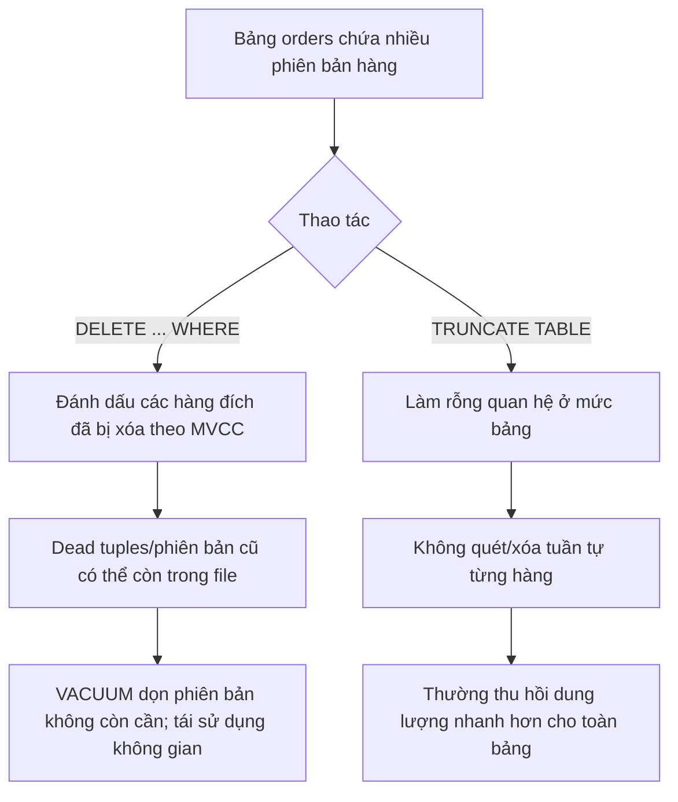

# TRUNCATE, DELETE và khác biệt về khóa, trigger, dung lượng trong PostgreSQL

Khi cần dọn dữ liệu trong PostgreSQL, hai câu lệnh rất dễ bị xem là tương đương:

```sql
DELETE FROM some_table;
```

và:

```sql
TRUNCATE TABLE some_table;
```

Trong tình huống đơn giản, sau khi chạy thành công và commit, cả hai đều có thể khiến bảng không còn hàng nào. Nhưng **hai lệnh không thực hiện cùng một cơ chế** và có khác biệt quan trọng về **khóa, transaction, MVCC, trigger, foreign key, identity sequence và dung lượng lưu trữ**.

Ví dụ, nếu một bảng `orders` được tham chiếu bởi bảng `order_items`:

- `DELETE FROM orders WHERE order_id = 101` có thể xóa đúng một đơn; hành vi với dòng đơn phụ thuộc vào khóa ngoại như `ON DELETE CASCADE`.
- `TRUNCATE orders` không hỗ trợ `WHERE`. PostgreSQL có thể **từ chối** lệnh vì bảng khác có foreign key tham chiếu.
- `TRUNCATE orders CASCADE` có thể làm rỗng **toàn bộ bảng tham chiếu**, không chỉ các dòng liên quan đến đơn đã chọn.
- `DELETE` kích hoạt các trigger thích hợp cho thao tác `DELETE`; `TRUNCATE` kích hoạt trigger `ON TRUNCATE`, **không chạy các trigger `ON DELETE` theo từng hàng**.
- `TRUNCATE` thường giải phóng dung lượng bảng nhanh hơn cho thao tác xóa toàn bộ, nhưng dùng khóa `ACCESS EXCLUSIVE` và có thể chặn ngay cả `SELECT` thông thường.

Vì vậy, câu hỏi đúng không chỉ là **“lệnh nào nhanh hơn?”**, mà là **“muốn thay đổi dữ liệu nào, cần bảo toàn quan hệ nào, cho phép khóa ở mức nào và cần giữ những side effect nào?”**.

Bài học thuộc chương **Thay đổi dữ liệu**, hướng dẫn cách lựa chọn lệnh và thực hành an toàn trên PostgreSQL.

## 1. So sánh nhanh DELETE và TRUNCATE

| Tiêu chí | `DELETE` | `TRUNCATE` |
| --- | --- | --- |
| Mục đích | Xóa những **hàng** đáp ứng điều kiện | Làm rỗng **toàn bộ bảng** hoặc các quan hệ được chỉ định |
| `WHERE` | Có | **Không** |
| `RETURNING` | Có, trả dữ liệu từ hàng đã xóa | **Không** |
| Phương thức | Thao tác trên các phiên bản hàng theo MVCC | Làm rỗng quan hệ bằng cơ chế ở mức bảng/lưu trữ |
| Khóa chính trên bảng đích | `ROW EXCLUSIVE` ở mức bảng và các khóa hàng cần thiết | `ACCESS EXCLUSIVE` trên các bảng bị truncate |
| Đọc `SELECT` đồng thời | Thông thường không bị chặn bởi table lock của DELETE; dùng snapshot MVCC | Có thể bị chặn trong lúc khóa `ACCESS EXCLUSIVE` được giữ |
| Trigger | `ON DELETE` theo hàng và/hoặc theo statement | `ON TRUNCATE` theo statement; **không có row-level TRUNCATE trigger** |
| Khóa ngoại | Tuân thủ các hành động `ON DELETE`, có thể tác động đúng hàng liên quan | Phải xử lý toàn bộ quan hệ tham chiếu; `CASCADE` có thể truncate cả bảng tham chiếu |
| Dung lượng | Hàng đã xóa thường trở thành dead tuples; cần VACUUM để thu hồi/reuse không gian | Thường giải phóng không gian bảng nhanh mà không cần VACUUM sau thao tác |
| Identity/sequence | Không reset sequence | Mặc định `CONTINUE IDENTITY`; có thể chọn `RESTART IDENTITY` |
| Transaction/ROLLBACK | Hỗ trợ rollback | **Cũng hỗ trợ rollback trong PostgreSQL** |
| RLS | Tuân thủ chính sách áp dụng cho `DELETE` | Không được lọc theo row-level policies; yêu cầu quyền `TRUNCATE` |
| Dùng cho | Xóa có điều kiện, audit theo hàng, xóa nghiệp vụ | Xóa sạch staging/temp/import data, reset bảng thử nghiệm, thao tác bảo trì có kiểm soát |

**Điều cần tránh:** không khẳng định “TRUNCATE không rollback được” theo kinh nghiệm từ hệ quản trị khác. **Trong PostgreSQL, `TRUNCATE` là thao tác có tính transaction và có thể rollback.** Tuy nhiên, điều đó không làm nó trở nên an toàn khi chạy nhầm trên production, vì một lệnh truncate đã commit vẫn xóa toàn bộ dữ liệu.

## 2. Cú pháp cơ bản

### 2.1. DELETE

```sql
DELETE FROM table_name
WHERE condition
RETURNING column_name;
```

Ví dụ chỉ xóa các phiên ghi nhận lỗi đã quá thời hạn lưu:

```sql
DELETE FROM audit_events
WHERE created_at < TIMESTAMPTZ '2026-01-01 00:00:00+00'
RETURNING event_id, created_at;
```

Đây là **mảnh SQL minh họa** với bảng `audit_events` giả định. `WHERE` giúp phạm vi xóa có điều kiện; `RETURNING` cho phép ứng dụng biết những hàng nào thực sự bị xóa.

Nếu bỏ `WHERE`:

```sql
DELETE FROM table_name;
```

thì mọi hàng trong phạm vi thao tác của câu DELETE có thể bị xóa, tùy quyền, RLS và các ràng buộc/trigger đang áp dụng. **Bỏ `WHERE` là một thay đổi rất lớn**, phải được xem lại trước khi thực thi.

### 2.2. TRUNCATE

```sql
TRUNCATE TABLE table_name;
```

Cú pháp PostgreSQL hỗ trợ các lựa chọn:

```sql
TRUNCATE [ TABLE ] [ ONLY ] name [ * ] [, ...]
    [ RESTART IDENTITY | CONTINUE IDENTITY ]
    [ CASCADE | RESTRICT ];
```

Ý nghĩa:

- `name [, ...]`: một hoặc nhiều bảng đích.
- `ONLY`: chỉ quan hệ được chỉ định, không lấy các bảng con theo quan hệ kế thừa; với bảng partitioned cần lưu ý cấu trúc và giới hạn riêng.
- `RESTART IDENTITY`: khởi động lại các sequence **được sở hữu bởi các cột** của bảng bị truncate.
- `CONTINUE IDENTITY`: tiếp tục sequence theo trạng thái hiện tại, **là lựa chọn mặc định**.
- `CASCADE`: xử lý thêm những bảng tham chiếu bằng foreign key khi cần, có thể lan rộng qua chuỗi phụ thuộc.
- `RESTRICT`: từ chối nếu có tham chiếu foreign key từ bảng không nằm trong tập truncate; **là lựa chọn mặc định**.

Không có cú pháp:

```sql
-- KHÔNG HỢP LỆ: TRUNCATE không hỗ trợ WHERE.
-- TRUNCATE TABLE orders WHERE status = 'CANCELLED';

-- KHÔNG HỢP LỆ: TRUNCATE không hỗ trợ RETURNING.
-- TRUNCATE TABLE orders RETURNING order_id;
```

Nếu cần xóa một phần dữ liệu hoặc trả bản ghi đã xóa, hãy dùng `DELETE` phù hợp.

## 3. Hiểu quan hệ giữa bảng, hàng và file lưu trữ

Trong PostgreSQL, một bảng thông thường là một quan hệ được lưu trên đĩa với các cấu trúc heap và index liên quan. Với cơ chế **MVCC**, thao tác `DELETE` không đơn giản lập tức xóa từng byte của hàng khỏi file đang dùng.

Ở mức khái niệm:



Sơ đồ này là mô hình tư duy, không phải biểu diễn mọi chi tiết bộ nhớ và write-ahead log (WAL) trong PostgreSQL.

Một số nguyên tắc:

1. **`DELETE`** là thao tác thay đổi tính hiển thị của **từng hàng** theo MVCC và vẫn phải xử lý index, constraint, trigger, WAL và các phiên bản cần thiết.
2. **`TRUNCATE`** làm rỗng bảng bằng cơ chế có phạm vi toàn quan hệ, không tạo một thao tác DELETE cho từng hàng.
3. **Index và constraint vẫn tồn tại sau `TRUNCATE`**; khác với `DROP TABLE`, lệnh này không bỏ định nghĩa bảng.
4. Các hệ thống ghi WAL vẫn có hoạt động ghi log cần thiết. `TRUNCATE` **không nên bị hiểu là một thao tác “không ghi WAL” một cách mặc định**.
5. Không gian thu hồi bởi `DELETE` và `TRUNCATE` khác nhau rõ nhất ở những bảng rất lớn; trên bảng nhỏ, thời gian có thể bị chi phối bởi khóa, trigger, FK và các tác vụ khác.

## 4. Môi trường SQL thử nghiệm

Để quan sát rõ các khác biệt, ta tạo hai bảng có khóa ngoại, hai bảng ghi nhận trigger và một số hàm PL/pgSQL. **Chỉ chạy trên database dùng để học hoặc được phép thay đổi**. Script giả định các bảng chưa tồn tại trong schema `truncate_delete_lab`.

### 4.1. Tạo schema và bảng cha

```sql
CREATE SCHEMA IF NOT EXISTS truncate_delete_lab;

CREATE TABLE truncate_delete_lab.projects (
    project_id BIGINT GENERATED ALWAYS AS IDENTITY PRIMARY KEY,
    project_name TEXT NOT NULL
);
```

`project_id` là identity column. Nó có sequence hỗ trợ tạo ID tự động. Việc xóa hàng **không mặc định tạo lại ID cũ**, vì sequence là một cơ chế độc lập với tập hàng đang tồn tại.

### 4.2. Tạo bảng con với ON DELETE CASCADE

```sql
CREATE TABLE truncate_delete_lab.tasks (
    task_id BIGINT GENERATED ALWAYS AS IDENTITY PRIMARY KEY,
    project_id BIGINT NOT NULL,
    task_name TEXT NOT NULL,
    CONSTRAINT fk_tasks_project
        FOREIGN KEY (project_id)
        REFERENCES truncate_delete_lab.projects (project_id)
        ON DELETE CASCADE
);
```

Ở đây:

- Một project có nhiều task.
- Mỗi task phải tham chiếu project tồn tại.
- Khi một **hàng project** bị `DELETE`, những **hàng task tham chiếu project đó** được xử lý theo `ON DELETE CASCADE`.
- `ON DELETE CASCADE` **không có nghĩa** rằng `TRUNCATE projects` sẽ tự động xóa task theo từng hàng.

### 4.3. Tạo bảng audit độc lập

```sql
CREATE TABLE truncate_delete_lab.delete_audit (
    audit_id BIGINT GENERATED ALWAYS AS IDENTITY PRIMARY KEY,
    table_name TEXT NOT NULL,
    deleted_id BIGINT NOT NULL,
    operation TEXT NOT NULL,
    recorded_at TIMESTAMPTZ NOT NULL DEFAULT clock_timestamp()
);

CREATE TABLE truncate_delete_lab.truncate_audit (
    audit_id BIGINT GENERATED ALWAYS AS IDENTITY PRIMARY KEY,
    table_name TEXT NOT NULL,
    operation TEXT NOT NULL,
    recorded_at TIMESTAMPTZ NOT NULL DEFAULT clock_timestamp()
);
```

Hai bảng audit không có foreign key tham chiếu `projects` hay `tasks`. Đây là lựa chọn **cố ý cho demo**, giúp log trigger còn trong database khi ta xóa dữ liệu thử nghiệm và commit.

Trong sản phẩm thật, một hệ thống audit có thể cần lưu nhiều thông tin khác, ví dụ actor, request ID, thời điểm hiệu lực, phiên bản dữ liệu, thông tin before/after và chính sách giữ log. Bài chỉ minh họa rõ sự khác nhau về trigger.

### 4.4. Tạo row-level DELETE trigger

```sql
CREATE OR REPLACE FUNCTION truncate_delete_lab.log_row_delete()
RETURNS trigger
LANGUAGE plpgsql
AS $function$
BEGIN
    INSERT INTO truncate_delete_lab.delete_audit
        (table_name, deleted_id, operation)
    VALUES
        (TG_TABLE_NAME, OLD.project_id, TG_OP);

    RETURN OLD;
END;
$function$;

CREATE TRIGGER trg_project_delete_audit
AFTER DELETE ON truncate_delete_lab.projects
FOR EACH ROW
EXECUTE FUNCTION truncate_delete_lab.log_row_delete();
```

Ở đây, hàm đọc `OLD.project_id` nên **chỉ gắn với bảng projects**. Nếu muốn dùng cho nhiều bảng có tên khóa chính khác nhau, cần thiết kế hàm tương ứng hoặc sử dụng cơ chế lấy key linh hoạt được kiểm soát.

Trigger `AFTER DELETE FOR EACH ROW` được gọi cho **mỗi hàng project thực sự bị xóa** qua `DELETE`. Nó không tự chạy khi chỉ có `TRUNCATE`.

### 4.5. Tạo statement-level TRUNCATE trigger

```sql
CREATE OR REPLACE FUNCTION truncate_delete_lab.log_truncate()
RETURNS trigger
LANGUAGE plpgsql
AS $function$
BEGIN
    INSERT INTO truncate_delete_lab.truncate_audit
        (table_name, operation)
    VALUES
        (TG_TABLE_NAME, TG_OP);

    RETURN NULL;
END;
$function$;

CREATE TRIGGER trg_project_truncate_audit
AFTER TRUNCATE ON truncate_delete_lab.projects
FOR EACH STATEMENT
EXECUTE FUNCTION truncate_delete_lab.log_truncate();

CREATE TRIGGER trg_task_truncate_audit
AFTER TRUNCATE ON truncate_delete_lab.tasks
FOR EACH STATEMENT
EXECUTE FUNCTION truncate_delete_lab.log_truncate();
```

PostgreSQL hỗ trợ trigger `TRUNCATE` **ở mức statement**, không có trigger `BEFORE/AFTER TRUNCATE FOR EACH ROW`. Cũng có thể định nghĩa `BEFORE TRUNCATE` để kiểm soát hành vi ở thời điểm thích hợp.

Hàm trigger ở trên ghi tên bảng và thao tác để quan sát; `RETURN NULL` trong statement-level trigger không dùng làm giá trị trả cho một hàng.

### 4.6. Nạp dữ liệu

```sql
INSERT INTO truncate_delete_lab.projects (project_name)
VALUES
    ('Dự án A'),
    ('Dự án B'),
    ('Dự án C')
RETURNING project_id, project_name;

INSERT INTO truncate_delete_lab.tasks (project_id, task_name)
VALUES
    (1, 'A - Thiết kế'),
    (1, 'A - Kiểm thử'),
    (2, 'B - Triển khai'),
    (3, 'C - Tài liệu');
```

Trong **schema mới tạo, sequence chưa được sử dụng**, các project sẽ lần lượt có ID 1, 2, 3. Nếu bạn đã chạy lại script, đã thay đổi sequence hoặc dữ liệu, **không nên mặc định ID vẫn là 1–3**; hãy đọc `RETURNING` và điều chỉnh dữ liệu con tương ứng.

Đếm:

```sql
SELECT COUNT(*) AS project_count
FROM truncate_delete_lab.projects;

SELECT COUNT(*) AS task_count
FROM truncate_delete_lab.tasks;
```

Kết quả ban đầu là **3 projects** và **4 tasks**. Không có log trigger nào do việc `INSERT` ban đầu, vì trigger trong ví dụ chỉ đăng ký `DELETE` và `TRUNCATE`.

## 5. DELETE với WHERE: xóa đúng hàng mục tiêu

Yêu cầu: xóa **Dự án B** có `project_id = 2`.

```sql
BEGIN;

DELETE FROM truncate_delete_lab.projects
WHERE project_id = 2
RETURNING project_id, project_name;

SELECT project_id, project_name
FROM truncate_delete_lab.projects
ORDER BY project_id;

SELECT project_id, task_name
FROM truncate_delete_lab.tasks
ORDER BY project_id, task_id;

SELECT audit_id, table_name, deleted_id, operation
FROM truncate_delete_lab.delete_audit
ORDER BY audit_id;

ROLLBACK;
```

Trong transaction, trước khi `ROLLBACK`:

- `DELETE ... RETURNING` trả đúng một hàng: project B.
- Bảng projects còn A và C.
- Task `'B - Triển khai'` cũng bị xóa theo `ON DELETE CASCADE`.
- Hai task của A và task của C **vẫn còn**.
- Trigger `AFTER DELETE` trên projects ghi một dòng audit tương ứng `project_id = 2`.
- Sau `ROLLBACK`, việc xóa project, xóa task liên quan và bản ghi audit của trigger đều được **hoàn tác**.

**Ý nghĩa:** `DELETE` có thể tác động **chọn lọc từng hàng** và việc xóa qua foreign key cũng đi theo những hàng liên quan.

### 5.1. DELETE không có WHERE

```sql
-- Chỉ chạy trong transaction thử nghiệm!
BEGIN;

DELETE FROM truncate_delete_lab.projects;

SELECT COUNT(*) FROM truncate_delete_lab.projects;
SELECT COUNT(*) FROM truncate_delete_lab.tasks;

ROLLBACK;
```

Nếu không có trigger nào chặn, lệnh sẽ xóa cả ba project; do `ON DELETE CASCADE`, cả bốn task liên quan cũng bị xóa. Trigger `AFTER DELETE FOR EACH ROW` trên projects sẽ ghi **ba bản ghi audit** trong cùng transaction.

Điểm khác với `TRUNCATE`: ở đây PostgreSQL vẫn xử lý thao tác **DELETE trên các hàng**, duy trì ngữ nghĩa trigger và FK theo từng hàng.

### 5.2. DELETE RETURNING để kiểm tra phạm vi xóa

```sql
BEGIN;

DELETE FROM truncate_delete_lab.tasks
WHERE project_id = 1
RETURNING task_id, project_id, task_name;

ROLLBACK;
```

Kết quả `RETURNING` gồm **hai task của project A**. Đây là một cách kiểm tra những hàng bị ảnh hưởng **trong transaction** trước khi quyết định commit hay rollback.

**Lưu ý:** bản thân `RETURNING` không phải cơ chế bảo vệ nếu bạn chạy câu `DELETE` sai trên production và sau đó commit. Cần giới hạn quyền, xác minh `WHERE`, cân nhắc backup và kiểm soát phê duyệt.

## 6. TRUNCATE không chọn hàng: làm rỗng toàn bảng

Thử minh họa lệnh:

```sql
-- CÓ THỂ BỊ TỪ CHỐI trong schema demo vì bảng tasks có FK
-- tham chiếu projects nhưng không nằm trong danh sách TRUNCATE.
-- TRUNCATE TABLE truncate_delete_lab.projects;
```

PostgreSQL sẽ từ chối thao tác nếu bảng được tham chiếu bởi foreign key từ bảng không cùng bị truncate, trừ khi dùng cách xử lý thích hợp.

Điều này **không phụ thuộc** việc bảng tasks có đang chứa hàng hay không: PostgreSQL cần bảo vệ ràng buộc tham chiếu khi bỏ qua việc kiểm tra từng hàng. Không nên hiểu “đã xóa hết task thì chắc chắn TRUNCATE parent sẽ chạy” nếu FK vẫn được định nghĩa ở bảng con.

### 6.1. Truncate bảng con độc lập

Vì `tasks` là bảng **tham chiếu** `projects` và không có bảng khác tham chiếu tasks trong ví dụ, có thể truncate tasks riêng:

```sql
BEGIN;

TRUNCATE TABLE truncate_delete_lab.tasks;

SELECT COUNT(*) AS remaining_tasks
FROM truncate_delete_lab.tasks;

SELECT COUNT(*) AS remaining_projects
FROM truncate_delete_lab.projects;

ROLLBACK;
```

Trong transaction:

- `remaining_tasks = 0`.
- `remaining_projects = 3`.
- `TRUNCATE tasks` kích hoạt trigger `ON TRUNCATE` của tasks.
- `ROLLBACK` phục hồi dữ liệu và hoàn tác dòng audit đã chèn.

### 6.2. Truncate hai bảng cùng lúc

Nếu mục tiêu thật sự là xóa sạch cả projects lẫn tasks:

```sql
BEGIN;

TRUNCATE TABLE
    truncate_delete_lab.tasks,
    truncate_delete_lab.projects;

SELECT COUNT(*) AS remaining_projects
FROM truncate_delete_lab.projects;

SELECT COUNT(*) AS remaining_tasks
FROM truncate_delete_lab.tasks;

SELECT table_name, operation
FROM truncate_delete_lab.truncate_audit
ORDER BY audit_id;

ROLLBACK;
```

Trong transaction, cả hai bảng đều rỗng. Với trigger đã định nghĩa, bảng `truncate_audit` ghi **một sự kiện cho mỗi bảng bị truncate**, không phải một dòng cho từng project/task.

Do `ROLLBACK` ở cuối, cả dữ liệu gốc và trạng thái audit được phục hồi như trước demo.

### 6.3. TRUNCATE ... CASCADE

PostgreSQL cho phép:

```sql
BEGIN;

TRUNCATE TABLE truncate_delete_lab.projects CASCADE;

SELECT COUNT(*) AS remaining_projects
FROM truncate_delete_lab.projects;

SELECT COUNT(*) AS remaining_tasks
FROM truncate_delete_lab.tasks;

ROLLBACK;
```

Vì `tasks` tham chiếu `projects`, `CASCADE` khiến **cả bảng tasks** cũng bị truncate. Nó **không** lần lượt tìm từng task thuộc project bị xóa, mà thực hiện thao tác làm rỗng các quan hệ bị ảnh hưởng.

Trong môi trường phức tạp, `CASCADE` có thể lan sang các bảng phụ thuộc ở **schema khác** và qua nhiều cấp foreign key. Không dùng `CASCADE` chỉ để “cho lệnh hết báo lỗi” khi chưa biết chính xác toàn bộ các bảng sẽ bị ảnh hưởng.

### 6.4. TRUNCATE RESTRICT

`RESTRICT` là mặc định:

```sql
TRUNCATE TABLE truncate_delete_lab.projects RESTRICT;
```

Trong schema mẫu, lệnh bị từ chối vì còn bảng tasks tham chiếu qua foreign key mà không nằm trong tập truncate.

Muốn tránh rủi ro lan rộng, hãy **liệt kê tường minh các bảng được phép làm rỗng** và để PostgreSQL từ chối nếu còn bảng khác phụ thuộc, thay vì tự động dùng `CASCADE`.

## 7. CASCADE của TRUNCATE khác ON DELETE CASCADE

Đây là khác biệt có tác động lớn nhất đến tính an toàn dữ liệu.

Giả sử:

```text
projects
  #1 Dự án A
  #2 Dự án B
  #3 Dự án C

tasks
  A-1 -> project #1
  A-2 -> project #1
  B-1 -> project #2
  C-1 -> project #3
```

**`DELETE FROM projects WHERE project_id=2`**:

- Xóa project B.
- Với FK `ON DELETE CASCADE`, xóa **chỉ những task tham chiếu B**.
- Project A/C và task A/C vẫn tồn tại.

**`TRUNCATE projects CASCADE`**:

- Làm rỗng **toàn bộ projects**.
- Làm rỗng **toàn bộ tasks**, vì bảng tasks tham chiếu bảng projects.
- Không giới hạn task theo một project_id.

| Câu lệnh | Project còn lại trong transaction | Task còn lại trong transaction |
| --- | --- | --- |
| `DELETE ... WHERE project_id=2` | A, C | A-1, A-2, C-1 |
| `DELETE FROM projects` | Không | Không, do ON DELETE CASCADE |
| `TRUNCATE tasks` | A, B, C | Không |
| `TRUNCATE tasks, projects` | Không | Không |
| `TRUNCATE projects CASCADE` | Không | Không |

Trong ví dụ, các DELETE/TRUNCATE chạy trong transaction rồi ROLLBACK để tránh làm mất dữ liệu học tập.

### 7.1. Nếu foreign key không phải ON DELETE CASCADE?

Giả sử FK sử dụng `ON DELETE RESTRICT` hoặc `NO ACTION`:

- `DELETE FROM projects WHERE ...` có thể bị từ chối nếu còn task tham chiếu project đó, theo quy tắc kiểm tra constraint.
- `TRUNCATE projects RESTRICT` bị từ chối nếu có bảng khác tham chiếu và không được truncate cùng.
- `TRUNCATE projects CASCADE` vẫn có thể làm rỗng bảng tham chiếu **ở cấp bảng**, thay vì dựa vào từng hành động `ON DELETE`.

Vì vậy, **đừng suy luận hành vi TRUNCATE từ cấu hình ON DELETE của foreign key**.

### 7.2. Xác minh các bảng phụ thuộc

Có thể bắt đầu bằng truy vấn metadata để tìm khóa ngoại tham chiếu một bảng:

```sql
SELECT
    con.conname AS constraint_name,
    con.conrelid::regclass AS referencing_table,
    con.confrelid::regclass AS referenced_table
FROM pg_constraint AS con
WHERE con.contype = 'f'
  AND con.confrelid = 'truncate_delete_lab.projects'::regclass
ORDER BY con.conrelid::regclass::text, con.conname;
```

Với demo, bạn sẽ thấy FK `fk_tasks_project` từ tasks tới projects.

Đây chỉ là **điểm bắt đầu**. Trên production còn có thể có nhiều lớp phụ thuộc, partitioning, trigger tùy biến, replication hoặc bảng được tham chiếu gián tiếp. Cần xem toàn bộ tác động trước khi dùng `CASCADE`.

## 8. Khác biệt về khóa (locking)

Hai lệnh đều thay đổi dữ liệu, nhưng ảnh hưởng tới truy cập đồng thời rất khác nhau.

### 8.1. DELETE dùng ROW EXCLUSIVE ở mức bảng

`DELETE` thông thường lấy khóa `ROW EXCLUSIVE` ở mức bảng đích, đồng thời sử dụng các khóa cần thiết trên **hàng** và những quan hệ liên quan để duy trì tính nhất quán.

Điều này có nghĩa:

- Một `SELECT` thông thường có thể **đọc đồng thời** dựa trên snapshot MVCC, không bị chặn chỉ vì `DELETE` có table lock `ROW EXCLUSIVE`.
- Một transaction khác muốn sửa hoặc khóa **cùng hàng** có thể phải đợi.
- FK cascades và trigger có thể làm phát sinh khóa trên những bảng/hàng khác.
- `DELETE` một số lượng rất lớn hàng vẫn có thể tạo áp lực lên WAL, I/O và độ dài transaction.

Không đồng nhất tên khóa `ROW EXCLUSIVE` với việc “lệnh chỉ giữ row lock”: đây là **tên một chế độ table-level lock**. DELETE còn phải thực hiện các cơ chế khóa hàng tương ứng.

### 8.2. TRUNCATE lấy ACCESS EXCLUSIVE

`TRUNCATE` yêu cầu khóa `ACCESS EXCLUSIVE` trên bảng bị truncate. Đây là chế độ table lock mạnh, xung đột cả với `ACCESS SHARE` mà `SELECT` thông thường cần.

Hệ quả:

- Một transaction đang `SELECT` và giữ table lock thích hợp có thể khiến TRUNCATE **phải đợi**.
- Trong lúc TRUNCATE đã giữ `ACCESS EXCLUSIVE`, một `SELECT` mới vào bảng đó có thể **bị chặn** tới khi transaction truncate commit hoặc rollback.
- Nếu dùng `CASCADE`, nhiều bảng khác cũng có thể phải lấy khóa tương tự.
- Nếu transaction thực hiện TRUNCATE rồi chờ ứng dụng hoặc người vận hành lâu trước khi commit, khóa mạnh vẫn có thể được giữ và gây nghẽn hệ thống.

### 8.3. Bảng minh họa khóa

| Thao tác | Table-level lock chủ đạo trên bảng đích | Đọc SELECT thông thường có bị khóa này chặn? |
| --- | --- | --- |
| `SELECT` | `ACCESS SHARE` | Các SELECT tương thích với nhau |
| `DELETE` | `ROW EXCLUSIVE` | **Thông thường không** |
| `TRUNCATE` | `ACCESS EXCLUSIVE` | **Có**, khi khóa đang được giữ |

Đây là bảng về **chế độ khóa ở bảng chính**, không liệt kê mọi khóa phụ có thể phát sinh từ FK, trigger, index, schema hoặc ứng dụng.

### 8.4. Thực hành hai phiên để thấy TRUNCATE chặn SELECT

Mở **Session A**:

```sql
BEGIN;

TRUNCATE TABLE
    truncate_delete_lab.tasks,
    truncate_delete_lab.projects;

-- Giữ transaction mở để quan sát.
-- Chưa COMMIT / ROLLBACK.
```

Mở **Session B**:

```sql
SELECT COUNT(*)
FROM truncate_delete_lab.projects;
```

Trong điều kiện không có timeout ngắn và không có các yếu tố đặc biệt khác, Session B **chờ khóa** vì A đang giữ `ACCESS EXCLUSIVE`. Sau đó ở **Session A**:

```sql
ROLLBACK;
```

Session B có thể tiếp tục và đọc dữ liệu đã được phục hồi. Nếu A `COMMIT` thay vì rollback, khi được đọc tiếp B sẽ thấy bảng đã bị làm rỗng theo snapshot phù hợp.

**Không chạy thí nghiệm này trên production.** Nếu vô tình để Session A mở lâu, các lệnh đọc/ghi khác có thể bị nghẽn. Thực hành trên database riêng có thể đặt `lock_timeout` và giám sát session để tránh để transaction treo.

### 8.5. Xem phiên chờ khóa

Với quyền quan sát phù hợp, có thể xem:

```sql
SELECT
    a.pid,
    a.state,
    a.wait_event_type,
    a.wait_event,
    pg_blocking_pids(a.pid) AS blocked_by,
    a.query
FROM pg_stat_activity AS a
WHERE a.datname = current_database()
  AND a.wait_event_type = 'Lock'
ORDER BY a.pid;
```

`pg_blocking_pids(pid)` cung cấp PID của những phiên đang chặn một backend; không tự suy đoán blocker chỉ bằng thời gian chờ. Các chi tiết query/session có thể bị hạn chế bởi quyền của người gọi.

Trong vận hành, đừng kết luận khóa nào “an toàn” chỉ vì lệnh nhỏ: **thời gian giữ transaction** và các bảng bị cascade thường quan trọng không kém bản thân câu lệnh.

## 9. MVCC và sự khác nhau khi transaction khác đang đọc

PostgreSQL dùng **Multi-Version Concurrency Control (MVCC)** để quản lý khả năng nhìn thấy dữ liệu theo snapshot của từng statement/transaction.

### 9.1. DELETE tuân theo mô hình phiên bản hàng

Khi một transaction DELETE một hàng nhưng chưa commit:

- Transaction đó nhìn thấy tác động của chính nó theo quy tắc PostgreSQL.
- Transaction khác có snapshot phù hợp vẫn có thể nhìn thấy phiên bản hàng cũ đã commit.
- Sau khi DELETE commit, những snapshot bắt đầu sau đó thông thường không còn nhìn thấy hàng đã xóa.
- Phiên bản cũ có thể còn vật lý trong heap tới khi cơ chế VACUUM có thể dọn.

Do đó, `DELETE` tương thích với cách đọc nhất quán dựa trên các phiên bản hàng.

### 9.2. TRUNCATE không hoàn toàn MVCC-safe

Một khác biệt nâng cao trong PostgreSQL: **`TRUNCATE` không MVCC-safe theo cùng cách như DELETE**. Theo hành vi của PostgreSQL, một transaction đồng thời đang dùng snapshot được lấy **trước TRUNCATE** nhưng chưa từng truy cập/giữ khóa trên bảng đó trong những điều kiện thích hợp có thể thấy bảng **rỗng** sau TRUNCATE, thay vì thấy những hàng cũ như mong đợi từ một thao tác DELETE thông thường.

Điều này không mâu thuẫn với việc `TRUNCATE` có thể rollback. Đây là hai thuộc tính khác nhau:

- **Transactional rollback:** thay đổi của TRUNCATE chưa commit có thể được hoàn tác.
- **MVCC visibility:** cách phiên cũ nhìn thấy bảng sau khi transaction truncate commit không tương đương hoàn toàn với cách nhìn các hàng DELETE.

Nếu một transaction đã truy cập bảng và đang giữ `ACCESS SHARE` trước khi TRUNCATE muốn lấy `ACCESS EXCLUSIVE`, TRUNCATE phải đợi transaction đó kết thúc hoặc nhả khóa tương ứng. Vì vậy, một thí nghiệm MVCC cần được thiết kế chính xác; **không thử tạo race condition trên production**.

### 9.3. Khi nào khác biệt MVCC ảnh hưởng quyết định?

- Báo cáo dài hạn dùng snapshot cũ.
- Job ETL chạy đồng thời với việc reset bảng staging.
- Transaction có nhiều câu SELECT ở `REPEATABLE READ`.
- Hệ thống muốn các bản đọc cũ tiếp tục thấy dữ liệu trước khi bảo trì.

Khi cần bảo toàn ngữ nghĩa snapshot cho từng hàng và chỉ xóa một phần dữ liệu, `DELETE` thường là cơ chế phù hợp hơn. Khi cần thay thế toàn bộ một tập dữ liệu staging, có thể thiết kế kiến trúc luân chuyển bảng/partition thay vì TRUNCATE trực tiếp một bảng đang được đọc.

## 10. Trigger: ON DELETE và ON TRUNCATE là hai sự kiện khác nhau

### 10.1. Trigger DELETE theo hàng

Một trigger:

```sql
CREATE TRIGGER trg_project_delete_audit
AFTER DELETE ON truncate_delete_lab.projects
FOR EACH ROW
EXECUTE FUNCTION truncate_delete_lab.log_row_delete();
```

được gọi với mỗi hàng project bị xóa do `DELETE`.

Trong trigger:

- `TG_OP` có giá trị `DELETE`.
- `OLD` chứa dữ liệu hàng trước khi bị xóa.
- `NEW` không chứa hàng mới cho thao tác DELETE.
- Với trigger `AFTER DELETE` trong ví dụ, `RETURN OLD` không thay đổi việc xóa đã xảy ra.

Trigger `BEFORE DELETE FOR EACH ROW` còn có thể được dùng để kiểm tra/chặn hoặc điều chỉnh cách xử lý hàng tùy giá trị trả về. Vì vậy, nếu dùng DELETE cho một bảng có trigger tùy biến, hiệu ứng có thể rộng hơn việc xóa hàng trong heap.

### 10.2. Trigger DELETE theo statement

PostgreSQL cũng hỗ trợ:

```sql
CREATE TRIGGER trg_delete_statement_example
AFTER DELETE ON some_table
FOR EACH STATEMENT
EXECUTE FUNCTION some_statement_trigger_function();
```

Đây là **mảnh DDL minh họa**, không chạy nếu chưa tạo bảng/hàm tương ứng. Trigger statement-level có thể chạy **một lần cho statement** ngay cả khi `DELETE ... WHERE` không khớp hàng nào. Trong khi đó, trigger `FOR EACH ROW` không được gọi nếu không có hàng mục tiêu.

### 10.3. Trigger TRUNCATE theo statement

```sql
CREATE TRIGGER trg_project_truncate_audit
AFTER TRUNCATE ON truncate_delete_lab.projects
FOR EACH STATEMENT
EXECUTE FUNCTION truncate_delete_lab.log_truncate();
```

Ở TRUNCATE:

- `TG_OP` là `TRUNCATE`.
- Trigger chỉ hỗ trợ **FOR EACH STATEMENT**, không duyệt từng OLD row.
- Không có `OLD.project_id` cho từng hàng; số hàng bị xóa cũng không được phát qua các row-level TRUNCATE events.
- Nếu truncate nhiều bảng và mỗi bảng có trigger TRUNCATE, các trigger liên quan tới từng bảng được xử lý theo ngữ nghĩa lệnh.

### 10.4. Test sự khác nhau bằng log

Test DELETE:

```sql
BEGIN;

DELETE FROM truncate_delete_lab.projects
WHERE project_id = 1;

SELECT COUNT(*) AS delete_events
FROM truncate_delete_lab.delete_audit;

SELECT COUNT(*) AS truncate_events
FROM truncate_delete_lab.truncate_audit;

ROLLBACK;
```

Với các audit table đang rỗng, trong transaction trước rollback, có **1 delete event** và **0 truncate event**.

Test TRUNCATE:

```sql
BEGIN;

TRUNCATE TABLE
    truncate_delete_lab.projects,
    truncate_delete_lab.tasks;

SELECT table_name, operation
FROM truncate_delete_lab.truncate_audit
ORDER BY audit_id;

SELECT COUNT(*) AS delete_events
FROM truncate_delete_lab.delete_audit;

ROLLBACK;
```

Trong transaction, sẽ có sự kiện `TRUNCATE` cho projects và tasks; **không có một DELETE event cho mỗi hàng**. Nếu audit ban đầu rỗng, số delete events vẫn là 0.

### 10.5. Trigger audit trong cùng transaction có thể rollback

Trong các ví dụ, bảng audit được ghi bằng `INSERT` bình thường trong cùng transaction. Nếu `ROLLBACK`, các dòng audit đó cũng bị hoàn tác.

Điều này phù hợp với một số thiết kế **audit transactionally consistent**, nhưng nếu yêu cầu là **ghi lại cả nỗ lực xóa bị rollback**, phải có một hệ thống log độc lập phù hợp. Không giả định rằng một bảng audit ghi trong cùng transaction có thể cung cấp nhật ký không thể xóa hay nhật ký của các transaction thất bại.

## 11. Dung lượng: vì sao DELETE thường chưa trả lại file cho hệ điều hành?

PostgreSQL lưu nhiều phiên bản hàng nhằm phục vụ MVCC. Khi DELETE một lượng lớn dữ liệu:

1. Những hàng bị xóa được đánh dấu theo thông tin transaction.
2. Một số phiên bản có thể vẫn cần thiết cho snapshot đang hoạt động.
3. Khi không còn cần, `VACUUM` có thể dọn chúng, cập nhật visibility/free-space metadata và cho phép **tái sử dụng không gian**.
4. File heap và các index **không nhất thiết co nhỏ ngay** sau DELETE, thậm chí sau VACUUM thường.

Điều này dẫn đến một quan sát phổ biến: **`SELECT COUNT(*)` đã giảm mạnh, nhưng dung lượng bảng trên đĩa chưa giảm tương ứng**.

### 11.1. Xem kích thước quan hệ

Các hàm PostgreSQL:

```sql
SELECT
    pg_size_pretty(
        pg_relation_size('truncate_delete_lab.projects')
    ) AS heap_size,
    pg_size_pretty(
        pg_indexes_size('truncate_delete_lab.projects')
    ) AS indexes_size,
    pg_size_pretty(
        pg_total_relation_size('truncate_delete_lab.projects')
    ) AS total_size;
```

Phân biệt:

- `pg_relation_size(...)`: dung lượng fork chính của quan hệ theo dạng gọi ở trên.
- `pg_indexes_size(...)`: dung lượng các index liên quan.
- `pg_total_relation_size(...)`: bao gồm bảng và các cấu trúc liên quan như index, TOAST khi có.

Đây là công cụ quan sát, không phải phép đo chính xác “bao nhiêu byte của từng hàng đã chết”. Muốn kiểm tra bloat/chi tiết sâu cần thêm phương pháp và extension phù hợp.

### 11.2. VACUUM sau DELETE

```sql
VACUUM (ANALYZE) truncate_delete_lab.projects;
```

`VACUUM` thông thường dọn các phiên bản không còn cần, giúp tái sử dụng không gian và hỗ trợ vận hành MVCC. `ANALYZE` cập nhật thống kê phục vụ planner.

Nhưng:

- VACUUM thường **không được hiểu là lệnh ép hệ điều hành trả lại mọi byte đã xóa**.
- Phần lớn không gian có thể được giữ để các INSERT/UPDATE về sau tái sử dụng.
- Không phải mọi dead tuple đều dọn được ngay nếu còn snapshot/transaction cũ cần chúng.
- PostgreSQL có **autovacuum** để xử lý công việc nền theo cấu hình; không nên tự động VACUUM thủ công sau mọi DELETE nhỏ.

### 11.3. VACUUM FULL là chuyện khác

```sql
-- Chỉ minh họa một thao tác bảo trì cần lập kế hoạch.
-- VACUUM FULL truncate_delete_lab.projects;
```

`VACUUM FULL` viết lại bảng thành biểu diễn gọn hơn và có thể trả dung lượng đáng kể cho hệ điều hành, nhưng yêu cầu khóa mạnh `ACCESS EXCLUSIVE` và có thể cần dung lượng tạm đáng kể để viết lại.

**Không chạy `VACUUM FULL` như giải pháp mặc định sau mỗi DELETE** trên bảng đang phục vụ traffic. Cần bảo trì được lập kế hoạch, giám sát storage, transaction và các phương án khác như partitioning.

### 11.4. TRUNCATE thường thu hồi dung lượng ngay hơn

Khi `TRUNCATE` commit thành công, bảng bị làm rỗng ở mức lưu trữ, thường giải phóng không gian của dữ liệu cũ theo cách nhanh hơn nhiều so với xóa từng hàng rồi dọn VACUUM. Đây là một lý do quan trọng để dùng TRUNCATE cho bảng staging lớn cần **làm trống hoàn toàn**.

Tuy nhiên:

- Việc thu hồi dung lượng còn phụ thuộc transaction commit, cơ chế lưu trữ và các cấu trúc liên quan.
- TRUNCATE không trả lời yêu cầu “xóa các hàng trước ngày X”.
- Chi phí khóa ACCESS EXCLUSIVE và tác động cascading có thể quan trọng hơn lợi ích tốc độ.
- Sau TRUNCATE, định nghĩa bảng và index vẫn tồn tại, không giống DROP TABLE.

### 11.5. So sánh ba cách nhìn dữ liệu

| Trạng thái | `COUNT(*)` | File bảng | Ghi chú |
| --- | --- | --- | --- |
| Trước khi xóa | N | Chứa dữ liệu | Trạng thái ban đầu |
| Sau DELETE toàn bảng đã commit | 0 | Có thể còn lớn | Dead tuples, không gian có thể được VACUUM và tái sử dụng |
| Sau VACUUM thường | 0 | Có thể vẫn còn lớn | Không nhất thiết co file |
| Sau VACUUM FULL | 0 | Có thể thu gọn đáng kể | Rewrites, khóa mạnh |
| Sau TRUNCATE đã commit | 0 | Thường nhỏ lại mạnh | Làm rỗng cấp quan hệ, yêu cầu ACCESS EXCLUSIVE |

Đây là xu hướng thường gặp, không phải số đo cam kết cho mọi phiên bản PostgreSQL, storage backend và trạng thái database.

## 12. Sequence và IDENTITY: TRUNCATE có reset khóa không?

Trong bảng:

```sql
project_id BIGINT GENERATED ALWAYS AS IDENTITY PRIMARY KEY
```

identity column được hỗ trợ bởi sequence. Hai khái niệm cần tách:

- **Khóa chính (PRIMARY KEY):** ràng buộc duy nhất và không NULL với những **hàng đang có trong bảng**.
- **Sequence/identity:** cơ chế cấp giá trị mới cho các lần INSERT, **không tự suy ra MAX(id)+1 sau mỗi DELETE**.

### 12.1. DELETE không reset sequence

Trong schema thử nghiệm vừa tạo:

```sql
BEGIN;

DELETE FROM truncate_delete_lab.tasks;
DELETE FROM truncate_delete_lab.projects;

-- Bảng projects trống, nhưng sequence cấp project_id
-- không tự quay về 1 chỉ vì DELETE.

ROLLBACK;
```

Khi rollback, dữ liệu được phục hồi. Để minh họa hiệu ứng sequence khi DELETE được **commit**, cần làm trên một bản dữ liệu thử nghiệm có thể phục hồi; không nên chỉ lấy kết quả `ROLLBACK` và kết luận về giá trị sequence sau một DELETE đã commit.

Về nguyên tắc, `DELETE` **không khởi động lại sequence**.

### 12.2. TRUNCATE CONTINUE IDENTITY là mặc định

```sql
TRUNCATE TABLE
    truncate_delete_lab.tasks,
    truncate_delete_lab.projects
CONTINUE IDENTITY;
```

Câu lệnh làm rỗng bảng nhưng giữ hướng tiến của sequence theo trạng thái hiện tại. Khi INSERT sau đó, ID mới có thể tiếp tục lớn hơn những ID trước khi truncate.

Trong bài, **không chạy lệnh trên một database chứa dữ liệu bạn muốn giữ**, trừ khi bạn đã chủ động chọn reset hoàn toàn.

### 12.3. TRUNCATE RESTART IDENTITY

```sql
TRUNCATE TABLE
    truncate_delete_lab.tasks,
    truncate_delete_lab.projects
RESTART IDENTITY;
```

`RESTART IDENTITY` restart các sequence **được sở hữu bởi cột của những bảng bị truncate**. Với identity tạo ở schema mẫu, sequence tương ứng sẽ được khởi động lại theo giá trị bắt đầu được cấu hình.

Không nên hiểu `RESTART IDENTITY` là “reset mọi sequence có thể được các bảng này gọi trong code”. Nếu sequence tùy biến không có quan hệ ownership phù hợp, nó không nhất thiết nằm trong tập reset tự động.

### 12.4. Test bằng transaction và ROLLBACK

```sql
BEGIN;

TRUNCATE TABLE
    truncate_delete_lab.tasks,
    truncate_delete_lab.projects
RESTART IDENTITY;

INSERT INTO truncate_delete_lab.projects (project_name)
VALUES ('Dự án sau reset')
RETURNING project_id;

ROLLBACK;
```

Trên schema mới với identity khởi đầu 1, INSERT trong transaction này thường trả `project_id = 1`. Sau rollback, **TRUNCATE và việc restart sequence sở hữu bởi bảng cũng được rollback** theo ngữ nghĩa PostgreSQL.

**Chi tiết nâng cao:** nếu session gọi `currval()` cho sequence đã được restart rồi sau đó transaction rollback, giá trị `currval` được ghi nhận ở **trạng thái local của session** không nhất thiết phản ánh sequence đã được phục hồi. Không dùng `currval` sau rollback như chứng cứ duy nhất cho trạng thái toàn cục của sequence.

### 12.5. nextval và rollback

Thông thường, một lời gọi `nextval()` cấp số theo cơ chế sequence, và giá trị đã cấp **không nhất thiết được lấy lại** khi transaction INSERT rollback; các khoảng trống trong ID là bình thường.

Điều đó không phủ định khả năng **rollback chính thao tác `TRUNCATE ... RESTART IDENTITY`** của PostgreSQL. Đừng nhầm giữa:

- “Sequence cấp một số trong INSERT rồi transaction rollback”.
- “TRUNCATE yêu cầu restart sequence rồi chính TRUNCATE bị rollback”.

Trong thiết kế, **ID là định danh**, không phải bộ đếm doanh nghiệp được bảo đảm liên tục. Không dùng giả định ID không có khoảng trống để tính số bản ghi hoặc số đơn.

## 13. Ràng buộc khóa chính và chỉ mục sau TRUNCATE

`TRUNCATE` **không xóa schema của bảng**.

Ví dụ:

```sql
-- Sau TRUNCATE, định nghĩa vẫn tồn tại:
-- project_id BIGINT GENERATED ALWAYS AS IDENTITY PRIMARY KEY
-- project_name TEXT NOT NULL
```

Những thuộc tính còn tồn tại gồm:

- Tên bảng, các cột, kiểu dữ liệu và giá trị DEFAULT.
- PRIMARY KEY, UNIQUE, CHECK và FOREIGN KEY.
- Index definitions và trigger definitions.
- Privileges trên bảng và metadata liên quan.

Tuy nhiên, tập hàng đang lưu có thể trở thành rỗng. Đó là lý do `TRUNCATE` khác `DROP TABLE`:

```sql
-- KHÁC HẲN TRUNCATE: xóa cả định nghĩa quan hệ.
-- DROP TABLE truncate_delete_lab.projects;
```

Nếu bảng bị DROP, những truy vấn tham chiếu nó không còn thực thi được cho tới khi tạo lại theo schema thích hợp. Với TRUNCATE, ứng dụng vẫn có thể tiếp tục sử dụng bảng sau khi lock được giải phóng.

### 13.1. Truncate không kiểm tra FK từng hàng

PostgreSQL yêu cầu xử lý các bảng được tham chiếu bằng cơ chế RESTRICT/CASCADE ở **cấp bảng**, thay vì kiểm tra/xử lý từng hàng con theo `ON DELETE`.

Trong khi đó, DELETE vẫn tuân thủ hệ thống ràng buộc trên **những hàng cụ thể**. Việc ràng buộc FK được thiết kế DEFERRABLE hoặc có thể trì hoãn kiểm tra ở transaction cũng không biến TRUNCATE thành DELETE theo hàng.

## 14. Privileges và Row-Level Security (RLS)

Một hệ thống production không nên cấp quyền thay đổi toàn bộ bảng cho mọi application role.

### 14.1. DELETE privilege

Để xóa hàng, role cần quyền `DELETE` theo yêu cầu PostgreSQL; khi điều kiện `WHERE` hoặc `RETURNING` tham chiếu dữ liệu cột, có thể cần quyền `SELECT` tương ứng. Nếu bảng có RLS, các chính sách phù hợp áp dụng cho thao tác DELETE.

Ví dụ:

```sql
-- Cú pháp minh họa; thực thi cần quyền GRANT phù hợp.
GRANT DELETE ON TABLE truncate_delete_lab.tasks TO app_writer;
```

Role `app_writer` là tên minh họa, không được tạo trong bài. Một câu lệnh GRANT thực tế phải được duyệt theo mô hình phân quyền của hệ thống.

### 14.2. TRUNCATE privilege là quyền riêng

`TRUNCATE` yêu cầu quyền `TRUNCATE` trên bảng bị ảnh hưởng. Cấp DELETE **không mặc nhiên** cấp TRUNCATE.

```sql
-- Cú pháp minh họa, thường không nên cấp rộng trên production.
GRANT TRUNCATE ON TABLE truncate_delete_lab.tasks TO maintenance_role;
```

Role `maintenance_role` cũng chỉ là tên ví dụ.

### 14.3. TRUNCATE không phải DELETE có áp RLS

Row-Level Security giúp hạn chế những hàng có thể nhìn hoặc tác động trong các câu `SELECT/INSERT/UPDATE/DELETE` phù hợp. Nhưng `TRUNCATE` là thao tác toàn bảng và **không áp dụng lọc từng hàng bởi chính sách RLS**.

Vì vậy, nếu một role được cấp quyền TRUNCATE trên bảng multi-tenant, không được mặc định rằng RLS sẽ giới hạn nó chỉ xóa dữ liệu tenant hiện tại.

Trong thiết kế multi-tenant:

- Tránh cấp `TRUNCATE` cho role xử lý request người dùng.
- Chỉ cấp cho role bảo trì đã kiểm soát và xét tất cả tenant.
- Nếu cần xóa dữ liệu của **một tenant**, dùng DELETE có điều kiện đúng khóa tenant hoặc một quy trình riêng đã kiểm soát.
- Nếu dữ liệu phân vùng theo tenant, vẫn phải xét quyền trên partition/table và hành vi truncate cụ thể.

**Cú pháp SQL hợp lệ không đủ để kết luận một thao tác an toàn về quyền truy cập.**

## 15. DELETE có điều kiện: chọn lọc, audit và số hàng ảnh hưởng

Trong phần lớn thao tác nghiệp vụ, việc xóa được gắn với điều kiện cụ thể.

### 15.1. Xóa theo khóa chính

```sql
DELETE FROM truncate_delete_lab.tasks
WHERE task_id = 42
RETURNING task_id, project_id, task_name;
```

Nếu `task_id = 42` không tồn tại, lệnh trả **0 hàng**, không tự coi là lỗi cú pháp. Ứng dụng có thể kiểm tra số hàng ảnh hưởng để quyết định trả kết quả 404, báo idempotent success hoặc cảnh báo theo hợp đồng API.

### 15.2. Xóa theo quan hệ USING

PostgreSQL hỗ trợ `DELETE ... USING ...` để xác định hàng cần xóa dựa trên quan hệ với bảng khác:

```sql
-- Mảnh minh họa logic, có thể chạy trên demo trong transaction.
BEGIN;

DELETE FROM truncate_delete_lab.tasks AS t
USING truncate_delete_lab.projects AS p
WHERE t.project_id = p.project_id
  AND p.project_name = 'Dự án C'
RETURNING t.task_id, t.task_name;

ROLLBACK;
```

Ở đây chỉ những **hàng tasks** thuộc project C bị xóa, còn project C không bị xóa. Cần kiểm tra điều kiện `JOIN` và `WHERE` kỹ lưỡng để không mở rộng phạm vi ngoài ý muốn.

### 15.3. Xóa một số hàng theo lô

PostgreSQL không có cú pháp `DELETE ... LIMIT 1000` trực tiếp theo cách một số hệ khác hỗ trợ. Muốn xóa theo lô, có thể chọn khóa đích trong một CTE:

```sql
WITH candidates AS (
    SELECT task_id
    FROM truncate_delete_lab.tasks
    WHERE project_id = 1
    ORDER BY task_id
    LIMIT 100
)
DELETE FROM truncate_delete_lab.tasks AS t
USING candidates AS c
WHERE t.task_id = c.task_id
RETURNING t.task_id;
```

Ví dụ này chọn tối đa 100 task của project A theo ID. Trong một job cleanup thực tế, cần lặp nhiều transaction, xử lý concurrent inserts/updates, kiểm tra lock, dùng khóa ổn định và chiến lược retry nếu cần.

**Không tự coi DELETE theo lô là bảo đảm không khóa hoặc không lỗi**. Nó chỉ có thể giúp giới hạn lượng công việc và thời gian transaction so với một DELETE rất lớn nếu được thiết kế hợp lý.

## 16. Chia lô DELETE và nguy cơ bloat

Một câu DELETE xóa hàng triệu hàng có thể:

- Ghi rất nhiều WAL.
- Tạo số lượng lớn phiên bản đã xóa chờ VACUUM.
- Giữ khóa và transaction lâu.
- Làm tăng công việc bảo trì index.
- Gây độ trễ cho replica hoặc downstream consumer tùy kiến trúc.

Chia lô nhỏ, commit giữa các lô có thể giới hạn thời gian transaction và giúp VACUUM có cơ hội hoạt động. Nhưng tổng số WAL/chi phí ghi không nhất thiết nhỏ hơn và cần xử lý việc tập dữ liệu có thể thay đổi giữa các lô.

### 16.1. Lựa chọn chia lô

Một cleanup job có thể:

1. Chọn những bản ghi cũ theo index như `created_at` hoặc khóa định danh.
2. Xóa một batch hữu hạn.
3. Kiểm tra số hàng xóa và hiệu năng.
4. Commit.
5. Lặp cho tới khi không còn hàng phù hợp.

Trong môi trường có nhiều worker, có thể dùng `FOR UPDATE SKIP LOCKED` để phối hợp khóa hàng theo một thiết kế nhất quán, nhưng phải hiểu rủi ro bỏ qua hàng đang khóa và sự thay đổi giữa các batch. Đừng tự động gắn `SKIP LOCKED` vào mọi cleanup mà không xem yêu cầu độ đầy đủ.

### 16.2. Khi toàn bộ dữ liệu cũ được chia theo partition

Nếu dữ liệu được partition theo tháng/ngày và cần bỏ **toàn bộ một partition đã hết hạn**, có thể cân nhắc **detach/drop partition** qua quy trình bảo trì phù hợp, thay vì DELETE từng hàng của cả tháng.

Điều này không thay thế việc đánh giá khóa, FK, replication và retention. Nhưng cấu trúc dữ liệu theo thời gian có thể làm chiến lược dọn dẹp quy mô lớn hiệu quả và dự đoán được hơn.

## 17. TRUNCATE với bảng partitioned và inheritance

Một bảng PostgreSQL có thể là **partitioned table** hoặc tham gia kế thừa bảng.

Nguyên tắc cần biết:

- Khi chỉ định một **bảng cha** trong TRUNCATE mà không dùng `ONLY`, PostgreSQL có thể áp dụng thao tác cho các bảng con/partition theo quy tắc kế thừa tương ứng.
- `ONLY` điều chỉnh phạm vi kế thừa, nhưng không có ý nghĩa “chỉ xóa hàng thỏa bộ lọc”. Bảng cha partitioned không có heap chứa hàng riêng, nên việc TRUNCATE ONLY đối với nó có các hạn chế.
- Khi truncate **một partition riêng**, các sibling partitions không tự bị truncate chỉ vì cùng một bảng cha.
- Nếu có foreign key dependency và dùng `CASCADE`, phạm vi có thể mở rộng sang các bảng liên quan; cần xem kỹ khi quan hệ FK gắn với bảng phân vùng.

Ví dụ ý tưởng:

```sql
-- Dữ liệu minh họa một hệ thống đã có partition tháng:
-- TRUNCATE TABLE events_2026_01;
```

Không thể dùng ví dụ này nếu bảng `events_2026_01` chưa tồn tại.

**Khuyến nghị:** với dữ liệu partitioned, hãy xác định **đích đúng là parent hay partition cụ thể**, cấu trúc FK và mục tiêu retention trước khi TRUNCATE. Không mặc định câu `TRUNCATE parent CASCADE` chỉ tác động một tháng.

## 18. Thực hành an toàn với transaction và timeout

Cả DELETE và TRUNCATE đều hỗ trợ transaction, nên có thể dùng một phiên thao tác thử **chưa commit** để quan sát. Tuy nhiên, **giữ transaction TRUNCATE mở gây khóa mạnh**, vì vậy thao tác kiểm tra phải ngắn và nằm trong môi trường thử nghiệm.

### 18.1. Kiểm tra trước khi xóa

```sql
SELECT COUNT(*) AS target_rows
FROM truncate_delete_lab.tasks
WHERE project_id = 1;

SELECT task_id, project_id, task_name
FROM truncate_delete_lab.tasks
WHERE project_id = 1
ORDER BY task_id;
```

Với dữ liệu mẫu có hai task thuộc project A, câu SELECT này cho thấy phạm vi muốn xóa.

### 18.2. DELETE trong transaction

```sql
BEGIN;

SET LOCAL lock_timeout = '3s';
SET LOCAL statement_timeout = '15s';

DELETE FROM truncate_delete_lab.tasks
WHERE project_id = 1
RETURNING task_id, task_name;

-- Xác minh những hàng thực sự bị ảnh hưởng.
SELECT COUNT(*) AS remaining_tasks
FROM truncate_delete_lab.tasks;

ROLLBACK;
```

Lệnh `SET LOCAL` chỉ áp dụng trong transaction hiện tại. Các giá trị timeout **chỉ để minh họa**, không phải ngưỡng tối ưu cho mọi hệ thống.

Nếu cần commit thật, thực hiện sau quy trình rà soát/phê duyệt phù hợp. Không thay `ROLLBACK` bằng `COMMIT` trong môi trường có dữ liệu quan trọng chỉ vì “câu SQL nhìn có vẻ đúng”.

### 18.3. TRUNCATE trong transaction

```sql
BEGIN;

SET LOCAL lock_timeout = '3s';
SET LOCAL statement_timeout = '15s';

TRUNCATE TABLE
    truncate_delete_lab.tasks,
    truncate_delete_lab.projects
CONTINUE IDENTITY;

SELECT COUNT(*) AS projects_after_truncate
FROM truncate_delete_lab.projects;

SELECT COUNT(*) AS tasks_after_truncate
FROM truncate_delete_lab.tasks;

ROLLBACK;
```

Điểm quan trọng:

- `lock_timeout` có thể tránh đợi lấy lock mãi trong một số tình huống.
- `statement_timeout` giúp giới hạn thời gian statement.
- Chúng không bảo đảm thao tác không gây ảnh hưởng, cũng không thay thế xét phạm vi FK và trigger.
- Transaction TRUNCATE cần được **kết thúc nhanh**, vì table lock mạnh có thể cản trở traffic khác.

### 18.4. Không xem transaction là chiến lược backup

`ROLLBACK` chỉ có ý nghĩa **khi lệnh chưa commit và transaction còn có thể hoàn tác**. Sau khi commit một TRUNCATE trên production, không có nút `ROLLBACK` đơn giản để lấy lại dữ liệu.

Khả năng phục hồi khi đó phụ thuộc backup, PITR, replica hoặc cơ chế recovery khác đã được cấu hình và kiểm thử. Trước thao tác hủy dữ liệu lớn, cần xác minh kế hoạch phục hồi, không chỉ đặt lệnh trong `BEGIN ... COMMIT`.

## 19. DELETE trong transaction vs TRUNCATE trong transaction

Để hiểu rõ, xét hai tình huống:

**Transaction A:**

```sql
BEGIN;
DELETE FROM truncate_delete_lab.tasks
WHERE project_id = 1;
-- Chưa commit.
```

**Transaction B:**

```sql
SELECT COUNT(*)
FROM truncate_delete_lab.tasks;
```

Trong điều kiện snapshot thông thường, SELECT ở B không bị chặn chỉ vì DELETE đang mở, và có thể thấy dữ liệu trước khi DELETE commit. Những transaction cố sửa **cùng các hàng** có thể đợi.

Ngược lại:

**Transaction A:**

```sql
BEGIN;
TRUNCATE TABLE truncate_delete_lab.tasks;
-- Chưa commit.
```

**Transaction B:**

```sql
SELECT COUNT(*)
FROM truncate_delete_lab.tasks;
```

B có thể **bị chặn ở mức table lock** cho đến khi A commit hoặc rollback.

Không nên chạy hai thí nghiệm cùng lúc trên cùng schema nếu transaction A của thí nghiệm trước còn mở. Hãy kết thúc bằng `ROLLBACK` trước khi chuyển sang tình huống khác.

## 20. Trigger, FK và các tác dụng phụ khác khi xóa

Trong một ứng dụng thực tế, `DELETE` có thể kích hoạt:

- Trigger ghi audit từng hàng.
- Trigger duy trì bảng tổng hợp hoặc dữ liệu cache.
- Hành động foreign key `ON DELETE CASCADE` / `SET NULL` / `SET DEFAULT` và kiểm tra `RESTRICT/NO ACTION`.
- Ghi nhận thay đổi qua replication hoặc change data capture theo cấu hình.
- Logic ứng dụng lấy danh sách `RETURNING` để phát thông báo ở một bước khác.

`TRUNCATE` không chạy trigger `ON DELETE` từng hàng và không phát hàng `RETURNING`. Vì vậy nếu một workflow dựa trên các side effect của DELETE, **thay bằng TRUNCATE có thể phá vỡ những bất biến của hệ thống** ngay cả khi bảng cuối cùng đều rỗng.

### 20.1. Audit phải ghi nhận thao tác TRUNCATE riêng

Nếu cần audit hoạt động bảo trì, hãy đăng ký `ON TRUNCATE` hoặc ghi nhật ký tập trung ở lớp thao tác được kiểm soát. Log cần thể hiện **toàn bộ bảng nào bị truncate**, ai thực hiện, lý do, ticket phê duyệt và thời điểm.

Không thể coi `ON DELETE FOR EACH ROW` là cơ chế audit đủ cho một role có quyền TRUNCATE.

### 20.2. Replication và CDC cần kiểm tra cụ thể

Logical replication PostgreSQL có cơ chế hỗ trợ sự kiện `TRUNCATE` theo cấu hình publication/subscription phù hợp. Nhưng các pipeline CDC, consumer hoặc external search index có thể có cách xử lý riêng.

Trước khi dùng TRUNCATE trên bảng được đồng bộ:

1. Xác nhận publication có phát sự kiện TRUNCATE phù hợp.
2. Xác nhận subscriber/consumer hỗ trợ thao tác này và quan hệ đích.
3. Kiểm tra sự khác biệt FK/trigger giữa nguồn và đích.
4. Xác nhận việc đồng bộ xóa **toàn bộ bảng** có đúng kỳ vọng vận hành.

Không mặc định rằng mọi hệ thống downstream chỉ cần nhận nhiều sự kiện DELETE, hoặc rằng một TRUNCATE sẽ tự đồng bộ tới mọi đích như nhau.

## 21. Hiệu năng: lệnh nào nhanh hơn?

Với yêu cầu **xóa toàn bộ hàng của một bảng lớn, không cần trigger DELETE theo hàng và có thể chịu được khóa**, `TRUNCATE` thường nhanh hơn đáng kể vì không xử lý từng hàng theo cách DELETE.

Nhưng không thể khẳng định “TRUNCATE luôn tốt hơn DELETE”:

| Tình huống | Lựa chọn thường phù hợp | Lý do |
| --- | --- | --- |
| Xóa vài hàng theo ID | `DELETE ... WHERE id IN (...)` | Chính xác phạm vi, dùng index phù hợp |
| Xóa dữ liệu cũ theo thời gian | `DELETE WHERE created_at < ...`, có thể chia lô | Có điều kiện; cần giữ dữ liệu mới |
| Làm trống bảng staging chỉ dùng cho một batch | `TRUNCATE` khi quyền và FK cho phép | Không cần duyệt từng hàng |
| Bảng lớn đang chịu nhiều SELECT liên tục | Cân nhắc DELETE/partition switch/detach thay vì TRUNCATE trực tiếp | `ACCESS EXCLUSIVE` có thể gây nghẽn |
| Muốn audit từng hàng đã xóa | `DELETE` | Có `OLD`/row trigger và `RETURNING` |
| Muốn giữ sequence chạy tiếp | `DELETE` hoặc `TRUNCATE CONTINUE IDENTITY` | Không reset identity |
| Muốn reset dữ liệu và identity trong bài test | `TRUNCATE ... RESTART IDENTITY` | Dọn sạch và reset owned sequences |
| Bảng có foreign key tham chiếu | Xem FK và phạm vi; thường DELETE có điều kiện | `TRUNCATE CASCADE` có thể làm rỗng cả bảng con |
| Cần kiểm soát theo tenant/RLS | `DELETE` với chính sách và điều kiện đúng | `TRUNCATE` không lọc theo hàng |
| Lo ngại bloat sau xóa hàng loạt | Phân tích VACUUM/partitioning/bảo trì | Không tự thay DELETE thành TRUNCATE nếu cần giữ một phần |

### 21.1. Đừng benchmark chỉ bằng thời gian client

Một thí nghiệm `DELETE`/`TRUNCATE` có thể bị ảnh hưởng bởi:

- Thời gian chờ lock.
- Chi phí trigger.
- FK và các bảng tham chiếu.
- Số index trên bảng.
- Số hàng và kích thước row/TOAST.
- WAL, synchronous commit, replication.
- Cache, checkpoint và I/O.
- Autovacuum và phiên đọc lâu.

So sánh công bằng phải dùng tập dữ liệu/tham số/điều kiện phù hợp và ghi nhận tác động sau đó: bloat, latency của query khác, tốc độ replica và khả năng phục hồi, không chỉ một số mili giây của statement.

## 22. Các ví dụ “chọn sai lệnh” trong thực tế

### 22.1. Dọn đơn hàng quá hạn lưu

Yêu cầu: xóa đơn trước 2024 nhưng giữ đơn mới.

**Sai:**

```sql
-- Xóa toàn bộ bảng, bao gồm đơn mới:
-- TRUNCATE TABLE orders;
```

**Phù hợp hơn về phạm vi:**

```sql
DELETE FROM orders
WHERE ordered_at < TIMESTAMPTZ '2024-01-01 00:00:00+00';
```

Ví dụ giả định bảng orders và cột ordered_at tồn tại. Cần xử lý FK, retention và audit thực tế trước khi chạy.

### 22.2. Reset bảng staging sau import

Yêu cầu: một bảng staging chỉ chứa dữ liệu batch trước, mọi hàng đều không cần nữa, không có FK/trigger nghiệp vụ đòi DELETE theo hàng.

```sql
TRUNCATE TABLE import_stage;
```

Có thể phù hợp nếu bảng thật sự thuộc quyền của job, không có reader cần giữ snapshot và lock gây chậm được chấp nhận.

### 22.3. Reset bảng test rồi chèn lại ID từ đầu

```sql
TRUNCATE TABLE
    truncate_delete_lab.tasks,
    truncate_delete_lab.projects
RESTART IDENTITY;
```

Phù hợp trong database thử nghiệm được phép dọn trắng. Trên production, reset identity có thể gây xung đột với ID đang được tham chiếu ở những hệ thống bên ngoài dù các bảng trong DB đã rỗng.

### 22.4. Xóa riêng dữ liệu một khách trong bảng đa tenant

```sql
DELETE FROM customer_events
WHERE tenant_id = 12
  AND customer_id = 345;
```

Mục tiêu là xóa **đúng khách trong đúng tenant**, không phải toàn bộ bảng. Cần bảo vệ bằng authorization, khóa ghép, RLS phù hợp và xử lý dữ liệu phụ thuộc.

### 22.5. Reset một bảng có consumer downstream

Nếu bảng có event trigger, CDC, search index hoặc cache phụ thuộc từng hàng, TRUNCATE có thể không đi qua cùng đường xử lý với DELETE.

Giải pháp không nhất thiết là “cấm TRUNCATE tuyệt đối”; có thể xây dựng một **maintenance workflow** có audit và phát sự kiện reset toàn bộ dữ liệu tới các consumer. Nhưng **phải thiết kế tường minh**, không kỳ vọng side effects của DELETE được tái sử dụng tự động.

## 23. Quy trình ra quyết định trước khi xóa dữ liệu

<u>Đề xuất quy trình cho người thực hiện hoặc review migration:</u>

1. **Nêu mục tiêu:** xóa vài hàng, một phân đoạn dữ liệu hay toàn bảng?
2. **Xác định các bảng đích:** tên có schema đầy đủ, tránh nhầm môi trường/search_path.
3. **Kiểm tra quyền:** role chỉ có DELETE hay có cả TRUNCATE? Có RLS không?
4. **Đếm hàng đích:** dùng `SELECT COUNT(*) ... WHERE ...` với cùng điều kiện dự kiến.
5. **Đọc quan hệ FK:** các bảng nào tham chiếu bảng đích? Hành động ON DELETE là gì?
6. **Đọc trigger:** có row-level DELETE trigger, statement DELETE trigger, TRUNCATE trigger nào?
7. **Xem downstream:** replication, CDC, cache, index ngoài DB, audit và pipeline sự kiện.
8. **Đánh giá khóa:** `ROW EXCLUSIVE` + row locks hay `ACCESS EXCLUSIVE`? Ai có thể bị block?
9. **Đánh giá dung lượng:** DELETE tạo dead tuples, VACUUM; TRUNCATE làm rỗng cấp bảng.
10. **Kiểm tra identity:** cần `CONTINUE IDENTITY` hay `RESTART IDENTITY`? Có ID tham chiếu bên ngoài không?
11. **Chốt transaction:** chọn thời điểm ít traffic, timeout hợp lý, rollback/commit, phân batch nếu cần.
12. **Xác minh phục hồi:** backup/PITR đã kiểm thử, biết hậu quả nếu lệnh commit sai.
13. **Xác minh sau thao tác:** COUNT, foreign-key integrity, audit, replication lag và hoạt động ứng dụng.
14. **Ghi lại quyết định:** lý do chọn lệnh và phạm vi dữ liệu đã được phê duyệt.

Quy trình này đặc biệt quan trọng khi có yêu cầu “xóa nhanh toàn bộ dữ liệu cũ” nhưng thực tế bảng chứa cả dữ liệu mới hoặc được nhiều bộ phận sử dụng.

## 24. Lỗi hiểu nhầm thường gặp

| Hiểu nhầm | Vì sao sai | Điều đúng |
| --- | --- | --- |
| `TRUNCATE` chỉ là `DELETE` không WHERE nhưng chạy nhanh | Khác lock, trigger, FK, MVCC và lưu trữ | Chọn theo ngữ nghĩa và tác động |
| `TRUNCATE` không rollback được trong PostgreSQL | PostgreSQL hỗ trợ TRUNCATE trong transaction | Có thể ROLLBACK nếu chưa commit |
| TRUNCATE xóa từng hàng nên chạy ON DELETE trigger | Không có thao tác DELETE theo từng hàng | Dùng ON TRUNCATE statement trigger |
| ON DELETE CASCADE sẽ áp dụng như cũ cho TRUNCATE | TRUNCATE kiểm tra/cascade ở cấp bảng | `TRUNCATE ... CASCADE` có thể làm rỗng cả bảng tham chiếu |
| Chỉ cần bảng con rỗng là TRUNCATE parent chạy được | Cơ chế kiểm tra FK ở cấp quan hệ | Có thể cần truncate cả bảng con hoặc thay đổi thiết kế |
| DELETE không khóa bảng | Có table-level ROW EXCLUSIVE và row locks | Đọc và ghi đồng thời phụ thuộc loại lock |
| TRUNCATE không bao giờ chặn SELECT | ACCESS EXCLUSIVE xung đột ACCESS SHARE | SELECT có thể phải đợi |
| DELETE giải phóng file ngay | Dead tuples còn theo MVCC | VACUUM/reuse; VACUUM FULL có mục tiêu khác |
| VACUUM thường co mọi file về kích thước tối thiểu | Không phải luôn thu nhỏ file | Không gian thường được tái sử dụng |
| TRUNCATE không ghi WAL | Phải bảo đảm tính bền vững và recovery | Có WAL theo cơ chế PostgreSQL |
| TRUNCATE mặc định reset identity | Mặc định CONTINUE IDENTITY | Chọn RESTART IDENTITY rõ ràng nếu cần |
| DELETE reset SERIAL/IDENTITY khi bảng rỗng | Sequence độc lập với số hàng còn lại | Không reset tự động |
| RESTART IDENTITY reset mọi sequence được gọi ngẫu nhiên | Chỉ tác động sequence thuộc ownership phù hợp | Kiểm tra sequence thuộc bảng |
| TRUNCATE xóa cả cột/index/constraint | Chỉ làm rỗng dữ liệu | DROP TABLE mới xóa định nghĩa bảng |
| DELETE có điều kiện dựa vào RLS thì TRUNCATE cũng vậy | TRUNCATE không áp row-level policies | Hạn chế quyền TRUNCATE riêng |
| TRUNCATE CASCADE chỉ xóa những child rows liên quan | TRUNCATE ở cấp bảng | Phải kiểm tra toàn bộ bảng phụ thuộc |
| Gọi TRUNCATE sau DELETE là cách bảo trì bình thường | Có thể làm mất dữ liệu mới và khóa mạnh | Chọn VACUUM/partitioning nếu mục tiêu thu hồi không gian |
| VACUUM FULL nên chạy sau mọi DELETE | Khóa mạnh, ghi lại bảng và tốn I/O | Chỉ bảo trì khi thực sự cần và có kế hoạch |
| Có transaction là đã có backup | Sau COMMIT không đơn giản ROLLBACK được | Kiểm tra backup/PITR trước thao tác hủy dữ liệu |
| Dùng TRUNCATE trên multi-tenant sẽ chỉ xóa tenant hiện tại | Không có WHERE và không áp RLS từng hàng | Dùng DELETE với tenant predicate hoặc quy trình riêng |

## 25. Bài tập thực hành PostgreSQL

Các bài dưới đây dùng schema `truncate_delete_lab` ở mục 4. Hãy chạy các thao tác có thể làm mất dữ liệu trong **transaction kết thúc bằng ROLLBACK** trước khi thử những biến thể khác. Sau mỗi ví dụ, có thể nạp lại dữ liệu vào một database test sạch nếu cần.

1. **Phân biệt cú pháp:** viết một câu DELETE chỉ xóa task thuộc project 1 và một câu TRUNCATE tasks. Câu nào có WHERE, câu nào không?
2. **Kiểm tra phạm vi:** SELECT các task của project 2 trước khi DELETE. Dùng DELETE RETURNING và ROLLBACK để xem chính xác hàng bị ảnh hưởng.
3. **ON DELETE CASCADE:** DELETE project 2 trong transaction, đếm tasks trước/sau. Vì sao chỉ task B biến mất?
4. **DELETE không WHERE:** chạy DELETE toàn bộ projects trong transaction rồi xem delete_audit. Vì sao có ba sự kiện theo hàng?
5. **TRUNCATE bảng con:** truncate tasks, kiểm tra projects còn bao nhiêu hàng và truncate_audit có sự kiện nào.
6. **FK RESTRICT:** thử TRUNCATE projects riêng khi tasks có FK. Giải thích lỗi và tại sao nó không phụ thuộc chỉ vào số hàng tasks đang tồn tại.
7. **TRUNCATE nhiều bảng:** truncate cả projects và tasks trong cùng statement. Vì sao không cần dùng CASCADE nếu mọi bảng tham chiếu cần thiết đã được liệt kê?
8. **CASCADE:** chạy TRUNCATE projects CASCADE trong transaction. So kết quả với DELETE project_id=2.
9. **Audit trigger:** so các dòng trong delete_audit và truncate_audit của hai thử nghiệm DELETE/TRUNCATE. Vì sao TRUNCATE không có deleted_id từng hàng?
10. **ROLLBACK:** sau TRUNCATE cả hai bảng trong transaction, ROLLBACK rồi đếm lại dữ liệu. Điều gì được phục hồi?
11. **Chặn SELECT:** dùng hai phiên A/B; A giữ transaction sau TRUNCATE, B SELECT COUNT projects. Mô tả trạng thái chờ.
12. **DELETE đồng thời:** thay TRUNCATE bằng DELETE project 1 rồi để transaction mở; thử SELECT projects ở phiên B. Vì sao thường không bị khóa giống TRUNCATE?
13. **Phân biệt khóa:** giải thích `ROW EXCLUSIVE` table lock của DELETE và `ACCESS EXCLUSIVE` của TRUNCATE.
14. **Theo dõi blocker:** dùng `pg_stat_activity` và `pg_blocking_pids` để tìm session đang chờ Lock trong môi trường thử nghiệm.
15. **Dung lượng:** dùng `pg_relation_size`, `pg_indexes_size` và `pg_total_relation_size` kiểm tra trước/sau DELETE/ROLLBACK/TRUNCATE/ROLLBACK. Điều gì không thể kết luận từ bảng chỉ có vài hàng?
16. **VACUUM:** giải thích vì sao DELETE toàn bảng có thể để lại file lớn và VACUUM thường không bảo đảm trả lại mọi byte cho hệ điều hành.
17. **VACUUM FULL:** liệt kê chi phí khóa và I/O của VACUUM FULL, phân biệt với VACUUM thường.
18. **CONTINUE IDENTITY:** viết cú pháp TRUNCATE cả projects/tasks nhưng giữ các sequence tiếp tục.
19. **RESTART IDENTITY:** viết cú pháp TRUNCATE cả projects/tasks rồi restart owned sequences. Dùng INSERT RETURNING trong một transaction test.
20. **Sequence rollback:** giải thích vì sao rollback thao tác TRUNCATE RESTART IDENTITY khác với rollback một INSERT đã gọi nextval.
21. **Quyền:** vì sao role có DELETE không mặc nhiên có TRUNCATE? Đề xuất phân quyền cho app_writer và maintenance_role.
22. **RLS:** một bảng dùng chung cho nhiều tenant có row-level policies. Vì sao không thể dùng TRUNCATE để xóa riêng dữ liệu tenant 12?
23. **DELETE USING:** viết DELETE tasks dựa trên tên project từ bảng projects, dùng RETURNING để quan sát task được chọn.
24. **Batch DELETE:** viết một CTE chọn 100 task theo task_id để DELETE trong một batch. Vì sao không dùng TRUNCATE nếu chỉ muốn xóa 100 task?
25. **Trigger statement:** mô tả khác nhau giữa DELETE FOR EACH ROW và DELETE FOR EACH STATEMENT khi câu DELETE không khớp hàng nào.
26. **Trigger truncate:** xây dựng một BEFORE TRUNCATE trigger để ghi nhận thao tác hoặc kiểm soát thao tác trong môi trường test. Vì sao không thể dùng OLD.project_id theo từng hàng?
27. **Tìm FK metadata:** dùng pg_constraint liệt kê bảng tham chiếu projects. Nếu có thêm bảng sub_tasks tham chiếu tasks, phạm vi CASCADE có thể thay đổi thế nào?
28. **Partitioning:** khi bảng events partition theo tháng, chọn cách dọn một tháng cũ. So DELETE theo timestamp, TRUNCATE partition và detach/drop partition.
29. **Tác dụng phụ:** một bảng có DELETE trigger cập nhật bảng tổng hợp. Điều gì xảy ra nếu thay DELETE bằng TRUNCATE mà không có thiết kế xử lý reset?
30. **Replicated tables:** liệt kê các điều cần kiểm tra trước TRUNCATE trên bảng được logical replication/CDC theo dõi.
31. **PITR:** vì sao transaction rollback không thay thế kế hoạch backup và khôi phục sau COMMIT?
32. **Chọn lệnh:** dọn bảng import_stage mỗi batch, không có FK và chỉ một job dùng. Phương án nào thường phù hợp hơn?
33. **Chọn lệnh:** xóa dữ liệu trước ngày 2025-01-01 nhưng vẫn phải giữ năm 2026. Vì sao TRUNCATE không đáp ứng?
34. **Review migration:** tạo checklist kiểm tra schema, FK, trigger, quyền, lock timeout, identity, backup, số hàng ảnh hưởng và downstream.
35. **Tình huống hai phiên:** mô tả cách truy vấn SNAPSHOT/MVCC khác nhau giữa DELETE và TRUNCATE với transaction cũ, và vì sao không thử race này trên production.
36. **Báo cáo vận hành:** sau một DELETE lớn, hàng đếm giảm nhưng file chưa nhỏ; hãy đề xuất hướng điều tra VACUUM, autovacuum, transaction dài và chiến lược partition thay vì tự ý TRUNCATE toàn bộ.

## 26. Tổng kết

Khi cân nhắc hai cách làm rỗng dữ liệu:

```text
DELETE FROM table WHERE condition
    -> Có thể chọn từng hàng
    -> MVCC theo hàng, trigger DELETE, FK ON DELETE
    -> ROW EXCLUSIVE table lock + khóa hàng liên quan
    -> Có thể tạo dead tuples, VACUUM dọn/tái sử dụng
    -> RETURNING và rollback được

TRUNCATE TABLE table
    -> Làm rỗng toàn bộ bảng; không WHERE/RETURNING
    -> ACCESS EXCLUSIVE, có thể chặn SELECT
    -> Trigger TRUNCATE theo statement, không chạy DELETE per row
    -> RESTRICT/CASCADE ở cấp bảng với FK
    -> Thường thu hồi không gian nhanh hơn cho toàn bảng
    -> CONTINUE IDENTITY mặc định; RESTART IDENTITY khi yêu cầu
    -> Có thể rollback trong PostgreSQL
```

**Ba khác biệt quan trọng nhất**:

1. **Khóa và đồng thời:** `TRUNCATE` đòi `ACCESS EXCLUSIVE`; `DELETE` có thể cho phép nhiều thao tác đọc thông thường tiếp tục nhờ MVCC.
2. **Trigger và khóa ngoại:** `DELETE` làm việc với hàng cụ thể và hành động `ON DELETE`; `TRUNCATE` có trigger riêng và có thể mở rộng phạm vi sang cả bảng tham chiếu bằng `CASCADE`.
3. **Dung lượng và identity:** `DELETE` thường để lại các phiên bản hàng chờ VACUUM, trong khi `TRUNCATE` thường làm rỗng nhanh hơn ở cấp lưu trữ và có lựa chọn restart các sequence sở hữu bởi bảng.

**Lựa chọn an toàn không dựa vào tốc độ đơn thuần.** Nếu cần xóa có điều kiện, giữ audit theo hàng hoặc tôn trọng chính sách xóa nghiệp vụ, hãy cân nhắc `DELETE`. Nếu thực sự cần làm rỗng **toàn bộ** một bảng staging/test, đã kiểm soát FK, trigger, quyền, replication và downtime do lock, `TRUNCATE` có thể là công cụ đúng. Trong cả hai trường hợp, cần xác minh phạm vi, dùng transaction hợp lý và chuẩn bị khả năng phục hồi trước khi commit.
