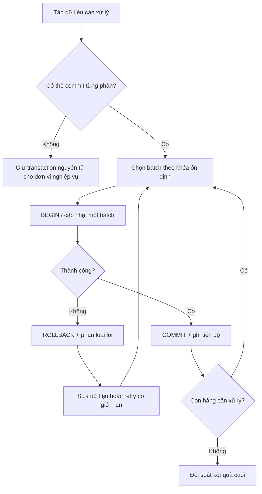

# Thay đổi dữ liệu theo lô và giới hạn kích thước giao dịch trong PostgreSQL

Trong ứng dụng PostgreSQL, cập nhật một bản ghi thường đơn giản: chạy một câu `INSERT`, `UPDATE` hoặc `DELETE` rồi commit. Khi cần nhập vài triệu dòng, chuẩn hóa một cột cho toàn bảng hoặc xóa dữ liệu hết hạn, bài toán khác hẳn. Một câu lệnh hoặc một giao dịch quá lớn có thể sinh lượng lớn WAL, giữ khóa lâu, làm tăng số phiên bản hàng do MVCC quản lý và gây chậm replication, autovacuum hoặc các truy vấn đang hoạt động.

**Thay đổi dữ liệu theo lô (batch processing)** là cách chia một khối công việc lớn thành các phần nhỏ, có thể quan sát, giới hạn tài nguyên, retry và tiếp tục khi bị gián đoạn. Điểm khó không chỉ là viết `LIMIT 500`: cần lựa chọn khóa phân trang ổn định, xác định ranh giới transaction, xử lý đồng thời và bảo đảm các quy tắc nghiệp vụ không bị phá vỡ khi công việc được commit dần.

Bài học giải thích ba hướng thường gặp:

- **Batch `INSERT`:** chèn nhiều hàng trong một statement hoặc một loạt statement, có thể dùng `COPY` khi nhập rất lớn.
- **Batch `UPDATE`:** chọn một nhóm khóa cần sửa rồi cập nhật, lặp đến khi hoàn thành.
- **Batch `DELETE`/archive:** xóa hoặc chuyển dữ liệu cũ từng phần, tránh một giao dịch xóa toàn bộ bảng.

Đồng thời, chúng ta sẽ phân tích **giới hạn thực tế của kích thước giao dịch** trong PostgreSQL: không có một con số hàng tối đa phổ quát, nhưng có các ràng buộc tài nguyên và yêu cầu vận hành rất thật.

## 1. Vì sao một giao dịch khổng lồ có thể gây vấn đề?

Giả sử bảng `events` có 50 triệu hàng và bạn muốn chuẩn hóa trường `event_code`:

```sql
UPDATE app.events
SET normalized_code = upper(trim(event_code))
WHERE normalized_code IS NULL;
```

Câu lệnh có thể đúng về ngữ nghĩa SQL, nhưng nếu phải cập nhật 50 triệu hàng trong một transaction, hệ thống có thể phải:

1. Tạo các phiên bản hàng mới theo cơ chế **MVCC**.
2. Sinh **WAL** để ghi nhận thay đổi và phục vụ phục hồi/replication.
3. Duy trì khóa liên quan trong suốt transaction.
4. Làm các index bị ảnh hưởng phải cập nhật, hoặc tạo thêm phiên bản tuple trên heap.
5. Xử lý nhiều hàng đã chết sau khi transaction kết thúc thông qua vacuum phù hợp.
6. Chờ một giao dịch rất dài hoàn tất mới giải phóng một số tài nguyên và quan hệ khóa.
7. Đối mặt với chi phí lớn nếu công việc phải retry sau lỗi.

Một giao dịch lớn **không nhất thiết thất bại**; PostgreSQL có thể xử lý các transaction chứa rất nhiều thay đổi khi đủ tài nguyên. Nhưng “database chạy được” khác với “có thể vận hành an toàn trong giờ cao điểm”.

### 1.1. Hai mục tiêu cạnh tranh

| Giao dịch/batch nhỏ | Giao dịch/batch lớn |
| --- | --- |
| Thời gian giữ khóa mỗi batch thường ngắn hơn | Giảm overhead commit và round trip trên mỗi hàng |
| Dễ tạm dừng, quan sát, retry từng phần | Tốt khi toàn bộ thay đổi bắt buộc có tính nguyên tử |
| Phân tán chi phí WAL và vacuum theo thời gian | Có thể có throughput cao khi workload và tài nguyên phù hợp |
| Có thể để lộ trạng thái hoàn thành từng phần | Giữ tính nhất quán “tất cả hoặc không gì cả” trong một transaction |
| Nhiều transaction hơn và cần checkpoint tiến độ | Nếu lỗi muộn, cả khối công việc phải được xử lý lại |

Không có batch size tốt nhất cho mọi bảng. Cần cân bằng **tính đúng đắn**, **throughput**, **độ trễ giao dịch khác**, **WAL**, **replication lag** và **khả năng phục hồi khi gián đoạn**.

## 2. Phân biệt statement, batch và transaction

Ba khái niệm này thường bị nhầm:

- **Statement:** một lệnh SQL, ví dụ `UPDATE ... WHERE ...`.
- **Batch:** một nhóm dữ liệu được xử lý cùng đợt; có thể được thực hiện bởi một hoặc nhiều statement.
- **Transaction:** đơn vị commit/rollback của database, có thể chứa một hoặc nhiều statement.

Ví dụ một statement chèn ba hàng:

```sql
INSERT INTO app.labels (label_code, label_name)
VALUES
    ('A', 'Alpha'),
    ('B', 'Beta'),
    ('C', 'Gamma');
```

Còn một transaction có thể chứa nhiều statement:

```sql
BEGIN;

UPDATE app.accounts
SET balance = balance - 100
WHERE account_id = 1;

UPDATE app.accounts
SET balance = balance + 100
WHERE account_id = 2;

COMMIT;
```

Hai cập nhật số dư cần nằm trong **cùng transaction** nếu đây là một chuyển tiền, vì chia chúng thành hai transaction riêng có thể tạo trạng thái mất cân đối quan sát được hoặc không thể rollback cả hai khi bước thứ hai lỗi.

**Batching không phải lý do để phá vỡ một bất biến nghiệp vụ cần atomicity.** Trước khi chia lô, hãy xác định thay đổi nào bắt buộc hoàn tất cùng nhau và thay đổi nào được phép commit dần.



Sơ đồ mô tả quy trình **nhiều transaction nối tiếp**, không phải một transaction PostgreSQL tự commit nội bộ từng batch.

## 3. Chuẩn bị dữ liệu thực hành

Chúng ta tạo schema `batch_lab` và 12.000 hàng thử nghiệm. Không chạy các lệnh tạo hoặc xóa dữ liệu của bài trên bảng production.

```sql
CREATE SCHEMA IF NOT EXISTS batch_lab;

CREATE TABLE batch_lab.events (
    event_id bigint PRIMARY KEY,
    account_id integer NOT NULL,
    event_code text NOT NULL,
    normalized_code text,
    status text NOT NULL CHECK (status IN ('new', 'processed')),
    event_at timestamptz NOT NULL
);

INSERT INTO batch_lab.events
    (event_id, account_id, event_code, normalized_code, status, event_at)
SELECT
    g::bigint,
    (g % 200 + 1)::integer,
    ' code-' || (g % 25)::text || ' ',
    NULL::text,
    CASE WHEN g % 4 = 0 THEN 'processed' ELSE 'new' END,
    TIMESTAMPTZ '2026-01-01 00:00:00+00'
        + (g % 90) * INTERVAL '1 day'
FROM generate_series(1, 12000) AS g;

CREATE INDEX idx_events_need_backfill
    ON batch_lab.events (event_id)
    WHERE normalized_code IS NULL;

CREATE INDEX idx_events_archive_candidates
    ON batch_lab.events (event_at, event_id)
    WHERE status = 'processed';

ANALYZE batch_lab.events;
```

Kiểm tra:

```sql
SELECT
    COUNT(*) AS total_events,
    COUNT(*) FILTER (WHERE normalized_code IS NULL)
        AS waiting_for_backfill,
    COUNT(*) FILTER (WHERE status = 'processed')
        AS processed_events
FROM batch_lab.events;
```

Bộ dữ liệu mẫu có **12.000 hàng**, toàn bộ đang thiếu `normalized_code`, trong đó **3.000 hàng** có `status = 'processed'`.

### 3.1. Bảng nhận dữ liệu nhập có khóa idempotency

```sql
CREATE TABLE batch_lab.inbox (
    source_event_id text PRIMARY KEY,
    payload text NOT NULL,
    received_at timestamptz NOT NULL DEFAULT now()
);
```

`source_event_id` là khóa do nguồn cung cấp, dùng để xác định một sự kiện đã nhập trước đó hay chưa. Việc chọn khóa thực tế phải theo nghiệp vụ; không nên dùng số thứ tự của lần chạy batch làm ID nếu các lần retry có thể đổi thứ tự.

### 3.2. Bảng lưu sự kiện đã archive

```sql
CREATE TABLE batch_lab.events_archive (
    event_id bigint PRIMARY KEY,
    account_id integer NOT NULL,
    event_code text NOT NULL,
    normalized_code text,
    status text NOT NULL,
    event_at timestamptz NOT NULL,
    archived_at timestamptz NOT NULL DEFAULT now()
);
```

Bảng archive phục vụ ví dụ chuyển dữ liệu từng lô. Trong production, một bảng archive có thể có quyền truy cập, chỉ mục, phân vùng và chính sách lưu trữ khác bảng nguồn.

## 4. Batch INSERT bằng nhiều bộ VALUES

Cách cơ bản để giảm số statement là chèn nhiều hàng trong một `INSERT`:

```sql
INSERT INTO batch_lab.inbox (source_event_id, payload)
VALUES
    ('src-001', '{"kind":"created"}'),
    ('src-002', '{"kind":"updated"}'),
    ('src-003', '{"kind":"deleted"}');
```

So với ba lần gửi một `INSERT` một hàng, câu lệnh này thường giảm overhead giao tiếp và parse/plan. Mọi bộ giá trị nằm trong **một statement nguyên tử**: nếu một hàng vi phạm ràng buộc không được xử lý, statement đó thất bại, không chèn một phần hàng rồi âm thầm bỏ phần còn lại.

Để hỗ trợ chạy lại:

```sql
INSERT INTO batch_lab.inbox (source_event_id, payload)
VALUES
    ('src-001', '{"kind":"created"}'),
    ('src-004', '{"kind":"exported"}')
ON CONFLICT (source_event_id) DO NOTHING
RETURNING source_event_id;
```

`RETURNING` chỉ trả các hàng **thực sự được chèn**. Nó không tự trả hàng đã bị bỏ qua bởi `DO NOTHING`.

### 4.1. Batch một statement không phải batch một transaction với nhiều statement

Hai mô hình:

```sql
-- Một statement chứa nhiều dòng.
INSERT INTO batch_lab.inbox (source_event_id, payload)
VALUES ('src-101', 'a'), ('src-102', 'b');
```

và:

```sql
-- Một transaction chứa hai statement.
BEGIN;
    INSERT INTO batch_lab.inbox
        (source_event_id, payload)
    VALUES ('src-201', 'a');

    INSERT INTO batch_lab.inbox
        (source_event_id, payload)
    VALUES ('src-202', 'b');
COMMIT;
```

có thể tạo cùng số hàng, nhưng khác số lượt client–server và mức chi phí statement. Trên JDBC, `executeBatch()` cũng không nhất thiết đồng nghĩa server nhận đúng một `INSERT ... VALUES (...), (...)`; driver có thể gửi/rewrite batch tùy cấu hình.

### 4.2. Đừng tạo một VALUES vô hạn

SQL dài hàng chục MB có thể tốn bộ nhớ parse/plan và băng thông, dễ chạm giới hạn của driver hoặc protocol khi dùng nhiều tham số. Một batch 10.000 hàng không mặc nhiên tốt hơn batch 500 hàng.

Khi input nằm ở ứng dụng và cần nhiều tham số, hãy đo thực tế ở quy mô đại diện. Khi input rất lớn hoặc nằm ở file, `COPY` thường đáng cân nhắc.

## 5. INSERT ... SELECT: xử lý lô trực tiếp trên database

Nếu dữ liệu nguồn đã nằm trong PostgreSQL, có thể chèn một tập hàng bằng `INSERT ... SELECT` mà không tải tất cả về ứng dụng:

```sql
INSERT INTO batch_lab.inbox
    (source_event_id, payload)
SELECT
    'event-' || event_id::text,
    event_code
FROM batch_lab.events
WHERE event_id BETWEEN 1 AND 100
ON CONFLICT (source_event_id) DO NOTHING;
```

Đây là một statement chèn tối đa 100 hàng từ khoảng khóa minh họa. Nếu `SELECT` trả 0 hàng, câu lệnh vẫn thành công với số hàng chèn 0.

Để xử lý toàn bộ nguồn theo nhiều transaction, có thể lặp qua những **dải khóa không chồng lấn**. Tuy nhiên, chia theo dải cố định `BETWEEN 1 AND 100` chỉ hiệu quả khi phân bố ID và kích thước từng dải phù hợp.

### 5.1. INSERT ... SELECT với tập nhiều hàng vẫn có thể lớn

```sql
INSERT INTO batch_lab.inbox
    (source_event_id, payload)
SELECT 'event-' || event_id::text, event_code
FROM batch_lab.events
ON CONFLICT (source_event_id) DO NOTHING;
```

Trên 12.000 hàng thử nghiệm, câu này tương đối nhỏ. Trên 500 triệu hàng, nó có thể trở thành một transaction rất lớn dù SQL chỉ dài vài dòng.

**Độ dài câu SQL không quyết định kích thước công việc.** Phải xét số hàng thực sự được đọc/ghi, lượng dữ liệu mỗi hàng, index và trigger liên quan.

## 6. COPY: lựa chọn cho nhập hàng loạt lớn

PostgreSQL có `COPY` để nạp dữ liệu dạng luồng, đặc biệt phù hợp khi dữ liệu đã được chuẩn bị ở file hoặc nguồn bên ngoài.

Ví dụ cú pháp phía server:

```sql
COPY batch_lab.inbox (source_event_id, payload)
FROM '/path/on/database/server/inbox.csv'
WITH (FORMAT csv, HEADER true);
```

Lệnh này yêu cầu file tồn tại **trên máy chủ PostgreSQL** và quyền đọc file theo quy định. Công cụ `psql` hỗ trợ `\copy` để truyền dữ liệu từ file trên **máy client**:

```text
\copy batch_lab.inbox (source_event_id, payload)
FROM 'inbox.csv' WITH (FORMAT csv, HEADER true)
```

`\copy` là lệnh riêng của `psql`, không phải SQL gửi nguyên văn qua JDBC.

`COPY` thường hiệu quả hơn rất nhiều `INSERT` một hàng lặp đi lặp lại. Nhưng:

- `COPY` không bỏ qua các ràng buộc dữ liệu.
- Một `COPY` khổng lồ vẫn có thể là một transaction lớn.
- Nếu dữ liệu lỗi khiến `COPY FROM` thất bại, phải xử lý ảnh hưởng theo transaction và trạng thái dữ liệu nạp.
- `COPY` không tự giải quyết xung đột business key theo cùng cú pháp `INSERT ... ON CONFLICT`.

Một quy trình nhập an toàn thường gồm **COPY vào staging → kiểm tra/chuyển kiểu → INSERT ... SELECT/UPSERT vào bảng đích theo lô**.

## 7. UPDATE theo lô: PostgreSQL không có UPDATE ... LIMIT trực tiếp

Nhiều người muốn viết:

```sql
-- Không phải cú pháp PostgreSQL hợp lệ:
UPDATE batch_lab.events
SET normalized_code = upper(trim(event_code))
WHERE normalized_code IS NULL
LIMIT 500;
```

PostgreSQL không cung cấp `LIMIT` trực tiếp cho `UPDATE` theo cách đó. Thay vào đó, hãy **chọn các khóa của một lô** bằng subquery/CTE rồi cập nhật những hàng được chọn.

### 7.1. Một lô bằng CTE khóa chính

```sql
WITH picked AS (
    SELECT event_id
    FROM batch_lab.events
    WHERE normalized_code IS NULL
    ORDER BY event_id
    LIMIT 500
)
UPDATE batch_lab.events AS e
SET normalized_code = upper(trim(e.event_code))
FROM picked AS p
WHERE e.event_id = p.event_id
  AND e.normalized_code IS NULL
RETURNING e.event_id, e.normalized_code;
```

Câu lệnh trên cập nhật **tối đa 500 sự kiện**. Nếu chỉ còn 123 sự kiện cần chuẩn hóa, nó có thể trả 123 hàng. Sau một lô thành công, chạy lại để lấy lô tiếp theo.

Tại sao dùng `event_id`?

- Là khóa chính duy nhất, ổn định cho dữ liệu mẫu.
- Có index hỗ trợ việc tìm và cập nhật các hàng đã chọn.
- Có tiêu chí `ORDER BY` để chọn một lô có tính dự đoán được.

`RETURNING` giúp quan sát **những hàng thực sự thay đổi**. Khi chạy công việc thực tế, không nhất thiết phải gửi hàng trăm nghìn giá trị `RETURNING` qua mạng; có thể chỉ lấy update count hoặc số liệu cần đối soát.

### 7.2. FOR UPDATE SKIP LOCKED khi nhiều worker cùng chạy

Nếu nhiều worker xử lý cùng bảng, nên tránh để chúng chờ nhau trên cùng các hàng đầu:

```sql
WITH picked AS (
    SELECT e.event_id
    FROM batch_lab.events AS e
    WHERE e.normalized_code IS NULL
    ORDER BY e.event_id
    LIMIT 500
    FOR UPDATE SKIP LOCKED
)
UPDATE batch_lab.events AS e
SET normalized_code = upper(trim(e.event_code))
FROM picked AS p
WHERE e.event_id = p.event_id
  AND e.normalized_code IS NULL
RETURNING e.event_id;
```

`FOR UPDATE` khóa các hàng được chọn; `SKIP LOCKED` cho phép bỏ qua những hàng đang bị khóa bởi transaction khác. Mỗi statement là một đơn vị có khóa và update nhất quán.

Các giới hạn quan trọng:

- `SKIP LOCKED` có thể tạo một góc nhìn **không đầy đủ tại thời điểm đó** về tập hàng đang chờ, nên phù hợp cho hàng đợi/backfill worker, không phù hợp mọi truy vấn nghiệp vụ.
- Hai worker có thể xử lý những lô khác nhau, nhưng không có cam kết tuyệt đối về thứ tự ID hoàn thành.
- Một kết quả **0 hàng** chưa chắc chứng minh toàn bộ bảng sạch nếu những hàng còn lại đang bị transaction khác khóa.
- `SKIP LOCKED` không thay thế khóa duy nhất, trạng thái xử lý hay idempotency.
- Lệnh `SELECT ... FOR UPDATE` chỉ khóa hàng được chọn ở phạm vi transaction; các khóa còn được giữ đến commit/rollback theo quy tắc PostgreSQL.

### 7.3. Nếu chỉ chạy một worker

Một worker đơn giản có thể dùng truy vấn `picked` không có `SKIP LOCKED`, commit từng lô rồi lặp. Với nhiều writer nghiệp vụ cùng cập nhật `normalized_code`, hãy cân nhắc điều kiện cập nhật và ngữ nghĩa dữ liệu để không ghi đè kết quả của người khác.

Có thể dùng `SKIP LOCKED` ngay cả khi một worker chạy để không chờ các hàng đang khóa, nhưng khi đến gần cuối cần **quét xác minh sau khi các transaction cạnh tranh kết thúc**, tránh kết luận sai rằng công việc đã hoàn tất.

## 8. Điều kiện dừng và tiến độ của UPDATE theo lô

Một quy trình đơn giản:

1. Chạy lệnh cập nhật tối đa 500 hàng.
2. Commit transaction.
3. Ghi số hàng đã xử lý và thời lượng.
4. Nếu còn hàng cần sửa, chạy lô tiếp theo.
5. Đối soát lại toàn bộ điều kiện sau khi các worker hoàn tất.

Kiểm tra tiến độ:

```sql
SELECT
    COUNT(*) FILTER (
        WHERE normalized_code IS NULL
    ) AS remaining,
    COUNT(*) FILTER (
        WHERE normalized_code IS NOT NULL
    ) AS completed
FROM batch_lab.events;
```

Truy vấn `COUNT(*)` toàn bảng có thể tốn chi phí trên bảng rất lớn. Đối với vận hành thường xuyên, có thể kết hợp số liệu batch, ước lượng thống kê và một lần đếm chính xác định kỳ.

**Điều kiện dừng đáng tin cậy** phải dựa trên yêu cầu nghiệp vụ. Nếu vẫn có các transaction khác tạo hàng mới với `normalized_code IS NULL`, số còn lại có thể tăng trong lúc backfill. Khi đó cần quyết định có khóa phạm vi dữ liệu, dùng high-water mark, hay tiếp tục xử lý dòng mới theo luồng sự kiện.

### 8.1. Không tự suy tiến độ từ số thứ tự batch

Nếu có một lô không chọn đủ 500 hàng, đó có thể do:

- Tập hàng chưa xử lý sắp cạn.
- Nhiều hàng đang bị khóa và bị `SKIP LOCKED` bỏ qua.
- Bộ lọc chỉ chọn một phạm vi hẹp.
- Giao dịch khác đang thay đổi trạng thái dữ liệu.

Vì vậy, “lô thứ 24 đã xong” không đồng nghĩa “đã xử lý đúng 12.000 hàng”. Cần số liệu thực, khóa tiến độ và đối soát cuối cùng.

## 9. Keyset batching: chọn hàng theo khóa thay vì OFFSET

Một mẫu lặp lô hay gặp:

```sql
SELECT event_id
FROM batch_lab.events
ORDER BY event_id
OFFSET 100000
LIMIT 500;
```

`OFFSET` lớn có thể khiến PostgreSQL phải đi qua nhiều hàng trước khi bỏ chúng. Trong khi dữ liệu đang được `UPDATE` hoặc `DELETE`, vị trí của hàng trong tập kết quả còn có thể thay đổi, khiến việc “trang 2, trang 3” bỏ sót hoặc lặp hàng.

**Keyset batching** thường phù hợp hơn:

```sql
SELECT event_id
FROM batch_lab.events
WHERE event_id > 5000
ORDER BY event_id
LIMIT 500;
```

Trong đó `5000` là khóa cuối cùng của batch trước. Ứng dụng lưu `last_event_id` và truyền vào lô tiếp theo.

### 9.1. High-water mark để cố định phạm vi backfill

Nếu có dữ liệu mới liên tục được chèn, có thể xác định một ranh giới ID ban đầu:

```sql
SELECT MAX(event_id) AS high_water_id
FROM batch_lab.events;
```

Sau đó chỉ xử lý:

```sql
SELECT event_id
FROM batch_lab.events
WHERE event_id > 5000
  AND event_id <= 12000
ORDER BY event_id
LIMIT 500;
```

Ở ví dụ, `12000` đại diện high-water mark được ghi nhận từ đầu chạy, không phải số hàng đếm được. Cần lưu marker này trong hệ thống điều phối để có thể tiếp tục sau gián đoạn.

Giới hạn của high-water mark:

- ID không nhất thiết được commit theo thứ tự tăng dần tuyệt đối; một transaction có thể cấp ID rồi commit muộn hơn transaction khác.
- Dữ liệu có thể bị sửa thành “cần backfill” **sau khi** cursor đi qua.
- Có thể có hàng được chèn với ID cũ do import đặc biệt.
- Khoảng ID có lỗ hổng; không được suy số lượng hàng từ hiệu ID.

Để đảm bảo không bỏ sót trong môi trường ghi đồng thời, cần phối hợp ranh giới nghiệp vụ, trạng thái có thể tìm lại, kiểm tra cuối và/hoặc cơ chế bắt các thay đổi mới.

### 9.2. Cột cursor cần ổn định

Đừng dùng một cột thường xuyên thay đổi như `updated_at` làm cursor đơn độc mà không có quy tắc. Khi một hàng được cập nhật, nó có thể “nhảy” sang vị trí khác trong thứ tự, khiến công việc bỏ sót hoặc xử lý lặp.

Nếu sort theo timestamp, nên dùng khóa phụ duy nhất:

```sql
SELECT event_id, event_at
FROM batch_lab.events
WHERE (event_at, event_id) >
      (TIMESTAMPTZ '2026-02-01 00:00:00+00', 1000)
ORDER BY event_at, event_id
LIMIT 500;
```

Ví dụ trên có ý nghĩa khi `event_at` là khóa thời gian không đổi của sự kiện và `event_id` dùng phá hòa. Nó không tự giải quyết vấn đề transaction commit muộn hoặc dữ liệu xuất hiện lại trong một khoảng đã duyệt.

## 10. DELETE theo lô: tránh xóa hàng triệu hàng một lần

PostgreSQL không có cú pháp `DELETE ... LIMIT 1000` trực tiếp. Một cách an toàn là chọn khóa cần xóa:

```sql
WITH picked AS (
    SELECT event_id
    FROM batch_lab.events
    WHERE status = 'processed'
      AND event_at < TIMESTAMPTZ '2026-02-01 00:00:00+00'
    ORDER BY event_id
    LIMIT 200
    FOR UPDATE SKIP LOCKED
)
DELETE FROM batch_lab.events AS e
USING picked AS p
WHERE e.event_id = p.event_id
RETURNING e.event_id;
```

Câu lệnh xóa tối đa 200 hàng đủ điều kiện, rồi có thể chạy lại. Điều kiện `event_at < ...` là tiêu chí retention minh họa, không phải mốc nên dùng trong hệ thống thật.

### 10.1. DELETE lớn gây dead tuples và tốn VACUUM

`DELETE` trong PostgreSQL không giống việc lập tức thu hồi mọi byte vật lý của hàng bị xóa để trả lại hệ điều hành. Do MVCC, các phiên bản hàng đã xóa cần được dọn bởi vacuum khi không còn snapshot liên quan cần chúng.

Một `DELETE` khổng lồ có thể tạo nhiều dead tuples, tăng WAL, áp lực autovacuum và khiến query sau đó tốn công đọc các page vẫn chứa dữ liệu cũ. Chia batch giúp kiểm soát đỉnh tải nhưng **không làm tổng lượng dữ liệu cần xóa biến mất**.

### 10.2. TRUNCATE và DELETE là hai công cụ khác nhau

`TRUNCATE` thường xóa toàn bộ hàng của bảng nhanh hơn `DELETE` toàn bảng, nhưng:

- Không hỗ trợ lọc `WHERE`.
- Sử dụng khóa mạnh hơn, thường là `ACCESS EXCLUSIVE`.
- Có semantics khác về trigger, khóa ngoại, sequence và MVCC.
- Không phù hợp nếu phải giữ một phần dữ liệu hoặc nếu hệ thống vẫn cần truy cập liên tục theo workload hiện tại.

Do đó, không thay một chiến lược xóa retention bằng `TRUNCATE` khi chưa kiểm tra quan hệ tham chiếu và ràng buộc nghiệp vụ.

### 10.3. Partitioning có thể thay đổi hoàn toàn bài toán retention

Nếu dữ liệu lớn được phân vùng theo ngày/tháng và chính sách retention xóa **toàn bộ một partition cũ**, việc detach/drop partition có thể hiệu quả hơn xóa từng hàng. Nhưng đây là thao tác DDL với khóa, ràng buộc và ảnh hưởng tới truy vấn/replication riêng. Nó chỉ phù hợp khi thiết kế phân vùng và quy tắc giữ dữ liệu cho phép.

Với bảng không phân vùng, hoặc khi chỉ xóa một phần trong từng partition, batch DELETE vẫn cần thiết.

## 11. Archive rồi xóa: đảm bảo không mất dữ liệu giữa hai bước

Một luồng không an toàn là:

1. `INSERT INTO archive SELECT ... FROM source`.
2. Commit.
3. `DELETE FROM source WHERE ...`.
4. Commit.

Nếu có lỗi sau bước 2, dữ liệu tồn tại cả hai nơi; nếu nguồn thay đổi giữa hai bước, nội dung có thể không còn khớp. Nếu xóa trước rồi insert sau trong **hai transaction khác nhau**, lỗi có thể gây mất dữ liệu.

Một cách gói **xóa và đưa vào archive trong cùng statement** là dùng data-modifying CTE với `DELETE ... RETURNING`:

```sql
WITH picked AS (
    SELECT e.event_id
    FROM batch_lab.events AS e
    WHERE e.status = 'processed'
      AND e.event_at < TIMESTAMPTZ '2026-02-01 00:00:00+00'
    ORDER BY e.event_id
    LIMIT 200
    FOR UPDATE SKIP LOCKED
),
moved AS (
    DELETE FROM batch_lab.events AS e
    USING picked AS p
    WHERE e.event_id = p.event_id
    RETURNING
        e.event_id,
        e.account_id,
        e.event_code,
        e.normalized_code,
        e.status,
        e.event_at
)
INSERT INTO batch_lab.events_archive
    (event_id, account_id, event_code, normalized_code, status, event_at)
SELECT
    event_id,
    account_id,
    event_code,
    normalized_code,
    status,
    event_at
FROM moved
RETURNING event_id, archived_at;
```

Nếu `INSERT` vào archive không thành công, toàn bộ statement sẽ thất bại; các hàng vừa xóa không được commit thành trạng thái mất dữ liệu một phần.

**Không thêm `ON CONFLICT DO NOTHING` tùy tiện vào INSERT archive.** Nếu archive đã có cùng ID nhưng nội dung khác, việc bỏ qua conflict có thể khiến hàng bị xóa khỏi nguồn mà không ghi được phiên bản mong muốn. Chính sách xung đột archive phải được thiết kế minh bạch.

### 11.1. Kiểm tra FK và dữ liệu liên quan

Khi `events` có các bảng con tham chiếu, `DELETE` có thể bị chặn bởi FK hoặc kéo theo cascade tùy cấu hình. Một batch 200 event không nhất thiết chỉ thay đổi 200 hàng nếu có nhiều dòng liên quan hoặc trigger.

Trước khi áp dụng cho nghiệp vụ thật, phải xác định cần archive/xóa những bảng nào và ranh giới atomicity giữa chúng. Không tự động vô hiệu hóa ràng buộc để vượt qua lỗi.

## 12. Chọn batch size theo tài nguyên, không theo con số truyền miệng

Một lựa chọn ban đầu thường dùng là vài trăm đến vài nghìn hàng mỗi batch, nhưng đó chỉ là **điểm thử nghiệm**, không phải giới hạn chính thức của PostgreSQL.

Nếu mỗi hàng có kích thước nhỏ và ít index, batch 5.000 hàng có thể hợp lý. Nếu mỗi hàng có JSONB lớn, nhiều index hoặc trigger nặng, batch vài chục hàng đã có thể tạo tải đáng kể.

Một nguyên tắc đo lường:

| Tín hiệu theo dõi | Khi batch quá lớn có thể thấy |
| --- | --- |
| Thời lượng mỗi transaction | Commit chậm, giữ khóa lâu |
| p95/p99 latency của ứng dụng | Query nghiệp vụ bị ảnh hưởng |
| WAL sinh ra mỗi giây | Tăng cao, gây áp lực disk/replication |
| Replication lag | Replica không theo kịp |
| Dead tuples và autovacuum | Tăng tải dọn dẹp sau UPDATE/DELETE |
| CPU, I/O, buffer hit/read | Cao và kéo dài |
| Lock waits, deadlocks | Các phiên cạnh tranh thường xuyên |
| Thời gian retry sau lỗi | Batch thất bại phải làm lại nhiều công việc |

### 12.1. Hướng điều chỉnh batch size có kiểm soát

Ví dụ phương pháp thử nghiệm:

1. Khởi đầu batch 200 hàng.
2. Ghi nhận thời gian p50/p95, số hàng/giây và WAL/replication lag.
3. Nếu thời gian batch thấp và hệ thống ổn định, thử 500 hàng.
4. Nếu độ trễ nghiệp vụ tăng hoặc replica tụt xa, giảm batch và thêm nhịp nghỉ giữa batch.
5. Lặp lại trên workload đại diện, không chỉ bảng trống hoặc môi trường local.

Không cần cực đoan chọn một con số toàn hệ thống: batch `INSERT` vào bảng staging có thể lớn hơn batch `UPDATE` vào bảng có nhiều index và FK.

### 12.2. Mục tiêu theo thời gian có khi hữu ích hơn mục tiêu số hàng

Một worker có thể đặt mục tiêu mỗi transaction kết thúc trong một khoảng thời gian vận hành chấp nhận được (ví dụ dưới vài giây trên hệ thống cần độ trễ thấp), sau đó tự điều chỉnh số hàng mỗi batch từ các lần đo.

Đây là **mục tiêu thiết kế**, không phải PostgreSQL tự áp giới hạn thời gian đó. `statement_timeout` và `lock_timeout` là công cụ bảo vệ bổ sung, không thay thế việc đo tải.

## 13. PostgreSQL có giới hạn số hàng trong một transaction không?

**Không có một giới hạn phổ quát kiểu “PostgreSQL chỉ cho phép UPDATE tối đa 10.000 hàng trong một transaction”.** Giới hạn thực tế đến từ tài nguyên, kiểu DML, thiết kế bảng và cấu hình hệ thống.

Những giới hạn cần phân biệt:

### 13.1. Dung lượng WAL và đĩa

Một transaction ghi rất nhiều dữ liệu có thể sinh lượng WAL lớn. PostgreSQL cần giữ WAL để phục hồi, phục vụ checkpoint và replication theo cấu hình.

**`max_wal_size` không phải hard cap kích thước một transaction.** Đây chủ yếu là ngưỡng mục tiêu liên quan tới tần suất checkpoint; lượng WAL thực tế có thể vượt mức cấu hình trong những điều kiện nhất định.

Nếu đĩa chứa WAL hết chỗ, database có thể gặp sự cố nghiêm trọng. Khi dùng replication slot, WAL còn có thể phải giữ lại vì replica chưa xử lý tới, nên cần theo dõi retention và khả năng bão hòa đĩa.

### 13.2. Khóa

Một transaction càng dài thì càng có khả năng giữ khóa liên quan lâu. Tuy nhiên, tham số **`max_locks_per_transaction` không có nghĩa mỗi transaction chỉ được khóa từng đó hàng**. Tham số này chủ yếu ảnh hưởng kích thước cấu trúc shared-memory quản lý các đối tượng lock, không phải một hạn mức trực tiếp bằng số row-level locks.

Row-level locks trong PostgreSQL được biểu diễn khác với table-level locks, nên không nên suy công thức số hàng batch từ giá trị `max_locks_per_transaction`.

### 13.3. Bộ nhớ client và server

Dùng `INSERT ... VALUES` quá dài hoặc tạo một mảng tham số khổng lồ có thể ngốn RAM phía client, driver, parser hoặc executor. Mỗi câu truy vấn còn có giới hạn của protocol/driver, kiểu dữ liệu, kích thước kết quả `RETURNING` và cấu hình bộ nhớ.

Không mặc định server phải giữ **toàn bộ hàng được cập nhật** trong RAM mới có thể commit; PostgreSQL dùng buffer, WAL và cấu trúc lưu trữ riêng. Hạn chế thực tế phải được đo theo kiểu workload.

### 13.4. Thời gian, MVCC và replication

Không có hard cap theo giây cho mọi transaction mặc định. Nhưng transaction rất dài có thể gây ảnh hưởng lớn đến hệ thống đồng thời và dọn dẹp dữ liệu. Có thể đặt các timeout phù hợp để chặn những phiên không được phép giữ transaction vô hạn.

### 13.5. Vòng đời transaction ID

Các transaction dài và các snapshot lâu có thể làm hạn chế khả năng cleanup dữ liệu theo MVCC. PostgreSQL còn phải quản lý tuổi transaction ID để ngăn wraparound bằng vacuum/freeze. Đây là một phần lý do vận hành quan trọng để tránh những transaction không cần thiết kéo dài nhiều giờ hoặc nhiều ngày.

**Kết luận:** “giới hạn kích thước giao dịch” nên được thiết kế như **ngưỡng vận hành theo công việc**, không tìm một số hàng tối đa duy nhất mà PostgreSQL công bố cho mọi trường hợp.

## 14. MVCC và dead tuples sau UPDATE/DELETE lớn

PostgreSQL dùng **Multi-Version Concurrency Control (MVCC)**. Một `UPDATE` thường tạo phiên bản mới của hàng thay vì ghi đè tùy ý phiên bản đang được các snapshot khác nhìn thấy.

Khi nhiều triệu hàng bị cập nhật:

- Bảng có thể tăng kích thước do tồn tại cả phiên bản cũ và mới.
- Các index có thể có thêm chi phí ghi hoặc bloat, tùy HOT update có khả dụng hay không.
- Vacuum cần thu dọn các phiên bản không còn cần thiết khi điều kiện cho phép.
- Một transaction có snapshot quá cũ có thể khiến vacuum chưa thể giải phóng một số phiên bản hàng.

### 14.1. HOT update không phải lúc nào cũng xảy ra

PostgreSQL có cơ chế **Heap-Only Tuple (HOT)** khi điều kiện phù hợp, ví dụ không thay đổi cột liên quan đến index và còn chỗ trên page. HOT có thể giảm việc cập nhật index, nhưng không thể dựa vào nó như một cam kết.

Trong ví dụ `normalized_code` ban đầu NULL, bảng có partial index với predicate `normalized_code IS NULL`. Khi cập nhật cột này từ NULL sang chuỗi, hàng **ra khỏi partial index**, nên vẫn có chi phí bảo trì index và có thể không đáp ứng điều kiện HOT. Đây là trade-off: index giúp tìm hàng chưa xử lý nhanh hơn nhưng cũng tạo chi phí khi trạng thái thay đổi.

### 14.2. Batch không loại bỏ tổng số dead tuples sinh ra

Nếu phải sửa 12.000 hàng, chia thành 24 batch × 500 vẫn làm PostgreSQL ghi lại các thay đổi cần thiết. Batching chủ yếu giới hạn **đỉnh tải và thời gian giữ transaction**, không biến công việc 12.000 hàng thành không có chi phí.

Khi công việc lớn kết thúc, tiếp tục quan sát autovacuum và thống kê bảng; đôi khi cần bảo trì bổ sung theo chính sách vận hành, nhưng không tự chạy `VACUUM FULL` trên production vì nó có thể đòi hỏi khóa mạnh và viết lại bảng.

## 15. WAL, checkpoint và replication lag

Mọi thay đổi được ghi WAL theo cơ chế PostgreSQL. Batch UPDATE/DELETE lớn có thể tạo WAL đáng kể, đặc biệt khi cập nhật các hàng lớn hoặc nhiều index.

Trong hệ thống có streaming replication:

1. Primary ghi thay đổi và WAL.
2. WAL được truyền tới replica.
3. Replica nhận và phát lại thay đổi.
4. Một loạt batch ghi quá nhanh có thể làm replica tụt lại.

Một transaction lớn hoặc đợt ghi kéo dài cũng có thể ảnh hưởng cơ chế logical replication và lịch áp dụng thay đổi. Với logical decoding, transaction lớn có thể cần buffering hoặc streaming theo khả năng và cấu hình; không nên coi mọi replica đều có cơ chế và độ trễ giống nhau.

### 15.1. Giới hạn theo WAL/độ trễ, không chỉ theo rows/s

Giả sử worker xử lý 30.000 hàng/giây nhưng replica bắt đầu trễ 20 phút. Mục tiêu throughput đó có thể không chấp nhận được đối với ứng dụng đọc từ replica cần dữ liệu mới.

Cần đo:

- Mức WAL sinh mỗi giây.
- Lượng WAL phải giữ lại và dung lượng trống trên đĩa.
- Trạng thái sender/receiver và lag khi có replica.
- Tốc độ apply/flush của replica, không chỉ tốc độ transaction commit trên primary.

Giảm số worker, batch size hoặc thêm nhịp nghỉ giữa các batch có thể cải thiện ổn định tổng thể.

## 16. Khóa, chờ khóa và mức cô lập khi chạy nhiều worker

Một batch DML có thể bị chặn bởi transaction khác đang giữ row lock. Ngược lại, batch của bạn có thể chặn luồng giao dịch nghiệp vụ.

### 16.1. Vì sao transaction ngắn thường tốt hơn?

Khi mỗi batch được commit nhanh, các khóa hàng liên quan thường được giải phóng sớm hơn. Nhưng nếu quá nhiều worker cùng khóa những bảng/cột có contention cao, ngay cả batch nhỏ cũng có thể gây tắc nghẽn.

Không nên kết luận “càng nhiều worker càng nhanh”. Số worker phù hợp phụ thuộc đĩa, CPU, WAL, index và mức cạnh tranh khóa.

### 16.2. READ COMMITTED và thay đổi dữ liệu giữa các batch

Ở mức cô lập `READ COMMITTED` mặc định của PostgreSQL, mỗi statement nhìn một snapshot phù hợp tại thời điểm chạy. Giữa batch 1 và batch 2, transaction khác có thể thêm/xóa/sửa hàng.

Vì thế, backfill chạy nhiều transaction không phải một “ảnh chụp toàn bảng duy nhất”. Nếu công việc yêu cầu tập dữ liệu cố định, cần xác định ranh giới nghiệp vụ, isolation hoặc một cơ chế chốt danh sách hàng trước khi xử lý.

### 16.3. FOR UPDATE SKIP LOCKED không thích hợp cho mọi bài toán

`SKIP LOCKED` rất hữu ích khi nhiều worker lấy các “công việc” độc lập. Nhưng với truy vấn báo cáo đầy đủ hoặc quy trình bắt buộc duyệt tất cả hàng theo thứ tự nhất quán, bỏ qua hàng đang khóa có thể tạo kết quả không đầy đủ.

Trong môi trường có worker cạnh tranh, hãy bổ sung lần kiểm tra cuối sau khi các worker dừng và các khóa tranh chấp đã được giải phóng.

### 16.4. Giữ thứ tự khóa nhất quán

Nếu một transaction cập nhật bảng A rồi bảng B, còn transaction khác cập nhật B rồi A, deadlock có thể xảy ra. Chia batch nhỏ giảm thời gian giữ khóa nhưng không loại bỏ deadlock tuyệt đối.

Chọn thứ tự truy cập bảng/khóa nhất quán, index phù hợp và xử lý retry cho deadlock khi cần.

## 17. Timeout để bảo vệ vận hành

PostgreSQL có một số tham số timeout hữu ích:

| Thiết lập | Tác dụng chính |
| --- | --- |
| `lock_timeout` | Hủy statement khi chờ lấy một lock quá lâu |
| `statement_timeout` | Hủy statement chạy quá thời gian cho phép |
| `idle_in_transaction_session_timeout` | Ngắt session nằm idle trong transaction quá lâu |
| `transaction_timeout` | Giới hạn thời gian transaction trên phiên bản PostgreSQL có hỗ trợ thiết lập này |

Không phải mọi phiên bản PostgreSQL đều hỗ trợ `transaction_timeout`; phải kiểm tra major version server trước khi cấu hình. `lock_timeout` và `statement_timeout` cũng phải được đặt theo yêu cầu tải và phạm vi chạy, không chọn tùy tiện một ngưỡng quá thấp khiến mọi batch đều thất bại.

Ví dụ dùng timeout trong một transaction:

```sql
BEGIN;

SET LOCAL lock_timeout = '2s';
SET LOCAL statement_timeout = '30s';

WITH picked AS (
    SELECT event_id
    FROM batch_lab.events
    WHERE normalized_code IS NULL
    ORDER BY event_id
    LIMIT 500
    FOR UPDATE SKIP LOCKED
)
UPDATE batch_lab.events AS e
SET normalized_code = upper(trim(e.event_code))
FROM picked AS p
WHERE e.event_id = p.event_id;

COMMIT;
```

`SET LOCAL` chỉ áp dụng trong transaction hiện tại. Nếu statement bị lỗi và transaction rơi vào trạng thái aborted, ứng dụng cần `ROLLBACK` thay vì cố tiếp tục các statement khác như chưa có lỗi.

### 17.1. Timeout không có nghĩa tự commit phần đã xử lý

Nếu một `UPDATE` lớn bị `statement_timeout` hủy, statement đó không tự commit “500 hàng đầu tiên đã sửa”. Thay đổi của statement thất bại bị rollback theo cơ chế transaction của PostgreSQL.

Nếu trước đó đã commit những batch độc lập, các batch ấy **vẫn tồn tại**. Đây chính là sự khác biệt giữa lặp nhiều transaction và một transaction chứa tất cả batch.

## 18. Theo dõi tiến độ và tải khi chạy batch

Một worker production nên ghi các số liệu:

- ID/marker đầu và cuối của batch khi có keyset cursor.
- Số hàng thực sự được chèn/cập nhật/xóa.
- Thời gian chạy SQL và thời gian commit.
- Số lần retry, SQLSTATE của lỗi.
- Tốc độ hàng/giây, p95 latency của mỗi batch.
- Nhịp WAL, replication lag và các cảnh báo tài nguyên.
- Thời điểm dừng, lý do dừng và trạng thái đối soát.

Không nên đưa payload nhạy cảm vào log để chẩn đoán batch; thường chỉ cần khóa kỹ thuật, số lượng và metadata đã được phép ghi.

### 18.1. Quan sát các transaction đang chạy

```sql
SELECT
    pid,
    usename,
    state,
    now() - xact_start AS transaction_age,
    now() - query_start AS query_age,
    wait_event_type,
    wait_event,
    pg_blocking_pids(pid) AS blocking_pids,
    left(query, 150) AS query_sample
FROM pg_stat_activity
WHERE datname = current_database()
  AND xact_start IS NOT NULL
ORDER BY xact_start;
```

Những session `idle in transaction` đáng được chú ý khi tuổi transaction cao vì chúng có thể giữ lock/snapshot hoặc ảnh hưởng vacuum. Khả năng xem toàn bộ query của session khác phụ thuộc quyền giám sát.

Không tự động chấm dứt backend chỉ vì thấy transaction dài; cần xác định chủ sở hữu, hoạt động hiện tại và tác động của việc ngắt.

### 18.2. Kiểm tra dead tuples và thống kê bảng

```sql
SELECT
    schemaname,
    relname,
    n_live_tup,
    n_dead_tup,
    n_tup_ins,
    n_tup_upd,
    n_tup_del,
    last_autovacuum,
    last_autoanalyze
FROM pg_stat_user_tables
WHERE schemaname = 'batch_lab'
ORDER BY relname;
```

Các trường `n_live_tup` và `n_dead_tup` là **ước lượng từ thống kê**, không phải `COUNT(*)` chính xác ngay lập tức. Chúng hữu ích để theo dõi xu hướng sau backfill/delete, nhưng không phải chứng nhận rằng đã xử lý hết từng hàng.

### 18.3. Theo dõi WAL khi được phép

```sql
SELECT
    wal_records,
    wal_fpi,
    wal_bytes,
    stats_reset
FROM pg_stat_wal;
```

`wal_bytes` là số byte WAL tích lũy trong khoảng thống kê; nên đo **chênh lệch theo thời gian** thay vì đọc giá trị tích lũy như số byte của một batch. Số liệu này có thể bao gồm WAL của các workload khác cùng server.

### 18.4. Theo dõi replication

Trên primary có streaming replication, có thể tham khảo:

```sql
SELECT
    application_name,
    state,
    sync_state,
    sent_lsn,
    write_lsn,
    flush_lsn,
    replay_lsn,
    write_lag,
    flush_lag,
    replay_lag
FROM pg_stat_replication;
```

Nếu không có replica hoặc quyền giám sát thích hợp, truy vấn có thể không trả thông tin cần thiết. Các cột lag không phải lúc nào cũng khác NULL; cần hiểu cách đo, kết hợp LSN backlog và tình trạng thực tế.

Nếu dùng replication slots:

```sql
SELECT
    slot_name,
    slot_type,
    active,
    restart_lsn,
    confirmed_flush_lsn
FROM pg_replication_slots;
```

Không tùy tiện xóa replication slot để giảm WAL khi chưa biết downstream phụ thuộc vào slot đó.

## 19. Retry, SQLSTATE và tính idempotent

Batch processing thường phải chịu lỗi tạm thời do deadlock, chờ khóa hoặc sự cố kết nối. Không nên retry mọi lỗi với cùng chiến lược.

| SQLSTATE | Nhóm lỗi | Cách ứng xử thường gặp |
| --- | --- | --- |
| `40P01` | Deadlock detected | Rollback transaction và retry toàn bộ đơn vị công việc, có giới hạn/backoff |
| `40001` | Serialization failure | Retry transaction từ đầu nếu logic nghiệp vụ cho phép |
| `55P03` | Lock not available/lock timeout | Lên lịch lại, backoff, tránh vòng retry nóng |
| `57014` | Query canceled/statement timeout | Xem kích thước batch, tải server và điều kiện truy vấn |
| `23505` | Unique violation | Kiểm tra business key; dùng upsert nếu chính sách cho phép |
| `23503` | Foreign key violation | Sửa thứ tự chèn/phụ thuộc dữ liệu, không retry mù |
| `23514` | Check violation | Sửa dữ liệu không hợp lệ, không retry nguyên payload |

### 19.1. Vì sao cần khóa idempotency?

Giả sử worker gửi batch `INSERT`, PostgreSQL commit thành công nhưng kết nối mạng ngắt trước khi client nhận được phản hồi. Client không biết chắc batch đã commit hay chưa.

Nếu retry đơn thuần với các ID mới, có thể chèn trùng dữ liệu nghiệp vụ. Khóa duy nhất như `source_event_id` và chiến lược `ON CONFLICT` phù hợp giúp biến retry thành thao tác có thể chạy lại an toàn trong phạm vi đã thiết kế.

```sql
INSERT INTO batch_lab.inbox (source_event_id, payload)
VALUES
    ('external-123', 'payload-v1')
ON CONFLICT (source_event_id) DO NOTHING;
```

**Lưu ý:** `DO NOTHING` không bảo đảm payload của bản ghi trùng giống bản ghi mới. Nếu cùng source ID nhưng payload khác nhau, ứng dụng có thể cần ghi lỗi/đối soát thay vì im lặng bỏ qua.

### 19.2. UPDATE có idempotent không?

Một phép cập nhật:

```sql
UPDATE batch_lab.events
SET normalized_code = upper(trim(event_code))
WHERE normalized_code IS NULL;
```

về mặt ý nghĩa thường có thể chạy lại vì chỉ sửa hàng đang NULL; sau khi commit, hàng đó không còn khớp điều kiện. Nhưng nếu code đổi hoặc dữ liệu nguồn được sửa lại, quy tắc đồng bộ có thể khác.

Ngược lại, phép:

```sql
UPDATE batch_lab.counters
SET total = total + 1
WHERE counter_id = 10;
```

**không idempotent**: retry sau commit có thể tăng thêm lần nữa. `batch_lab.counters` ở đây là bảng giả định chỉ để phân biệt hai dạng UPDATE, không được tạo trong bộ dữ liệu mẫu.

Với thao tác tích lũy tiền hoặc bộ đếm, cần khóa event và cơ chế exactly-once/idempotency ở tầng nghiệp vụ, không chỉ dựa vào batch size.

## 20. Điều phối nhiều worker: cách tránh nhận cùng công việc

Mô hình `SELECT ... FOR UPDATE SKIP LOCKED` thường được dùng cho một hàng đợi trong PostgreSQL.

Ví dụ bảng job:

```sql
CREATE TABLE batch_lab.jobs (
    job_id bigint GENERATED ALWAYS AS IDENTITY PRIMARY KEY,
    payload text NOT NULL,
    status text NOT NULL DEFAULT 'pending'
        CHECK (status IN ('pending', 'running', 'done', 'failed')),
    started_at timestamptz,
    finished_at timestamptz
);

CREATE INDEX idx_jobs_pending
ON batch_lab.jobs (job_id)
WHERE status = 'pending';
```

Worker có thể **claim tối đa 50 job** trong một statement:

```sql
WITH claimed AS (
    SELECT j.job_id
    FROM batch_lab.jobs AS j
    WHERE j.status = 'pending'
    ORDER BY j.job_id
    LIMIT 50
    FOR UPDATE SKIP LOCKED
)
UPDATE batch_lab.jobs AS j
SET
    status = 'running',
    started_at = now()
FROM claimed AS c
WHERE j.job_id = c.job_id
RETURNING j.job_id, j.payload;
```

Sau khi statement commit, các job đã có trạng thái `running`; worker khác chỉ claim `pending` nên không nhận lại chúng một cách bình thường.

### 20.1. Không giữ transaction mở suốt thời gian xử lý việc bên ngoài

Nếu một job gọi API bên ngoài mất vài phút, **không nên giữ row lock và transaction PostgreSQL mở trong suốt thời gian gọi API** trừ khi có lý do rất đặc biệt.

Một quy trình phổ biến:

1. Claim job trong transaction ngắn.
2. Commit trạng thái `running`.
3. Thực hiện công việc ngoài transaction.
4. Ghi `done` hoặc `failed` bằng transaction ngắn khác.

Nhưng cần xử lý worker crash sau claim: job có thể mắc ở trạng thái `running`. Trong hệ thống thật, nên có **lease/heartbeat/timeout**, ownership token và chính sách requeue, không chỉ bốn trạng thái đơn giản.

### 20.2. Exactly-once là yêu cầu cao hơn khóa hàng

Nếu worker đã gọi API thanh toán thành công nhưng crash trước khi ghi `done`, job có thể được retry và gọi API lần nữa. PostgreSQL row lock không thể bảo đảm một thao tác ngoài database được thực hiện đúng một lần.

Cần cơ chế idempotency với hệ thống đích, outbox hoặc thiết kế phân tán phù hợp. `SKIP LOCKED` giải quyết việc **nhiều worker nhận công việc cùng lúc**, không tự giải quyết mọi vấn đề phân tán.

## 21. Batch bằng Java/JDBC: executeBatch và commit từng phần

Với dữ liệu nhập từ ứng dụng, JDBC cung cấp `PreparedStatement.addBatch()` và `executeBatch()`. Có thể kết hợp với transaction để commit một nhóm sau mỗi N hàng.

Ví dụ dưới đây chủ động cho phép **commit từng batch**, sử dụng khóa nguồn để retry:

```java
import java.sql.Connection;
import java.sql.PreparedStatement;
import java.sql.SQLException;
import java.util.List;
import javax.sql.DataSource;

public class InboxImporter {
    public record Message(String sourceId, String payload) {}

    public void importMessages(
            DataSource dataSource,
            List<Message> messages,
            int batchSize
    ) throws SQLException {
        if (batchSize <= 0) {
            throw new IllegalArgumentException("batchSize must be positive");
        }

        String sql = """
            INSERT INTO batch_lab.inbox (source_event_id, payload)
            VALUES (?, ?)
            ON CONFLICT (source_event_id) DO NOTHING
            """;

        try (Connection connection = dataSource.getConnection()) {
            // Ví dụ này sở hữu connection và transaction.
            connection.setAutoCommit(false);

            try (PreparedStatement ps =
                         connection.prepareStatement(sql)) {
                int buffered = 0;

                for (Message message : messages) {
                    ps.setString(1, message.sourceId());
                    ps.setString(2, message.payload());
                    ps.addBatch();
                    buffered++;

                    if (buffered == batchSize) {
                        ps.executeBatch();
                        connection.commit();
                        buffered = 0;
                    }
                }

                if (buffered > 0) {
                    ps.executeBatch();
                    connection.commit();
                }
            } catch (SQLException | RuntimeException failure) {
                try {
                    connection.rollback();
                } catch (SQLException rollbackError) {
                    failure.addSuppressed(rollbackError);
                }
                throw failure;
            }
        }
    }
}
```

Điểm quan trọng trong ví dụ:

- Mỗi batch thành công được **commit riêng**, nên nếu batch thứ 8 lỗi thì bảy batch đã commit trước đó không tự rollback.
- `ON CONFLICT DO NOTHING` làm thao tác chèn có thể retry khi `source_event_id` là khóa ổn định, phù hợp chính sách.
- `executeBatch()` có thể được driver gửi hoặc rewrite thành những statement server khác nhau. Không được kết luận nó luôn là một `INSERT VALUES` duy nhất.
- Chọn `batchSize` theo phép đo, không dựa vào một giới hạn số hàng cố định do PostgreSQL áp đặt.
- Ví dụ nhận `List<Message>` để ngắn gọn; với hàng triệu bản ghi, nên đọc đầu vào qua streaming/iterator để không tải toàn bộ dữ liệu vào RAM Java.
- Nếu client mất kết nối ngay sau `commit`, trạng thái commit có thể không chắc chắn từ phía client; cần idempotency và đối soát.

### 21.1. Connection do framework quản lý

Khi dùng Spring `@Transactional` hoặc một transaction manager, không nên gọi `connection.commit()` hoặc đổi `autoCommit` tùy tiện bên trong phương thức đang tham gia transaction của framework.

Nếu muốn mỗi batch là một transaction riêng, phải thiết kế **ranh giới transaction thực sự** ở tầng service. Gọi một phương thức có `@Transactional` liên tục bên trong một transaction bên ngoài không tự bảo đảm từng batch được commit; cơ chế propagation và proxy của framework có ý nghĩa quyết định.

### 21.2. JDBC batch và RETURNING

Khi cần lấy ID của từng hàng, có thể dùng PostgreSQL `RETURNING` hoặc chức năng generated keys được driver hỗ trợ. Tuy nhiên, việc ghép ID theo đúng thứ tự đầu vào trong batch lớn cần một hợp đồng rõ ràng; driver có thể rewrite và số hàng trả về có thể thay đổi khi dùng `ON CONFLICT DO NOTHING`.

Đối với import có business key, thường dễ đối soát hơn nếu sử dụng khóa nguồn ổn định và `RETURNING` các khóa cần thiết, thay vì đoán thứ tự sequence ID.

## 22. Backfill một cột mới trong migration

Một tình huống rất phổ biến:

1. Thêm cột mới cho bảng lớn.
2. Ứng dụng bắt đầu ghi giá trị mới cho các hàng phát sinh.
3. Chạy backfill dữ liệu cũ theo nhiều transaction.
4. Kiểm tra không còn hàng thiếu.
5. Bổ sung ràng buộc cuối cùng.

Ví dụ với bảng `batch_lab.events` đã có cột `normalized_code`:

```sql
-- Giai đoạn kiểm tra trước backfill:
SELECT COUNT(*) AS remaining
FROM batch_lab.events
WHERE normalized_code IS NULL;
```

Sau đó chạy `UPDATE` theo batch như phần 7. Khi hoàn thành, kiểm tra:

```sql
SELECT event_id, event_code
FROM batch_lab.events
WHERE normalized_code IS NULL
ORDER BY event_id
LIMIT 20;
```

Truy vấn này giúp phát hiện **một phần** hàng còn thiếu nhanh; muốn xác nhận hoàn tất, dùng điều kiện kiểm tra trên toàn bộ phạm vi thích hợp, ví dụ `NOT EXISTS`:

```sql
SELECT NOT EXISTS (
    SELECT 1
    FROM batch_lab.events
    WHERE normalized_code IS NULL
) AS backfill_complete;
```

### 22.1. Đừng vội SET NOT NULL giữa chừng

Nếu bắt buộc tất cả hàng có `normalized_code`, việc đổi cột thành `NOT NULL` trước khi backfill xong sẽ thất bại khi còn NULL. Với bảng lớn và yêu cầu giảm thời gian khóa mạnh, có thể cân nhắc quy trình kiểm tra bằng constraint phù hợp ở phiên bản server, ví dụ `CHECK (normalized_code IS NOT NULL) NOT VALID`, xử lý dữ liệu rồi `VALIDATE CONSTRAINT` trước khi `SET NOT NULL` trong điều kiện hỗ trợ.

Tuy nhiên, **`NOT VALID` không có nghĩa constraint không được thực thi với ghi mới**, và chuyển sang NOT NULL chính thức vẫn là DDL có khóa. Cần chọn thời điểm ứng dụng đã sẵn sàng ghi trường mới trước khi bắt đầu áp constraint.

### 22.2. Ghi kép trong giai đoạn chuyển đổi

Nếu các writer cũ vẫn có thể tạo `normalized_code = NULL`, backfill có thể xử lý mãi không hết. Nên triển khai theo thứ tự:

- Sửa writer mới trước.
- Thêm cột/tính năng tương thích ngược.
- Backfill dữ liệu cũ.
- Đối soát tất cả writer/ETL và dòng nhập muộn.
- Áp ràng buộc chặt khi dữ liệu đã đáp ứng.

Đây là quy trình **expand → backfill → contract**: thay đổi schema theo những bước giúp tránh một giao dịch lớn và tránh gãy ứng dụng ngay lúc deploy.

## 23. Một runbook vận hành cho batch UPDATE/DELETE

Với thay đổi lớn trên production, nên chuẩn bị trước khi chạy:

**Bước 1 — Xác định phạm vi dữ liệu**

Mô tả predicate `WHERE`, trạng thái nguồn/đích, high-water mark và bất biến nghiệp vụ. Xác định công việc có được commit từng phần không.

**Bước 2 — Ước lượng khối lượng**

Đo số hàng ứng viên, kích thước mỗi hàng, index/trigger/FK và giới hạn thời gian mong muốn. Không chỉ tính số dòng; một bảng với JSONB lớn có thể tốn tài nguyên khác hẳn bảng số nguyên.

**Bước 3 — Chuẩn bị index và SQL lấy lô**

Dùng khóa chính ổn định, predicate/index phù hợp. Nếu cần tạo index concurrently, nhớ `CREATE INDEX CONCURRENTLY` có giới hạn transaction riêng; không chạy tùy tiện trong transaction migration đang mở.

**Bước 4 — Thử với batch nhỏ**

Ghi nhận rows, duration, WAL, lock waits, ảnh hưởng p95/p99 latency và replica lag. Đảm bảo rollback/retry được thử trên môi trường kiểm thử phù hợp.

**Bước 5 — Chạy từng transaction**

Mỗi batch: bắt đầu transaction, lấy đúng tập khóa, thay đổi, commit và ghi tiến độ. Với nhiều worker, dùng `SKIP LOCKED` chỉ khi ngữ nghĩa công việc phù hợp.

**Bước 6 — Tạm dừng khi vượt ngưỡng**

Giảm batch size, số worker hoặc nhịp chạy khi có dấu hiệu lock, lag, WAL/disk, CPU hay I/O vượt giới hạn vận hành. Có cơ chế stop an toàn giữa hai transaction.

**Bước 7 — Đối soát**

Kiểm tra số hàng thực sự còn đáp ứng predicate, số liệu nghiệp vụ trước/sau và dữ liệu bị loại/đã archive. Đừng coi “worker không còn nhận được batch” là bằng chứng duy nhất.

**Bước 8 — Dọn dẹp theo kế hoạch**

Theo dõi vacuum, bloat, replication và các index hỗ trợ backfill tạm thời. Không xóa index, bảng staging hoặc log checkpoint trước khi các bên xác nhận công việc đã hoàn tất.

### 23.1. Progress marker phải được lưu an toàn

Nếu dùng keyset cursor, hãy lưu `last_event_id`, `high_water_id`, phiên bản logic chuyển đổi và trạng thái run. Nếu marker ghi trong hệ thống ngoài PostgreSQL, cần xét tình huống commit database thành công nhưng ghi marker thất bại.

Một cách hạn chế rủi ro là thiết kế thao tác **idempotent** để khi lặp lại một khoảng cursor cũng không làm hỏng dữ liệu. Nếu marker quyết định tính chính xác của backfill, có thể cần lưu trạng thái tiến độ **trong cùng transaction** với thay đổi dữ liệu.

### 23.2. Tiến độ không chỉ là phần trăm

Tỷ lệ `processed / estimated_total` hữu ích cho giao diện, nhưng trong hệ thống ghi đồng thời tổng hàng mục tiêu có thể thay đổi. Hãy công bố tiến độ có ngữ cảnh: phạm vi thời gian, high-water mark, số batch đã commit và kết quả đối soát.

## 24. Sai lầm phổ biến

| Sai lầm | Vì sao nguy hiểm | Hướng xử lý |
| --- | --- | --- |
| Một UPDATE toàn bảng trong giờ cao điểm | WAL/lock/MVCC và chi phí retry có thể quá lớn | Chia lô khi nghiệp vụ cho phép |
| Nghĩ PostgreSQL giới hạn 1.000 hàng/transaction | Không có giới hạn phổ quát đó | Chọn ngưỡng theo tài nguyên và SLA |
| Dùng `UPDATE ... LIMIT` trực tiếp | Không phải cú pháp PostgreSQL | Chọn khóa qua CTE/subquery rồi UPDATE |
| Dùng `OFFSET` để duyệt dữ liệu đang bị xóa/sửa | Dễ chậm, bỏ sót hoặc xử lý lặp | Dùng predicate trạng thái và keyset |
| Commit sau mọi hàng | Overhead commit/round trip lớn | Gom một batch có kích thước phù hợp |
| Commit sau toàn bộ 50 triệu hàng | Giao dịch quá dài, rủi ro tài nguyên cao | Commit từng batch nếu quy tắc nghiệp vụ cho phép |
| `SKIP LOCKED` trả 0 nghĩa là hết việc | Có thể còn hàng đang bị khóa | Đối soát cuối khi cạnh tranh kết thúc |
| Đọc high-water mark là số lượng hàng | ID có lỗ hổng và không theo thứ tự commit tuyệt đối | Dùng như ranh giới, không làm count |
| Retry `SET counter = counter + 1` mù quáng | Có thể cộng trùng sau commit thành công | Dùng event key/idempotency |
| `ON CONFLICT DO NOTHING` cho mọi lỗi | Không xử lý CHECK/FK/type và có thể che conflict dữ liệu | Chọn chính sách cụ thể cho từng loại lỗi |
| Archive INSERT và DELETE tách transaction | Có thể trùng hoặc mất dữ liệu khi lỗi | Thiết kế atomicity hoặc job đối soát phù hợp |
| Bỏ qua replication lag | Replica lỗi thời, WAL retention tăng | Theo dõi lag và giảm tốc độ |
| Coi `max_wal_size` là hạn mức transaction | Có thể vượt mục tiêu checkpoint | Theo dõi WAL/disk thực |
| Coi `max_locks_per_transaction` là số row lock tối đa | Hiểu sai loại lock và shared memory | Đánh giá locks theo đúng cơ chế |
| Giữ transaction mở khi gọi API lâu | Giữ tài nguyên/khóa, tăng nguy cơ bloat | Claim nhanh, commit, xử lý ngoài, ghi kết quả |
| Không có truy vấn xác nhận sau backfill | Có thể bỏ sót hàng bị khóa hoặc hàng mới | Đối soát predicate và dữ liệu nghiệp vụ |

## 25. Bài thực hành

Các bài thực hành sử dụng schema `batch_lab` đã tạo ở phần 3. Nên chạy trên database riêng và ghi lại số hàng thực tế sau mỗi batch.

### Bài 1 — Chèn nhiều hàng và chạy lại an toàn

```sql
INSERT INTO batch_lab.inbox (source_event_id, payload)
VALUES
    ('exercise-001', 'A'),
    ('exercise-002', 'B'),
    ('exercise-003', 'C')
ON CONFLICT (source_event_id) DO NOTHING
RETURNING source_event_id;
```

Chạy hai lần. Lần thứ hai trả những hàng nào? Vì sao số hàng `RETURNING` có thể là 0 dù statement thành công?

### Bài 2 — UPDATE tối đa 500 hàng

```sql
WITH picked AS (
    SELECT event_id
    FROM batch_lab.events
    WHERE normalized_code IS NULL
    ORDER BY event_id
    LIMIT 500
)
UPDATE batch_lab.events AS e
SET normalized_code = upper(trim(e.event_code))
FROM picked AS p
WHERE e.event_id = p.event_id
  AND e.normalized_code IS NULL
RETURNING e.event_id;
```

Dự đoán số hàng còn thiếu sau một lần chạy trên dữ liệu ban đầu. Tại sao một lô thành công không đồng nghĩa toàn bộ backfill đã hoàn thành?

### Bài 3 — Quan sát nhiều batch

Lặp truy vấn bài 2 cho đến khi không còn hàng cần chuẩn hóa. Sau mỗi lần, đo số hàng đã thay đổi và kiểm tra:

```sql
SELECT COUNT(*) AS remaining
FROM batch_lab.events
WHERE normalized_code IS NULL;
```

Giải thích chi phí của việc `COUNT(*)` toàn bảng khi số hàng tăng lên hàng trăm triệu.

### Bài 4 — Hai worker và SKIP LOCKED

Mở hai session trong database thử nghiệm. Ở session A:

```sql
BEGIN;

SELECT event_id
FROM batch_lab.events
WHERE normalized_code IS NULL
ORDER BY event_id
LIMIT 20
FOR UPDATE;
```

Trước khi commit session A, tại session B thử truy vấn:

```sql
SELECT event_id
FROM batch_lab.events
WHERE normalized_code IS NULL
ORDER BY event_id
LIMIT 20
FOR UPDATE SKIP LOCKED;
```

So sánh các ID được chọn. **Kết thúc transaction ở cả hai session** bằng `COMMIT` hoặc `ROLLBACK`, không để transaction treo.

Nếu đã hoàn thành backfill ở bài 3, cần tạo lại một số hàng `normalized_code = NULL` trong môi trường thực hành trước khi thử để thấy kết quả.

### Bài 5 — DELETE giới hạn 200 hàng

```sql
WITH picked AS (
    SELECT event_id
    FROM batch_lab.events
    WHERE status = 'processed'
      AND event_at < TIMESTAMPTZ '2026-02-01 00:00:00+00'
    ORDER BY event_id
    LIMIT 200
)
DELETE FROM batch_lab.events AS e
USING picked AS p
WHERE e.event_id = p.event_id
RETURNING e.event_id;
```

Trước khi chạy, đếm số hàng đáp ứng `WHERE`. Sau đó đối chiếu số hàng còn lại và giải thích vì sao `DELETE` không lập tức thu nhỏ kích thước file bảng theo đúng số byte đã xóa.

### Bài 6 — Archive an toàn với DELETE RETURNING

Thay bài 5 bằng câu `WITH picked, moved AS (DELETE ... RETURNING) INSERT INTO events_archive ... SELECT ... FROM moved` ở phần 11. Giải thích:

1. Vì sao chuyển dữ liệu không bị commit một nửa khi statement thất bại?
2. Vì sao `ON CONFLICT DO NOTHING` ở archive có thể là lựa chọn nguy hiểm?
3. Cần xử lý thế nào nếu nguồn có bảng con tham chiếu bằng foreign key?

### Bài 7 — WAL và dead tuples

Trước và sau một loạt batch UPDATE/DELETE, quan sát:

```sql
SELECT
    relname,
    n_live_tup,
    n_dead_tup,
    n_tup_upd,
    n_tup_del
FROM pg_stat_user_tables
WHERE schemaname = 'batch_lab';
```

Giải thích vì sao đây là số liệu thống kê/ước lượng, không phải bằng chứng đã dọn hoàn toàn dead tuples.

### Bài 8 — Transaction boundaries

Thiết kế một chương trình giả định gồm 5 batch, mỗi batch cập nhật 500 hàng rồi commit. Nếu batch thứ 4 thất bại, những batch nào vẫn đã được commit? So sánh với việc đặt toàn bộ 5 batch vào cùng một `BEGIN ... COMMIT`.

### Bài 9 — Idempotency của retry

So sánh hai thao tác:

```sql
UPDATE batch_lab.events
SET normalized_code = upper(trim(event_code))
WHERE normalized_code IS NULL;
```

và:

```sql
-- Bảng counters là ví dụ giả định.
UPDATE batch_lab.counters
SET total = total + 1
WHERE counter_id = 10;
```

Thao tác nào có thể chạy lại một cách tự nhiên hơn? Nếu một request tăng counter bị mất phản hồi sau commit, cần thêm cơ chế gì để tránh tăng hai lần?

### Bài 10 — Java/JDBC batch importer

Viết phương thức dùng `PreparedStatement.addBatch()` và `executeBatch()` để chèn message vào `batch_lab.inbox` theo từng 200 hàng. Dùng một transaction cho mỗi batch, xử lý rollback khi lỗi và ghi số hàng đã xử lý.

Giải thích vì sao việc commit batch thứ nhất khiến dữ liệu đó **không** bị rollback nếu batch thứ ba thất bại.

### Bài 11 — Đánh giá một kế hoạch backfill production

Giả sử bảng có 100 triệu hàng, replica đang phục vụ API đọc, cột mới cần được backfill bằng một biểu thức không đơn giản. Hãy đề xuất:

- Khóa chọn batch và index hỗ trợ.
- Batch size ban đầu và chỉ số để điều chỉnh.
- Giới hạn số worker.
- Cách theo dõi WAL, replica lag, lock waits và vacuum.
- Cơ chế tạm dừng/tiếp tục và bảo đảm idempotency.
- Điều kiện xác nhận xong và thời điểm áp ràng buộc cuối.

Bản kế hoạch nên nêu rõ **vì sao được phép commit từng phần** hoặc khi nào không thể chia nhỏ do bất biến nghiệp vụ.

## 26. Kết luận

Thay đổi dữ liệu theo lô trong PostgreSQL không chỉ là thêm `LIMIT` để làm câu SQL “nhẹ hơn”. Đó là việc thiết kế **đơn vị công việc và transaction** sao cho mỗi phần có thể hoàn thành, quan sát, retry và kiểm chứng mà vẫn giữ đúng dữ liệu nghiệp vụ.

Những nguyên tắc quan trọng:

- **Không có số hàng tối đa phổ quát cho một transaction.** Giới hạn thực tế đến từ WAL, disk, lock, MVCC, replication, thời gian và yêu cầu độ trễ.
- **Một statement và một transaction là hai khái niệm khác nhau.** Multi-row `INSERT` có tính nguyên tử; nhiều batch chỉ commit riêng khi chương trình thật sự tạo các transaction riêng.
- **UPDATE/DELETE theo lô** trong PostgreSQL thường chọn khóa bằng CTE/subquery rồi thay đổi những hàng tương ứng; không dùng `UPDATE ... LIMIT` hay `DELETE ... LIMIT` trực tiếp.
- **Keyset và predicate trạng thái** đáng tin cậy hơn OFFSET khi tập dữ liệu thay đổi. Với nhiều worker, `FOR UPDATE SKIP LOCKED` hữu ích nhưng cần đối soát cuối vì nó có thể bỏ qua hàng đang khóa.
- **Commit nhỏ có đánh đổi:** giảm thời gian giữ khóa và tăng khả năng phục hồi, nhưng có thể để lộ trạng thái hoàn thành từng phần. Không tách những thay đổi bắt buộc atomic.
- **Batch không loại bỏ tổng chi phí ghi.** UPDATE/DELETE vẫn sinh WAL và phiên bản hàng; phải theo dõi autovacuum, bloat, replica và disk.
- **Retry cần idempotency.** Unique key, progress marker, kiểm soát phiên bản và chính sách xung đột quan trọng không kém batch size.
- **Chọn batch size bằng đo lường.** Bắt đầu nhỏ, quan sát duration, p95/p99, lock, WAL, replication lag và điều chỉnh theo tải thực.
- **Luôn đối soát sau cùng.** Một worker không tìm được batch tiếp theo chưa chứng minh mọi hàng đủ điều kiện đều đã được xử lý.

Khi kết hợp SQL theo lô, ranh giới giao dịch rõ ràng và quy trình vận hành có giám sát, PostgreSQL có thể thực hiện backfill, import, cleanup và archive quy mô lớn mà giảm đáng kể rủi ro làm gián đoạn ứng dụng hoặc gây sai lệch dữ liệu.
