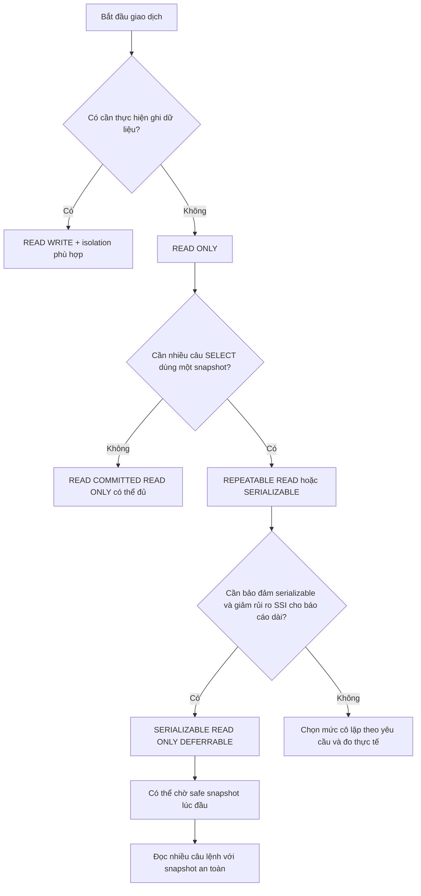

# Giao dịch chỉ đọc và chế độ DEFERRABLE trong PostgreSQL

Báo cáo tài chính, truy vấn phân tích kéo dài, đối soát dữ liệu và sao lưu logic thường có một yêu cầu chung: **đọc một bức tranh dữ liệu nhất quán mà không vô tình sửa dữ liệu nghiệp vụ**. PostgreSQL cung cấp các thuộc tính giao dịch như `READ ONLY`, `READ WRITE` và `DEFERRABLE` để đáp ứng những nhu cầu khác nhau.

Điểm quan trọng nhất của bài học:

> **`READ ONLY` giới hạn những thao tác ghi được phép thực hiện; `SERIALIZABLE` là mức cô lập giao dịch; `DEFERRABLE` (khi kết hợp `SERIALIZABLE READ ONLY`) cho phép PostgreSQL chờ một snapshot an toàn trước khi chạy phần đọc dài.**

Ba khái niệm này liên quan nhưng **không đồng nghĩa**:

- Giao dịch `READ ONLY` không mặc nhiên có một snapshot cố định cho mọi câu lệnh nếu vẫn dùng `READ COMMITTED`.
- Giao dịch `SERIALIZABLE` không mặc nhiên là chỉ đọc; nó vẫn có thể cập nhật dữ liệu nếu khai báo `READ WRITE`.
- `DEFERRABLE` **không** có tác dụng tối ưu snapshot thông thường khi thiếu một trong hai điều kiện `SERIALIZABLE` hoặc `READ ONLY`.
- `DEFERRABLE` của giao dịch không phải là `DEFERRABLE` trên `UNIQUE`/`FOREIGN KEY` constraint.

Bài học thuộc chương **Giao dịch** của module *Database Engine Relational PostgreSQL*. Nội dung tập trung vào SQL thực hành, hiểu snapshot và Serializable Snapshot Isolation (SSI), quan sát tình huống chờ snapshot, giới hạn của chế độ read-only, tích hợp JDBC, tác động vận hành và những tình huống nên hoặc không nên dùng chế độ này.

Các đoạn tạo bảng và cập nhật dùng **database thử nghiệm**, không áp dụng trực tiếp trên production. Các tình huống đa phiên cần chạy ở các kết nối riêng biệt và kết quả thời điểm chờ có thể thay đổi tùy tải thực tế.

## 1. Ba thuộc tính khác nhau của một giao dịch

Một transaction trong PostgreSQL có thể được mô tả bởi ít nhất ba thuộc tính quan trọng:

| Thuộc tính | Câu hỏi nó trả lời | Ví dụ |
|---|---|---|
| Isolation level | Giao dịch nhìn dữ liệu đồng thời và được bảo vệ khỏi anomaly như thế nào? | `READ COMMITTED`, `REPEATABLE READ`, `SERIALIZABLE` |
| Access mode | Giao dịch có được thực hiện các loại thao tác ghi bị hạn chế không? | `READ ONLY`, `READ WRITE` |
| Deferrability | Với serializable read-only, có thể chờ snapshot an toàn trước khi đọc không? | `DEFERRABLE`, `NOT DEFERRABLE` |

Cú pháp gộp điển hình:

```sql
BEGIN TRANSACTION
    ISOLATION LEVEL SERIALIZABLE,
    READ ONLY,
    DEFERRABLE;

-- Các truy vấn SELECT cần cùng một snapshot nhất quán.
SELECT current_setting('transaction_isolation') AS isolation_level;
SELECT current_setting('transaction_read_only') AS read_only;
SELECT current_setting('transaction_deferrable') AS deferrable;

COMMIT;
```

Câu `BEGIN` đặt cả ba thuộc tính ngay từ đầu. Thời điểm PostgreSQL **thu nhận snapshot** có thể xuất hiện khi truy vấn cần đọc dữ liệu bắt đầu; không nên hiểu rằng chỉ gửi lệnh `BEGIN` thì mọi sự chờ snapshot đã luôn xảy ra.

### 1.1. Sơ đồ tổng quát



Sơ đồ chỉ là hướng lựa chọn. Những yêu cầu về tính nhất quán nghiệp vụ còn phụ thuộc cách các giao dịch ghi trên hệ thống được thiết kế và mức cô lập chúng sử dụng.

## 2. READ ONLY: giới hạn thao tác ghi, không phải mức cô lập

`READ ONLY` là **transaction access mode**. Nó yêu cầu PostgreSQL từ chối nhiều lệnh có thể làm thay đổi dữ liệu/đối tượng database trong giao dịch.

```sql
BEGIN READ ONLY;

SELECT 1 AS read_is_allowed;

COMMIT;
```

Giao dịch ở trên không có yêu cầu ghi. Tuy nhiên, điều kiện `READ ONLY` **không tự quyết định một snapshot cố định hay an toàn theo SSI**. Nếu isolation level mặc định là `READ COMMITTED`, những statement khác nhau có thể nhìn các snapshot khác nhau.

### 2.1. READ WRITE là chế độ còn lại

```sql
BEGIN READ WRITE;

-- Với quyền và các ràng buộc phù hợp, có thể INSERT/UPDATE/DELETE.
SELECT 1;

ROLLBACK;
```

`READ WRITE` chỉ cho phép những thao tác ghi mà quyền hạn, chính sách bảo mật và các constraint khác vẫn cho phép. Nó không có nghĩa user được tự do sửa mọi bảng.

### 2.2. READ ONLY không đồng nghĩa read replica

Giao dịch `READ ONLY` có thể chạy trên **primary**. Ngược lại, một standby ở chế độ hot standby thường chỉ cho phép các giao dịch đọc và có hạn chế về mức cô lập/chức năng khác.

Không đánh đồng:

- **Read-only transaction:** một lựa chọn access mode cho giao dịch trên server phù hợp.
- **Read-only database role:** thiết kế quyền của role, không chỉ cờ transaction.
- **Read replica/standby:** topology sao chép/khôi phục với đặc tính visibility và lag riêng.
- **`default_transaction_read_only`:** mặc định của những giao dịch mới trong session, không phải một hệ thống phân quyền.

## 3. Ba mức cô lập cần phân biệt khi đọc báo cáo

PostgreSQL cung cấp những mức isolation theo SQL. Với PostgreSQL, `READ UNCOMMITTED` được xử lý về cơ bản như `READ COMMITTED` vì MVCC không hỗ trợ dirty read theo cách SQL standard định nghĩa.

### 3.1. READ COMMITTED

Ở `READ COMMITTED`, mỗi statement đọc thông thường lấy snapshot phù hợp tại thời điểm statement bắt đầu. Hai câu `SELECT` trong cùng transaction có thể thấy dữ liệu khác nhau nếu transaction khác đã commit giữa chúng.

```sql
BEGIN TRANSACTION
    ISOLATION LEVEL READ COMMITTED,
    READ ONLY;

SELECT ...; -- Snapshot thứ nhất.
SELECT ...; -- Có thể nhìn commit mới hơn.

COMMIT;
```

`READ ONLY` không thay đổi điểm này.

### 3.2. REPEATABLE READ

`REPEATABLE READ` cung cấp một snapshot transaction ổn định đối với các câu đọc thông thường, bắt đầu từ thao tác lấy snapshot đầu tiên phù hợp.

```sql
BEGIN TRANSACTION
    ISOLATION LEVEL REPEATABLE READ,
    READ ONLY;

SELECT ...;
SELECT ...; -- Dùng snapshot của transaction.

COMMIT;
```

Nó rất hữu ích khi báo cáo gồm nhiều SELECT cần cùng một bức tranh MVCC.

Tuy vậy, **REPEATABLE READ không tương đương hoàn toàn SERIALIZABLE**: trong các tình huống có giao dịch ghi liên quan, snapshot isolation có thể cho phép một số hiện tượng như write skew. Một giao dịch read-only đơn lẻ không phải “sửa được” những bất biến mà các writer trước đó đã cho phép vi phạm.

### 3.3. SERIALIZABLE

`SERIALIZABLE` ở PostgreSQL hiện đại sử dụng cơ chế **Serializable Snapshot Isolation (SSI)** để phát hiện những phụ thuộc đồng thời có thể khiến lịch commit không tương đương một thứ tự tuần tự hợp lệ.

```sql
BEGIN TRANSACTION
    ISOLATION LEVEL SERIALIZABLE,
    READ ONLY;

SELECT ...;

COMMIT;
```

Một transaction `SERIALIZABLE` thông thường có thể bị từ chối với lỗi `serialization_failure` (SQLSTATE `40001`) khi SSI phát hiện nguy cơ anomaly. Điều này có thể liên quan cả giao dịch chỉ đọc trong một số lịch đồng thời, không chỉ giao dịch ghi.

### 3.4. Bảng so sánh

| Isolation + access | Có được ghi bảng thường? | Snapshot của nhiều SELECT | Đặc điểm |
|---|---|---|---|
| `READ COMMITTED READ ONLY` | Không | Có thể thay đổi theo statement | Đọc an toàn về thao tác ghi, không giữ một snapshot duy nhất |
| `REPEATABLE READ READ ONLY` | Không | Ổn định trong transaction | Thích hợp báo cáo nhiều bước cần snapshot cố định |
| `SERIALIZABLE READ ONLY NOT DEFERRABLE` | Không | Ổn định | Có thể chịu cơ chế SSI và lỗi `40001` |
| `SERIALIZABLE READ ONLY DEFERRABLE` | Không | Ổn định, có thể chờ trước | Chờ safe snapshot; sau khi có snapshot an toàn, tránh nguy cơ lỗi SSI serialization do chính việc đọc này |
| `SERIALIZABLE READ WRITE` | Có theo quyền | Ổn định cùng luật SSI | Bảo vệ serializability cho thao tác ghi theo quy tắc hệ thống |

**Đừng chọn isolation chỉ dựa trên việc giao dịch có ghi hay không.** Trước hết cần xác định báo cáo có cần nhất quán qua nhiều statement và cần những guarantee nào trong hệ thống cùng các writer đồng thời.

## 4. DEFERRABLE là gì?

Trong ngữ cảnh giao dịch, `DEFERRABLE` cho phép PostgreSQL **trì hoãn việc thu nhận snapshot** của một transaction `SERIALIZABLE READ ONLY` cho đến khi có thể xác định một **safe snapshot**.

Cú pháp trọng tâm:

```sql
BEGIN TRANSACTION
    ISOLATION LEVEL SERIALIZABLE,
    READ ONLY,
    DEFERRABLE;

SELECT ...;

COMMIT;
```

Ý nghĩa:

1. Transaction cần đọc ở mức `SERIALIZABLE`.
2. Nó không được thực hiện các lệnh ghi bị cấm bởi `READ ONLY`.
3. Nó chấp nhận **chờ** cho một snapshot được xem là an toàn theo logic SSI.
4. Sau khi safe snapshot được lấy, phần đọc có thể chạy mà không phải chịu overhead SSI bình thường như một serializable transaction không deferrable và không có nguy cơ trở thành nạn nhân của `serialization_failure` do SSI trong điều kiện đó.

**Lợi ích phải trả bằng độ trễ lúc bắt đầu đọc**. Đặc biệt với báo cáo chạy rất lâu, chấp nhận chờ một lần để tránh lỗi serialization phải chạy lại cả báo cáo có thể là lựa chọn tốt.

### 4.1. Điều kiện để DEFERRABLE có hiệu lực

`DEFERRABLE` có tác dụng liên quan safe snapshot **chỉ khi đồng thời**:

- `ISOLATION LEVEL SERIALIZABLE`.
- `READ ONLY`.
- `DEFERRABLE`.

Nếu đặt ở isolation thấp hơn hoặc giao dịch read-write, chỉ dẫn này **không tạo ra cơ chế chờ safe snapshot của serializable read-only**.

Ví dụ không đạt tổ hợp cần thiết:

```sql
BEGIN ISOLATION LEVEL READ COMMITTED, READ ONLY, DEFERRABLE;
-- Không có tác dụng safe-snapshot tương tự SERIALIZABLE READ ONLY.
COMMIT;
```

```sql
BEGIN ISOLATION LEVEL SERIALIZABLE, READ WRITE, DEFERRABLE;
-- Giao dịch ghi không nhận lợi ích safe-snapshot của read-only.
ROLLBACK;
```

Các ví dụ trên giúp thấy **ba thuộc tính độc lập về cú pháp nhưng không độc lập về hiệu lực của cơ chế DEFERRABLE**.

### 4.2. NOT DEFERRABLE

`NOT DEFERRABLE` là trạng thái không yêu cầu chờ safe snapshot:

```sql
BEGIN TRANSACTION
    ISOLATION LEVEL SERIALIZABLE,
    READ ONLY,
    NOT DEFERRABLE;

SELECT ...;

COMMIT;
```

Không có chỉ dẫn `DEFERRABLE` thì mặc định thường là `NOT DEFERRABLE`. Vì vậy, một transaction serializable chỉ đọc **không tự động chọn safe snapshot bằng cách chờ**.

## 5. Safe snapshot: điều gì làm nó “an toàn”?

PostgreSQL SSI theo dõi các quan hệ phụ thuộc đọc–ghi giữa những giao dịch đồng thời để nhận diện cấu trúc có thể gây anomaly serializable. Một giao dịch chỉ đọc chạy lâu có thể liên quan đến quan hệ phụ thuộc khiến SSI phải xử lý.

**Safe snapshot** là snapshot mà PostgreSQL có thể xác định rằng transaction serializable read-only bắt đầu đọc với nó **không thể tham gia vào một cấu trúc SSI nguy hiểm làm hỏng tính serializable** theo các điều kiện hệ thống.

Nếu không thể xác định ngay snapshot an toàn, transaction `SERIALIZABLE READ ONLY DEFERRABLE` có thể chờ.

```text
  BEGIN SERIALIZABLE READ ONLY DEFERRABLE
                    │
                    ▼
       Yêu cầu snapshot cho lần đọc đầu
                    │
                    ▼
     PostgreSQL xét trạng thái giao dịch đồng thời
                    │
        ┌───────────┴───────────┐
        │                       │
     An toàn                  Chưa an toàn
        │                       │
        │                       ▼
        │                  Chờ điều kiện
        │                   safe snapshot
        │                       │
        └───────────┬───────────┘
                    ▼
            Thu nhận snapshot
                    │
                    ▼
         Chạy SELECT / báo cáo dài
                    │
                    ▼
                 COMMIT
```

### 5.1. Chờ không đồng nghĩa có một global lock chặn tất cả writer

Safe-snapshot wait không nên hiểu là PostgreSQL khóa toàn bộ database và ngăn mọi giao dịch ghi mới.

Cơ chế SSI/snapshot cho phép hoạt động đồng thời theo các quy tắc MVCC; việc chờ có liên quan điều kiện phụ thuộc của các transaction đang hoạt động, **không phải yêu cầu dừng toàn bộ hệ thống**.

### 5.2. “An toàn” không có nghĩa dữ liệu mới nhất tuyệt đối

Safe snapshot bảo vệ về mặt serializability theo ngữ nghĩa transaction; nó **không hứa chứa mọi thay đổi commit sau thời điểm snapshot được lấy**.

Sau khi bắt đầu đọc bằng snapshot an toàn:

- Transaction ghi khác vẫn có thể commit.
- Báo cáo tiếp tục nhìn bức tranh MVCC của snapshot, không tự cập nhật theo mọi commit mới.
- Những row mới được commit sau snapshot có thể chưa xuất hiện trong báo cáo.
- Không có đảm bảo báo cáo “fresh đến mili giây hiện tại” chỉ vì dùng `DEFERRABLE`.

Muốn biết dữ liệu mới đến đâu cần thiết kế thời điểm chốt sổ, watermark, business cutoff hoặc cơ chế xác nhận riêng.

### 5.3. Không phải lúc nào cũng có thời gian chờ đáng kể

Trên hệ thống ít hoạt động đồng thời hoặc điều kiện SSI đã an toàn, việc lấy snapshot có thể rất nhanh. Ngược lại, khi các giao dịch ghi liên quan đang chạy, giao dịch deferrable có thể phải chờ.

**Không nên xây bài benchmark với một kết quả thời gian chờ cố định**; thời gian phụ thuộc trạng thái transaction và lịch thực thi.

## 6. DEFERRABLE khác DEFERRABLE constraint

PostgreSQL dùng cùng từ “deferrable” trong hai khái niệm **khác hoàn toàn**.

### 6.1. Deferrable transaction

```sql
BEGIN TRANSACTION
    ISOLATION LEVEL SERIALIZABLE,
    READ ONLY,
    DEFERRABLE;
```

Nội dung: chờ snapshot an toàn cho báo cáo serializable read-only.

### 6.2. Deferrable constraint

Các ví dụ dùng schema thử nghiệm `demo_tx`; nếu thực hành tuần tự từ đầu bài, hãy tạo schema trước. 

```sql
CREATE SCHEMA IF NOT EXISTS demo_tx;
```

```sql
CREATE TABLE demo_tx.deferred_reference (
    reference_id BIGINT PRIMARY KEY,
    external_code TEXT NOT NULL,
    CONSTRAINT uq_deferred_external_code
        UNIQUE (external_code) DEFERRABLE INITIALLY DEFERRED
);
```

Nội dung: một số kiểm tra constraint được hoãn tới thời điểm thích hợp theo cấu hình constraint/transaction. Chẳng hạn:

```sql
SET CONSTRAINTS uq_deferred_external_code IMMEDIATE;
```

Điều này tác động đến **thời điểm kiểm tra uniqueness**, không khiến PostgreSQL chờ safe snapshot SSI.

| Cụm từ | Áp dụng vào | Mục đích |
|---|---|---|
| `BEGIN ... DEFERRABLE` | Thuộc tính của giao dịch | Safe snapshot khi SERIALIZABLE READ ONLY |
| `UNIQUE ... DEFERRABLE` | Ràng buộc | Hoãn việc kiểm tra constraint |
| `SET CONSTRAINTS ... DEFERRED` | Constraint trong transaction | Điều khiển thời điểm kiểm tra được phép hoãn |
| `NOT DEFERRABLE` ở transaction | Thuộc tính transaction | Không chọn chế độ chờ safe snapshot |
| `NOT DEFERRABLE` ở constraint | Constraint | Không cho hoãn kiểm tra constraint |

**Không dùng `SET CONSTRAINTS ALL DEFERRED` để “bật” safe snapshot**, cũng không thêm `DEFERRABLE` vào unique constraint để một báo cáo tránh `40001`.

## 7. Cú pháp BEGIN, START TRANSACTION, SET TRANSACTION

Có nhiều cách khai báo các thuộc tính. Chúng nên được hiểu như **các đường khác nhau để xác định transaction characteristics**, không phải các chế độ phụ thuộc UI client.

### 7.1. BEGIN với các thuộc tính

```sql
BEGIN TRANSACTION
    ISOLATION LEVEL SERIALIZABLE,
    READ ONLY,
    DEFERRABLE;

SELECT COUNT(*) FROM pg_catalog.pg_class;

COMMIT;
```

Đây là mẫu nên ưu tiên trong tài liệu SQL vì cả ba thuộc tính nằm ngay tại câu bắt đầu.

### 7.2. START TRANSACTION

```sql
START TRANSACTION
    ISOLATION LEVEL SERIALIZABLE,
    READ ONLY,
    DEFERRABLE;

SELECT current_timestamp;

COMMIT;
```

`START TRANSACTION` là cách diễn đạt tương tự `BEGIN` trong PostgreSQL.

### 7.3. BEGIN rồi SET TRANSACTION

```sql
BEGIN;

SET TRANSACTION
    ISOLATION LEVEL SERIALIZABLE,
    READ ONLY,
    DEFERRABLE;

SELECT COUNT(*) FROM pg_catalog.pg_class;

COMMIT;
```

Đặt `SET TRANSACTION` **trước câu truy vấn hoặc lệnh thay đổi dữ liệu đầu tiên** trong transaction. PostgreSQL hạn chế thay isolation level và nhiều transaction characteristics sau khi transaction đã thực hiện query/DML.

Không viết code mà ORM/pool chạy một SELECT kiểm tra kết nối trước, rồi mới cố nâng isolation lên SERIALIZABLE trong cùng transaction.

### 7.4. Thứ tự đặc tính trong khai báo

Các `transaction_mode` có thể xuất hiện theo cú pháp PostgreSQL với dấu phẩy như ví dụ. Viết tách dòng để người đọc thấy rõ ý nghĩa:

```sql
BEGIN
    ISOLATION LEVEL SERIALIZABLE,
    READ ONLY,
    DEFERRABLE;
```

Mỗi transaction có đúng một access mode/isolation được áp dụng cuối cùng theo các quy tắc khai báo. Tránh lặp các mode mâu thuẫn trong cùng statement.

## 8. Đọc trạng thái transaction thực tế

Dùng:

```sql
BEGIN TRANSACTION
    ISOLATION LEVEL SERIALIZABLE,
    READ ONLY,
    DEFERRABLE;

SHOW transaction_isolation;
SHOW transaction_read_only;
SHOW transaction_deferrable;

COMMIT;
```

Các giá trị kỳ vọng về mặt ý nghĩa:

| Tham số | Kỳ vọng |
|---|---|
| `transaction_isolation` | `serializable` |
| `transaction_read_only` | `on` |
| `transaction_deferrable` | `on` |

Có thể đọc bằng hàm:

```sql
SELECT
    current_setting('transaction_isolation') AS isolation_level,
    current_setting('transaction_read_only') AS read_only,
    current_setting('transaction_deferrable') AS deferrable;
```

Đây là cách quan sát cấu hình giao dịch tại thời điểm statement. **Nó không chứng minh rằng snapshot an toàn đã được lấy trước khi các statement khác bắt đầu**, không thay thế việc hiểu thời điểm PostgreSQL có snapshot hay thời gian chờ đã xảy ra.

### 8.1. Kiểm tra mặc định session

```sql
SHOW default_transaction_isolation;
SHOW default_transaction_read_only;
SHOW default_transaction_deferrable;
```

Những tham số `default_transaction_*` quyết định đặc tính **mặc định cho các transaction mới** (trong phạm vi cấu hình tương ứng), không có nghĩa transaction đang mở sẽ được viết lại thành chế độ mới.

## 9. Thiết lập mặc định cho session

Nếu một kết nối dành riêng cho báo cáo:

```sql
SET SESSION CHARACTERISTICS AS TRANSACTION
    ISOLATION LEVEL SERIALIZABLE,
    READ ONLY,
    DEFERRABLE;
```

Những transaction tiếp theo trong session có thể sử dụng bộ thuộc tính mặc định ấy, trừ khi transaction được bắt đầu với chỉ định khác hợp lệ.

```sql
BEGIN;
SELECT current_setting('transaction_isolation'),
       current_setting('transaction_read_only'),
       current_setting('transaction_deferrable');
COMMIT;
```

### 9.1. Hạn chế trong connection pool

**Thiết lập session có thể tồn tại khi connection được trả về pool**. Nếu một request báo cáo đặt mặc định `READ ONLY DEFERRABLE` rồi trả connection cho request ghi khác mà pool không reset chính xác, request sau có thể gặp lỗi bất ngờ.

Những lựa chọn cần cân nhắc:

- Dùng connection pool riêng cho reporting.
- Đặt transaction mode tường minh ngay từng transaction.
- Đảm bảo pool reset session state đúng cách.
- Không phát lệnh `SET SESSION CHARACTERISTICS` tùy tiện trên connection dùng chung mà không có cơ chế hoàn nguyên.
- Với các tầng proxy/pool như transaction pooling, phải hiểu setting nào là session-scoped và khả năng tái sử dụng connection vật lý.

### 9.2. default_transaction_read_only không phải bảo mật

```sql
SET default_transaction_read_only = on;
```

Đây là một mặc định session cho transaction mới. Nó không thay thế `REVOKE INSERT/UPDATE/DELETE` hoặc chính sách phân quyền.

Trên primary, role có quyền phù hợp vẫn có thể yêu cầu một transaction `READ WRITE` hợp lệ; vì vậy **đừng coi default_transaction_read_only là hàng rào security cho tài khoản không đáng tin**.

## 10. Chuẩn bị môi trường lab giao dịch

Tạo schema và hai tài khoản với tổng số dư ban đầu được biết.

```sql
CREATE SCHEMA IF NOT EXISTS demo_tx;

CREATE TABLE demo_tx.account (
    account_id INTEGER PRIMARY KEY,
    account_name TEXT NOT NULL,
    balance NUMERIC(14, 2) NOT NULL,
    CONSTRAINT ck_demo_tx_balance_nonnegative CHECK (balance >= 0)
);

INSERT INTO demo_tx.account (account_id, account_name, balance)
VALUES
    (1, 'A', 1000.00),
    (2, 'B', 1000.00);
```

Lúc này, tổng số dư của hai tài khoản là `2000.00`.

```sql
SELECT account_id, account_name, balance
FROM demo_tx.account
ORDER BY account_id;

SELECT SUM(balance) AS total_balance
FROM demo_tx.account;
```

### 10.1. Giao dịch chuyển tiền mẫu

Chuyển 100 từ A sang B:

```sql
BEGIN;

UPDATE demo_tx.account
SET balance = balance - 100
WHERE account_id = 1
  AND balance >= 100;

UPDATE demo_tx.account
SET balance = balance + 100
WHERE account_id = 2;

COMMIT;
```

Đây là **mô phỏng để học snapshot**, không phải mã chuyển tiền production hoàn chỉnh. Một hệ thống tài chính thật phải kiểm tra số hàng cập nhật, trường hợp không đủ tiền, audit, idempotency, ghi sổ, đồng thời và rollback toàn bộ khi bất kỳ bước nào không đạt.

Với giả định cả hai lệnh thành công và transaction commit, sau chuyển tiền A có 900, B có 1100; tổng vẫn 2000.

### 10.2. Khởi tạo lại lab có kiểm soát

Để thử lại kết quả ban đầu trên database lab:

```sql
BEGIN;

UPDATE demo_tx.account
SET balance = CASE account_id
    WHEN 1 THEN 1000.00
    WHEN 2 THEN 1000.00
END
WHERE account_id IN (1, 2);

COMMIT;
```

Không dùng script reset này trong khi nhiều session đang thực hành cùng dữ liệu, nếu không kết quả thời điểm có thể khó giải thích.

## 11. READ COMMITTED READ ONLY vẫn có thể thấy hai snapshot

Mở **hai phiên psql khác nhau**, A và B, kết nối cùng database lab. Đảm bảo bảng ở trạng thái ban đầu.

### 11.1. Session A: bắt đầu báo cáo chỉ đọc

```sql
BEGIN TRANSACTION
    ISOLATION LEVEL READ COMMITTED,
    READ ONLY;

SELECT balance AS balance_a
FROM demo_tx.account
WHERE account_id = 1;
-- Nếu chưa có writer commit: 1000.00.
```

Giữ transaction A mở, **chưa chạy câu đọc account B**.

### 11.2. Session B: chuyển tiền rồi commit

```sql
BEGIN;

UPDATE demo_tx.account
SET balance = balance - 100
WHERE account_id = 1
  AND balance >= 100;

UPDATE demo_tx.account
SET balance = balance + 100
WHERE account_id = 2;

COMMIT;
```

Giả định transaction B thành công và commit trước khi A đọc câu tiếp theo.

### 11.3. Session A: đọc account B sau commit

```sql
SELECT balance AS balance_b
FROM demo_tx.account
WHERE account_id = 2;
-- Có thể là 1100.00 sau khi B commit.

COMMIT;
```

Nếu ứng dụng ghép số đã đọc ở hai thời điểm, nó có thể kết luận sai `1000 + 1100 = 2100`. Điều này **không** phải PostgreSQL làm mất 100 đơn vị; nó xảy ra vì hai SELECT ở `READ COMMITTED` có thể nhìn hai snapshot khác nhau.

### 11.4. Một SELECT vẫn có snapshot nhất quán ở mức statement

Nếu A chỉ chạy:

```sql
SELECT SUM(balance) AS total_balance
FROM demo_tx.account;
```

một lần, SELECT thông thường tại `READ COMMITTED` nhìn một snapshot statement, nên không ghép một hàng trước commit và một hàng sau commit theo kiểu hai statement độc lập. Những chức năng đặc biệt như gọi external data sources/functions cần xem thêm ngữ nghĩa riêng.

**Nếu báo cáo chỉ là một SELECT đơn giản**, `READ COMMITTED` có thể đáp ứng nhu cầu nhất quán theo statement mà không cần nâng lên `SERIALIZABLE DEFERRABLE`.

## 12. REPEATABLE READ READ ONLY giữ một snapshot cho nhiều câu

Đặt lại số dư ban đầu, sau đó bắt đầu:

### 12.1. Session A

```sql
BEGIN TRANSACTION
    ISOLATION LEVEL REPEATABLE READ,
    READ ONLY;

SELECT balance AS balance_a
FROM demo_tx.account
WHERE account_id = 1;
-- 1000.00 nếu snapshot được lấy trước giao dịch B.
```

### 12.2. Session B

```sql
BEGIN;

UPDATE demo_tx.account
SET balance = balance - 100
WHERE account_id = 1
  AND balance >= 100;

UPDATE demo_tx.account
SET balance = balance + 100
WHERE account_id = 2;

COMMIT;
```

### 12.3. Session A tiếp tục

```sql
SELECT balance AS balance_b
FROM demo_tx.account
WHERE account_id = 2;
-- Nếu snapshot A được lấy trước B commit: 1000.00.

SELECT SUM(balance) AS total_at_snapshot
FROM demo_tx.account;
-- 2000.00 trong tình huống mô phỏng.

COMMIT;
```

Dù B đã commit, A tiếp tục nhìn snapshot cũ. Đây là lợi ích chính của `REPEATABLE READ` đối với báo cáo nhiều query.

**Snapshot ổn định không có nghĩa nhìn dữ liệu mới nhất.** Báo cáo được nhất quán theo một mốc thời gian, không phải real-time refresh.

## 13. SERIALIZABLE READ ONLY không DEFERRABLE

```sql
BEGIN TRANSACTION
    ISOLATION LEVEL SERIALIZABLE,
    READ ONLY,
    NOT DEFERRABLE;

SELECT SUM(balance)
FROM demo_tx.account;

COMMIT;
```

Giao dịch chỉ đọc này sử dụng quy tắc `SERIALIZABLE` thông thường của PostgreSQL. Với SSI:

- PostgreSQL có thể cần theo dõi những phụ thuộc đọc–ghi.
- Cấu trúc phụ thuộc nguy hiểm có thể gây lỗi `serialization_failure`.
- Một báo cáo dài có thể tốn nhiều công sức rồi phải retry nếu bị hủy do SSI.
- Việc chỉ đọc giúp tránh thay đổi bảng nghiệp vụ nhưng không loại trừ mọi tình huống serializable conflict.

Một giao dịch `SERIALIZABLE READ ONLY DEFERRABLE` thay đổi trade-off: **chờ safe snapshot trước** để tránh rủi ro serialization conflict do chính report khi đã có snapshot an toàn.

### 13.1. SERIALIZABLE không phải khóa toàn bộ bảng

PostgreSQL SSI không đơn giản biến mọi SELECT thành `SELECT FOR UPDATE`. Nó vẫn sử dụng MVCC và cơ chế theo dõi phụ thuộc (bao gồm predicate/SIREAD locks theo cách triển khai SSI) để quyết định transaction nào có thể commit.

Một transaction serializable có thể cùng tồn tại với các transaction khác; nhưng một số lịch đồng thời dẫn đến abort/retry thay vì cho phép anomaly.

## 14. SERIALIZABLE READ ONLY DEFERRABLE trong thực tế

Đây là dạng SQL cốt lõi:

```sql
BEGIN TRANSACTION
    ISOLATION LEVEL SERIALIZABLE,
    READ ONLY,
    DEFERRABLE;

SELECT account_id, account_name, balance
FROM demo_tx.account
ORDER BY account_id;

SELECT SUM(balance) AS total_balance
FROM demo_tx.account;

COMMIT;
```

Nếu PostgreSQL chưa có safe snapshot thích hợp khi câu đọc bắt đầu, nó có thể chờ. Sau khi snapshot được nhận, hai câu SELECT nhìn một bức tranh snapshot ổn định.

### 14.1. Vì sao cách này hữu ích cho báo cáo dài?

Giả sử báo cáo gồm:

1. Truy vấn 100.000 khách và phân nhóm.
2. Tổng hợp doanh thu từng tháng.
3. Đối soát tồn kho.
4. Kết xuất CSV qua ứng dụng.
5. Tính checksum.
6. Ghi file kết quả bên ngoài database.

Nếu báo cáo đang chạy sau 25 phút rồi bị `40001`, ứng dụng có thể phải **bỏ toàn bộ kết quả và chạy lại**. Với mode deferrable, việc chờ safe snapshot từ đầu có thể tốt hơn so với bị hủy giữa chừng bởi serialization failure.

Điều này không đồng nghĩa không có bất kỳ lỗi nào khác sau đó: query vẫn có thể timeout, bị cancel, bị đóng connection, gặp thiếu tài nguyên hoặc lỗi do ứng dụng.

### 14.2. Không nên dùng cho request latency rất thấp theo mặc định

Một endpoint trả dữ liệu tức thời với SLA rất chặt có thể không muốn **chờ không xác định trước khi lấy snapshot**. Nếu chỉ có một SELECT và không cần guarantee serializable cho toàn báo cáo, `READ COMMITTED` hoặc `REPEATABLE READ` có thể phù hợp hơn.

Chọn chế độ theo **latency budget và consistency contract**, không chỉ dựa trên “nghe có vẻ an toàn hơn”.

## 15. Trường hợp chờ snapshot có thể quan sát được

Thử nghiệm với **hai hoặc ba connection** trong lab. Không có một chuỗi lệnh ngắn nào bảo đảm mọi lần sẽ thấy thời gian chờ vì SSI cần một lịch transaction phù hợp.

### 15.1. Session W: writer serializable đang hoạt động

```sql
BEGIN TRANSACTION ISOLATION LEVEL SERIALIZABLE, READ WRITE;

UPDATE demo_tx.account
SET balance = balance + 1
WHERE account_id = 1;

-- Giữ transaction mở trong thời gian ngắn để quan sát.
-- Chưa COMMIT.
```

Không để giao dịch cập nhật mở lâu trên production. Trong lab, việc một writer đang mở **không bảo đảm** reader deferrable sẽ chờ; kết quả còn phụ thuộc quan hệ phụ thuộc SSI và trạng thái các transaction khác.

### 15.2. Session R: reader serializable, read-only, deferrable

```sql
BEGIN TRANSACTION
    ISOLATION LEVEL SERIALIZABLE,
    READ ONLY,
    DEFERRABLE;

SELECT COUNT(*)
FROM demo_tx.account;

SELECT SUM(balance)
FROM demo_tx.account;

COMMIT;
```

Reader có thể nhanh chóng nhận snapshot hoặc chờ một khoảng thời gian. Nếu chờ, đừng kết luận PostgreSQL bị deadlock chỉ từ việc query chưa trả ngay.

### 15.3. Session M: monitor trạng thái

```sql
SELECT
    pid,
    usename,
    state,
    wait_event_type,
    wait_event,
    xact_start,
    query_start,
    left(query, 160) AS query_excerpt
FROM pg_stat_activity
WHERE datname = current_database()
ORDER BY query_start NULLS LAST;
```

Trong một số phiên bản/trạng thái, reader đợi safe snapshot có thể hiển thị wait event **`SafeSnapshot`** trong nhóm IPC. Sự xuất hiện của event này phụ thuộc thời điểm lấy mẫu và phiên bản, nên không thể yêu cầu nó luôn có trong output.

### 15.4. Kết thúc writer và dọn session

Ở Session W:

```sql
ROLLBACK;
```

Sau đó xác nhận reader không bị giữ mở ngoài ý muốn. Nếu đã thử nhiều lần, đặt lại số dư bằng script lab mục 10.

**Không làm bài tập kiểu giữ transaction writer mở lâu trên production**: row locks có thể chặn giao dịch khác và giữ phiên bản hàng cũ.

## 16. SafeSnapshot wait khác lock wait thông thường

Cần phân biệt các nguồn chờ khi query “đứng”:

| Loại chờ | Nguyên nhân | Dấu hiệu |
|---|---|---|
| Safe snapshot | PostgreSQL đang chờ điều kiện snapshot an toàn cho SERIALIZABLE READ ONLY DEFERRABLE | Có thể thấy wait event `SafeSnapshot` |
| Row lock | Một transaction muốn sửa/khóa hàng đang bị giao dịch khác giữ khóa | `Lock` với wait event liên quan tuple/transactionid |
| Table lock | Lệnh DDL hoặc transaction giữ lock xung đột với SELECT | `Lock` với relation/object phù hợp |
| Disk I/O | Đọc dữ liệu hoặc temp file từ thiết bị lưu trữ | Wait event thuộc nhóm I/O tùy phiên bản |
| Client | Server chờ client gửi/nhận dữ liệu | Wait event nhóm Client |
| CPU | Query đang tính toán | Có thể active nhưng wait_event rỗng |

`pg_locks` hữu ích để xem lock thông thường, nhưng **không nên mặc định mọi đợi safe snapshot là một row lock có thể thấy trực tiếp trong `pg_locks`**.

### 16.1. Đừng tự kill blocker dựa trên chẩn đoán sơ bộ

Khi thấy báo cáo chờ, cần xác định PID, transaction, loại chờ, business owner và tác động của việc cancel/terminate. Hủy nhầm một writer đang xử lý giao dịch quan trọng có thể gây sự cố nghiệp vụ.

Trên môi trường thật, sử dụng quy trình điều tra và escalation; không gọi `pg_terminate_backend` chỉ vì một transaction deferrable đang chờ.

## 17. READ ONLY cấm những lệnh nào?

Chế độ read-only của PostgreSQL hạn chế nhiều lệnh ghi vào **bảng không tạm** và các thao tác DDL. Một số ví dụ nên nhận diện:

| Lệnh/nhóm lệnh | Trong giao dịch READ ONLY thông thường |
|---|---|
| `SELECT` chỉ đọc dữ liệu | Được phép |
| `INSERT` vào bảng persistent | Bị cấm |
| `UPDATE` bảng persistent | Bị cấm |
| `DELETE` bảng persistent | Bị cấm |
| `MERGE` ghi bảng persistent | Bị cấm |
| `COPY ... FROM` ghi bảng persistent | Bị cấm |
| `CREATE`, `ALTER`, `DROP` và DDL tương tự | Bị hạn chế/cấm |
| `TRUNCATE` | Bị cấm |
| `SELECT ... FOR UPDATE` | Không phù hợp và bị cấm trong READ ONLY |
| `EXPLAIN` không ANALYZE trên DML | Chỉ lập kế hoạch, tùy câu lệnh và quyền; không thực thi DML |
| `EXPLAIN ANALYZE` trên DML bị cấm | Không được dùng để lách READ ONLY |
| DML trên bảng temporary đã có | Có ngoại lệ được PostgreSQL cho phép với bảng tạm thích hợp |

Phần ngoại lệ bảng tạm cần hiểu chính xác: các thao tác dữ liệu trên **temporary table** có thể khác bảng persistent, nhưng **không vì thế mà mọi DDL tạo bảng tạm đều được phép** trong READ ONLY. Hãy tạo bảng tạm trước khi vào transaction read-only hoặc dùng phương án khác theo phiên bản/quyền.

### 17.1. Thử UPDATE trong READ ONLY

Chạy riêng, trong lab:

```sql
BEGIN READ ONLY;

UPDATE demo_tx.account
SET balance = balance + 1
WHERE account_id = 1;
-- Dự kiến PostgreSQL báo lỗi vì read-only transaction.

ROLLBACK;
```

Sau lỗi, transaction thường ở trạng thái aborted; `ROLLBACK` là cần thiết để phục hồi session.

**Không chạy tiếp một chuỗi SELECT trong transaction đang lỗi rồi cho rằng READ ONLY tự rollback mọi thứ ngay lập tức.** PostgreSQL cần transaction được kết thúc hoặc rollback về savepoint phù hợp.

### 17.2. SELECT FOR UPDATE không phải cách kiểm tra dữ liệu chỉ đọc

```sql
BEGIN READ ONLY;

SELECT *
FROM demo_tx.account
WHERE account_id = 1
FOR UPDATE;
-- Không được phép lấy loại row-level lock này trong READ ONLY.

ROLLBACK;
```

Nếu nghiệp vụ cần khóa hàng để chuẩn bị thay đổi trạng thái, đó là một workflow ghi và cần transaction `READ WRITE` phù hợp.

### 17.3. SELECT không tự được xem là thuần túy về mọi mặt

Một câu `SELECT` có thể gọi function, external connector, thao tác với trạng thái session hoặc gây side effect ngoài cơ sở dữ liệu tùy cấu hình/extension/đặc quyền.

`READ ONLY` không nên được coi là **sandbox bảo mật tuyệt đối** hay cơ chế bảo đảm mọi function mà user được phép gọi đều không có tác động bên ngoài.

Với vai trò chỉ đọc không tin cậy, hãy quản lý quyền thực thi function, extension, network access, dữ liệu nhạy cảm và resource quotas riêng.

## 18. Temporary tables và ngoại lệ cần hiểu rõ

Trong một số trường hợp, PostgreSQL cho phép DML trên các **temporary tables** đã tồn tại trong một read-only transaction. Điều này phản ánh rằng temporary data không giống dữ liệu persistent chia sẻ.

Tình huống minh họa:

```sql
-- Tạo bảng tạm trước khi bắt đầu transaction READ ONLY.
CREATE TEMP TABLE IF NOT EXISTS tmp_report_note (
    note_id INTEGER,
    note_text TEXT
) ON COMMIT PRESERVE ROWS;

BEGIN READ ONLY;

INSERT INTO tmp_report_note (note_id, note_text)
VALUES (1, 'Ghi chú tạm của session');

SELECT * FROM tmp_report_note;

COMMIT;
```

Các chi tiết quyền/phiên bản và loại lệnh trên bảng tạm cần kiểm tra trong môi trường thực, nhưng **không được suy diễn rằng READ ONLY chỉ là một comment không có hiệu lực**. Nó vẫn cấm thay đổi các bảng persistent và nhiều DDL.

### 18.1. Serializable read-only deferrable có nên ghi bảng tạm?

Nếu một công việc thực sự cần tạo/ghi staging data trong cùng transaction, việc chọn `SERIALIZABLE READ ONLY DEFERRABLE` có thể không còn là mô hình thích hợp hoặc có các hạn chế triển khai cụ thể với lệnh đó.

Một phương án đơn giản hơn là:

- Đọc dữ liệu qua một transaction read-only có snapshot phù hợp.
- Xử lý trung gian ở application hoặc một bước/temp workspace được thiết kế riêng.
- Chỉ dùng transaction read-write khi cần ghi dữ liệu DB thực sự.
- Giữ ranh giới giao dịch và tính nhất quán của dữ liệu đầu vào được tài liệu hóa.

Đừng cố biến một transaction báo cáo long-running thành transaction đa chức năng ghi/sửa chỉ vì có ngoại lệ temporary tables.

## 19. Default READ ONLY có thể bị thay đổi nếu quyền vẫn cho phép

Ví dụ:

```sql
SET SESSION CHARACTERISTICS AS TRANSACTION READ ONLY;

BEGIN;
SHOW transaction_read_only;
COMMIT;
```

Trên primary, một role có quyền ghi và được phép chỉ định chế độ phù hợp có thể bắt đầu giao dịch `READ WRITE` tường minh. Vì vậy:

> **`READ ONLY` là một thuộc tính thực thi của transaction, không thay thế GRANT/REVOKE và RLS.**

Để tạo tài khoản reporting, cần thiết kế quyền:

```sql
-- Mẫu quản trị minh họa; không chạy nếu role/schema chưa sẵn có.
REVOKE INSERT, UPDATE, DELETE ON ALL TABLES
    IN SCHEMA demo_tx FROM reporting_role;

GRANT USAGE ON SCHEMA demo_tx TO reporting_role;
GRANT SELECT ON ALL TABLES
    IN SCHEMA demo_tx TO reporting_role;
```

Các câu trên giả định role có tên `reporting_role` đã tồn tại. Quyền mặc định cho bảng tương lai, quyền sở hữu, function privileges, role inheritance và quyền trên schema khác cũng cần được quản trị. Không xem vài dòng GRANT/REVOKE này là một cấu hình bảo mật production hoàn chỉnh.

## 20. DEFERRABLE có tác động tới độ trễ thế nào?

Một transaction báo cáo có hai loại thời gian:

```text
Tổng thời gian xử lý =
    Thời gian chờ snapshot (nếu có)
  + Thời gian thực thi SQL
  + Thời gian truyền dữ liệu/ứng dụng xử lý
  + Thời gian đóng transaction
```

Với `SERIALIZABLE READ ONLY DEFERRABLE`, thời gian chờ snapshot có thể tăng, nhưng sau đó hệ thống tránh được rủi ro SSI serialization failure khiến phải bỏ toàn bộ báo cáo.

### 20.1. Một ví dụ định tính

- Báo cáo A chạy 2 giây, SLA yêu cầu trả dưới 3 giây. Chờ safe snapshot một lúc có thể không phù hợp.
- Báo cáo B chạy 45 phút, nếu bị hủy phải chạy lại gần một giờ. Chấp nhận chờ snapshot vài giây hoặc lâu hơn tùy SLA có thể mang lại lợi ích lớn.
- Sao lưu logic lớn cần một ảnh nhất quán để tái tạo trạng thái về sau; chế độ chờ snapshot có thể đáng giá hơn phản hồi tức thời.

**Không có công thức thời gian chờ cố định** cho mọi server. Cần đo từ workload thực và xem giao dịch ghi đồng thời nào khiến snapshot chưa an toàn.

### 20.2. Chỉ đặt DEFERRABLE không giải quyết truy vấn chậm

Nếu bottleneck là:

- Thiếu index.
- Query join nhân hàng.
- Sort/temp I/O lớn.
- Aggregate rất nặng.
- Thiếu thống kê.
- Disk I/O chậm.
- Nút thắt network hoặc serialization trong Java.

thì `DEFERRABLE` không sửa những vấn đề đó. Nó giải quyết **rủi ro SSI/safe snapshot** của một lớp transaction cụ thể.

## 21. Timeout cho báo cáo: đợi an toàn nhưng có giới hạn

Một báo cáo production thường cần giới hạn thời gian tổng để không treo vô hạn.

### 21.1. statement_timeout

```sql
BEGIN TRANSACTION
    ISOLATION LEVEL SERIALIZABLE,
    READ ONLY,
    DEFERRABLE;

SET LOCAL statement_timeout = '30s';

SELECT SUM(balance)
FROM demo_tx.account;

COMMIT;
```

`statement_timeout` giới hạn thời gian chạy statement theo quy tắc phiên bản/giao thức PostgreSQL, và có thể bao gồm giai đoạn chờ trước khi statement hoàn tất. Nếu timeout trong lúc chờ snapshot, client nhận lỗi và transaction thường cần rollback.

Cẩn thận: timeout 30 giây cho mỗi statement **không** tự đặt giới hạn 30 giây cho toàn báo cáo gồm nhiều statement. Cần time budget ở tầng ứng dụng và, nếu cần, transaction timeout theo phiên bản/thiết kế phù hợp.

### 21.2. lock_timeout không thay thế statement_timeout

`lock_timeout` giới hạn thời gian chờ **acquire lock** theo cơ chế lock, không phải mọi loại wait. Đợi `SafeSnapshot` là một kiểu chờ khác; không nên dựa vào `lock_timeout` để giới hạn mọi tình huống chờ snapshot.

```sql
BEGIN TRANSACTION
    ISOLATION LEVEL SERIALIZABLE,
    READ ONLY,
    DEFERRABLE;

SET LOCAL statement_timeout = '60s';
SET LOCAL lock_timeout = '5s';

SELECT COUNT(*) FROM demo_tx.account;

COMMIT;
```

Với những query nhanh, chọn lock_timeout nhỏ hơn statement_timeout có thể giúp phát hiện table-lock contention; nhưng cấu hình phù hợp tùy nghiệp vụ và không làm safe snapshot xuất hiện nhanh hơn.

### 21.3. idle_in_transaction_session_timeout

Nếu ứng dụng mở transaction báo cáo rồi đứng ở bước xử lý Java lâu mà **không gửi câu SQL nào**, transaction có thể giữ snapshot và lock.

`idle_in_transaction_session_timeout` có thể kết thúc session idle trong transaction vượt ngưỡng theo cấu hình, giúp giảm rủi ro giao dịch “quên đóng”. Nhưng timeout có tác động trực tiếp tới long-running workflows; cần điều chỉnh dựa trên nhu cầu, không đặt một giá trị toàn cục nhỏ tùy ý.

## 22. Read-only transaction vẫn giữ tài nguyên MVCC

Một giao dịch chỉ đọc không tạo thay đổi hàng persistent, nhưng nếu giữ snapshot rất lâu, nó có thể ảnh hưởng:

- Thời điểm một số row versions cũ được VACUUM thu gom.
- Tuổi snapshot và việc giữ `xmin` trong những trường hợp liên quan.
- Mức độ bloat do writers tạo ra khi phải giữ phiên bản cho reader.
- Quan hệ/DDL lock thường xuyên trong quá trình SELECT.
- Bộ nhớ, kết nối, CPU và I/O của hệ thống.

### 22.1. Dấu hiệu transaction báo cáo quên đóng

Một ứng dụng chạy:

```sql
BEGIN TRANSACTION ISOLATION LEVEL REPEATABLE READ, READ ONLY;
SELECT ...
-- Quên COMMIT hoặc ROLLBACK, giữ kết nối trong pool.
```

dù không có INSERT/UPDATE, transaction có thể vẫn ở trạng thái `idle in transaction`, giữ snapshot/tài nguyên và gây tác động vận hành.

`SERIALIZABLE READ ONLY DEFERRABLE` không miễn trừ nghĩa vụ **đóng transaction sớm ngay khi không còn cần snapshot**.

### 22.2. Không duy trì snapshot cho công việc bên ngoài DB quá lâu

Một report cần xuất hàng triệu dòng qua network có thể kéo dài. Nếu transaction vẫn mở trong suốt quá trình nén/ghi file/upload, snapshot và lock cũng có thể được giữ.

Cân nhắc kiến trúc:

- Stream dữ liệu có kiểm soát, hoàn tất và đóng transaction đúng lúc.
- Đưa dữ liệu sang một snapshot/export có lifecycle rõ.
- Tách xử lý nặng sau khi đã lấy xong dữ liệu nếu có thể.
- Không dùng pagination qua nhiều transaction rồi gọi đó là “một snapshot nhất quán” trừ khi có cơ chế snapshot chia sẻ được thiết kế đúng.

## 23. Read-only transaction và các loại lock

Ngay cả `SELECT` thuần cũng có thể lấy **table-level AccessShareLock** trên quan hệ được đọc. Lock này thường không chặn DML thông thường nhưng có thể xung đột với một số thao tác DDL cần lock mạnh.

Vì vậy:

- `READ ONLY` không có nghĩa “không dùng lock”.
- `DEFERRABLE` không có nghĩa “không thể bị block bởi DDL”.
- Safe snapshot giúp phần serializable read tránh overhead SSI thông thường khi đã an toàn, nhưng không loại bỏ mọi cơ chế đồng bộ của hệ thống.

### 23.1. Đọc plan cũng có thể cần lock

Ngay cả một số bước lập kế hoạch/query validation có thể truy cập catalog/quan hệ theo quy tắc khóa tương ứng. Không hứa một report sẽ chạy không bị gián đoạn chỉ vì không sửa dữ liệu.

### 23.2. Cancel và terminate

Dừng query `SELECT` dài bằng cancellation có thể để transaction ở trạng thái cần rollback. Đóng session/terminate có thể ảnh hưởng connection pool và công việc ứng dụng khác.

Quy trình vận hành nên ưu tiên timeouts, cancellation theo request có chủ sở hữu và rollback sạch trước khi chọn biện pháp mạnh.

## 24. Giám sát trạng thái bằng pg_stat_activity

Trong một session monitoring đủ quyền:

```sql
SELECT
    pid,
    datname,
    usename,
    application_name,
    state,
    wait_event_type,
    wait_event,
    xact_start,
    query_start,
    now() - xact_start AS transaction_age,
    left(query, 200) AS query_excerpt
FROM pg_stat_activity
WHERE datname = current_database()
  AND pid <> pg_backend_pid()
ORDER BY xact_start NULLS LAST;
```

Nhìn vào:

- `state = 'active'` và `wait_event` để xem query đang thực thi hay chờ.
- `state = 'idle in transaction'` nếu transaction đang mở nhưng client chưa gửi query tiếp.
- `xact_start` để phát hiện giao dịch kéo dài.
- `application_name` để biết service/job nào giữ connection.
- `wait_event = 'SafeSnapshot'` nếu phiên bản/trạng thái hiển thị reader chờ safe snapshot.

**Không phải mọi user đều nhìn thấy đầy đủ query text của session khác**. PostgreSQL có quy tắc quyền đọc thông tin thống kê; cần role được quản trị phù hợp, ví dụ quyền giám sát cụ thể.

### 24.1. Log thời gian lấy snapshot ở application

Để phân biệt thời gian chờ snapshot với SQL nặng, ứng dụng có thể ghi dấu thời gian:

```text
T0: BEGIN SERIALIZABLE READ ONLY DEFERRABLE
T1: bắt đầu SELECT đầu tiên cần snapshot
T2: SELECT đầu tiên trả kết quả
T3: kết thúc các SELECT
T4: COMMIT
```

Khoảng T1–T2 bao gồm **thời gian chờ snapshot nếu có** và chi phí thực thi SELECT đầu tiên. Không đo “snapshot wait chính xác” chỉ bằng hiệu T1–T2 nếu SELECT đó cũng tốn CPU/I/O đáng kể. Kết hợp `pg_stat_activity`, wait events và telemetry khi cần điều tra kỹ.

## 25. EXPLAIN không cho biết hết thời gian chờ snapshot

`EXPLAIN` mô tả kế hoạch thực thi. `EXPLAIN (ANALYZE, BUFFERS)` đo execution của câu SQL và buffer activity; nó hữu ích khi nghi ngờ query scan/sort/join chậm.

Nhưng câu hỏi:

> “Báo cáo mất 20 giây vì chờ safe snapshot hay vì quét bảng?”

cần phối hợp nhiều nguồn:

1. Mốc bắt đầu statement trong ứng dụng.
2. `pg_stat_activity.wait_event` khi đang chạy.
3. Thống kê/plan `EXPLAIN` trên query tương ứng.
4. Lock/log/CPU/I/O nếu có.
5. Thời gian transaction writer đồng thời.

`DEFERRABLE` không làm biến mất nhu cầu tối ưu SQL. Một câu SELECT vốn quét 500 triệu hàng vẫn có thể quét nhiều hàng sau khi đã nhận safe snapshot.

## 26. Phân biệt transaction READ ONLY và statement SELECT

Có hai mức bảo vệ khác nhau:

- **Statement:** một câu SELECT thông thường ở `READ COMMITTED` đọc từ snapshot của statement.
- **Transaction:** nhiều statement trong `REPEATABLE READ`/`SERIALIZABLE` cùng nhìn snapshot transaction theo quy tắc mức cô lập.

Nếu workflow gồm:

```text
SELECT total_accounts;
SELECT total_balance;
SELECT total_debt;
SELECT total_payment;
```

và cả bốn cần tương ứng cùng một thời điểm dữ liệu, việc đặt transaction isolation phù hợp quan trọng hơn chỉ ghi `READ ONLY`.

Nếu workflow chỉ có một câu:

```sql
SELECT COUNT(*), SUM(balance)
FROM demo_tx.account;
```

thì snapshot theo statement ở `READ COMMITTED` thường đã cho một bức tranh nhất quán cho câu đó. Đừng thêm `SERIALIZABLE READ ONLY DEFERRABLE` chỉ để “nâng cấp” mọi SELECT mà không có yêu cầu cụ thể.

## 27. SERIALIZABLE và bảo vệ bất biến giữa các transaction

Một hệ thống có bất biến “luôn có ít nhất một người trực ca” hoặc “tổng một số khoản không vượt hạn mức” thường đòi hỏi cách phối hợp giữa **những transaction ghi**.

Hai writers ở `REPEATABLE READ` có thể đọc cùng dữ liệu cũ và thực hiện những thay đổi không trực tiếp tranh chấp cùng hàng, tạo hiện tượng **write skew**. PostgreSQL `SERIALIZABLE` có thể phát hiện và abort một transaction để giữ lịch tuần tự hợp lệ.

Reader `SERIALIZABLE READ ONLY DEFERRABLE` không tự sửa được bất biến đã bị hệ thống ghi sai từ trước.

### 27.1. Lưu ý khi writers không chạy SERIALIZABLE

Các guarantee về serializability của **toàn bộ workflow nghiệp vụ** phải được đánh giá dựa trên cách mọi transaction liên quan truy cập dữ liệu. Nếu writers dùng các isolation thấp hơn và ứng dụng tự ghép nhiều thao tác, chỉ nâng transaction báo cáo lên `SERIALIZABLE` không biến toàn hệ thống thành serializable.

Chọn isolation trên reader giúp bảo vệ đặc tính **của transaction reader đó**, nhưng không thay thế invariant constraints hoặc chiến lược transaction ở writer.

## 28. Không nhầm read-only với SELECT của standby

PostgreSQL standby/hot standby có quy tắc riêng cho các truy vấn chỉ đọc, MVCC snapshot, WAL replay, replication conflict và độ trễ sao chép.

### 28.1. Standby có thể lag

Một query trên replica đọc trạng thái mà primary đã commit thay đổi mới hơn. `READ ONLY` trên replica **không** bảo đảm dữ liệu đã cập nhật đến transaction mới nhất trên primary.

Cần thiết kế SLA replica lag, thông tin replay LSN hoặc điều kiện consistency theo workload.

### 28.2. SERIALIZABLE trên hot standby có hạn chế

Không giả định `SERIALIZABLE READ ONLY DEFERRABLE` là lựa chọn hoạt động nguyên vẹn trên mọi standby. PostgreSQL có hạn chế lịch sử và/hoặc phiên bản đối với serializable isolation trong hot standby; nhiều triển khai chỉ cung cấp các mức read isolation phù hợp với recovery.

Trước khi đưa mode này vào job chạy trên replica, kiểm tra phiên bản PostgreSQL và khả năng hỗ trợ của standby cụ thể, thay vì tự suy luận từ việc replica chỉ đọc.

### 28.3. Standby query cũng có thể bị hủy vì conflict replay

Một truy vấn dài trên hot standby có thể bị cancel do xung đột với quá trình áp dụng WAL/recovery theo cấu hình. Đây **không giống** SSI serialization failure trên primary. `DEFERRABLE` không phải giải pháp chung cho mọi lỗi cancel trên replica.

## 29. Ứng dụng với pg_dump và sao lưu logic

PostgreSQL `pg_dump` hỗ trợ cờ `--serializable-deferrable` cho những trường hợp cần snapshot dump có tính chất serializable phù hợp.

Ví dụ cú pháp:

```bash
pg_dump \
  --dbname="postgresql://backup_user@db-host:5432/appdb" \
  --format=custom \
  --file="appdb.dump" \
  --serializable-deferrable
```

Ví dụ không chứa mật khẩu; không đưa thông tin đăng nhập thật vào script chia sẻ công khai. Trong production, quản lý secret và quyền backup theo quy trình bảo mật.

Ý tưởng: dùng transaction serializable, read-only, deferrable để chờ snapshot thích hợp, giúp dump nhất quán với các quy tắc serializable liên quan. Đây là tùy chọn phục vụ nhu cầu cụ thể; **không phải mọi backup đều cần cờ này**.

### 29.1. Snapshot-consistent dump và safe serializable snapshot

`pg_dump` thông thường đã có cơ chế lấy snapshot nhất quán để tránh những hàng của một transaction xuất hiện nửa chừng trong bản dump.

`--serializable-deferrable` nhắm tới tính chất **serializable safe snapshot** mạnh hơn trong các trường hợp liên quan tới concurrent transactions, không chỉ để “sao lưu có snapshot” cơ bản.

### 29.2. DEFERRABLE không kiểm tra khả năng restore

Một file dump xuất thành công không bảo đảm:

- Dump gồm mọi object/role/tablespace mong muốn.
- Tài khoản backup có đủ quyền.
- File được truyền/upload nguyên vẹn.
- Có thể restore trên phiên bản/môi trường mục tiêu.
- Application sau restore hoạt động đúng.
- Recovery point objective và recovery time objective được đáp ứng.

Vẫn cần kiểm tra restore định kỳ và chính sách backup tổng thể. `DEFERRABLE` chỉ liên quan cách thu snapshot transaction trong tình huống hỗ trợ.

## 30. JDBC: chọn transaction mode tường minh

Trong ứng dụng Java, một cách minh bạch là đặt transaction characteristics bằng SQL **trước khi có SELECT đầu tiên**.

```java
import java.sql.Connection;
import java.sql.PreparedStatement;
import java.sql.ResultSet;
import java.sql.SQLException;
import java.sql.Statement;

public final class ReportReader {
    public static void readConsistentReport(Connection connection)
            throws SQLException {

        boolean oldAutoCommit = connection.getAutoCommit();

        try {
            connection.setAutoCommit(false);

            // Phải là câu đầu tiên của transaction về mặt truy vấn dữ liệu.
            try (Statement mode = connection.createStatement()) {
                mode.execute("""
                    SET TRANSACTION
                        ISOLATION LEVEL SERIALIZABLE,
                        READ ONLY,
                        DEFERRABLE
                    """);
            }

            try (PreparedStatement ps = connection.prepareStatement("""
                SELECT account_id, account_name, balance
                FROM demo_tx.account
                ORDER BY account_id
                """);
                 ResultSet rs = ps.executeQuery()) {

                while (rs.next()) {
                    int id = rs.getInt("account_id");
                    String name = rs.getString("account_name");
                    java.math.BigDecimal balance =
                            rs.getBigDecimal("balance");
                    System.out.println(id + ": " + name + "=" + balance);
                }
            }

            connection.commit();
        } catch (SQLException | RuntimeException ex) {
            try {
                connection.rollback();
            } catch (SQLException rollbackError) {
                ex.addSuppressed(rollbackError);
            }
            throw ex;
        } finally {
            // Pool thực tế cần chiến lược reset connection rõ ràng.
            connection.setAutoCommit(oldAutoCommit);
        }
    }
}
```

Đây là ví dụ minh họa JDBC trên connection dành riêng cho giao dịch; trước khi dùng với pool/ORM, cần chắc chắn **không có query nào được chạy trong cùng transaction trước `SET TRANSACTION`**, kể cả query ngầm của framework.

### 30.1. Vì sao không chỉ dùng Connection.setReadOnly(true)?

JDBC có API:

```java
connection.setReadOnly(true);
```

Nhưng semantics thực thi phụ thuộc JDBC driver, cấu hình và trạng thái connection. Với PostgreSQL JDBC, chế độ read-only có thể được driver thể hiện bằng transaction mode theo những option cụ thể, nhưng **`setReadOnly(true)` không tự bật `SERIALIZABLE DEFERRABLE`**.

Đối với yêu cầu chặt “SERIALIZABLE + READ ONLY + DEFERRABLE”, SQL tường minh trong transaction là cách dễ kiểm chứng hơn. Có thể sử dụng `Connection.setTransactionIsolation(Connection.TRANSACTION_SERIALIZABLE)` và các API driver phù hợp, nhưng vẫn cần xác nhận phần `DEFERRABLE`, thời điểm bắt đầu transaction và khả năng reset.

### 30.2. Không đổi isolation sau query đầu tiên

Một bẫy:

```java
connection.setAutoCommit(false);

// Framework chạy SELECT 1 hoặc query đọc metadata ở đây.

// Bây giờ mới cố đặt isolation:
statement.execute(
    "SET TRANSACTION ISOLATION LEVEL SERIALIZABLE, READ ONLY, DEFERRABLE"
);
```

Khi transaction đã có query, PostgreSQL có thể từ chối việc đổi isolation hoặc transaction characteristics. Thiết kế connection flow để mode được đặt **trước mọi truy vấn cần snapshot**, hoặc cấu hình mặc định cho session/pool reporting.

### 30.3. Đọc kết quả bằng stream phải giữ transaction mở

Nếu Java dùng server-side cursor/fetch size để stream hàng lớn, transaction có thể phải mở cho tới khi đọc hết kết quả. Trong thời gian đó, snapshot và một số locks/tài nguyên được giữ.

Cân nhắc:

- `fetchSize` và khả năng cursor của driver.
- Thời gian stream/network.
- Connection pool timeout và server timeouts.
- Xử lý client cancel/exception và rollback.
- Không giữ transaction mở khi application đã không cần đọc dữ liệu nữa.

## 31. Retry khi có lỗi: không retry mù quáng

Một transaction `SERIALIZABLE READ ONLY NOT DEFERRABLE` có thể gặp `40001` do SSI. `DEFERRABLE` giúp tránh loại lỗi serialization đó sau khi nhận safe snapshot, nhưng **vẫn có thể xảy ra lỗi khác**.

Một số SQLSTATE cần phân biệt:

| SQLSTATE | Nhóm vấn đề | Hướng xử lý |
|---|---|---|
| `40001` | Serialization failure | Retry toàn transaction theo chính sách phù hợp |
| `40P01` | Deadlock detected | Điều tra, có thể retry toàn transaction |
| `57014` | Query canceled, thường do statement_timeout hoặc cancel | Xem time budget, nguyên nhân chờ và quyết định có retry không |
| `25006` | Read-only SQL transaction | Truy vấn cố thực hiện lệnh ghi bị cấm; sửa workflow/code |
| `25P02` | In failed SQL transaction | Cần rollback transaction hoặc savepoint phù hợp trước khi dùng tiếp |
| `42501` | Insufficient privilege | Kiểm tra quyền role/RLS, không xem là lỗi transient bình thường |

### 31.1. Vì sao không retry tự động mọi timeout?

Nếu safe-snapshot wait kéo dài do workload có giao dịch writer đang giữ, retry ngay vô hạn có thể tạo hàng loạt kết nối chờ tương tự và làm tình trạng xấu hơn.

Cần:

- Giới hạn số lần retry.
- Exponential backoff/jitter nếu phù hợp.
- Tổng time budget của request/report.
- Theo dõi số lần retry và nguyên nhân.
- Phân biệt công việc có thể chạy sau với request phải phản hồi ngay.
- Đảm bảo thao tác xuất file/đẩy thông báo bên ngoài không bị lặp một cách không kiểm soát.

## 32. READ ONLY không thay thế snapshot export hay transaction spanning

Một job xuất dữ liệu có thể cần nhiều worker đọc những phần khác nhau theo **cùng snapshot**. Không thể chỉ khai báo `READ ONLY` ở mỗi worker rồi mặc định chúng nhìn cùng một trạng thái.

PostgreSQL có cơ chế **export/import snapshot** cho một số tình huống, ví dụ `pg_export_snapshot()` và `SET TRANSACTION SNAPSHOT`, với các điều kiện về isolation, thời điểm gọi và vòng đời exporting transaction.

### 32.1. Ý tưởng

```text
Connection A: bắt đầu transaction, lấy snapshot phù hợp
              │
              ├── xuất snapshot ID
              │
              ├── connection B import snapshot trước khi đọc
              │
              └── connection C import snapshot trước khi đọc

B, C có thể dùng chung mốc snapshot theo quy tắc PostgreSQL.
A phải giữ snapshot export còn hợp lệ cho thời điểm import.
```

Đây là workflow nâng cao, không được giải quyết chỉ bằng `DEFERRABLE` trong ba session riêng. Từng worker cùng chọn `SERIALIZABLE READ ONLY DEFERRABLE` vẫn có thể nhận **những snapshot khác nhau** nếu khởi chạy và nhận snapshot ở các thời điểm khác nhau.

### 32.2. Không dùng snapshot export mà không hiểu lifetime

Một snapshot ID không phải token có thể lưu lại vài ngày và import bất kỳ lúc nào. PostgreSQL có quy tắc vòng đời, transaction state và ràng buộc isolation khi import.

Nếu có yêu cầu parallel export/backup, sử dụng công cụ hỗ trợ snapshot đồng bộ hoặc thiết kế transaction phối hợp đúng với tài liệu PostgreSQL của phiên bản triển khai.

## 33. READ ONLY, autocommit và phạm vi statement

Với client mặc định autocommit, mỗi SQL statement riêng lẻ thường được thực hiện trong một transaction riêng nếu không mở transaction block tường minh.

Nếu ứng dụng chạy:

```sql
SELECT COUNT(*) FROM demo_tx.account;
SELECT SUM(balance) FROM demo_tx.account;
```

mà không `BEGIN`, hai statement có thể nhận snapshot khác nhau, bất kể mỗi statement riêng lẻ chỉ đọc.

Muốn hai truy vấn thuộc cùng một transaction và snapshot phù hợp:

```sql
BEGIN TRANSACTION
    ISOLATION LEVEL REPEATABLE READ,
    READ ONLY;

SELECT COUNT(*) FROM demo_tx.account;
SELECT SUM(balance) FROM demo_tx.account;

COMMIT;
```

Không giả định JDBC connection đang `readOnly=true` hoặc query là `SELECT` có nghĩa nhiều statement tự chia sẻ snapshot.

## 34. Những trường hợp nên chọn DEFERRABLE

### 34.1. Báo cáo dài cần serializable semantics

Ví dụ đối soát báo cáo gồm nhiều nhóm dữ liệu, trong khi writers cũng sử dụng mô hình serializable và báo cáo cần một trạng thái nhất quán theo hợp đồng hệ thống.

`SERIALIZABLE READ ONLY DEFERRABLE` có thể giúp tránh chạy lâu rồi bị SSI serialization failure.

### 34.2. Backup/snapshot logic cần tính chất serializable

`pg_dump --serializable-deferrable` là một ví dụ được hỗ trợ cho loại workload này, khi yêu cầu thực sự cần safe serializable snapshot.

### 34.3. Job không yêu cầu phản hồi ngay

Một nightly batch report có lịch rộng có thể chấp nhận chờ snapshot lúc bắt đầu. Đối với request tương tác có deadline rất chặt, chờ snapshot có thể không phù hợp.

### 34.4. Đọc nhiều bảng/nhiều statement phải cùng bức tranh

Nếu yêu cầu là một snapshot nhất quán qua nhiều query, có thể bắt đầu từ `REPEATABLE READ READ ONLY`; chỉ nâng lên `SERIALIZABLE DEFERRABLE` khi cần guarantee SSI và đã hiểu trade-off.

## 35. Những trường hợp không nên chọn DEFERRABLE theo thói quen

- **Một câu SELECT đơn giản** không cần full serializable semantics.
- **Endpoint latency cực thấp** không chấp nhận chờ safe snapshot.
- **Ứng dụng cần INSERT/UPDATE** trong cùng transaction.
- **Job chạy trên standby** nơi serializable mode không được hỗ trợ theo môi trường.
- **Vấn đề hiệu năng do thiếu index**, không liên quan SSI.
- **Mục tiêu chỉ chặn user ghi dữ liệu**, vốn cần phân quyền và có thể dùng READ ONLY mà không cần SERIALIZABLE.
- **Cần đọc dữ liệu mới nhất ngay sau commit trên primary**, trong khi snapshot ổn định có thể không thấy các commit sau khi lấy snapshot.
- **Muốn giải quyết transaction lock wait do DDL**: DEFERRABLE không tự sửa lock conflict.

Không có một mức isolation mạnh nhất phù hợp cho mọi request. Tăng guarantee thường đi kèm chi phí và yêu cầu quản trị.

## 36. Quy trình lựa chọn cho một dịch vụ reporting

### Bước 1 — xác định output cần nhất quán ở phạm vi nào

- Một SQL statement?
- Nhiều SQL statements trong một transaction?
- Nhiều sessions/worker?
- Nhiều nguồn dữ liệu (database khác, API, cache)?
- Nhiều ngày/phiên xử lý phải cùng business cutoff?

Một transaction PostgreSQL không tự tạo snapshot nguyên tử cho hệ thống ngoài PostgreSQL.

### Bước 2 — hỏi có thao tác ghi nào bắt buộc không

Nếu có update trạng thái job, lưu checkpoint hoặc đánh dấu đã xuất dữ liệu, quyết định nó nên ở **transaction khác** hay trong một workflow ghi có lock/constraint riêng.

Không cố ghi bảng persistent trong transaction `READ ONLY`.

### Bước 3 — chọn isolation

- `READ COMMITTED`: có thể đủ cho từng SELECT độc lập.
- `REPEATABLE READ`: cần một MVCC snapshot cho nhiều SELECT.
- `SERIALIZABLE`: cần serializable semantics theo mô hình giao dịch liên quan.

### Bước 4 — cân nhắc DEFERRABLE khi SERIALIZABLE READ ONLY

Nếu báo cáo rất dài và chi phí retry do serialization failure cao, `DEFERRABLE` thường đáng xem xét. Xác định có chấp nhận chờ snapshot lúc đầu không.

### Bước 5 — đặt mode trước query

```sql
BEGIN
    ISOLATION LEVEL SERIALIZABLE,
    READ ONLY,
    DEFERRABLE;
```

Tránh framework phát SELECT ngầm trước khi đặt `SET TRANSACTION`.

### Bước 6 — đo và giám sát

Theo dõi latency, snapshot wait, `SafeSnapshot` event nếu có, transaction age, locks, temp I/O và timeout. Phân biệt an toàn giao dịch với tối ưu kế hoạch.

### Bước 7 — đóng transaction dứt khoát

`COMMIT` khi thành công; `ROLLBACK` khi thất bại/cancel. Không để connection ở trạng thái idle in transaction trong pool.

## 37. Bài tập 1: nhận diện ba thuộc tính

Cho SQL:

```sql
BEGIN TRANSACTION
    ISOLATION LEVEL SERIALIZABLE,
    READ ONLY,
    DEFERRABLE;
```

**Câu hỏi:** ba thuộc tính tương ứng điều gì?

**Đáp án:**

- `SERIALIZABLE` là isolation level.
- `READ ONLY` là access mode.
- `DEFERRABLE` là lựa chọn cho phép chờ safe snapshot của serializable read-only.

Không thuộc tính nào ở đây yêu cầu hoãn kiểm tra unique constraint.

## 38. Bài tập 2: READ ONLY có giữ snapshot không?

```sql
BEGIN ISOLATION LEVEL READ COMMITTED, READ ONLY;

SELECT balance FROM demo_tx.account WHERE account_id = 1;
-- Session khác COMMIT thay đổi hai tài khoản.
SELECT balance FROM demo_tx.account WHERE account_id = 2;

COMMIT;
```

**Câu hỏi:** hai SELECT nhất thiết nhìn cùng snapshot?

**Đáp án:** không. `READ COMMITTED` cho phép snapshot thay đổi giữa các statement. `READ ONLY` chỉ giới hạn thao tác ghi; muốn snapshot ổn định qua nhiều query, chọn `REPEATABLE READ` hoặc `SERIALIZABLE` theo yêu cầu.

## 39. Bài tập 3: câu nào có tác dụng safe snapshot?

Đánh giá bốn trường hợp:

| Transaction | Chờ safe snapshot theo DEFERRABLE? |
|---|---|
| `READ COMMITTED READ ONLY DEFERRABLE` | Không |
| `SERIALIZABLE READ WRITE DEFERRABLE` | Không |
| `SERIALIZABLE READ ONLY NOT DEFERRABLE` | Không yêu cầu chờ safe snapshot |
| `SERIALIZABLE READ ONLY DEFERRABLE` | Có thể chờ đến safe snapshot |

**Bài học:** phải đủ bộ ba điều kiện; từ `DEFERRABLE` một mình không mang bảo đảm đó.

## 40. Bài tập 4: vì sao báo cáo thấy dữ liệu cũ?

Một reader:

```sql
BEGIN ISOLATION LEVEL REPEATABLE READ, READ ONLY;

SELECT SUM(balance) FROM demo_tx.account;

-- Writer transaction commit thêm dữ liệu.

SELECT SUM(balance) FROM demo_tx.account;
COMMIT;
```

**Hỏi:** vì sao câu hai chưa nhìn commit mới?

**Đáp án:** reader tiếp tục dùng snapshot transaction được lấy trước đó. Đây là hành vi nhất quán mong muốn, không phải replication lag.

## 41. Bài tập 5: SELECT FOR UPDATE trong READ ONLY

```sql
BEGIN READ ONLY;

SELECT *
FROM demo_tx.account
WHERE account_id = 1
FOR UPDATE;
```

**Đáp án:** bị cấm trong read-only transaction. Nếu cần khóa hàng cho workflow ghi, phải chọn transaction read-write và kiểm tra quyền.

Sau lỗi, chạy `ROLLBACK` để kết thúc transaction đang ở trạng thái thất bại.

## 42. Bài tập 6: phân biệt DEFERRABLE constraint

Có hai câu:

```sql
BEGIN TRANSACTION ISOLATION LEVEL SERIALIZABLE, READ ONLY, DEFERRABLE;
```

và:

```sql
UNIQUE (external_code) DEFERRABLE INITIALLY DEFERRED
```

**Câu hỏi:** chúng có liên hệ trực tiếp tới cùng một cơ chế không?

**Đáp án:** không. Câu đầu là transaction mode về safe snapshot; câu thứ hai là thời điểm kiểm tra constraint. Chỉ giống từ khóa.

## 43. Bài tập 7: báo cáo mất 15 giây trước khi trả hàng

Một transaction `SERIALIZABLE READ ONLY DEFERRABLE` chưa trả kết quả SELECT đầu tiên. Hệ thống đang có nhiều writer.

**Hỏi:** kết luận “query thiếu index” có đủ cơ sở không?

**Đáp án:** chưa. Query có thể chờ safe snapshot. Quan sát `pg_stat_activity.wait_event` và telemetry; sau đó đọc `EXPLAIN` để xem phần thực thi SQL có chậm không. Hai nguyên nhân có thể cùng tồn tại.

## 44. Bài tập 8: query trên standby

Một job chạy trên hot standby và cố yêu cầu `SERIALIZABLE READ ONLY DEFERRABLE`.

**Câu hỏi:** có thể mặc định như chạy primary không?

**Đáp án:** không. Khả năng hỗ trợ serializable trên hot standby và các conflict do WAL replay có quy tắc riêng. Cần kiểm tra phiên bản/topology; nếu phải chạy trên standby, thiết kế theo isolation/replica consistency được hỗ trợ.

## 45. Bài tập 9: JDBC đặt mode quá muộn

Đoạn Java:

```java
connection.setAutoCommit(false);
statement.executeQuery("SELECT count(*) FROM demo_tx.account");
statement.execute(
    "SET TRANSACTION ISOLATION LEVEL SERIALIZABLE, READ ONLY, DEFERRABLE");
```

**Hỏi:** lỗi ở đâu?

**Đáp án:** transaction đã chạy query trước khi đặt isolation/transaction mode. Đặt mode ngay đầu transaction, trước SELECT đầu tiên, hoặc cấu hình connection/session đúng cách trước khi bắt đầu transaction.

## 46. Bài tập 10: báo cáo có cần serializable không?

Một endpoint chỉ chạy:

```sql
SELECT COUNT(*), SUM(balance)
FROM demo_tx.account;
```

và trả kết quả ngay. Không cần so với nhiều statement khác.

**Đáp án gợi ý:** `READ COMMITTED` với snapshot theo statement có thể là đủ; `SERIALIZABLE READ ONLY DEFERRABLE` chỉ nên dùng nếu có yêu cầu serializable semantics bổ sung. “Mạnh hơn” không tự đồng nghĩa “tốt hơn”.

## 47. Bài tập 11: vì sao READ ONLY không thay bảo mật?

User có quyền UPDATE nhưng ứng dụng đặt:

```sql
SET default_transaction_read_only = on;
```

**Hỏi:** đã bảo đảm tài khoản không thể ghi dữ liệu chưa?

**Đáp án:** chưa. Đây là default transaction, không thay GRANT/REVOKE/RLS. Security cần quyền ở database và hạn chế khả năng thực thi function/extension tương ứng.

## 48. Bài tập 12: long-running transaction và VACUUM

Một báo cáo `REPEATABLE READ READ ONLY` chạy xong phần SQL trong 10 phút nhưng giữ connection idle in transaction thêm nhiều giờ.

**Hỏi:** có vô hại vì chỉ đọc?

**Đáp án:** không. Snapshot còn mở có thể giữ phiên bản hàng cũ, ảnh hưởng VACUUM và bloat, cùng kết nối/lock. Đóng transaction ngay khi không còn cần nó.

## 49. Bài tập 13: DEFERRABLE có chặn mọi error?

Một serializable read-only deferrable transaction đã nhận snapshot an toàn, sau đó bị `statement_timeout` khi chạy aggregate lớn.

**Hỏi:** chế độ DEFERRABLE có mâu thuẫn với timeout không?

**Đáp án:** không. Safe snapshot liên quan tránh các rủi ro SSI serialization. Query vẫn có thể timeout, cancel, thiếu tài nguyên hoặc lỗi hệ thống khác.

## 50. Bài tập 14: thiết kế báo cáo ba câu SELECT

Yêu cầu: một báo cáo gồm:

- Tổng số khách.
- Tổng số dư tài khoản.
- Tổng số giao dịch.

Cả ba chỉ cần cùng một snapshot MVCC, không có yêu cầu serializable đặc biệt.

**Lời giải định hướng:**

```sql
BEGIN TRANSACTION
    ISOLATION LEVEL REPEATABLE READ,
    READ ONLY;

SELECT COUNT(*) FROM demo_tx.account;
SELECT SUM(balance) FROM demo_tx.account;
SELECT COUNT(*) FROM demo_tx.account;

COMMIT;
```

Ở lab chưa có bảng khách/giao dịch riêng, nên ba phép đếm chỉ minh họa cách giữ snapshot trên bảng `account`. Trong hệ thống thật, thay bằng ba bảng/statement nghiệp vụ phù hợp.

**Điểm cần nhớ:** `REPEATABLE READ READ ONLY` thường đã đáp ứng yêu cầu “cùng một snapshot” mà không cần `DEFERRABLE`.

## 51. Bài tập 15: chẩn đoán wait_event

Một session monitor cho thấy:

```text
state           = active
wait_event_type = IPC
wait_event      = SafeSnapshot
```

**Hỏi:** điều này gợi ý điều gì?

**Đáp án:** backend đang đợi điều kiện lấy snapshot an toàn cho một transaction read-only serializable deferrable (khi phiên bản báo sự kiện đó). Điều này khác chờ row-level lock hoặc chạy CPU-intensive SELECT. Xác nhận thêm query text, transaction mode, thời gian chờ và workload đồng thời.

## 52. Những hiểu lầm thường gặp

**“READ ONLY nghĩa là mọi câu SELECT đều nhìn cùng dữ liệu.”** Không đúng nếu transaction ở `READ COMMITTED` và có writer commit giữa các statement.

**“DEFERRABLE là một mức isolation thứ năm.”** Không đúng. Nó là transaction characteristic riêng, chỉ có tác dụng safe snapshot ở `SERIALIZABLE READ ONLY`.

**“READ ONLY DEFERRABLE đủ, không cần SERIALIZABLE.”** Không đúng. Nếu thiếu `SERIALIZABLE`, không có cùng cơ chế chờ safe snapshot.

**“BEGIN DEFERRABLE khóa mọi writer.”** Không đúng. Nó có thể chờ để lấy snapshot an toàn, không phải global write lock.

**“Chờ càng lâu thì snapshot càng mới và chính xác tuyệt đối.”** Không đúng. Safe snapshot tập trung vào serializability, không hứa freshness với các commit sau thời điểm snapshot.

**“Một read-only report không thể gây vấn đề hiệu năng.”** Không đúng. Nó vẫn tiêu tốn tài nguyên, giữ snapshot/locks và có thể ảnh hưởng VACUUM.

**“Read-only transaction = read-only role.”** Không đúng. Access mode không thay quyền.

**“DEFERRABLE giúp ngăn tất cả lỗi query.”** Không đúng. Nó tránh rủi ro serialization do SSI cho transaction tương ứng sau khi có safe snapshot, không miễn lỗi khác.

**“SET CONSTRAINTS ALL DEFERRED bật safe snapshot.”** Không đúng. Đó là cơ chế constraint checking.

**“Transaction trên standby luôn hỗ trợ SERIALIZABLE DEFERRABLE.”** Không nên giả định; phải kiểm tra hệ thống và phiên bản.

**“pg_dump bình thường không có snapshot nhất quán.”** Không đúng. `pg_dump` có cơ chế nhất quán riêng; cờ `--serializable-deferrable` phục vụ yêu cầu snapshot serializable mạnh hơn.

**“Dùng DEFERRABLE rồi không cần đóng transaction.”** Không đúng. Transaction dài vẫn ảnh hưởng tài nguyên MVCC và vận hành.

## 53. Bảng tra cứu nhanh

| Mục tiêu | Cách tiếp cận |
|---|---|
| Ngăn vô tình ghi vào bảng persistent trong một transaction | `BEGIN READ ONLY` |
| Mỗi SELECT có thể thấy commit mới nhất lúc bắt đầu statement | `READ COMMITTED READ ONLY` |
| Nhiều SELECT cần một snapshot ổn định | `REPEATABLE READ READ ONLY` |
| Báo cáo cần SERIALIZABLE và chấp nhận rủi ro SSI thông thường | `SERIALIZABLE READ ONLY NOT DEFERRABLE` |
| Báo cáo dài cần safe serializable snapshot và chấp nhận chờ | `SERIALIZABLE READ ONLY DEFERRABLE` |
| Xem isolation hiện tại | `SHOW transaction_isolation` |
| Xem access mode hiện tại | `SHOW transaction_read_only` |
| Xem deferrability hiện tại | `SHOW transaction_deferrable` |
| Đặt thuộc tính sau BEGIN nhưng trước truy vấn | `SET TRANSACTION ...` |
| Đặt default cho những giao dịch mới của session | `SET SESSION CHARACTERISTICS AS TRANSACTION ...` |
| Quan sát trạng thái chờ | `pg_stat_activity.wait_event_type`/`wait_event` |
| Giới hạn thời gian mỗi query | `statement_timeout` |
| Giới hạn lock wait | `lock_timeout` (không phải mọi wait) |
| Kiểm soát quyền ghi thực sự | `GRANT`/`REVOKE`/RLS/role design |
| Dump dùng safe serializable snapshot khi phù hợp | `pg_dump --serializable-deferrable` |
| Kiểm tra constraint được phép hoãn | `SET CONSTRAINTS`, không liên quan safe snapshot |

## 54. Checklist cho báo cáo sản xuất

Trước khi triển khai transaction reporting quan trọng, cần xác nhận:

1. **Báo cáo có một hay nhiều SQL statements?** Snapshot theo statement có đủ không?
2. **Các bảng có cần cùng mốc MVCC không?** Nếu có, cân nhắc REPEATABLE READ.
3. **Có thật sự cần SERIALIZABLE không?** Dựa trên invariant, nghiệp vụ và writer workflow.
4. **Báo cáo có thể chấp nhận chờ snapshot không?** Xác định SLA chờ.
5. **SERIALIZABLE READ ONLY DEFERRABLE có được bật đủ ba thuộc tính?**
6. **Mode được thiết lập trước query đầu tiên chưa?**
7. **Có connection pool/ORM tự thực hiện query trước SET TRANSACTION không?**
8. **Có lệnh INSERT/UPDATE/DDL hoặc SELECT FOR UPDATE ngầm không?**
9. **Query dài có `statement_timeout` và time budget phù hợp không?**
10. **Có xử lý rollback khi query bị cancel/timeout không?**
11. **Pool có reset session/transaction state sau request không?**
12. **Có monitor wait_event, xact_start và idle in transaction không?**
13. **Transaction có giữ snapshot quá lâu ảnh hưởng VACUUM không?**
14. **Báo cáo lấy dữ liệu từ primary hay standby?** Isolation/lag/conflicts ra sao?
15. **Có yêu cầu nhiều connection cùng snapshot không?** Nếu có, nghiên cứu snapshot export/import.
16. **Có phân quyền reporting riêng không?** READ ONLY không thay bảo mật.
17. **Có retry đúng SQLSTATE không?** Không replay mù quáng các hiệu ứng ngoài database.
18. **Có phân biệt latency chờ snapshot với latency SELECT không?**
19. **Có đánh giá backup/restore nếu dùng pg_dump không?**
20. **Đã có test trên dữ liệu và workload đại diện chưa?** Không suy đoán thời gian chờ từ lab nhỏ.

Checklist này giúp chọn isolation theo yêu cầu thực tế, thay vì bật DEFERRABLE như một “cờ an toàn” trong mọi transaction.

## 55. Sơ đồ tổng kết

```text
           CẦN ĐỌC DỮ LIỆU TRONG POSTGRESQL
                         │
                         ▼
              Có cần ghi bảng persistent?
                  ┌──────┴───────┐
                  │              │
                 Có             Không
                  │              │
                  ▼              ▼
             READ WRITE       READ ONLY
                  │              │
                  │              ▼
                  │      Nhiều câu SELECT cần cùng snapshot?
                  │          ┌──────┴──────┐
                  │          │             │
                  │         Không          Có
                  │          │             │
                  │          ▼             ▼
                  │    READ COMMITTED   REPEATABLE READ
                  │                    hoặc SERIALIZABLE
                  │                          │
                  │                          ▼
                  │                Cần SERIALIZABLE?
                  │                    ┌─────┴───────┐
                  │                    │             │
                  │                   Không          Có
                  │                    │             │
                  │                    ▼             ▼
                  │              REPEATABLE READ  Báo cáo dài,
                  │                              chấp nhận chờ?
                  │                               ┌────┴────┐
                  │                               │         │
                  │                              Có       Không
                  │                               │         │
                  │                               ▼         ▼
                  │                  SERIALIZABLE READ   SERIALIZABLE READ
                  │                  ONLY DEFERRABLE     ONLY NOT DEFERRABLE
                  │                         │                 │
                  │                         ▼                 ▼
                  │                    Chờ safe          SSI thông thường,
                  │                    snapshot          có thể cần retry
                  │                         │                 │
                  └─────────────────────────┴─────────────────┘
                                            │
                                            ▼
                           Chạy SELECT / giám sát / đóng transaction
```

## 56. Tổng kết

**Giao dịch chỉ đọc và chế độ DEFERRABLE là hai công cụ khác mục tiêu, bổ sung cho nhau khi đi cùng mức cô lập phù hợp.**

Năm điều cần ghi nhớ:

1. **`READ ONLY` là access mode, không phải isolation level.** Nó ngăn nhiều thao tác ghi bảng persistent nhưng không tự bảo đảm các SELECT ở `READ COMMITTED` nhìn cùng snapshot.
2. **`REPEATABLE READ` và `SERIALIZABLE` giữ snapshot ổn định theo transaction**, nhưng SERIALIZABLE còn có cơ chế SSI để bảo vệ lịch giao dịch khỏi anomaly với khả năng báo `40001` ở những lịch đồng thời liên quan.
3. **`DEFERRABLE` chỉ phát huy ý nghĩa safe snapshot khi transaction đồng thời là `SERIALIZABLE` và `READ ONLY`.** PostgreSQL có thể chờ trước khi lấy snapshot, sau đó giúp báo cáo đọc dài tránh nguy cơ serialization failure do SSI.
4. **Safe snapshot không thay thế phân quyền, index, transaction management hay bảo đảm freshness.** Báo cáo vẫn có thể chậm, bị cancel, giữ snapshot lâu hoặc thấy dữ liệu cũ hơn những commit mới.
5. **Hãy chọn theo workload:** một SELECT đơn giản thường không cần chế độ mạnh nhất; báo cáo đa bước cần snapshot ổn định có thể dùng REPEATABLE READ; báo cáo serializable dài và nhạy với retry mới là ứng viên tự nhiên cho READ ONLY DEFERRABLE.

Một mẫu SQL cần nhớ:

```sql
BEGIN TRANSACTION
    ISOLATION LEVEL SERIALIZABLE,
    READ ONLY,
    DEFERRABLE;

-- Chạy toàn bộ các SELECT thuộc cùng báo cáo.
SELECT COUNT(*) AS account_count
FROM demo_tx.account;

SELECT SUM(balance) AS total_balance
FROM demo_tx.account;

COMMIT;
```

Khi thiết kế hệ thống, hãy trả lời lần lượt: **“Tôi chỉ cần tránh ghi, cần cùng một snapshot, hay cần serializable guarantee?”, “Tôi có thể chờ để lấy safe snapshot không?”, và “Ứng dụng có đóng transaction, đo wait và xử lý timeout đúng không?”** Trả lời rõ ba câu hỏi này giúp PostgreSQL cung cấp đúng mức nhất quán mà không làm tăng độ trễ và chi phí vận hành một cách vô thức.
