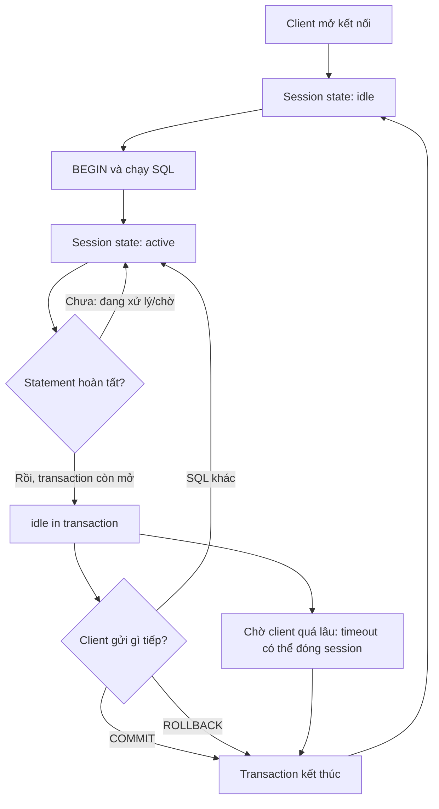

# Thời gian chờ, giao dịch dài và trạng thái idle in transaction trong PostgreSQL

Một giao dịch PostgreSQL có thể bắt đầu bằng `BEGIN`, chạy một câu `SELECT` hoặc `UPDATE`, rồi bị “bỏ quên” vì ứng dụng đang chờ HTTP API, chờ người dùng thao tác hoặc không gọi `COMMIT`/`ROLLBACK`. Trong thời gian đó, kết nối vẫn tồn tại và giao dịch có thể tiếp tục giữ khóa, tài nguyên hoặc thông tin snapshot liên quan. Các phiên khác có thể bị chặn, DDL triển khai chậm và hoạt động dọn phiên bản dữ liệu cũ của PostgreSQL bị ảnh hưởng.

Đó là lý do ba vấn đề sau cần được học cùng nhau:

- **Thời gian chờ (wait time):** một phiên có thể đợi lock, I/O, client hoặc tài nguyên khác. Không phải mọi truy vấn “lâu” đều đang dùng CPU.
- **Giao dịch dài (long-running transaction):** khoảng thời gian từ khi transaction bắt đầu tới khi commit hoặc rollback; nó có thể dài dù các câu SQL bên trong đều rất ngắn.
- **`idle in transaction`:** PostgreSQL đã thực thi xong câu lệnh gần nhất, nhưng **transaction vẫn mở** và server đang đợi client gửi lệnh tiếp theo.

Bài học thuộc chương **Giao dịch**, tập trung vào việc hiểu đúng trạng thái phiên, chẩn đoán khóa và các truy vấn bị chặn, xử lý giao dịch dài an toàn, cấu hình timeout và thiết kế ứng dụng Java/JDBC để tránh để transaction tồn tại ngoài ý muốn.

## 1. Vì sao một transaction không chạy SQL vẫn có thể nguy hiểm?

Xét hai phiên kết nối vào cùng database. Phiên A thực hiện:

```sql
BEGIN;

UPDATE app.accounts
SET balance = balance + 100
WHERE account_id = 1;

-- Client không gửi thêm lệnh trong vài phút.
-- COMMIT/ROLLBACK vẫn chưa được thực hiện.
```

Câu `UPDATE` đã chạy xong nhưng transaction vẫn mở. Phiên B muốn cập nhật cùng tài khoản:

```sql
UPDATE app.accounts
SET balance = balance - 20
WHERE account_id = 1;
```

Phiên B có thể phải **chờ** vì hàng mục tiêu đang bị khóa bởi transaction của A. Trên server, A có thể ở trạng thái `idle in transaction` còn B ở trạng thái `active` nhưng đang chờ lock.

Một nhầm lẫn thường gặp là cho rằng phiên A “không làm gì” nên vô hại. Thực tế:

- Các thay đổi chưa commit của A chưa trở thành dữ liệu đã commit cho phiên khác.
- Khóa hàng và khóa bảng mà transaction giữ có thể tiếp tục tồn tại.
- Một số kiểu snapshot/giao dịch dài có thể cản trở việc thu dọn các phiên bản hàng cũ.
- Connection vẫn bị chiếm giữ, làm giảm số kết nối sẵn có trong pool.

**Kết luận:** trạng thái `idle in transaction` không nói rằng PostgreSQL đang xử lý SQL nặng. Nó nói rằng **ứng dụng đã dừng gửi lệnh trong khi transaction chưa kết thúc**.

## 2. Phân biệt vòng đời session, statement và transaction

Ba đối tượng có thời gian sống khác nhau:

| Đối tượng | Bắt đầu | Kết thúc | Ví dụ |
| --- | --- | --- | --- |
| Session/kết nối | Client kết nối PostgreSQL | Disconnect hoặc bị server đóng | Một connection JDBC trong pool |
| Statement | PostgreSQL nhận và xử lý một lệnh SQL | Lệnh hoàn tất hoặc bị hủy | `SELECT`, `UPDATE`, `COMMIT` |
| Transaction | Bắt đầu transaction, ngầm hoặc tường minh | `COMMIT` hoặc `ROLLBACK`; cũng có thể bị rollback khi session kết thúc | `BEGIN; UPDATE; SELECT; COMMIT;` |

Khi bật autocommit của JDBC, một statement thông thường được xử lý trong transaction ngầm tương ứng. Khi ứng dụng tắt autocommit và bắt đầu thao tác, transaction có thể tiếp tục mở giữa các statement cho đến khi gọi commit/rollback.

Một ví dụ phân biệt hai dạng “chậm”:

```sql
-- Câu SELECT đang chạy lâu: statement và transaction đều đang hoạt động.
SELECT pg_sleep(5);

-- Transaction có thể dài dù mỗi statement rất nhanh.
BEGIN;
SELECT 1;
-- Client ngừng gửi lệnh trong 5 phút.
COMMIT;
```

Trong trường hợp thứ hai, phần lớn tuổi transaction đến từ thời gian **chờ client**, không phải thời gian tính toán của PostgreSQL.



Sơ đồ mô tả các trạng thái thường gặp. Thực tế có thêm lỗi, transaction ở trạng thái aborted, prepared transaction, transaction ngầm và các hoạt động phụ khác.

## 3. Những trạng thái chính trong pg_stat_activity

View hệ thống `pg_stat_activity` là điểm khởi đầu phổ biến để tìm phiên đang hoạt động và xác định có transaction nào bị bỏ ngỏ.

| `state` | Diễn giải | Có mặc định nghĩa là đang giữ khóa gây hại? |
| --- | --- | --- |
| `active` | Backend đang thực thi một câu SQL | Không; có thể đang xử lý, chờ lock, I/O hoặc tài nguyên khác |
| `idle` | Không có statement đang chạy, không có transaction đang mở tại thời điểm quan sát | Không; một session idle thông thường khác idle trong transaction |
| `idle in transaction` | Statement gần nhất đã xong, nhưng transaction còn mở | Có **khả năng** giữ khóa/snapshot; phải kiểm tra thêm |
| `idle in transaction (aborted)` | Transaction đã lỗi, đang chờ client rollback hoặc kết thúc | Có nguy cơ giữ transaction/tài nguyên; cần rollback |
| `fastpath function call` | Đang thực hiện fast-path function call theo cơ chế hỗ trợ | Ít gặp trong ứng dụng SQL thông thường |
| `disabled` | Thống kê hoạt động bị tắt ở backend tương ứng | Không đủ dữ liệu trạng thái để kết luận |

Một phiên `active` có thể đang **chờ Lock**, nhưng không phải cứ `active` là dùng CPU. Ngược lại, `idle in transaction` không phải trạng thái “đợi lock”; nó thường đợi **client** gửi lệnh tiếp.

### 3.1. Truy vấn quan sát cơ bản

```sql
SELECT
    pid,
    usename,
    application_name,
    client_addr,
    state,
    wait_event_type,
    wait_event,
    xact_start,
    query_start,
    state_change,
    left(query, 160) AS query_sample
FROM pg_stat_activity
WHERE datname = current_database()
ORDER BY xact_start NULLS LAST, pid;
```

Các trường quan trọng:

- `pid`: ID tiến trình backend PostgreSQL để tra cứu phiên.
- `usename`: database role sử dụng kết nối.
- `application_name`: nhãn client/ứng dụng, rất hữu ích nếu được cấu hình rõ ràng.
- `client_addr`: địa chỉ kết nối nếu có; không phải mọi loại kết nối đều có IP.
- `state`: trạng thái session tại lúc thống kê được lấy.
- `wait_event_type` và `wait_event`: loại và tên sự kiện đang chờ, nếu có.
- `xact_start`: thời điểm transaction hiện tại bắt đầu khi đang có transaction.
- `query_start`: thời điểm câu SQL hiện tại bắt đầu nếu đang active, hoặc câu SQL cuối cùng bắt đầu nếu không active.
- `state_change`: thời điểm chuyển sang trạng thái hiện tại.
- `query`: câu SQL hiện tại hoặc gần nhất; khả năng xem toàn bộ có thể bị giới hạn bởi quyền và cấu hình.

**Đặc biệt:** `query_start` của phiên `idle in transaction` là thời điểm bắt đầu **câu cuối**, không phải thời điểm transaction bắt đầu. Dùng nó để đo “tuổi transaction” sẽ sai.

### 3.2. Quyền xem các phiên khác

Một role thông thường có thể nhìn thấy thông tin bị giới hạn về các session thuộc role khác. Role giám sát được cấp quyền phù hợp, chẳng hạn các quyền liên quan `pg_monitor`/`pg_read_all_stats`, có thể xem thêm chi tiết.

Không đưa các vai trò giám sát hoặc quyền superuser vào tài khoản ứng dụng chỉ để sửa một vấn đề observability. Hãy thiết kế role vận hành riêng và tránh ghi dữ liệu nhạy cảm từ nội dung `query` vào log công khai.

## 4. Đo tuổi transaction và thời gian idle cho đúng

Muốn biết transaction nào mở lâu:

```sql
SELECT
    pid,
    usename,
    application_name,
    state,
    now() - xact_start AS transaction_age,
    now() - query_start AS last_query_start_age,
    now() - state_change AS current_state_age,
    wait_event_type,
    wait_event
FROM pg_stat_activity
WHERE datname = current_database()
  AND xact_start IS NOT NULL
ORDER BY xact_start;
```

Trong kết quả:

- `transaction_age` đo tuổi từ lúc transaction hiện tại bắt đầu.
- `last_query_start_age` không nhất thiết là “statement đang chạy”; với session idle, đây là thời gian tính từ lúc **câu cuối bắt đầu**.
- `current_state_age` đo thời gian session nằm trong trạng thái hiện tại, hữu ích cho `idle in transaction`.
- `xact_start IS NULL` thường có nghĩa session đó không đang có một transaction được ghi nhận ở thời điểm quan sát.

### 4.1. Chỉ tìm idle transaction quá lâu

```sql
SELECT
    pid,
    usename,
    application_name,
    client_addr,
    state,
    now() - xact_start AS transaction_age,
    now() - state_change AS idle_state_age,
    wait_event_type,
    wait_event,
    pg_blocking_pids(pid) AS blocked_by,
    left(query, 200) AS last_sql
FROM pg_stat_activity
WHERE datname = current_database()
  AND state LIKE 'idle in transaction%'
  AND state_change < now() - INTERVAL '1 minute'
ORDER BY state_change;
```

Câu trên bao gồm `idle in transaction` và `idle in transaction (aborted)`. Mốc **1 phút chỉ là ví dụ**; hệ thống có giao dịch nghiệp vụ đặc biệt có thể có ngưỡng khác. Ngưỡng cảnh báo nên gắn với SLA, loại ứng dụng, tần suất ghi và độ nhạy với khóa.

### 4.2. Vì sao nên dùng state_change thay vì query_start?

Giả sử transaction bắt đầu lúc 10:00, chạy SQL mất 20 giây và chuyển sang idle lúc 10:00:20. Đến 10:05:

- Tuổi transaction khoảng 5 phút.
- Thời gian ở trạng thái idle trong transaction khoảng 4 phút 40 giây.
- Tuổi từ `query_start` phụ thuộc thời điểm SQL bắt đầu, không trực tiếp bằng thời gian idle.

Khi mục tiêu là phát hiện ứng dụng bỏ quên transaction, **`state_change`** giúp đo sát hơn khoảng thời gian chờ client.

## 5. Wait event: chờ khóa khác với chờ client

PostgreSQL có các loại wait event. Chúng giúp phân biệt thời gian statement “lâu” được dành ở đâu.

| `wait_event_type` thường gặp | Ý nghĩa khái quát | Cách điều tra |
| --- | --- | --- |
| `Lock` | Đang đợi một lock có xung đột | Dùng `pg_blocking_pids` và `pg_locks` |
| `LWLock` | Chờ lightweight lock nội bộ | Xem workload, tài nguyên và phiên bản server |
| `IO` | Chờ hoạt động I/O | Xem đĩa, bộ nhớ cache, truy vấn và số buffer |
| `Client` | Chờ đọc/ghi dữ liệu với client | Kiểm tra client xử lý kết quả hoặc gửi lệnh |
| `Timeout` | Chờ sự kiện liên quan đến timeout/sleep | Xem tên wait event và câu SQL |
| `BufferPin` | Chờ tình trạng liên quan đến buffer pin | Xem các phiên và hoạt động giữ buffer |
| `IPC` | Chờ trao đổi giữa các tiến trình backend | Xem tên event và loại workload |
| `Activity` | Backend chờ công việc trong vòng lặp hoạt động của nó | Thường liên quan background worker |

Tên wait event cụ thể phụ thuộc phiên bản PostgreSQL. `wait_event_type IS NULL` không tự chứng minh backend đang bận CPU 100%; nó chỉ cho biết không ghi nhận wait event tại thời điểm quan sát.

### 5.1. Hai phiên có biểu hiện trái ngược

Trong một vụ khóa chờ:

- Phiên **A** có thể có `state = 'idle in transaction'`, `wait_event_type = 'Client'` và `wait_event = 'ClientRead'`.
- Phiên **B** có thể có `state = 'active'`, `wait_event_type = 'Lock'`.

Phiên B là **nạn nhân đang chờ**, còn A có thể là **nguyên nhân giữ khóa**. Chỉ tìm những phiên `active` có thời gian chạy dài sẽ bỏ sót thủ phạm đang idle.

Không nên chẩn đoán A là thủ phạm chỉ vì A idle lâu; phải xác định **quan hệ chặn thực tế** bằng các công cụ khóa.

## 6. Bài thực hành hai session: tạo idle in transaction và lock wait

Thực hiện trong **database học tập**, không thử cố ý giữ khóa trên bảng production.

### 6.1. Chuẩn bị bảng

```sql
CREATE SCHEMA IF NOT EXISTS tx_lab;

CREATE TABLE tx_lab.accounts (
    account_id integer PRIMARY KEY,
    owner_name text NOT NULL,
    balance numeric(12, 2) NOT NULL CHECK (balance >= 0)
);

INSERT INTO tx_lab.accounts (account_id, owner_name, balance)
VALUES
    (1, 'Account One', 1000.00),
    (2, 'Account Two', 500.00),
    (3, 'Account Three', 200.00);
```

Nếu đã tạo/chèn những hàng này ở lần thực hành trước, dùng schema mới hoặc dọn dữ liệu mẫu có kiểm soát; đừng chạy lại `INSERT` rồi hiểu lỗi trùng khóa là lỗi giao dịch.

### 6.2. Session A: giữ transaction mở

Mở kết nối A bằng `psql` hoặc SQL client và chạy:

```sql
BEGIN;

UPDATE tx_lab.accounts
SET balance = balance + 100
WHERE account_id = 1;

SELECT pg_backend_pid() AS session_a_pid;

-- Dừng ở đây: chưa COMMIT/ROLLBACK.
```

Lệnh `UPDATE` đã hoàn tất. Nếu không gửi câu SQL tiếp theo, session A thường ở `idle in transaction`, chờ lệnh từ client.

Một `SELECT` thường trong session B ở mức `READ COMMITTED` vẫn có thể đọc **giá trị đã commit cũ** của balance từ trước update của A, thay vì bị chặn theo kiểu đọc có khóa. Nhưng một cập nhật vào cùng hàng sẽ xung đột.

### 6.3. Session B: thử cập nhật cùng hàng

Mở kết nối B và chạy:

```sql
BEGIN;

SET LOCAL lock_timeout = '3s';

UPDATE tx_lab.accounts
SET balance = balance - 20
WHERE account_id = 1;

-- Nếu UPDATE bị hủy vì lock_timeout, phải ROLLBACK.
```

Trong lúc chờ, session B có thể hiển thị `wait_event_type = 'Lock'`. Nếu A vẫn chưa commit/rollback sau khoảng timeout, B sẽ gặp lỗi liên quan tới lock timeout (thường SQLSTATE `55P03`).

Sau lỗi của một statement trong transaction thông thường, transaction B chuyển sang trạng thái lỗi; hãy chạy:

```sql
ROLLBACK;
```

Nếu A giải phóng khóa trước khi B hết timeout, `UPDATE` ở B có thể hoàn thành. Khi đó cũng dùng `ROLLBACK` trong bài thực hành để tránh thay đổi số dư ngoài ý muốn.

### 6.4. Session C: quan sát quan hệ chặn

Trong lúc B đang đợi, mở kết nối C và chạy:

```sql
SELECT
    pid,
    application_name,
    state,
    wait_event_type,
    wait_event,
    now() - xact_start AS transaction_age,
    pg_blocking_pids(pid) AS blocking_pids,
    left(query, 120) AS sql_sample
FROM pg_stat_activity
WHERE datname = current_database()
  AND pid <> pg_backend_pid()
ORDER BY xact_start NULLS LAST, pid;
```

Kỳ vọng trong khoảng thời gian B chưa timeout:

- Session A: có transaction mở, đang idle sau `UPDATE`/`SELECT`.
- Session B: đang active nhưng chờ Lock.
- `pg_blocking_pids(B_pid)` chứa PID của A nếu A trực tiếp chặn B.

Vì `lock_timeout = '3s'` khiến thời gian quan sát ngắn, có thể tăng timeout trong môi trường học tập nếu cần xem kỹ, nhưng phải luôn có cách dừng chờ và kết thúc transaction.

### 6.5. Dọn dẹp đúng cách

Trở lại session A:

```sql
ROLLBACK;
```

Nếu muốn kiểm tra lại, chạy trong một session mới:

```sql
SELECT account_id, balance
FROM tx_lab.accounts
ORDER BY account_id;
```

Do đã rollback các thao tác thử nghiệm, số dư mẫu vẫn như trước. Điều quan trọng nhất của bài thực hành là **không để session A tồn tại mãi với transaction chưa kết thúc**.

## 7. pg_blocking_pids: tìm ai đang chặn ai

Hàm `pg_blocking_pids(pid)` trả một mảng PID các backend được PostgreSQL xác định là đang chặn backend mục tiêu trong ngữ cảnh chờ lock.

Một truy vấn liệt kê cặp waiter/blocker:

```sql
SELECT
    w.pid AS waiting_pid,
    w.usename AS waiting_user,
    w.wait_event_type AS waiting_type,
    w.wait_event AS waiting_event,
    now() - w.query_start AS waiting_query_age,
    left(w.query, 160) AS waiting_sql,
    b.pid AS blocking_pid,
    b.state AS blocking_state,
    now() - b.xact_start AS blocking_transaction_age,
    now() - b.state_change AS blocking_state_age,
    left(b.query, 160) AS blocking_last_sql
FROM pg_stat_activity AS w
JOIN LATERAL
    unnest(pg_blocking_pids(w.pid)) AS bp(blocking_pid)
    ON TRUE
LEFT JOIN pg_stat_activity AS b
    ON b.pid = bp.blocking_pid
WHERE w.datname = current_database()
ORDER BY waiting_query_age DESC NULLS LAST;
```

Cách đọc:

- `waiting_pid`: backend đang bị chặn.
- `blocking_pid`: backend đang giữ hoặc đứng trước trong hàng đợi lock theo cơ chế chặn.
- `blocking_state`: thủ phạm có thể là `idle in transaction` hoặc đang active.
- `blocking_transaction_age`: thời gian transaction của blocker đã mở.
- `blocking_last_sql`: SQL hiện tại/gần nhất, không nhất thiết là SQL đầu tiên đã lấy lock.

### 7.1. Vì sao không chỉ so sánh những hàng pg_locks có cùng relation?

Khóa PostgreSQL có nhiều dạng: relation, transaction ID, virtual transaction ID, tuple, advisory lock, object lock... Một wait để cập nhật hàng có thể được biểu diễn như chờ transaction ID, không đơn thuần là “hai bản ghi `pg_locks` cùng một relation”.

`pg_blocking_pids()` thường là công cụ đầu tiên phù hợp hơn việc tự dựng mọi cặp xung đột từ `pg_locks`. Có thể dùng `pg_locks` để đi sâu, nhưng không nên xem một join đơn giản trên relation là bộ phát hiện blocker hoàn chỉnh.

### 7.2. Chuỗi chặn

Có thể có:

```text
A (idle in transaction, giữ lock)
       |
       v
B (active, chờ A)
       |
       v
C (active, chờ B hoặc chờ trong hàng đợi)
```

Không phải phiên đang chờ lâu nhất là nguyên nhân gốc. Hãy đi theo chuỗi blocker để tìm **phiên đang giữ tài nguyên tại gốc**, sau đó xác định owner và cách kết thúc an toàn.

## 8. pg_locks: quan sát mức khóa và đối tượng bị ảnh hưởng

Ví dụ xem lock trên bảng thực hành:

```sql
SELECT
    l.pid,
    l.locktype,
    l.mode,
    l.granted,
    l.relation::regclass AS relation_name,
    a.state,
    left(a.query, 120) AS query_sample
FROM pg_locks AS l
JOIN pg_stat_activity AS a
    ON a.pid = l.pid
WHERE a.datname = current_database()
  AND l.relation = 'tx_lab.accounts'::regclass
ORDER BY l.granted, l.pid, l.mode;
```

Các cột:

- `locktype`: loại đối tượng được khóa.
- `mode`: chế độ khóa như `AccessShareLock`, `RowExclusiveLock`, `AccessExclusiveLock`...
- `granted`: `true` nếu lock đã được cấp; `false` nếu đang chờ.
- `relation`: đối tượng bảng khi lock thuộc loại liên quan tới relation.

**Giới hạn:** không phải mọi row lock được giữ đều xuất hiện như một dòng `tuple` riêng trong `pg_locks`. Một session bị chặn bởi cập nhật hàng có thể đang chờ `transactionid`. Vì thế, truy vấn lọc `l.relation = ...` có thể không giải thích hết nguyên nhân chờ.

### 8.1. Đọc trạng thái lock trước khi hành động

Một phiên có `RowExclusiveLock` trên bảng không đồng nghĩa nó chặn mọi truy vấn `SELECT`. PostgreSQL có ma trận tương thích lock theo mức, và row-level locks có quy tắc khác table-level locks.

Cần xác định **lock nào đang được chờ**, **ai giữ lock không tương thích**, và **mức độ ảnh hưởng thực tế**. Không nên chấm dứt transaction chỉ vì thấy một lock được cấp.

## 9. Idle in transaction có thể chặn DDL dù chỉ chạy SELECT

Một tình huống khác với `UPDATE` là transaction đã đọc bảng nhưng chưa commit.

Session A:

```sql
BEGIN;

SELECT account_id, owner_name
FROM tx_lab.accounts
WHERE account_id = 1;

-- Để transaction mở và không gửi thêm SQL.
```

Câu `SELECT` thông thường có thể giữ table-level `AccessShareLock` đến khi transaction kết thúc. Mặc dù không sửa dữ liệu, nó có thể chặn DDL cần `AccessExclusiveLock`, chẳng hạn một số lệnh `ALTER TABLE`.

Trong session B, có thể minh họa một DDL có timeout:

```sql
BEGIN;

SET LOCAL lock_timeout = '3s';

ALTER TABLE tx_lab.accounts
ADD COLUMN lab_note text;

ROLLBACK;
```

Nếu A vẫn giữ transaction mở, `ALTER TABLE` có thể không lấy được lock và bị hủy sau khoảng timeout. Nếu DDL lấy được lock thì `ROLLBACK` trong ví dụ giúp không giữ thay đổi schema thử nghiệm.

**Lưu ý:** nếu `ALTER TABLE` bị lỗi, transaction B bị đánh dấu aborted; khi đó phải `ROLLBACK`, không cố thực hiện các câu DDL tiếp theo trong transaction chưa được giải quyết.

Sau đó dọn session A:

```sql
ROLLBACK;
```

Điểm cần nhớ: **giao dịch chỉ đọc cũng có thể giữ khóa bảng** trong suốt transaction và cản trở DDL. Khả năng cản trở vacuum cleanup phụ thuộc snapshot/transaction cụ thể, không phải mọi transaction chỉ đọc đều giữ cùng một `xmin` suốt đời.

## 10. Idle in transaction (aborted): trạng thái lỗi nhưng chưa rollback

Trong session thực hành:

```sql
BEGIN;

SELECT 1 / 0;
-- division_by_zero: statement lỗi.

SELECT 42;
-- Trong transaction bị lỗi, câu này cũng bị từ chối.

ROLLBACK;
```

Ở giữa lần lỗi và lệnh `ROLLBACK`, PostgreSQL có thể báo session state:

```text
idle in transaction (aborted)
```

Một số thông điệp lỗi sau đó thường có SQLSTATE `25P02`, nghĩa là transaction hiện tại đã ở trạng thái failed và các lệnh tiếp theo không được thực thi bình thường cho đến khi rollback (hoặc xử lý savepoint thích hợp).

### 10.1. Vì sao lỗi không tự làm session quay về idle bình thường?

Trong transaction tường minh, khi một statement lỗi, PostgreSQL không tự biến toàn bộ transaction thành một transaction thành công. Client cần có hành động để kết thúc hoặc phục hồi trạng thái.

Nếu ứng dụng bắt exception rồi tiếp tục sử dụng connection mà không rollback, nó có thể:

- Nhận thêm lỗi `current transaction is aborted`.
- Để transaction/session ở trạng thái không mong muốn.
- Giữ connection trong pool lâu hơn dự kiến.
- Làm các request tiếp theo nhận connection với trạng thái transaction chưa được dọn nếu pool/ứng dụng quản lý sai.

### 10.2. Savepoint dành cho lỗi có thể xử lý

Nếu muốn một phần công việc có thể thất bại mà không làm hỏng toàn bộ transaction, có thể dùng `SAVEPOINT`:

```sql
BEGIN;

SAVEPOINT before_optional_step;

-- Nếu lệnh tiếp theo lỗi, client phải thực hiện
-- ROLLBACK TO SAVEPOINT before_optional_step.

ROLLBACK TO SAVEPOINT before_optional_step;

RELEASE SAVEPOINT before_optional_step;

COMMIT;
```

Đây chỉ là **khung minh họa**. Trong ứng dụng thật, phải đặt lệnh gây lỗi và nhánh rollback phù hợp; không chạy các lệnh tiếp theo nếu transaction đang aborted mà chưa quay về savepoint hợp lệ.

Savepoint không phải cơ chế chữa việc client bỏ quên transaction. Nó giải quyết **phạm vi rollback bên trong transaction**, không tự đóng transaction.

## 11. Giao dịch dài tác động đến MVCC và VACUUM như thế nào?

PostgreSQL sử dụng **Multi-Version Concurrency Control (MVCC)** để các phiên có thể đọc các phiên bản dữ liệu phù hợp mà không nhất thiết chặn nhau như các hệ dùng khóa đọc/ghi đơn giản.

Khi một hàng bị `UPDATE` hoặc `DELETE`, các phiên bản cũ có thể cần tồn tại thêm một thời gian để phục vụ những snapshot vẫn có quyền nhìn thấy chúng. `VACUUM` dọn những phiên bản đã hết cần thiết theo các điều kiện an toàn.

### 11.1. Long transaction có thể làm chậm việc dọn phiên bản cũ

Một transaction giữ snapshot cũ trong thời gian dài có thể khiến PostgreSQL chưa được phép thu hồi một số phiên bản hàng mà snapshot đó vẫn có thể cần.

Hệ quả tiềm năng:

- `n_dead_tup` tăng hoặc cleanup bị trì hoãn.
- Kích thước bảng/index tăng theo khối lượng cập nhật/xóa.
- I/O và chi phí scan tăng.
- Autovacuum phải làm thêm công việc khi điều kiện cho phép dọn.
- Tuổi transaction và các mốc dọn dẹp cần được giám sát.

Tuy nhiên, cần tránh phát biểu quá đơn giản rằng **mọi session `idle in transaction` luôn giữ cùng một snapshot `xmin` và chặn VACUUM trên toàn database**.

Trong `READ COMMITTED`, PostgreSQL thường dùng snapshot theo statement; transaction chỉ đọc và đang idle có thể **không luôn giữ snapshot còn hoạt động** ở khoảng giữa các statement. Trong `REPEATABLE READ`/`SERIALIZABLE`, transaction có thể duy trì snapshot lâu hơn. Cursor, query đang hoạt động, các transaction đã gán XID và những yếu tố khác cũng ảnh hưởng cleanup.

Vì thế, nên kết hợp `state`, `xact_start`, `backend_xmin`/`backend_xid` khi có và thống kê vacuum, thay vì suy toàn bộ rủi ro từ một cột `state`.

### 11.2. Quan sát backend_xid và backend_xmin

```sql
SELECT
    pid,
    application_name,
    state,
    xact_start,
    now() - xact_start AS transaction_age,
    backend_xid,
    backend_xmin,
    left(query, 120) AS last_sql
FROM pg_stat_activity
WHERE datname = current_database()
  AND xact_start IS NOT NULL
ORDER BY xact_start;
```

`backend_xid` là transaction ID cấp cao nhất đã được gán cho backend nếu có. `backend_xmin` phản ánh mốc `xmin` được backend duy trì tại thời điểm thống kê khi có. Chúng có thể **NULL**; không được coi `backend_xmin IS NULL` là lời bảo đảm phiên hoàn toàn vô hại.

Nếu cần chẩn đoán vacuum freeze/wraparound nghiêm trọng, phải xem toàn hệ thống, bao gồm replication slots, prepared transactions, transaction đang chạy và tuổi XID liên quan.

### 11.3. Xem thống kê dead tuples

```sql
SELECT
    schemaname,
    relname,
    n_live_tup,
    n_dead_tup,
    n_tup_upd,
    n_tup_del,
    last_autovacuum,
    last_vacuum
FROM pg_stat_user_tables
WHERE schemaname = 'tx_lab'
ORDER BY relname;
```

`n_live_tup` và `n_dead_tup` là số liệu **ước lượng** được cập nhật theo cơ chế thống kê, không nhất thiết phản ánh số hàng chính xác ngay sau mỗi transaction.

Không tự chạy `VACUUM FULL` để chữa mọi tình trạng bloat: lệnh đó có cơ chế rewrite/locking riêng và có thể gây gián đoạn lớn. Trước hết phải xử lý nguyên nhân transaction/snapshot tồn tại quá lâu.

## 12. Thời gian chờ lock, truy vấn dài và deadlock không phải một

Ba tình huống:

| Tình huống | Điều đang xảy ra | Cần điều tra |
| --- | --- | --- |
| Lock wait | Backend chờ khóa được cấp | `wait_event_type = 'Lock'`, `pg_blocking_pids` |
| Slow query | SQL xử lý dữ liệu lâu nhưng chưa chắc chờ lock | `EXPLAIN`, I/O, số hàng, index, CPU, query plan |
| Deadlock | Một chu trình chờ khóa khiến các transaction không thể cùng tiến triển | Server deadlock detector, SQLSTATE `40P01` |

Ví dụ deadlock hai chiều:

```text
Session A: giữ lock trên account 1, đợi account 2.
Session B: giữ lock trên account 2, đợi account 1.

A đang đợi B; B đang đợi A → chu trình deadlock.
```

PostgreSQL có cơ chế phát hiện deadlock và thường hủy một transaction để phá vòng chờ. Không phải mọi lock wait dài đều là deadlock: một transaction đang chạy chậm có thể cuối cùng commit và giải phóng khóa bình thường.

### 12.1. deadlock_timeout không phải transaction timeout

Tham số `deadlock_timeout` ảnh hưởng thời điểm PostgreSQL kiểm tra deadlock khi một backend đã chờ lock đủ lâu. Nó không phải “giới hạn tối đa một transaction được phép chạy” và không phải lời hứa mọi câu SQL sẽ bị hủy sau khoảng đó.

Trong vận hành, đừng chỉnh `deadlock_timeout` chỉ để ngắt các query chậm. Hãy chọn `lock_timeout` hoặc `statement_timeout` khi mục tiêu thật sự là hạn chế thời gian chờ/statement.

## 13. Các loại timeout liên quan

PostgreSQL cung cấp nhiều tham số timeout giải quyết những vấn đề khác nhau. Một số có ở nhiều phiên bản, một số phụ thuộc major version.

| Tham số | Giới hạn điều gì? | Khi nào hữu ích |
| --- | --- | --- |
| `lock_timeout` | Thời gian chờ lấy từng lock | Tránh DDL/DML chờ lock quá lâu |
| `statement_timeout` | Thời gian thực thi statement, thường gồm cả thời gian chờ liên quan | Tránh statement quá lâu |
| `idle_in_transaction_session_timeout` | Thời gian session nằm idle khi transaction còn mở | Dọn những kết nối bỏ quên transaction |
| `idle_session_timeout` | Thời gian session idle ngoài transaction | Quản lý session không hoạt động; cần cẩn thận với pool |
| `transaction_timeout` | Tổng tuổi transaction trên các PostgreSQL version có hỗ trợ | Giới hạn transaction kéo dài cả lúc active và lúc idle |
| `deadlock_timeout` | Mốc chờ trước khi chạy cơ chế kiểm tra deadlock | Tuning phát hiện deadlock/log lock wait; không phải hạn mức transaction |

Các giá trị `0` của nhiều timeout thông dụng có nghĩa vô hiệu hóa timeout tương ứng; cần kiểm tra ngữ nghĩa từng tham số ở server đang dùng.

### 13.1. lock_timeout

Ví dụ giới hạn thời gian chờ lock trong transaction:

```sql
BEGIN;

SET LOCAL lock_timeout = '2s';

UPDATE tx_lab.accounts
SET balance = balance + 10
WHERE account_id = 1;

COMMIT;
```

Nếu statement phải chờ một lock quá lâu, PostgreSQL có thể hủy statement. Khi đó trong transaction tường minh, cần `ROLLBACK` thay vì `COMMIT` như thể không có lỗi.

`lock_timeout` không cấm một statement **tính toán trong 20 phút** nếu nó không chờ lock lâu. Nó chỉ tập trung vào thời gian chờ lock.

### 13.2. statement_timeout

```sql
BEGIN;

SET LOCAL statement_timeout = '10s';

SELECT pg_sleep(20);

-- Nếu bị statement_timeout hủy, phải ROLLBACK.
```

`statement_timeout` có thể hủy statement đang chạy vượt giới hạn. Nó không phải một transaction timeout tổng thể. Một ứng dụng có thể gửi nhiều câu SQL ngắn dưới ngưỡng timeout nhưng vẫn để transaction mở rất lâu giữa các câu.

Nếu `lock_timeout` dài hơn hoặc bằng `statement_timeout`, statement timeout có thể đến trước, khiến lock timeout gần như không mang lại tác dụng riêng. Với mục đích phân biệt lỗi lock wait, người vận hành thường đặt `lock_timeout` ngắn hơn `statement_timeout`.

### 13.3. idle_in_transaction_session_timeout

Ví dụ thiết lập tại session:

```sql
SET idle_in_transaction_session_timeout = '60s';
```

Khi session vào trạng thái idle trong transaction liên tục quá thời gian cấu hình, PostgreSQL có thể **chấm dứt kết nối session đó**, kéo theo rollback của transaction chưa commit và giải phóng tài nguyên/khóa liên quan.

Đây là **biện pháp bảo vệ cuối**, không phải thay thế code gọi `COMMIT`/`ROLLBACK` đúng lúc.

Hệ quả cần xem xét:

- Connection đang được ứng dụng giữ sẽ bị server đóng; lần dùng tiếp theo có thể nhận lỗi kết nối.
- Transaction chưa commit bị rollback, nên thao tác nghiệp vụ có thể chưa hoàn thành dù phía client chưa nhận ra ngay.
- Connection pool cần phát hiện và loại bỏ connection hỏng.
- Timeout quá ngắn có thể cắt một workflow hợp lệ đang chờ client giữa các bước.
- Với ứng dụng dùng transaction dài có chủ đích, nên điều chỉnh thiết kế trước, không chỉ tắt cơ chế bảo vệ.

### 13.4. idle_session_timeout khác idle_in_transaction_session_timeout

`idle_session_timeout` nhắm tới session không làm gì **ngoài transaction**, trong khi `idle_in_transaction_session_timeout` nhắm tới trạng thái idle khi **transaction còn mở**.

Với connection pool, một connection có thể ở trạng thái `idle` một cách bình thường để chờ request tiếp theo. Cấu hình `idle_session_timeout` quá ngắn ở PostgreSQL có thể khiến pool liên tục nhận connection bị server ngắt. Ngược lại, `idle_in_transaction_session_timeout` đặc biệt có ích để xử lý trường hợp application quên kết thúc transaction.

Đừng lẫn hai tham số chỉ vì tên gần giống nhau.

### 13.5. transaction_timeout và khả năng theo phiên bản

Một số phiên bản PostgreSQL mới có tham số `transaction_timeout` để giới hạn thời lượng một transaction. Nếu server không hỗ trợ, lệnh `SHOW transaction_timeout` có thể báo tham số không tồn tại.

Không nên dựa trên một tham số chưa xác nhận có ở major version đang vận hành. Với dự án đa môi trường, kiểm tra cấu hình bằng:

```sql
SHOW server_version;
SHOW idle_in_transaction_session_timeout;
SHOW statement_timeout;
SHOW lock_timeout;
```

Nếu dùng `transaction_timeout`, xác nhận nó được hỗ trợ trên server đó và hiểu tương tác với những timeout khác. Tham số này khác `statement_timeout`: một transaction có thể dài do nhiều statement hoặc khoảng idle giữa chúng.

## 14. Cấu hình timeout theo cấp session, transaction và role

Có các phạm vi thiết lập khác nhau:

- `SET` thay đổi cấu hình ở session hiện tại (trừ khi có quy tắc đặc biệt).
- `SET LOCAL` thay đổi thiết lập trong phạm vi transaction hiện tại.
- Cấu hình trên role/database hoặc file cấu hình áp dụng theo phạm vi và thời điểm tải phù hợp.

Một migration có thể dùng timeout riêng:

```sql
BEGIN;

SET LOCAL lock_timeout = '3s';
SET LOCAL statement_timeout = '30s';

ALTER TABLE tx_lab.accounts
ADD COLUMN optional_metadata jsonb;

COMMIT;
```

Ở môi trường học tập, nếu không muốn giữ thay đổi schema thì dùng `ROLLBACK` thay `COMMIT`. Ở production, thời gian chờ và giới hạn statement phải chọn dựa trên thời gian thực tế, không sao chép máy móc.

### 14.1. Đặt timeout để tránh transaction bị bỏ quên

Có thể cấu hình thời gian idle trong transaction cho role ứng dụng khi được cho phép, ví dụ:

```sql
-- Ví dụ cấu hình quản trị; không chạy trực tiếp nếu chưa xác định role.
ALTER ROLE application_role
SET idle_in_transaction_session_timeout = '60s';
```

Đây là cấu hình cho những session mới với role tương ứng; nó không đồng nghĩa mọi kết nối hiện tại lập tức thay đổi. `application_role` chỉ là tên minh họa.

Cấu hình qua role giúp áp chính sách mặc định mà không yêu cầu từng query tự `SET LOCAL`. Nhưng nó đòi hỏi kiểm thử với connection pool và các workflow dài hợp lệ.

### 14.2. Không đặt timeout bằng cách đoán

Để chọn ngưỡng, hãy xem:

- Transaction nghiệp vụ bình thường mất bao lâu ở p95/p99?
- Những code path nào có thể chờ HTTP API hoặc thao tác người dùng?
- Có phiên nào thường giữ lock trên bảng nóng?
- Ứng dụng có dùng cursor/streaming hoặc batch lớn không?
- Pool và ORM xử lý kết nối bị server đóng như thế nào?
- Đâu là ngưỡng gây ảnh hưởng người dùng thật?

Một giá trị 30 giây có thể hợp lý cho API đơn giản nhưng không phù hợp với một job báo cáo có transaction có chủ đích. Tốt nhất là **giảm thời gian transaction trong code**, sau đó đặt timeout như hàng rào bảo vệ.

## 15. Khi timeout xảy ra, transaction có tự được rollback không?

Phải phân biệt **hủy statement** với **ngắt session**.

### 15.1. Hủy statement bằng statement_timeout/lock_timeout

Một statement bị hủy trong transaction tường minh thường khiến transaction vào trạng thái lỗi. Client cần `ROLLBACK` hoặc cơ chế savepoint có chủ đích để tiếp tục đúng cách.

Ví dụ:

```sql
BEGIN;

SET LOCAL statement_timeout = '1s';

SELECT pg_sleep(5);
-- Statement bị hủy sau khoảng 1s.

SELECT 1;
-- Có thể báo transaction đang aborted.

ROLLBACK;
```

Việc statement bị hủy không có nghĩa các statement đã commit **trước đó ở transaction khác** tự rollback. Những thay đổi đã commit thuộc transaction riêng không bị đảo ngược bởi timeout của transaction hiện tại.

### 15.2. Ngắt session bằng idle_in_transaction_session_timeout

Khi session bị chấm dứt, transaction chưa commit của session đó không thể tiếp tục và sẽ được rollback. Connection phía client không còn dùng được như một connection khỏe mạnh.

**Đây là một lỗi ở biên kết nối**, không chỉ một lỗi trả về bình thường trong `ResultSet`. Tầng ứng dụng cần phát hiện trạng thái connection và retry đúng phạm vi nghiệp vụ nếu an toàn.

### 15.3. Trường hợp kết nối mất sau COMMIT

Có tình huống PostgreSQL commit thành công nhưng phản hồi `COMMIT` không đến được client do mạng bị ngắt. Client không nên mặc định là giao dịch đã rollback và gửi lại một thao tác không idempotent.

Với các lệnh chuyển tiền, tăng bộ đếm hoặc ghi giao dịch bên ngoài, phải có **idempotency key**, khóa duy nhất hoặc cơ chế đối soát để xử lý kết quả commit không chắc chắn.

## 16. Hủy query hay kết thúc session: hai thao tác khác nhau

PostgreSQL có các hàm quản trị:

```sql
SELECT pg_cancel_backend(12345);
```

và:

```sql
SELECT pg_terminate_backend(12345);
```

`12345` là **PID minh họa**, không được chạy với PID tùy ý.

| Thao tác | Mục đích | Lưu ý |
| --- | --- | --- |
| `pg_cancel_backend(pid)` | Gửi yêu cầu hủy statement đang thực thi | Không bảo đảm transaction/session bị đóng; transaction có thể còn ở trạng thái aborted |
| `pg_terminate_backend(pid)` | Yêu cầu kết thúc backend/session | Transaction chưa commit sẽ rollback; có thể làm ứng dụng mất kết nối |
| `COMMIT` từ client sở hữu transaction | Kết thúc transaction thành công | Chỉ khi nghiệp vụ đã hoàn thành và dữ liệu hợp lệ |
| `ROLLBACK` từ client sở hữu transaction | Hủy transaction chưa commit | Phù hợp khi transaction bị bỏ ngỏ hoặc lỗi |

Cần quyền tương ứng để hủy/terminate session của người khác. Không nên tự động terminate mọi phiên quá 60 giây: một số transaction dài có chủ đích hoặc đang chạy thao tác quan trọng.

**Thứ tự xử lý khuyến nghị:**

1. Tìm xác thực blocker bằng `pg_blocking_pids()`.
2. Xác định owner qua `application_name`, role, client và log ứng dụng.
3. Ưu tiên để ứng dụng **kết thúc transaction đúng cách**.
4. Nếu là sự cố nghiêm trọng, có quy trình vận hành được phép và hiểu tác động rollback, mới cân nhắc terminate session.
5. Kiểm tra lại blocker chain, latency và trạng thái ứng dụng sau khi xử lý.

### 16.1. Vì sao cancel không luôn giải quyết idle in transaction?

Một session `idle in transaction` **không có statement đang chạy** để hủy. `pg_cancel_backend` có thể không tạo ra kết quả mong muốn: transaction vẫn mở và khóa có thể còn.

Muốn đóng transaction đó, client cần commit/rollback, hoặc cuối cùng session phải kết thúc theo cơ chế được phép. Đây là lý do một nút “Cancel query” trong dashboard không phải cách xử lý chung cho mọi giao dịch dài.

## 17. Connection pool và nguồn gốc idle in transaction

Ứng dụng thường dùng pool như HikariCP để tái sử dụng kết nối. Pool giúp giảm chi phí mở kết nối, nhưng một connection bị mượn và giữ transaction mở lâu sẽ làm giảm số connection sẵn có.

Các tình huống thường gặp:

- Phương thức mở transaction rồi gọi HTTP API bên ngoài.
- Người dùng được hiển thị một form và ứng dụng giữ transaction trong lúc chờ họ nhấn xác nhận.
- Exception xảy ra nhưng code không rollback.
- JDBC được đặt `autoCommit(false)` nhưng code thiếu `commit()`/`rollback()` ở một nhánh.
- Streaming/cursor đọc kết quả lâu hơn cần thiết trong transaction.
- ORM mở transaction quá rộng cho cả request hoặc chuỗi xử lý dài.
- Một job batch thực thi hàng nghìn statement nhưng chỉ commit ở cuối.
- Connection được trả về pool trong trạng thái không nhất quán do code/cấu hình sai.

### 17.1. Idle connection trong pool không phải idle in transaction

Nếu pool giữ 20 connection ở trạng thái `idle` để phục vụ request tiếp theo, đây có thể là hành vi hoàn toàn bình thường.

Nếu nhiều connection ở trạng thái `idle in transaction`, cần xem code path vì có transaction chưa kết thúc. Cấu hình pool như `idleTimeout` hoặc `maxLifetime` không nên được hiểu là thay thế cho `idle_in_transaction_session_timeout` của PostgreSQL; mỗi cơ chế quản lý một khía cạnh khác nhau.

Một số pool không đóng connection **đang được mượn** chỉ vì hết thời gian nhàn rỗi của pool. Vì vậy, có thể xuất hiện connection leak dù pool được cấu hình thời gian sống.

### 17.2. Gắn application_name để tìm chủ phiên

Ở phía PostgreSQL có thể thấy `application_name` trong `pg_stat_activity`. Đặt tên theo service hoặc worker giúp phân biệt nguồn kết nối:

```sql
SET application_name = 'orders-api';
```

Hoặc cấu hình qua connection string/driver theo khả năng hỗ trợ, ví dụ PgJDBC có thuộc tính tên ứng dụng tương ứng. Không đưa token, thông tin cá nhân hoặc các dữ liệu nhạy cảm vào `application_name`.

Trong hệ thống nhiều instance, có thể kết hợp tên service với những nhãn quan sát được cho phép, nhưng cần tránh dữ liệu có cardinality quá cao hoặc làm lộ bí mật.

## 18. Thiết kế ranh giới transaction đúng trong Java/JDBC

Ví dụ một phương thức thực hiện hai statement liên quan. Điều quan trọng không phải SQL phức tạp, mà là mọi nhánh đều **commit hoặc rollback** và giải phóng connection.

```java
import java.math.BigDecimal;
import java.sql.Connection;
import java.sql.PreparedStatement;
import java.sql.SQLException;
import javax.sql.DataSource;

public class AccountService {
    private final DataSource dataSource;

    public AccountService(DataSource dataSource) {
        this.dataSource = dataSource;
    }

    public void transfer(
            long fromId,
            long toId,
            BigDecimal amount
    ) throws SQLException {
        if (amount.signum() <= 0 || fromId == toId) {
            throw new IllegalArgumentException("Invalid transfer");
        }

        try (Connection connection = dataSource.getConnection()) {
            connection.setAutoCommit(false);

            try {
                try (PreparedStatement debit =
                             connection.prepareStatement("""
                    UPDATE tx_lab.accounts
                    SET balance = balance - ?
                    WHERE account_id = ?
                      AND balance >= ?
                    """);
                     PreparedStatement credit =
                             connection.prepareStatement("""
                    UPDATE tx_lab.accounts
                    SET balance = balance + ?
                    WHERE account_id = ?
                    """)) {

                    debit.setBigDecimal(1, amount);
                    debit.setLong(2, fromId);
                    debit.setBigDecimal(3, amount);

                    if (debit.executeUpdate() != 1) {
                        throw new SQLException("Insufficient funds or missing source");
                    }

                    credit.setBigDecimal(1, amount);
                    credit.setLong(2, toId);

                    if (credit.executeUpdate() != 1) {
                        throw new SQLException("Missing destination");
                    }
                }

                connection.commit();
            } catch (SQLException | RuntimeException ex) {
                try {
                    connection.rollback();
                } catch (SQLException rollbackError) {
                    ex.addSuppressed(rollbackError);
                }
                throw ex;
            }
        }
    }
}
```

Ví dụ này sở hữu connection lấy từ pool và minh họa commit/rollback. Nó **không phải hệ thống chuyển tiền production hoàn chỉnh**: còn cần thiết kế chống deadlock cho chuyển tiền hai chiều (chẳng hạn khóa tài khoản theo thứ tự cố định), idempotency, audit, kiểm tra phạm vi kiểu số và quy trình xử lý sự cố.

Các điểm tốt cần giữ:

- Transaction không mở trước khi người dùng xác nhận nghiệp vụ.
- Toàn bộ các statement cần atomicity nằm trong cùng transaction.
- Có `commit()` khi thành công.
- Có `rollback()` khi `SQLException`/`RuntimeException` được ném.
- `try-with-resources` bảo đảm đóng resources và trả kết nối về pool khi hoàn tất.

### 18.1. Không gọi mạng bên ngoài khi transaction đang mở nếu không cần

Ví dụ **không nên**:

```java
@Transactional
public void processOrder(long orderId) {
    orderRepository.markProcessing(orderId);

    // Có thể mất 30 giây hoặc nhiều phút.
    externalPaymentClient.charge(orderId);

    orderRepository.markPaid(orderId);
}
```

Nếu phương thức thật sự chạy trong một transaction trải suốt lời gọi `externalPaymentClient`, nó có thể giữ transaction/connection/lock trong lúc chờ mạng. Ngoài ra, rollback database **không tự rollback** tác động của HTTP API bên ngoài.

Một thiết kế tốt hơn thường tách các pha:

1. Ghi trạng thái và intent/outbox bằng transaction ngắn.
2. Commit.
3. Gọi service bên ngoài với idempotency key.
4. Ghi kết quả bằng transaction ngắn khác.
5. Có cơ chế retry/reconciliation cho lỗi ở biên hai hệ thống.

Đó là một hướng kiến trúc, không phải quy tắc áp dụng máy móc cho mọi luồng. Những yêu cầu atomicity trong cùng database vẫn phải được giữ trong transaction phù hợp.

### 18.2. @Transactional không tự bảo đảm kết thúc transaction ở mọi tình huống

Trong Spring, transaction boundary phụ thuộc cấu hình transaction manager, proxy/interception, propagation và cách exception được xử lý. Một số exception có thể được code bắt và nuốt đi khiến framework không biết cần rollback; một số cách gọi nội bộ có thể không đi qua proxy theo mặc định.

Không nên nghĩ chỉ cần thêm annotation là mọi lỗi `idle in transaction` biến mất. Cần quan sát runtime thực tế, tracing và các nhánh thành công/thất bại.

## 19. Giao dịch dài khi dùng cursor và streaming ResultSet

Một truy vấn trả rất nhiều hàng có thể khiến ứng dụng muốn đọc theo luồng thay vì tải toàn bộ vào RAM.

Trong PgJDBC, các cách xử lý cursor/fetch size có thể yêu cầu transaction không ở autocommit theo cấu hình sử dụng. Nếu client đọc từng chút rồi chờ xử lý file, HTTP API hoặc người dùng trong thời gian dài, transaction có thể tồn tại lâu hơn dự kiến.

Ví dụ phác thảo:

```java
try (Connection connection = dataSource.getConnection()) {
    connection.setAutoCommit(false);

    try (PreparedStatement ps = connection.prepareStatement("""
        SELECT account_id, balance
        FROM tx_lab.accounts
        ORDER BY account_id
        """)) {
        ps.setFetchSize(100);

        try (var rs = ps.executeQuery()) {
            while (rs.next()) {
                // Xử lý nhanh dữ liệu trong phạm vi hợp lý.
                // Không chờ tương tác người dùng ở đây.
            }
        }
    }

    connection.commit();
}
```

Ví dụ này chỉ minh họa cách đọc dữ liệu bằng cursor/fetch size; hành vi streaming thực tế còn tùy driver, loại ResultSet, mode kết nối và phiên bản.

Nếu thao tác xuất báo cáo mất hàng giờ, cần cân nhắc:

- Chia trang bằng keyset/khóa ổn định nếu semantics cho phép.
- Sử dụng snapshot/transaction có chủ đích khi cần ảnh chụp nhất quán.
- Đọc từ replica hoặc bảng tổng hợp phù hợp khi kiến trúc cho phép.
- Không để một connection bị giữ vô thời hạn chỉ vì consumer ở đầu ra chạy chậm.

**Không tự tách transaction** nếu nghiệp vụ bắt buộc ảnh chụp nhất quán toàn bộ dữ liệu. Thay vào đó, thiết kế phương án đọc/streaming có kiểm soát và đánh giá tác động MVCC.

## 20. READ COMMITTED, REPEATABLE READ và transaction dài

Thời gian tồn tại snapshot phụ thuộc isolation level và cách truy vấn đang sử dụng nó.

### 20.1. READ COMMITTED

Ở `READ COMMITTED`, mỗi statement thường nhận snapshot phù hợp tại lúc statement bắt đầu. Hai câu `SELECT` trong cùng transaction có thể nhìn thấy những commit khác nhau của transaction khác.

```sql
BEGIN ISOLATION LEVEL READ COMMITTED;

SELECT balance
FROM tx_lab.accounts
WHERE account_id = 1;

-- Một transaction khác COMMIT một thay đổi.

SELECT balance
FROM tx_lab.accounts
WHERE account_id = 1;

ROLLBACK;
```

Hai lần đọc có thể khác nhau nếu thay đổi từ transaction khác được commit giữa hai statement và không bị ngăn bởi ràng buộc/khóa tương ứng.

Vì vậy, một `idle in transaction` ở `READ COMMITTED` không nhất thiết giữ nguyên một snapshot cũ trong cả khoảng idle. Nhưng nó vẫn có thể giữ các lock đã lấy trước đó trong transaction.

### 20.2. REPEATABLE READ

Ở `REPEATABLE READ`, transaction thường sử dụng một snapshot ổn định cho các truy vấn sau khi snapshot được thiết lập, giúp tránh những thay đổi quan sát được giữa các lần đọc theo semantics của PostgreSQL.

```sql
BEGIN ISOLATION LEVEL REPEATABLE READ;

SELECT balance
FROM tx_lab.accounts
WHERE account_id = 1;

-- Không nên để transaction này idle quá lâu nếu không cần.

SELECT balance
FROM tx_lab.accounts
WHERE account_id = 1;

COMMIT;
```

Một transaction dài với snapshot cũ có thể làm việc cleanup các phiên bản hàng liên quan khó khăn hơn. Vì vậy, lựa chọn isolation level không chỉ ảnh hưởng ngữ nghĩa đọc mà còn có tác động vận hành khi transaction bị giữ lâu.

### 20.3. SERIALIZABLE

Ở `SERIALIZABLE`, PostgreSQL có thể phát hiện xung đột tuần tự hóa và yêu cầu retry toàn bộ transaction với SQLSTATE `40001`. Giao dịch dài và các truy cập chồng lấn có thể làm xung đột phức tạp hơn.

Không giải quyết lỗi serialization bằng cách giữ transaction mở lâu hơn hoặc retry từng statement lẻ. Với `40001`, ứng dụng thường phải retry **đơn vị transaction** từ đầu, với idempotency và số lần thử phù hợp.

## 21. Prepared transactions: giao dịch dài không còn gắn với session thường

PostgreSQL hỗ trợ two-phase commit trong những môi trường bật và sử dụng cơ chế prepared transactions. Một transaction đã `PREPARE TRANSACTION` có thể tồn tại **sau khi session ban đầu kết thúc**, tiếp tục giữ tài nguyên/khóa cho đến `COMMIT PREPARED` hoặc `ROLLBACK PREPARED`.

Vì vậy, đôi khi không có một `pid` rõ ràng trong `pg_stat_activity` đang `idle in transaction`, nhưng vẫn có lock khó giải thích.

Kiểm tra:

```sql
SELECT
    gid,
    prepared,
    owner,
    database
FROM pg_prepared_xacts
ORDER BY prepared;
```

**Cảnh báo quan trọng:**

- Không tự chạy `COMMIT PREPARED` hoặc `ROLLBACK PREPARED` trên một `gid` không rõ chủ sở hữu.
- 2PC có thể liên quan transaction coordinator hoặc nhiều tài nguyên khác.
- Xử lý sai có thể phá tính nhất quán của hệ thống phân tán.
- Phải liên hệ nhóm vận hành/ứng dụng quản lý coordinator và xác định trạng thái nghiệp vụ.

Prepared transaction là tình huống khác `idle in transaction` thông thường, nhưng rất quan trọng trong điều tra những lock tồn tại lâu không gắn với session đang hoạt động.

## 22. Replication và retention: không chỉ transaction trên primary

Khi điều tra vacuum cleanup và độ trễ dữ liệu, đôi khi nguồn giữ lại tài nguyên không chỉ là transaction trong ứng dụng mà còn là cơ chế replication.

Ví dụ kiểm tra replication slots:

```sql
SELECT
    slot_name,
    slot_type,
    active,
    restart_lsn,
    confirmed_flush_lsn
FROM pg_replication_slots;
```

Một replication slot có thể khiến WAL phải được giữ lại nếu downstream không bắt kịp. Những cơ chế liên quan snapshot/xmin ở một số loại slot cũng cần được xem xét khi điều tra vacuum horizon.

Đây **không phải** nguyên nhân của mọi trường hợp idle in transaction, nhưng giúp tránh kết luận sai rằng chỉ cần terminate một session là hệ thống sẽ giải phóng ngay toàn bộ WAL hoặc dead tuples.

Nếu có replica đang phục vụ truy vấn dài, có thể cần xem cơ chế feedback/snapshot và xung đột recovery theo cấu hình. Không tùy tiện xóa slot hoặc tắt tính năng replication để “chữa bloat” khi chưa biết tác động lên khả năng đồng bộ và phục hồi.

## 23. Sự khác nhau giữa long transaction và long-running query trong giám sát

Một dashboard tốt nên hiển thị **hai trục thời gian khác nhau**:

| Metric | Cách đo gần đúng | Ý nghĩa |
| --- | --- | --- |
| Tuổi transaction | `now() - xact_start` | Bao lâu kể từ khi transaction mở |
| Tuổi statement đang active | `now() - query_start` khi `state = 'active'` | Câu SQL hiện tại chạy/chờ bao lâu |
| Thời gian idle trong transaction | `now() - state_change` khi `state LIKE 'idle in transaction%'` | Client không gửi lệnh trong transaction bao lâu |
| Thời gian chờ lock | Wait event, telemetry hoặc log lock waits | SQL bị kẹt do lock bao lâu |
| Tuổi snapshot/oldest xmin | Metadata liên quan XID/xmin, điều kiện server | Rủi ro giữ phiên bản cũ |
| Pool checkout duration | Metric từ ứng dụng/pool | Connection đã được ứng dụng mượn bao lâu |

Một request HTTP chạy 30 giây có thể không giữ transaction database trong suốt 30 giây. Ngược lại, một request đã kết thúc nhưng connection bị leak có thể để transaction mở hàng phút.

Phải tương quan **PID/application_name**, trace request, connection checkout, query log và thời điểm transaction để tìm code path gốc.

### 23.1. Một truy vấn giám sát gọn cho vận hành

```sql
SELECT
    a.pid,
    a.usename,
    a.application_name,
    a.client_addr,
    a.state,
    a.wait_event_type,
    a.wait_event,
    CASE
        WHEN a.xact_start IS NOT NULL
        THEN now() - a.xact_start
    END AS transaction_age,
    CASE
        WHEN a.state = 'active'
        THEN now() - a.query_start
    END AS active_statement_age,
    CASE
        WHEN a.state LIKE 'idle in transaction%'
        THEN now() - a.state_change
    END AS idle_in_transaction_age,
    pg_blocking_pids(a.pid) AS blocking_pids,
    left(a.query, 160) AS query_sample
FROM pg_stat_activity AS a
WHERE a.datname = current_database()
ORDER BY a.xact_start NULLS LAST, a.pid;
```

Lưu ý: query chỉ là **ảnh chụp tại thời điểm thực thi**. Phiên có thể commit, rollback, đổi trạng thái hoặc disconnect ngay sau đó. Không được tự động terminate dựa trên dữ liệu quan sát đã cũ.

## 24. Runbook xử lý sự cố idle in transaction

Giả sử API bắt đầu timeout do chờ khóa và dashboard xuất hiện nhiều transaction idle. Một quy trình an toàn:

### Bước 1 — Đánh giá tác động

Xác định bảng/tính năng bị ảnh hưởng, số request chờ, p95/p99 latency, số connection pool đang sử dụng và mức độ nghiêm trọng. Nếu có DDL hoặc migration đang chờ, xác định nó đang chờ loại lock nào.

### Bước 2 — Tìm waiter và blocker

Dùng `pg_stat_activity`, `pg_blocking_pids()` và `pg_locks`. Không giả định session SQL lâu nhất là blocker.

### Bước 3 — Xác định chủ transaction

Dựa trên `pid`, `application_name`, `usename`, `client_addr` và dấu vết ứng dụng. Khi có khả năng, tìm request/job tương ứng trong tracing. Không công khai toàn bộ `query` nếu chứa dữ liệu nhạy cảm.

### Bước 4 — Xác định trạng thái nghiệp vụ

Hỏi: transaction còn đang thực hiện bước quan trọng không? Có uncommitted changes nào cần giữ không? Nó đang chờ API bên ngoài, đang chờ người dùng, hay code bị lỗi và không rollback?

### Bước 5 — Ưu tiên kết thúc transaction từ chủ sở hữu

Nếu có thể, cho ứng dụng xử lý xong hoặc rollback an toàn. Khi bắt buộc phải giải phóng khóa ngay, cân nhắc quyền, tác động và quy trình được duyệt trước khi `pg_terminate_backend`.

### Bước 6 — Quan sát phục hồi

Kiểm tra lại chuỗi blocker, độ trễ ứng dụng, số phiên trong pool, replication lag và thống kê vacuum. Thao tác terminate không tự khiến mọi row version được dọn hoặc ứng dụng hết lỗi nếu code path gây leak vẫn tồn tại.

### Bước 7 — Ngăn tái diễn

Sửa transaction boundaries, exception handling, timeout mặc định, connection pool metrics và alert trên `idle in transaction`. Dùng load test hoặc tái hiện lỗi trong staging, không coi việc terminate thủ công là giải pháp lâu dài.

## 25. Một số tình huống thường khiến chẩn đoán sai

### 25.1. “Phiên idle không giữ lock”

Đúng với nhiều session `idle` thông thường, nhưng **sai với transaction còn mở**. Một `idle in transaction` có thể giữ row/table locks đến khi commit/rollback.

### 25.2. “Giao dịch dài luôn do câu SQL dài”

Transaction có thể kéo dài chủ yếu vì khoảng thời gian ứng dụng không gửi thêm SQL. Xem cả `xact_start` và `state_change`, không chỉ `query_start`.

### 25.3. “Chỉ cần hủy query là hết khóa”

Nếu session đã `idle in transaction`, không có câu query đang chạy để cancel. Cần kết thúc transaction hoặc session theo quy trình an toàn.

### 25.4. “Statement timeout bảo vệ mọi giao dịch”

Nhiều statement ngắn cách nhau bởi khoảng chờ client có thể nằm trong một transaction dài. `statement_timeout` không đo tổng thời gian từ `BEGIN` đến `COMMIT`.

### 25.5. “Idle in transaction luôn giữ backend_xmin”

Không phải mọi trường hợp đều có mốc `backend_xmin` tồn tại liên tục; isolation level, snapshot và kiểu công việc quyết định. Nhưng ngay cả khi `backend_xmin IS NULL`, một transaction có thể đang giữ khóa và gây rủi ro vận hành.

### 25.6. “Có lock nghĩa là có vấn đề”

Nhiều lock được cấp hoàn toàn bình thường. Cần tìm **lock không tương thích và phiên thực sự bị chặn**, không chỉ đếm `pg_locks`.

### 25.7. “SKIP LOCKED chữa mọi lock wait”

`FOR UPDATE SKIP LOCKED` chỉ phù hợp cho một số luồng xử lý công việc có thể bỏ qua hàng đang khóa. Nó không thay thế kiểm soát transaction khi cần cập nhật một hàng nghiệp vụ cụ thể hoặc phải bảo đảm xử lý tất cả dữ liệu.

### 25.8. “Mọi rollback đều an toàn nếu client không nhận phản hồi”

Nếu lỗi xảy ra ở ranh giới commit, client có thể không biết server đã commit hay chưa. Cần idempotency và đối soát thay vì retry thao tác không idempotent một cách mù quáng.

## 26. Các câu SQL hữu ích để mang vào runbook

### 26.1. Kiểm tra cấu hình timeout

```sql
SHOW server_version;
SHOW lock_timeout;
SHOW statement_timeout;
SHOW idle_in_transaction_session_timeout;
SHOW idle_session_timeout;
```

Chỉ truy vấn `SHOW transaction_timeout` khi đã xác nhận version hỗ trợ hoặc có cơ chế xử lý tham số không tồn tại.

### 26.2. Liệt kê transaction lâu hơn một ngưỡng

```sql
SELECT
    pid,
    application_name,
    state,
    now() - xact_start AS age,
    pg_blocking_pids(pid) AS blocked_by,
    left(query, 160) AS sql_sample
FROM pg_stat_activity
WHERE datname = current_database()
  AND xact_start < now() - INTERVAL '5 minutes'
ORDER BY xact_start;
```

Truy vấn này gồm cả những transaction đang active và idle, hữu ích để phát hiện tuổi transaction cao; nó **không** tự kết luận tất cả đều cần terminate.

### 26.3. Tìm phiên idle in transaction

```sql
SELECT
    pid,
    application_name,
    state,
    now() - state_change AS idle_age,
    now() - xact_start AS xact_age,
    backend_xmin,
    left(query, 160) AS last_sql
FROM pg_stat_activity
WHERE datname = current_database()
  AND state LIKE 'idle in transaction%'
ORDER BY idle_age DESC;
```

### 26.4. Quan sát lock wait

```sql
SELECT
    pid,
    application_name,
    wait_event_type,
    wait_event,
    pg_blocking_pids(pid) AS blocking_pids,
    now() - query_start AS current_query_age,
    left(query, 160) AS sql_sample
FROM pg_stat_activity
WHERE datname = current_database()
  AND wait_event_type = 'Lock'
ORDER BY query_start;
```

### 26.5. Quan sát prepared transactions

```sql
SELECT gid, prepared, owner, database
FROM pg_prepared_xacts
ORDER BY prepared;
```

Không cần “chạy tất cả câu truy vấn mỗi giây” để theo dõi. Dashboard nên chọn tần suất và quyền truy cập phù hợp, tránh để chính hệ thống giám sát gây thêm tải hoặc làm lộ query text nhạy cảm.

## 27. Bài thực hành

Sử dụng schema `tx_lab` trong phần 6. Những bài có khóa và timeout cần **hai hoặc ba kết nối riêng**, không chạy trên production và luôn kết thúc session thử nghiệm bằng `COMMIT`/`ROLLBACK`.

### Bài 1 — So sánh idle với idle in transaction

Trong session A:

```sql
SELECT 1;

BEGIN;
SELECT 2;
-- Giữ transaction mở vài giây để quan sát.
```

Trong session B, xem `pg_stat_activity.state` của A. Giải thích khác biệt giữa trạng thái sau `SELECT 1` trong autocommit và sau `BEGIN; SELECT 2`.

Kết thúc A:

```sql
ROLLBACK;
```

### Bài 2 — Đo tuổi transaction và idle age

Ở session A mở transaction rồi đợi 10 giây. Ở session B truy vấn:

```sql
SELECT
    pid,
    state,
    now() - xact_start AS xact_age,
    now() - state_change AS state_age,
    now() - query_start AS last_query_start_age
FROM pg_stat_activity
WHERE datname = current_database()
  AND state LIKE 'idle in transaction%';
```

Giải thích vì sao ba khoảng thời gian không nhất thiết giống nhau.

### Bài 3 — Tạo blocker thật

Session A cập nhật `account_id = 1` rồi giữ transaction mở. Session B cố cập nhật cùng hàng với `lock_timeout = '3s'`.

Trong session C, tìm PID nào đang chờ và PID nào chặn bằng `pg_blocking_pids()`. Kết thúc hai transaction đúng cách.

### Bài 4 — SELECT thông thường và SELECT FOR UPDATE

Trong khi A giữ khóa cập nhật account 1, ở B thử hai lệnh riêng trong môi trường thử nghiệm:

```sql
SELECT balance
FROM tx_lab.accounts
WHERE account_id = 1;
```

và:

```sql
BEGIN;
SET LOCAL lock_timeout = '3s';

SELECT balance
FROM tx_lab.accounts
WHERE account_id = 1
FOR UPDATE;

ROLLBACK;
```

Giải thích vì sao một lần đọc thông thường theo MVCC có thể không chờ, còn một lần đọc muốn khóa hàng có thể phải đợi. Nếu bị timeout, hãy `ROLLBACK` transaction B.

### Bài 5 — DDL bị chặn bởi một transaction chỉ đọc

Session A dùng `BEGIN; SELECT ... FROM tx_lab.accounts;` rồi để idle. Session B chạy `ALTER TABLE ... ADD COLUMN ...` với `lock_timeout` ngắn và rollback thay đổi nếu statement thành công.

Quan sát `AccessShareLock`/`AccessExclusiveLock` và giải thích vì sao “không sửa dữ liệu” vẫn có thể cản trở DDL.

### Bài 6 — Transaction ở trạng thái aborted

```sql
BEGIN;
SELECT 1 / 0;
-- Trước khi ROLLBACK, xem trạng thái session từ phiên khác.
ROLLBACK;
```

Ghi nhận `idle in transaction (aborted)` và giải thích tại sao gửi một `SELECT 42` bình thường khi transaction còn aborted không giúp nó tự phục hồi.

### Bài 7 — So sánh hai timeout

Với session đang cố chờ lock, thử cấu hình `lock_timeout` ngắn hơn `statement_timeout`. Sau đó trình bày:

- Lỗi nào chủ yếu liên quan thời gian chờ lock?
- Lỗi nào giới hạn thời gian của statement nói chung?
- Vì sao hai loại timeout này không bảo vệ được client bỏ quên transaction sau statement?

### Bài 8 — Nhận diện nguồn connection pool

Giả sử `pg_stat_activity` có 20 session `idle` và 5 session `idle in transaction` của cùng service. Hãy nêu cách kết hợp `application_name`, connection checkout metrics và request tracing để tìm code path mở transaction nhưng không kết thúc.

### Bài 9 — Chẩn đoán vacuum

Tạo một transaction dài ở mức cô lập phù hợp trong database thử nghiệm, sau đó thực hiện một số `UPDATE` ở session khác. Quan sát `pg_stat_activity.backend_xmin`, `pg_stat_user_tables.n_dead_tup` và trạng thái autovacuum.

Giải thích vì sao chỉ dựa vào `state = 'idle in transaction'` không đủ để kết luận mức độ giữ snapshot. Không tự chạy các thao tác vacuum cưỡng bức trên production.

### Bài 10 — Java/JDBC transaction handling

Viết một phương thức Java:

1. Lấy connection từ `DataSource`.
2. Dùng transaction tường minh cho hai cập nhật phụ thuộc nhau.
3. Gọi `commit()` khi thành công.
4. Gọi `rollback()` ở mọi nhánh lỗi cần thiết.
5. Đóng connection bằng `try-with-resources`.
6. Không giữ transaction mở để chờ một HTTP request hoặc người dùng.

Giải thích khi nào nên thêm timeout ở application và database.

### Bài 11 — Quyết định hành động trong sự cố thật

Cho một dashboard có ba session:

| PID | state | xact_age | wait_event_type | Quan hệ chặn |
| ---: | --- | --- | --- | --- |
| 1101 | idle in transaction | 15 phút | Client | Chặn 1102 |
| 1102 | active | 4 phút | Lock | Bị 1101 chặn |
| 1103 | active | 8 phút | IO | Không bị lock chặn |

Hãy xác định:

- Session nào nhiều khả năng là blocker gây lỗi chờ lock?
- Session nào là nạn nhân?
- Session nào cần điều tra hiệu năng/I/O theo hướng khác?
- Vì sao không nên terminate cả ba chỉ vì `xact_age` lớn?
- Cần thông tin nào từ owner và ứng dụng trước khi chấm dứt một connection?

### Bài 12 — Thiết kế alert

Thiết kế hai điều kiện cảnh báo riêng:

1. `idle_in_transaction_age` vượt ngưỡng cấu hình của service.
2. Số phiên `active` chờ `Lock` và thời gian chờ tăng liên tục.

Giải thích vì sao ngưỡng số lượng connection `idle` thông thường không thay thế được cả hai cảnh báo trên.

## 28. Tổng kết và các nguyên tắc cần nhớ

- **`idle in transaction` không phải idle vô hại.** SQL có thể đã hoàn tất nhưng transaction vẫn giữ khóa hoặc tài nguyên cho đến commit/rollback.
- **Đo đúng khoảng thời gian:** `xact_start` dùng cho tuổi transaction, `query_start` cho câu SQL hiện tại/cuối, `state_change` cho thời gian ở trạng thái hiện tại.
- **Phân biệt waiter với blocker:** phiên đang `active` và chờ `Lock` có thể bị chặn bởi một phiên `idle in transaction`. Dùng `pg_blocking_pids()` để kiểm tra thực tế.
- **Không gom mọi chờ đợi vào lock wait.** `wait_event_type` còn có `IO`, `Client`, `LWLock`, `Timeout` và các loại khác.
- **Giao dịch dài có thể ảnh hưởng MVCC/VACUUM**, nhưng mức ảnh hưởng phụ thuộc snapshot, isolation level và các yếu tố khác; không suy từ một trạng thái đơn lẻ.
- **`statement_timeout` và `lock_timeout` không giải quyết mọi transaction dài.** `idle_in_transaction_session_timeout` giúp bảo vệ trước client bỏ quên transaction; trên phiên bản hỗ trợ có thể cân nhắc thêm `transaction_timeout`.
- **Hủy query khác với kết thúc session.** `pg_cancel_backend` không phải cách phổ quát để giải phóng lock của transaction idle; `pg_terminate_backend` có tác động rollback và kết nối, chỉ dùng theo quyền/quy trình phù hợp.
- **Đặt transaction boundary đúng trong ứng dụng.** Không mở transaction trong lúc chờ tương tác người dùng hay HTTP API nếu không cần; mọi nhánh phải commit/rollback và trả connection về pool.
- **Tạo giám sát có ngữ cảnh.** Kết hợp `application_name`, PID, pool metrics, tracing, blocker chain, WAL/vacuum và tình trạng replication trước khi hành động.
- **Kết thúc sự cố bằng sửa nguyên nhân gốc.** Terminate thủ công có thể giải phóng khóa tạm thời nhưng không sửa một nhánh code vẫn quên rollback.

Hiểu đúng giao dịch dài và trạng thái `idle in transaction` giúp bạn tìm ra **vì sao một truy vấn đang chờ**, bảo vệ PostgreSQL khỏi những session bỏ quên giao dịch và thiết kế ứng dụng có ranh giới transaction ngắn, rõ ràng và dễ vận hành.
