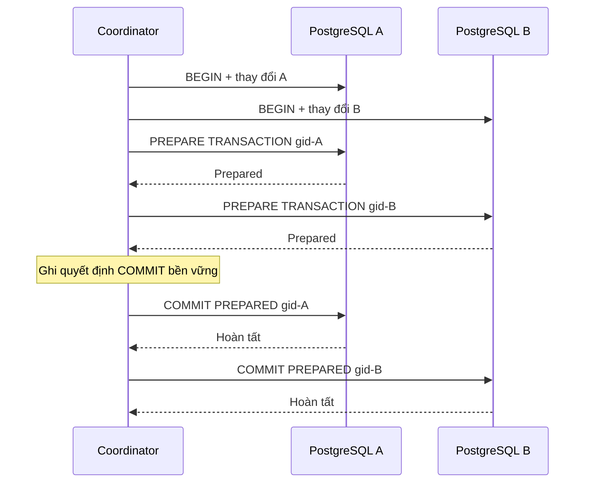
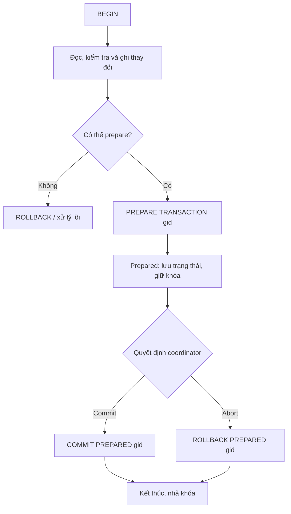

# Giao dịch chuẩn bị hai pha và rủi ro vận hành trong PostgreSQL

Một transaction PostgreSQL thông thường kết thúc bằng `COMMIT` hoặc `ROLLBACK`. Nhưng trong hệ thống cần phối hợp **một giao dịch nghiệp vụ qua nhiều database hoặc nhiều tài nguyên giao dịch**, một bên có thể đã sẵn sàng ghi nhận thay đổi trong khi bên kia chưa sẵn sàng. Nếu cho từng bên commit độc lập, khi xảy ra lỗi mạng hoặc crash sẽ có nguy cơ **một bên đã commit, bên còn lại rollback**.

PostgreSQL hỗ trợ **prepared transactions** như phần tham gia vào giao thức **two-phase commit (2PC – commit hai pha)**. Một participant có thể xác nhận:

> “Tôi đã ghi nhận bền vững trạng thái giao dịch và sẵn sàng làm theo quyết định commit hoặc rollback sau này; hiện tôi chưa công bố thay đổi thành dữ liệu đã commit.”

Điều đó thực hiện bằng:

```sql
BEGIN;
-- Các câu INSERT / UPDATE / DELETE của một nhánh giao dịch.
PREPARE TRANSACTION 'global-id-cua-nhanh';
```

Sau khi một giao dịch được chuẩn bị, **nó không còn thuộc về phiên kết nối ban đầu như một transaction đang mở thông thường**. Một phiên hợp lệ, ở đúng database và có đủ quyền, có thể hoàn tất bằng một trong hai lệnh:

```sql
COMMIT PREPARED 'global-id-cua-nhanh';
```

hoặc:

```sql
ROLLBACK PREPARED 'global-id-cua-nhanh';
```

Khả năng này rất hữu ích cho một **transaction coordinator** bên ngoài PostgreSQL. Tuy nhiên, prepared transactions **giữ khóa và tài nguyên cho tới khi có quyết định cuối cùng**; chúng có thể tồn tại sau khi client ngắt kết nối hoặc PostgreSQL khởi động lại. Một giao dịch chuẩn bị bị bỏ quên có thể gây nghẽn cập nhật, cản trở VACUUM, làm bảng phình to và khiến hệ thống khó vận hành.

Bài học thuộc chương **Giao dịch**, giải thích cụ thể cơ chế hai pha, cú pháp PostgreSQL, giới hạn cấu hình, xử lý lỗi, cách quan sát trạng thái và lý do **không dùng 2PC như bản thay thế mặc định cho transaction thông thường**.

## 1. Bài toán mà một COMMIT đơn lẻ không giải quyết được

Giả sử một hệ thống có:

- **Database A** quản lý tài khoản tiền.
- **Database B** quản lý sổ ghi nhận thanh toán.
- Một nghiệp vụ yêu cầu **ghi giảm tiền tại A và ghi tăng/ghi nhận nghiệp vụ tại B** như một quyết định chung.

Nếu ứng dụng làm:

```text
A: BEGIN
A: UPDATE balance
A: COMMIT                   -- Thành công

B: BEGIN
B: INSERT ledger_entry
B: COMMIT                   -- Lỗi mạng hoặc server bị sự cố
```

thì A có thể đã commit trong khi B chưa commit. Hai transaction độc lập **không tự động trở thành một transaction phân tán nguyên tử** chỉ vì ứng dụng gọi chúng trong cùng một request.

Một transaction PostgreSQL đơn lẻ đã có tính atomic **bên trong một database và phạm vi transaction đó**, nhưng không thể dùng một câu `COMMIT` ở database A để trực tiếp commit cả một transaction độc lập ở database B.

### 1.1. Mục tiêu của 2PC

Giao thức 2PC chia việc ra làm hai pha:

1. **Prepare / voting:** mỗi participant thực hiện thay đổi dự kiến và báo có thể commit hay không. Participant đồng ý phải lưu trạng thái đủ bền vững để phục hồi sau sự cố.
2. **Decision / completion:** coordinator, khi đã quyết định commit/rollback theo quy tắc giao thức và ghi lại quyết định bền vững, yêu cầu mọi participant hoàn tất tương ứng.

Mô hình:



Đây là **luồng thành công**, không phải bảo đảm hệ thống sẽ thực hiện các thao tác mạng không lỗi. Nếu coordinator hoặc participant gặp sự cố, cơ chế phục hồi phải xử lý những nhánh còn ở trạng thái prepared.

### 1.2. Hai pha không có nghĩa hai câu COMMIT

Không phải:

```text
Database A: COMMIT
Database B: COMMIT
```

mà là:

```text
Database A: PREPARE
Database B: PREPARE
Coordinator: quyết định toàn cục
Database A: COMMIT PREPARED
Database B: COMMIT PREPARED
```

Sự khác biệt quyết định nằm ở **trạng thái đã chuẩn bị nhưng chưa commit**, cho phép một participant tiếp tục chờ quyết định sau khi phiên gốc kết thúc.

## 2. Transaction thông thường và prepared transaction

| Tiêu chí | Transaction thông thường | Prepared transaction |
| --- | --- | --- |
| Bắt đầu | `BEGIN` hoặc transaction ngầm theo cơ chế client | Cũng bắt đầu bằng transaction thông thường |
| Hoàn tất | `COMMIT` / `ROLLBACK` | `PREPARE TRANSACTION`, sau đó `COMMIT PREPARED` hoặc `ROLLBACK PREPARED` |
| Kết nối gốc ngắt sau khi đã chuẩn bị | Không áp dụng | Trạng thái prepared **vẫn tồn tại** |
| Thay đổi đã công khai sau bước chuẩn bị? | Chỉ sau COMMIT | **Chưa**; phải COMMIT PREPARED |
| Khóa còn được giữ trong lúc chờ? | Cho tới khi transaction kết thúc | **Có**, cho tới COMMIT/ROLLBACK PREPARED |
| Có thể hoàn tất từ kết nối khác? | Không theo cách này | Có, với database/quyền phù hợp |
| Cấu hình để sử dụng | Khả năng transaction thông thường | Cần `max_prepared_transactions` lớn hơn 0 |
| Nhu cầu phổ biến | Hầu hết hoạt động ứng dụng | Điều phối commit qua nhiều participant |
| Khi bị bỏ quên | Kết nối/transaction đang mở có thể được xử lý bằng quản lý session | **Không còn session gốc để hủy**; phải giải quyết prepared GID |

Điểm quan trọng: `PREPARE TRANSACTION` **không commit** những thay đổi. Một transaction đã được prepare vẫn là trách nhiệm của hệ thống điều phối cho tới khi nhận quyết định cuối cùng.

### 2.1. Sơ đồ vòng đời



**Một prepared transaction không tự hết hạn theo một timeout mặc định chỉ vì client rời đi.** Đây vừa là điểm mạnh để phục hồi sau lỗi, vừa là rủi ro lớn nếu không có coordinator đủ tin cậy.

## 3. Ba lệnh PostgreSQL cốt lõi

### 3.1. PREPARE TRANSACTION

```sql
PREPARE TRANSACTION 'gid';
```

GID (*global transaction identifier*) là một chuỗi dùng để nhận diện transaction đã chuẩn bị. Nó phải **duy nhất trong các prepared transactions đang tồn tại của PostgreSQL cluster** và có giới hạn độ dài; với PostgreSQL thông dụng, GID phải **ngắn hơn 200 byte**.

Ví dụ đặt tên có cấu trúc:

```text
transfer:20261114:8af39:branch-A
transfer:20261114:8af39:branch-B
```

GID nên bắt nguồn từ **định danh nghiệp vụ toàn cục và nhánh giao dịch**, không chỉ từ username hoặc timestamp có thể trùng. Không nhúng mật khẩu, token hoặc dữ liệu cá nhân nhạy cảm vào GID vì nó xuất hiện trong metadata vận hành.

`PREPARE TRANSACTION` dùng **bên trong một transaction đang hoạt động**. Nó kết thúc transaction hiện hành theo hướng chuyển sang trạng thái prepared; sau đó connection không còn tiếp tục cập nhật nhánh đã chuẩn bị.

### 3.2. COMMIT PREPARED

```sql
COMMIT PREPARED 'gid';
```

Lệnh này chốt các thay đổi đã prepare, nhả khóa và hoàn tất nhánh giao dịch. Nó thường được gọi từ coordinator sau khi coordinator **đã ghi bền vững quyết định commit toàn cục**.

Không đặt `COMMIT PREPARED` bên trong một transaction block `BEGIN ... COMMIT` khác. Nó là lệnh hoàn tất prepared transaction độc lập và phải được thực thi ngoài transaction block đang mở.

### 3.3. ROLLBACK PREPARED

```sql
ROLLBACK PREPARED 'gid';
```

Lệnh này hoàn tác các thay đổi của nhánh đã chuẩn bị và nhả khóa. Nó thường được dùng khi coordinator có **quyết định abort**.

**Không dùng `ROLLBACK PREPARED` chỉ vì thấy giao dịch đang chờ quá lâu.** Một participant khác có thể đã commit theo quyết định toàn cục. Nếu rollback một nhánh sau khi nhánh khác đã commit, trạng thái nghiệp vụ phân tán có thể không còn nhất quán.

### 3.4. COMMIT PREPARED/ROLLBACK PREPARED yêu cầu đúng ngữ cảnh

Các lệnh hoàn tất phải được gửi:

- Tới **đúng PostgreSQL database** chứa transaction đã chuẩn bị.
- Với **đúng GID**, không thêm/bớt một ký tự.
- Từ role có quyền thích hợp: về nguyên tắc **chủ sở hữu transaction đã prepare hoặc superuser** mới được hoàn tất nó.
- **Ngoài một transaction block** đang mở.

Không dùng SQL injection-prone string concatenation từ dữ liệu người dùng để tự tạo lệnh xử lý GID; trong ứng dụng dùng transaction manager/driver đáng tin cậy và cơ chế tạo GID được kiểm soát.

## 4. PREPARE TRANSACTION không phải PREPARE câu SQL

Từ “prepared” có hai nghĩa hoàn toàn khác trong PostgreSQL.

**Prepared statement**:

```sql
PREPARE find_account(integer) AS
SELECT account_id, balance
FROM tx2pc_lab.accounts
WHERE account_id = $1;

EXECUTE find_account(1);

DEALLOCATE find_account;
```

Đây là một **câu SQL được chuẩn bị để thực thi nhiều lần** trong session; nó **không giữ một transaction ở trạng thái chưa commit**.

**Prepared transaction**:

```sql
BEGIN;
UPDATE tx2pc_lab.accounts
SET balance = balance + 10
WHERE account_id = 1;
PREPARE TRANSACTION 'demo-transaction-001';
```

Đây là **trạng thái transaction** có khả năng chờ quyết định commit/rollback sau này.

| Thuật ngữ | Mục đích | Khái niệm liên quan |
| --- | --- | --- |
| `PREPARE statement_name AS ...` | Chuẩn bị plan/câu lệnh dùng lại | `EXECUTE`, `DEALLOCATE`, `pg_prepared_statements` |
| JDBC `PreparedStatement` | Truyền tham số và thực thi SQL an toàn từ Java | Parameter binding |
| `PREPARE TRANSACTION 'gid'` | Chuẩn bị một transaction cho pha quyết định 2PC | `COMMIT PREPARED`, `ROLLBACK PREPARED`, `pg_prepared_xacts` |

Không dùng `pg_prepared_statements` để giám sát giao dịch 2PC. View cần xem là **`pg_prepared_xacts`**.

## 5. Điều kiện cấu hình: max_prepared_transactions

PostgreSQL có tham số:

```sql
SHOW max_prepared_transactions;
```

Trong cấu hình phổ biến, giá trị mặc định là **0**, nghĩa là **không cho phép prepared transactions**. Nếu chạy `PREPARE TRANSACTION` khi tính năng bị tắt, server sẽ từ chối.

Để xem thêm trạng thái:

```sql
SELECT
    name,
    setting,
    context,
    pending_restart
FROM pg_settings
WHERE name = 'max_prepared_transactions';
```

### 5.1. Không thể chỉ SET trong một phiên rồi dùng ngay

`max_prepared_transactions` là tham số cần được cấu hình ở **cấp server và cần restart PostgreSQL để thay đổi có hiệu lực**. Nó không phải thứ có thể bật tạm bằng:

```sql
-- Không phải cách bật tính năng cho riêng session:
-- SET max_prepared_transactions = 10;
```

Một quản trị viên, trong môi trường phù hợp, có thể đặt giá trị qua file cấu hình hoặc cơ chế `ALTER SYSTEM` rồi **restart** có kế hoạch:

```sql
-- Ví dụ cú pháp cấu hình của quản trị viên;
-- KHÔNG tự chạy trên production chỉ để thực hành.
-- ALTER SYSTEM SET max_prepared_transactions = 20;
```

Sau khi server được restart theo quy trình vận hành, xác nhận lại bằng `SHOW max_prepared_transactions`.

### 5.2. Giá trị nào phù hợp?

Đừng chọn một số như 20 hoặc 100 chỉ vì ví dụ:

- Cần biết số transaction phân tán có thể đồng thời ở trạng thái prepared.
- Phải dự trù những participant bị chậm hoặc tạm mất kết nối.
- Prepared transactions dùng tài nguyên server và có thể giữ khóa lâu.
- Nếu không có coordinator 2PC thực sự, **để 0 thường là lựa chọn an toàn**.
- Trong cấu hình primary/standby, giá trị trên standby cần được đặt **bằng hoặc lớn hơn primary** theo yêu cầu của PostgreSQL để hỗ trợ trạng thái tương ứng.

Một hệ thống có hàng trăm request mỗi giây không đồng nghĩa phải tăng `max_prepared_transactions` theo số request. Tham số này liên quan tới **số transaction prepared đồng thời**, không phải số connection thông thường.

### 5.3. Điều kiện cho bài thực hành

Các ví dụ dùng `PREPARE TRANSACTION` ở phần tiếp theo chỉ có thể chạy nếu server thử nghiệm đã được **quản trị viên cho phép prepared transactions** với giá trị lớn hơn 0. Nếu bạn không có quyền thay đổi cấu hình, **đọc và hiểu SQL mà không chạy phần PREPARE**; không cần vô hiệu hóa các bảo vệ của production để học một tính năng hiếm dùng.

## 6. Chuẩn bị database thử nghiệm

Hãy dùng **một database học tập riêng**, không tạo hoặc chuẩn bị giao dịch trên database phục vụ traffic thật. Những thao tác demo có thể **giữ khóa sau khi phiên kết thúc**, vì vậy phải thực hiện cả bước cleanup.

### 6.1. Tạo schema và bảng tài khoản

```sql
CREATE SCHEMA IF NOT EXISTS tx2pc_lab;

CREATE TABLE tx2pc_lab.accounts (
    account_id INTEGER PRIMARY KEY,
    owner_name TEXT NOT NULL,
    balance NUMERIC(14, 2) NOT NULL
        CHECK (balance >= 0)
);
```

Số dư dùng `NUMERIC` để minh họa phép tính thập phân chính xác. Đây là **bài thực hành cơ chế transaction**, không phải thiết kế ledger tài chính đầy đủ: hệ thống tiền thật còn phải có double-entry accounting, kiểm tra idempotency, sổ bất biến, đối soát và các yêu cầu nghiệp vụ khác.

### 6.2. Nạp dữ liệu

Chỉ chạy trên bảng mới trong database thử nghiệm:

```sql
INSERT INTO tx2pc_lab.accounts
    (account_id, owner_name, balance)
VALUES
    (1, 'An', 500.00),
    (2, 'Bình', 100.00);
```

Kiểm tra:

```sql
SELECT
    account_id,
    owner_name,
    balance
FROM tx2pc_lab.accounts
ORDER BY account_id;
```

Kết quả ban đầu:

| account_id | owner_name | balance |
| ---: | --- | ---: |
| 1 | An | 500.00 |
| 2 | Bình | 100.00 |

Tổng = **600.00**. Trong ví dụ chuyển 80, tổng số dư phải giữ nguyên. Quy tắc “không tạo ra hoặc làm mất tiền” được minh họa bằng hai UPDATE nằm **trong cùng một transaction PostgreSQL**.

### 6.3. Không dùng GID đã có

Trước demo, kiểm tra:

```sql
SELECT
    gid,
    owner,
    database,
    prepared
FROM pg_prepared_xacts
WHERE gid LIKE 'course222:%'
ORDER BY prepared;
```

Nếu đã có một GID đang chờ, **không chạy lại demo bằng GID đó** và không tự rollback giao dịch chưa rõ nguồn gốc. Dữ liệu trong view chỉ cho biết các transaction **đang ở trạng thái prepared**, không phải toàn bộ lịch sử transaction đã commit hay rollback.

## 7. Thực hành một nhánh: PREPARE rồi ROLLBACK PREPARED

Trước tiên, ta học **vòng đời prepared transaction** trên một database. Đây không phải ví dụ 2PC phân tán hoàn chỉnh; mục tiêu là quan sát trạng thái ở một participant.

### 7.1. Bước 1 — BEGIN và cập nhật

```sql
BEGIN;

UPDATE tx2pc_lab.accounts
SET balance = balance - 80
WHERE account_id = 1
  AND balance >= 80
RETURNING account_id, balance;

UPDATE tx2pc_lab.accounts
SET balance = balance + 80
WHERE account_id = 2
RETURNING account_id, balance;
```

Khi mọi điều kiện đúng, hai UPDATE lần lượt trả:

| account_id | balance sau UPDATE, trước prepare |
| ---: | ---: |
| 1 | 420.00 |
| 2 | 180.00 |

**Quan trọng:** ví dụ trên giả định mỗi UPDATE ảnh hưởng **đúng một hàng**. Nếu UPDATE thứ nhất không trả hàng vì thiếu tiền hoặc không có tài khoản, phải **ROLLBACK**, không được tiếp tục ghi có tài khoản 2 rồi prepare. Một ứng dụng production phải kiểm tra số hàng bị ảnh hưởng một cách tự động và hủy transaction khi thiếu bất kỳ điều kiện nào.

### 7.2. Bước 2 — Chuyển transaction thành prepared

Trong **cùng session đang có transaction ở bước 1**:

```sql
PREPARE TRANSACTION 'course222:local:abort:001';
```

Lúc này transaction đã chuyển sang trạng thái **prepared**. Hai số dư mới **chưa được commit**, nhưng trạng thái transaction đã được PostgreSQL lưu để có thể quyết định sau.

Kết nối vừa thực hiện lệnh không còn cần giữ transaction đó mở. Một phiên đủ quyền ở đúng database có thể hoàn tất giao dịch bằng GID.

### 7.3. Bước 3 — Xem danh sách prepared transactions

```sql
SELECT
    gid,
    transaction,
    prepared,
    owner,
    database
FROM pg_prepared_xacts
WHERE gid = 'course222:local:abort:001';
```

Kỳ vọng có **một hàng**, với:

- `gid`: định danh đã chọn.
- `transaction`: transaction ID nội bộ.
- `prepared`: thời điểm chuyển sang trạng thái prepared.
- `owner`: role đã chuẩn bị transaction.
- `database`: database chứa transaction này.

Trong một phiên khác, các câu SELECT thông thường theo snapshot mới trước khi commit prepared vẫn thấy dữ liệu **chưa bị thay đổi** (500.00 và 100.00), dù các khóa ghi của transaction có thể khiến một UPDATE vào cùng hàng phải đợi.

### 7.4. Bước 4 — Quyết định abort

Chạy **ngoài một transaction block**:

```sql
ROLLBACK PREPARED 'course222:local:abort:001';
```

Kiểm tra:

```sql
SELECT account_id, balance
FROM tx2pc_lab.accounts
ORDER BY account_id;

SELECT gid
FROM pg_prepared_xacts
WHERE gid = 'course222:local:abort:001';
```

Kết quả số dư trở về **500.00 / 100.00**. GID không còn xuất hiện trong danh sách đang prepared.

**Nếu chạy `ROLLBACK PREPARED` với GID không tồn tại**, PostgreSQL sẽ báo lỗi; đừng suy luận một cách mù quáng rằng giao dịch “chắc chắn đã rollback” chỉ từ việc không còn GID.

## 8. Thực hành một nhánh: PREPARE rồi COMMIT PREPARED

Ví dụ tiếp theo dùng **GID khác** để mô phỏng quyết định commit.

### 8.1. Bước 1 — Thay đổi số dư

```sql
BEGIN;

UPDATE tx2pc_lab.accounts
SET balance = balance - 80
WHERE account_id = 1
  AND balance >= 80
RETURNING account_id, balance;

UPDATE tx2pc_lab.accounts
SET balance = balance + 80
WHERE account_id = 2
RETURNING account_id, balance;

PREPARE TRANSACTION 'course222:local:commit:002';
```

Chỉ thực hiện `PREPARE TRANSACTION` khi **cả hai UPDATE đều ảnh hưởng đúng một hàng**. Nếu một lệnh thất bại hoặc trả 0 hàng, dùng `ROLLBACK` cho transaction vẫn đang mở và xử lý lỗi.

### 8.2. Bước 2 — Chốt transaction

Chạy bên ngoài transaction block:

```sql
COMMIT PREPARED 'course222:local:commit:002';
```

### 8.3. Bước 3 — Kiểm tra số dư cuối cùng

```sql
SELECT
    account_id,
    balance
FROM tx2pc_lab.accounts
ORDER BY account_id;

SELECT SUM(balance) AS total_balance
FROM tx2pc_lab.accounts;
```

Kết quả:

| account_id | balance sau commit |
| ---: | ---: |
| 1 | 420.00 |
| 2 | 180.00 |

`total_balance = 600.00`, không mất hoặc thêm tiền trong ví dụ.

### 8.4. Làm sao để khôi phục demo?

Sau khi đã commit, bạn có thể tạo một transaction mới để chuyển 80 từ Bình về An, nhưng đó là **một nghiệp vụ bù mới**, không phải `ROLLBACK PREPARED` của GID đã hoàn tất.

Trong database thử nghiệm thuần túy, nếu muốn nạp lại các giá trị ban đầu:

```sql
-- CHỈ dùng để reset dữ liệu lớp học trong schema tx2pc_lab
-- và khi không còn prepared transaction liên quan.
UPDATE tx2pc_lab.accounts
SET balance = CASE account_id
    WHEN 1 THEN 500.00
    WHEN 2 THEN 100.00
END
WHERE account_id IN (1, 2);
```

Không áp dụng kiểu đặt lại số dư này cho dữ liệu tiền thật; hệ thống ledger cần điều chỉnh theo giao dịch bù, audit và quy trình kế toán.

## 9. Chặt chẽ hơn: kiểm tra số hàng ảnh hưởng trước khi prepare

Trong ứng dụng thật, không nên dựa vào việc người vận hành quan sát hai câu `RETURNING` bằng mắt. Một ví dụ PL/pgSQL trong transaction thử nghiệm có thể **báo lỗi nếu thiếu bất kỳ hàng mục tiêu nào**:

```sql
BEGIN;

DO $body$
DECLARE
    updated_rows INTEGER;
BEGIN
    UPDATE tx2pc_lab.accounts
    SET balance = balance - 80
    WHERE account_id = 1
      AND balance >= 80;

    GET DIAGNOSTICS updated_rows = ROW_COUNT;
    IF updated_rows <> 1 THEN
        RAISE EXCEPTION
            'Cannot debit source account: expected 1 row, got %',
            updated_rows;
    END IF;

    UPDATE tx2pc_lab.accounts
    SET balance = balance + 80
    WHERE account_id = 2;

    GET DIAGNOSTICS updated_rows = ROW_COUNT;
    IF updated_rows <> 1 THEN
        RAISE EXCEPTION
            'Cannot credit target account: expected 1 row, got %',
            updated_rows;
    END IF;
END;
$body$;

-- Chỉ gọi PREPARE nếu DO hoàn tất thành công.
PREPARE TRANSACTION 'course222:checked:003';
```

Sau đó, hãy hoàn tất ngay một trong hai hướng:

```sql
-- Chọn MỘT hướng theo quyết định điều phối:
ROLLBACK PREPARED 'course222:checked:003';

-- HOẶC trong lượt demo khác, có GID phù hợp:
-- COMMIT PREPARED 'course222:checked:003';
```

Nếu `DO` phát sinh exception, transaction thông thường đã ở trạng thái lỗi và không thể prepare; cần `ROLLBACK`. Việc có **đủ tiền, đủ hai tài khoản và đúng số hàng ảnh hưởng** là điều kiện nghiệp vụ phải được kiểm tra trước pha prepare.

**Lưu ý:** đoạn code trên chỉ củng cố tính đúng của **một database**. Để đạt 2PC trên hai database, còn cần coordinator bền vững, như phần tiếp theo.

## 10. Hai database và một coordinator: quy trình 2PC đầy đủ

Giả sử có **PostgreSQL A** và **PostgreSQL B**, mỗi database có schema/bảng riêng phù hợp. Coordinator quản lý một giao dịch toàn cục:

```text
global_operation_id = payout-2026-11-14-0007
branch A GID        = payout-2026-11-14-0007:A
branch B GID        = payout-2026-11-14-0007:B
```

Mỗi GID nhận diện **một transaction của một participant**. Tránh dùng chung một GID cho hai nhánh trên **cùng một PostgreSQL cluster**; GID cần duy nhất trong các prepared transactions đang tồn tại của cluster.

### 10.1. Pha 1: mỗi participant thực hiện và prepare

**Kết nối tới database A:**

```sql
BEGIN;

-- Thay đổi thuộc database A và đã được kiểm tra đầy đủ.
UPDATE tx2pc_lab.accounts
SET balance = balance - 80
WHERE account_id = 1
  AND balance >= 80;

-- Coordinator phải xác nhận UPDATE ảnh hưởng đúng một hàng.
PREPARE TRANSACTION 'payout-2026-11-14-0007:A';
```

**Kết nối tới database B:**

```sql
BEGIN;

-- Thay đổi thuộc database B, sử dụng tài khoản đích
-- theo dữ liệu và quy tắc nghiệp vụ của B.
UPDATE tx2pc_lab.accounts
SET balance = balance + 80
WHERE account_id = 2;

-- Coordinator phải xác nhận UPDATE ảnh hưởng đúng một hàng.
PREPARE TRANSACTION 'payout-2026-11-14-0007:B';
```

Hai mảnh SQL giả định schema `tx2pc_lab.accounts` tồn tại ở **cả hai database** và số dư/tài khoản đã được khởi tạo thích hợp. Chúng minh họa việc **chạy trên hai kết nối khác nhau**, không phải script chạy tuần tự trong một database duy nhất. Khi triển khai thực tế, coordinator phải kiểm soát quyền, kết quả UPDATE và các quy tắc cân đối nghiệp vụ.

### 10.2. Nếu cả hai đều prepared thành công

Coordinator ghi **quyết định COMMIT toàn cục vào durable storage** trước khi gửi các lệnh hoàn tất. Cấu trúc log khái niệm:

```text
operation_id: payout-2026-11-14-0007
participants:
  - database: A
    gid: payout-2026-11-14-0007:A
    prepared: true
  - database: B
    gid: payout-2026-11-14-0007:B
    prepared: true
decision: COMMIT
decision_durable: true
```

Sau đó:

**Trên database A:**

```sql
COMMIT PREPARED 'payout-2026-11-14-0007:A';
```

**Trên database B:**

```sql
COMMIT PREPARED 'payout-2026-11-14-0007:B';
```

Tại thời điểm hai lệnh đang được truyền qua mạng, A có thể đã hoàn tất còn B vẫn đang prepared. Vì vậy 2PC không tự tạo **một thời điểm quan sát toàn cục tức thời** cho mọi client độc lập; nó là cơ chế để các participant đi tới **cùng một quyết định commit/abort** và cho phép phục hồi trạng thái đang chờ khi xảy ra sự cố.

### 10.3. Nếu một participant không thể prepare

Ví dụ B báo lỗi kiểm tra số dư hoặc lỗi lưu trữ. Coordinator quyết định **ABORT**:

- Với nhánh A đã prepared: gửi `ROLLBACK PREPARED` tới A.
- Với transaction B chưa prepare nhưng còn mở: gửi `ROLLBACK` tới B, hoặc để hệ thống transaction manager xử lý abort theo trạng thái thực.
- Ghi trạng thái hoàn tất/abort cho việc phục hồi.

**Không** gửi `COMMIT PREPARED` tới A chỉ vì A đã prepare. Kết quả của một nhánh không tự quyết định kết quả toàn cục.

### 10.4. Coordinator là thành phần bắt buộc

PostgreSQL cung cấp **các câu lệnh participant**. Nó **không tự phát hiện mọi transaction của tất cả database và tự chọn quyết định toàn cục**.

Coordinator phải quản lý:

1. Danh sách participant và GID của từng nhánh.
2. Kết quả Prepare hoặc Vote No.
3. Quyết định COMMIT/ABORT.
4. **Nhật ký quyết định bền vững** để phục hồi sau crash.
5. Gửi lệnh hoàn tất, retry theo trạng thái đã được đối chiếu.
6. Giám sát những nhánh chưa được hoàn tất.

Nếu tự gọi `PREPARE TRANSACTION` từ ứng dụng mà không có coordinator bền vững, bạn đã tạo ra khả năng **mắc kẹt giao dịch vô hạn** mà không có nơi quyết định đúng hướng giải quyết.

## 11. 2PC là cơ chế blocking: điều gì xảy ra khi coordinator mất?

Giả sử cả A và B đã chuẩn bị:

```text
A: prepared, giữ khóa
B: prepared, giữ khóa
Coordinator: mất kết nối / crash
```

Các database participant **không thể tự biết** toàn bộ điều kiện và quyết định của giao dịch phân tán, nên chúng giữ trạng thái prepared để chờ phục hồi.

Đây là đặc điểm **blocking** của 2PC cổ điển. Không phải “đợi vài giây rồi rollback” là luôn đúng: coordinator có thể đã ghi quyết định commit và đã commit một nhánh trước khi mất kết nối.

### 11.1. Prepared không có nghĩa đã thành công nghiệp vụ

Một nhánh được prepare thành công nghĩa là:

- PostgreSQL đã chấp nhận đưa nhánh đó vào trạng thái có thể hoàn tất sau.
- Những thay đổi của nhánh **chưa được commit**.
- Khóa và một số tài nguyên vẫn gắn với transaction đó.

Nó **không xác nhận** toàn bộ nghiệp vụ đã được commit trên mọi hệ thống. Kể cả khi cả hai database trả “prepared”, coordinator vẫn chưa chắc đã truyền quyết định commit đến tất cả bên.

### 11.2. Vì sao không auto-rollback mọi prepared transaction quá hạn?

Giả sử:

1. Coordinator ghi quyết định **COMMIT** vào log.
2. A thực hiện `COMMIT PREPARED` thành công.
3. Mạng đứt trước khi B nhận `COMMIT PREPARED`.
4. B vẫn xuất hiện trong `pg_prepared_xacts` suốt một khoảng thời gian.

Nếu một job dọn dẹp tự động `ROLLBACK PREPARED` ở B chỉ vì “GID đã cũ”, A đã commit còn B rollback. Job đó **phá vỡ quyết định toàn cục**.

Cách đúng là đọc thông tin coordinator và tiếp tục **COMMIT PREPARED** ở B, nếu log cho biết quyết định bền vững là COMMIT.

## 12. Bảng tình huống lỗi và hướng phục hồi

| Lỗi | Trạng thái khả dĩ | Hướng xử lý |
| --- | --- | --- |
| Participant lỗi trước PREPARE | Transaction thường chưa commit, có thể tự abort | Coordinator quyết định abort, rollback các nhánh còn mở/prepared |
| Participant đã PREPARE rồi ngắt kết nối | GID vẫn ở `pg_prepared_xacts` | Coordinator kết nối lại để COMMIT/ROLLBACK PREPARED theo quyết định |
| PostgreSQL restart sau PREPARE | Prepared transaction được PostgreSQL phục hồi | Kiểm tra `pg_prepared_xacts` và tiếp tục quyết định |
| Coordinator crash trước khi ghi quyết định COMMIT | Có thể còn những nhánh prepared | Phục hồi log bền vững, xác định trạng thái và quyết định theo giao thức |
| Coordinator crash sau khi ghi COMMIT, trước khi gửi cho mọi bên | Một số nhánh đã commit, các nhánh còn lại prepared | Gửi/retry COMMIT PREPARED cho những nhánh chưa hoàn tất |
| Client timeout sau khi gửi COMMIT PREPARED | Không biết server đã commit hay chưa | Đối chiếu GID, log coordinator và bằng chứng nghiệp vụ; không suy đoán |
| GID không còn trong pg_prepared_xacts | Có thể đã commit, rollback hoặc chưa từng prepare | Không coi vắng mặt GID là bằng chứng của trạng thái cuối |
| Prepared transaction giữ khóa lâu | Session khác chờ, có thể bloat | Điều tra owner/GID/coordinator, giải quyết theo quyết định có căn cứ |
| Vượt giới hạn max_prepared_transactions | PREPARE mới bị từ chối | Xử lý các prepared GID hợp lệ, xem lại concurrency và cấu hình |
| Không truy cập được coordinator log | Thiếu quyết định toàn cục đáng tin cậy | Escalate vận hành, phục hồi log/nguồn sự thật; không xóa GID tùy tiện |

**Không có quy tắc “lỗi mạng thì rollback” áp dụng cho mọi thời điểm.** Trước khi quyết định toàn cục được ghi, abort có thể là hướng phù hợp; sau khi quyết định commit đã được ghi và một nhánh đã commit, việc rollback nhánh khác có thể gây sai lệch không thể sửa bằng lệnh rollback thông thường.

## 13. Tính bền vững và phục hồi sau PostgreSQL restart

Một prepared transaction tồn tại để một database có thể **phục hồi trách nhiệm hoàn tất** sau sự cố.

Về bản chất:

1. PostgreSQL ghi thông tin cần thiết về trạng thái prepared theo cơ chế lưu trữ và WAL phù hợp.
2. Khi backend gốc đóng kết nối sau PREPARE, trạng thái đó vẫn còn.
3. Nếu server restart, PostgreSQL khôi phục prepared transactions chưa được kết thúc.
4. Một phiên hợp lệ có thể kiểm tra và dùng `COMMIT PREPARED` hoặc `ROLLBACK PREPARED`.

Ví dụ theo dõi sau restart:

```sql
SELECT
    gid,
    database,
    owner,
    prepared
FROM pg_prepared_xacts
ORDER BY prepared;
```

**Không dùng việc restart PostgreSQL như cách “dọn hết transaction đang treo”.** Với prepared transactions, chính cơ chế phục hồi nhằm **giữ chúng lại** để thực hiện quyết định của coordinator.

### 13.1. Prepared transactions không phải bản sao dự phòng dữ liệu

Chúng không thay cho:

- Backup và PITR.
- Replication/HA.
- Chính sách audit.
- Durable log của transaction coordinator.
- Sổ nghiệp vụ và cơ chế đối soát.

Nếu một cluster bị mất dữ liệu hoặc restore không tương thích với trạng thái coordinator, việc phục hồi distributed transaction cần xử lý đặc biệt; đừng chỉ nhìn các GID còn tồn tại trên một bên rồi suy ra toàn bộ hệ thống nhất quán.

## 14. Quan sát bằng pg_prepared_xacts

View vận hành chủ đạo:

```sql
SELECT
    gid,
    transaction,
    prepared,
    owner,
    database
FROM pg_prepared_xacts
ORDER BY prepared;
```

Các cột quan trọng:

| Cột | Nội dung |
| --- | --- |
| `gid` | Định danh toàn cục của nhánh prepared transaction |
| `transaction` | Transaction ID PostgreSQL |
| `prepared` | Thời điểm transaction được prepare |
| `owner` | Role sở hữu transaction |
| `database` | Database nơi transaction được prepare |

View này hiển thị các transaction **hiện đang prepared**, không phải lịch sử audit của những transaction đã hoàn tất.

### 14.1. Tìm những GID tồn tại lâu

```sql
SELECT
    database,
    owner,
    gid,
    prepared,
    now() - prepared AS prepared_age
FROM pg_prepared_xacts
ORDER BY prepared;
```

`prepared_age` cho biết transaction đã nằm trong trạng thái prepared bao lâu. Hãy so với **thời gian bình thường của giao thức điều phối**. Một hệ thống hoàn tất 2PC thường dưới vài giây không nên có GID cũ nhiều giờ mà không có giải thích.

Tuy nhiên, **tuổi lớn là tín hiệu điều tra, không phải giấy phép tự rollback**.

### 14.2. Lọc theo một database và GID

```sql
SELECT
    gid,
    owner,
    database,
    prepared
FROM pg_prepared_xacts
WHERE database = current_database()
  AND gid LIKE 'course222:%'
ORDER BY prepared;
```

Việc lọc theo database giúp giảm nguy cơ nhầm một nhánh ở database khác. Khi phục hồi thực tế, phải đối chiếu với log của coordinator và định danh giao dịch nghiệp vụ.

### 14.3. Không dùng pg_prepared_xacts để chứng minh đã commit

GID vắng mặt khỏi view có thể nghĩa là:

- Đã `COMMIT PREPARED`.
- Đã `ROLLBACK PREPARED`.
- PREPARE chưa bao giờ thành công.
- Transaction ở database/cluster khác.
- Đang có sự cố đồng bộ thông tin hoặc người quan sát kiểm tra sai môi trường.

Để biết kết quả cuối, cần **lịch sử coordinator bền vững và bằng chứng trạng thái nghiệp vụ**, không chỉ một query xem transaction hiện đang treo.

## 15. Khóa: prepared transaction có thể chặn cả hệ thống

Trước khi PREPARE, một transaction cập nhật hàng phải lấy các khóa cần thiết. **Sau PREPARE, các khóa đó không biến mất** chỉ vì backend ban đầu đã trả connection về pool.

Ví dụ:

```sql
BEGIN;

UPDATE tx2pc_lab.accounts
SET balance = balance - 80
WHERE account_id = 1
  AND balance >= 80;

PREPARE TRANSACTION 'course222:lock-demo:004';
```

Khi GID này đang prepared:

- Session khác muốn `UPDATE` cùng hàng tài khoản 1 có thể **phải đợi khóa**.
- Một thao tác DDL như `ALTER TABLE tx2pc_lab.accounts ...` có thể cần khóa table mạnh và **bị chặn**.
- SELECT thông thường thường vẫn có thể đọc **phiên bản đã commit trước đó** nhờ MVCC, không phải số dư chưa commit trong prepared transaction.
- Các khóa chỉ được nhả khi chạy `COMMIT PREPARED` hoặc `ROLLBACK PREPARED`, chứ không phải lúc đóng kết nối gốc.

**Kết thúc ngay demo** từ session hợp lệ:

```sql
ROLLBACK PREPARED 'course222:lock-demo:004';
```

Không giữ GID demo ở trạng thái prepared để “thử xem bao lâu mới hết hạn”; nó có thể không tự hết hạn.

### 15.1. Vì sao pg_terminate_backend không giải quyết được?

Một transaction prepared không còn gắn với backend thường đang thực thi request. Nó có thể giữ khóa mà **không có PID phiên ban đầu để terminate**.

Các lệnh:

```sql
-- Không phải giải pháp chung cho prepared transaction:
-- SELECT pg_terminate_backend(<old_pid>);
```

không thay thế `COMMIT PREPARED`/`ROLLBACK PREPARED`. Kết thúc một backend đang chờ có thể làm request đó dừng, nhưng **không giải quyết nguyên nhân là GID prepared đang giữ khóa**.

### 15.2. Xem những phiên đang đợi khóa

Với quyền quan sát phù hợp:

```sql
SELECT
    a.pid,
    a.datname,
    a.state,
    a.wait_event_type,
    a.wait_event,
    pg_blocking_pids(a.pid) AS blocking_pids,
    a.query
FROM pg_stat_activity AS a
WHERE a.wait_event_type = 'Lock'
ORDER BY a.datname, a.pid;
```

Khi một prepared transaction là blocker, một số công cụ hoặc hàm giám sát có thể biểu diễn backend blocker **không có PID sống thông thường**; trong PostgreSQL, `pg_blocking_pids` có thể trả giá trị **0** để biểu diễn blocker là prepared transaction.

Để xem những khóa không gắn PID backend:

```sql
SELECT
    locktype,
    relation::regclass AS relation_name,
    transactionid,
    mode,
    granted
FROM pg_locks
WHERE pid IS NULL
ORDER BY locktype, relation::text, mode;
```

Các hàng `pg_locks.pid IS NULL` có thể giúp điều tra khóa do prepared transactions giữ, nhưng **không tự đồng nhất mọi dòng PID NULL với một GID cụ thể**. Muốn lập bản đồ chính xác phải đối chiếu transaction ID/GID và các thông tin catalog/lock phù hợp.

### 15.3. Dùng lock_timeout có giải quyết không?

Ứng dụng bị chặn có thể đặt:

```sql
BEGIN;
SET LOCAL lock_timeout = '3s';
UPDATE tx2pc_lab.accounts
SET balance = balance + 1
WHERE account_id = 1;
ROLLBACK;
```

Nếu không lấy được lock trong thời gian quy định, statement có thể báo lỗi timeout. Điều này giúp tránh **chờ vô hạn ở client**, nhưng **không giải phóng prepared transaction** đang giữ khóa.

Không dùng việc tăng timeout liên tục làm giải pháp vận hành. Cần giải quyết GID theo quyết định hợp lệ.

## 16. MVCC, VACUUM và nguy cơ bloat

Prepared transactions không chỉ tạo lock waits. Vì chúng giữ trạng thái transaction chưa kết thúc, chúng có thể **giữ lại các mốc transaction cũ**, làm PostgreSQL phải bảo toàn các phiên bản hàng đã lẽ ra có thể được dọn ở một thời điểm khác.

Một giao dịch prepared tồn tại quá lâu có thể dẫn tới:

- **Dead tuples** không được dọn như mong đợi.
- Bảng và index có thể tăng dung lượng (*bloat*).
- VACUUM/autovacuum không thu dọn được hết các phiên bản mà hệ thống còn cần bảo toàn.
- Áp lực transaction ID và các hoạt động chống wraparound có thể tăng trong tình huống nghiêm trọng.
- DDL, bảo trì và một số hoạt động replication/backup có thể bị ảnh hưởng bởi khóa hoặc trạng thái transaction cũ.

Không phải mọi prepared transaction đều gây mức độ bloat như nhau. Tác động phụ thuộc loại thay đổi, thời gian giữ trạng thái, tuổi transaction, tốc độ ghi của các bảng liên quan và hoạt động của các session khác.

### 16.1. Vì sao không VACUUM cho xong?

`VACUUM` không thể xóa những phiên bản hàng mà PostgreSQL vẫn phải bảo toàn vì snapshot/transaction horizon còn hoạt động. Nếu nguyên nhân là prepared GID đã treo nhiều giờ hoặc nhiều ngày, cần **giải quyết GID** theo quyết định coordinator.

`VACUUM FULL` cũng không phải cách chữa rẻ và an toàn: nó cần khóa mạnh, có thể bị chặn và tạo tải I/O lớn. Không thay việc phân tích nguồn giữ transaction bằng một lệnh bảo trì ép chạy trên production.

### 16.2. Hai rủi ro được cộng dồn

```text
Prepared transaction bị bỏ quên
    |
    +--> Giữ khóa: UPDATE/DDL/maintenance bị chặn
    |
    +--> Giữ transaction horizon: VACUUM khó dọn phiên bản cũ
                                   -> bloat / tăng chi phí vận hành
```

Vì thế, câu hỏi “chỉ có một prepared transaction thì có đáng lo không?” phải được trả lời bằng **tuổi, loại công việc, khóa giữ và mức độ tải của hệ thống**, không chỉ số lượng GID.

## 17. Giới hạn tài nguyên và nguy cơ cạn slot prepared transaction

`max_prepared_transactions` đặt giới hạn số prepared transaction đồng thời trong PostgreSQL instance. Khi đạt giới hạn:

- Một lần `PREPARE TRANSACTION` mới có thể **thất bại**.
- Coordinator phải xử lý nhánh không prepare thành công và quyết định abort theo giao thức.
- Nếu các GID cũ vẫn giữ khóa, tăng tham số một cách vô hạn không giải quyết nguyên nhân.
- Những luồng giao dịch phụ thuộc 2PC có thể không hoàn tất bình thường cho đến khi sự cố được xử lý.

### 17.1. Quan sát số lượng

```sql
SELECT COUNT(*) AS prepared_count
FROM pg_prepared_xacts;

SHOW max_prepared_transactions;
```

Một hệ thống có max 50 và 49 transaction prepared cũ nhiều ngày có nguy cơ vận hành khác hẳn hệ thống có 49 transaction prepared bình thường chỉ tồn tại trong vài mili giây.

### 17.2. Không dùng prepared transaction thay hàng đợi công việc

Một anti-pattern:

```text
BEGIN
UPDATE inventory
PREPARE TRANSACTION 'order-123'
Chờ người dùng thanh toán trong 30 phút
COMMIT PREPARED
```

Trong 30 phút, transaction có thể giữ khóa tồn kho và tài nguyên. Số lượng đơn chờ tăng sẽ dễ làm database nghẽn.

Thông thường cần **reservation có thời hạn ở cấp dữ liệu**, outbox hoặc workflow nghiệp vụ với các transition được commit ngắn, thay vì dùng trạng thái prepared như cơ chế “giữ đơn hàng” chờ phản hồi người dùng.

**2PC phù hợp với khoảng thời gian điều phối commit ngắn**, không phải lưu trạng thái nghiệp vụ kéo dài hàng giờ.

## 18. Hạn chế sử dụng bên trong một prepared transaction

Không phải mọi hoạt động session PostgreSQL đều có thể được chuyển sang prepared transaction một cách an toàn.

Những ví dụ cần chú ý:

- Các thao tác liên quan **temporary tables hoặc temporary namespace** có những hạn chế vì đối tượng tạm gắn với session.
- Các thao tác như `LISTEN`, `UNLISTEN`, `NOTIFY` không phù hợp với việc chuẩn bị giao dịch trong những trường hợp PostgreSQL từ chối chuẩn bị.
- Các đối tượng hay trạng thái gắn với session như cursors và advisory locks đòi xem lại giới hạn cụ thể.
- Các thành phần bên ngoài database như HTTP request, gửi email, ghi file ngoài DB **không được PostgreSQL rollback** chỉ vì transaction DB bị rollback.

Vì giới hạn có thể phụ thuộc phiên bản và loại thao tác, trước khi đưa một workload thật vào 2PC cần kiểm tra tài liệu PostgreSQL của phiên bản đang chạy và thử các thao tác cụ thể trên môi trường tương đương.

### 18.1. Không dùng side effect ngoài database trong pha prepare

Giả sử một trigger hoặc service gửi email “đã thanh toán” ngay khi UPDATE hàng:

```text
UPDATE trạng thái đơn
    -> gửi email bên ngoài
PREPARE TRANSACTION
ROLLBACK PREPARED
```

Email đã gửi **không tự bị thu hồi** do rollback DB. Đây là một lỗi kiến trúc có thể xảy ra ngay cả khi các database participant đều tuân thủ 2PC.

Cách thường phù hợp hơn là **transactional outbox**: ghi sự kiện dự kiến vào bảng trong cùng transaction DB, chỉ cho worker phát sự kiện sau khi dữ liệu đã commit. Nhưng outbox cần idempotency và consumer deduplication; nó không biến các service ngoài thành participant 2PC một cách tự động.

### 18.2. Cần đúng phạm vi atomicity

2PC chỉ đảm bảo mục tiêu của giao thức đối với những **resource manager thực sự tham gia 2PC** và có coordinator xử lý lỗi đúng. Một email server, HTTP API hoặc gateway thanh toán không hỗ trợ cùng giao thức không tự nhiên trở thành transaction participant.

## 19. Quyền truy cập và bảo vệ GID

Prepared transactions là công cụ mạnh vì một phiên có thể quyết định **commit hoặc rollback thay đổi được chuẩn bị bởi phiên khác**.

### 19.1. Nguyên tắc quyền

Để hoàn tất một prepared transaction, role thường phải là **role đã prepare transaction đó hoặc superuser**. Việc có quyền `SELECT` hay `UPDATE` trên một bảng không mặc nhiên trao quyền commit một prepared transaction của role khác.

Trong ứng dụng phân tán:

- Coordinator hoặc adapter dùng role chuyên dụng, giới hạn quyền.
- Các GID được tạo từ định danh giao dịch đã kiểm soát.
- Không nhận một chuỗi GID tùy ý từ request internet rồi thực thi.
- Có audit cho quyết định, actor, thời điểm và kết quả từng nhánh.
- Thao tác can thiệp thủ công cần có phê duyệt tương ứng với mức độ rủi ro.

### 19.2. Không nhầm quyền truy vấn với quyền quyết định

Một người có thể đọc `pg_prepared_xacts` để quan sát trạng thái nhưng **không có quyền** `COMMIT PREPARED` hoặc `ROLLBACK PREPARED` cho GID do role khác tạo.

Nếu cần khôi phục thủ công, hãy dùng tài khoản/chức năng quản trị được cấp phép; không thay đổi rộng quyền hoặc dùng superuser thường trực cho mọi request chỉ để tránh lỗi permission.

## 20. Idempotency và xử lý phản hồi không chắc chắn

Hãy hình dung client gửi:

```sql
COMMIT PREPARED 'payout-2026-11-14-0007:B';
```

Sau đó mất kết nối **trước khi nhận response**.

Hai tình huống khả dĩ:

1. Server **chưa xử lý** lệnh; GID vẫn prepared.
2. Server **đã commit thành công**, nhưng response bị mất; GID không còn prepared.

Client không thể suy ra kết quả chỉ từ lỗi mạng. Nếu retry lệnh sau khi GID đã hoàn tất, PostgreSQL có thể báo **transaction with identifier does not exist**. Lỗi đó **không phải bằng chứng đủ** rằng lần trước đã commit thành công; GID cũng có thể đã rollback hoặc chưa từng được prepare.

### 20.1. Vai trò của log coordinator

Coordinator nên lưu:

```text
global_id
participant_id
gid
prepare_result
durable_global_decision
completion_attempts
completion_evidence
last_error
updated_at
```

Khi phục hồi:

- Tìm quyết định toàn cục đã được ghi bền vững.
- Kiểm tra participant còn prepared hay đã hoàn tất.
- Retry **cùng quyết định**, không đổi COMMIT thành ROLLBACK vì timeout.
- Đối chiếu trạng thái nghiệp vụ và dấu vết audit khi thiếu GID.
- Đánh dấu hoàn tất khi có đủ bằng chứng cho các participant.

### 20.2. Cần idempotency ở cấp nghiệp vụ

Giả sử người dùng gửi lại yêu cầu thanh toán vì HTTP request timeout. Dù transaction 2PC trước đã commit, một request mới có thể tạo một **global transaction ID khác** và ghi giao dịch lần hai.

Vì vậy, ứng dụng vẫn cần cơ chế như:

```sql
-- Ví dụ schema riêng cho idempotency ở cấp ứng dụng.
CREATE TABLE tx2pc_lab.processed_operations (
    operation_id TEXT PRIMARY KEY,
    processed_at TIMESTAMPTZ NOT NULL DEFAULT now()
);
```

Khi xử lý cùng `operation_id`, hệ thống phải có hợp đồng rõ để **không thực hiện lại side effect nghiệp vụ**. Chỉ tạo bảng UNIQUE chưa đủ: cần thiết kế cách transaction kiểm tra, khóa và lưu kết quả/idempotency response một cách nhất quán.

**2PC đảm bảo quyết định giữa các participant đã tham gia; nó không tự ngăn một người dùng gửi một nghiệp vụ mới trùng nội dung.**

## 21. Thao tác thủ công khi gặp prepared GID bị treo

Đây là quy trình vận hành cần cẩn trọng vì hậu quả có thể liên quan tới nhiều hệ thống.

### Bước 1 — Xác định GID và môi trường

```sql
SELECT
    gid,
    database,
    owner,
    prepared,
    now() - prepared AS age
FROM pg_prepared_xacts
ORDER BY prepared;
```

Ghi nhận cluster, database, role, GID, thời gian, incident/ticket và những ứng dụng có liên quan.

### Bước 2 — Đánh giá tác động khóa

Xem các phiên đang chờ:

```sql
SELECT
    pid,
    datname,
    wait_event_type,
    wait_event,
    pg_blocking_pids(pid) AS blockers,
    query
FROM pg_stat_activity
WHERE wait_event_type = 'Lock';
```

Không chỉ nhìn các session đang chờ; còn xem prepared transaction có tuổi bất thường và dấu hiệu autovacuum/bloat/transaction horizon.

### Bước 3 — Tìm owner/coordinator và quyết định bền vững

Kiểm tra:

- Log transaction manager.
- Giao dịch toàn cục và danh sách nhánh.
- Nhánh nào đã commit, nhánh nào còn prepared.
- Quyết định COMMIT/ABORT đã được ghi bền vững hay chưa.
- Có lỗi mạng, restart, failover hoặc thay đổi cấu hình nào không.

Nếu không truy được quyết định, **không tự động chọn hướng theo cảm tính**. Escalate tới nhóm quản trị dữ liệu/ứng dụng và khôi phục nguồn sự thật của coordinator.

### Bước 4 — Hoàn tất theo đúng quyết định

Khi xác nhận được **COMMIT**:

```sql
-- Ví dụ minh họa cú pháp; thay bằng GID đã xác minh.
COMMIT PREPARED 'gid-da-xac-minh';
```

Khi xác nhận được **ABORT**:

```sql
ROLLBACK PREPARED 'gid-da-xac-minh';
```

**Tuyệt đối không thực thi cả hai lệnh** đối với cùng một transaction; chọn một hướng phù hợp với quyết định giao dịch toàn cục.

### Bước 5 — Xác minh sau xử lý

```sql
SELECT gid
FROM pg_prepared_xacts
WHERE gid = 'gid-da-xac-minh';
```

GID đã hoàn tất không còn xuất hiện trong view. Nhưng vẫn cần đối chiếu:

- Dữ liệu nghiệp vụ đúng/sai.
- Log coordinator và trạng thái các nhánh khác.
- Số session còn đợi khóa.
- Tình trạng VACUUM, WAL, replication và latency.

Sự vắng mặt của GID **chỉ chứng minh không còn ở trạng thái prepared tại server được hỏi**, không một mình chứng minh toàn hệ thống đã nhất quán.

## 22. Giám sát chủ động và cảnh báo

Một hệ thống dùng 2PC có chủ đích nên có giám sát, không chờ đến khi database treo mới truy vấn `pg_prepared_xacts`.

### 22.1. Các tín hiệu nên theo dõi

| Tín hiệu | Vì sao cần theo dõi |
| --- | --- |
| Số lượng prepared transactions | Phát hiện gần chạm `max_prepared_transactions` |
| GID lâu nhất đang prepared | Phát hiện nhánh bị bỏ quên |
| Tuổi prepared theo application/owner/database | Xác định thành phần có vấn đề |
| Số phiên chờ lock và thời gian chờ | Phát hiện tác động tới request đang chạy |
| Coordinator completion retry/errors | Phát hiện quyết định đã ghi nhưng chưa gửi xong |
| WAL/storage/bloat/autovacuum | Phát hiện tác động của transaction horizon |
| Thất bại PREPARE | Phát hiện cấu hình và tài nguyên thiếu |
| Failover/replication status | Đảm bảo xử lý prepared sau sự cố HA |

### 22.2. SQL cơ bản cho dashboard

```sql
SELECT
    database,
    owner,
    COUNT(*) AS prepared_count,
    MIN(prepared) AS oldest_prepared_at,
    MAX(now() - prepared) AS max_prepared_age
FROM pg_prepared_xacts
GROUP BY database, owner
ORDER BY max_prepared_age DESC NULLS LAST;
```

Khi không có prepared transaction, query trên trả **0 hàng**, chứ không tự trả một hàng có count bằng 0 cho từng database. Dashboard cần xử lý trường hợp đó.

### 22.3. Không đặt một ngưỡng SLA tùy tiện

GID prepared 30 giây có thể bình thường với một hệ thống triển khai qua mạng chậm, nhưng quá lâu với hệ thống đáng lẽ hoàn tất trong vài mili giây. Cần hiểu **thời gian prepare bình thường**, timeout của coordinator và mục tiêu khôi phục.

Khuyến nghị theo nguyên tắc:

- Cảnh báo khi độ tuổi GID vượt quá thời gian điều phối dự kiến.
- Cảnh báo cấp cao khi GID gây lock wait dài hoặc gần giới hạn slot.
- Trang bị runbook để xác định quyết định bền vững.
- Tách **alert yêu cầu điều tra** khỏi **action commit/rollback**.

Không dùng automation “rollback mọi GID quá X phút” trừ khi có cơ chế chứng minh quyết định abort đúng cho từng giao dịch; timeout một mình không đủ bằng chứng.

## 23. Khác biệt giữa atomicity, isolation và khả năng đọc tức thời

2PC thường được giới thiệu như giải pháp cho **atomic commit** qua nhiều resource managers. Tuy nhiên, nó không tự cung cấp mọi tính chất của một transaction toàn cục ở mọi tầng.

### 23.1. Atomic commit không đồng nghĩa mọi client thấy cùng lúc

Ví dụ coordinator đã chọn COMMIT:

```text
12:00:00.000  A nhận COMMIT PREPARED
12:00:00.005  Reader ở A thấy dữ liệu mới
12:00:00.010  B vẫn prepared
12:00:00.030  B nhận COMMIT PREPARED
12:00:00.035  Reader ở B thấy dữ liệu mới
```

Tùy thứ tự truyền quyết định và thời điểm đọc, các reader độc lập có thể quan sát dữ liệu ở hai bên tại những thời điểm khác nhau trong **pha hoàn tất**. Giao thức 2PC nhằm đảm bảo quyết định commit/abort **nhất quán và có thể phục hồi**, không phải đồng hồ chung tạo snapshot toàn hệ thống ngay lập tức.

### 23.2. Isolation level vẫn cần chọn đúng

Ở mỗi PostgreSQL database, `READ COMMITTED`, `REPEATABLE READ` hoặc `SERIALIZABLE` có quy tắc cô lập tương ứng. Chỉ bật 2PC không tự:

- Nâng các transaction từ `READ COMMITTED` thành `SERIALIZABLE`.
- Bảo đảm mọi ràng buộc nghiệp vụ liên database được kiểm tra đầy đủ.
- Ngăn một ứng dụng khác đọc hai database ở hai thời điểm khác nhau.

Ví dụ khi cập nhật số dư ở A và ledger ở B, phải bảo đảm các điều kiện nghiệp vụ được thực hiện bằng khóa, constraint, isolation và giao thức điều phối phù hợp. **2PC không thay thế thiết kế isolation và bất biến dữ liệu.**

### 23.3. Durability của quyết định coordinator

Nếu coordinator báo “COMMIT” nhưng chỉ lưu quyết định trong RAM rồi crash, hệ thống không có căn cứ bền vững để biết phải gửi COMMIT hay ROLLBACK cho các nhánh prepared.

Do đó, **log bền vững của coordinator là thành phần cốt lõi**, không phải chỉ một tùy chọn logging cho đẹp. Cần cả quy trình phục hồi log khi hệ thống quản lý transaction bị mất.

## 24. So sánh 2PC với các phương án thiết kế khác

Không phải mọi bài toán nhiều service đều phải dùng `PREPARE TRANSACTION`.

| Phương án | Đặc điểm | Khi nên cân nhắc |
| --- | --- | --- |
| Một transaction trong một PostgreSQL database | Dễ kiểm soát atomicity và rollback trong một tài nguyên | Các bảng có thể đặt trong cùng một database |
| 2PC với coordinator bền vững | Điều phối quyết định commit/abort giữa participant hỗ trợ 2PC | Bắt buộc có atomic commit và hạ tầng điều phối đáng tin |
| Transactional outbox | Ghi dữ liệu và outbox trong một DB transaction; worker phát sự kiện sau commit | Event-driven, cần chống mất sự kiện và chấp nhận xử lý bất đồng bộ |
| Saga/workflow có compensation | Nhiều local transaction; có bước bù khi thất bại | Nghiệp vụ kéo dài, nhiều service không hỗ trợ 2PC |
| Reservation có TTL | Giữ nguồn lực bằng trạng thái dữ liệu đã commit và cơ chế hết hạn | Đơn chờ thanh toán, đặt chỗ, giữ tồn kho trong nhiều phút |
| Batch reconciliation | Đối chiếu và sửa lệch theo chính sách | Tương tác external provider không bảo đảm atomic 2PC |

### 24.1. Transactional outbox không phải 2PC

Outbox thường có mô hình:

```text
PostgreSQL transaction:
    UPDATE order
    INSERT outbox_event
    COMMIT

Worker:
    đọc outbox đã commit
    gửi event
    retry khi lỗi

Consumer:
    xử lý idempotently
```

Nó giảm nhu cầu commit đồng thời giữa DB và message broker, nhưng có thể cần **eventual consistency**, cơ chế retry/dedup và trạng thái gửi sự kiện.

### 24.2. Saga không phải rollback database phân tán

Saga dùng nhiều transaction local:

```text
T1: tạo đơn -> commit
T2: giữ kho -> commit
T3: thu tiền -> lỗi
Compensation: hủy giữ kho, hủy đơn theo quy tắc
```

Compensation không đồng nghĩa đảo ngược tuyệt đối mọi tác dụng phụ. Ví dụ đã gửi email, đã giao hàng hoặc đã ghi nhận cước vận chuyển thì cần quy trình nghiệp vụ bù có kiểm soát.

### 24.3. Khi nào 2PC đáng chi phí?

2PC có thể phù hợp khi:

- Các participant **thực sự hỗ trợ giao thức** và được vận hành trong một kiến trúc đã lựa chọn.
- Yêu cầu nguyên tử giữa các tài nguyên đủ quan trọng để chấp nhận **blocking và độ phức tạp phục hồi**.
- Đã có transaction manager bền vững, logging, alerting và runbook.
- Giao dịch phân tán dự kiến hoàn tất nhanh; không phụ thuộc bước chờ người dùng hàng giờ.

Nếu hầu hết thay đổi đều có thể xử lý trong **một PostgreSQL database**, một transaction thường là lựa chọn đơn giản và an toàn hơn.

## 25. Java, JTA và quản lý 2PC trong ứng dụng

Với ứng dụng Java, có các khái niệm dễ bị nhầm:

- JDBC `Connection.setAutoCommit(false)`: mở giao dịch trên một kết nối.
- JDBC `commit()`/`rollback()`: hoàn tất transaction thông thường của kết nối đó.
- JDBC `PreparedStatement`: chuẩn bị/truyền tham số cho SQL, **không phải 2PC**.
- XA/JTA transaction manager: có thể điều phối nhiều resource managers theo hợp đồng XA khi các driver/datasource và nền tảng hỗ trợ đầy đủ.

Không nên tự viết một hàm:

```java
dbA.commit();
dbB.commit();
```

rồi gọi đó là “two-phase commit”. Hai `commit()` độc lập có cửa sổ lỗi giữa chúng.

### 25.1. Mô hình có transaction manager

```text
Business service
       |
       v
Transaction manager (durable decision log)
       |
       +-- XA resource PostgreSQL A
       |
       +-- XA resource PostgreSQL B
       |
       v
Prepare -> global decision -> completion/recovery
```

Ứng dụng cần kiểm tra:

1. Driver và XADataSource có hỗ trợ đúng luồng XA cần dùng không.
2. Transaction manager được cấu hình persistence và phục hồi sau restart thế nào.
3. Connection pool có quản lý enlist/delist và timeout phù hợp không.
4. GID/XID được ánh xạ giữa transaction manager và PostgreSQL ra sao.
5. Cấu hình `max_prepared_transactions`, quyền DB và HA tương thích.
6. Các nhánh có bao gồm hệ thống không hỗ trợ XA không.

Không nên bật 2PC chỉ vì framework có tùy chọn “XA”: nếu coordination log, recovery hoặc database configuration thiếu, hệ thống có thể tệ hơn transaction đơn giản.

### 25.2. Tương tác với connection pool

Sau `PREPARE TRANSACTION`, prepared GID tồn tại **độc lập với backend ban đầu**. Việc pool thu hồi connection không làm transaction đó commit hay rollback. Vì vậy connection pool health check bình thường **không phải công cụ dọn prepared transactions**.

Coordinator phải duy trì định danh nhánh ngoài vòng đời connection và có thể mở kết nối mới để hoàn tất khi cần.

## 26. Những hiểu lầm và lỗi vận hành thường gặp

| Hiểu lầm / lỗi | Hậu quả | Cách hiểu đúng |
| --- | --- | --- |
| Nghĩ `PREPARE TRANSACTION` đã commit | Báo thành công khi thay đổi chưa công bố | Phải `COMMIT PREPARED` |
| Nghĩ PREPARE transaction là chuẩn bị SQL statement | Giám sát sai và cấu hình không đúng | Phân biệt `PREPARE ... AS` và `PREPARE TRANSACTION` |
| Dùng 2PC cho mọi request CRUD | Tăng độ phức tạp và giữ khóa không cần thiết | Transaction thường khi một DB đủ |
| Bật 2PC mà không có coordinator bền vững | GID treo sau lỗi mạng/crash | Durable decision log và recovery |
| Đóng kết nối là tự rollback prepared | Prepared GID vẫn tồn tại | Phải COMMIT/ROLLBACK PREPARED |
| Restart PostgreSQL để xóa GID treo | GID được phục hồi sau restart | Điều tra và kết thúc đúng quyết định |
| Rollback mọi GID quá hạn | Có thể phá giao dịch toàn cục đã chọn COMMIT | Không quyết định theo tuổi đơn thuần |
| Nhìn `pg_prepared_xacts` rỗng và kết luận đã commit | GID cũng có thể đã rollback/chưa prepare | Đối chiếu log và trạng thái nghiệp vụ |
| Retry `COMMIT PREPARED` báo “not exist” rồi chắc chắn đã commit | Không phân biệt commit/abort | Giữ evidence và idempotent recovery |
| Dùng cùng GID cho nhiều nhánh trong cùng cluster | Xung đột nhận dạng | GID duy nhất theo global operation + branch |
| Dùng PID cũ để terminate prepared transaction | Không giải quyết GID giữ khóa | Hoàn tất prepared GID |
| Chỉ quan sát max slot, bỏ qua tuổi prepared | GID ít nhưng giữ khóa hàng ngày | Monitor age và lock waits |
| Tăng max_prepared_transactions vô hạn | Che lỗi vận hành, tăng resource usage | Sửa coordinator và giới hạn phù hợp |
| Nghĩ mọi SELECT đều thấy dữ liệu đã prepare | Dirty reads sai kỳ vọng | Chỉ sau COMMIT PREPARED mới công bố |
| Nghĩ 2PC bảo đảm mọi reader trên nhiều DB thấy commit cùng tích tắc | Sai quan sát khi pha completion đang diễn ra | Cần thiết kế global read consistency riêng nếu yêu cầu |
| Chỉ bật SERIALIZABLE là có 2PC | Không có coordinator toàn cục | Isolation và atomic commit là hai vấn đề |
| Gửi email trước prepare rồi rollback DB | Email vẫn đã gửi | Outbox / thiết kế side effect sau commit |
| Để transaction prepared chờ người dùng thanh toán hàng giờ | Locks, bloat, hết slot | Reservation/workflow nghiệp vụ |
| Không xem standby config | Lỗi đọc hoặc phục hồi HA | Cấu hình primary/standby tương thích |
| Chỉ kiểm tra số dư sau một branch | Có thể chưa commit branch khác | Đối chiếu toàn bộ participant + log |
| Chạy demo trên production | GID thử nghiệm có thể chặn traffic | Lab riêng, rollback prepared ngay |
| Coi transaction manager là optional | Không có nguồn quyết định khi crash | Bắt buộc cho 2PC thực tế |

## 27. Quy trình thiết kế 2PC an toàn

Khi một đội đề xuất dùng `PREPARE TRANSACTION`, nên làm rõ trước khi triển khai:

1. **Vì sao cần atomic commit liên tài nguyên?** Có thể gộp thay đổi vào một database không?
2. **Tất cả participant có hỗ trợ 2PC/XA thật không?** Có API bên ngoài hay side effect không rollback được không?
3. **Coordinator là ai?** Có durable log, crash recovery và failover không?
4. **GID được tạo thế nào?** Unique, có branch identifier, không lộ secrets?
5. **Quyết định COMMIT được ghi bền vững khi nào?** Có bảo đảm ghi trước khi phát các quyết định hoàn tất không?
6. **Nếu một nhánh không prepare được thì sao?** Có abort logic và cleanup đầy đủ không?
7. **Nếu coordinator crash sau khi một nhánh commit thì sao?** Ai retry nhánh còn prepared?
8. **Nếu mạng timeout sau COMMIT PREPARED thì sao?** Làm sao xác minh kết quả và tránh đổi quyết định?
9. **Transaction có thể tồn tại prepared bao lâu?** Có SLA về độ tuổi và cảnh báo không?
10. **Tác động lock/MVCC/VACUUM thế nào?** Có thử với concurrency thực tế không?
11. **Cấu hình PostgreSQL ra sao?** `max_prepared_transactions`, standby và giới hạn tài nguyên?
12. **Ai có quyền COMMIT/ROLLBACK PREPARED?** Có role/service account và audit không?
13. **Cơ chế idempotency nghiệp vụ là gì?** HTTP retry có tạo giao dịch mới trùng không?
14. **Quy trình xử lý in-doubt là gì?** Ai có thẩm quyền quyết định, evidence nào đủ?
15. **Có test crash/kill mạng/restart/failover không?** Kiểm thử cả trước prepare và sau durable decision.
16. **Làm sao giám sát sau triển khai?** pg_prepared_xacts, age, locks, coordinator log, replication.
17. **Có kế hoạch rollback triển khai kiến trúc không?** Không bật 2PC rồi bỏ dở GID khi xóa service.

Một deployment thành công không chỉ là chạy được `PREPARE TRANSACTION`; nó còn phải **giải quyết đầy đủ transaction đang prepared khi một thành phần gặp sự cố**.

## 28. Bài tập thực hành PostgreSQL

Các bài đầu dùng schema `tx2pc_lab` đã tạo, trên database riêng có `max_prepared_transactions > 0`. **Không chạy đồng thời nhiều bài giữ GID prepared**; hoàn tất mỗi GID trước khi chuyển bài tiếp theo.

1. **Khái niệm:** giải thích khác nhau giữa `COMMIT` và `PREPARE TRANSACTION`. Vì sao giao dịch prepared chưa được xem là hoàn tất?
2. **Hai pha:** vẽ sơ đồ coordinator A/B từ BEGIN, PREPARE tới durable decision và COMMIT PREPARED.
3. **Cấu hình:** chạy `SHOW max_prepared_transactions`. Nếu nhận 0, vì sao không thể chỉ `SET` ở một session để bật prepared transactions?
4. **Schema demo:** tạo `tx2pc_lab.accounts` và nạp hai số dư 500.00, 100.00. Xác nhận tổng 600.00.
5. **Chuẩn bị:** mở BEGIN, cập nhật hai số dư chuyển 80 rồi gọi `PREPARE TRANSACTION` với GID riêng. Cần kiểm tra điều kiện gì trước PREPARE?
6. **Quan sát:** dùng `pg_prepared_xacts` tìm GID, owner, database, prepared time. Phân biệt transaction ID nội bộ và GID.
7. **Không tự commit:** từ session khác, SELECT số dư trước khi COMMIT PREPARED. Vì sao không thấy thay đổi chưa commit?
8. **Abort:** chạy `ROLLBACK PREPARED` cho GID demo, xác nhận số dư trở về ban đầu và GID biến mất.
9. **Commit:** dùng GID mới, prepare một giao dịch chuyển 80 rồi `COMMIT PREPARED`. Xác nhận số dư 420.00/180.00.
10. **Lỗi lặp:** thử dùng lại GID đang tồn tại. Vì sao hai prepared transactions không được cùng một GID trong cluster?
11. **Quyền:** thử phác thảo một ứng dụng với role xử lý transaction và role maintenance. Ai có thể hoàn tất prepared transaction theo quy tắc PostgreSQL?
12. **Statement vs transaction:** phân biệt `PREPARE name AS SELECT ...` và `PREPARE TRANSACTION 'gid'` bằng hai ví dụ.
13. **Hai session và lock:** ở session A, prepare UPDATE vào account 1; ở B thử UPDATE cùng hàng với lock_timeout ngắn. B gặp điều gì?
14. **Backend chết:** sau khi prepare, đóng session A. Dùng session mới truy vấn pg_prepared_xacts. Vì sao GID vẫn còn?
15. **Restart mô phỏng:** giải thích vì sao restart không loại bỏ một prepared transaction đang chờ. Nếu được phép thử trên lab, cần làm gì để cleanup sau restart?
16. **COMMIT PREPARED trong BEGIN:** giải thích vì sao không chạy `COMMIT PREPARED` trong một transaction block khác.
17. **GID không còn:** nếu `pg_prepared_xacts` không thấy GID, nêu ít nhất ba tình huống có thể xảy ra và nguồn evidence cần xem.
18. **Mất coordinator:** A và B đều prepared, coordinator crash. Vì sao không tự rollback sau một timeout cố định?
19. **Commit một phần trong pha completion:** coordinator đã ghi quyết định COMMIT, A đã commit, B còn prepared. B phải xử lý theo quyết định nào?
20. **Lỗi mạng sau lệnh:** client gửi COMMIT PREPARED rồi mất response. Thiết kế các bước xác minh an toàn.
21. **max_prepared_transactions:** nếu đã có rất nhiều GID đang chờ, nêu tác động tới PREPARE mới và cách tìm nguyên nhân.
22. **pg_locks:** tìm các khóa có PID NULL trong lab. Vì sao không thể đồng nhất mọi dòng đó với một GID nếu không đối chiếu?
23. **VACUUM:** giải thích prepared transaction lâu có thể làm tăng bloat dù không còn backend đang chạy transaction đó.
24. **Side effect:** nếu một trigger gửi email trước PREPARE và transaction sau đó rollback, vì sao email vẫn tồn tại? Đề xuất cách dùng outbox.
25. **Idempotency:** một request chuyển tiền bị timeout, người dùng bấm gửi lại. Thiết kế `operation_id` và UNIQUE để tránh trùng giao dịch.
26. **Hai database:** thiết kế GID riêng cho A và B từ cùng global transaction ID, mô tả trạng thái trong coordinator log.
27. **Abort phase:** B không prepare được, A đã prepared. Coordinator phải giải quyết A thế nào?
28. **Giới hạn của isolation:** giải thích vì sao bật SERIALIZABLE ở A không tự commit B theo cùng quyết định.
29. **So sánh kiến trúc:** chọn 2PC hay saga cho một đơn hàng chờ thanh toán 30 phút? Phân tích thời gian giữ khóa.
30. **Outbox:** mô tả chuỗi UPDATE order + INSERT outbox + COMMIT, rồi worker phát event. Vì sao đây không phải atomic commit liên DB?
31. **Monitor:** viết query báo số prepared GID, GID cũ nhất theo database/owner; đề xuất alert dựa trên thời gian bình thường của hệ thống.
32. **Recovery runbook:** chuẩn bị checklist tìm GID, coordinator decision, nhánh đã hoàn tất, quyền, lệnh cần thực thi và xác minh kết quả.
33. **XA trong Java:** phân biệt JDBC PreparedStatement, local transaction và XA/JTA transaction manager. Vì sao hai lệnh `connection.commit()` không đủ cho atomic commit liên database?
34. **HA:** tại sao cấu hình standby cần tính đến `max_prepared_transactions` của primary và cách phục hồi prepared GID sau failover?
35. **Crash test:** lập ma trận lỗi tại bốn mốc: trước PREPARE, sau một PREPARE, sau hai PREPARE trước decision, và sau durable COMMIT trước khi hai nhánh đều hoàn tất.
36. **Phản biện thiết kế:** một nhóm muốn bật `max_prepared_transactions=1000` để giải quyết GID treo. Đề xuất hướng điều tra coordinator, tuổi GID, lock waits và quy trình giải quyết hợp lệ thay vì chỉ tăng giới hạn.

## 29. Tổng kết

Prepared transactions trong PostgreSQL là **cơ chế participant** của hai pha commit, không phải một biến thể của prepared SQL statement và cũng không phải công cụ nên sử dụng trong mọi transaction.

```text
Pha 1: PREPARE
    BEGIN
    thay đổi và kiểm tra điều kiện
    PREPARE TRANSACTION 'gid'
    -> giao dịch chưa commit
    -> trạng thái sống sau ngắt kết nối/restart
    -> khóa và tài nguyên vẫn được giữ

Pha 2: DECISION + COMPLETION
    Coordinator ghi quyết định bền vững
    COMMIT PREPARED 'gid'
         hoặc
    ROLLBACK PREPARED 'gid'
    -> giải quyết trạng thái, nhả khóa
```

Những điểm phải ghi nhớ:

- **`PREPARE TRANSACTION` không phải COMMIT.** Một GID prepared còn trách nhiệm chưa hoàn tất.
- **2PC cần coordinator có durable decision log.** PostgreSQL không tự điều phối toàn bộ các database hoặc external services.
- **Prepared transactions sống qua disconnect và restart.** Chúng có thể giữ khóa, tài nguyên và ảnh hưởng VACUUM cho tới khi được giải quyết.
- **Không auto-rollback theo tuổi hoặc timeout.** Quyết định phải dựa trên transaction coordinator và trạng thái các participant khác.
- **`pg_prepared_xacts` là view quan sát trạng thái đang prepared**, không phải bằng chứng đầy đủ của commit hay rollback trong quá khứ.
- **`max_prepared_transactions` thường mặc định bằng 0 và cần cấu hình/restart để bật.** Không bật trên production nếu chưa có nhu cầu và năng lực vận hành 2PC.
- **Atomic commit khác isolation và global read consistency.** 2PC không thay thế thiết kế bất biến, phân quyền, idempotency và xử lý side effect ngoài database.
- **Một transaction thường đơn giản hơn khi mọi thay đổi nằm trong một PostgreSQL database.** Với nghiệp vụ dài hoặc nhiều service không hỗ trợ 2PC, hãy đánh giá saga, reservation và transactional outbox.

Quy tắc vận hành quan trọng nhất: **đừng tạo trạng thái prepared mà không có một cơ chế chắc chắn để quyết định và hoàn tất nó, kể cả khi ứng dụng, kết nối hay máy chủ gặp sự cố**. Trong hệ thống phân tán, khả năng phục hồi sau lỗi mới là phần khó nhất của giao dịch chuẩn bị hai pha.
