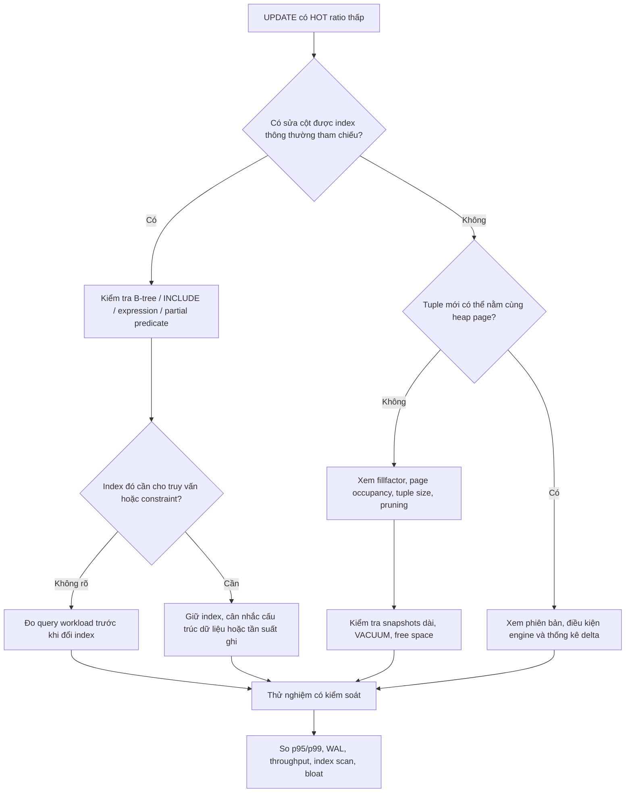

# HOT update và điều kiện giảm cập nhật chỉ mục trong PostgreSQL

Một câu `UPDATE` của PostgreSQL không chỉ thay đổi vài byte trong hàng hiện tại. Do cơ chế **Multi-Version Concurrency Control (MVCC)**, một lần cập nhật thông thường tạo **phiên bản tuple mới** trong heap, đồng thời giữ phiên bản cũ trong thời gian cần thiết để các giao dịch đang đọc vẫn thấy được dữ liệu nhất quán.

Khi bảng có nhiều index, việc tạo phiên bản hàng mới có thể kéo theo công việc bổ sung: tạo hoặc duy trì các entry trong index, ghi WAL, làm tăng dung lượng và gây thêm I/O. Nhưng PostgreSQL có một tối ưu quan trọng tên **HOT — Heap-Only Tuple update**: trong những điều kiện phù hợp, phiên bản mới của hàng được tạo ngay trên cùng một trang heap và **không cần thêm entry mới vào các index không thuộc loại summarizing**.

Lợi ích thực tế:

- Giảm công việc cập nhật index khi một hàng được sửa thường xuyên.
- Giảm số entry index chết phải dọn và chi phí bảo trì liên quan.
- Có thể giảm WAL, CPU và lượng I/O của workload cập nhật.
- Giúp nhiều vòng cập nhật cột không được index theo dõi tiết kiệm hơn.
- Kết hợp với cơ chế pruning/VACUUM để tái sử dụng chỗ trống trên heap page.

Tuy nhiên, **không phải mọi UPDATE đều HOT**. Phải xét cả cột bị thay đổi, các index và chỗ trống trên trang heap. Một bảng có index rất hợp lý cho truy vấn đọc vẫn có thể khiến HOT hiếm khi xảy ra nếu index đó tham chiếu đến cột được cập nhật liên tục.

Bài học thuộc chương **MVCC** của module *Database Engine Relational PostgreSQL*. Mục tiêu là hiểu HOT từ cơ chế đến quan sát thực tế; lựa chọn chỉ mục, `fillfactor` và chiến lược cập nhật đúng mà không đánh đổi tính đúng dữ liệu. Các lệnh tạo bảng/chỉnh cấu hình là ví dụ cho **database lab**, không chạy trực tiếp trên production.

## 1. Nhắc lại: UPDATE trong MVCC là tạo phiên bản mới

Giả sử bảng có một hàng:

```text
id = 42
status = 'NEW'
note = 'created'
```

Một transaction chạy:

```sql
UPDATE orders
SET note = 'confirmed'
WHERE id = 42;
```

Theo MVCC, PostgreSQL có thể giữ một phiên bản cũ và tạo phiên bản mới:

```text
Heap trước UPDATE
┌──────────────────────────────────────┐
│ Tuple A: id=42, status=NEW, note=... │
└──────────────────────────────────────┘

Heap sau UPDATE (mô hình logic)
┌──────────────────────────────────────┐
│ Tuple A: phiên bản cũ, đã bị update  │
├──────────────────────────────────────┤
│ Tuple B: phiên bản mới của id=42     │
└──────────────────────────────────────┘
```

Một transaction bắt đầu từ trước có thể tiếp tục nhìn phiên bản A tùy snapshot, còn một transaction mới sau khi commit có thể nhìn B. Điều đó giải thích vì sao PostgreSQL không đơn giản sửa đè ngay toàn bộ dữ liệu hàng cũ theo kiểu in-place.

### 1.1. Hai loại chi phí cần phân biệt

Một UPDATE có thể gây:

1. **Chi phí heap:** tạo tuple mới, đánh dấu/ghi thông tin phiên bản cũ, WAL, trang bẩn và việc dọn tuple khi không còn cần.
2. **Chi phí index:** nếu phải tạo pointer tới tuple mới, PostgreSQL cập nhật những cấu trúc chỉ mục liên quan, có thể tạo index tuple mới và về sau phải dọn các entry không còn hữu ích.

HOT chủ yếu tối ưu phần **index maintenance** bằng cách cho các entry index hiện có dẫn đến một chuỗi các phiên bản heap trên cùng trang.

HOT **không loại bỏ MVCC**: tuple mới vẫn được tạo, WAL vẫn có thể phát sinh, transaction vẫn có lock, và các phiên bản cũ vẫn cần được dọn khi an toàn.

## 2. HOT là viết tắt của Heap-Only Tuple

HOT là cơ chế cho phép một UPDATE tạo phiên bản tuple mới trên **cùng heap page** mà không cần entry mới tương ứng trong các index không phải summarizing.

Ví dụ:

- Cột `id` là primary key có B-tree index.
- Cột `status` nằm trong một index hỗ trợ lọc truy vấn.
- Cột `last_seen_at` **không nằm trong bất kỳ index nào và không được index expression/predicate tham chiếu**.

Nếu cập nhật duy nhất `last_seen_at` và có đủ chỗ trên heap page, PostgreSQL **có cơ hội** thực hiện HOT update.

```sql
UPDATE account
SET last_seen_at = statement_timestamp()
WHERE account_id = 42;
```

Nếu một điều kiện không thỏa, UPDATE vẫn có thể thành công, nhưng theo đường **non-HOT update**, có thêm chi phí index.

### 2.1. HOT không phải lệnh SQL tường minh

Không có dạng SQL:

```sql
-- KHÔNG TỒN TẠI:
UPDATE account HOT SET ...;
```

HOT là **quyết định nội bộ của storage engine** dựa trên schema, kiểu cập nhật và điều kiện vật lý của trang. Người viết SQL có thể tăng xác suất HOT, nhưng không có một từ khóa chuẩn để yêu cầu “bắt buộc HOT” cho từng UPDATE.

### 2.2. HOT cũng không phải cache trong RAM

Chữ HOT ở đây là tên viết tắt, **không có nghĩa** tuple luôn ở shared buffers, không có I/O, hoặc nằm ở “vùng dữ liệu nóng” theo nghĩa truy cập thường xuyên.

Một HOT update vẫn có thể cần đọc/ghi heap page, tạo WAL và chịu độ trễ disk khi dữ liệu chưa có trong cache hoặc khi checkpoint/VACUUM hoạt động.

## 3. Hai điều kiện cốt lõi để một UPDATE có thể HOT

Với các index thông thường, cần hai điều kiện lớn:

1. **Không thay đổi giá trị của những cột mà các index không phải summarizing của bảng phụ thuộc vào.** Điều này bao gồm index keys, `INCLUDE` columns, biểu thức index, và cột trong predicate của partial index.
2. **Phiên bản tuple mới phải đặt được trên cùng heap page với phiên bản cũ.** PostgreSQL cần đủ không gian có thể sử dụng trên trang đó.

Từ PostgreSQL 16, quy tắc liên quan đến **summarizing indexes**, nổi bật là BRIN, cho phép một số HOT update ngay cả khi thay đổi cột chỉ được những index dạng tóm tắt này theo dõi. Index tóm tắt có thể cần duy trì thông tin tóm tắt của nó theo cách riêng.

Hai điều kiện ở trên vẫn phải đi cùng các ràng buộc xử lý MVCC, trạng thái tuple và cơ chế lưu trữ thực tế; vì vậy ta nói **HOT có thể xảy ra**, không bảo đảm mọi UPDATE “đủ điều kiện về SQL” sẽ thành HOT.

### 3.1. Bảng quyết định nhanh

| Tình huống cập nhật | Khả năng HOT |
|---|---|
| Sửa cột không được index nào phụ thuộc, đủ chỗ cùng page | Có thể HOT |
| Sửa cột B-tree indexed thực sự thay đổi giá trị | Thông thường không HOT |
| Sửa cột `INCLUDE` trong B-tree index | Thông thường không HOT |
| Sửa cột tham gia expression index | Có thể cản HOT |
| Sửa cột tham gia predicate của partial index | Có thể cản HOT |
| Sửa cột không liên quan index nhưng page hết chỗ | Không HOT |
| Sửa cột chỉ thuộc BRIN summarizing index, PostgreSQL 16+ | Có thể HOT nếu các điều kiện khác phù hợp |
| INSERT một hàng mới | Không phải UPDATE, không áp dụng tỷ lệ HOT update |
| DELETE một hàng | Không phải HOT update |
| UPDATE không đổi giá trị nhưng vẫn tạo tuple | Có thể phát sinh công việc MVCC; cần xem điều kiện thực tế |

Điểm quyết định là **mối phụ thuộc của index đối với những cột bị thay đổi**, không đơn giản “bảng có index hay không”.

## 4. Heap page, tuple và TID: nền tảng của HOT

Heap của PostgreSQL được chia thành các trang có kích thước cố định, **thường 8 KiB** với cấu hình build mặc định. Mỗi trang có:

- Page header.
- Line pointers (item identifiers).
- Các tuple chứa dữ liệu hàng và metadata MVCC.
- Vùng chỗ trống có thể dùng cho tuple mới.
- Những thông tin cần thiết để quản lý, dọn và đọc trang.

Một vị trí tuple có thể được biểu diễn bằng **TID/CTID**, gồm số block và vị trí item trong block.

```text
Heap relation
       │
       ├── Block 100
       │     ├── Item 1: tuple của id=10
       │     ├── Item 2: tuple của id=42 (phiên bản cũ)
       │     ├── Item 3: tuple của id=42 (phiên bản mới)
       │     └── Free space
       │
       └── Block 101
             └── Các tuple khác
```

Với HOT, index pointer có thể tiếp tục hướng đến **root** của chuỗi phiên bản trên cùng page. PostgreSQL theo chuỗi HOT và kiểm tra MVCC visibility để tìm phiên bản đúng cho snapshot đang đọc.

### 4.1. CTID không phải primary key

```sql
SELECT ctid, *
FROM some_table
WHERE id = 42;
```

Đây là mẫu SQL minh họa vì bảng `some_table` chưa được tạo trong lab. `ctid` là **vị trí vật lý của phiên bản tuple hiện tại**; nó có thể thay đổi sau UPDATE, VACUUM FULL hoặc thao tác tái tổ chức dữ liệu.

Không lưu `ctid` làm ID lâu dài, không đồng bộ client theo `ctid`, không thay primary key bằng `ctid`. HOT dùng TID nội bộ để đi theo chuỗi phiên bản, nhưng contract ứng dụng vẫn nên dùng khóa logic.

## 5. HOT chain hoạt động ra sao?

Một chuỗi HOT biểu diễn các phiên bản liên tiếp của cùng hàng trên một heap page.

```text
                 B-tree index
              key: account_id=42
                       │
                       ▼
              TID gốc (block 100, item 2)
                       │
                       ▼
Heap page 100  ┌───────────────────────────┐
               │ Tuple A (phiên bản cũ)   │
               │ t_ctid → item 3         │
               ├───────────────────────────┤
               │ Tuple B (phiên bản mới)  │
               │ t_ctid → item 4         │
               ├───────────────────────────┤
               │ Tuple C (phiên bản mới)  │
               │ đang visible cho reader │
               └───────────────────────────┘

             Không cần 3 entry B-tree mới.
```

Đây là mô hình diễn giải, không mô tả mọi bit/flag trong header hoặc mọi trạng thái line pointer thực tế. PostgreSQL có các marker và quy tắc để phân biệt root, heap-only tuple, redirect và trạng thái tuple bị dọn.

### 5.1. Vì sao cùng page quan trọng?

Index entry chỉ chứa một heap TID để bắt đầu tìm. Với HOT chain, việc theo chuỗi diễn ra **bên trong một page**, cho phép PostgreSQL tránh việc phải ghi thêm các index entries cho mỗi phiên bản cập nhật.

Nếu tuple mới nằm trên **page khác**, chỉ dựa vào chain trên page cũ sẽ không đáp ứng mô hình HOT. Khi đó UPDATE cần đường non-HOT với index maintenance phù hợp.

### 5.2. Một index entry có thể dẫn tới nhiều phiên bản theo thời gian

Một entry không có nghĩa chỉ một tuple version tồn tại. Khi snapshot cần xem phiên bản cũ, engine lần theo chain/visibility để tìm version tương ứng.

Khi các phiên bản cũ không còn visible với bất kỳ snapshot cần thiết nào, PostgreSQL có thể **prune** chain và tái sử dụng chỗ trống trên trang.

### 5.3. HOT chain không nên dài vô hạn

Một workload cập nhật liên tục không được bảo đảm chỉ dùng mãi một tuple root và không tăng chi phí. Pruning, tình trạng snapshot mở, kích thước tuple, mức đầy page và nhịp dọn dẹp quyết định chain có thể được rút gọn như thế nào.

Nếu không prune được các phiên bản cũ do transaction đọc dài, trang có thể hết chỗ và những UPDATE kế tiếp mất khả năng HOT.

## 6. HOT khác non-HOT UPDATE

So sánh khi UPDATE cột không index và khi UPDATE cột indexed:

```text
                     UPDATE hàng id=42
                            │
                 ┌──────────┴──────────┐
                 │                     │
        Điều kiện HOT đủ          Điều kiện HOT thiếu
                 │                     │
                 ▼                     ▼
       Phiên bản mới cùng       Phiên bản mới có thể
          heap page             ở cùng/khác page
                 │                     │
                 ▼                     ▼
       Index cũ dùng root       Cần index entry mới
          HOT chain              theo cách non-HOT
                 │                     │
                 └──────────┬──────────┘
                            │
                            ▼
                      MVCC, WAL,
                  VACUUM vẫn cần
```

Trong non-HOT UPDATE, PostgreSQL thường phải tạo các index entries cho phiên bản mới ở **tất cả các index thường liên quan tới việc tìm tuple**, không chỉ index của cột đã thay đổi. Đây là lý do một index nhỏ trên cột thay đổi thường xuyên có thể làm chi phí UPDATE tăng đáng kể trên bảng có nhiều index.

### 6.1. Tại sao phải cập nhật cả index trên cột không đổi?

Nếu một UPDATE không HOT tạo tuple mới mà index pointer cũ chỉ tới phiên bản cũ, các index queries cần khả năng tìm phiên bản mới. Vì vậy hệ thống phải tạo đường truy cập index phù hợp cho tuple mới.

HOT tránh nhu cầu đó bằng cách bảo đảm tất cả các phiên bản cùng page có thể được tìm qua root chain khi index keys không thay đổi theo những điều kiện hỗ trợ.

### 6.2. Không đồng nghĩa “HOT không ghi WAL”

Cả HOT và non-HOT đều có thay đổi heap, và PostgreSQL cần bảo đảm crash recovery theo các quy tắc WAL. HOT chỉ **giảm một loại công việc**, không loại bỏ durability overhead.

## 7. Vì sao thêm một index có thể làm UPDATE chậm hơn?

Giả sử bảng `session_state` có:

- `session_id`: khóa chính.
- `user_id`: dùng để tìm session của người dùng.
- `last_seen_at`: thay đổi vài giây một lần.

Khi chỉ có index trên `session_id` và `user_id`, cập nhật `last_seen_at` **có thể HOT**, nếu page còn đủ không gian.

Nếu tạo:

```sql
CREATE INDEX idx_session_last_seen_at
ON session_state (last_seen_at);
```

thì mỗi lần `last_seen_at` thay đổi, nó trở thành **cột được index tham chiếu**. Với B-tree index thông thường, UPDATE đó không còn đáp ứng điều kiện HOT.

Hậu quả có thể lớn nếu một bảng có hàng triệu session và nhiều heartbeat updates mỗi phút. Mỗi UPDATE tạo thêm công việc index dù mục đích chỉ cập nhật timestamp.

### 7.1. Index không xấu; index cần có lý do

Index trên `last_seen_at` có thể rất cần thiết cho:

- Tìm session hết hạn.
- Quét theo khoảng thời gian.
- Xử lý TTL/cleanup batch.
- Báo cáo hoạt động gần đây.

Quyết định đúng không phải “xóa mọi index trên cột thường thay đổi”, mà là đo:

- Truy vấn nào cần index này?
- Số lần đọc so với số lần UPDATE?
- Có thể dùng index khác hoặc thay cấu trúc cleanup không?
- Có thể chia bảng ghi heartbeat riêng không?
- Nếu phù hợp, summarizing index như BRIN có giúp đạt trade-off tốt hơn không?

**Mọi tối ưu HOT đều phải giữ đúng ngữ nghĩa và latency của truy vấn đọc.**

## 8. Thực hành: tạo schema cho HOT

Các ví dụ sử dụng PostgreSQL hiện đại trong database lab. Lệnh DDL có thể tạo bảng thật; chỉ chạy ở môi trường được phép.

```sql
CREATE SCHEMA IF NOT EXISTS demo_hot;

CREATE TABLE demo_hot.hot_candidate (
    state_id BIGINT GENERATED ALWAYS AS IDENTITY PRIMARY KEY,
    business_key TEXT NOT NULL UNIQUE,
    state_code TEXT NOT NULL,
    note TEXT NOT NULL,
    last_seen_at TIMESTAMPTZ NOT NULL DEFAULT statement_timestamp()
) WITH (fillfactor = 70);

CREATE TABLE demo_hot.dense_candidate (
    state_id BIGINT GENERATED ALWAYS AS IDENTITY PRIMARY KEY,
    business_key TEXT NOT NULL UNIQUE,
    state_code TEXT NOT NULL,
    note TEXT NOT NULL,
    last_seen_at TIMESTAMPTZ NOT NULL DEFAULT statement_timestamp()
) WITH (fillfactor = 100);
```

Hai bảng có schema logic tương tự nhưng khác `fillfactor`:

- `hot_candidate`: để dành phần chỗ trống trên page khi chèn dữ liệu mới.
- `dense_candidate`: cho phép các page mới được lấp đầy hơn.

Cả hai đều có index trên `state_id` và `business_key` do constraint, nhưng không có index trên `note` hay `last_seen_at`.

### 8.1. Chèn dữ liệu nguồn

```sql
INSERT INTO demo_hot.hot_candidate
    (business_key, state_code, note)
SELECT
    'BUS-' || lpad(g::text, 6, '0'),
    CASE WHEN g % 3 = 0 THEN 'ACTIVE' ELSE 'IDLE' END,
    repeat('a', 100)
FROM generate_series(1, 20000) AS g;

INSERT INTO demo_hot.dense_candidate
    (business_key, state_code, note)
SELECT
    'BUS-' || lpad(g::text, 6, '0'),
    CASE WHEN g % 3 = 0 THEN 'ACTIVE' ELSE 'IDLE' END,
    repeat('a', 100)
FROM generate_series(1, 20000) AS g;

ANALYZE demo_hot.hot_candidate;
ANALYZE demo_hot.dense_candidate;
```

Với schema lab sạch, hai bảng có cùng 20.000 business keys. Đừng chạy lại khối INSERT khi dữ liệu đã có vì constraint UNIQUE sẽ báo trùng.

### 8.2. Vì sao dùng hai bảng thay vì ALTER một bảng?

`fillfactor` quyết định cách **phân bổ chỗ trống khi tạo/đưa các tuple vào trang**. Thay tham số trên một bảng đã đầy không tự viết lại mọi page hiện có để lấy ngay 30% free space.

Hai bảng được tạo với fillfactor khác nhau từ đầu giúp thể hiện ý tưởng rõ hơn. Dù vậy, các phép đo sẽ còn chịu ảnh hưởng tuple size, page occupancy, MVCC snapshots, cache và workload; không bảo đảm tỉ lệ HOT đúng một con số cố định.

## 9. Đo HOT bằng pg_stat_user_tables

PostgreSQL cung cấp những bộ đếm thống kê cho mỗi bảng:

- `n_tup_upd`: số hàng được UPDATE theo thống kê tích lũy.
- `n_tup_hot_upd`: số UPDATE được thực hiện theo đường HOT.
- `n_tup_newpage_upd`: trên PostgreSQL 16+, số UPDATE tạo phiên bản mới trên page khác với phiên bản cũ.
- `n_dead_tup`: **ước lượng** số dead tuples, không phải bộ đếm chính xác tức thời.
- `n_live_tup`: **ước lượng** số live tuples.

### 9.1. Truy vấn tỷ lệ HOT

```sql
SELECT
    schemaname,
    relname,
    n_tup_upd,
    n_tup_hot_upd,
    CASE
        WHEN n_tup_upd = 0 THEN NULL
        ELSE round(100.0 * n_tup_hot_upd / n_tup_upd, 2)
    END AS hot_update_percent,
    n_live_tup,
    n_dead_tup
FROM pg_stat_user_tables
WHERE schemaname = 'demo_hot'
ORDER BY relname;
```

Ý nghĩa:

\[
\text{HOT ratio} =
\frac{\text{n\_tup\_hot\_upd}}{\text{n\_tup\_upd}} \times 100\%
\]

Tỷ lệ này là **lũy kế từ thời điểm các statistics counters được reset**, không nhất thiết mô tả chỉ một lần thử UPDATE vừa thực hiện.

### 9.2. Phiên bản mới và n_tup_newpage_upd

Nếu server là PostgreSQL 16 hoặc mới hơn:

```sql
SELECT
    relname,
    n_tup_upd,
    n_tup_hot_upd,
    n_tup_newpage_upd
FROM pg_stat_user_tables
WHERE schemaname = 'demo_hot'
ORDER BY relname;
```

Không chạy query thứ hai trên phiên bản không có `n_tup_newpage_upd`. Kiểm tra:

```sql
SHOW server_version;
```

`n_tup_newpage_upd` giúp nhận diện các UPDATE phải chuyển sang page khác, nhưng **không phải mọi non-HOT UPDATE đều thuộc nhóm newpage**: một UPDATE có thể non-HOT ngay cả khi tuple mới ở cùng trang nếu một cột được index thông thường thay đổi.

### 9.3. Lưu ý về độ trễ thống kê

Bộ đếm trong `pg_stat_user_tables` không nhất thiết thay đổi ngay khi bạn chạy câu UPDATE và SELECT stats trong **cùng transaction**. Thống kê được ghi nhận/flush theo quy tắc session và bộ nhớ đệm thống kê.

Để quan sát dễ hơn trong lab:

1. Chụp số liệu trước.
2. Thực hiện UPDATE trong một transaction và `COMMIT`.
3. Dùng session quan sát khác hoặc đọc lại sau khi stats được cập nhật.
4. Nếu session đang giữ một statistics snapshot, dùng `pg_stat_clear_snapshot()` ở ngữ cảnh phù hợp.
5. So sánh **delta**, không chỉ tỷ lệ tích lũy.

Không reset toàn bộ statistics của production chỉ để đo một bài thực hành.

## 10. Thử cập nhật cột không được index

Trên bảng `hot_candidate`:

```sql
UPDATE demo_hot.hot_candidate
SET note = note || 'x',
    last_seen_at = statement_timestamp()
WHERE state_id BETWEEN 1 AND 2000;
```

Cả `note` và `last_seen_at` đều không được các index hiện có tham chiếu. Đây là **ứng viên HOT** khi đủ chỗ trên page.

Trên bảng `dense_candidate`:

```sql
UPDATE demo_hot.dense_candidate
SET note = note || 'x',
    last_seen_at = statement_timestamp()
WHERE state_id BETWEEN 1 AND 2000;
```

Hai UPDATE tương tự về logic. Sự khác nhau về HOT ratio, nếu có, giúp thấy ảnh hưởng của page free space.

### 10.1. Quan sát sau COMMIT

```sql
SELECT
    relname,
    n_tup_upd,
    n_tup_hot_upd,
    round(
        100.0 * n_tup_hot_upd / NULLIF(n_tup_upd, 0), 2
    ) AS hot_pct
FROM pg_stat_user_tables
WHERE schemaname = 'demo_hot'
  AND relname IN ('hot_candidate', 'dense_candidate')
ORDER BY relname;
```

Nếu `hot_candidate` có HOT ratio tốt hơn, đó là kết quả phù hợp kỳ vọng thiết kế. Nhưng nếu hai tỷ lệ gần nhau hoặc khác nhiều giữa các lần chạy, không tự kết luận PostgreSQL lỗi: page occupancy, số update, kích thước tuple và các phiên bản cũ cùng ảnh hưởng.

### 10.2. Cập nhật lặp có thể làm mất chỗ trống

Thử nhiều vòng UPDATE cùng những hàng có thể tạo nhiều version mới:

```sql
UPDATE demo_hot.hot_candidate
SET note = note || 'y'
WHERE state_id BETWEEN 1 AND 2000;
```

Tùy cơ chế prune và snapshot đang mở, không gian trên page có thể được tái sử dụng hoặc bị giữ bởi những tuple versions còn cần thiết. **Không bảo đảm lần đầu HOT thì lần thứ 100 cũng HOT**.

## 11. Thêm index vào cột thường xuyên thay đổi

Giờ xem trường hợp có một index thường trên `last_seen_at`:

```sql
CREATE INDEX idx_demo_hot_last_seen
ON demo_hot.hot_candidate (last_seen_at);

ANALYZE demo_hot.hot_candidate;
```

Cập nhật timestamp:

```sql
UPDATE demo_hot.hot_candidate
SET last_seen_at = statement_timestamp()
WHERE state_id BETWEEN 3001 AND 5000;
```

Vì `last_seen_at` được B-tree index theo dõi và giá trị thường thay đổi, UPDATE này **không còn đáp ứng điều kiện HOT thông thường**. Nếu các hàng nhận đúng cùng timestamp như giá trị cũ trong trường hợp rất đặc biệt, điều kiện “có thay đổi giá trị indexed attribute hay không” cần được xét theo engine thực tế.

### 11.1. Tác động ngoài index mới

Khi không HOT, PostgreSQL có thể cần index tuples cho cả index của `state_id` và `business_key` dù hai khóa ấy không đổi. Đây là **chi phí khuếch đại do thêm index trên cột cập nhật nhiều**.

### 11.2. So sánh thống kê bằng delta

Trước và sau lần UPDATE, lấy:

```sql
SELECT relname, n_tup_upd, n_tup_hot_upd
FROM pg_stat_user_tables
WHERE schemaname = 'demo_hot'
  AND relname = 'hot_candidate';
```

So số tăng của hai bộ đếm qua lần chạy. Nếu `n_tup_upd` tăng khoảng 2.000 mà `n_tup_hot_upd` tăng ít hơn nhiều, đó là tín hiệu các UPDATE vừa rồi không được HOT tương ứng.

**Không nhìn tỷ lệ HOT lũy kế sau khi thêm index rồi nói “index chẳng ảnh hưởng”**: bộ đếm có thể đã chứa 2.000 HOT update của lần thử trước.

## 12. Khóa chính không đổi vẫn có HOT được

Một hiểu nhầm phổ biến:

> “Bảng có PRIMARY KEY B-tree nên mọi UPDATE phải cập nhật index PK.”

Không đúng.

Nếu chỉ thay đổi những cột **không được index nào phụ thuộc**, và tuple mới nằm cùng page, một HOT update **không yêu cầu tạo entry PK mới**. Index PK cũ vẫn giúp tìm root của chain.

Ví dụ:

```sql
UPDATE demo_hot.dense_candidate
SET note = 'acknowledged'
WHERE state_id = 123;
```

Cột `state_id` indexed được **dùng trong WHERE để tìm hàng**, nhưng bản thân nó **không bị thay đổi** bởi UPDATE. Điều kiện HOT không hỏi “WHERE có dùng index hay không”; nó hỏi “có indexed attribute nào thực sự thay đổi và có đủ chỗ trên cùng page không?”.

### 12.1. WHERE sử dụng index không ngăn HOT

```sql
UPDATE demo_hot.dense_candidate
SET note = note || 'z'
WHERE business_key = 'BUS-000123';
```

`business_key` là unique index key trong điều kiện tìm kiếm. Nhưng ta chỉ sửa `note`, nên vẫn có cơ hội HOT nếu page còn chỗ.

### 12.2. Không thể suy luận HOT từ EXPLAIN Index Scan

`EXPLAIN` có thể cho biết UPDATE tìm những hàng nào bằng Index Scan, nhưng **không có quy tắc “UPDATE dùng Index Scan thì phải non-HOT”**. Hai vấn đề là hai bước khác nhau:

1. Đường tìm hàng đích.
2. Cách lưu phiên bản tuple mới và duy trì index.

## 13. INCLUDE columns cũng có thể cản HOT

PostgreSQL hỗ trợ `INCLUDE` columns ở một số index, đặc biệt B-tree, để mang thêm dữ liệu cho các truy vấn.

```sql
CREATE INDEX idx_customer_include_note
ON demo_hot.dense_candidate (business_key)
INCLUDE (note);
```

Cột `note` không phải key dùng để sắp thứ tự B-tree, nhưng **được lưu trong index tuple**. Do đó, khi `note` thay đổi, index cần phản ánh giá trị mới và nó có thể **ngăn HOT** tương tự các indexed columns khác.

### 13.1. INCLUDE không miễn phí khi ghi

Một covering index:

```sql
CREATE INDEX idx_orders_customer
ON some_orders (customer_id)
INCLUDE (status, updated_at);
```

có thể giảm heap fetch cho các truy vấn đọc trong một số điều kiện visibility. Nhưng nếu `updated_at` đổi ở mọi UPDATE, index ấy có thể phá khả năng HOT của workload.

Đây là mẫu minh họa, bảng `some_orders` không thuộc lab. Khi thiết kế index INCLUDE trên dữ liệu thật, hãy đo tần suất cập nhật của cả các cột **include**, không chỉ các cột key.

### 13.2. Covering index và HOT có trade-off

- Đọc: index INCLUDE có thể giúp index-only scan khi page đủ all-visible.
- Ghi: cập nhật INCLUDE field có thể gây non-HOT.
- MVCC: UPDATE còn có thể xóa cờ all-visible của page, làm index-only scan phải kiểm tra heap nhiều hơn.

Vì vậy, một index tối ưu cho SELECT trên bảng ít thay đổi có thể trở thành điểm nghẽn trên bảng cập nhật liên tục.

## 14. Expression index: cột nguồn cũng quan trọng

Xét index trên biểu thức:

```sql
CREATE TABLE demo_hot.account (
    account_id BIGINT GENERATED ALWAYS AS IDENTITY PRIMARY KEY,
    email TEXT NOT NULL,
    profile_note TEXT NOT NULL DEFAULT '',
    is_active BOOLEAN NOT NULL DEFAULT TRUE
) WITH (fillfactor = 75);

CREATE UNIQUE INDEX uq_demo_hot_account_lower_email
ON demo_hot.account (lower(email));
```

Nếu cập nhật:

```sql
UPDATE demo_hot.account
SET profile_note = 'changed'
WHERE account_id = 1;
```

khi có hàng phù hợp và page còn chỗ, UPDATE có thể HOT vì `profile_note` không liên quan index.

Nhưng nếu cập nhật `email`:

```sql
UPDATE demo_hot.account
SET email = 'new@example.test'
WHERE account_id = 1;
```

`lower(email)` phụ thuộc cột `email`. Thay đổi cột nguồn ấy có thể làm HOT không được áp dụng với expression index.

### 14.1. Biểu thức tính ra cùng kết quả thì sao?

Giả sử chỉ đổi `Alice@example.test` thành `alice@example.test`, và expression `lower(email)` vẫn cho cùng kết quả. Đừng suy luận từ đó rằng HOT chắc chắn xảy ra.

PostgreSQL xét các thuộc tính được index/expression/predicate tham chiếu theo logic hỗ trợ HOT; không nên dựa vào việc người viết SQL đoán **kết quả biểu thức có vẻ không đổi** để bảo đảm không cần index maintenance.

**Hướng thực hành:** nếu cột nguồn của expression index cập nhật thường xuyên, xem đây là một rủi ro HOT và đo thực tế.

### 14.2. Generated columns cũng cần xem dependency

Nếu một generated column được index, UPDATE những cột mà generated expression phụ thuộc có thể làm giá trị generated column thay đổi. Cần xét toàn bộ schema, không chỉ những cột xuất hiện trực tiếp trong SQL `CREATE INDEX` ở bước đầu.

## 15. Partial index: cột trong predicate cũng liên quan

Ví dụ chỉ index các account đang active:

```sql
CREATE INDEX idx_demo_hot_active_email
ON demo_hot.account (email)
WHERE is_active;
```

Khi thay `is_active` từ TRUE sang FALSE, hàng có thể **ra khỏi tập index**. Khi thay FALSE sang TRUE, nó có thể **vào tập index**.

```sql
UPDATE demo_hot.account
SET is_active = FALSE
WHERE account_id = 1;
```

Cột `is_active` là **predicate column**, nên việc cập nhật có thể ngăn HOT ngay cả khi nó không nằm trong danh sách key `(email)` của index.

### 15.1. Predicate vẫn đáng kể ngay cả khi hàng không đổi membership?

Không nên viết một quy tắc nghiệp vụ kiểu “vì hàng vẫn active cả trước và sau, chắc chắn HOT”. PostgreSQL có các điều kiện kiểm tra thuộc tính được index tham chiếu; khả năng HOT không nên được suy đoán chỉ từ việc một predicate đọc thành TRUE sau UPDATE.

### 15.2. Partial index vẫn có lợi nếu lọc đúng workload

Một partial index có thể rất hiệu quả cho truy vấn thường xuyên theo tập nhỏ:

```sql
SELECT account_id, email
FROM demo_hot.account
WHERE is_active
  AND email = 'lan@example.test';
```

Nhưng nếu trạng thái active thay đổi liên tục, chi phí ghi cũng phải được đưa vào quyết định. Không bỏ partial index chỉ vì có thể cản HOT; cần so chi phí read/write tổng thể.

## 16. BRIN và ngoại lệ summarizing indexes

**BRIN — Block Range Index** lưu thông tin tóm tắt trên các vùng block, thay vì giữ một index tuple cho từng hàng như B-tree.

Từ **PostgreSQL 16**, HOT có thể vẫn xảy ra khi cập nhật cột chỉ được index bằng **summarizing index** như BRIN, nếu các điều kiện khác phù hợp. Đây là cải tiến quan trọng khi một cột thường xuyên thay đổi nhưng vẫn cần khả năng hỗ trợ quét theo vùng block.

Ví dụ với một bảng riêng:

```sql
CREATE TABLE demo_hot.sensor_state (
    sensor_id BIGINT GENERATED ALWAYS AS IDENTITY PRIMARY KEY,
    last_seen_at TIMESTAMPTZ NOT NULL,
    payload TEXT NOT NULL
) WITH (fillfactor = 75);

CREATE INDEX idx_sensor_last_seen_brin
ON demo_hot.sensor_state
USING brin (last_seen_at);
```

Nếu chỉ sửa `last_seen_at`:

```sql
UPDATE demo_hot.sensor_state
SET last_seen_at = statement_timestamp()
WHERE sensor_id = 1;
```

Trên phiên bản hỗ trợ và nếu điều kiện cùng heap page thỏa, cột tham gia BRIN không nhất thiết phá HOT theo quy tắc B-tree thông thường.

### 16.1. BRIN không phải B-tree giá rẻ cho mọi query

BRIN đặc biệt hữu ích khi giá trị cột có **tương quan vật lý** tốt với vị trí page, ví dụ dữ liệu sự kiện chủ yếu được append theo thời gian. Với cột `last_seen_at` thay đổi liên tục ở những hàng nằm rải rác, tương quan vật lý có thể kém, dẫn tới nhiều page ranges phải kiểm tra.

Vì vậy:

- Có thể được lợi về chi phí ghi/HOT.
- Nhưng query theo timestamp có thể phải đọc nhiều heap pages.
- BRIN có thể cần cập nhật thông tin tóm tắt phù hợp.
- Cần benchmark trên phân phối dữ liệu thật.

**Đừng đổi một B-tree cần cho truy vấn chính sang BRIN chỉ vì muốn tăng HOT ratio.**

### 16.2. Theo dõi phiên bản

Các kết luận BRIN summarizing ở đây hướng tới PostgreSQL 16+. Trên phiên bản cũ hơn, không giả định cùng ngoại lệ. Kiểm tra:

```sql
SHOW server_version;
```

Với những index methods/extensions khác, đừng tự gán chúng là summarizing index chỉ vì cấu trúc của chúng nhỏ. Cần xác nhận kiểu index và khả năng HOT trên phiên bản đang vận hành.

## 17. fillfactor: chủ động chừa khoảng trống trong heap page

`fillfactor` của bảng là tham số lưu trữ quyết định mức lấp đầy mục tiêu khi PostgreSQL đặt dữ liệu vào trang trong những hoạt động phù hợp.

Ví dụ:

```sql
CREATE TABLE demo_hot.profile_state (
    profile_id BIGINT GENERATED ALWAYS AS IDENTITY PRIMARY KEY,
    memo TEXT NOT NULL
) WITH (fillfactor = 70);
```

Giá trị 70 nhằm để lại khoảng trống trên các page mới, giúp những lần UPDATE sau có cơ hội tạo tuple mới cùng page.

### 17.1. Trade-off cơ bản

| fillfactor thấp hơn | fillfactor cao hơn |
|---|---|
| Chừa nhiều khoảng trống hơn trên heap page | Lưu dữ liệu ban đầu dày hơn |
| Có thể tăng tỷ lệ HOT cho workload cập nhật | Có thể giảm footprint với bảng chủ yếu đọc |
| Bảng ban đầu chiếm nhiều page hơn | Bảng ban đầu có thể ít page hơn |
| Có thể tăng I/O cho các scan toàn bảng vì nhiều page | Có thể cần nhiều non-HOT khi cập nhật tăng |
| Thích hợp khi update nhiều cột không index | Thích hợp hơn với bảng tương đối tĩnh, tùy workload |

Không có `fillfactor=70` là chuẩn tối ưu cho mọi bảng. Có hệ thống phù hợp 80/90, có hệ thống không cần giảm so mặc định, và có bảng bị cập nhật indexed columns nên giảm fillfactor cũng không tăng HOT như mong muốn.

### 17.2. ALTER fillfactor không viết lại dữ liệu cũ ngay

```sql
ALTER TABLE demo_hot.hot_candidate
SET (fillfactor = 80);
```

Lệnh này thay đổi storage parameter cho những hoạt động sau; **không tự sắp xếp lại mọi tuple đang có để bảo đảm mỗi page hiện tại chừa 20% trống**.

Nếu bảng đã đầy, cần đánh giá phương án reorganize/rewrite phù hợp (và tác động khóa, WAL, dung lượng). Đừng tự chạy `VACUUM FULL` trên production chỉ để tạo khoảng trống mà không có kế hoạch downtime và dung lượng.

### 17.3. Chỗ trống thực tế còn phụ thuộc tuple size

Một UPDATE thêm 2 byte vào `note` có nhu cầu chỗ trống khác UPDATE làm một trường text tăng từ 100 byte lên nhiều KiB. Nếu tuple mới không vừa page cũ, HOT không thể xảy ra, dù cột ấy không được index.

Ngược lại, một UPDATE không tăng payload length vẫn có thể tạo tuple version mới và cần đủ không gian cho phiên bản mới. **Đừng đoán HOT chỉ từ số byte tăng thêm**.

## 18. TOAST và HOT có quan hệ thế nào?

PostgreSQL có cơ chế **TOAST** cho những giá trị lớn, ví dụ text/JSONB/bytea vượt ngưỡng phù hợp. Giá trị lớn có thể được nén và/hoặc lưu out-of-line trong TOAST relation, còn heap tuple chính giữ thông tin tham chiếu phù hợp.

Điều đó ảnh hưởng đến kích thước tuple chính và lượng chỗ trống cần cho UPDATE.

### 18.1. UPDATE cột JSONB lớn có thể HOT không?

Có thể, **nếu**:

- Những cột thay đổi không ảnh hưởng index thường.
- Heap tuple mới phù hợp với việc lưu trên cùng page.
- Các điều kiện storage/MVCC khác thỏa.

Nhưng một UPDATE JSONB có thể tạo giá trị TOAST mới, WAL và I/O đáng kể dù HOT. Vì vậy **HOT ratio cao không tự chứng minh cập nhật JSONB rẻ**.

### 18.2. Index GIN trên JSONB có thể làm thay đổi bài toán

```sql
CREATE INDEX idx_documents_payload
ON documents USING gin (payload);
```

Đây là ví dụ khái niệm, không có bảng `documents` trong lab. Nếu `payload` bị cập nhật thường xuyên, index GIN trên payload có thể cản HOT vì cột đó là một indexed attribute và còn có chi phí bảo trì index riêng.

Không nên đưa toàn bộ JSONB vào GIN chỉ để hỗ trợ một truy vấn hiếm, nếu workload chính là ghi liên tục và query có thể dùng index expression nhỏ hơn. Nhưng mọi thay đổi index phải được đo trên truy vấn thật.

## 19. HOT và VACUUM/pruning: phần dọn sau cập nhật

HOT không làm các tuple versions cũ biến mất ngay lập tức. Chúng vẫn tồn tại cho đến khi không còn snapshot/transaction cần nhìn.

PostgreSQL có hai cơ chế cần phân biệt:

- **Heap page pruning:** có thể được thực hiện opportunistically khi page được truy cập và các điều kiện phù hợp, rút ngắn chain và tái sử dụng chỗ trống an toàn.
- **VACUUM/autovacuum:** duy trì việc dọn dead tuples và index, cập nhật visibility/free-space information theo quy tắc hệ thống.

### 19.1. Chuỗi HOT có thể được prune

```text
Ban đầu:
  Root → A → B → C
         cũ  cũ  mới

Khi không reader nào còn cần A/B:
  Root redirect → C
  Chỗ A/B có thể được tái sử dụng
```

Sơ đồ đơn giản hóa; trạng thái root line pointer và cơ chế dọn thực tế có nhiều chi tiết hơn. Ý nghĩa là **không cần giữ mọi phiên bản cũ mãi**, và việc dọn có thể hỗ trợ HOT updates tương lai.

### 19.2. HOT không thay thế VACUUM

Một bảng có HOT ratio cao vẫn có thể cần autovacuum để xử lý dead tuples, cập nhật visibility map, ngăn transaction ID wraparound và duy trì hiệu năng.

Không tắt autovacuum vì thấy HOT đã giảm index churn. Đó là hai cơ chế bổ sung nhau.

### 19.3. VACUUM không phải một nút “ép HOT”

```sql
VACUUM (ANALYZE) demo_hot.hot_candidate;
```

Trên lab, VACUUM có thể dọn các phiên bản không còn cần và cập nhật thống kê. Nhưng:

- Nó không biến một UPDATE đã xảy ra non-HOT thành HOT.
- Không biến index trên cột vừa đổi thành “không liên quan”.
- Không bảo đảm page đã đầy được tái bố trí theo fillfactor mới.
- Có thể không dọn được tuple còn được snapshot cũ cần đến.

Không coi `VACUUM FULL` và `VACUUM` là tương đương: `VACUUM FULL` rewrite table và có tác động khóa/dung lượng khác hẳn.

## 20. Snapshot dài có thể làm giảm tỷ lệ HOT

Giả sử:

1. Transaction A bắt đầu `REPEATABLE READ` và đọc bảng.
2. A giữ snapshot mở rất lâu.
3. Transaction B liên tục UPDATE các hàng trên bảng.
4. Những version cũ có thể chưa thể prune vì A vẫn cần snapshot đó.
5. Page dần thiếu chỗ để đặt version mới cùng trang.

Khi điều kiện page-local không còn thỏa, HOT ratio của B có thể giảm dù `UPDATE` vẫn chỉ chạm cột không indexed.

### 20.1. Ví dụ tạo transaction đọc lâu trong lab

Session A:

```sql
BEGIN TRANSACTION
    ISOLATION LEVEL REPEATABLE READ,
    READ ONLY;

SELECT COUNT(*) FROM demo_hot.hot_candidate;

-- Giữ transaction mở trong lab, không thực hành trên production.
```

Session B:

```sql
UPDATE demo_hot.hot_candidate
SET note = note || 'a'
WHERE state_id BETWEEN 1 AND 500;
```

Lặp lại ở các transaction B có thể tạo nhiều version. Đến cuối thử nghiệm, Session A:

```sql
COMMIT;
```

Đây chỉ là mô hình để hiểu tác động của snapshot; số UPDATE cần để thấy HOT giảm không cố định và còn phụ thuộc pruning, free space, tuple size.

### 20.2. Giám sát transaction già

```sql
SELECT
    pid,
    application_name,
    state,
    xact_start,
    now() - xact_start AS transaction_age,
    backend_xmin,
    left(query, 150) AS query_excerpt
FROM pg_stat_activity
WHERE datname = current_database()
ORDER BY xact_start NULLS LAST;
```

Một transaction ở `idle in transaction` trong thời gian dài có thể giữ snapshot hoặc lock và cản cleanup. Cần đánh giá quan hệ với replication slots, standby feedback và các yếu tố xmin khác, chứ không quy mọi bloat cho một reader.

## 21. HOT và visibility map: tác động tới Index Only Scan

**Index-only scan** không có nghĩa PostgreSQL luôn bỏ qua heap. Nó cần xác định tuple visibility; nếu heap page được đánh dấu **all-visible** trong visibility map, engine có thể tránh một số heap visits.

Khi UPDATE một hàng, page liên quan thường mất trạng thái all-visible tương ứng vì có phiên bản mới/chưa xác nhận visibility cho mọi transaction.

Vì vậy, một workload UPDATE nhiều có thể làm giảm hiệu quả index-only scan, **ngay cả khi phần lớn UPDATE là HOT**.

### 21.1. Hai tối ưu khác nhau

| HOT UPDATE | Index Only Scan |
|---|---|
| Tối ưu đường ghi của UPDATE | Tối ưu đường đọc của SELECT |
| Giảm nhu cầu tạo index entry mới | Giảm nhu cầu đọc heap khi có đủ thông tin từ index và visibility map |
| Cần page-local tuple và index dependencies phù hợp | Cần index chứa dữ liệu trả về và page all-visible phù hợp |
| Không loại bỏ heap tuple mới | Không bảo đảm 0 heap fetch |
| Liên quan `n_tup_hot_upd` | Liên quan `Heap Fetches` trong EXPLAIN |

Một index INCLUDE có thể giúp index-only scan của SELECT nhưng **cản HOT** nếu một include column thay đổi thường xuyên. Đây là trade-off quan trọng giữa read-heavy và update-heavy workloads.

### 21.2. Kiểm tra plan

```sql
EXPLAIN (ANALYZE, BUFFERS)
SELECT business_key
FROM demo_hot.hot_candidate
WHERE business_key BETWEEN 'BUS-000100' AND 'BUS-000200';
```

Nếu plan có `Index Only Scan`, xem thêm `Heap Fetches`. Không kỳ vọng giá trị luôn 0 chỉ vì SELECT chỉ cần cột index.

Cần hiểu `EXPLAIN ANALYZE` chạy query, nên đối với DML nó có side effect; ở đây chỉ sử dụng với SELECT lab.

## 22. HOT có giúp giảm index bloat không?

Có thể. Bởi một HOT update tránh tạo nhiều entry index mới, nó có thể giảm tốc độ tích tụ các entry không còn hữu ích so với cập nhật non-HOT có cùng tần suất.

Tuy nhiên:

- Index bloat còn do DELETE, UPDATE indexed fields, page splits, workload và VACUUM.
- HOT không khiến index hiện tại tự co nhỏ về kích thước tối thiểu.
- Heap vẫn có phiên bản cũ cần dọn.
- Không thể khẳng định index “không bao giờ bloat” nếu HOT ratio cao.

Cần phân biệt **giảm tốc độ tạo thêm rác index** với **rebuild index đã bloat**. `REINDEX` và các công cụ/chiến lược bảo trì có mục đích khác, tác động tài nguyên lớn hơn.

## 23. Cập nhật cột bằng chính giá trị cũ có cần thiết không?

Một câu:

```sql
UPDATE demo_hot.hot_candidate
SET state_code = state_code
WHERE state_id = 100;
```

về mặt giá trị có thể không thay đổi dữ liệu ứng dụng, nhưng PostgreSQL vẫn có thể thực hiện một UPDATE MVCC, tạo tuple version mới và kích hoạt trigger theo các quy tắc phù hợp.

**Không dùng HOT như lý do chấp nhận mọi no-op UPDATE.** Tốt hơn, tránh tạo UPDATE khi không có sự thay đổi nghiệp vụ:

```sql
UPDATE demo_hot.hot_candidate
SET note = 'processed'
WHERE state_id = 100
  AND note IS DISTINCT FROM 'processed';
```

`IS DISTINCT FROM` xử lý cả NULL một cách xác định; trong lab `note` NOT NULL nhưng kỹ thuật hữu ích với cột nullable.

### 23.1. No-op updates và ORMs

Một ORM có thể phát UPDATE cho mọi field trên entity dù một số field không thay đổi. Kết quả:

- Có thêm MVCC tuple.
- Có thể phát sinh WAL/locks/triggers.
- Nếu included indexed field bị đưa vào SET nhưng giá trị giữ nguyên, điều kiện HOT cần được đánh giá theo engine, không thể kết luận từ câu SQL text đơn giản.

Ưu tiên **dirty checking đúng**, SQL UPDATE có điều kiện và mô hình ghi phù hợp, rồi đo hiệu quả.

## 24. Cập nhật timestamp mọi lần có thể phá HOT

Một pattern rất phổ biến:

```sql
UPDATE account
SET profile = ?,
    updated_at = now()
WHERE id = ?;
```

Nếu `updated_at` được index bằng B-tree, mỗi lần UPDATE thông thường khiến timestamp thay đổi. Kể cả `profile` không indexed, HOT có thể bị chặn do `updated_at`.

### 24.1. Hỏi đúng về index updated_at

Index đó có dùng cho:

- Dọn bản ghi quá hạn?
- Đồng bộ incremental theo timestamp?
- Lấy các bản ghi thay đổi mới nhất?
- Tạo báo cáo gần thời gian thực?
- Hiển thị danh sách theo updated_at?

Nếu rất quan trọng, bỏ index có thể làm SELECT xấu đi. Nếu query hiếm và scan theo timestamp không hiệu quả vì dữ liệu phân tán, nên đánh giá giải pháp thay thế.

### 24.2. Phương án tách heartbeat

Nếu chỉ `last_seen_at` cập nhật 100 lần/giờ còn profile tương đối tĩnh, có thể cân nhắc:

- Đưa heartbeat vào bảng riêng với khóa và retention policy khác.
- Batch cập nhật heartbeat theo ngưỡng thời gian.
- Thiết kế cache/stream riêng cho dữ liệu tạm thời, đồng bộ lại có kiểm soát.
- Tránh ghi khi timestamp mới không đủ khác theo quy tắc nghiệp vụ.
- Đo khả năng dùng BRIN nếu dữ liệu có tương quan vật lý thích hợp.

Không có phương án nào tự động tốt cho mọi hệ thống. Việc tách bảng có thể tăng JOIN, latency và số statement, nên cần đánh giá tổng thể.

## 25. Index trên cột ít thay đổi thường thân thiện với HOT hơn

Ví dụ bảng customer gồm:

- `customer_id`: PK.
- `tenant_id`: ổn định.
- `email`: hiếm thay đổi.
- `tier`: hiếm thay đổi.
- `last_seen_at` và `profile_note`: thay đổi thường xuyên.

Nếu index chủ yếu trên `customer_id`/`tenant_id`/`email` và các UPDATE thường chỉ sửa `last_seen_at`/`profile_note`, HOT có cơ hội phát huy.

Điều này gợi ý nguyên tắc:

> **Thiết kế index theo nhu cầu truy vấn, nhưng luôn kiểm tra có index nào tham chiếu đến nhóm cột được UPDATE nhiều nhất hay không.**

Một bảng có năm index trên những cột **không thay đổi** không nhất thiết giết HOT. Ngược lại, một bảng chỉ có một B-tree index trên `last_seen_at` cập nhật liên tục có thể gây non-HOT cho phần lớn UPDATE.

## 26. HOT và tỉ lệ INSERT/UPDATE/DELETE

`n_tup_hot_upd / n_tup_upd` chỉ đo những tuple được UPDATE theo thống kê, không nói về tỷ lệ INSERT hoặc DELETE của workload.

Bảng có:

- 90% INSERT.
- 9% DELETE.
- 1% UPDATE.

và HOT ratio 100% vẫn có thể chịu rất nhiều WAL, index inserts và autovacuum vì phần lớn khối lượng là INSERT/DELETE.

Ngược lại, bảng có 95% UPDATE và HOT ratio 80% có thể nhận lợi ích lớn, nhưng còn phụ thuộc các UPDATE có tăng TOAST payload, row size, contention và số index hay không.

Không so sánh hai bảng chỉ bằng HOT ratio mà không so **số lần UPDATE tuyệt đối**.

### 26.1. Thống kê tổng hợp đơn giản

```sql
SELECT
    relname,
    n_tup_ins,
    n_tup_upd,
    n_tup_hot_upd,
    n_tup_del,
    n_live_tup,
    n_dead_tup
FROM pg_stat_user_tables
WHERE schemaname = 'demo_hot'
ORDER BY relname;
```

Các thống kê này hữu ích cho xu hướng, không phải phép đếm row-level có thời gian thực/độ chính xác tuyệt đối. Đối chiếu với metrics ứng dụng, WAL, latency và logs nếu cần tối ưu production.

## 27. Đọc mức đầy trang và dung lượng

Một chỉ số thô:

```sql
SELECT
    pg_size_pretty(pg_relation_size('demo_hot.hot_candidate'))
        AS hot_table_heap_size,
    pg_size_pretty(pg_relation_size('demo_hot.dense_candidate'))
        AS dense_table_heap_size,
    pg_size_pretty(pg_total_relation_size('demo_hot.hot_candidate'))
        AS hot_total_with_indexes_and_toast,
    pg_size_pretty(pg_total_relation_size('demo_hot.dense_candidate'))
        AS dense_total_with_indexes_and_toast;
```

Với fillfactor thấp, heap ban đầu có thể lớn hơn. Nhưng kích thước sau nhiều UPDATE còn phụ thuộc pruning/VACUUM, tuple growth, TOAST và index changes.

### 27.1. pgstattuple nếu extension có sẵn

Extension `pgstattuple` có thể hỗ trợ xem tình trạng tuple/free space/bloat ở mức chi tiết hơn, với quyền cần thiết:

```sql
-- Chỉ trên môi trường lab được phép cài extension:
CREATE EXTENSION IF NOT EXISTS pgstattuple;

SELECT *
FROM pgstattuple('demo_hot.hot_candidate');
```

Đây là công cụ bổ trợ và có thể tốn I/O trên bảng lớn. Không quét các bảng production khổng lồ bằng các extension diagnostics mà không ước tính tác động.

### 27.2. pg_freespacemap và pageinspect

Những extension như `pg_freespacemap` hoặc `pageinspect` giúp nghiên cứu cấu trúc trang và index ở mức thấp. Ví dụ cú pháp, chỉ dùng khi được phép:

```sql
CREATE EXTENSION IF NOT EXISTS pg_freespacemap;

SELECT *
FROM pg_freespace('demo_hot.hot_candidate'::regclass);
```

Thông tin free space map là **ước lượng/metadata lưu trữ**, không phải cam kết một UPDATE sẽ HOT. `pageinspect` còn đi sâu vào item pointers/tuple headers, phù hợp bài lab storage nâng cao nhưng không cần để sử dụng HOT trong công việc thường ngày.

## 28. Index maintenance và WAL

Một UPDATE có thể ghi WAL cho:

- Thay đổi heap tuple.
- Những thay đổi index liên quan.
- Full-page images trong những hoàn cảnh cần thiết.
- Các hiệu ứng trigger/TOAST liên quan.

HOT có thể giảm một phần WAL và công việc index, nhưng tổng WAL còn phụ thuộc nhiều yếu tố như page layout, checkpoint, `full_page_writes`, số bảng/index và kiểu cập nhật.

### 28.1. Đo WAL trong môi trường thử

Một số phiên bản PostgreSQL hỗ trợ `EXPLAIN (ANALYZE, WAL, BUFFERS)` cho các truy vấn:

```sql
BEGIN;

EXPLAIN (ANALYZE, BUFFERS, WAL)
UPDATE demo_hot.hot_candidate
SET note = note || 'k'
WHERE state_id BETWEEN 6001 AND 7000;

ROLLBACK;
```

**Quan trọng:** `EXPLAIN ANALYZE` **thật sự thực thi UPDATE**. Dù có `ROLLBACK`, quá trình vẫn gây lock/WAL và có thể có side effect không transactional trong những hệ thống phức tạp. Chỉ dùng ví dụ trên môi trường lab, không dùng production theo thói quen.

Các chỉ số WAL/BUFFERS giúp so mức tài nguyên dưới điều kiện gần nhau, nhưng không đủ để tách toàn bộ WAL chỉ do HOT/non-HOT nếu còn trigger/TOAST/khác biệt cache.

### 28.2. Nhiều index làm non-HOT đắt hơn

Nếu UPDATE rơi vào đường non-HOT, mỗi index thông thường cần được duy trì. Vì vậy tác động của một index trên cột frequently updated có thể **lớn hơn chính kích thước index mới**: nó có thể làm những index khác cũng phát sinh work.

Đây là một lý do cần audit tất cả index khi tối ưu workload cập nhật.

## 29. HOT và autovacuum thresholds

Autovacuum được kích hoạt theo các ngưỡng/tính toán dựa trên số dead tuples, inserts, updates và cấu hình từng phiên bản/bảng.

Ví dụ kiểm tra cấu hình:

```sql
SHOW autovacuum;
SHOW autovacuum_vacuum_threshold;
SHOW autovacuum_vacuum_scale_factor;
SHOW autovacuum_analyze_threshold;
SHOW autovacuum_analyze_scale_factor;
```

Một bảng cập nhật nhiều có thể cần autovacuum chạy thường xuyên hơn. Tuy nhiên:

- HOT không loại bỏ nhu cầu autovacuum.
- Tăng tần suất VACUUM không tự làm indexed-column changes thành HOT.
- Đặt threshold quá thấp có thể tăng overhead.
- Autovacuum có thể bị cản bởi long transactions, standby feedback hoặc replication slots.
- Nên dùng metrics thực tế trước khi đổi storage parameters.

### 29.1. Thông tin hoạt động VACUUM

```sql
SELECT
    relname,
    last_vacuum,
    last_autovacuum,
    vacuum_count,
    autovacuum_count,
    n_dead_tup
FROM pg_stat_user_tables
WHERE schemaname = 'demo_hot'
ORDER BY relname;
```

Nếu `last_autovacuum` NULL, điều đó không tự chứng minh “autovacuum bị tắt”; bảng có thể chưa đủ điều kiện trigger, metrics đã reset hoặc quan sát chưa cập nhật.

## 30. Độ trễ update và HOT dưới concurrency

HOT không làm biến mất **row-level lock** cần cho UPDATE. Nếu 1.000 clients cùng cập nhật hàng counter duy nhất, chúng vẫn có thể phải tuần tự hóa việc sửa hàng và chờ nhau.

Ví dụ một counter:

```sql
CREATE TABLE demo_hot.counter_state (
    counter_id INTEGER PRIMARY KEY,
    counter_value BIGINT NOT NULL
) WITH (fillfactor = 70);

INSERT INTO demo_hot.counter_state (counter_id, counter_value)
VALUES (1, 0);
```

Ứng dụng cập nhật:

```sql
UPDATE demo_hot.counter_state
SET counter_value = counter_value + 1
WHERE counter_id = 1;
```

`counter_value` không indexed, nên HOT có thể xảy ra nếu đủ chỗ. Nhưng tất cả writers vẫn tranh chấp **cùng một row**. HOT giúp một phần storage/index overhead, không giải quyết bottleneck hot-row locking.

### 30.1. Đổi thiết kế khi hotspot ở row lock

Có thể cần:

- Sharded/striped counters rồi tổng hợp.
- Event log append-only và aggregate có chu kỳ.
- Batching nhiều increments.
- Tách nguồn tải theo key.
- Caching có cơ chế đồng bộ chặt nếu đúng nghiệp vụ.

Không tăng fillfactor rồi kỳ vọng mọi session cập nhật cùng một row đồng thời mà không chờ.

## 31. Tỷ lệ HOT cao chưa chắc latency tốt

Một bảng có `hot_pct = 95%` nhưng các UPDATE vẫn chậm có thể do:

- Row lock contention.
- Trigger gọi function đắt.
- TOAST JSONB rất lớn.
- WAL flush hoặc disk bottleneck.
- Số hàng cập nhật quá lớn.
- Replication synchronous commit latency.
- Thiết kế transaction giữ lock lâu.
- Query plan tìm hàng bằng seq scan không phù hợp.

HOT ratio chỉ nói **phần nào UPDATE tránh index maintenance**, không giải thích mọi chi phí.

### 31.1. Quan sát lock wait

```sql
SELECT
    pid,
    state,
    wait_event_type,
    wait_event,
    xact_start,
    now() - xact_start AS transaction_age,
    left(query, 150) AS sql_excerpt
FROM pg_stat_activity
WHERE datname = current_database()
ORDER BY xact_start NULLS LAST;
```

Nếu thời gian UPDATE chủ yếu nằm ở `Lock` wait event, một thay đổi chỉ tăng HOT ratio có thể cải thiện ít hơn dự đoán.

## 32. HOT dưới transaction isolation và MVCC visibility

HOT không thay đổi các quy tắc isolation:

- Ở `READ COMMITTED`, statement đọc snapshot phù hợp và thấy phiên bản visible theo MVCC.
- Ở `REPEATABLE READ`, transaction có thể tiếp tục thấy phiên bản cũ dù writer đã commit.
- Ở `SERIALIZABLE`, PostgreSQL còn áp các quy tắc SSI để bảo vệ serializability.
- Một HOT chain có thể chứa nhiều phiên bản, nhưng reader vẫn chỉ nên thấy đúng hàng theo snapshot.

**HOT là tối ưu vật lý**, không phải mức cô lập hoặc cơ chế cho phép bỏ qua kiểm tra visibility.

### 32.1. VACUUM không được xóa phiên bản còn cần đọc

Khi một snapshot cũ vẫn có thể nhìn tuple A, PostgreSQL không thể tùy tiện xóa A và cho mọi reader thấy B. Điều này làm việc pruning/HOT phụ thuộc vào hoạt động transaction đồng thời.

### 32.2. CTID đổi không làm khóa chính đổi

Nếu `ctid` của một hàng được SELECT thay đổi sau UPDATE, không suy ra khóa chính hay business identity đổi. Đây là hệ quả của row versioning và vị trí tuple vật lý.

## 33. HOT không phải cơ chế tạo bản sao lưu hoặc replication tối ưu tuyệt đối

HOT giảm index maintenance trên primary, nhưng một UPDATE vẫn được WAL-logged theo cơ chế durability. Standby áp dụng WAL để tái tạo thay đổi, và các nhu cầu replication/logical decoding còn phụ thuộc identity/logical row changes.

### 33.1. Physical replication

Standby vật lý nhận thay đổi WAL gồm heap/page/index theo nội dung cần thiết. HOT có thể tác động tới lượng công việc/WAL, nhưng không loại bỏ việc standby phải replay các cập nhật đã xảy ra.

### 33.2. Logical replication

Logical replication phát các thay đổi hàng theo replication identity/protocol phù hợp. HOT không có nghĩa logical subscriber “bỏ qua UPDATE” nếu hàng nghiệp vụ thay đổi.

### 33.3. Backup

HOT không phải phiên bản nén của backup. MVCC tuples, WAL, VACUUM và backup/PITR có mục đích khác nhau; không dùng HOT ratio thay cho chỉ số backup consistency hoặc recovery.

## 34. Khi tối ưu index nên xem query patterns trước

Đối với một bảng nhiều UPDATE, lập ma trận:

| Cột | Tần suất UPDATE | Tần suất lọc/sort | Index hiện tại | Nhận xét |
|---|---|---|---|---|
| `id` | Gần như không | Rất nhiều lookup | PK | Phù hợp, HOT thường không bị cản vì id ổn định |
| `tenant_id` | Hiếm | Nhiều filter | B-tree composite | Cần cho phân vùng và truy vấn |
| `status` | Vừa | Nhiều filter | Partial/composite | Đánh giá chi phí HOT khi status đổi |
| `updated_at` | Mọi UPDATE | Ít truy vấn | B-tree riêng | Ứng viên xem xét vì có thể phá HOT |
| `payload` | Rất nhiều | Một số search | GIN | Có thể là chi phí cập nhật lớn |
| `last_seen_at` | Liên tục | Cleanup định kỳ | B-tree | Cân nhắc workload/BRIN/thiết kế bảng |
| `note` | Nhiều | Hiếm | Không index | Thân thiện HOT nếu còn chỗ |

Bảng trên là mẫu phân tích, không phải khuyến cáo xóa index. Cần dùng thống kê query thực tế và dữ liệu production.

### 34.1. Không phải mọi index unused đều vô ích

`pg_stat_user_indexes` cung cấp `idx_scan` và các metrics khác:

```sql
SELECT
    schemaname,
    relname,
    indexrelname,
    idx_scan,
    idx_tup_read,
    idx_tup_fetch
FROM pg_stat_user_indexes
WHERE schemaname = 'demo_hot'
ORDER BY relname, indexrelname;
```

Một index `idx_scan = 0` trong một khoảng ngắn có thể phục vụ:

- Unique constraint.
- Foreign key-related workload.
- Báo cáo chạy hàng tháng.
- Sự cố/maintenance operations hiếm.
- Một kế hoạch thay đổi khi dữ liệu lớn lên.

Không xóa index chỉ vì `idx_scan` bằng 0 mà không biết thời gian thống kê, loại index và chức năng constraint.

## 35. So sánh fillfactor và index: thiết kế thí nghiệm

Muốn tách ảnh hưởng từng yếu tố, cần so các **biến thể kiểm soát**:

1. Bảng A: fillfactor thấp, chỉ index trên cột ổn định.
2. Bảng B: fillfactor cao, cùng index.
3. Bảng C: fillfactor thấp, thêm index vào cột UPDATE thường xuyên.
4. Cùng loại UPDATE, dữ liệu và số row tương đương.
5. Chụp bộ đếm trước/sau, thời gian, WAL/BUFFERS.
6. Đo nhiều lần và xét ảnh hưởng cache, checkpoint, autovacuum.
7. So cả truy vấn đọc cần các index đó.

### 35.1. Không chạy ba thí nghiệm trên một bảng rồi so số tích lũy

Ví dụ nếu trước đó đã tạo thêm `idx_demo_hot_last_seen` trên `hot_candidate`, tỷ lệ HOT tích lũy của nó đã bao gồm workload **trước và sau khi thêm index**.

Khi muốn đo sạch, dùng bảng mới trong lab hoặc chụp snapshot counters và tính delta đúng. Không reset production stats hoặc bỏ index phục vụ client khác vì mục tiêu thí nghiệm.

### 35.2. Ưu tiên latency p95/p99 cùng throughput

Nếu giảm fillfactor làm HOT ratio tăng từ 50% lên 85%, nhưng một truy vấn table scan quan trọng chậm hơn 30%, cần so **tác động tổng thể** theo SLA. HOT ratio cao không phải mục tiêu tối hậu của hệ thống.

## 36. Dọn lab không phá dữ liệu ngoài phạm vi

Bài thực hành tạo đối tượng trong `demo_hot`. Nếu đây là schema lab riêng, việc dọn có thể dùng:

```sql
-- CHỈ chạy trên database lab sau khi xác nhận toàn schema là dữ liệu thử:
DROP SCHEMA demo_hot CASCADE;
```

Lệnh này xóa **toàn bộ** đối tượng trong schema, bao gồm bảng và index. Không thực thi trên database dùng chung hoặc production. Nếu chỉ muốn ngừng bài tập, không cần phải xóa dữ liệu ngay.

## 37. Bài tập 1: xác định HOT candidates

Một bảng có:

```sql
CREATE TABLE demo_hot.task_state (
    task_id BIGINT PRIMARY KEY,
    tenant_id BIGINT NOT NULL,
    status TEXT NOT NULL,
    progress_pct INTEGER NOT NULL,
    last_message TEXT
) WITH (fillfactor = 75);

CREATE INDEX idx_task_tenant_status
ON demo_hot.task_state (tenant_id, status);
```

Đánh giá các UPDATE:

A. `SET progress_pct = progress_pct + 1`.

B. `SET status = 'DONE'`.

C. `SET last_message = 'ok'`.

D. `SET tenant_id = 200`.

**Gợi ý đáp án:** A và C là ứng viên HOT vì không đổi indexed attributes, nếu có chỗ trên cùng page. B và D thay đổi cột được B-tree index tham chiếu nên thông thường không HOT.

## 38. Bài tập 2: điều kiện cùng page

Một UPDATE chỉ thay `last_message` không được index, nhưng heap page hiện tại không có đủ chỗ cho tuple version mới.

**Hỏi:** có phải HOT không?

**Đáp án:** không. Chỉ thỏa điều kiện về indexed attributes là chưa đủ; tuple mới phải được lưu cùng heap page.

**Hỏi tiếp:** tăng fillfactor từ 70 lên 100 có giúp không?

**Đáp án:** thường ngược lại: fillfactor cao làm trang mới được lấp đầy hơn, giảm khoảng trống dự phòng cho UPDATE. Tuy nhiên phải đo với tuple size và workload thực tế.

## 39. Bài tập 3: INCLUDE và HOT

Có:

```sql
CREATE INDEX idx_task_cover
ON demo_hot.task_state (tenant_id)
INCLUDE (progress_pct);
```

**Hỏi:** `UPDATE task_state SET progress_pct = progress_pct + 1` còn là HOT candidate như trước không?

**Đáp án:** thông thường không vì `progress_pct` được lưu trong index thông qua `INCLUDE`, dù nó không phải index search key.

## 40. Bài tập 4: partial index và status

Có:

```sql
CREATE INDEX idx_task_open
ON demo_hot.task_state (tenant_id)
WHERE status = 'OPEN';
```

**Hỏi:** tại sao update `status` có thể cản HOT?

**Đáp án:** `status` được tham chiếu trong predicate của partial index, quyết định membership của hàng trong tập indexed.

**Hỏi tiếp:** `UPDATE last_message` có bị index này cản HOT không?

**Đáp án:** không vì `last_message` không tham gia index key/predicate, nhưng vẫn cần đủ chỗ trên heap page và xem các index khác.

## 41. Bài tập 5: đo HOT ratio

Có số liệu trước và sau thử nghiệm:

```text
Trước: n_tup_upd=10000, n_tup_hot_upd=7000
Sau:   n_tup_upd=12000, n_tup_hot_upd=8800
```

**Hỏi:** HOT ratio của riêng 2.000 UPDATE mới là bao nhiêu?

**Lời giải:**

\[
\Delta\mathrm{upd}=12000-10000=2000
\]

\[
\Delta\mathrm{hot}=8800-7000=1800
\]

\[
\mathrm{HOT\ ratio}_{\mathrm{delta}}=\frac{1800}{2000}\times100\%=90\%
\]

Không lấy `8800/12000` để thay cho tỷ lệ của lần thử mới; đó là tỷ lệ lũy kế.

## 42. Bài tập 6: index on updated_at

Một bảng có 7 index, tất cả trên cột ít thay đổi. HOT ratio cao. Nhóm vận hành tạo thêm B-tree trên `updated_at`, mà trigger làm timestamp đổi mỗi lần UPDATE. Sau đó HOT ratio gần 0%.

**Hỏi:** có phải PostgreSQL bị regression?

**Đáp án:** không nhất thiết. Index mới tham chiếu cột thay đổi thường xuyên, nên mất điều kiện HOT. Việc giảm HOT có thể làm cả các index cũ cũng phải được duy trì trên non-HOT updates.

**Cách xử lý:** xác nhận query nào dùng index timestamp, cân nhắc trade-off, thống kê, thiết kế bảng/retention; không xóa index theo cảm tính.

## 43. Bài tập 7: BRIN ngoại lệ

Trên PostgreSQL 16+, một cột thời gian chỉ được theo dõi bằng BRIN summarizing index. UPDATE thay đổi cột ấy, và tuple mới có thể nằm cùng page.

**Hỏi:** có chắc chắn non-HOT không?

**Đáp án:** không. PostgreSQL 16+ cho phép HOT trong một số trường hợp thay đổi cột chỉ thuộc summarizing index. Cần kiểm tra còn index thường nào phụ thuộc cột hay không, khả năng free space và thống kê thực tế.

**Hỏi tiếp:** BRIN luôn thay B-tree được không?

**Đáp án:** không. Hiệu quả BRIN phụ thuộc tương quan giá trị với heap block ranges và kiểu truy vấn.

## 44. Bài tập 8: UPDATE không đổi giá trị

```sql
UPDATE demo_hot.task_state
SET last_message = last_message
WHERE task_id = 1;
```

**Hỏi:** có bảo đảm không phát sinh WAL/tuple mới?

**Đáp án:** không. Đây vẫn là một UPDATE theo ngữ nghĩa SQL/PostgreSQL. Nếu nghiệp vụ không cần ghi, hãy thêm điều kiện chỉ update khi có sự khác biệt thực sự hoặc tránh gửi statement.

## 45. Bài tập 9: HOT và Index Only Scan

Một bảng có HOT ratio cao nhưng SELECT `Index Only Scan` vẫn báo nhiều `Heap Fetches`.

**Hỏi:** có mâu thuẫn không?

**Đáp án:** không. HOT tối ưu index maintenance khi UPDATE, còn Index Only Scan phụ thuộc visibility map/all-visible và cột có trong index. Những UPDATE liên tục có thể làm page mất all-visible, buộc SELECT kiểm tra heap.

## 46. Bài tập 10: snapshot dài

Một transaction đọc ở `REPEATABLE READ` giữ snapshot 3 giờ, trong khi worker khác UPDATE cùng hàng nhiều lần.

**Hỏi:** vì sao HOT ratio có thể giảm?

**Đáp án:** những phiên bản heap cũ có thể chưa được prune vì vẫn visible với snapshot dài, làm page thiếu chỗ cho các version tiếp theo. Đóng transaction đúng lúc và giám sát `backend_xmin`/VACUUM là quan trọng.

## 47. Bài tập 11: xem thống kê đúng phiên bản

Server PostgreSQL 15 chạy:

```sql
SELECT n_tup_newpage_upd
FROM pg_stat_user_tables;
```

**Hỏi:** câu này có chạy được không?

**Đáp án:** không trên phiên bản chưa có cột đó. `n_tup_newpage_upd` được cung cấp từ PostgreSQL 16; sử dụng `n_tup_upd`/`n_tup_hot_upd` trên các phiên bản cũ hơn và xem tài liệu/catalog phù hợp.

## 48. Bài tập 12: thiết kế một bảng heartbeat

Yêu cầu:

- Update `last_seen_at` mỗi 10 giây.
- Lookup theo `session_id` thường xuyên.
- Quét các session hết hạn vài phút một lần.

**Đề xuất phân tích:**

1. Giữ PK/index trên `session_id`.
2. Đo tần suất quét theo `last_seen_at` và selectivity.
3. Nếu cần B-tree theo timestamp, hiểu rằng mỗi heartbeat có thể non-HOT.
4. Cân nhắc batch updates, phân bảng heartbeat, expiration queue hoặc BRIN nếu phù hợp với layout/query.
5. Điều chỉnh fillfactor chỉ khi update unindexed columns thực sự hưởng lợi.
6. Theo dõi HOT ratio, WAL, row locks, latency tìm session và latency cleanup.

**Không có một câu CREATE INDEX nào tối ưu cho cả lookup/update/cleanup nếu chưa biết số session và phân phối thời gian.**

## 49. Bài tập 13: chọn chiến lược giảm UPDATE index

Một bảng lưu đơn hàng có:

```text
order_id          PK, ổn định
customer_id       lọc nhiều, hiếm đổi
status            đổi vài lần/vòng đời
last_polled_at    cập nhật hàng phút
amount            gần như bất biến
```

Nhóm vận hành định lập index cho mọi cột vì “SELECT nhanh hơn”.

**Câu hỏi:** cần xem gì trước?

**Đáp án:** cột `last_polled_at` cập nhật rất thường xuyên; B-tree trên nó có thể phá HOT của phần lớn updates. Cần đánh giá query sử dụng, selectivity, chi phí cập nhật, WAL và mô hình poll. Không index mọi cột theo thói quen.

## 50. Bài tập 14: sự khác biệt giữa HOT ratio và disk usage

Một bảng `hot_pct = 98%` nhưng heap size tăng mạnh sau vài ngày.

**Hỏi:** HOT đã “không hoạt động” sao?

**Đáp án:** chưa thể kết luận. HOT vẫn tạo heap tuple versions. Nếu pruning/VACUUM bị cản, payload/TOAST tăng hoặc hàng mới liên tục được INSERT, heap có thể tăng. Cần xem `n_dead_tup`, autovacuum, snapshots dài, tuple size và tốc độ insert.

## 51. Bảng tổng hợp: điều gì ảnh hưởng HOT?

| Yếu tố | Ảnh hưởng đến HOT | Việc cần làm |
|---|---|---|
| UPDATE cột B-tree indexed | Thường cản HOT | Cân đối index và tần suất UPDATE |
| UPDATE cột B-tree INCLUDE | Thường cản HOT | Đánh giá lợi ích covering index |
| UPDATE cột trong expression index | Có thể cản HOT | Xem dependency, không chỉ tên index |
| UPDATE cột trong partial index predicate | Có thể cản HOT | Xem membership và tần suất đổi trạng thái |
| Cột chỉ có BRIN summarizing index (PG16+) | Có ngoại lệ cho HOT | Đo với version và physical correlation |
| Page còn free space | Điều kiện cần cho tuple mới cùng page | fillfactor, pruning, VACUUM |
| fillfactor thấp hơn | Có thể tăng cơ hội HOT | Đo trade-off table size/scan |
| Snapshot dài | Có thể cản prune, giảm free space | Giám sát transaction age/xmin |
| HOT chain có nhiều dead versions | Cần pruning khi an toàn | Giữ autovacuum hoạt động |
| UPDATE no-op | Vẫn có thể tạo tuple/WAL | Dùng IS DISTINCT FROM nếu phù hợp |
| Nhiều index | Khuếch đại chi phí khi non-HOT | Audit giá trị từng index |
| TOAST payload lớn | Có thể khiến UPDATE vẫn đắt dù HOT | Đánh giá payload, WAL, compression |
| Index Only Scan | Tối ưu đọc riêng, ảnh hưởng visibility map | Đo Heap Fetches |
| Row lock contention | HOT không loại bỏ chờ hàng | Tối ưu transaction/partition workload |

## 52. Checklist tối ưu HOT trên production

Trước khi đổi index, fillfactor hoặc chiến lược UPDATE, kiểm tra:

1. **Bảng có bao nhiêu UPDATE/giây?** HOT có thực sự đáng tối ưu không?
2. **Các cột nào được cập nhật thường xuyên?** Đặc biệt timestamp, status, JSONB.
3. **Cột ấy xuất hiện trong index nào?** Kể cả `INCLUDE`, expression và partial predicate.
4. **Có index B-tree ít dùng nhưng phá HOT không?** Xác minh workload/constraint trước khi đổi.
5. **Có summarizing index phù hợp với phiên bản không?** Đánh giá BRIN từ PostgreSQL 16+.
6. **HOT ratio hiện tại và theo delta?** Tránh chỉ nhìn bộ đếm tích lũy.
7. **`n_tup_newpage_upd` có cao không?** Chỉ trên phiên bản hỗ trợ.
8. **Page có đủ chỗ không?** fillfactor, tuple size, free space.
9. **Có giao dịch/snapshot dài không?** Cần xử lý khi cản pruning/VACUUM.
10. **Autovacuum có hoạt động đúng không?** Không tắt chỉ vì HOT ratio cao.
11. **Có ghi no-op không?** Đánh giá `WHERE ... IS DISTINCT FROM` và ORM dirty checking.
12. **Có HOT chain/TOAST/WAL quá lớn không?** HOT không triệt tiêu mọi write cost.
13. **Index-only scan có bị ảnh hưởng không?** Cân nhắc read/write balance.
14. **Query đọc phụ thuộc index định bỏ không?** Đo latency và plan.
15. **Có hotspot row lock không?** HOT không giải quyết tranh chấp cùng hàng.
16. **Thay fillfactor có cần rewrite không?** ALTER parameter không tái bố trí mọi page.
17. **Đã có thử nghiệm trên dữ liệu đại diện chưa?** Không kết luận từ bảng 100 hàng.
18. **Có đủ thời gian bảo trì/rollback khi đổi index không?** DDL có thể ảnh hưởng lock/WAL.
19. **Có theo dõi sau deploy không?** HOT ratio, p95/p99, throughput, disk, autovacuum.
20. **Luật dữ liệu có được giữ nguyên không?** Không bỏ index UNIQUE chỉ để tăng HOT.

Chất lượng tối ưu được đánh giá bằng **latency, throughput, độ đúng và chi phí vận hành tổng thể**, không phải chỉ bằng một phần trăm HOT.

## 53. Sơ đồ quyết định khi một UPDATE không HOT



## 54. Tổng kết

HOT update là một tối ưu cốt lõi nằm giữa **MVCC heap storage** và **index maintenance** của PostgreSQL. Một UPDATE thông thường tạo phiên bản tuple mới; HOT cho phép các index hiện có tiếp tục tìm đúng phiên bản thông qua một chain trên cùng heap page, nhờ đó giảm nhu cầu tạo index entries mới.

Năm ý quan trọng nhất:

1. **HOT cần đúng điều kiện cột và vị trí.** Với index thường, không đổi các cột mà index phụ thuộc; tuple mới phải nằm cùng heap page. PostgreSQL 16+ có ngoại lệ đáng chú ý với summarizing indexes như BRIN.
2. **Chỉ mục trên cột UPDATE thường xuyên có thể làm mất HOT trên toàn bộ workload.** Đừng chỉ nhìn key columns; `INCLUDE`, expression index và partial predicate cũng quan trọng.
3. **`fillfactor` và pruning tạo cơ hội về chỗ trống.** HOT không tự dọn mọi tuple cũ; VACUUM, snapshots dài và kích thước payload vẫn ảnh hưởng tới tỷ lệ HOT.
4. **HOT ratio là một chỉ báo, không phải toàn bộ hiệu năng.** Cần đo delta `n_tup_hot_upd / n_tup_upd` cùng WAL, heap/index size, lock waits và plan của truy vấn đọc.
5. **Không đánh đổi tính đúng và truy vấn đọc chỉ để đạt HOT 100%.** UNIQUE indexes, điều kiện tìm kiếm quan trọng và nhu cầu audit có thể đòi hỏi chi phí non-HOT là chấp nhận được.

Một câu hỏi thực hành nên đặt trước khi thêm index mới là: **“Cột này có bị thay đổi trong phần lớn các UPDATE không, và nếu được index thì các UPDATE ấy còn có thể HOT không?”** Câu hỏi thứ hai là: **“Có đủ chỗ trên cùng heap page để lưu phiên bản mới, và VACUUM/pruning có theo kịp workload không?”** Khi trả lời hai câu đó bằng schema, thống kê và thí nghiệm có kiểm soát, bạn có thể tối ưu đường ghi của PostgreSQL dựa trên cơ chế thực sự thay vì chỉ tăng giảm index theo cảm tính.
