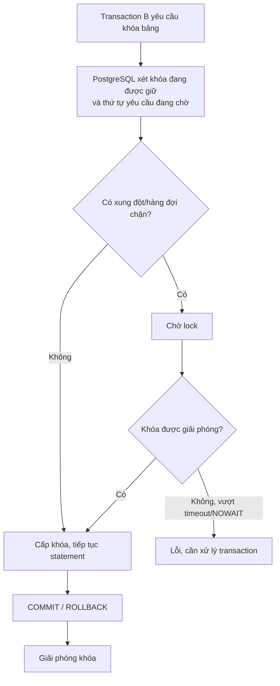
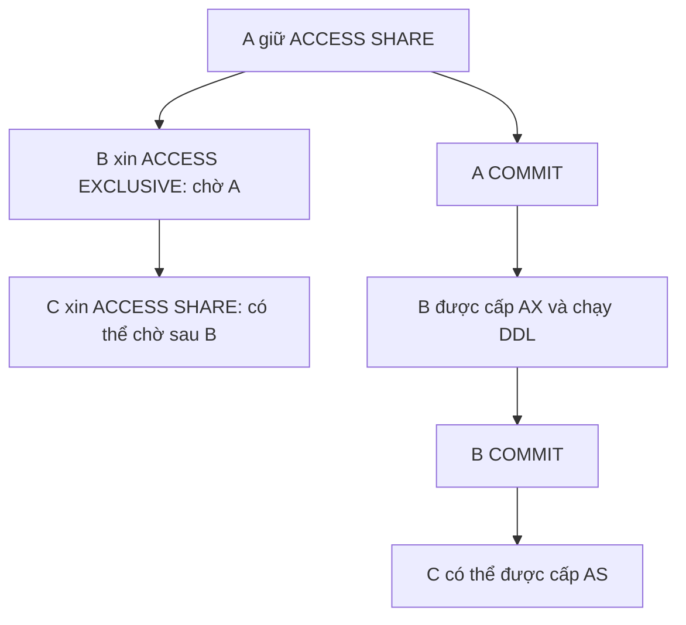

# Các chế độ khóa bảng và ma trận tương thích trong PostgreSQL

Trong PostgreSQL, khi nhiều giao dịch đồng thời đọc, ghi hoặc thay đổi cấu trúc của cùng một bảng, hệ quản trị phải bảo đảm những thao tác không tương thích không thực hiện sai trật tự. Một công cụ quan trọng là **khóa cấp bảng (table-level lock)**. PostgreSQL có **tám chế độ khóa bảng**, từ `ACCESS SHARE` ít hạn chế cho tới `ACCESS EXCLUSIVE` mạnh nhất.

Tên khóa có thể gây nhầm lẫn: `ROW EXCLUSIVE` nghe như khóa một hàng, nhưng thực chất là **một chế độ khóa cấp bảng**; trong khi `SELECT ... FOR UPDATE` vừa lấy chế độ `ROW SHARE` ở cấp bảng vừa có thể khóa những hàng cụ thể. Hai tầng khóa này khác nhau và cần được phân biệt.

Bài học thuộc chương **Khóa**, tập trung vào:

- Tám chế độ `ACCESS SHARE`, `ROW SHARE`, `ROW EXCLUSIVE`, `SHARE UPDATE EXCLUSIVE`, `SHARE`, `SHARE ROW EXCLUSIVE`, `EXCLUSIVE` và `ACCESS EXCLUSIVE`.
- **Ma trận tương thích**: hai giao dịch có thể cùng giữ những chế độ nào trên một bảng?
- Những câu SQL nào thường lấy từng chế độ một cách **ngầm định**; khi nào nên dùng `LOCK TABLE` tường minh?
- Quan hệ giữa table lock, row lock, lock wait, deadlock và transaction đang `idle in transaction`.
- Cách xem `pg_locks`, `pg_stat_activity`, `pg_blocking_pids()`, kiểm soát thời gian chờ và viết ứng dụng Java/JDBC an toàn.
- Các tình huống triển khai index, migration/DDL và xử lý tác vụ đồng thời.

Mục tiêu không phải học thuộc mọi ô của ma trận một cách máy móc, mà là biết **dự đoán thao tác nào có thể chờ**, tìm **đúng phiên đang chặn** và chọn mức khóa ít hạn chế nhất mà vẫn giữ được tính đúng đắn.

## 1. Khóa bảng là gì?

Một **table-level lock** được PostgreSQL quản lý cho một đối tượng quan hệ, thường là bảng hoặc đối tượng liên quan, nhằm phối hợp những thao tác đồng thời. Khi một transaction đã giữ một chế độ khóa trên bảng, PostgreSQL xét chế độ khóa mà transaction khác muốn lấy trên cùng đối tượng.

- Nếu **tương thích**, các transaction có thể cùng giữ khóa.
- Nếu **xung đột**, transaction mới thường phải **chờ**, hoặc nhận lỗi nếu sử dụng cơ chế không chờ/timeout.
- Khi transaction kết thúc bằng `COMMIT` hoặc `ROLLBACK`, các khóa mà nó giữ thường được giải phóng.
- Một transaction thường **không xung đột với chính nó** khi yêu cầu thêm những chế độ khóa trên cùng một đối tượng; ma trận dùng chủ yếu để xét giữa các transaction khác nhau.

Khóa cấp bảng thường được lấy **ngầm định** bởi các lệnh như `SELECT`, `INSERT`, `UPDATE`, `DELETE`, `CREATE INDEX` và `ALTER TABLE`. Không cần gọi `LOCK TABLE` thì PostgreSQL vẫn có cơ chế bảo vệ thích hợp.



Đây là mô hình khái niệm, không mô tả đầy đủ thuật toán cấp khóa và mọi trường hợp lock queue.

### 1.1. Khóa cấp bảng không có nghĩa luôn chặn toàn bộ bảng

Một `ROW EXCLUSIVE` lock, thường được lấy khi `UPDATE`, **không tự động chặn mọi lệnh SELECT** trên bảng đó. PostgreSQL dùng MVCC để nhiều truy vấn đọc có thể chạy đồng thời với truy vấn ghi.

Chỉ những **cặp chế độ không tương thích** mới xung đột tại tầng table-level. Row lock có thể tạo thêm tình huống chờ khác, ngay cả khi hai table lock tương thích với nhau.

### 1.2. “Khóa được cấp” và “đang chờ khóa”

View `pg_locks` có cột `granted`:

- `granted = true`: backend đã được cấp lock.
- `granted = false`: yêu cầu đang chờ được cấp lock.

Việc thấy nhiều khóa với `granted = true` là bình thường. Muốn xác định vấn đề, cần tìm **yêu cầu đang bị chặn**, chế độ khóa tương ứng và transaction đang gây xung đột.

## 2. Tám chế độ khóa bảng

PostgreSQL sử dụng các tên chế độ sau, theo thứ tự thông thường từ ít hạn chế đến mạnh hơn. Tuy vậy, **đây không phải một thứ tự “nhỏ hơn/lớn hơn” tuyến tính cho mọi cặp**: phải nhìn chính xác tập xung đột.

| Viết tắt trong bài | Tên chế độ chính xác | Đặc điểm khái quát |
| --- | --- | --- |
| **AS** | `ACCESS SHARE` | Thường gặp ở `SELECT` đọc dữ liệu; chỉ xung đột với `ACCESS EXCLUSIVE` |
| **RS** | `ROW SHARE` | Thường gặp với `SELECT ... FOR UPDATE/SHARE`; xung đột `EXCLUSIVE` và `ACCESS EXCLUSIVE` |
| **RX** | `ROW EXCLUSIVE` | Thường gặp ở `INSERT`, `UPDATE`, `DELETE`; chặn một số chế độ `SHARE` và các chế độ mạnh |
| **SUE** | `SHARE UPDATE EXCLUSIVE` | Dành cho nhiều hoạt động bảo trì/DDL online; **xung đột với chính nó** |
| **S** | `SHARE` | Cho phép nhiều reader; xung đột với writer `ROW EXCLUSIVE` và một số chế độ bảo trì |
| **SRX** | `SHARE ROW EXCLUSIVE` | Chế độ `SHARE` mạnh hơn, **tự xung đột**; được dùng trong một số DDL |
| **X** | `EXCLUSIVE` | Cho phép đọc `ACCESS SHARE` thông thường, chặn nhiều thao tác khác |
| **AX** | `ACCESS EXCLUSIVE` | Xung đột với **mọi chế độ**, kể cả `ACCESS SHARE` |

**Chú ý:** chữ “ROW” trong `ROW SHARE` hoặc `ROW EXCLUSIVE` là **một phần tên của table-lock mode**. Chúng không thay thế các chế độ khóa hàng như `FOR KEY SHARE`, `FOR SHARE`, `FOR NO KEY UPDATE` và `FOR UPDATE`.

## 3. Ma trận tương thích đầy đủ

Bảng dưới xét **hai transaction khác nhau cùng yêu cầu khóa trên cùng một bảng**. Dòng là khóa đã được yêu cầu/giữ bởi transaction A; cột là khóa transaction B cần. Ma trận đối xứng.

- **✓**: hai chế độ **tương thích** ở cấp bảng.
- **✕**: hai chế độ **xung đột**; B có thể phải chờ hoặc thất bại theo chính sách chờ/timeout.
- Đây là **ma trận table lock**; một row lock, advisory lock, transaction-ID wait hoặc yêu cầu đang đứng trước trong hàng đợi vẫn có thể ảnh hưởng.

| A \ B | AS | RS | RX | SUE | S | SRX | X | AX |
| --- | :---: | :---: | :---: | :---: | :---: | :---: | :---: | :---: |
| **AS** | ✓ | ✓ | ✓ | ✓ | ✓ | ✓ | ✓ | ✕ |
| **RS** | ✓ | ✓ | ✓ | ✓ | ✓ | ✓ | ✕ | ✕ |
| **RX** | ✓ | ✓ | ✓ | ✓ | ✕ | ✕ | ✕ | ✕ |
| **SUE** | ✓ | ✓ | ✓ | ✕ | ✕ | ✕ | ✕ | ✕ |
| **S** | ✓ | ✓ | ✕ | ✕ | ✓ | ✕ | ✕ | ✕ |
| **SRX** | ✓ | ✓ | ✕ | ✕ | ✕ | ✕ | ✕ | ✕ |
| **X** | ✓ | ✕ | ✕ | ✕ | ✕ | ✕ | ✕ | ✕ |
| **AX** | ✕ | ✕ | ✕ | ✕ | ✕ | ✕ | ✕ | ✕ |

Đọc vài ô quan trọng:

1. **AS–RX = ✓**: `SELECT` thông thường có thể chạy đồng thời với `INSERT/UPDATE/DELETE` ở tầng table lock.
2. **RX–RX = ✓**: hai `UPDATE` trên cùng bảng không xung đột ở tầng table lock, nhưng có thể chờ **row lock** nếu cập nhật cùng hàng.
3. **RX–S = ✕**: một transaction giữ `SHARE` khiến DML thông thường cần `ROW EXCLUSIVE` phải chờ.
4. **S–S = ✓**: hai transaction có thể cùng giữ `SHARE`; điều này **không có nghĩa** chúng sẽ luôn cập nhật được mà không gặp deadlock sau đó.
5. **SUE–SUE = ✕**: hai hoạt động bảo trì yêu cầu `SHARE UPDATE EXCLUSIVE` trên cùng bảng có thể chặn nhau.
6. **X–AS = ✓**: `EXCLUSIVE` vẫn cho phép `SELECT` thông thường, khác `ACCESS EXCLUSIVE`.
7. **AX–AS = ✕**: một thao tác cần `ACCESS EXCLUSIVE` có thể chặn cả `SELECT` chỉ đọc.

### 3.1. Tập chế độ xung đột để tra nhanh

| Chế độ đang giữ | Xung đột với các chế độ của transaction khác |
| --- | --- |
| `ACCESS SHARE` | `ACCESS EXCLUSIVE` |
| `ROW SHARE` | `EXCLUSIVE`, `ACCESS EXCLUSIVE` |
| `ROW EXCLUSIVE` | `SHARE`, `SHARE ROW EXCLUSIVE`, `EXCLUSIVE`, `ACCESS EXCLUSIVE` |
| `SHARE UPDATE EXCLUSIVE` | `SHARE UPDATE EXCLUSIVE`, `SHARE`, `SHARE ROW EXCLUSIVE`, `EXCLUSIVE`, `ACCESS EXCLUSIVE` |
| `SHARE` | `ROW EXCLUSIVE`, `SHARE UPDATE EXCLUSIVE`, `SHARE ROW EXCLUSIVE`, `EXCLUSIVE`, `ACCESS EXCLUSIVE` |
| `SHARE ROW EXCLUSIVE` | `ROW EXCLUSIVE`, `SHARE UPDATE EXCLUSIVE`, `SHARE`, `SHARE ROW EXCLUSIVE`, `EXCLUSIVE`, `ACCESS EXCLUSIVE` |
| `EXCLUSIVE` | `ROW SHARE`, `ROW EXCLUSIVE`, `SHARE UPDATE EXCLUSIVE`, `SHARE`, `SHARE ROW EXCLUSIVE`, `EXCLUSIVE`, `ACCESS EXCLUSIVE` |
| `ACCESS EXCLUSIVE` | Tất cả tám chế độ, kể cả chính nó |

Tập xung đột giúp nhìn rõ một chi tiết: `SHARE UPDATE EXCLUSIVE` **tương thích với `ROW EXCLUSIVE`** dù nó tự xung đột và xung đột với `SHARE`. Vì thế không thể suy rằng chỉ cần tên khóa có chữ `EXCLUSIVE` là nó chặn mọi DML.

### 3.2. Một vài trường hợp dễ nhầm

**Hai transaction cùng SELECT:** mỗi bên thường cần AS. AS–AS tương thích, nên không chặn nhau tại tầng table lock.

**Một transaction SELECT, một transaction UPDATE:** AS–RX tương thích; SELECT thường đọc snapshot theo MVCC. Nếu SELECT dùng `FOR UPDATE`, còn có row-level locking và phải xét điều kiện khác.

**Một transaction UPDATE, một transaction CREATE INDEX thường:** RX–S xung đột, vì `CREATE INDEX` thông thường thường yêu cầu `SHARE` trên bảng nguồn.

**Một transaction UPDATE, một transaction CREATE INDEX CONCURRENTLY:** RX–SUE tương thích ở tầng table lock, nhưng quá trình tạo index concurrently có nhiều giai đoạn và có thể **chờ các transaction liên quan** ở một số bước. Không được kết luận nó hoàn toàn không thể gây chờ.

## 4. ACCESS SHARE: khóa đọc thông thường

`ACCESS SHARE` là chế độ thường được yêu cầu bởi lệnh `SELECT` chỉ đọc một bảng.

```sql
SELECT *
FROM lock_lab.products
WHERE product_id = 1;
```

Nó chỉ xung đột với `ACCESS EXCLUSIVE`. Do đó, `ACCESS SHARE` tương thích với `ROW EXCLUSIVE` do DML và tương thích với `EXCLUSIVE`.

Điều này là một lý do cốt lõi giúp PostgreSQL phục vụ nhiều reader/writer đồng thời. Nhưng không nên suy rằng mọi `SELECT` đều không chờ:

- Một DDL đang giữ hoặc đang chờ `ACCESS EXCLUSIVE` có thể chặn `SELECT`.
- Truy vấn `SELECT ... FOR UPDATE` sử dụng khóa mạnh hơn AS tại cấp bảng và hàng.
- Function/trigger hoặc query phức tạp có thể làm phát sinh những hoạt động và lock khác.
- Một phiên đọc có thể chờ I/O, buffer, client hoặc tài nguyên khác dù không có table-lock conflict.

**Quan trọng:** `SELECT` trong transaction tường minh có thể giữ `ACCESS SHARE` đến khi transaction kết thúc, ngay cả khi statement SELECT đã thực thi xong. Một transaction đọc nhưng bỏ quên `COMMIT/ROLLBACK` có thể chặn DDL cần `ACCESS EXCLUSIVE`.

## 5. ROW SHARE: khóa bảng khi truy vấn muốn khóa hàng

`ROW SHARE` thường xuất hiện khi dùng:

```sql
SELECT *
FROM lock_lab.products
WHERE product_id = 1
FOR UPDATE;
```

Hoặc:

```sql
SELECT *
FROM lock_lab.products
WHERE product_id = 1
FOR SHARE;
```

Các biến thể `FOR NO KEY UPDATE`, `FOR KEY SHARE` cũng thuộc nhóm câu SELECT có yêu cầu row locking. Ở cấp bảng, những câu SELECT này dùng `ROW SHARE` trên bảng mục tiêu; đồng thời, PostgreSQL lấy **khóa hàng** tương ứng trên các hàng được chọn theo semantics cụ thể.

`ROW SHARE` chỉ xung đột ở cấp bảng với `EXCLUSIVE` và `ACCESS EXCLUSIVE`. Tuy vậy, câu `SELECT ... FOR UPDATE` có thể chờ hàng đang bị transaction khác khóa, dù table-lock `ROW SHARE` và `ROW EXCLUSIVE` đang tương thích.

### 5.1. NOWAIT và SKIP LOCKED của FOR UPDATE không phải table-level NOWAIT

```sql
SELECT *
FROM lock_lab.products
WHERE product_id = 1
FOR UPDATE NOWAIT;
```

`NOWAIT` ở đây chủ yếu điều chỉnh hành vi khi lấy **row lock**. Yêu cầu lấy `ROW SHARE` ở cấp bảng vẫn theo cơ chế thông thường và có thể phải chờ. Nếu cần giới hạn thời gian chờ table lock, hãy cấu hình `lock_timeout` phù hợp.

Tương tự, `FOR UPDATE SKIP LOCKED` có thể bỏ qua những **hàng** đang bị khóa, không có nghĩa bỏ qua mọi khóa bảng hoặc mọi loại wait.

## 6. ROW EXCLUSIVE: khóa bảng của thao tác ghi

Các câu DML thường lấy `ROW EXCLUSIVE` trên bảng đích:

```sql
INSERT INTO lock_lab.products
    (product_id, product_name, price)
VALUES
    (10, 'New Item', 100.00);
```

```sql
UPDATE lock_lab.products
SET price = price + 5
WHERE product_id = 1;
```

```sql
DELETE FROM lock_lab.products
WHERE product_id = 10;
```

`ROW EXCLUSIVE` **không xung đột** với `ACCESS SHARE`, `ROW SHARE`, chính `ROW EXCLUSIVE` hoặc `SHARE UPDATE EXCLUSIVE`.

Nhưng nó **xung đột** với `SHARE`, `SHARE ROW EXCLUSIVE`, `EXCLUSIVE` và `ACCESS EXCLUSIVE`.

### 6.1. Hai UPDATE cùng bảng chưa chắc chặn nhau ở table lock

Session A:

```sql
BEGIN;
UPDATE lock_lab.products SET price = 120 WHERE product_id = 1;
-- Chưa COMMIT.
```

Session B:

```sql
BEGIN;
UPDATE lock_lab.products SET price = 75 WHERE product_id = 2;
COMMIT;
```

Nếu không có xung đột nào khác và hai hàng độc lập, B có thể tiến hành dù A đang giữ `ROW EXCLUSIVE` trên cùng bảng. Lý do: **RX–RX tương thích**.

Nếu B sửa **cùng `product_id = 1`**, nó có thể chờ vì **row-level lock hoặc transaction-ID wait**, không phải vì `ROW EXCLUSIVE` không tương thích với `ROW EXCLUSIVE`.

Đây là tình huống điển hình khi `pg_locks` chỉ nhìn table mode sẽ không giải thích đủ nguyên nhân chờ.

## 7. SHARE UPDATE EXCLUSIVE: bảo trì đồng thời có giới hạn

`SHARE UPDATE EXCLUSIVE` thường gặp ở một số hoạt động như:

- `VACUUM` thông thường (không phải `VACUUM FULL`).
- `ANALYZE`.
- `CREATE INDEX CONCURRENTLY` và một số thao tác bảo trì/index trực tuyến liên quan.
- Một số dạng `ALTER TABLE` không cần khóa mạnh nhất, tùy từng subcommand và phiên bản.

Tập xung đột của SUE gồm chính SUE, `SHARE`, `SHARE ROW EXCLUSIVE`, `EXCLUSIVE` và `ACCESS EXCLUSIVE`.

Điều này thể hiện hai ý:

1. **SUE tương thích với DML cần RX** ở mức ma trận; nhiều công việc bảo trì có thể diễn ra đồng thời với đọc/ghi thông thường.
2. **SUE tự xung đột**, giúp ngăn những công việc bảo trì cần chế độ này chạy đồng thời trên cùng bảng theo cách không an toàn.

Ví dụ câu lệnh có thể liên quan tới SUE:

```sql
ANALYZE lock_lab.products;
```

```sql
-- Chạy riêng, ngoài một transaction block tường minh.
CREATE INDEX CONCURRENTLY idx_products_price
ON lock_lab.products (price);
```

**Giới hạn:** `CREATE INDEX CONCURRENTLY` không được chạy trong một transaction block tường minh; nó cũng có các giai đoạn đợi transaction và validation riêng. Việc mode SUE tương thích RX **không** đồng nghĩa quá trình tạo index không bao giờ phải đợi hoặc không tạo thêm I/O.

## 8. SHARE: đọc được nhưng ghi thông thường có thể phải chờ

`SHARE` thường gắn với `CREATE INDEX` thông thường và có thể được lấy tường minh:

```sql
BEGIN;

LOCK TABLE lock_lab.products IN SHARE MODE;

-- Những transaction khác vẫn có thể SELECT bình thường.
-- Nhưng INSERT/UPDATE/DELETE cần ROW EXCLUSIVE sẽ xung đột.

COMMIT;
```

`SHARE` tương thích với AS, RS và chính S. Nhưng nó xung đột RX, SUE, SRX, X, AX.

### 8.1. Hai SHARE lock cùng tồn tại được không?

Có. Hai transaction có thể cùng giữ `SHARE` trên cùng bảng vì ô S–S trong ma trận là ✓.

Tuy nhiên, nếu sau đó cả hai cùng muốn `UPDATE` bảng đó, chúng có thể cố nâng yêu cầu lên RX. Vì mỗi bên vẫn giữ S và RX của bên kia xung đột với S, tình huống có thể dẫn tới **deadlock**. Do vậy, một mode tự tương thích không bảo đảm mọi bước nâng lock sau đó cũng tương thích.

## 9. SHARE ROW EXCLUSIVE: chế độ SHARE tự xung đột

`SHARE ROW EXCLUSIVE` xuất hiện ở một số thao tác thay đổi schema, ví dụ `CREATE TRIGGER`, và có thể lấy tường minh:

```sql
BEGIN;

LOCK TABLE lock_lab.products
IN SHARE ROW EXCLUSIVE MODE;

-- Làm việc cần phạm vi khóa đã xác định.

COMMIT;
```

Mode này xung đột với RX, SUE, S, chính SRX, X và AX; vẫn tương thích với AS và RS.

So với `SHARE`, điểm khác nổi bật là **SRX–SRX xung đột** trong khi S–S tương thích. Điều đó hữu ích cho các thao tác cần thực thi theo từng lượt trên cùng bảng.

Tên `SHARE ROW EXCLUSIVE` không có nghĩa PostgreSQL đã khóa mọi hàng bằng `FOR UPDATE`. Nó vẫn là **khóa cấp bảng**, còn row-level locking là cơ chế riêng.

## 10. EXCLUSIVE: cho phép SELECT thường, chặn nhiều thao tác khác

`EXCLUSIVE` là chế độ mạnh nhưng **chưa phải mạnh nhất**.

Nó chỉ tương thích với `ACCESS SHARE`, do đó câu `SELECT` không lấy row lock vẫn có thể chạy đồng thời. Nó xung đột với `ROW SHARE`, RX, SUE, S, SRX, X và AX.

Một ví dụ lệnh có thể lấy chế độ này là `REFRESH MATERIALIZED VIEW CONCURRENTLY` trên materialized view được refresh, trong điều kiện PostgreSQL cho phép thao tác đó.

Có thể minh họa tường minh:

```sql
BEGIN;

LOCK TABLE lock_lab.products IN EXCLUSIVE MODE;

-- SELECT thường từ session khác vẫn có thể chạy.
-- SELECT FOR UPDATE hoặc UPDATE từ session khác có thể phải chờ.

COMMIT;
```

Không nên hiểu `EXCLUSIVE` là “chặn mọi thứ”. Chỉ `ACCESS EXCLUSIVE` xung đột cả `ACCESS SHARE`.

## 11. ACCESS EXCLUSIVE: chế độ mạnh nhất

`ACCESS EXCLUSIVE` xung đột với **cả tám chế độ**, kể cả chính nó và `ACCESS SHARE`.

Một số lệnh thường yêu cầu mode này:

- `TRUNCATE`.
- `DROP TABLE`.
- `VACUUM FULL`.
- `CLUSTER`.
- `REFRESH MATERIALIZED VIEW` không có `CONCURRENTLY`.
- Nhiều dạng `ALTER TABLE`, trừ trường hợp subcommand có chế độ yếu hơn được tài liệu lệnh quy định.

`LOCK TABLE` nếu **không chỉ định mode** cũng dùng mặc định `ACCESS EXCLUSIVE`. Đây là một nguyên nhân dễ gây khóa quá mạnh ngoài ý muốn:

```sql
BEGIN;

-- Mạnh hơn cần thiết trong phần lớn luồng ứng dụng.
LOCK TABLE lock_lab.products;

-- Tương đương yêu cầu ACCESS EXCLUSIVE cho bảng này.
ROLLBACK;
```

Khi AX đã được cấp, cả một `SELECT` thông thường từ transaction khác cũng có thể phải chờ. Nếu AX đang **đợi trong hàng đợi**, những yêu cầu mới có thể bị xếp sau nó để tránh starvation; xem phần 19.

### 11.1. Vì sao DDL ngắn vẫn gây gián đoạn dài?

Một câu `ALTER TABLE` có thể thực thi rất nhanh sau khi lấy được khóa, nhưng bị **chờ** hàng phút vì một transaction khác đang giữ AS/RX chưa commit. Trong lúc DDL chờ AX, các yêu cầu SELECT/UPDATE đến sau còn có thể mắc vào hàng đợi.

Do đó, không chỉ đo thời gian chạy DDL; phải đo cả **thời gian chờ lấy lock** và hiểu workload đang mở transaction.

## 12. Những câu SQL thường lấy mode nào?

Bảng sau là **quy tắc điển hình**, không phải danh mục đầy đủ của mọi lệnh/phương án thực thi. Một statement có thể lấy **nhiều mode trên nhiều bảng**, và một số subcommand DDL có quy tắc riêng.

| Lệnh / tình huống phổ biến | Mode cấp bảng thường liên quan |
| --- | --- |
| `SELECT` thường | `ACCESS SHARE` trên bảng được đọc |
| `SELECT ... FOR UPDATE / FOR SHARE` | `ROW SHARE` trên bảng đích row-locking; các bảng khác có thể là AS |
| `INSERT` | `ROW EXCLUSIVE` trên bảng đích |
| `UPDATE` | `ROW EXCLUSIVE` trên bảng đích |
| `DELETE` | `ROW EXCLUSIVE` trên bảng đích |
| `MERGE` | Khóa phù hợp với thao tác ghi trên bảng đích, thường RX |
| `VACUUM` thường | `SHARE UPDATE EXCLUSIVE` |
| `ANALYZE` | `SHARE UPDATE EXCLUSIVE` |
| `CREATE INDEX` thông thường | `SHARE` |
| `CREATE INDEX CONCURRENTLY` | `SHARE UPDATE EXCLUSIVE` trong những giai đoạn liên quan |
| `CREATE TRIGGER` | `SHARE ROW EXCLUSIVE` |
| `REFRESH MATERIALIZED VIEW CONCURRENTLY` | `EXCLUSIVE` |
| `TRUNCATE` | `ACCESS EXCLUSIVE` |
| `VACUUM FULL` | `ACCESS EXCLUSIVE` |
| `DROP TABLE` | `ACCESS EXCLUSIVE` |
| Nhiều `ALTER TABLE` | `ACCESS EXCLUSIVE` nếu subcommand không yêu cầu mode yếu hơn |
| `LOCK TABLE tablename` không có `IN ... MODE` | Mặc định `ACCESS EXCLUSIVE` |

**Thận trọng khi dự đoán DDL:** `ALTER TABLE` có nhiều subcommand với yêu cầu lock khác nhau; thêm column, thêm/validate constraint, thay đổi dữ liệu cột hoặc thiết lập metadata không nên được coi là cùng một tác vụ. Khi chuẩn bị migration, kiểm tra tài liệu đúng major version và thử trên dữ liệu đại diện.

### 12.1. Một câu SELECT có JOIN lấy lock ở đâu?

```sql
SELECT
    p.product_name,
    c.category_name
FROM lock_lab.products AS p
JOIN lock_lab.categories AS c
    ON c.category_id = p.category_id;
```

Một query đọc cả hai bảng thường lấy khóa đọc phù hợp trên **các bảng liên quan**, không phải một table lock duy nhất cho “kết quả JOIN”.

Nếu query đọc bảng `products` và một transaction khác muốn `DROP TABLE products`, AS và AX xung đột trên products. Việc có JOIN thêm categories không làm mất xung đột này.

### 12.2. Câu INSERT ... SELECT lấy khóa khác nhau ở nguồn và đích

```sql
INSERT INTO lock_lab.product_audit (product_id, snapshot_price)
SELECT product_id, price
FROM lock_lab.products
WHERE price > 0;
```

Nếu các bảng ví dụ tồn tại và không có tác động phụ đặc biệt:

- Bảng đích `product_audit` cần khóa cho thao tác ghi, thường RX.
- Bảng nguồn `products` được đọc bằng khóa phù hợp, thường AS.
- Các bảng có trigger hoặc khóa ngoại liên quan còn có thể phát sinh yêu cầu lock bổ sung.

Một statement có thể đồng thời là **reader của bảng A và writer của bảng B**. Khi điều tra lock, luôn xét chính xác relation đang bị chặn.

## 13. Cú pháp LOCK TABLE tường minh

PostgreSQL cho phép yêu cầu khóa cấp bảng trực tiếp:

```sql
LOCK [TABLE] table_name
IN lock_mode MODE
[NOWAIT];
```

Trong câu trên, ngoặc vuông chỉ ký hiệu phần cú pháp **tùy chọn**, không phải dấu cần gõ nguyên văn. `lock_mode` phải được thay bằng một trong tám chế độ hợp lệ.

Ví dụ:

```sql
BEGIN;

LOCK TABLE lock_lab.products
IN SHARE MODE;

-- Thực hiện các bước thực sự cần trạng thái bảng ổn định
-- theo phạm vi khóa SHARE.

COMMIT;
```

Hoặc thử lấy khóa không chờ:

```sql
BEGIN;

LOCK TABLE lock_lab.products
IN SHARE MODE NOWAIT;

-- Nếu có lock xung đột, statement báo lỗi ngay.

ROLLBACK;
```

**`NOWAIT` trên `LOCK TABLE`** áp dụng cho yêu cầu table lock cụ thể. Khác với `FOR UPDATE NOWAIT`, nó không chỉ nói về row-level locks.

### 13.1. Tại sao cần BEGIN?

Với chế độ autocommit, một lệnh `LOCK TABLE` đứng riêng được chạy trong transaction ngầm; khi lệnh kết thúc, transaction cũng kết thúc và lock được giải phóng. Vì thế, nó thường **không bảo vệ một câu SQL được gửi sau đó** như người lập trình mong đợi.

Muốn khóa bao phủ một chuỗi statement, hãy dùng transaction tường minh và giữ nó **ngắn nhất có thể**.

### 13.2. Chọn mode ít hạn chế nhất

Nếu mục tiêu chỉ là bảo đảm vài statement trong transaction vẫn đọc được một bảng, hãy kiểm tra xem lock ngầm định AS đã đủ chưa. Không dùng `ACCESS EXCLUSIVE` chỉ vì muốn “an toàn”.

Ví dụ:

- Cần ngăn một số thay đổi cấu trúc nhưng vẫn cho phép DML? Xem những mode thích hợp với thao tác.
- Cần thực hiện nhiều bước ghi dữ liệu? Thường chỉ cần row locks, ràng buộc và transaction thay vì khóa toàn bảng mạnh.
- Cần trạng thái nhất quán nhiều bảng? Hãy xét isolation level và bất biến nghiệp vụ; table lock không phải câu trả lời duy nhất.

Thêm khóa mạnh có thể giải quyết race condition nhưng đổi lại throughput thấp và nguy cơ deadlock khi nhiều transaction lấy khóa không cùng thứ tự.

### 13.3. Khóa nhiều bảng theo thứ tự cố định

```sql
BEGIN;

LOCK TABLE lock_lab.products
IN SHARE MODE;

LOCK TABLE lock_lab.categories
IN SHARE MODE;

-- Thao tác phù hợp.

COMMIT;
```

Nếu nhiều code path cần cùng hai bảng, hãy cố gắng lấy khóa theo **một thứ tự thống nhất**. A khóa products rồi categories trong khi B khóa categories rồi products là cấu trúc có nguy cơ tạo chu trình chờ.

Có thể viết một câu `LOCK TABLE table_a, table_b IN ... MODE` khi cùng mode; điều quan trọng vẫn là hiểu những khóa cần lấy và quy tắc thực thi.

## 14. Tạo bảng thực hành

Mọi ví dụ từ đây dùng **database thử nghiệm riêng**. Các session được giữ transaction mở có chủ đích để quan sát khóa, nên **phải rollback/commit sau mỗi bài**. Không thử tạo lock wait trên bảng phục vụ production.

```sql
CREATE SCHEMA IF NOT EXISTS lock_lab;

CREATE TABLE lock_lab.categories (
    category_id integer PRIMARY KEY,
    category_name text NOT NULL
);

CREATE TABLE lock_lab.products (
    product_id integer PRIMARY KEY,
    category_id integer NOT NULL
        REFERENCES lock_lab.categories(category_id),
    product_name text NOT NULL,
    price numeric(12, 2) NOT NULL CHECK (price >= 0)
);

CREATE TABLE lock_lab.product_audit (
    audit_id bigint GENERATED ALWAYS AS IDENTITY PRIMARY KEY,
    product_id integer NOT NULL,
    snapshot_price numeric(12, 2) NOT NULL
);

INSERT INTO lock_lab.categories
    (category_id, category_name)
VALUES
    (1, 'Books'),
    (2, 'Devices');

INSERT INTO lock_lab.products
    (product_id, category_id, product_name, price)
VALUES
    (1, 1, 'PostgreSQL Handbook', 100.00),
    (2, 1, 'SQL Exercises', 70.00),
    (3, 2, 'USB-C Cable', 25.00);
```

Các lệnh tạo dữ liệu nên chạy **một lần** trên database thực hành trống. Nếu đã chạy bài trước và bảng có tồn tại, cần tạo schema mới hoặc dọn dữ liệu thử có kiểm soát, không chạy lại rồi hiểu lỗi duplicate key là lock conflict.

Bài thực hành dùng hai hoặc ba session:

- **Session A:** giữ một lock có chủ đích.
- **Session B:** chạy câu bị chặn hoặc tương thích với A.
- **Session C:** dùng view thống kê quan sát A/B.

## 15. Thực hành 1: SELECT và UPDATE cùng tồn tại

Session A:

```sql
BEGIN;

UPDATE lock_lab.products
SET price = price + 5
WHERE product_id = 1;

SELECT pg_backend_pid() AS session_a_pid;

-- Chưa COMMIT/ROLLBACK.
```

Session A có RX trên bảng products và row-level lock trên product 1. Session B chạy:

```sql
SELECT product_id, price
FROM lock_lab.products
WHERE product_id = 1;
```

Đây là SELECT không khóa hàng, thường chỉ cần AS. **AS–RX = ✓**, nên nó có thể đọc một phiên bản dữ liệu đã commit theo MVCC mà không bị chặn bởi row lock của UPDATE A.

Trong session B, thử cập nhật **hàng khác**:

```sql
BEGIN;

SET LOCAL lock_timeout = '2s';

UPDATE lock_lab.products
SET price = price + 1
WHERE product_id = 2;

ROLLBACK;
```

Hai writer cùng có RX trên bảng, nhưng sửa các hàng độc lập; trong điều kiện không có xung đột khác, B có thể hoàn tất.

Tiếp tục thử cập nhật **cùng hàng 1**:

```sql
BEGIN;

SET LOCAL lock_timeout = '2s';

UPDATE lock_lab.products
SET price = price + 1
WHERE product_id = 1;

-- Nếu lock_timeout báo lỗi, phải ROLLBACK.
```

Nếu A chưa kết thúc, B có thể phải chờ **row lock/transaction ID**, mặc dù table lock RX–RX tương thích.

Dọn dẹp:

```sql
-- Session B:
ROLLBACK;

-- Session A:
ROLLBACK;
```

Bài này phân biệt **khả năng đọc/ghi đồng thời** với **xung đột khi đụng chính xác cùng một hàng**.

## 16. Thực hành 2: SHARE chặn UPDATE

Session A:

```sql
BEGIN;

LOCK TABLE lock_lab.products IN SHARE MODE;

SELECT pg_backend_pid() AS session_a_pid;

-- Chưa COMMIT/ROLLBACK.
```

Session B:

```sql
BEGIN;

SET LOCAL lock_timeout = '3s';

UPDATE lock_lab.products
SET price = price + 10
WHERE product_id = 2;

-- Nếu bị hủy vì timeout, ROLLBACK.
```

`UPDATE` cần RX; A giữ S. **S–RX = ✕**, nên B phải chờ cho tới khi A giải phóng lock hoặc timeout xảy ra.

Bên cạnh đó, session C có thể chạy SELECT thường:

```sql
SELECT *
FROM lock_lab.products
ORDER BY product_id;
```

`SHARE` tương thích AS, nên SELECT thường có thể đọc dữ liệu bình thường, miễn không bị ảnh hưởng bởi những request khác đang chờ trong queue.

Kết thúc cả hai transaction:

```sql
-- Session B:
ROLLBACK;

-- Session A:
ROLLBACK;
```

Nếu cần một ví dụ thấy lỗi ngay:

```sql
BEGIN;

LOCK TABLE lock_lab.products IN ROW EXCLUSIVE MODE NOWAIT;

ROLLBACK;
```

Lệnh này, chạy ở một transaction khác khi A còn giữ SHARE, không đợi khóa mà báo lỗi. Nếu câu LOCK lỗi, transaction tường minh đang bị lỗi và cần ROLLBACK.

## 17. Thực hành 3: ACCESS EXCLUSIVE chặn SELECT

Session A:

```sql
BEGIN;

LOCK TABLE lock_lab.products
IN ACCESS EXCLUSIVE MODE;

-- Giữ transaction mở để session khác quan sát.
```

Session B:

```sql
BEGIN;

SET LOCAL lock_timeout = '3s';

SELECT *
FROM lock_lab.products
WHERE product_id = 1;

-- Nếu không lấy được AS, statement bị hủy theo timeout.
```

A giữ AX, B cần AS. **AX–AS = ✕**, nên cả SELECT thông thường có thể phải chờ.

Với một transaction chỉ đọc đang mở, chiều ngược lại cũng gây vấn đề:

1. A chạy `BEGIN; SELECT ... FROM lock_lab.products;` rồi dừng.
2. B muốn thực hiện DDL cần AX, chẳng hạn một số `ALTER TABLE`.
3. B có thể phải đợi A kết thúc transaction dù SELECT ở A đã trả kết quả.

Sau thử nghiệm, giải phóng transaction:

```sql
-- Session B:
ROLLBACK;

-- Session A:
ROLLBACK;
```

**Không bao giờ giữ AX của bảng production chỉ để minh họa.** Nếu cần phân tích sự cố thực tế, ưu tiên quan sát những khóa đã tồn tại và tái hiện trong staging.

## 18. Thực hành 4: EXCLUSIVE vẫn cho phép đọc thường

Session A:

```sql
BEGIN;

LOCK TABLE lock_lab.products
IN EXCLUSIVE MODE;
```

Session B đọc thường:

```sql
SELECT product_id, product_name
FROM lock_lab.products
ORDER BY product_id;
```

B có AS; **X–AS = ✓**, nên không bị chặn bởi table lock của A ở tình huống đơn giản.

Nhưng B muốn dùng `FOR UPDATE`:

```sql
BEGIN;

SET LOCAL lock_timeout = '3s';

SELECT *
FROM lock_lab.products
WHERE product_id = 2
FOR UPDATE;

-- Nếu timeout, ROLLBACK.
```

`FOR UPDATE` yêu cầu RS ở cấp bảng; **X–RS = ✕**. Do đó B có thể chờ ngay tại tầng table lock, trước khi xét row-level lock.

Kết thúc:

```sql
-- Session B:
ROLLBACK;

-- Session A:
ROLLBACK;
```

Ví dụ này cho thấy không nên gọi mọi khóa có chữ `EXCLUSIVE` là khóa “chặn mọi SELECT”: **EXCLUSIVE khác ACCESS EXCLUSIVE**.

## 19. Hàng đợi lock: vì sao SELECT có thể chờ khi holder hiện tại tương thích?

Hãy xét tình huống ba session trên cùng bảng:

1. **A** đang giữ `ACCESS SHARE` trong transaction chỉ đọc.
2. **B** gửi yêu cầu `ACCESS EXCLUSIVE` để thay đổi cấu trúc bảng; B phải chờ A.
3. **C** gửi một `SELECT` mới cần `ACCESS SHARE`.

Về ma trận, AS của A và AS của C **tương thích**. Nhưng một cơ chế xếp hàng công bằng có thể khiến C **đợi sau yêu cầu AX của B** thay vì đi qua nó; nếu không, lượng truy vấn đọc mới liên tục có thể khiến DDL B bị bỏ đói.



Điều này giải thích một triệu chứng vận hành quan trọng: một DDL chỉ cần chạy vài mili-giây có thể tạo **đoàn tàu các truy vấn SELECT đang chờ** nếu nó bị kẹt sau transaction lâu.

### 19.1. Hard blocker và soft blocker

`pg_blocking_pids()` xem xét những backend chặn việc cấp lock cho backend đang đợi. Trong các trường hợp, blocker có thể là:

- **Hard blocker:** một backend đang giữ lock xung đột.
- **Soft blocker:** một backend đang đứng trước trong hàng đợi với yêu cầu xung đột.

Đừng chỉ tìm các lock có `granted = true` rồi bỏ qua queue position. Điều tra đầy đủ bằng `pg_blocking_pids` và các trường của `pg_locks`/`pg_stat_activity`.

### 19.2. Tránh DDL “đứng chờ vô hạn” trong giờ cao điểm

Một migration cần AX nên thường có giới hạn `lock_timeout` thích hợp, ví dụ:

```sql
BEGIN;

SET LOCAL lock_timeout = '2s';
SET LOCAL statement_timeout = '30s';

ALTER TABLE lock_lab.products
ADD COLUMN IF NOT EXISTS description text;

COMMIT;
```

Đây là ví dụ thực hành; trên production, thời gian chờ và tác động DDL phải được đánh giá theo workload, version và subcommand cụ thể.

Nếu không lấy được lock trong thời gian cho phép, tốt hơn thường là rollback rồi lên lịch/ retry có kiểm soát, thay vì để một request AX treo lâu và chặn các request đến sau.

## 20. Quan sát bằng pg_locks

View `pg_locks` cho biết các yêu cầu lock trong hệ thống. Để xem khóa cấp bảng liên quan tới bảng thực hành:

```sql
SELECT
    l.pid,
    a.application_name,
    a.state,
    l.locktype,
    l.mode,
    l.granted,
    l.relation::regclass AS relation_name,
    now() - a.xact_start AS transaction_age,
    left(a.query, 120) AS query_sample
FROM pg_locks AS l
LEFT JOIN pg_stat_activity AS a
    ON a.pid = l.pid
WHERE l.locktype = 'relation'
  AND l.relation = 'lock_lab.products'::regclass
ORDER BY l.granted, l.pid, l.mode;
```

Kỳ vọng bạn sẽ thấy những tên `mode` như `AccessShareLock`, `RowExclusiveLock` hoặc `AccessExclusiveLock`.

**Tên xuất hiện trong `pg_locks.mode`** dùng dạng CamelCase và hậu tố `Lock`, còn cú pháp SQL dùng dấu cách:

| SQL mode | `pg_locks.mode` |
| --- | --- |
| `ACCESS SHARE` | `AccessShareLock` |
| `ROW SHARE` | `RowShareLock` |
| `ROW EXCLUSIVE` | `RowExclusiveLock` |
| `SHARE UPDATE EXCLUSIVE` | `ShareUpdateExclusiveLock` |
| `SHARE` | `ShareLock` |
| `SHARE ROW EXCLUSIVE` | `ShareRowExclusiveLock` |
| `EXCLUSIVE` | `ExclusiveLock` |
| `ACCESS EXCLUSIVE` | `AccessExclusiveLock` |

### 20.1. pg_locks có nhiều loại khóa, không chỉ relation

Một số `locktype` khác có thể là `transactionid`, `virtualxid`, `tuple`, `object`, `advisory` hoặc những loại nội bộ khác tùy phiên bản. Vì thế:

```sql
SELECT
    pid,
    locktype,
    mode,
    granted,
    relation::regclass AS relation_name,
    transactionid
FROM pg_locks
WHERE pid = pg_backend_pid();
```

là cách khám phá nhiều loại lock của **backend hiện tại**, không chỉ table lock. Nhưng không nên kết luận mọi row lock được giữ đều xuất hiện dưới dạng một dòng `tuple` riêng trong `pg_locks`.

### 20.2. Đọc granted trước khi quy kết blocker

Một backend có `RowExclusiveLock` được cấp không có nghĩa nó đang chặn những transaction khác. Muốn tìm xung đột, cần so với **yêu cầu cụ thể chưa được cấp** và ma trận.

Có thể quan sát các lock đang chờ:

```sql
SELECT
    l.pid,
    l.locktype,
    l.mode,
    l.granted,
    l.relation::regclass AS relation_name,
    a.state,
    a.wait_event_type,
    a.wait_event
FROM pg_locks AS l
LEFT JOIN pg_stat_activity AS a
    ON a.pid = l.pid
WHERE NOT l.granted
ORDER BY l.pid, l.locktype;
```

Query này xem hệ thống ở một thời điểm; số dòng đang chờ có thể thay đổi ngay sau khi đọc.

## 21. Tìm waiter và blocker bằng pg_blocking_pids()

`pg_blocking_pids(pid)` trả danh sách PID những backend đang chặn lock request của PID được hỏi. Đây thường là điểm xuất phát đáng tin cậy hơn việc tự ghép `pg_locks` bằng mỗi điều kiện `relation`.

```sql
SELECT
    w.pid AS waiting_pid,
    w.application_name AS waiting_application,
    w.wait_event_type AS waiting_type,
    w.wait_event AS waiting_event,
    now() - w.query_start AS waiting_query_age,
    left(w.query, 150) AS waiting_sql,
    b.pid AS blocking_pid,
    b.application_name AS blocking_application,
    b.state AS blocking_state,
    now() - b.xact_start AS blocking_xact_age,
    left(b.query, 150) AS blocking_last_sql
FROM pg_stat_activity AS w
JOIN LATERAL
    unnest(pg_blocking_pids(w.pid)) AS bp(blocking_pid)
    ON TRUE
LEFT JOIN pg_stat_activity AS b
    ON b.pid = bp.blocking_pid
WHERE w.datname = current_database()
ORDER BY waiting_query_age DESC NULLS LAST;
```

Truy vấn này có thể chỉ ra:

- **Waiting PID:** phiên đang đợi.
- **Blocking PID:** phiên đang chặn, có thể đang `active` hoặc `idle in transaction`.
- **Blocking transaction age:** transaction của blocker đã mở bao lâu.
- **Blocking last SQL:** câu SQL cuối cùng hoặc hiện tại, không nhất thiết là toàn bộ chuỗi câu lệnh đã lấy khóa.

### 21.1. Blocker có thể đang idle in transaction

Ví dụ transaction A:

```sql
BEGIN;

UPDATE lock_lab.products
SET price = price + 1
WHERE product_id = 1;

-- Ứng dụng ngừng gửi SQL, chưa COMMIT.
```

A có thể hiện `state = 'idle in transaction'`. Dù không còn câu SQL đang chạy, A vẫn có thể giữ table lock và row lock. Một phiên B chờ khóa sẽ hiện `state = 'active'`, `wait_event_type = 'Lock'`.

Chỉ lọc `WHERE state='active'` để tìm thủ phạm có thể bỏ sót A. Hãy lần theo **blocker chain**.

### 21.2. Một WAIT không nhất thiết là table lock

Một `UPDATE` bị chặn ở hàng có thể hiện wait trên `transactionid` thay vì một row-level `tuple` lock dễ nhìn. Hai transaction giữ table lock RX tương thích nhưng vẫn chờ nhau ở tầng hàng.

Vì vậy, `pg_blocking_pids()`, `pg_locks` và `wait_event_type` cần được hiểu cùng nhau, không chỉ dùng ma trận table lock để giải thích mọi lock wait.

## 22. Đo thời gian chờ, không nhầm với tuổi transaction

`pg_stat_activity` cung cấp những mốc thời gian khác nhau:

| Cột | Ý nghĩa |
| --- | --- |
| `xact_start` | Thời điểm transaction hiện tại bắt đầu, nếu có |
| `query_start` | Thời điểm query hiện tại bắt đầu khi `active`; thời điểm query cuối bắt đầu khi không active |
| `state_change` | Thời điểm backend chuyển sang trạng thái hiện tại |
| `wait_event_type` | Nhóm sự kiện backend đang đợi, nếu có |
| `wait_event` | Tên sự kiện cụ thể |

Ví dụ:

```sql
SELECT
    pid,
    application_name,
    state,
    wait_event_type,
    wait_event,
    CASE
        WHEN xact_start IS NOT NULL
        THEN now() - xact_start
    END AS transaction_age,
    CASE
        WHEN state = 'active'
        THEN now() - query_start
    END AS active_query_age,
    CASE
        WHEN state LIKE 'idle in transaction%'
        THEN now() - state_change
    END AS idle_transaction_age,
    pg_blocking_pids(pid) AS blocking_pids
FROM pg_stat_activity
WHERE datname = current_database()
ORDER BY xact_start NULLS LAST, pid;
```

`query_start` đo **tuổi câu SQL đang active**, không phải thời gian backend đã bị lock wait riêng. Nếu statement có 10 giây xử lý trước khi bắt đầu đợi lock 2 giây, lấy `now() - query_start` sẽ ra khoảng 12 giây, không phải đúng 2 giây chờ lock.

Để đo lock wait chính xác theo thời gian, có thể kết hợp log lock waits, APM/telemetry và các công cụ giám sát phù hợp.

## 23. NOWAIT, lock_timeout và statement_timeout

### 23.1. NOWAIT trên LOCK TABLE

```sql
BEGIN;

LOCK TABLE lock_lab.products
IN SHARE MODE NOWAIT;

COMMIT;
```

Nếu tồn tại khóa xung đột, statement không đợi và báo lỗi. Trong transaction tường minh, sau lỗi phải `ROLLBACK` hoặc xử lý savepoint thích hợp.

### 23.2. lock_timeout

```sql
BEGIN;

SET LOCAL lock_timeout = '2s';

UPDATE lock_lab.products
SET price = price + 1
WHERE product_id = 1;

COMMIT;
```

`lock_timeout` giới hạn thời gian chờ để **lấy từng lock**. Nếu UPDATE phải chờ lâu hơn ngưỡng, statement bị hủy với lỗi lock availability/timeout phù hợp. Nó không giới hạn tổng thời gian tính toán CPU/I/O sau khi đã lấy khóa.

### 23.3. statement_timeout

```sql
BEGIN;

SET LOCAL statement_timeout = '10s';

SELECT pg_sleep(20);

-- Câu SQL có thể bị hủy do statement_timeout.

ROLLBACK;
```

`statement_timeout` giới hạn thời lượng statement trong phạm vi cấu hình. Khác với `lock_timeout`, nó có thể hủy statement **dù không chờ lock**.

Nếu đặt `lock_timeout` bằng hoặc dài hơn `statement_timeout`, statement timeout có thể xảy ra trước khi lock timeout phát huy tác dụng.

### 23.4. idle_in_transaction_session_timeout

```sql
SET idle_in_transaction_session_timeout = '60s';
```

Khi session đứng `idle in transaction` liên tục quá ngưỡng cấu hình, PostgreSQL có thể **chấm dứt session**, giải phóng các lock/tài nguyên của transaction chưa commit thông qua rollback.

Đây là biện pháp bảo vệ khi client bỏ quên transaction, nhưng không thay thế việc ứng dụng gọi commit/rollback. Với connection pool, server đóng session khiến client cần xử lý connection đã chết.

### 23.5. deadlock_timeout không phải lock_timeout

`deadlock_timeout` là thời gian đợi trước khi PostgreSQL chạy cơ chế phát hiện deadlock đối với một lock wait. Nó không giới hạn tổng thời gian chờ lock như `lock_timeout` và không phải timeout cho một transaction.

Nếu có vòng chờ thật, PostgreSQL có thể phát hiện và hủy một transaction với SQLSTATE `40P01`. Không nên tăng/decrease tham số này tùy tiện chỉ để khiến query chạy nhanh hơn.

## 24. Khóa giữ bao lâu? Transaction và savepoint

Những table lock được PostgreSQL lấy trong một transaction thông thường được giữ cho tới khi transaction kết thúc bằng `COMMIT` hoặc `ROLLBACK`.

Ví dụ:

```sql
BEGIN;

LOCK TABLE lock_lab.products IN SHARE MODE;

SELECT product_name
FROM lock_lab.products
WHERE product_id = 1;

-- Đã SELECT xong nhưng SHARE vẫn có thể được giữ.

COMMIT;
```

Vì thế, một truy vấn ngắn chạy trong **transaction dài** có thể gây lock wait dài.

### 24.1. Savepoint và rollback tới savepoint

PostgreSQL có khả năng giải phóng các lock được lấy **sau một savepoint** khi rollback trở về savepoint đó, theo quy tắc rollback của transaction.

Ví dụ:

```sql
BEGIN;

SAVEPOINT before_lock;

LOCK TABLE lock_lab.products
IN SHARE MODE;

-- Bỏ phần công việc sau savepoint:
ROLLBACK TO SAVEPOINT before_lock;

-- Lock lấy sau savepoint có thể được giải phóng.

COMMIT;
```

Không có nghĩa `RELEASE SAVEPOINT` sẽ commit phần công việc hay giải phóng mọi khóa; nó chỉ bỏ một savepoint trong transaction đang mở. Hãy dùng `ROLLBACK TO SAVEPOINT` đúng mục tiêu thay vì giữ một transaction lỗi vô thời hạn.

### 24.2. Giao dịch lỗi phải được rollback

```sql
BEGIN;

SELECT 1 / 0;
-- Statement bị lỗi.

SELECT 1;
-- Không thể tiếp tục bình thường trong transaction đã aborted.

ROLLBACK;
```

Giữa lỗi và `ROLLBACK`, session có thể ở `idle in transaction (aborted)`. Nó vẫn là một dấu hiệu cần xử lý ở tầng ứng dụng, không phải một trạng thái nên để lâu cho đến khi connection pool tự dọn.

## 25. Deadlock từ thứ tự khóa và nâng cấp khóa

Một lock wait bình thường có thể kết thúc khi holder commit. **Deadlock** là chu trình chờ mà các transaction không thể tự tiến triển.

### 25.1. Deadlock hai bảng

Session A:

```sql
BEGIN;

LOCK TABLE lock_lab.products IN SHARE MODE;

-- Sau đó muốn khóa categories.
LOCK TABLE lock_lab.categories IN SHARE ROW EXCLUSIVE MODE;
```

Session B:

```sql
BEGIN;

LOCK TABLE lock_lab.categories IN SHARE ROW EXCLUSIVE MODE;

-- Sau đó muốn khóa products.
LOCK TABLE lock_lab.products IN SHARE ROW EXCLUSIVE MODE;
```

Nếu thời điểm giao nhau phù hợp:

- A giữ SHARE trên products, muốn SRX trên categories do B giữ.
- B giữ SRX trên categories, muốn SRX trên products; SRX của B xung đột với SHARE của A.
- Hai bên tạo chu trình chờ.

PostgreSQL phát hiện và hủy một transaction để phá deadlock. **Trong thực hành**, không mở các statement không timeout ở hai session mà thiếu cách dừng; dùng `lock_timeout` ngắn hoặc quan sát bằng môi trường đã chuẩn bị.

### 25.2. Nâng khóa từ SHARE lên ROW EXCLUSIVE

Hai transaction cùng giữ S trên một bảng được phép vì S–S tương thích. Nhưng nếu mỗi bên tiếp tục muốn `UPDATE` bảng, nó cần RX, mà RX xung đột với S của transaction kia.

Do đó, hai bên có thể cùng bước vào trạng thái chờ nâng khóa và phát sinh deadlock. Đừng thiết kế công việc bằng cách “đọc và giữ SHARE ở nhiều session, sau đó ai cũng UPDATE” nếu có cách tốt hơn.

### 25.3. Cách phòng tránh

- Lấy khóa trên các bảng theo **thứ tự thống nhất**.
- Giữ transaction ngắn, không gọi mạng ngoài khi đang giữ khóa nếu không cần.
- Hạn chế nâng cấp lock nhiều lần; chọn mode phù hợp khi thực sự cần.
- Dùng index/predicate để giảm số hàng cần row lock.
- Retry **toàn bộ transaction** bị deadlock theo chính sách có giới hạn và backoff; không retry một statement lẻ trong transaction đã lỗi.

## 26. Migration và vận hành: giảm thời gian khóa mạnh

Một quy trình migration có thể thất bại về vận hành dù đúng về dữ liệu nếu yêu cầu AX ở thời điểm bảng có nhiều transaction dài.

### 26.1. Đánh giá lệnh DDL trước khi chạy

Xác định:

1. Lệnh cần mode nào ở PostgreSQL version hiện tại?
2. Nó có cần rewrite bảng hay scan nhiều dữ liệu không?
3. Nó sẽ giữ khóa trong bao lâu sau khi lấy được?
4. Có thể thực hiện nhiều pha nhỏ hơn không?
5. Có cần index mới và việc tạo index có thể dùng `CONCURRENTLY` không?
6. Có thể dùng `lock_timeout` để tránh chờ quá lâu không?
7. Ứng dụng có những transaction chỉ đọc/ghi mở lâu không?

Không phải mọi `ALTER TABLE` đều lấy cùng mode. **Kiểm tra subcommand cụ thể**, không chỉ nhìn tên lệnh.

### 26.2. CREATE INDEX vs CREATE INDEX CONCURRENTLY

```sql
CREATE INDEX idx_products_price_regular
ON lock_lab.products (price);
```

`CREATE INDEX` thông thường thường cần S trên bảng, xung đột RX của DML: trong khi tạo index, một số writer có thể phải chờ.

```sql
CREATE INDEX CONCURRENTLY idx_products_price_online
ON lock_lab.products (price);
```

`CREATE INDEX CONCURRENTLY` dùng chiến lược cho phép nhiều thao tác ghi thường tiếp tục, nhưng có các pha quét/đợi riêng và không được chạy bên trong transaction block tường minh.

Nếu quá trình tạo index concurrently thất bại, có thể để lại một index không hợp lệ cần xử lý theo quy trình. Không tự tin rằng mọi DDL gắn `CONCURRENTLY` là zero-lock/zero-risk.

### 26.3. ALTER TABLE và quyền truy cập

Lệnh `ALTER TABLE` khác nhau có thể cần AX hoặc chế độ yếu hơn. Chẳng hạn, một thao tác metadata rất nhanh vẫn có thể chờ hàng phút để lấy AX.

Với migration tự động, cân nhắc:

```sql
BEGIN;

SET LOCAL lock_timeout = '2s';
SET LOCAL statement_timeout = '30s';

-- Lệnh thay đổi cấu trúc cụ thể.
ALTER TABLE lock_lab.products
ADD COLUMN IF NOT EXISTS sku text;

COMMIT;
```

Nếu `ALTER TABLE` không lấy được lock, thường nên rollback và đánh giá lại khung triển khai, thay vì kéo dài lock queue. Nếu câu DDL có rewrite/scan lớn, 30 giây có thể quá ngắn; ví dụ không phải một cấu hình chung cho mọi dự án.

## 27. Bảng partitioned, index và đối tượng phụ thuộc

Một câu lệnh trên bảng partitioned hoặc bảng có index/foreign key/trigger có thể lấy khóa trên **nhiều đối tượng**, không chỉ bảng được gõ trực tiếp.

Ví dụ, một `UPDATE` trên bảng parent có thể phải truy cập các partition liên quan; một `INSERT` có foreign key có thể kiểm tra bảng tham chiếu và lấy row lock tương ứng. Một `ALTER TABLE` có thể cần khóa khác nhau trên parent và các child/partition.

**Không suy từ một table-lock mode trên parent rằng mọi đối tượng phụ thuộc đều đã được khóa theo cùng mode**.

Trong môi trường có partitioning hoặc inheritance, hãy quan sát thực tế bằng `pg_locks` và xem yêu cầu của lệnh đang thực thi. `LOCK TABLE` còn có cú pháp/semantics liên quan đến việc đi qua bảng con; không dùng một câu `LOCK TABLE ONLY parent` để tự cho rằng toàn bộ partition cũng được bảo vệ.

Tương tự, hai câu lệnh có mode tương thích trên bảng đích vẫn có thể tranh chấp index, row, transaction ID hoặc những tài nguyên khác. Ma trận này giải thích **một tầng** của tính đồng thời, không phải toàn bộ hệ thống khóa.

## 28. Table lock khác row lock, predicate lock và advisory lock

| Khái niệm | Đối tượng/ngữ nghĩa | Ví dụ |
| --- | --- | --- |
| Table-level lock | Phối hợp truy cập ở cấp relation | `ACCESS SHARE`, `ROW EXCLUSIVE`, `ACCESS EXCLUSIVE` |
| Row-level lock | Phối hợp cập nhật/khóa các hàng cụ thể | `FOR UPDATE`, `FOR SHARE` |
| Transaction-ID wait | Một backend chờ transaction khác kết thúc để quyết định trạng thái hàng/khóa | Có thể thấy `transactionid` trong `pg_locks` |
| Predicate/SIRead lock | Hỗ trợ phát hiện xung đột ở isolation `SERIALIZABLE` | Cơ chế SSI, khác khóa chặn table thông thường |
| Advisory lock | Khóa do ứng dụng định nghĩa bằng khóa số | `pg_advisory_lock`, `pg_try_advisory_xact_lock` |

**Predicate locks ở SERIALIZABLE** thường phục vụ phát hiện tính tuần tự hóa và có ngữ nghĩa khác blocking table lock; không thể thay bảng tương thích trên bằng bảng xung đột của `SIReadLock`.

**Advisory locks** chỉ có ý nghĩa nếu các bên tham gia ứng dụng tuân thủ quy ước khóa; chúng không tự chặn mọi `INSERT/UPDATE/DELETE` trên một bảng dữ liệu.

Khi muốn tránh hai worker cùng xử lý một job, row-level `FOR UPDATE SKIP LOCKED` có thể phù hợp hơn khóa toàn bảng mạnh. Ngược lại, khi cần bảo vệ một thao tác schema có phạm vi toàn relation, table lock là một phần không thể bỏ qua.

## 29. Java/JDBC: đặt transaction và timeout có chủ đích

Trong một ứng dụng Java, lỗi lock wait thường lộ ra dưới dạng request chậm, timeout hoặc exception JDBC. Cách xử lý phải nhất quán ở cả database và ứng dụng.

Ví dụ một thao tác cập nhật giá sản phẩm trong transaction ngắn:

```java
import java.math.BigDecimal;
import java.sql.Connection;
import java.sql.PreparedStatement;
import java.sql.SQLException;
import javax.sql.DataSource;

public class ProductService {
    private final DataSource dataSource;

    public ProductService(DataSource dataSource) {
        this.dataSource = dataSource;
    }

    public void updatePrice(long productId, BigDecimal newPrice)
            throws SQLException {
        if (newPrice.signum() < 0) {
            throw new IllegalArgumentException("Price must be nonnegative");
        }

        try (Connection connection = dataSource.getConnection()) {
            connection.setAutoCommit(false);

            try {
                // SET LOCAL chỉ có tác dụng trong transaction hiện tại.
                try (PreparedStatement setup =
                             connection.prepareStatement(
                                 "SET LOCAL lock_timeout = '2s'")) {
                    setup.execute();
                }

                try (PreparedStatement ps =
                             connection.prepareStatement("""
                                 UPDATE lock_lab.products
                                 SET price = ?
                                 WHERE product_id = ?
                                 """)) {
                    ps.setBigDecimal(1, newPrice);
                    ps.setLong(2, productId);

                    if (ps.executeUpdate() != 1) {
                        throw new SQLException("Product not found");
                    }
                }

                connection.commit();
            } catch (SQLException | RuntimeException ex) {
                try {
                    connection.rollback();
                } catch (SQLException rollbackFailure) {
                    ex.addSuppressed(rollbackFailure);
                }
                throw ex;
            }
        }
    }
}
```

Ví dụ minh họa rằng:

- `UPDATE` thường lấy RX ở cấp bảng.
- Nếu bị chặn bởi table lock/row lock lâu, `lock_timeout` giới hạn thời gian đợi.
- Sau lỗi, application rollback transaction, không trả connection đang aborted về pool.
- `try-with-resources` đóng statement/connection đúng nhánh.
- Không giữ transaction mở trong lúc chờ user hay HTTP API bên ngoài.

Code giả định **sở hữu connection/transaction**. Trong ứng dụng Spring hoặc framework dùng transaction manager, không tự gọi `commit()` trên connection đang được framework quản lý; dùng boundary do framework cung cấp.

### 29.1. Xử lý SQLSTATE có ý thức

Một số mã lỗi thường gặp:

| SQLSTATE | Ý nghĩa khái quát | Cách ứng xử |
| --- | --- | --- |
| `55P03` | Lock not available; có thể gặp khi NOWAIT/lock timeout | Rollback, thông báo phù hợp hoặc retry sau với backoff |
| `40P01` | Deadlock detected | Rollback và retry **toàn bộ transaction** khi an toàn |
| `40001` | Serialization failure | Retry transaction từ đầu theo ngữ nghĩa nghiệp vụ |
| `57014` | Query canceled; thường có thể gặp với statement timeout/cancel | Xem timeout, chi phí truy vấn và trạng thái transaction |
| `25P02` | Current transaction is aborted | Rollback/khôi phục transaction, không chạy tiếp mù quáng |

Không retry vô hạn. Một transaction bị deadlock trong thao tác không idempotent có thể cần cơ chế idempotency khi kết quả commit ở biên kết nối không rõ ràng. Cũng cần phân biệt SQLSTATE server với lỗi kết nối đến từ mạng hoặc pool.

### 29.2. Gắn nhãn application_name

```sql
SET application_name = 'catalog-service';
```

Trong PgJDBC, cấu hình ứng dụng cũng có thể cung cấp nhãn cho `application_name`. Nó giúp tìm đúng service gây blocker trong `pg_stat_activity`. Không đặt token, password hay dữ liệu cá nhân vào nhãn.

Một metric quan trọng khác là **connection checkout duration** ở pool. Một session `idle in transaction` có thể là connection được ứng dụng giữ quá lâu dù SQL đã hoàn tất.

## 30. Không tự động terminate mọi blocker

Một cách nhìn sai là “phiên nào giữ khóa làm tôi chờ thì terminate luôn”.

Trong PostgreSQL có:

```sql
-- PID chỉ là giá trị minh họa; không chạy với PID bất kỳ.
SELECT pg_cancel_backend(12345);

SELECT pg_terminate_backend(12345);
```

Hai thao tác khác nhau:

- `pg_cancel_backend` gửi yêu cầu hủy statement đang chạy. Nó **không** bảo đảm transaction idle bị đóng và lock được giải phóng.
- `pg_terminate_backend` yêu cầu kết thúc session; transaction chưa commit sẽ rollback, có thể giải phóng khóa nhưng làm ứng dụng mất connection và có thể gián đoạn công việc hợp lệ.

Trước khi thực hiện, phải xác nhận **PID, owner, loại transaction, tác động của rollback và quyền vận hành**. Ưu tiên để ứng dụng kết thúc transaction một cách đúng đắn.

Một transaction giữ AS nhưng DDL cần AX đang chờ có thể chỉ là long-running report có chủ đích; giải pháp có thể là đổi thời điểm migration, rút ngắn transaction đọc hoặc chọn cách triển khai khác, chứ không phải kill báo cáo một cách tự động.

## 31. Runbook chẩn đoán sự cố khóa bảng

Một quy trình thực tế có thể đi theo các bước:

**Bước 1 — Xác nhận có thật là lock wait.** Trong `pg_stat_activity`, tìm `wait_event_type = 'Lock'` và thời điểm hiện tại. Phân biệt với I/O, CPU hoặc chờ client.

**Bước 2 — Xác định quan hệ đang bị ảnh hưởng.** Xem relation trong `pg_locks`, câu SQL, đối tượng được dùng. Với row-lock wait, relation không nhất thiết hiện ở dòng lock đang chờ; cần suy thêm từ query và blocker.

**Bước 3 — Tìm blocker chain.** Gọi `pg_blocking_pids(waiting_pid)` và lần tiếp nếu blocker cũng đang chờ.

**Bước 4 — Đọc mode của các lock.** Tra ma trận, xác định cặp xung đột. Đừng chỉ nhìn tên `RowExclusiveLock` mà kết luận nó chặn `SELECT` thường.

**Bước 5 — Đo tuổi transaction và trạng thái.** `now() - xact_start` khác `now() - query_start`. Ưu tiên điều tra transaction `idle in transaction` giữ khóa lâu.

**Bước 6 — Quyết định xử lý theo nghiệp vụ.** DDL có thể retry bằng `lock_timeout`; transaction bỏ quên có thể cần rollback từ ứng dụng; không terminate khi chưa biết tác động.

**Bước 7 — Kiểm tra hậu quả.** Sau khi xử lý, xem lại blocker, p95 latency, connection pool, tình trạng migration và những transaction bị rollback.

**Bước 8 — Ngăn tái diễn.** Bổ sung transaction boundaries, thứ tự lấy khóa, timeout và cảnh báo theo service, không chỉ theo toàn database.

### 31.1. Truy vấn theo dõi nhanh các phiên bị chặn

```sql
SELECT
    a.pid,
    a.application_name,
    a.state,
    a.wait_event_type,
    a.wait_event,
    now() - a.query_start AS query_age,
    pg_blocking_pids(a.pid) AS blockers,
    left(a.query, 140) AS sql_sample
FROM pg_stat_activity AS a
WHERE a.datname = current_database()
  AND a.wait_event_type = 'Lock'
ORDER BY a.query_start;
```

### 31.2. Truy vấn nhận diện giao dịch mở lâu

```sql
SELECT
    pid,
    application_name,
    state,
    now() - xact_start AS transaction_age,
    now() - state_change AS state_age,
    pg_blocking_pids(pid) AS blockers,
    left(query, 140) AS last_sql
FROM pg_stat_activity
WHERE datname = current_database()
  AND xact_start < now() - INTERVAL '2 minutes'
ORDER BY xact_start;
```

Ngưỡng hai phút chỉ là ví dụ. Không kết luận mọi transaction trên ngưỡng đó đều bất thường: batch job, backup, report hoặc một workflow có chủ đích có thể có ranh giới khác.

## 32. Các sai lầm thường gặp

| Nhầm lẫn | Vì sao không đúng | Cách hiểu đúng |
| --- | --- | --- |
| `ROW EXCLUSIVE` là row-level lock | Tên mode có chữ ROW nhưng đây là table lock | Row lock có hệ chế độ riêng |
| `UPDATE` chặn mọi `SELECT` | RX tương thích AS | SELECT thường đọc theo MVCC, trừ xung đột khác |
| Hai UPDATE cùng bảng không thể chạy đồng thời | RX–RX tương thích | Chỉ có thể chờ ở row/transaction ID hoặc tài nguyên khác |
| `SHARE` ngăn mọi thao tác đọc | S–AS tương thích | SHARE chủ yếu xung đột với writer RX và các mode khác |
| `SHARE UPDATE EXCLUSIVE` chặn UPDATE | SUE–RX tương thích | SUE tự xung đột và xung đột S/SRX/X/AX |
| `EXCLUSIVE` chặn mọi SELECT | X–AS tương thích | Chỉ AX chặn AS |
| `ACCESS EXCLUSIVE` chỉ chặn writer | AX xung đột cả AS | SELECT thường cũng có thể phải chờ |
| `SELECT FOR UPDATE` chỉ dùng ROW SHARE | Còn có row-level lock trên hàng | Phải xét cả hai tầng khóa |
| `NOWAIT` trong `FOR UPDATE` ngăn mọi loại chờ | Nó chủ yếu áp dụng cho row lock | Table-level acquisition vẫn có thể chờ |
| `LOCK TABLE` mặc định mức nhẹ | Mode mặc định là AX | Chọn `IN ... MODE` tường minh |
| `LOCK TABLE` ngoài BEGIN giữ khóa tới lệnh kế | Autocommit kết thúc transaction sau statement | Dùng transaction nếu cần giữ lock |
| Chỉ holder đã được cấp lock có thể khiến SELECT đợi | Hàng đợi có soft blockers | Xem `pg_blocking_pids` và lock queue |
| Mọi lock hiện ra trong `pg_locks` đều là lỗi | Lock là cơ chế hoạt động bình thường | Xem `granted`, wait và mode conflict |
| pg_locks luôn hiện mọi row lock dưới `tuple` | Thông tin row lock thường liên quan tuple header/transaction ID | Kết hợp wait event và blocking PIDs |
| DDL nhanh không ảnh hưởng production | Có thể chờ AX và gây queue | Đặt lock_timeout, chọn khung migration |
| `CREATE INDEX CONCURRENTLY` không bao giờ chờ | Có pha chờ transaction và chi phí riêng | Theo dõi quá trình và retry có kiểm soát |
| Chỉ cần cancel query của blocker | Idle transaction không có query active | Cần kết thúc transaction/session đúng cách |
| Không cần rollback sau timeout | Transaction tường minh có thể aborted | Rollback hoặc xử lý savepoint |
| Luôn cần khóa bảng mạnh để bảo vệ invariant | Có thể đủ row lock, unique constraint hoặc isolation phù hợp | Chọn cơ chế ít hạn chế nhất vẫn đúng nghiệp vụ |

## 33. Bài thực hành

Mọi bài sau dùng schema `lock_lab` và ba session A/B/C. **Luôn kết thúc transaction thực hành**, không giữ lock vô hạn.

### Bài 1 — Đọc ma trận không cần chạy SQL

Dựa vào ma trận, xác định khả năng cùng tồn tại của từng cặp:

1. AS và RX.
2. RX và RX.
3. RX và S.
4. SUE và RX.
5. SUE và SUE.
6. S và S.
7. X và AS.
8. X và RS.
9. AX và AS.
10. SRX và SRX.

Giải thích tại sao một cặp tương thích ở cấp bảng vẫn có thể phát sinh row-level lock wait.

### Bài 2 — SELECT không khóa hàng bên cạnh UPDATE

Session A chạy `BEGIN; UPDATE products SET price=price+1 WHERE product_id=1;` rồi chờ. Session B chạy `SELECT price ... WHERE product_id=1;` và ghi lại giá đọc được.

Giải thích bằng MVCC và ô AS–RX. Sau đó ở B thử `UPDATE` cùng hàng với `lock_timeout` ngắn để quan sát row lock wait. Dọn A/B bằng rollback.

### Bài 3 — Hai UPDATE khác hàng

A cập nhật product 1, B cập nhật product 2 trong hai transaction riêng; cả hai chưa commit khi kiểm tra `pg_locks`. Hai backend thường đều có `RowExclusiveLock` trên products với `granted = true`. Vì sao không có table-level conflict?

### Bài 4 — SHARE chặn writer

A lấy `LOCK TABLE ... IN SHARE MODE`. B thử:

```sql
BEGIN;

SET LOCAL lock_timeout = '2s';

INSERT INTO lock_lab.products
    (product_id, category_id, product_name, price)
VALUES
    (99, 1, 'Trial Product', 15.00);

ROLLBACK;
```

Nếu A còn giữ SHARE, INSERT cần RX và có thể bị hủy do timeout. Vì sao SELECT thường không nhất thiết bị chặn?

### Bài 5 — ACCESS EXCLUSIVE chặn SELECT

A giữ AX. B chạy `SELECT ...` với `lock_timeout` ngắn và quan sát `wait_event_type` khi chưa timeout. Dọn A bằng rollback. So sánh với trường hợp A giữ EXCLUSIVE.

### Bài 6 — ROW SHARE và EXCLUSIVE

A giữ `LOCK TABLE ... IN EXCLUSIVE MODE`. B chạy `SELECT` thường, sau đó `SELECT ... FOR UPDATE` trong transaction có timeout.

Tại sao cùng là SELECT nhưng một câu có thể chạy còn câu kia phải chờ tại table lock?

### Bài 7 — SHARE UPDATE EXCLUSIVE tự xung đột

A:

```sql
BEGIN;
LOCK TABLE lock_lab.products
IN SHARE UPDATE EXCLUSIVE MODE;
```

B:

```sql
BEGIN;

SET LOCAL lock_timeout = '2s';

LOCK TABLE lock_lab.products
IN SHARE UPDATE EXCLUSIVE MODE;

ROLLBACK;
```

Quan sát vì sao B có thể chờ dù nếu B thay bằng `LOCK ... IN ROW EXCLUSIVE MODE` thì cặp SUE–RX lại tương thích.

### Bài 8 — Theo dõi pg_locks

Trong lúc một session đang giữ SHARE và session khác đang chờ RX, chạy truy vấn `pg_locks` ở phần 20.

Xác định `pid`, `mode`, `granted` và `relation_name`; đối chiếu với ma trận. Vì sao một row lock wait có thể không lộ rõ nếu chỉ lọc `locktype='relation'`?

### Bài 9 — Tìm blocker bằng pg_blocking_pids

Tạo một khóa chờ trên bảng học tập. Trong session C, chạy câu SQL phần 21. Tìm waiting PID, blocking PID, blocker state và transaction age.

Giải thích vì sao blocker có thể đang `idle in transaction` trong khi waiter ở trạng thái `active`.

### Bài 10 — Quan sát tác động của DDL trong queue

Trong A, mở transaction chỉ SELECT bảng products rồi giữ AS. B chạy một lệnh DDL cần AX với lock timeout phù hợp. C thử SELECT trong lúc B đang chờ.

Mô tả vì sao C có thể bị chặn dù AS của C tương thích với AS của A. Dọn toàn bộ transaction khi kết thúc bài.

### Bài 11 — NOWAIT và timeout

So sánh:

```sql
LOCK TABLE lock_lab.products IN SHARE MODE NOWAIT;
```

với:

```sql
SET LOCAL lock_timeout = '2s';

LOCK TABLE lock_lab.products IN SHARE MODE;
```

Khi đã có khóa xung đột, một lệnh trả lỗi ngay; lệnh còn lại có thể đợi tối đa theo timeout. Những transaction bị lỗi cần xử lý thế nào?

### Bài 12 — Đánh giá kế hoạch migration

Giả sử một bảng orders lớn có transaction đọc chạy hàng chục phút và cần thêm cột. Hãy xác định:

- Mode khóa của DDL cụ thể trên PostgreSQL version sử dụng.
- Rủi ro DDL chờ AX và tạo hàng đợi SELECT.
- Mức `lock_timeout` ban đầu để thử lấy lock.
- Cách xác định blocker và chủ ứng dụng.
- Phương án đổi khung triển khai nếu không lấy được lock.
- Điều kiện rollback và đối soát sau migration.

### Bài 13 — Debug một deadlock

Hai luồng cần khóa products và categories nhưng lấy thứ tự ngược nhau. Vẽ chu trình chờ giữa A/B và đề xuất một thứ tự khóa chung.

Vì sao đặt `lock_timeout` không thay thế thiết kế thứ tự khóa nhất quán? Nếu PostgreSQL trả SQLSTATE `40P01`, đơn vị công việc nào nên được retry?

### Bài 14 — JDBC: transaction ngắn

Viết phương thức JDBC cập nhật một product bằng `PreparedStatement`, có `SET LOCAL lock_timeout`, `commit()`, `rollback()`, `try-with-resources`.

Mô tả các lỗi có thể xảy ra khi method giữ transaction mở trong lúc chờ API ngoài hoặc bỏ qua rollback sau exception.

## 34. Tổng kết

- PostgreSQL có **tám chế độ table lock**. Hãy nhớ **ma trận tương thích**, không chỉ dựa vào tên mode để đoán mức mạnh/yếu.
- **`ACCESS SHARE`** thường phục vụ SELECT và chỉ xung đột AX; **`ROW SHARE`** đi cùng SELECT có row locking và xung đột X/AX.
- **`ROW EXCLUSIVE`** là table lock của DML; **RX–RX tương thích**, nhưng hai writer vẫn có thể xung đột ở cấp hàng.
- **`SHARE UPDATE EXCLUSIVE`** cho phép DML RX, nhưng tự xung đột; **`SHARE`** chặn writer RX nhưng tương thích AS/RS/S.
- **`SHARE ROW EXCLUSIVE`** tự xung đột và chặn RX; **`EXCLUSIVE`** vẫn cho phép AS; **`ACCESS EXCLUSIVE`** chặn mọi mode.
- **Khóa ngầm định vẫn tồn tại**, ngay cả khi không dùng `LOCK TABLE`. `LOCK TABLE` không chỉ định mode mặc định là AX, vì vậy hãy viết tường minh và chọn mức ít hạn chế nhất.
- **Một table lock không giải thích mọi wait**. Row locks, transaction-ID waits, soft blockers trong queue và những tài nguyên khác phải được xét riêng.
- **Lock thường tồn tại đến hết transaction**. Một session `idle in transaction` có thể giữ khóa sau khi SQL đã hoàn tất; giữ transaction ngắn và rollback trên nhánh lỗi.
- **Dùng `pg_locks`, `pg_stat_activity` và `pg_blocking_pids()`** để tìm waiter/blocker thực tế; phân biệt tuổi transaction, query age và wait duration.
- **Chọn timeout và migration window có chủ đích**. Một DDL chờ AX có thể làm nhiều SELECT đến sau bị kẹt; `CREATE INDEX CONCURRENTLY` cũng có giới hạn riêng.
- **Trong Java/JDBC**, bind tham số, đặt transaction boundary ngắn, commit/rollback đầy đủ, xử lý lỗi lock/deadlock bằng retry có giới hạn khi phù hợp.

Hiểu ma trận tương thích giúp bạn trả lời câu hỏi vận hành quan trọng: **hai thao tác cùng sử dụng một bảng có thể tiến hành đồng thời hay phải chờ nhau, và chờ ở tầng khóa nào?** Khi kết hợp kiến thức đó với cách kiểm tra đúng trạng thái transaction và lock queue, bạn có thể triển khai thay đổi schema, viết DML đồng thời và xử lý sự cố PostgreSQL chính xác hơn mà không tạo thêm khóa mạnh không cần thiết.
