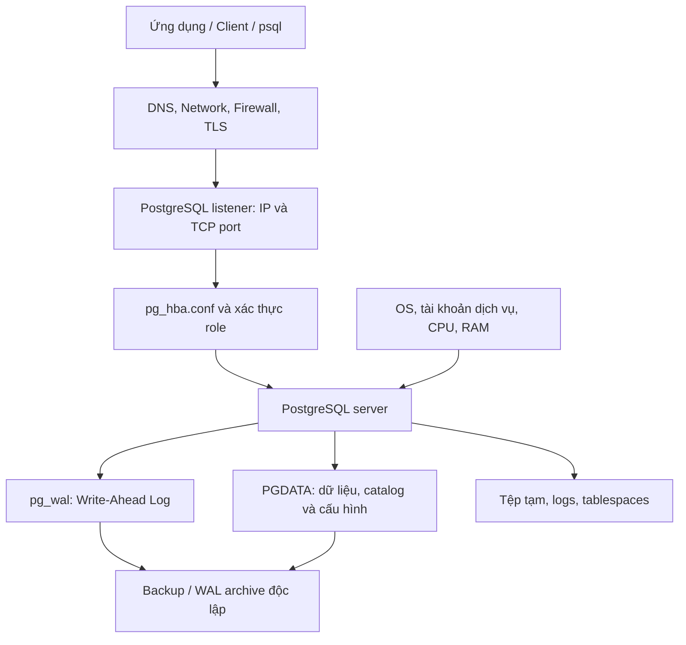
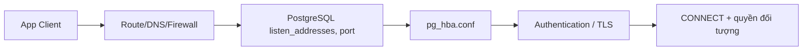

# Chuẩn bị hệ điều hành, dung lượng, cổng kết nối và tài khoản dịch vụ cho PostgreSQL

Trước khi chạy trình cài PostgreSQL hoặc khởi tạo một cụm dữ liệu (*database cluster*), cần xác định **máy chủ có tương thích và đủ tài nguyên không, dữ liệu sẽ nằm ở đâu, cổng nào được sử dụng, và tiến trình PostgreSQL được phép chạy dưới tài khoản nào**. Bỏ qua khâu này có thể khiến phần mềm cài được nhưng không khởi động, ổ đĩa đầy trong lúc ghi, ứng dụng không kết nối được hoặc vô tình mở database ra mạng công cộng.

Bài học hướng dẫn chuẩn bị PostgreSQL trên Linux, Windows và macOS, với các ví dụ chi tiết trên Linux dùng để vận hành máy chủ. Những nội dung chính gồm:

- Chọn hệ điều hành, bản PostgreSQL, kiến trúc và tài nguyên CPU/RAM.
- Ước lượng dung lượng bảng, chỉ mục, WAL, tệp tạm và backup; bố trí thư mục dữ liệu an toàn.
- Kiểm tra cổng mặc định `5432`, địa chỉ lắng nghe, firewall, xác thực và kết nối từ ứng dụng.
- Phân biệt **tài khoản dịch vụ của hệ điều hành** với **role đăng nhập PostgreSQL**; thiết kế quyền theo nguyên tắc tối thiểu.
- Lập bảng kiểm tra trước khi cài và thực hành xử lý các tình huống phổ biến.

Các lệnh quan sát OS có thể chạy trước khi cài. Những lệnh như `psql`, `pg_isready`, `SHOW` hoặc cấu hình `postgresql.conf` và `pg_hba.conf` chỉ có ý nghĩa **sau khi chương trình hoặc cluster tương ứng đã tồn tại**.

## 1. Bản đồ các thành phần cần chuẩn bị



| Thành phần | Câu hỏi chuẩn bị |
|---|---|
| Hệ điều hành | Phiên bản OS, CPU và bản phân phối PostgreSQL có tương thích không? |
| CPU/RAM | Có đủ tài nguyên cho lượng kết nối, truy vấn, báo cáo và hoạt động bảo trì không? |
| Đĩa | Đặt dữ liệu, WAL, logs, tệp tạm, bản sao lưu ở đâu và dự phòng bao nhiêu? |
| User dịch vụ | PostgreSQL chạy dưới user OS nào; ai sở hữu thư mục dữ liệu? |
| Cổng và địa chỉ | Client cùng máy hay khác máy, port có xung đột, server nghe trên interface nào? |
| Chính sách truy cập | Firewall, `pg_hba.conf`, xác thực, TLS và quyền trên database có khớp không? |
| Vận hành | Có logging, backup/restore, giám sát dung lượng và quy trình cập nhật không? |

Nên phân biệt sớm **máy học tập/local** (ứng dụng và DB cùng máy) với **máy chủ dùng trong mạng ứng dụng/production**. Máy học tập có thể chỉ cần `localhost`; server riêng cần phạm vi IP, xác thực, bảo mật và khả năng phục hồi rõ ràng.

## 2. Chuẩn bị hệ điều hành và phiên bản PostgreSQL

### 2.1. Tương thích quan trọng hơn tên hệ điều hành

PostgreSQL hoạt động trên nhiều nền tảng nhưng phải chọn **gói, phiên bản và kiến trúc phù hợp**. Trước khi tải, xác định:

1. Hệ điều hành và phiên bản cụ thể.
2. Kiến trúc `x86_64/amd64`, `aarch64/arm64` hoặc kiến trúc khác được gói hỗ trợ.
3. Nhánh PostgreSQL còn trong vòng đời hỗ trợ, phù hợp driver và công cụ quản trị.
4. Các extension, thư viện hệ thống và phương thức xác thực cần dùng.
5. Nguồn gói và cách cập nhật (gói OS, repository PostgreSQL, installer hay container).

| Môi trường | Lựa chọn triển khai thường gặp | Điểm cần chú ý |
|---|---|---|
| Debian/Ubuntu Linux | Gói từ distro hoặc kho PostgreSQL tương thích | Version package, tên service, data directory, systemd |
| RHEL/Rocky/Alma Linux | Gói hệ điều hành hoặc kho PostgreSQL | SELinux, firewalld, service theo phiên bản |
| Windows | Trình cài/nguồn gói phù hợp | Windows Service, NTFS ACL, service account, firewall |
| macOS | Installer, Homebrew hoặc công cụ phù hợp | Intel/Apple Silicon, quyền thư mục và service manager |
| Docker/Kubernetes | Image PostgreSQL và persistent volume | UID/GID, quota RAM/CPU, storage và vòng đời volume |

Đừng trộn nhiều nguồn cài trên cùng máy mà không có kế hoạch. Điều đó có thể tạo nhiều binary `postgres`/`psql`, service hoặc cluster khác nhau; một lệnh `psql` trong `PATH` có thể không thuộc phiên bản server đang chạy.

### 2.2. Kiểm tra Linux trước khi cài

```bash
# Phiên bản hệ điều hành.
cat /etc/os-release

# Kiến trúc máy và phiên bản kernel.
uname -m
uname -r

# CPU và RAM.
lscpu
nproc
free -h

# Swap và giới hạn file descriptor trong shell hiện tại.
swapon --show
ulimit -n
```

`ulimit -n` của shell không nhất thiết giống giới hạn mà service systemd nhận. Sau khi cài phải xem cả cấu hình service nếu cần xử lý giới hạn tài nguyên.

### 2.3. Kiểm tra Windows

Trong PowerShell:

```powershell
Get-ComputerInfo |
    Select-Object WindowsProductName, OsVersion, OsArchitecture

Get-CimInstance Win32_ComputerSystem |
    Select-Object Name, TotalPhysicalMemory

Get-CimInstance Win32_Processor |
    Select-Object Name, NumberOfCores, NumberOfLogicalProcessors
```

Trên Windows, dịch vụ PostgreSQL có thể chạy dưới một Windows service account do trình cài hoặc quản trị viên cấu hình. Không mặc định tài khoản ấy có cùng tên/cơ chế với user `postgres` trên Linux.

### 2.4. Kiểm tra macOS

```bash
sw_vers
uname -m
sysctl -n hw.memsize
sysctl -n hw.logicalcpu
```

Các lệnh trên chỉ thu thập thông tin. Khi chọn phiên bản PostgreSQL, phải đối chiếu khả năng hỗ trợ của nhà phát hành/gói cài ở thời điểm triển khai, thay vì mặc định mọi bản PostgreSQL đều chạy được trên mọi bản OS.

## 3. Ước lượng CPU, RAM và tải đồng thời

Không có công thức cố định kiểu “100 người dùng = 4 CPU và 8 GiB RAM” cho mọi PostgreSQL. Hai ứng dụng có cùng số người dùng nhưng khác cấu trúc truy vấn có thể cần tài nguyên rất khác nhau.

### 3.1. CPU

- Ứng dụng OLTP với giao dịch nhỏ cần thời gian đáp ứng tốt khi nhiều request đến đồng thời.
- Truy vấn phân tích với `JOIN`, `GROUP BY`, sắp xếp, tổng hợp và lọc nhiều dữ liệu có thể tiêu thụ CPU đáng kể.
- Tạo chỉ mục, autovacuum, nén bản sao lưu và tác vụ nền cùng cạnh tranh tài nguyên.
- VM và container có thể bị giới hạn bởi CPU quota hoặc contention của host.

Hãy dự trù hiệu năng trên workload đại diện; không chỉ nhìn tổng số core được báo cáo.

### 3.2. RAM và số kết nối

| Cấu hình PostgreSQL sau khi cài | Vai trò |
|---|---|
| `shared_buffers` | Bộ nhớ đệm dùng chung của PostgreSQL |
| `work_mem` | Ngân sách cho một số thao tác sort/hash; **có thể có nhiều thao tác trong một truy vấn** |
| `maintenance_work_mem` | Bộ nhớ cho một số tác vụ bảo trì |
| `max_connections` | Giới hạn kết nối đồng thời ở server |
| `autovacuum_work_mem` | Bộ nhớ cho công việc autovacuum khi được cấu hình |

Ví dụ, một truy vấn có nhiều bước hash/sort có thể dùng nhiều vùng `work_mem`. Nếu nhiều kết nối chạy truy vấn tương tự cùng lúc, tổng RAM cần thiết có thể lớn hơn suy nghĩ “mỗi kết nối chỉ dùng một `work_mem`”.

Không phân bổ toàn bộ RAM cho `shared_buffers`. Hệ điều hành còn cần page cache, tiến trình nền, mạng và các dịch vụ khác. Dùng connection pool ở ứng dụng thường hiệu quả hơn việc tăng `max_connections` quá lớn mà không hiểu số truy vấn thực sự chạy đồng thời.

### 3.3. Swap, OOM và giới hạn dịch vụ

Kiểm tra `free -h`, `swapon --show` và các giới hạn container/VM. Swap liên tục hoặc OOM killer có thể khiến service gián đoạn. Đừng áp dụng một danh sách sysctl “tối ưu PostgreSQL” sao chép từ môi trường khác mà không kiểm tra kernel, storage và tải thực tế.

Đặc biệt với container, RAM vật lý host có thể lớn hơn nhiều so với **memory limit** mà tiến trình PostgreSQL được cấp. Cấu hình cần dựa vào hạn mức thật của container và số worker/query đồng thời.

## 4. Dung lượng phải tính cả dữ liệu, WAL, tệp tạm và backup

Một lỗi lập kế hoạch phổ biến là tính “dữ liệu 80 GiB thì cấp ổ 100 GiB là đủ”. Ngoài dữ liệu, PostgreSQL còn có chỉ mục, nhật ký WAL, tệp tạm khi truy vấn nặng và dung lượng để bảo trì.

### 4.1. Các hạng mục tiêu thụ đĩa

| Hạng mục | Mục đích và rủi ro |
|---|---|
| Bảng dữ liệu | Chứa hàng và phiên bản bản ghi theo cơ chế MVCC |
| Chỉ mục | B-tree và các kiểu index khác, tiêu thụ thêm dung lượng |
| `pg_wal` | WAL để phục hồi sau crash, hỗ trợ replication và WAL archiving |
| Tệp tạm | Sort/hash hoặc thao tác vượt ngân sách RAM có thể spill ra đĩa |
| Bloat | Cập nhật/xóa có thể tạo phiên bản chết, cần vacuum và tài nguyên |
| Bảo trì | `VACUUM FULL`, `CLUSTER`, tạo lại index có thể cần không gian lớn |
| Server log | Nhật ký lỗi, kết nối, truy vấn chậm và tác vụ |
| Backup/WAL archive | Dữ liệu phục hồi; cần dung lượng và vị trí an toàn riêng |

`PGDATA` là tên quy ước của thư mục dữ liệu cluster. Nó thường chứa các thư mục hệ thống, tệp dữ liệu, catalog và `pg_wal` theo bố trí mặc định. Vị trí cụ thể do package, lệnh khởi tạo và service quyết định.

### 4.2. Bài toán dung lượng mẫu

Giả sử dữ liệu ban đầu 80 GiB, chỉ mục 32 GiB. Dự báo đến đợt mở rộng kế tiếp:

| Thành phần | Dung lượng kế hoạch |
|---|---:|
| Dữ liệu bảng | 80 GiB |
| Chỉ mục | 32 GiB |
| Tăng trưởng bảng và chỉ mục | 45 GiB |
| Dự phòng WAL khi ghi nhiều/replica chậm | 25 GiB |
| Tệp tạm của truy vấn báo cáo | 20 GiB |
| Bloat và thao tác bảo trì | 40 GiB |
| **Cộng trước headroom** | **242 GiB** |

Nếu thêm 20% vùng trống vận hành, tính `242 × 1,20 = 290,4 GiB`. Một volume khoảng **300 GiB hoặc hơn** là điểm khởi đầu để thảo luận trong ví dụ này. Đây không phải định mức chung cho mọi hệ thống: thao tác viết lại bảng lớn có thể cần **gần kích thước của bảng và các chỉ mục liên quan** làm không gian tạm, vượt mức dự phòng minh họa.

Phải xét thêm tốc độ tăng trưởng theo tháng, IOPS/throughput, chính sách backup và khả năng tăng dung lượng khi hệ thống hoạt động. Không đồng nhất **GiB** (2^30 byte) với **GB** (10^9 byte) khi so dung lượng thiết bị.

### 4.3. Vì sao WAL có thể tăng ngoài dự kiến?

WAL (*Write-Ahead Log*) giúp PostgreSQL phục hồi nhất quán sau sự cố và truyền thay đổi theo một số cơ chế replication. Thư mục `pg_wal` có thể phình lên nếu:

- Replica sử dụng **replication slot** nhưng dừng nhận WAL.
- WAL archive bị lỗi và PostgreSQL cần giữ các segment chưa archive thành công.
- Workload sinh nhiều WAL, có các giao dịch ghi lớn hoặc tốc độ thay đổi cao.
- Các cơ chế retention yêu cầu giữ các segment lâu hơn dự kiến.

Thông số `max_wal_size` **không phải giới hạn cứng** cho dung lượng WAL trong mọi tình huống. Một cấu hình giữ WAL sai hoặc archive lỗi có thể làm đầy volume dù đã thiết lập `max_wal_size`.

Từ giai đoạn chuẩn bị phải quyết định: ai nhận cảnh báo WAL tăng, dữ liệu nào được backup/archiving, và cách xử lý khi một replica không nhận được thay đổi. Không chuyển `pg_wal` bằng cách cắt/dán thư mục khi PostgreSQL đang chạy.

### 4.4. Backup không được chỉ nằm trong cùng nơi dữ liệu

Một thư mục `/srv/postgresql/backups` trên **cùng ổ vật lý** với `PGDATA` có thể hữu ích cho thao tác tạm, nhưng không giúp phục hồi khi mất toàn bộ ổ. Cần có bản backup ở nơi độc lập phù hợp với yêu cầu RPO/RTO, kiểm tra restore định kỳ, và chính sách giữ WAL nếu muốn phục hồi theo thời điểm.

Replication cũng không thay thế backup: lệnh `DELETE` sai, dữ liệu bị hỏng về mặt nghiệp vụ hoặc nhầm lẫn ứng dụng có thể được sao chép sang các replica.

## 5. Thiết bị lưu trữ, filesystem và thư mục PGDATA

### 5.1. Dung lượng trống không đồng nghĩa I/O đủ nhanh

Ngoài `df -h`, nên biết:

- Ổ sử dụng SSD/NVMe, HDD hay network/cloud volume?
- Có giới hạn IOPS, throughput hoặc burst credits không?
- Storage có hỗ trợ semantics flush/sync cần cho độ bền dữ liệu không?
- Có chính sách snapshot, thay ổ, giám sát hỏng phần cứng không?
- Mount có luôn sẵn sàng trước khi PostgreSQL service khởi động không?

Trên Linux, **ext4** và **XFS** là các filesystem phổ biến khi hạ tầng cho phép. Windows thường dùng **NTFS**, macOS thường dùng **APFS**. Điều quan trọng là cấu hình đã được hỗ trợ, phân quyền đúng và storage thực thi đồng bộ ghi dữ liệu một cách đáng tin cậy.

Không tắt `fsync` hoặc những cơ chế bảo đảm độ bền chỉ để làm benchmark đẹp hơn trong môi trường phải bảo vệ dữ liệu.

### 5.2. Quan sát ổ đĩa trên Linux

```bash
# Dung lượng và loại filesystem đang mount.
df -hT

# Inode còn trống.
df -i

# Thiết bị và phân vùng.
lsblk -f

# Kiểm tra filesystem chứa đường dẫn dự kiến (nếu đường dẫn đã tồn tại).
findmnt -T /srv/postgresql
```

Nếu mount point chưa được tạo hoặc volume chưa mount, đường dẫn `/srv/postgresql` có thể đang nằm trên **root filesystem**. Vì vậy không kết luận “đã có volume riêng” chỉ từ việc thư mục tồn tại.

Trên Windows PowerShell:

```powershell
Get-Volume |
    Select-Object DriveLetter, FileSystem, Size, SizeRemaining

Get-PSDrive -PSProvider FileSystem |
    Select-Object Name, Root, Used, Free
```

### 5.3. Bố trí dữ liệu

Một ví dụ cho môi trường Linux tự quản trị:

```text
/srv/postgresql/
    data/              # PGDATA thuộc user dịch vụ
    backups-local/     # bản tạm; không phải backup duy nhất

/var/log/postgresql/   # chỉ nếu chính sách log sử dụng đường dẫn này
```

Nhiều package đã có quy ước riêng như `/var/lib/postgresql/...` hoặc `/var/lib/pgsql/...`. **Ưu tiên cách quản lý của package/service được chọn** khi chưa có lý do đổi; không đoán `PGDATA` từ hướng dẫn của một bản phân phối khác.

Nếu dùng volume riêng, chuẩn bị mount **trước khi khởi tạo cluster**, và đảm bảo service chỉ khởi động khi volume đúng đã sẵn sàng. Nếu không, PostgreSQL có thể vô tình dùng đường dẫn trên root disk hoặc báo không thấy dữ liệu.

### 5.4. Quyền tệp dữ liệu

Trên Unix, thư mục dữ liệu phải thuộc user OS chạy PostgreSQL, với quyền hạn chế. Mức **`0700`** là lựa chọn phổ biến; ở một số cấu hình PostgreSQL chấp nhận **`0750`** cho quyền nhóm phù hợp. Không dùng `0777` và không để người dùng thường tùy ý đọc/sửa tệp database.

Lệnh quan sát nếu đường dẫn đã tồn tại:

```bash
stat -c '%U %G %a %n' /srv/postgresql/data
```

Chỉ kiểm tra ownership không đủ nếu hệ thống còn SELinux/AppArmor hoặc Windows ACL. Không chạy `chown -R`, `chmod -R` hay di chuyển thư mục dữ liệu của cluster đang hoạt động theo cảm tính; phải biết đúng service, volume và chính sách bảo mật.

## 6. Tài khoản dịch vụ OS khác với role trong PostgreSQL

### 6.1. User hệ điều hành chạy server

Trên nhiều bản phân phối Linux, gói cài tạo user hệ điều hành tên **`postgres`**. User này sở hữu tiến trình server và thư mục dữ liệu, thường **không phải root**.

Sau khi package tạo tài khoản, có thể kiểm tra:

```bash
id postgres
getent passwd postgres
ps -eo user,pid,comm,args | grep '[p]ostgres'
```

Nếu kiểm tra **trước khi cài** mà `id postgres` báo không tìm thấy, chưa thể kết luận có lỗi: gói cài có thể chưa tạo tài khoản. Đừng vội tạo user `postgres` thủ công khi chưa biết phương thức cài có tự quản lý UID, home directory và service hay không.

Nguyên tắc:

- Tiến trình PostgreSQL phải chạy dưới tài khoản OS có quyền hạn chế, **không chạy bằng root**.
- Account này có quyền đọc/ghi các đường dẫn mà server cần, không có quyền quản trị toàn bộ hệ thống.
- Không dùng nó làm tài khoản đăng nhập hằng ngày của ứng dụng web.
- Quyền đối với log, backup, TLS certificate và volumes phải được cấp có chủ đích.

Trên Windows, dùng **Windows service account** với NTFS ACL và chính sách “Log on as a service” phù hợp. Tên account có thể do trình cài đặt quyết định; không nhất thiết là `postgres`.

### 6.2. PostgreSQL role là tài khoản trong cluster

Sau khi cluster đã chạy, PostgreSQL quản lý **role** ở tầng database. Role có thể có thuộc tính `LOGIN` để kết nối, `CREATEDB`, `CREATEROLE` hoặc `SUPERUSER`; quyền trên bảng/schema/database còn được quản lý riêng.

Ví dụ SQL chỉ để minh họa **sau khi cài và được cấp quyền quản trị**:

```sql
CREATE ROLE app_user LOGIN;
-- Tài khoản này còn cần cơ chế xác thực và các quyền truy cập
-- database/schema/bảng theo yêu cầu ứng dụng.
```

| Đặc điểm | User OS `postgres` | Role PostgreSQL `postgres` |
|---|---|---|
| Được quản lý ở đâu? | Hệ điều hành | Bên trong database cluster |
| Vai trò | Chạy service, sở hữu PGDATA | Thường là role quản trị/superuser database |
| Kiểm tra | `id postgres`, process manager | `\du` trong psql hoặc catalog |
| Quyền | UID/GID, ACL, SELinux/AppArmor | `LOGIN`, `GRANT`, `SUPERUSER`, quyền object |
| Dùng cho ứng dụng web? | Không nên | Không nên; tạo role riêng |

Hai đối tượng có thể cùng tên nhưng **không phải cùng một tài khoản**. Không cần đặt mật khẩu user OS giống mật khẩu role database.

### 6.3. Áp dụng quyền tối thiểu

Một mô hình triển khai:

```text
OS service user: postgres
    └── Sở hữu PGDATA và chạy PostgreSQL

DB administrator role: postgres / role quản trị được chỉ định
    └── Quản trị cluster, database và role

DB migration role: app_migrator
    └── Thay đổi schema trong phạm vi được duyệt

DB application role: app_user
    └── CONNECT và SELECT/INSERT/UPDATE/DELETE cần thiết

DB backup role:
    └── Quyền phù hợp phương pháp backup
```

Không cấp `SUPERUSER` hoặc `CREATEROLE` cho role xử lý request thông thường. Phân quyền cần theo database, schema và đối tượng thực tế. Quản lý mật khẩu qua secret manager hoặc cơ chế bí mật phù hợp; không commit mật khẩu vào Git hay nhúng trong script chia sẻ.

## 7. Cổng mặc định 5432, địa chỉ lắng nghe và socket

PostgreSQL thường dùng **TCP 5432** theo mặc định. Cổng này có thể thay đổi để chạy nhiều cluster trên cùng host hoặc theo chính sách hạ tầng.

### 7.1. Kiểm tra port có bị chiếm trước khi cài

Linux:

```bash
ss -ltnp | grep ':5432'
```

Windows PowerShell:

```powershell
Get-NetTCPConnection -LocalPort 5432 -State Listen -ErrorAction SilentlyContinue
```

macOS:

```bash
lsof -nP -iTCP:5432 -sTCP:LISTEN
```

Nếu không có listener, lệnh lọc có thể không in gì. Nếu port đã bị chiếm, xác định tiến trình và cluster đang dùng nó. **Không dừng hoặc xóa một dịch vụ PostgreSQL đã có dữ liệu quan trọng chỉ vì muốn dùng 5432.** Có thể chọn port khác, ví dụ 5433, nhưng phải cập nhật cấu hình ứng dụng và firewall.

### 7.2. listen_addresses và port sau cài

Trong `postgresql.conf`, cấu hình thường gặp:

```conf
# Chỉ nghe loopback/local khi ứng dụng cùng máy.
listen_addresses = 'localhost'
port = 5432
```

Khi ứng dụng ở subnet riêng và server có IP riêng `10.20.0.10`:

```conf
# Chỉ là IP minh họa; cần dùng địa chỉ thật của máy chủ.
listen_addresses = '10.20.0.10'
port = 5432
```

`listen_addresses = '*'` cho phép listener trên tất cả interface thích hợp; **không dùng làm mặc định cho môi trường không cần kết nối từ xa**. Khi thay đổi tham số yêu cầu khởi động lại như `listen_addresses` hoặc `port`, phải restart service đúng cách; không mặc định chỉ reload là đủ.

### 7.3. TCP khác Unix-domain socket

Trên Linux/macOS, cùng một PostgreSQL server có thể nhận kết nối qua:

- **TCP/IP** có host/IP và port.
- **Unix-domain socket** nếu client cùng máy và server cấu hình socket.

Ví dụ sau khi đã có `appdb` và `app_user`:

```bash
# Kết nối qua TCP loopback.
psql -h 127.0.0.1 -p 5432 -U app_user -d appdb

# Trên Unix, bỏ -h thường sử dụng Unix-domain socket,
# tùy bản cài và cấu hình client.
psql -U app_user -d appdb
```

Kết nối socket và TCP có thể khớp **các rule xác thực khác nhau**. Việc `psql` dùng socket thành công không chứng minh ứng dụng trên máy khác sẽ kết nối TCP thành công.

## 8. Kết nối thành công cần nhiều lớp, không chỉ mở firewall



### 8.1. Thiết kế mạng riêng

Ví dụ minh họa:

```text
Ứng dụng: 10.20.1.25 thuộc subnet 10.20.1.0/24
          |
          | TCP 5432, chính sách TLS phù hợp
          v
PostgreSQL: 10.20.0.10 (private IP)
          |
          +-- pg_hba.conf
          +-- role app_user
          +-- database appdb
```

Mở port **chỉ cho nguồn đã được duyệt**, thường là các máy ứng dụng hoặc subnet riêng. Firewall OS, firewall đám mây, security group, network ACL và policy của container/Kubernetes có thể cùng ảnh hưởng đường kết nối.

### 8.2. pg_hba.conf quyết định ai được thử xác thực

Ví dụ rule dành cho ứng dụng mạng riêng, **chỉ dùng khi TLS đã được cấu hình**:

```conf
# TYPE     DATABASE   USER       ADDRESS         METHOD
hostssl    appdb      app_user   10.20.1.0/24    scram-sha-256
```

Ý nghĩa:

- `hostssl`: chỉ phù hợp với kết nối TCP có SSL/TLS.
- `appdb`: database mục tiêu.
- `app_user`: role được phép thử xác thực theo rule này.
- `10.20.1.0/24`: dải địa chỉ client được chấp nhận.
- `scram-sha-256`: phương pháp xác thực mật khẩu dựa trên SCRAM.

**Rule không tự tạo** role, database, mật khẩu hay chứng chỉ. Server phải có TLS phù hợp để `hostssl` hoạt động; client phải tin cậy và kiểm tra chứng chỉ theo yêu cầu bảo mật.

`pg_hba.conf` dùng **rule khớp đầu tiên** trong thứ tự được xét. Nếu xác thực theo rule đầu tiên khớp thất bại, server không tự động thử mọi rule bên dưới. Vì vậy cần kiểm tra cả thứ tự các rule, không chỉ tìm thấy một dòng trông đúng.

Không đặt `trust` cho kết nối mạng không đáng tin cậy: phương thức này không yêu cầu xác thực mật khẩu theo rule đó. Trên Linux, `peer` có thể phù hợp với một số kết nối Unix socket vì dựa trên danh tính OS user; nó không tương đương với xác thực mật khẩu TCP.

### 8.3. Kiểm tra firewall trước thay đổi

Linux dùng UFW:

```bash
sudo ufw status verbose
```

Linux dùng firewalld:

```bash
sudo firewall-cmd --list-all
```

Windows PowerShell:

```powershell
Get-NetFirewallRule -Enabled True -Direction Inbound |
    Select-Object DisplayName, Action, Profile
```

Các lệnh trên là bước **quan sát**. Việc cấp rule inbound cần dựa trên IP/subnet thực tế và phải xét cả firewall hạ tầng. Không mở TCP 5432 cho `0.0.0.0/0` chỉ vì một client đang gặp lỗi.

### 8.4. Kiểm tra sau khi service đã chạy

Từ máy ứng dụng Linux/macOS:

```bash
# Kiểm tra được TCP port hay chưa.
nc -vz db.internal.example 5432

# Kiểm tra server có chấp nhận kết nối ở mức trạng thái,
# không bảo đảm app_user xác thực thành công.
pg_isready -h db.internal.example -p 5432
```

Từ Windows:

```powershell
Test-NetConnection -ComputerName db.internal.example -Port 5432
```

Khi đã có role, database và chứng chỉ phù hợp:

```bash
psql "host=db.internal.example port=5432 dbname=appdb user=app_user sslmode=verify-full"
```

`sslmode=verify-full` kiểm tra chứng chỉ máy chủ và tên máy chủ; nó yêu cầu cấu hình CA tin cậy và chứng chỉ đúng. Nếu chưa thiết lập TLS, lệnh có thể báo lỗi chứng chỉ. **Không mặc nhiên hạ xuống kết nối không mã hóa** mà không xem yêu cầu bảo mật của môi trường.

| Lỗi quan sát | Hướng kiểm tra |
|---|---|
| `Connection refused` | Listener, địa chỉ, cổng, trạng thái service |
| Timeout TCP | Route, firewall, security group, mạng |
| `no pg_hba.conf entry` | Rule theo IP/client/database/role/SSL |
| `password authentication failed` | Mật khẩu, role, phương thức xác thực |
| TLS/certificate error | Chứng chỉ, CA, hostname và cấu hình TLS |
| `permission denied for table/schema` | Quyền đối tượng sau khi kết nối thành công |

Kết nối được TCP **không** chứng minh PostgreSQL đã cho phép đăng nhập; đăng nhập được **không** chứng minh role có quyền thao tác mọi bảng.

## 9. Đồng hồ hệ thống, encoding, locale và timezone

### 9.1. Thời gian chính xác hỗ trợ log và vận hành

Đồng hồ lệch giữa các máy có thể làm sai lệch nhật ký, lịch tác vụ, TTL, xác thực chứng chỉ và phân tích sự cố. Trên Linux systemd:

```bash
timedatectl status
```

Nếu hệ thống dùng Chrony:

```bash
chronyc tracking
chronyc sources
```

Công cụ đồng bộ cụ thể tùy OS/hạ tầng. Không tự đổi múi giờ toàn hệ thống khi chưa xét tác động tới ứng dụng khác.

### 9.2. Chọn encoding và locale trước khi initdb

Khi khởi tạo cluster hoặc tạo database, cần quyết định:

- **Encoding:** `UTF8` thường phù hợp với dữ liệu đa ngôn ngữ.
- **Locale/collation:** ảnh hưởng so sánh, sắp xếp chuỗi và hành vi của một số chỉ mục.
- **Locale provider:** tùy phiên bản PostgreSQL và nền tảng có thể là libc hoặc ICU.
- **Timezone:** chọn chuẩn lưu/hiển thị ngày giờ thống nhất với ứng dụng.

Trên Linux:

```bash
locale
locale -a
```

Không giả định locale `vi_VN.UTF-8` hay `en_US.UTF-8` tồn tại sẵn trên mọi OS/container. Chọn locale thực tế được hỗ trợ và ghi lại quyết định. Khi phiên bản thư viện collation thay đổi sau nâng cấp, thứ tự so sánh có thể thay đổi và cần quy trình kiểm tra hoặc tạo lại chỉ mục liên quan.

### 9.3. TIMESTAMP và TIMESTAMPTZ

Ứng dụng phân tán thường cần lưu thời điểm thực, ví dụ thời gian thanh toán, bằng `TIMESTAMPTZ`. PostgreSQL xử lý kiểu này theo mốc thời gian và hiển thị tùy timezone của phiên; nó **không lưu tên múi giờ gốc riêng cho mỗi giá trị**. Nếu nghiệp vụ cần nhớ “khách chọn múi giờ nào”, cần lưu thông tin đó riêng.

`TIMESTAMP WITHOUT TIME ZONE` phù hợp khi muốn biểu diễn thời gian địa phương không gắn với thời điểm tuyệt đối, nhưng dễ gây nhầm nếu dùng cho sự kiện giữa nhiều vùng. Việc quyết định này thuộc thiết kế dữ liệu nhưng nên được thống nhất ngay khi chuẩn bị môi trường.

## 10. Service manager, SELinux/AppArmor và vận hành

### 10.1. Service theo cách đóng gói

Trên Linux dùng systemd, sau khi cài có thể kiểm tra:

```bash
systemctl list-unit-files | grep -i postgres
systemctl status postgresql
```

Tên unit có thể gồm phiên bản hoặc tên cluster; `systemctl status postgresql` không tìm thấy chưa chứng minh server không được cài. Trước khi cài, không có PostgreSQL unit là bình thường.

Đường khởi động phải xác định đúng binary, data directory và user dịch vụ, và đảm bảo volume/mount chứa `PGDATA` sẵn sàng trước service. Không dùng lệnh kill mạnh như một cách dừng chuẩn khi có phương thức shutdown sạch được cung cấp.

### 10.2. SELinux và AppArmor

Trên một số bản phân phối Linux, quyền Unix đúng chưa đủ vì còn lớp Mandatory Access Control:

- **SELinux** phổ biến trên hệ RHEL.
- **AppArmor** có thể hiện diện trên Debian/Ubuntu và hệ khác.

Lệnh quan sát nếu công cụ được cài:

```bash
getenforce
sudo aa-status
```

Nếu chuyển PGDATA sang mount tùy chỉnh, cấu hình/nhãn bảo mật có thể không phù hợp. Không mặc định chữa lỗi bằng `chmod 777` hoặc vô hiệu hóa SELinux/AppArmor toàn hệ thống; cần xem log policy và tài liệu triển khai.

### 10.3. Quy trình vận hành phải được thiết kế trước

Một máy chủ PostgreSQL dùng dữ liệu quan trọng cần:

1. Lịch cập nhật bản vá OS và PostgreSQL.
2. Giám sát CPU, RAM, I/O, dung lượng dữ liệu, WAL, logs và kết nối.
3. Backup định kỳ, chính sách retention và **kiểm tra khôi phục**.
4. Quản lý password/secret, role và quyền quản trị.
5. Quy trình restart, thay đổi cổng, mở rộng volume và nâng cấp.
6. Cảnh báo sớm trước khi hết đĩa hoặc WAL tích tụ.

Mã hóa lưu trữ ở tầng volume và TLS khi truyền có thể cần theo chính sách bảo mật, nhưng **không thay thế** phân quyền hoặc sao lưu. Backup cũng không tự động bảo đảm có thể khôi phục nếu chưa được kiểm thử.

## 11. Lưu ý khi PostgreSQL chạy trong container hoặc cloud

Môi trường container có thêm các điều kiện riêng:

- **Persistent volume:** dữ liệu phải tồn tại sau khi container được thay thế; không lưu production chỉ trong lớp filesystem tạm của image.
- **UID/GID:** user trong container có thể không trùng user `postgres` trên host. Mount và filesystem phải cấp đúng quyền, không giải quyết bằng `chmod 777`.
- **CPU/RAM limits:** dùng hạn mức cgroup/container thực tế để thiết kế bộ nhớ PostgreSQL.
- **IOPS/throughput:** cloud volume có thể có giới hạn, không chỉ dung lượng tối đa.
- **Backup/snapshot:** phải kiểm chứng cách tạo bản sao nhất quán và restore; snapshot storage đơn lẻ không thay thế quy trình backup PostgreSQL đúng.
- **Readiness/liveness:** health check phải xét thời gian startup/recovery hợp lệ để không restart tiến trình lặp lại.

Khi dùng nhiều pod hoặc VM, cần xác định rõ **đường kết nối cố định**, DNS, firewall/policy mạng và ai chịu trách nhiệm failover. Mở TCP trên một pod không tự đảm bảo kết nối an toàn từ ứng dụng.

## 12. Hai kịch bản lập kế hoạch

### 12.1. Máy phát triển: PostgreSQL và ứng dụng cùng laptop

| Tiêu chí | Phương án hợp lý |
|---|---|
| OS | Windows, Linux hoặc macOS được bộ cài hỗ trợ |
| PGDATA | Đường dẫn theo trình cài/package, có dung lượng đủ |
| Port | `5432` nếu chưa bị chiếm |
| Listener | `localhost`/loopback |
| Firewall | Không mở port ra Internet |
| OS account | Tài khoản dịch vụ do cách cài tạo/quản lý |
| DB role | Role riêng cho project, không dùng superuser nếu không cần |
| Backup | Lưu bản sao cho dữ liệu học tập cần giữ |

```text
Laptop
  +---------------------------------------+
  | Java app / psql --> 127.0.0.1:5432   |
  |                    PostgreSQL service |
  |                    PGDATA trên ổ local|
  +---------------------------------------+
```

Không có nhu cầu đặt `listen_addresses = '*'` hoặc cấu hình public IP cho trường hợp học tập thuần local.

### 12.2. Server riêng cho mạng ứng dụng

```text
Application subnet 10.20.1.0/24
             |
             | TCP 5432 + TLS
             v
PostgreSQL private IP 10.20.0.10
             |
             +-- User OS: postgres/service account
             +-- PGDATA trên volume bền vững
             +-- WAL và I/O được giám sát
             +-- Role ứng dụng riêng
             +-- Backup ở nơi độc lập
```

| Quyết định | Giá trị minh họa | Điều phải xác minh |
|---|---|---|
| OS | Linux 64-bit được hỗ trợ | Distro và phiên bản chính xác |
| PostgreSQL | Nhánh phiên bản được hỗ trợ | Driver, extension, cách cài |
| Tài nguyên | CPU/RAM theo tải thử | Số kết nối và độ trễ truy vấn |
| Volume | Ví dụ khoảng 300 GiB từ bài toán dung lượng | Tăng trưởng, WAL, bảo trì và IOPS |
| Service user | `postgres` do gói tạo | UID, ownership, policy bảo mật OS |
| Address/port | `10.20.0.10:5432` | IP thật, DNS, xung đột port |
| Firewall | Chỉ subnet ứng dụng được duyệt | Policy OS/cloud/Kubernetes |
| Auth | `hostssl` + `scram-sha-256` | TLS certificate, role, secret và quyền |
| Backup | Lưu ngoài failure domain | Lịch backup, RPO/RTO và thử restore |

Các địa chỉ `10.20.x.x` chỉ là **IP riêng giả định**, không phải địa chỉ thật của người học.

## 13. Bảng kiểm chuẩn bị trước khi cài

### 13.1. Hệ điều hành và tài nguyên

- [ ] Đã chọn phiên bản PostgreSQL phù hợp với OS, kiến trúc và extension.
- [ ] Đã thống nhất nguồn gói/installer và phương án cập nhật.
- [ ] Đã kiểm tra CPU, RAM, swap, quota VM/container và giới hạn dịch vụ.
- [ ] Đồng hồ đồng bộ; encoding, locale và timezone có phương án.
- [ ] Biết service manager và các cơ chế SELinux/AppArmor/Windows ACL nếu có.

### 13.2. Lưu trữ

- [ ] Có ước lượng dữ liệu, index, tăng trưởng, WAL, tệp tạm và bảo trì.
- [ ] Đã kiểm tra filesystem, mount point, IOPS/throughput và khả năng tăng volume.
- [ ] Xác định đường dẫn `PGDATA` chính xác, không chồng lên cluster khác.
- [ ] User dịch vụ có ownership và quyền phù hợp; không dùng thư mục công cộng.
- [ ] Có chiến lược backup, WAL archive và vùng lưu độc lập.
- [ ] Có cảnh báo dung lượng/WAL trước khi hết đĩa.

### 13.3. Mạng và quyền

- [ ] Port dự kiến (thường 5432) không xung đột tiến trình khác.
- [ ] Biết ứng dụng kết nối bằng TCP hay Unix socket.
- [ ] Xác định địa chỉ `listen_addresses` và nguồn IP cần cho phép.
- [ ] Firewall/cloud security group chỉ mở phạm vi cần thiết.
- [ ] Có thiết kế `pg_hba.conf`, xác thực, TLS và quản lý secret.
- [ ] Tách role ứng dụng/migration/backup khỏi role quản trị.
- [ ] Có cách kiểm tra kết nối thực sự sau cài.

### 13.4. Vận hành

- [ ] Xác định chủ sở hữu dịch vụ, log và cảnh báo.
- [ ] Có quy trình restart, cập nhật, mở rộng đĩa, rollback thay đổi cấu hình.
- [ ] Backup được lên lịch và đã có kế hoạch thử phục hồi.
- [ ] Ghi lại đường dẫn binary, service, data directory, address và port.

## 14. Bài tập tình huống có đáp án

### Bài 1: PostgreSQL trên laptop có cần nghe mọi IP?

Một lập trình viên chạy Java và PostgreSQL trên cùng máy, muốn đặt `listen_addresses = '*'` chỉ vì kết nối `localhost` chưa thành công.

**Đáp án:** Không. Trước tiên kiểm tra service, port, `pg_hba.conf` và xác thực local. Nếu chỉ kết nối trong cùng máy, dùng `localhost` hoặc loopback phù hợp; mở mọi interface làm tăng bề mặt truy cập không cần thiết.

### Bài 2: Tính dung lượng đĩa

Bảng 80 GiB, index 32 GiB, dự báo tăng trưởng 45 GiB, WAL 25 GiB, tệp tạm 20 GiB và bảo trì 40 GiB, thêm 20% headroom.

**Đáp án:** Tổng trước headroom là `242 GiB`, sau dự phòng là khoảng **290,4 GiB**. Một volume 300 GiB là phương án thảo luận ban đầu, nhưng phải kiểm tra kích thước thao tác bảo trì và backup ở nơi khác.

### Bài 3: Hai tài khoản tên postgres có giống nhau?

Máy Linux có user OS `postgres` sở hữu `PGDATA` và PostgreSQL có role database `postgres`.

**Đáp án:** Không. User OS quản lý quyền tệp và tiến trình; role database được kiểm soát bởi quyền SQL và xác thực PostgreSQL. Ứng dụng nên có role `app_user` riêng thay vì dùng superuser.

### Bài 4: Port mở nhưng báo no pg_hba.conf entry

Ứng dụng trong subnet riêng kết nối TCP 5432 đến DB, nhưng PostgreSQL trả `no pg_hba.conf entry`.

**Đáp án:** Mạng đã tới server nhưng thiếu rule phù hợp theo loại kết nối, user, database, IP hoặc SSL. Kiểm tra thứ tự `pg_hba.conf` và bổ sung rule tối thiểu phù hợp; không bật `trust` hoặc mở mọi IP chỉ để hết lỗi.

### Bài 5: PGDATA đúng owner mà server vẫn không chạy

DB dùng Linux có SELinux, người quản trị chuyển `PGDATA` sang ổ riêng rồi đổi owner thành `postgres`. Service vẫn báo permission denied.

**Đáp án:** Có thể là SELinux label/policy, cấu hình service hoặc mount point chưa đúng; không phải chỉ do owner. Phải kiểm tra thông báo lỗi và chính sách bảo mật, không tùy tiện `chmod 777` hoặc tắt SELinux.

### Bài 6: max_wal_size có giới hạn cứng không?

Server có replication slot giữ WAL vì replica mất kết nối. Quản trị viên tin rằng `max_wal_size` đã đặt nên thư mục WAL không thể vượt ngưỡng.

**Đáp án:** Không. WAL có thể được giữ lại theo yêu cầu replication/archiving; `max_wal_size` không phải trần tuyệt đối. Phải giám sát `pg_wal`, archive, slots và headroom của volume.

### Bài 7: Thứ tự chẩn đoán lỗi kết nối

Ứng dụng không kết nối được PostgreSQL ở `db.internal.example:5432`.

**Đáp án:** Kiểm tra DNS/route → PostgreSQL chạy và nghe đúng IP/port → firewall/security group → `pg_hba.conf` → TLS/mật khẩu/role → quyền `CONNECT`, schema và bảng. Một lỗi `permission denied for table` sau khi đăng nhập là vấn đề quyền bên trong database, không phải firewall.

## 15. Tổng kết

Trước khi cài PostgreSQL, hãy hoàn thành bốn quyết định:

1. **Hệ điều hành:** OS/CPU tương thích với gói PostgreSQL; có nguồn cập nhật, đủ CPU/RAM và đồng bộ thời gian.
2. **Dung lượng:** biết `PGDATA` đặt ở đâu; đủ chỗ cho dữ liệu, index, WAL, temp, bloat, bảo trì và backup độc lập.
3. **Cổng kết nối:** port mặc định 5432 chỉ là một phần; phải đúng `listen_addresses`, firewall, `pg_hba.conf`, phương thức xác thực và TLS.
4. **Tài khoản dịch vụ:** PostgreSQL chạy dưới user OS không phải root; role của ứng dụng trong database được tách riêng và chỉ có các quyền cần thiết.

Khi đã chuẩn bị đúng bốn lớp này, việc cài đặt và khởi tạo cluster sẽ dễ kiểm soát hơn, và các bước triển khai, nâng cấp, sao lưu, mở rộng PostgreSQL về sau sẽ an toàn hơn.
