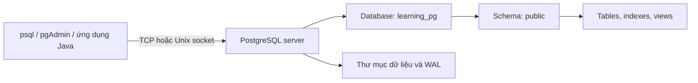

# Cài đặt PostgreSQL trên Linux, Windows và macOS

**PostgreSQL** là hệ quản trị cơ sở dữ liệu quan hệ mã nguồn mở, hỗ trợ SQL, giao dịch ACID, các kiểu dữ liệu phong phú, chỉ mục, khóa ngoại, view, function và nhiều khả năng mở rộng. Để bắt đầu học PostgreSQL, ta cần cài đặt máy chủ cơ sở dữ liệu (*database server*), công cụ kết nối (*client*) và tạo một cơ sở dữ liệu để thực hành. Trên Linux, Windows và macOS, các bước cài đặt khác nhau, nhưng sau khi máy chủ chạy, cách làm việc với SQL gần như giống nhau.

Bài này hướng dẫn ba môi trường phổ biến:

- **Linux:** Ubuntu/Debian bằng APT; Fedora/RHEL/Rocky Linux bằng DNF.
- **Windows:** bộ cài đồ họa PostgreSQL được trang tải chính thức giới thiệu, thường do EDB cung cấp.
- **macOS:** Homebrew hoặc ứng dụng Postgres.app.

Sau khi cài, ta sẽ xác minh dịch vụ, kết nối bằng `psql`, tạo role/database, thử lệnh SQL và học cách xử lý các lỗi phổ biến. Các lệnh sử dụng giả định bạn có quyền cài phần mềm trên máy thực hành. Không nên chạy lệnh thay đổi tài khoản, mạng hoặc xóa dữ liệu trên máy production khi chưa có quy trình vận hành phù hợp.

## 1. Hiểu các thành phần trước khi cài

Một hệ thống PostgreSQL thông thường gồm:

| Thành phần | Vai trò | Ví dụ |
| --- | --- | --- |
| PostgreSQL server | Quản lý database, dữ liệu, transaction và kết nối | Tiến trình `postgres` |
| Database cluster | Tập hợp các database do một PostgreSQL server instance quản lý trong một thư mục dữ liệu | Thư mục được khởi tạo bằng `initdb` |
| Client dòng lệnh | Gửi SQL đến server | `psql` |
| Công cụ quản trị GUI | Quản lý và truy vấn qua giao diện đồ họa | pgAdmin hoặc một SQL client tương thích |
| Service manager | Khởi động/dừng tiến trình server | `systemctl`, Windows Services, `brew services` |
| Thư mục dữ liệu | Lưu bảng, chỉ mục, WAL và metadata của instance | Đường dẫn được báo bởi `SHOW data_directory;` |
| Cấu hình | Điều chỉnh cổng, địa chỉ lắng nghe, xác thực | `postgresql.conf`, `pg_hba.conf` |



Lưu ý thuật ngữ: trong tài liệu PostgreSQL, **database cluster** không nhất thiết là một cụm nhiều máy chủ. Nó còn có nghĩa là tập các database nằm trong **một** thư mục dữ liệu và được quản lý bởi **một** instance PostgreSQL. Đừng nhầm với cụm high availability có primary/standby.

### 1.1. Server và client có thể nằm khác máy

Nếu chỉ cài `psql`, bạn có thể kết nối tới server PostgreSQL ở máy khác nhưng **chưa có server để chạy database cục bộ**. Ngược lại, nếu cài server mà không có client CLI trong `PATH`, bạn vẫn có thể quản trị bằng đường dẫn đầy đủ hoặc GUI.

Trong bài, ta cài cả server và các công cụ cần thiết để kết nối với `localhost`. Cổng TCP mặc định thường là **5432**, nhưng cổng có thể đã được thay đổi để chạy nhiều instance.

### 1.2. Chọn phiên bản PostgreSQL

Nên chọn **một major version còn được hỗ trợ** bởi PostgreSQL và phù hợp ứng dụng, hệ điều hành, driver cùng môi trường triển khai của bạn. Không mặc định phiên bản trong repository hệ điều hành chính là phiên bản mới nhất, và không cần nâng lên phiên bản cao nhất chỉ để hoàn thành bài cơ bản.

Một số ví dụ bên dưới dùng **PostgreSQL 18** để minh họa tên gói có số phiên bản; nếu bạn cài major version khác, hãy thay số phiên bản tương ứng. Việc có sẵn công thức Homebrew, gói RPM, binary Windows và hỗ trợ OS phụ thuộc thời điểm và repository.

Nguồn tải đáng tin cậy:

- [Trang tải PostgreSQL chính thức](https://www.postgresql.org/download/)
- [PostgreSQL cho Ubuntu](https://www.postgresql.org/download/linux/ubuntu/)
- [PostgreSQL cho Red Hat và các bản phân phối liên quan](https://www.postgresql.org/download/linux/redhat/)
- [PostgreSQL cho Windows](https://www.postgresql.org/download/windows/)
- [PostgreSQL cho macOS](https://www.postgresql.org/download/macosx/)

## 2. Chuẩn bị trước khi cài đặt

Trước khi chọn cách cài, xác định:

1. **Hệ điều hành và kiến trúc CPU:** Linux distribution/version, Windows x64 hoặc macOS Intel/Apple Silicon. Chọn bản cài được nhà phát hành hỗ trợ.
2. **Quyền trên máy:** `sudo` trên Linux, quyền quản trị khi cài Windows, quyền ghi vào thư mục Homebrew/ứng dụng trên macOS.
3. **Cổng 5432 có đang dùng không:** nếu đã có PostgreSQL chạy, cài thêm instance có thể xung đột cổng hoặc service.
4. **Đã có dữ liệu chưa:** nếu đây là máy chứa database cũ, cần sao lưu và nhận diện thư mục dữ liệu hiện hữu trước khi thay đổi phiên bản hoặc khởi tạo instance.
5. **Yêu cầu mạng:** học trên máy cá nhân thường chỉ cần `localhost`. Chưa cần mở server ra Internet.
6. **Dung lượng, quyền truy cập thư mục dữ liệu và sao lưu:** database phát triển có thể nhỏ, nhưng WAL, backup và log cũng sử dụng ổ đĩa.

Có thể kiểm tra trước khi cài:

```bash
# Linux hoặc macOS, nếu đã có psql trong PATH:
psql --version

# Nếu có server đã chạy và pg_isready khả dụng:
pg_isready -h 127.0.0.1 -p 5432
```

`pg_isready` kiểm tra khả năng chấp nhận kết nối của server, **không chứng minh** username/password có quyền đăng nhập vào một database cụ thể. Nếu `psql --version` không chạy được, có thể client chưa cài hoặc thư mục `bin` chưa nằm trong `PATH`.

## 3. Cài PostgreSQL trên Ubuntu/Debian

Ubuntu và Debian sử dụng hệ thống gói **APT**. Cách đơn giản nhất cho môi trường học là cài bản PostgreSQL có trong repository của hệ điều hành.

### 3.1. Cập nhật danh sách gói và cài đặt

Mở terminal trên Ubuntu/Debian:

```bash
sudo apt update
sudo apt install postgresql postgresql-client
```

Gói `postgresql` thường kéo theo server version phù hợp với repository; `postgresql-client` cung cấp các chương trình client. Một số gói Debian còn cài công cụ quản trị cluster như `pg_lsclusters`.

Nếu cần một major version cụ thể mà repository mặc định không có, sử dụng hướng dẫn **PostgreSQL Apt Repository (PGDG)** cho đúng phiên bản hệ điều hành tại trang PostgreSQL chính thức. Không tự thêm repository của một bản Ubuntu/Debian khác: có thể gây lỗi phụ thuộc hoặc mất khả năng cập nhật bảo mật.

### 3.2. Kiểm tra dịch vụ và cluster

Trên hệ thống dùng systemd:

```bash
sudo systemctl status postgresql
```

Nếu service chưa được bật, có thể chạy:

```bash
sudo systemctl enable --now postgresql
```

Với Debian/Ubuntu, đơn vị `postgresql` đôi khi là **dịch vụ tổng/quản lý**; cluster thực tế có thể dùng đơn vị theo phiên bản và tên cluster, chẳng hạn `postgresql@18-main`. Vì vậy `systemctl status postgresql` hiện `active (exited)` **không đủ** để kết luận tiến trình database cụ thể đã chạy.

Kiểm tra cluster bằng công cụ Debian:

```bash
pg_lsclusters
```

Đầu ra minh họa (phiên bản/cổng/đường dẫn có thể khác):

```text
Ver Cluster Port Status Owner    Data directory
18  main    5432 online postgres /var/lib/postgresql/18/main
```

Nếu cluster đang `down`, xem tên và phiên bản thực tế rồi khởi động bằng công cụ của distribution, ví dụ với cluster `18/main`:

```bash
sudo pg_ctlcluster 18 main start
```

Thay `18` và `main` theo kết quả `pg_lsclusters`. Không tạo cluster mới hay dùng `initdb` lên thư mục dữ liệu cũ chỉ vì service chưa chạy.

### 3.3. Đăng nhập với tài khoản hệ điều hành postgres

Các gói Debian/Ubuntu thường tạo một **user hệ điều hành** tên `postgres`, đồng thời tạo **role PostgreSQL** tên `postgres`. Xác thực local qua Unix socket thường dùng phương thức **peer**, trong đó user hệ điều hành được đối chiếu với role database.

Để mở `psql` với quyền quản trị instance:

```bash
sudo -iu postgres psql
```

Trong `psql`, chạy:

```sql
SELECT version();
SELECT current_user, current_database();
SHOW port;
```

Nếu đăng nhập thành công, `current_user` thường là `postgres` và `current_database()` thường cũng là `postgres`. Để thoát:

```text
\q
```

**Không mặc định role `postgres` có mật khẩu TCP được cấu hình sẵn.** Trên Debian/Ubuntu, lệnh `psql -U postgres -h 127.0.0.1` có thể yêu cầu mật khẩu và thất bại trong khi `sudo -iu postgres psql` vẫn hoạt động. Đó là khác biệt giữa xác thực local peer và xác thực host/TCP, không nhất thiết là cài đặt lỗi.

## 4. Cài PostgreSQL trên Fedora/RHEL/Rocky Linux

Các bản phân phối Fedora, RHEL và Rocky Linux thường sử dụng **DNF**. Tên gói và công cụ khởi tạo có thể khác giữa gói của distro và gói PGDG cài theo major version.

### 4.1. Cài gói của distribution

Trên bản phân phối cung cấp những gói này:

```bash
sudo dnf install postgresql-server postgresql-contrib
```

Trong một số phiên bản, cần bật module hoặc repository phù hợp trước khi cài; không áp dụng máy móc lệnh enable module của một release cho release khác. Nếu yêu cầu major version cụ thể, sử dụng hướng dẫn chính thức của PostgreSQL cho hệ điều hành và phiên bản đang dùng.

### 4.2. Khởi tạo thư mục dữ liệu

Với gói distro thông dụng, bước khởi tạo một database cluster mới thường là:

```bash
sudo postgresql-setup --initdb
```

Đây là bước **tạo cấu trúc dữ liệu ban đầu**, không phải lệnh chạy lại mỗi khi khởi động server. **Chỉ thực hiện khi instance chưa có thư mục dữ liệu được khởi tạo.** Nếu máy đang lưu database, phải kiểm tra đường dẫn và tình trạng instance hiện có trước khi chạy.

Với gói PostgreSQL PGDG có số phiên bản, lệnh có thể mang tên khác, ví dụ `/usr/pgsql-18/bin/postgresql-18-setup initdb`, còn service có thể tên `postgresql-18`. Những tên đó chỉ là **ví dụ theo major version 18**; xem hướng dẫn đúng gói đã cài.

### 4.3. Khởi động dịch vụ

Với gói distro dùng tên service `postgresql`:

```bash
sudo systemctl enable --now postgresql
sudo systemctl status postgresql
```

Với gói có tên service theo phiên bản, thay bằng tên thực tế mà `systemctl` quản lý. Không khởi động hai PostgreSQL instance khác nhau cùng nghe cổng 5432 nếu chưa cấu hình lại cổng.

### 4.4. Kết nối kiểm tra

```bash
sudo -iu postgres psql
```

Sau đó:

```sql
SELECT version();
SELECT current_user;
```

Nếu không kết nối được, kiểm tra service, SELinux/network policy trong trường hợp có kết nối TCP và các phương thức xác thực trong `pg_hba.conf`. Đừng tắt SELinux hoặc mở toàn bộ firewall chỉ để làm ví dụ local.

## 5. Cài PostgreSQL trên Windows

Windows không dùng `apt` hay `dnf`. Một cách phổ biến là dùng **bộ cài đồ họa** được giới thiệu trên trang PostgreSQL cho Windows, thường do EnterpriseDB (EDB) cung cấp.

### 5.1. Tải bộ cài đúng phiên bản

1. Mở [PostgreSQL Downloads — Windows](https://www.postgresql.org/download/windows/).
2. Theo liên kết tới bản cài phù hợp kiến trúc máy và major version cần dùng.
3. Tải từ nguồn được trang chính thức giới thiệu, kiểm tra thông tin nhà phát hành/chữ ký nếu tổ chức yêu cầu.
4. Chạy installer bằng quyền phù hợp.

Trong trình cài đặt, thường sẽ gặp các lựa chọn:

| Bước | Ý nghĩa | Gợi ý cho máy thực hành |
| --- | --- | --- |
| Installation Directory | Nơi lưu binary và công cụ | Có thể giữ đường dẫn mặc định |
| Components | Server, Command Line Tools, pgAdmin và tiện ích tùy chọn | Chọn server và client; GUI nếu cần |
| Data Directory | Nơi lưu dữ liệu thực | Chọn thư mục ổn định, có đủ dung lượng |
| Superuser Password | Mật khẩu role quản trị `postgres` | Mật khẩu mạnh, lưu bằng cách an toàn |
| Port | Cổng server lắng nghe | Thường `5432` nếu chưa dùng |
| Locale | Thiết lập locale khi khởi tạo cluster | Chọn phù hợp nhu cầu và chính sách |

Bộ cài có thể đưa ra các màn hình hơi khác theo phiên bản. Nếu `5432` đang được sử dụng, cần xác định dịch vụ cũ trước khi chọn port khác hoặc thay đổi dịch vụ hiện hữu.

**Mật khẩu cho role `postgres` là thông tin quan trọng.** Installer không tự dùng mật khẩu đăng nhập Windows của bạn cho role này. Không để tài khoản quản trị database dùng mật khẩu đơn giản, và không chụp/lưu mật khẩu thật trong tài liệu.

### 5.2. Kiểm tra PostgreSQL service

Sau khi cài, PostgreSQL thường chạy như một **Windows Service**. Mở `services.msc` hoặc dùng PowerShell:

```powershell
Get-Service -Name 'postgresql*'
```

Kết quả có thể cho tên dịch vụ như `postgresql-x64-18` (đây chỉ là ví dụ; tên thực tế phụ thuộc bản cài). Trạng thái `Running` nghĩa là service đang chạy.

Nếu có nhiều instance, xác định chính xác dịch vụ và cổng trước khi khởi động hoặc dừng một instance. Tùy tài khoản và chính sách Windows, thao tác service có thể yêu cầu PowerShell chạy với quyền quản trị.

### 5.3. Mở psql trên Windows

Installer thường cung cấp **SQL Shell (psql)** trong Start Menu. Mở SQL Shell, lần lượt nhập host, database, port, username và mật khẩu. Với bản cài local điển hình:

```text
Server [localhost]: localhost
Database [postgres]: postgres
Port [5432]: 5432
Username [postgres]: postgres
Password for user postgres: (nhập mật khẩu khi cài)
```

Để dùng PowerShell trực tiếp, có thể gọi `psql.exe` bằng đường dẫn đầy đủ. Ví dụ nếu đã cài major version **18** ở thư mục mặc định:

```powershell
& "C:\Program Files\PostgreSQL\18\bin\psql.exe" -h localhost -p 5432 -U postgres -d postgres
```

Nếu cài phiên bản khác, thay `18` bằng tên thư mục đã cài. Với đường dẫn có dấu cách, dùng dấu nháy và toán tử gọi `&` trong PowerShell.

Kiểm tra phiên bản:

```powershell
& "C:\Program Files\PostgreSQL\18\bin\psql.exe" --version
```

Nếu bạn muốn gọi trực tiếp `psql` ở mọi thư mục, thêm thư mục `bin` của đúng phiên bản vào biến môi trường `PATH` theo quy trình hệ điều hành/tổ chức, sau đó mở terminal mới. Đừng sửa `PATH` tùy tiện nếu máy đã có nhiều phiên bản PostgreSQL; `psql --version` sẽ cho biết binary được chọn.

### 5.4. Dùng pgAdmin

Nếu đã cài **pgAdmin**, bạn có thể đăng ký kết nối đến instance local:

| Trường | Giá trị điển hình |
| --- | --- |
| Host name/address | `localhost` |
| Port | `5432` |
| Maintenance database | `postgres` |
| Username | `postgres` |
| Password | Mật khẩu role PostgreSQL mà bạn đã thiết lập |

Mật khẩu mở ứng dụng pgAdmin (nếu có yêu cầu) và mật khẩu **database role** là hai mục đích khác nhau. Đăng nhập được pgAdmin không đồng nghĩa tự động có quyền truy cập server nếu chưa khai báo thông tin kết nối đúng.

## 6. Cài PostgreSQL trên macOS bằng Homebrew

**Homebrew** là trình quản lý gói phổ biến trên macOS. Cách này phù hợp nếu bạn làm việc nhiều với terminal, CLI và công cụ phát triển.

### 6.1. Kiểm tra Homebrew

Mở Terminal:

```bash
brew --version
```

Nếu lệnh không tồn tại, cài Homebrew theo hướng dẫn chính thức tại [brew.sh](https://brew.sh/). Không chạy script cài đặt tải từ một URL không tin cậy. Cần chú ý đường dẫn Homebrew khác nhau giữa Apple Silicon và Intel; dùng `brew --prefix` thay vì tự giả định mọi máy đều cài vào một thư mục.

### 6.2. Cài phiên bản được hỗ trợ

Ví dụ cài một major version được cung cấp dưới tên `postgresql@18`:

```bash
brew update
brew install postgresql@18
```

**`18` chỉ là major version minh họa**; kiểm tra phiên bản Homebrew đang cung cấp và thay theo phiên bản bạn muốn cài. Với một số công thức versioned, binary không tự được thêm vào `PATH` vì Homebrew cho phép nhiều phiên bản cùng tồn tại.

Để sử dụng client từ đúng công thức:

```bash
"$(brew --prefix postgresql@18)/bin/psql" --version
```

### 6.3. Khởi động server

Homebrew thường cung cấp một service cho phiên bản đã cài:

```bash
brew services start postgresql@18
brew services list
```

Khi service chạy, thử kết nối:

```bash
"$(brew --prefix postgresql@18)/bin/psql" -d postgres
```

Trong cài đặt phát triển Homebrew thông thường, role quản trị ban đầu có thể mang **tên user macOS hiện tại**, không nhất thiết tên `postgres` như ở gói Linux hay bộ cài Windows. `initdb` thường tạo role superuser ban đầu trùng tên user hệ điều hành đã chạy nó, trừ khi được chỉ định khác.

Vì vậy nếu lệnh `psql -U postgres` báo role không tồn tại trên macOS Homebrew, đó có thể là hành vi phù hợp với cách cluster được khởi tạo; hãy thử role đúng với tên người dùng hệ điều hành và kiểm tra bằng `SELECT current_user;`. Không tạo role `postgres` chỉ vì cho rằng nó bắt buộc phải tồn tại.

### 6.4. Dừng hoặc khởi động lại service

```bash
brew services stop postgresql@18
brew services start postgresql@18
```

Các lệnh này chỉ áp dụng cho service Homebrew tương ứng; nếu PostgreSQL của bạn được cài bằng Postgres.app hoặc một trình quản lý khác thì không dùng `brew services` để điều khiển instance đó.

## 7. Cài PostgreSQL trên macOS bằng Postgres.app

**Postgres.app** đóng gói PostgreSQL thành ứng dụng macOS, phù hợp khi muốn cài đặt nhanh mà không tự cấu hình nhiều thành phần dịch vụ.

### 7.1. Các bước cơ bản

1. Truy cập [Postgres.app](https://postgresapp.com/) hoặc trang tải macOS chính thức của PostgreSQL.
2. Chọn gói phù hợp phiên bản macOS/kiến trúc CPU.
3. Cài ứng dụng theo hướng dẫn của nhà phát hành, thông thường chuyển vào `/Applications`.
4. Mở Postgres.app và khởi tạo/start server theo giao diện.
5. Xác nhận server đang chạy và cổng kết nối.

Postgres.app có các chương trình dòng lệnh như `psql`, `createdb`, `pg_dump` trong thư mục binary của ứng dụng. Trên một cài đặt thông dụng, có thể thêm đường dẫn sau cho phiên terminal hiện tại:

```bash
export PATH="/Applications/Postgres.app/Contents/Versions/latest/bin:$PATH"
psql --version
```

Đường dẫn này áp dụng khi Postgres.app ở vị trí mặc định và cung cấp thư mục `latest`; nếu bản cài khác, tra đường dẫn binary mà ứng dụng hiển thị. Lệnh `export` ở đây chỉ thay đổi `PATH` của **phiên shell hiện tại**.

Thử kết nối:

```bash
psql -d postgres
```

Giống một số cài đặt macOS khác, role khởi tạo có thể mang tên user macOS. Nếu không có database `postgres` hoặc role tương ứng, xem hướng dẫn khởi tạo của chính bản Postgres.app đang dùng, không tự xóa thư mục dữ liệu để “làm mới”.

### 7.2. Không khởi chạy Homebrew và Postgres.app trên cùng cổng

Nếu đã có Homebrew PostgreSQL nghe `5432` mà Postgres.app cũng dùng `5432`, instance thứ hai có thể không khởi động được hoặc client kết nối nhầm server. Kiểm tra instance nào đang chạy, cổng nào được dùng và binary `psql` nào đang nằm trong `PATH`.

Trên macOS, một số lệnh hữu ích:

```bash
which psql
psql --version
lsof -nP -iTCP:5432 -sTCP:LISTEN
```

`which psql` cho biết đường dẫn client, **không chứng minh** server bạn kết nối thuộc cùng bản cài. Muốn chắc chắn, kết nối rồi chạy `SELECT version();`, `SHOW port;` và `SHOW data_directory;`.

## 8. Xác minh cài đặt trên cả ba hệ điều hành

Sau khi server đã chạy, mọi hệ điều hành đều có thể dùng một chuỗi bước chung.

### 8.1. Kiểm tra phiên bản client và server

Trong terminal có `psql`:

```bash
psql --version
```

Sau khi kết nối tới server:

```sql
SELECT version();
SELECT current_user, current_database();
SHOW server_version;
SHOW port;
```

Phiên bản `psql` là **client**; phiên bản trả về từ `SELECT version();` là **server đang được kết nối**. Chúng có thể khác nhau nếu máy có nhiều client hoặc kết nối tới một server khác.

### 8.2. Những lệnh psql đầu tiên

`psql` có các **meta-command** bắt đầu bằng dấu gạch chéo ngược `\`. Chúng không phải SQL và thường được dùng ngay trong phiên `psql`:

| Lệnh trong psql | Tác dụng |
| --- | --- |
| `\conninfo` | Xem thông tin kết nối hiện tại |
| `\l` | Liệt kê database |
| `\du` | Liệt kê role |
| `\c learning_pg` | Chuyển sang database `learning_pg` |
| `\dn` | Liệt kê schema |
| `\dt` | Liệt kê bảng trong search path phù hợp |
| `\d products` | Xem cấu trúc bảng `products` |
| `\?` | Trợ giúp meta-command |
| `\h CREATE TABLE` | Trợ giúp cú pháp SQL của PostgreSQL |
| `\q` | Thoát psql |

Ví dụ:

```text
postgres=# \conninfo
postgres=# \l
postgres=# \du
postgres=# \q
```

Ký hiệu `postgres=#` là prompt minh họa; bạn chỉ gõ phần lệnh bắt đầu bằng `\`, không gõ cả prompt.

### 8.3. Kết nối TCP tường minh

Để thử kết nối qua TCP loopback:

```bash
psql -h 127.0.0.1 -p 5432 -U learning_app -d learning_pg
```

Ý nghĩa:

- `-h 127.0.0.1`: host của PostgreSQL server.
- `-p 5432`: cổng server.
- `-U learning_app`: role đăng nhập.
- `-d learning_pg`: database sẽ kết nối.

Nếu role có mật khẩu, `psql` sẽ dùng cơ chế xác thực được cấu hình. Để chủ động yêu cầu dấu nhắc nhập mật khẩu, có thể dùng `-W`:

```bash
psql -h 127.0.0.1 -p 5432 -U learning_app -d learning_pg -W
```

Ưu tiên nhập mật khẩu qua prompt hoặc giải pháp quản lý secret phù hợp; đừng đặt mật khẩu thật trực tiếp trong chuỗi kết nối được lưu vào lịch sử terminal.

## 9. Tạo role và database riêng để học SQL

Không nên dùng role quản trị mặc định như `postgres` cho tất cả truy vấn ứng dụng. Một thực hành tốt là tạo **role đăng nhập riêng** và **database riêng**.

### 9.1. Phân biệt role với database

PostgreSQL dùng khái niệm **role** để biểu diễn danh tính cùng tập quyền. Role có thuộc tính `LOGIN` có thể kết nối; role không có `LOGIN` có thể dùng để nhóm quyền. Database là một không gian chứa schema và dữ liệu độc lập trong cùng instance.

| Khái niệm | Ví dụ | Vai trò |
| --- | --- | --- |
| PostgreSQL role | `learning_app` | Danh tính đăng nhập và quyền |
| PostgreSQL database | `learning_pg` | Nơi lưu bảng thực hành |
| Schema | `public` | Không gian tên bên trong database |
| Table | `public.products` | Cấu trúc lưu dữ liệu |

### 9.2. Đăng nhập với vai trò quản trị

Tùy hệ điều hành:

- Ubuntu/Debian/Fedora dùng gói distro: thường `sudo -iu postgres psql`.
- Windows installer: thường `psql -h localhost -U postgres -d postgres` sau khi nhập mật khẩu đã thiết lập.
- macOS Homebrew/Postgres.app: thường đăng nhập bằng role được tạo lúc `initdb`, có thể trùng tên user macOS.

Sau khi đăng nhập bằng role có quyền `CREATEROLE` và `CREATEDB` hoặc superuser, chạy:

```sql
CREATE ROLE learning_app
    LOGIN
    PASSWORD 'REPLACE_WITH_A_UNIQUE_STRONG_PASSWORD!';

CREATE DATABASE learning_pg OWNER learning_app;
```

**Chỉ là ví dụ.** Phải thay mật khẩu mẫu bằng bí mật mạnh của riêng môi trường. Không lưu mật khẩu thật trong repository hoặc ảnh chụp terminal. Bạn cũng có thể dùng công cụ quản trị để đặt mật khẩu theo cơ chế an toàn, tránh nhúng trực tiếp bí mật vào file script.

`CREATE DATABASE` phải được chạy **ngoài transaction block**. Trong `psql` thông thường ở chế độ autocommit, lệnh trên có thể chạy trực tiếp; không bọc toàn bộ bằng `BEGIN; ... COMMIT;`.

Role `learning_app` được đặt làm **owner** của database mới để thực hành. Trên các phiên bản PostgreSQL hiện đại, quyền CREATE trong schema `public` có những thay đổi so với các bản cũ; với database vừa được tạo và owner hợp lệ, role owner thường có quyền cần thiết để tạo bảng trong schema `public`. Nếu môi trường đã áp dụng chính sách schema riêng, hãy xem quyền thực tế thay vì cấp `SUPERUSER` để sửa lỗi.

### 9.3. Kết nối bằng role mới

Thoát phiên quản trị bằng `\q`, rồi mở kết nối TCP như sau:

```bash
psql -h 127.0.0.1 -p 5432 -U learning_app -d learning_pg -W
```

Sau khi xác thực thành công, chạy:

```sql
SELECT
    current_user AS role_name,
    current_database() AS db_name,
    current_schema() AS active_schema;
```

Kết quả mong đợi theo ý nghĩa là role `learning_app` đang làm việc trong database `learning_pg`, thường với schema `public` theo search path mặc định.

Nếu PostgreSQL báo `role "learning_app" does not exist` hoặc `database "learning_pg" does not exist`, cần kiểm tra mình đang kết nối tới **đúng instance/port** đã tạo các đối tượng này; không mặc nhiên tạo lại trên một server khác.

## 10. Chạy một bài SQL đầu tiên

Trong `psql` với `learning_app` và `learning_pg`, chạy:

```sql
CREATE TABLE products (
    product_id BIGINT GENERATED ALWAYS AS IDENTITY PRIMARY KEY,
    sku        VARCHAR(40) NOT NULL UNIQUE,
    name       VARCHAR(150) NOT NULL,
    unit_price NUMERIC(12, 2) NOT NULL CHECK (unit_price >= 0),
    stock_qty  INTEGER NOT NULL DEFAULT 0 CHECK (stock_qty >= 0)
);

INSERT INTO products (sku, name, unit_price, stock_qty)
VALUES
    ('BOOK-A5', 'Sổ tay A5', 45000.00, 10),
    ('PEN-02', 'Bút bi xanh', 8000.00, 100);

SELECT
    product_id,
    sku,
    name,
    unit_price,
    stock_qty,
    unit_price * stock_qty AS inventory_value
FROM products
ORDER BY product_id;
```

Kết quả mong đợi:

| product_id | sku | name | unit_price | stock_qty | inventory_value |
| ---: | --- | --- | ---: | ---: | ---: |
| 1 | BOOK-A5 | Sổ tay A5 | 45000.00 | 10 | 450000.00 |
| 2 | PEN-02 | Bút bi xanh | 8000.00 | 100 | 800000.00 |

`GENERATED ALWAYS AS IDENTITY` yêu cầu PostgreSQL tự cấp mã định danh; nếu database đã có dữ liệu, ID thực tế có thể khác vì sequence không nhất thiết bắt đầu lại. Kiểu `NUMERIC(12,2)` phù hợp với ví dụ đơn giá cần phần thập phân chính xác.

Thử thêm một sản phẩm có giá âm:

```sql
INSERT INTO products (sku, name, unit_price, stock_qty)
VALUES ('BAD-PRICE', 'Sản phẩm lỗi', -1.00, 5);
```

Kết quả mong đợi là **lỗi vi phạm CHECK**, và bản ghi không được chèn. Đây là minh chứng server thực thi ràng buộc dữ liệu, không phụ thuộc giao diện client.

Khi đã hoàn tất, kiểm tra các bảng với:

```text
\dt
\d products
```

**Không bắt buộc** phải chạy câu lỗi `BAD-PRICE` trong một transaction đang dùng cho công việc khác: sau khi statement lỗi, transaction PostgreSQL có thể chuyển sang trạng thái aborted và cần `ROLLBACK` trước khi tiếp tục.

## 11. Xác thực, cổng và các file cấu hình quan trọng

Sau khi cài thành công trên bất kỳ OS nào, hai file cần biết là:

| File | Dùng để làm gì? |
| --- | --- |
| `postgresql.conf` | Cổng, địa chỉ lắng nghe, memory, log và các thiết lập server |
| `pg_hba.conf` | Quy tắc xác thực theo kiểu kết nối, database, role và địa chỉ client |

Đường dẫn thực tế phụ thuộc bản cài và hệ điều hành. Thay vì đoán đường dẫn, kết nối với role quản trị phù hợp rồi hỏi server:

```sql
SHOW config_file;
SHOW hba_file;
SHOW data_directory;
SHOW port;
SHOW listen_addresses;
```

Trên Debian/Ubuntu, file cấu hình và thư mục dữ liệu thường được tách riêng theo cách đóng gói của distribution. Trên Windows hoặc macOS, các file có thể nằm trong thư mục dữ liệu của instance tương ứng. **Không lấy đường dẫn ví dụ của một OS để sửa máy khác.**

### 11.1. Xác thực local và TCP không giống nhau

Một file `pg_hba.conf` có thể chứa những dòng kiểu:

```text
# TYPE   DATABASE   USER           ADDRESS          METHOD
local    all        postgres                        peer
host     all        all            127.0.0.1/32     scram-sha-256
host     all        all            ::1/128          scram-sha-256
```

Đây là **ví dụ minh họa**, không phải cấu hình bắt buộc trên mọi cài đặt.

- `local` áp dụng cho kết nối qua Unix-domain socket trên hệ thống hỗ trợ.
- `host` áp dụng cho kết nối TCP/IP.
- `peer` xác thực dựa trên danh tính user hệ điều hành đối với kết nối local phù hợp.
- `scram-sha-256` là một phương thức xác thực dùng mật khẩu an toàn hơn các phương thức cũ trong nhiều bối cảnh.
- `127.0.0.1/32` chỉ một địa chỉ IPv4 loopback; `::1/128` chỉ IPv6 loopback.

PostgreSQL xét các mục `pg_hba.conf` **theo thứ tự từ trên xuống** và dùng quy tắc phù hợp đầu tiên; nếu xác thực theo quy tắc đó thất bại, nó không tự thử các quy tắc phía sau như các phương án dự phòng. Vì vậy vị trí và phạm vi mỗi dòng đều quan trọng.

**Không dùng `trust` cho kết nối từ mạng không kiểm soát**, vì cơ chế này cho phép kết nối phù hợp mà không kiểm tra mật khẩu. Một số môi trường thử nghiệm đặc biệt có thể chọn `trust`, nhưng không nên áp dụng máy móc cho máy cá nhân chứa dữ liệu quan trọng hoặc production.

### 11.2. Kiểm tra cấu hình xác thực

Nếu đang dùng role quản trị đủ quyền, có thể kiểm tra các dòng `pg_hba.conf` được PostgreSQL phân tích:

```sql
SELECT
    line_number,
    type,
    database,
    user_name,
    address,
    auth_method,
    error
FROM pg_hba_file_rules
ORDER BY line_number;
```

View này giúp phát hiện những dòng có lỗi cú pháp hoặc phương thức xác thực không hợp lệ theo cấu hình hiện tại. Quyền truy cập view có thể bị hạn chế; không nên cấp quyền quản trị rộng cho tài khoản ứng dụng chỉ để xem dữ liệu hệ thống.

Sau khi chỉnh `pg_hba.conf` trong môi trường được phép, server thường cần **reload** cấu hình:

```sql
SELECT pg_reload_conf();
```

Đối với những thiết lập cần **restart** như `listen_addresses`, reload đơn thuần không đủ. Kiểm tra trạng thái áp dụng bằng tài liệu và thông tin server sau khi thay đổi.

## 12. Cho phép kết nối từ máy khác: chỉ khi thực sự cần

Để học PostgreSQL trên cùng máy, giữ cấu hình chỉ nghe loopback là lựa chọn ít rủi ro. Nếu ứng dụng chạy ở một máy khác, cần phối hợp nhiều lớp:

1. Server PostgreSQL lắng nghe trên đúng địa chỉ mạng được phép.
2. Firewall/security group/VPC cho phép **nguồn IP cụ thể** đến cổng PostgreSQL.
3. `pg_hba.conf` cho phép đúng database/role và IP/dải IP cần truy cập với phương thức xác thực phù hợp.
4. Role đăng nhập có mật khẩu/chứng thực mạnh và chỉ có quyền SQL cần thiết.
5. Kết nối mạng sử dụng TLS phù hợp với chính sách bảo mật; không gửi mật khẩu và dữ liệu quan trọng qua đường truyền không tin cậy.

Ví dụ về một dòng `pg_hba.conf` giới hạn cho mạng nội bộ minh họa:

```text
# Chỉ là ví dụ: thay CIDR bằng nguồn ứng dụng thực tế.
host    learning_pg    learning_app    192.0.2.0/24    scram-sha-256
```

Dải `192.0.2.0/24` dành cho tài liệu, không phải mặc định mạng riêng của bạn. Cấu hình ngoài thực tế phải dựa vào nguồn client đã được phê duyệt.

Trong `postgresql.conf`, có thể đặt `listen_addresses` về địa chỉ IP giao diện nội bộ phù hợp. Tránh sử dụng `'*'` để lắng nghe mọi giao diện nếu chỉ cần một địa chỉ mạng. Sau khi thay đổi `listen_addresses`, thông thường phải **restart** server.

**Không mở cổng 5432 ra Internet công cộng chỉ để thử một câu SELECT.** Ưu tiên VPN, private network, SSH tunnel hoặc nền tảng managed database có kiểm soát truy cập phù hợp.

## 13. Kiểm tra và quản lý service theo hệ điều hành

| Hệ điều hành / phương án | Kiểm tra server | Quản lý server điển hình |
| --- | --- | --- |
| Ubuntu/Debian gói distro | `pg_lsclusters`; `systemctl status postgresql` | `pg_ctlcluster <major> main start/stop` hoặc đơn vị systemd tương ứng |
| Fedora/RHEL/Rocky gói distro | `systemctl status postgresql` | `sudo systemctl start/stop postgresql` |
| Linux gói PGDG versioned | Đơn vị systemd theo major version | Ví dụ `postgresql-18`, phụ thuộc gói thực tế |
| Windows installer | Services hoặc `Get-Service 'postgresql*'` | Windows Services / service name thực tế |
| macOS Homebrew | `brew services list` | `brew services start/stop postgresql@18` trong ví dụ |
| macOS Postgres.app | Trạng thái trong ứng dụng | Start/Stop từ Postgres.app |

Một ứng dụng đang giữ connection pool có thể bị gián đoạn khi bạn restart database. Trong môi trường thật, cần cân nhắc downtime, transaction đang chạy, backup và thông báo người dùng trước khi thay đổi service.

### 13.1. Xác định server bạn thật sự đang kết nối

Đặc biệt khi máy có nhiều PostgreSQL instance:

```sql
SELECT
    current_database() AS db_name,
    current_user AS role_name,
    inet_server_addr() AS server_ip,
    inet_server_port() AS server_port,
    version() AS server_version;
```

Với kết nối Unix socket, `inet_server_addr()` có thể trả về `NULL`; điều đó không đồng nghĩa server không hoạt động. Có thể kết hợp `\conninfo`, `SHOW data_directory;` (nếu có quyền) và thông tin service để xác định instance.

## 14. Xử lý lỗi cài đặt và kết nối thường gặp

### 14.1. “psql: command not found” hoặc “psql is not recognized”

**Nguyên nhân:** client chưa cài hoặc thư mục binary chưa nằm trong `PATH`.

Cách xử lý:

- Linux: kiểm tra đã cài gói client phù hợp chưa.
- Windows: gọi trực tiếp `psql.exe` từ thư mục `C:\Program Files\PostgreSQL\<major>\bin` hoặc thêm đúng thư mục đó vào `PATH`.
- macOS Homebrew: dùng `"$(brew --prefix postgresql@18)/bin/psql"` nếu dùng ví dụ major 18.
- macOS Postgres.app: kiểm tra đường dẫn `/Applications/Postgres.app/Contents/Versions/latest/bin` theo bản cài thực tế.

Không nên sao chép binary `psql` riêng lẻ từ một máy khác mà không biết các thư viện phụ thuộc của nó.

### 14.2. “connection refused” trên localhost:5432

**Nguyên nhân thường gặp:** server chưa chạy, cổng không đúng hoặc PostgreSQL không nghe trên giao diện/cổng đang truy cập.

Kiểm tra theo thứ tự:

```bash
pg_isready -h 127.0.0.1 -p 5432
```

Sau đó xem service, cổng thực tế và log. Trên Linux dùng systemd có thể tham khảo:

```bash
sudo systemctl status postgresql
sudo journalctl -u postgresql -n 50 --no-pager
```

Trên Debian/Ubuntu, log của cluster thực có thể nằm ở service `postgresql@<major>-main` hoặc đường dẫn do distribution quản lý. Trên Windows, xem Windows Event Viewer và log PostgreSQL theo cấu hình installer.

### 14.3. “FATAL: role ... does not exist”

PostgreSQL không tìm thấy role được yêu cầu trong **instance đang kết nối**. Nếu `psql` không có `-U`, nó thường thử tên user hệ điều hành hiện tại; điều đó khác nhau giữa Windows, Linux và macOS.

Giải pháp: kết nối bằng role quản trị có thật, chạy `\du` để xem các role, rồi tạo role đúng khi cần. Không cấp superuser cho role ứng dụng chỉ để sửa lỗi đăng nhập.

### 14.4. “FATAL: database ... does not exist”

Nếu không có `-d`, `psql` thường thử database cùng tên với user đăng nhập. Role có thể đã tồn tại nhưng database cùng tên chưa được tạo.

Ví dụ nên kết nối tường minh:

```bash
psql -h 127.0.0.1 -U learning_app -d learning_pg -W
```

Chỉ tạo thêm database khi thật sự cần; trước hết kiểm tra tên database và cổng instance chính xác.

### 14.5. “Peer authentication failed”

**Nguyên nhân phổ biến trên Linux:** đang dùng kết nối Unix socket với phương thức `peer`, nhưng user hệ điều hành hiện tại không khớp role PostgreSQL định đăng nhập.

Ví dụ:

```bash
# Đăng nhập local với OS user postgres:
sudo -iu postgres psql
```

Để dùng mật khẩu qua TCP, phải có role và các quy tắc `pg_hba.conf` phù hợp, sau đó kết nối với `-h 127.0.0.1`. Đừng đổi toàn bộ local authentication thành `trust` chỉ để bỏ qua peer.

### 14.6. “password authentication failed”

Kiểm tra:

- Có đúng user, database, host và port không?
- Có đang trỏ tới một PostgreSQL instance khác không?
- Role có mật khẩu hợp lệ hoặc phương thức xác thực khác không?
- Thứ tự các dòng `pg_hba.conf` có khiến kết nối khớp quy tắc khác dự kiến không?
- Driver có hỗ trợ cơ chế xác thực đang được dùng không?

Nếu là máy học và bạn có quyền quản trị, có thể đặt lại mật khẩu **của đúng role** bằng cách an toàn. Không ghi mật khẩu mới vào lịch sử lệnh hoặc mã nguồn.

### 14.7. “no pg_hba.conf entry for host ...”

Server đã nhận kết nối nhưng không tìm thấy một quy tắc xác thực phù hợp cho IP client, database, role và trạng thái mã hóa kết nối.

Cần kiểm tra nguồn IP thật mà PostgreSQL nhìn thấy, đối chiếu `pg_hba.conf`, quy tắc TLS và firewall. Thêm một quy tắc **hẹp nhất đáp ứng nhu cầu**, đặt đúng vị trí trong file rồi reload cấu hình. Không thêm `host all all 0.0.0.0/0 trust` để “làm cho chạy”.

### 14.8. Cổng 5432 đang bị chiếm

Có thể máy đang chạy PostgreSQL khác hoặc một ứng dụng dùng cùng cổng.

Trên Linux/macOS:

```bash
ss -lntp | grep 5432
```

Trên macOS không có `ss` trong môi trường mặc định, dùng:

```bash
lsof -nP -iTCP:5432 -sTCP:LISTEN
```

Trên Windows PowerShell:

```powershell
Get-NetTCPConnection -LocalPort 5432 -State Listen
```

Không dừng một tiến trình mà chưa xác định owner và tác động. Nếu cần chạy nhiều instance cùng máy, dùng cổng và thư mục dữ liệu riêng, cấu hình client theo đúng instance.

### 14.9. “permission denied for schema public”

Role đã đăng nhập được nhưng không có quyền tạo bảng trong schema đang dùng. PostgreSQL 15 trở lên có những thay đổi mặc định về quyền CREATE của `public` so với các phiên bản cũ.

Kiểm tra owner database, schema, search path và quyền được cấp. Nếu cần, quản trị viên có thể tạo schema riêng cho ứng dụng và gán owner phù hợp thay vì cấp quyền rộng:

```sql
-- Chạy trong learning_pg bằng role có quyền tạo schema.
CREATE SCHEMA app AUTHORIZATION learning_app;
```

Sau đó dùng tên đầy đủ như `app.products` hoặc cấu hình `search_path` có chủ đích. Không cấp `SUPERUSER` để xử lý một lỗi quyền schema đơn thuần.

## 15. Sao lưu, nâng cấp và tránh mất dữ liệu khi cài lại

Cài PostgreSQL lần đầu khác với **nâng cấp một instance chứa dữ liệu**. Dữ liệu nằm trong cluster/directory thực, không chỉ nằm trong các binary có thể gỡ và cài lại.

### 15.1. Sao lưu logic bằng pg_dump

Ví dụ sao lưu một database đã có quyền truy cập:

```bash
pg_dump -h 127.0.0.1 -p 5432 -U learning_app -d learning_pg \
  -Fc -f learning_pg.dump
```

Đây là cú pháp shell kiểu Linux/macOS; trong PowerShell có thể viết cùng các tham số trên **một dòng** thay vì dùng `\` xuống dòng.

`-Fc` chọn định dạng custom của `pg_dump`, thường được khôi phục bằng `pg_restore`. Một bản sao lưu chỉ thực sự đáng tin cậy sau khi đã có quy trình **thử khôi phục**, kiểm tra tính toàn vẹn và bảo vệ file chứa dữ liệu nhạy cảm.

### 15.2. Cập nhật minor version và nâng major version

- **Minor update** trong cùng major version thường nhằm sửa lỗi/bảo mật và thường dùng chung định dạng data directory theo cơ chế cập nhật được hỗ trợ.
- **Major upgrade** có thể cần `pg_upgrade` hoặc dump/restore; **không được** chỉ trỏ binary major mới vào data directory của major cũ rồi mong server tự tương thích.
- Nếu nhiều instance chung máy, cần xác định cổng, service, extension, cấu hình, backup và phiên bản client trước khi chuyển.
- Với production, cần lập kế hoạch downtime/replication, thử trước trong môi trường tương đương, kiểm tra rollback và tương thích ứng dụng.

Đừng xóa thư mục dữ liệu hoặc chạy `initdb` lên một thư mục đã có dữ liệu chỉ vì PostgreSQL không khởi động sau cập nhật. Trước hết đọc log và xác định major version của cluster hiện tại.

## 16. Bảng đối chiếu nhanh theo hệ điều hành

| Việc cần làm | Ubuntu/Debian | Fedora/RHEL/Rocky | Windows installer | macOS Homebrew |
| --- | --- | --- | --- | --- |
| Cài server | `sudo apt install postgresql` | `sudo dnf install postgresql-server` | Installer chính thức | `brew install postgresql@18` (ví dụ) |
| Khởi tạo cluster | Gói thường tạo cluster mặc định | Thường cần `postgresql-setup --initdb` | Installer thực hiện | Formula/postinstall quản lý theo hướng dẫn |
| Quản lý service | `systemctl`, `pg_ctlcluster` | `systemctl` | Windows Services | `brew services` |
| Admin login đầu tiên | `sudo -iu postgres psql` | `sudo -iu postgres psql` | Thường `postgres` với mật khẩu đã đặt | Thường role ban đầu theo user macOS |
| Client psql | Gói client | Gói client | SQL Shell hoặc `psql.exe` | Binary trong Homebrew formula |
| Port thường gặp | 5432 | 5432 | 5432 | 5432 |
| Kiểm tra kết nối | `pg_isready`, `psql` | `pg_isready`, `psql` | `psql.exe` hoặc pgAdmin | `psql` hoặc SQL client |

Với **Postgres.app**, quản lý server từ ứng dụng và dùng công cụ dòng lệnh mà ứng dụng cung cấp; không áp dụng máy móc dòng Homebrew cho nó.

## 17. Bài tập thực hành

1. Trên hệ điều hành đang dùng, chọn phương án cài PostgreSQL phù hợp. Giải thích vì sao bạn chọn gói distro, installer, Homebrew hoặc Postgres.app.
2. Xác định **phiên bản server**, **phiên bản `psql`**, port và data directory. Giải thích vì sao client version và server version có thể khác nhau.
3. Kiểm tra server đã chạy bằng service manager của OS. Trên Debian/Ubuntu, giải thích thêm khác biệt giữa service tổng `postgresql` và cluster cụ thể.
4. Đăng nhập vào `psql` bằng một role quản trị trong môi trường thực hành và chạy `SELECT version();`, `\l`, `\du`, `\conninfo`.
5. Tạo role `learning_app` và database `learning_pg` do role đó sở hữu. Sau đó kết nối bằng TCP đến `127.0.0.1:5432` với role mới.
6. Tạo bảng `products`, chèn hai sản phẩm và truy vấn giá trị tồn kho. Thử một lệnh vi phạm `CHECK` và giải thích lỗi.
7. Tìm đường dẫn `postgresql.conf`, `pg_hba.conf` và `data_directory` bằng câu SQL; không tự đoán từ đường dẫn cài đặt của hệ điều hành khác.
8. So sánh kết nối local qua Unix socket với kết nối TCP. Vì sao `sudo -iu postgres psql` có thể thành công nhưng `psql -h 127.0.0.1 -U postgres` yêu cầu mật khẩu?
9. Mô tả cách cấp quyền kết nối từ một máy ứng dụng nội bộ khác tới PostgreSQL mà không mở database ra toàn Internet.
10. Trình bày phương án xử lý từng lỗi: `psql not found`, `connection refused`, `role does not exist`, `peer authentication failed` và `no pg_hba.conf entry`.
11. Trên macOS, nếu Homebrew và Postgres.app đều được cài, làm sao xác định server nào đang nghe cổng 5432 và `psql` đang chạy từ binary của bản nào?
12. Giải thích tại sao không thể nâng PostgreSQL sang major version mới bằng cách thay binary mà bỏ qua nâng cấp dữ liệu; mô tả bước sao lưu và thử khôi phục cần thực hiện trước.

## 18. Tổng kết

Cài PostgreSQL trên Linux, Windows và macOS khác nhau ở **gói cài đặt, cách khởi tạo database cluster, service manager và phương thức đăng nhập ban đầu**. Tuy nhiên, sau khi server chạy, quy trình làm việc chung là:

```text
Cài server và client
    -> Xác nhận instance đang chạy, đúng port
    -> Kết nối bằng psql
    -> Xác minh server version và danh tính role
    -> Tạo role/database riêng
    -> Chạy SQL thử nghiệm
    -> Hiểu cấu hình xác thực, sao lưu và bảo mật
```

Hãy bắt đầu với **kết nối local, role ứng dụng có quyền tối thiểu và một database thử nghiệm riêng**, thay vì mở quyền quản trị hoặc cổng mạng rộng ngay từ đầu. Nắm rõ sự khác nhau giữa PostgreSQL server, `psql` client, cluster, database, role và các file cấu hình sẽ giúp bạn cài đặt an toàn, chẩn đoán lỗi kết nối hiệu quả và sẵn sàng cho những bài học SQL, giao dịch và quản trị PostgreSQL tiếp theo.
