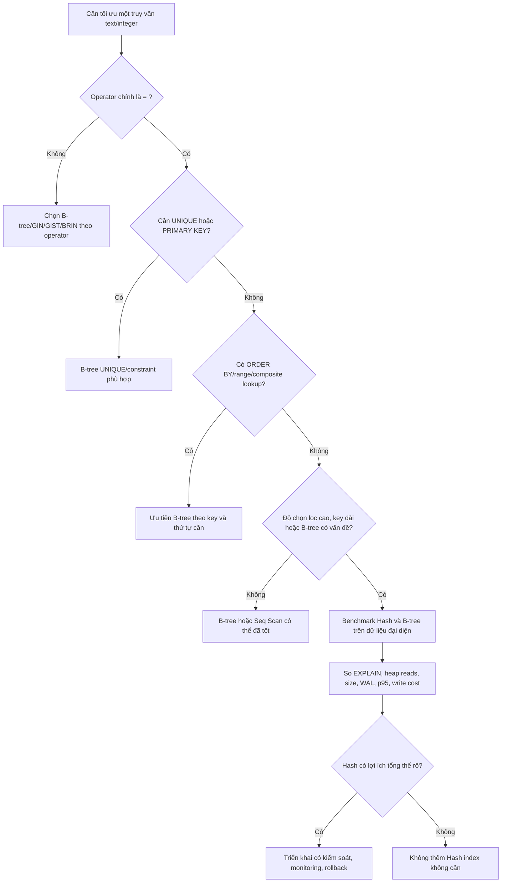

# Hash index và truy vấn bằng trong PostgreSQL

Trong PostgreSQL, **Hash index** là một phương pháp lập chỉ mục nhằm hỗ trợ truy vấn **so sánh bằng** (`=`). Thay vì lưu nguyên giá trị khóa theo thứ tự có thể duyệt từ nhỏ đến lớn như B-tree, Hash index lưu **mã băm** (*hash code*) của khóa và tổ chức các mục chỉ mục theo những *bucket*.

Nếu workload chủ yếu là tra cứu chính xác một giá trị:

```sql
SELECT *
FROM orders
WHERE external_code = 'EVT-00018427';
```

thì Hash index có thể là một lựa chọn để kiểm thử. Nhưng với đa số bảng ứng dụng, **B-tree vẫn là lựa chọn mặc định tốt hơn**, vì B-tree cũng hỗ trợ phép bằng, đồng thời hỗ trợ nhiều toán tử khác, sắp xếp, khóa duy nhất và những dạng index scan mà Hash index không hỗ trợ.

Bài học thuộc chương **Chỉ mục** của module *Database Engine Relational PostgreSQL*. Nội dung giải thích cơ chế Hash index từ storage đến query planner, cách sử dụng đúng với toán tử `=`, giới hạn quan trọng, khi nào nên thử thay B-tree, cách đo thực tế và những bẫy thường gặp trong Java/JDBC.

**Các ví dụ DDL chỉ dùng trên database thử nghiệm.** Không tự tạo hoặc thay thế index production chỉ vì tên “hash” gợi ý tìm kiếm O(1). Quyết định phải dựa trên kế hoạch truy vấn, phân phối dữ liệu, yêu cầu tính đúng và chi phí bảo trì.

## 1. Mục tiêu và tình huống sử dụng

Sau bài này, bạn có thể:

1. Giải thích vì sao Hash index thích hợp với `WHERE column = value` nhưng không phục vụ trực tiếp `ORDER BY` hay truy vấn khoảng.
2. Phân biệt **Hash index** với **Hash Join**, **Hash Aggregate** và hàm `hashtext()`.
3. Hiểu mã băm, bucket, overflow page, hash collision và lý do PostgreSQL phải **recheck** giá trị tại heap.
4. Xác định các giới hạn: **không unique**, **chỉ một index key**, **không index-only scan**, **không cấp thứ tự**, và các hạn chế khác của hash access method.
5. Tạo và kiểm thử index bằng `CREATE INDEX ... USING hash` và `EXPLAIN (ANALYZE, BUFFERS)`.
6. Cân nhắc B-tree, expression index, partial index và multi-column index cho yêu cầu nghiệp vụ.
7. Theo dõi index size, thống kê truy cập, tác động cập nhật và WAL.
8. Triển khai thay đổi chỉ mục có khả năng kiểm soát trên hệ thống thực.

Ví dụ một ứng dụng nhận sự kiện từ bên ngoài bằng mã định danh dài:

```sql
SELECT event_id, received_at, payload
FROM integration_event
WHERE partner_reference = $1;
```

Nếu `partner_reference` có độ phân biệt cao, thường chỉ nhận một vài hàng, và các query khác không cần sort/range theo trường này, Hash index **có thể đáng benchmark**. Tuy nhiên, nếu trường này phải duy nhất, B-tree unique index thường vẫn cần thiết.

## 2. Ôn lại: Index là gì trong PostgreSQL?

Bảng PostgreSQL lưu các phiên bản hàng trong **heap**. Không có index, để tìm một mã hiếm, PostgreSQL có thể phải quét nhiều heap pages:

```text
Heap của event
┌────────────────────┐
│ Page 1: nhiều hàng │
├────────────────────┤
│ Page 2: nhiều hàng │
├────────────────────┤
│ Page 3: nhiều hàng │
├────────────────────┤
│ ...                │
└────────────────────┘

SELECT ... WHERE external_code = 'EVT-00018427'
   → Có thể đọc nhiều page nếu chỉ Seq Scan.
```

Index thêm một đường truy cập có cấu trúc giúp tìm **những TID (tuple identifiers)** của hàng có khóa phù hợp:

```text
Giá trị truy vấn
       │
       ▼
    Index
       │
       ▼
Heap TID cần kiểm tra
       │
       ▼
Phiên bản hàng visible theo MVCC
```

Index **không** thay thế kiểm tra MVCC visibility. Ngay cả khi index chỉ đến một tuple, PostgreSQL vẫn cần xác định phiên bản nào được phép nhìn thấy theo snapshot giao dịch.

### 2.1. Access method là lựa chọn cấu trúc chỉ mục

PostgreSQL có nhiều index access methods, phổ biến gồm:

| Phương pháp | Trường hợp thường gặp |
|---|---|
| **B-tree** | Bằng, thứ tự, khoảng, unique, index scan theo thứ tự |
| **Hash** | Bằng (`=`) theo một khóa |
| **GIN** | Khóa có nhiều thành phần như mảng, full-text, JSONB theo operator class |
| **GiST** | Tìm kiếm hình học, phạm vi và các toán tử theo operator class |
| **SP-GiST** | Không gian dữ liệu phân hoạch, trie và các opclass chuyên biệt |
| **BRIN** | Tóm tắt block ranges, hiệu quả khi giá trị có tương quan vị trí vật lý |

Không thể chọn index chỉ bằng tên kiểu dữ liệu. Cần xét **operator** trong query, **operator class**, số hàng phải lấy, và nhu cầu thứ tự hay uniqueness.

## 3. Tạo Hash index cơ bản

Cú pháp:

```sql
CREATE INDEX index_name
ON schema_name.table_name
USING hash (column_name);
```

Ví dụ:

```sql
CREATE INDEX idx_event_external_code_hash
ON demo_hash.integration_event
USING hash (external_code);
```

Khi query:

```sql
SELECT event_id, external_code
FROM demo_hash.integration_event
WHERE external_code = 'EVT-00018427';
```

planner **có thể** dùng Hash index nếu thống kê và ước lượng chi phí cho thấy nó có lợi. Việc tạo index không bắt buộc planner luôn chọn nó.

### 3.1. Cú pháp USING hash không phải hash function call

```sql
CREATE INDEX ... USING hash (external_code);
```

không có nghĩa lưu nguyên chuỗi `external_code` vào một cột hash mới. PostgreSQL gọi hàm băm theo **hash operator class** phù hợp để tạo key nội bộ của index.

Không cần tự viết:

```sql
-- Không cần tự băm giá trị để dùng Hash index:
CREATE INDEX ... ON t USING hash (md5(external_code));
```

Việc thêm `md5()` làm thay đổi biểu thức khóa và nghĩa lookup. Với nhu cầu so sánh `external_code = ?`, hãy ưu tiên lập index trực tiếp trên cột, không tự băm hai lần.

### 3.2. Hash index không tự thay đổi bảng

Tạo Hash index không cập nhật giá trị text, không biến mã thành chuỗi hash trong heap và không thay đổi ràng buộc hiện có. Nó tạo **đối tượng chỉ mục độc lập** để PostgreSQL có thể dùng khi truy vấn.

## 4. Vì sao Hash index chỉ hỗ trợ so sánh bằng?

Hash function ánh xạ các khóa đầu vào sang mã băm:

```text
  'EVT-001' ──────► hash code A ──► bucket X
  'EVT-002' ──────► hash code B ──► bucket Y
  'EVT-003' ──────► hash code C ──► bucket X
```

Hai giá trị bằng nhau theo quy tắc hash/equality phù hợp phải có **mã băm tương thích** để tra cứu đúng. Nhưng quan hệ số học giữa các mã băm **không thể hiện thứ tự từ vựng hoặc độ lớn** của khóa.

Ví dụ, không có quy tắc:

```text
'a' < 'b'  ⇒  hash('a') < hash('b')
```

Vì vậy, Hash index không có thông tin thích hợp để trả lời trực tiếp:

```sql
WHERE external_code > 'EVT-05000000'

WHERE external_code BETWEEN 'EVT-01000000' AND 'EVT-02000000'

ORDER BY external_code ASC
```

Nó chỉ có chiến lược truy cập dựa trên **equality operator** được hỗ trợ.

### 4.1. Những câu query phù hợp với ý tưởng Hash index

```sql
SELECT *
FROM demo_hash.integration_event
WHERE external_code = 'EVT-00018427';
```

```sql
SELECT COUNT(*)
FROM demo_hash.integration_event
WHERE external_code = 'EVT-00018427';
```

```sql
SELECT event_id
FROM demo_hash.integration_event
WHERE external_code = $1;
```

Câu cuối dùng placeholder PostgreSQL ở mức server/prepared statement; trong JDBC ta thường dùng `?`.

### 4.2. Những câu không được Hash index hỗ trợ trực tiếp như điều kiện tra cứu

```sql
-- Truy vấn khoảng:
SELECT * FROM demo_hash.integration_event
WHERE external_code >= 'EVT-00010000';

-- Sắp xếp:
SELECT * FROM demo_hash.integration_event
ORDER BY external_code
LIMIT 20;

-- Prefix pattern:
SELECT * FROM demo_hash.integration_event
WHERE external_code LIKE 'EVT-0001%';

-- Tìm chứa:
SELECT * FROM demo_hash.integration_event
WHERE external_code ILIKE '%184%';
```

Nếu query có thêm một điều kiện bằng, planner vẫn có thể dùng Hash index **cho điều kiện bằng**, rồi lọc/sort những phần khác. Nhưng chính Hash index không cung cấp truy cập range, pattern hay thứ tự.

## 5. So sánh Hash index và B-tree

| Tiêu chí | Hash index | B-tree |
|---|---|---|
| `WHERE key = value` | Có thể hỗ trợ | Có thể hỗ trợ |
| `WHERE key < value` hoặc `>` | Không | Có, theo opclass |
| `BETWEEN` | Không | Có |
| `ORDER BY key` qua thứ tự index | Không | Có thể |
| `MIN(key)`/`MAX(key)` qua thứ tự index | Không | Có thể |
| Unique index | **Không** | Có |
| Composite index nhiều key columns | **Không** với Hash AM hiện hành | Có |
| `INCLUDE`/covering index | Không hỗ trợ như B-tree | Có, tùy cấu trúc |
| Index-only scan | **Không** | Có thể khi đủ điều kiện |
| Partial index | Có | Có |
| Expression index | Có | Có |
| Tối ưu mã text rất dài | Có thể đáng thử vì lưu hash code | Có giới hạn kích thước index tuple |
| Chịu hash collision | Có, phải recheck | Không có vấn đề hash collision tương tự |
| Mặc định của `CREATE INDEX` | Không | **Có** |
| Phù hợp khóa chính/unique nghiệp vụ | Không | Thường phù hợp |

B-tree vừa hỗ trợ equality vừa nhiều nhu cầu khác. Vì thế **đừng tạo Hash index chỉ vì truy vấn có dấu `=`**; B-tree đang tồn tại có thể đáp ứng rất tốt mà không phát sinh thêm index.

### 5.1. Trường hợp Hash index có thể đáng cân nhắc

- Một cột có độ phân biệt cao, gần như chỉ được tra cứu bằng equality.
- Giá trị index key dài khiến B-tree index lớn hoặc khó lập index nguyên giá trị.
- Không cần uniqueness, thứ tự, range, index-only scan trên chính cột đó.
- Benchmark trên dữ liệu thực cho thấy kích thước/độ trễ/chi phí ghi phù hợp.
- Không có index B-tree sẵn có đáp ứng workload đủ tốt.

Đây là **ứng viên thử nghiệm**, không phải các điều kiện chứng minh Hash index chắc chắn thắng.

### 5.2. Trường hợp B-tree thường hợp lý hơn

- Khóa phải `UNIQUE` hoặc `PRIMARY KEY`.
- Có truy vấn `>`, `<`, `BETWEEN` hoặc `ORDER BY`.
- Điều kiện truy vấn thường là nhiều cột, ví dụ `tenant_id` và `external_code`.
- Có nhu cầu index-only scan.
- Cần prefix lookup phù hợp với operator class/collation.
- Đã có B-tree index được sử dụng tốt, không có bottleneck thật.

## 6. Hash index lưu gì trong cấu trúc vật lý?

Một Hash index của PostgreSQL lưu **mã hash 4 byte** của index key cùng thông tin TID cần thiết để đến heap tuple. Nó không giữ nguyên toàn bộ giá trị văn bản làm khóa như B-tree thông thường.

Ý tưởng:

```text
Hash index
┌────────────────────────────────────────────┐
│ Metadata / metapage                         │
├────────────────────────────────────────────┤
│ Bucket 0                                    │
│    hash code h0 → heap TID                  │
│    hash code h1 → heap TID                  │
├────────────────────────────────────────────┤
│ Bucket 1                                    │
│    hash code h2 → heap TID                  │
│    hash code h3 → heap TID                  │
├────────────────────────────────────────────┤
│ Bucket 2                                    │
│    hash code h4 → heap TID                  │
│    ...                                      │
├────────────────────────────────────────────┤
│ Overflow pages khi bucket chứa nhiều entry │
└────────────────────────────────────────────┘
```

Sơ đồ minh họa, không biểu diễn chính xác bit layout của mọi phiên bản PostgreSQL.

### 6.1. Bucket là nhóm mục chỉ mục

Hash code được dùng để xác định bucket tương ứng. Các entries trong bucket hỗ trợ tìm những ứng viên có hash phù hợp.

Khi index phát triển, PostgreSQL có cơ chế mở rộng/split buckets và quản lý overflow pages. Chi phí truy cập thực tế không chỉ là một phép băm CPU; nó còn phụ thuộc:

- Số trang index phải đọc.
- Bucket có bao nhiêu entries.
- Số overflow pages.
- Cache và I/O.
- Số heap tuples cần recheck.
- Phân phối giá trị và số lượng khóa trùng.
- MVCC visibility.
- Đồng thời/lock/latch nội bộ của index.

Vì vậy không nên diễn giải Hash index là “mọi lookup luôn O(1) trong thực tế”.

### 6.2. Hash code không phải chính giá trị

Nếu có các chuỗi:

```text
'ORDER-ABC'
'ORDER-XYZ'
```

index chỉ lưu hash codes đại diện để lọc ứng viên. Khi cần trả về `external_code` hoặc xác nhận đúng chuỗi, PostgreSQL cần đến heap, không thể dựa duy nhất vào hash code để biết khóa gốc.

Điều này liên quan trực tiếp đến hai hạn chế: **collision recheck** và **không index-only scan**.

## 7. Hash collision: vì sao phải kiểm tra lại giá trị?

**Hash collision** là trường hợp hai khóa **khác nhau** cho cùng một mã băm.

Không thể tránh hoàn toàn vì tập giá trị text có thể rất lớn trong khi hash code của PostgreSQL Hash index có độ dài hữu hạn.

```text
    'external-code-A' ──► 0x1A2B3C4D ─┐
                                        ├─► cùng hash code
    'external-code-B' ──► 0x1A2B3C4D ─┘

    Hai chuỗi khác nhau!
```

Mã hex chỉ để minh họa collision, **không phải kết quả băm thực** của các chuỗi trong PostgreSQL.

### 7.1. Hai lớp kiểm tra khi query

Với:

```sql
SELECT event_id
FROM demo_hash.integration_event
WHERE external_code = 'EVT-00018427';
```

Hash index:

1. Tính hash code của giá trị truy vấn bằng opclass tương ứng.
2. Tìm những index tuples trong bucket có hash code phù hợp.
3. Đến heap tuple từ các TID.
4. **Recheck equality thực tế** đối với `external_code`.
5. Áp dụng MVCC visibility và những điều kiện khác để trả hàng đúng.

Do vậy collision có thể làm **tăng số ứng viên cần đọc**, nhưng không được phép làm query trả về hàng sai chỉ vì hash code bằng nhau.

### 7.2. Không nhầm hash collision với duplicate key

Hai hàng có cùng `external_code` là **duplicate value** theo equality. Hai hàng có `external_code` khác nhau nhưng cùng hash code là **collision**.

Hash index lưu cả hai loại ứng viên. Nó **không thực thi uniqueness**.

Một ứng dụng tuyệt đối không được xem:

```sql
hashtext(external_code) = hashtext(?)
```

là bằng chứng duy nhất rằng hai chuỗi gốc bằng nhau. Nếu muốn so sánh giá trị, hãy so sánh **giá trị gốc**.

### 7.3. Vì sao Hash index không tạo được UNIQUE?

Hash index chỉ lưu mã băm hữu hạn, còn những giá trị khác nhau có thể cùng mã. Nó không có cơ chế unique index như B-tree để bảo đảm ràng buộc duy nhất cho khóa gốc theo cách PostgreSQL hỗ trợ.

Cú pháp sau không hợp lệ với Hash access method:

```sql
-- CỐ TÌNH KHÔNG HỢP LỆ:
CREATE UNIQUE INDEX ux_event_code_hash
ON demo_hash.integration_event USING hash (external_code);
```

Nếu cần `UNIQUE`:

```sql
CREATE UNIQUE INDEX ux_event_code_btree
ON demo_hash.integration_event USING btree (external_code);
```

Lưu ý nếu dữ liệu đang có duplicate thật thì lệnh tạo unique B-tree có thể thất bại. Không tùy tiện tạo unique index trong lab trước khi kiểm tra dữ liệu.

## 8. Hash index không phải Hash Join

Hai khái niệm có chữ “hash” nhưng nằm ở **hai tầng khác nhau**.

**Hash index:**

- Một object tồn tại trong database schema.
- Được tạo bởi `CREATE INDEX ... USING hash`.
- Giúp tìm những row theo equality trên một khóa.
- Có dung lượng disk, được duy trì qua INSERT/UPDATE/DELETE/VACUUM.
- Được query planner cân nhắc như một access path.

**Hash Join:**

- Một **thuật toán join** trong kế hoạch thực thi của một câu truy vấn.
- Thường xây một hash table tạm trong bộ nhớ hoặc spill theo cấu hình để kết hợp hai tập dữ liệu qua điều kiện join thích hợp.
- Không yêu cầu bảng có Hash index.
- Không tạo một index persistent chỉ vì execution plan có node `Hash`.

### 8.1. Ví dụ Hash Join không cần Hash index

```sql
SELECT e.event_id, t.tenant_name
FROM demo_hash.integration_event AS e
JOIN demo_hash.tenant AS t
    ON t.tenant_id = e.tenant_id;
```

PostgreSQL có thể chọn:

```text
Hash Join
  Hash Cond: (e.tenant_id = t.tenant_id)
  -> Seq Scan on integration_event e
  -> Hash
       -> Seq Scan on tenant t
```

Đây là **plan minh họa**, không phải EXPLAIN output cố định. Không có Hash index nào bắt buộc tồn tại để thực thi `Hash Join`.

### 8.2. Hash index có thể được dùng bởi Nested Loop

Nếu query cần tìm một vài hàng theo mã qua mỗi vòng lặp và hash index đủ chọn lọc, planner có thể dùng một **Index Scan trên Hash index** trong nhánh inner của `Nested Loop`.

```text
Nested Loop
  -> ... outer rows ...
  -> Index Scan using idx_event_code_hash
       Index Cond: (external_code = outer.some_code)
```

Plan trên cũng chỉ là minh họa. Khả năng chọn đường này phụ thuộc số rows, thống kê, các join alternatives và chi phí.

### 8.3. HashAggregate cũng là khái niệm khác

`HashAggregate` nhóm dữ liệu bằng hash table trong quá trình chạy query, không phải Hash index được tạo trên cột group.

```sql
SELECT tenant_id, COUNT(*)
FROM demo_hash.integration_event
GROUP BY tenant_id;
```

Nếu EXPLAIN hiển thị `HashAggregate`, **đừng suy ra** index method `hash` đang được dùng.

## 9. Chuẩn bị lab có dữ liệu đủ lớn

Tạo schema riêng để thử nghiệm, không tác động tới bảng ngoài phạm vi.

```sql
CREATE SCHEMA IF NOT EXISTS demo_hash;

CREATE TABLE demo_hash.tenant (
    tenant_id INTEGER PRIMARY KEY,
    tenant_name TEXT NOT NULL
);

CREATE TABLE demo_hash.integration_event (
    event_id BIGINT GENERATED ALWAYS AS IDENTITY PRIMARY KEY,
    tenant_id INTEGER NOT NULL REFERENCES demo_hash.tenant(tenant_id),
    external_code TEXT NOT NULL,
    event_type TEXT NOT NULL,
    created_at TIMESTAMPTZ NOT NULL,
    payload TEXT NOT NULL
);
```

Chỉ có PK trên `event_id`, còn `external_code` ban đầu **chưa có index**. Ta sẽ so sánh các lựa chọn index trên cột này.

### 9.1. Chèn dữ liệu

```sql
INSERT INTO demo_hash.tenant (tenant_id, tenant_name)
SELECT
    g,
    'Tenant ' || g::text
FROM generate_series(1, 100) AS g;

INSERT INTO demo_hash.integration_event
    (tenant_id, external_code, event_type, created_at, payload)
SELECT
    ((g - 1) % 100) + 1,
    'EVT-' || lpad(g::text, 8, '0'),
    CASE WHEN g % 10 = 0 THEN 'RETRY' ELSE 'NEW' END,
    TIMESTAMPTZ '2026-01-01 00:00:00+00'
        + (g % 300) * INTERVAL '1 day',
    repeat('p', 80)
FROM generate_series(1, 100000) AS g;

ANALYZE demo_hash.integration_event;
ANALYZE demo_hash.tenant;
```

Kết quả trên một schema mới:

- 100 tenant.
- 100.000 event.
- Mã `external_code` theo quy luật, mỗi event một giá trị.
- `event_type` có phân phối lệch, nhiều hàng `NEW` hơn `RETRY`.
- Payload vừa phải để heap không chỉ gồm các cột index.

Không chạy lại setup nếu bảng đã có 100.000 hàng mà chưa reset: sẽ tạo dữ liệu trùng hoặc phát sinh tình trạng không còn cùng điều kiện benchmark.

### 9.2. Kiểm tra phân phối

```sql
SELECT
    COUNT(*) AS total_rows,
    COUNT(DISTINCT external_code) AS distinct_codes,
    COUNT(DISTINCT tenant_id) AS distinct_tenants
FROM demo_hash.integration_event;

SELECT event_type, COUNT(*) AS row_count
FROM demo_hash.integration_event
GROUP BY event_type
ORDER BY event_type;
```

Với dữ liệu này, một equality lookup theo `external_code` thường có độ chọn lọc rất cao. Ngược lại, `event_type = 'NEW'` trả phần lớn bảng: đây là hai đặc điểm dẫn tới **lựa chọn kế hoạch khác nhau**.

## 10. Đường cơ sở: chưa có index trên external_code

Bắt đầu:

```sql
EXPLAIN (ANALYZE, BUFFERS)
SELECT event_id, tenant_id, external_code
FROM demo_hash.integration_event
WHERE external_code = 'EVT-00018427';
```

Không có index trên `external_code`, planner có thể chọn `Seq Scan` và kiểm tra từng hàng.

Plan minh họa:

```text
Seq Scan on integration_event
  Filter: (external_code = 'EVT-00018427')
  Rows Removed by Filter: ...
```

**Không có con số thời gian cố định.** Query trên máy lab nhanh/chậm tùy CPU, disk, cache, số hàng và môi trường chạy.

Ghi nhận:

- `Execution Time`.
- `actual rows`.
- `Rows Removed by Filter`.
- `Buffers: shared hit/read`.
- Plan node thực sự.

Không lấy thời gian từ một lần chạy để suy luận kết quả production.

## 11. Tạo và thử Hash index

```sql
CREATE INDEX idx_event_external_code_hash
ON demo_hash.integration_event
USING hash (external_code);

ANALYZE demo_hash.integration_event;
```

Đọc kế hoạch:

```sql
EXPLAIN (ANALYZE, BUFFERS)
SELECT event_id, tenant_id, external_code
FROM demo_hash.integration_event
WHERE external_code = 'EVT-00018427';
```

Với bộ dữ liệu có độ phân biệt cao, PostgreSQL **có thể** chọn dạng:

```text
Index Scan using idx_event_external_code_hash
  on integration_event
  Index Cond: (external_code = 'EVT-00018427')
```

Nếu vẫn chọn `Seq Scan`, không có nghĩa index bị hỏng. Có thể bảng quá nhỏ trong môi trường đó, các trang đã cache, thống kê khác hoặc planner ước tính quét tuần tự rẻ hơn.

### 11.1. Index Cond không chứng minh không cần heap recheck

`Index Cond` cho biết một điều kiện được dùng để tìm ứng viên qua index. Vì Hash index chỉ chứa mã hash, PostgreSQL vẫn cần truy cập heap để recheck giá trị gốc và MVCC visibility.

Đừng hiểu `Index Cond` là một phép so sánh được chứng minh **chỉ từ 4 byte hash**.

### 11.2. Một query trả nhiều cột

```sql
EXPLAIN (ANALYZE, BUFFERS)
SELECT event_id, tenant_id, created_at, payload
FROM demo_hash.integration_event
WHERE external_code = 'EVT-00018427';
```

Hash index có thể xác định ứng viên, nhưng dữ liệu trả về đến từ heap. Với một hàng duy nhất, chi phí có thể vẫn tốt. Với hàng triệu ứng viên, phải đọc nhiều heap pages; planner có thể chọn đường khác.

## 12. So sánh với B-tree trên cùng cột

Tạo thêm một B-tree index trong lab:

```sql
CREATE INDEX idx_event_external_code_btree
ON demo_hash.integration_event
USING btree (external_code);

ANALYZE demo_hash.integration_event;
```

Chạy lại:

```sql
EXPLAIN (ANALYZE, BUFFERS)
SELECT event_id, tenant_id, external_code
FROM demo_hash.integration_event
WHERE external_code = 'EVT-00018427';
```

Khi cả hai index có mặt, **PostgreSQL tự chọn một trong hai** hoặc thậm chí Seq Scan. Đừng xem một plan chọn B-tree là bằng chứng rằng Hash index không hợp lệ; và cũng đừng xem một plan chọn Hash là bằng chứng Hash luôn nhanh hơn.

### 12.1. Cách so sánh công bằng

Trên **bản sao lab**:

1. Đo query với **chỉ B-tree** thích hợp.
2. Ghi EXPLAIN, buffers, latency nhiều lần, index size.
3. Xóa B-tree **trên lab**, tạo/chỉ để Hash index.
4. Đo cùng query, cùng dữ liệu, cùng trạng thái thống kê.
5. Lặp chạy và so các mức p50/p95, I/O, footprint, số index đã duy trì.
6. Nếu cần, kiểm tra cả INSERT/UPDATE/DELETE workload.

Không thay đổi index đang phục vụ ứng dụng production chỉ để đo. Dùng restore/copy hoặc môi trường benchmark độc lập nếu hệ thống thật đang hoạt động.

### 12.2. So kích thước index

```sql
SELECT
    pg_size_pretty(
        pg_relation_size('demo_hash.idx_event_external_code_hash')
    ) AS hash_index_size,
    pg_size_pretty(
        pg_relation_size('demo_hash.idx_event_external_code_btree')
    ) AS btree_index_size;
```

Hash index lưu hash code và TID nên **có thể nhỏ hơn** B-tree với khóa text dài. Tuy nhiên thực tế còn phụ thuộc index metadata, buckets, overflow pages, page fill, dữ liệu trùng và đặc điểm PostgreSQL version. Không tuyên bố Hash index luôn nhỏ hơn.

## 13. Trường hợp dữ liệu khóa rất dài

Hash index đặc biệt đáng đánh giá khi một cột được tìm đúng bằng một chuỗi dài, ví dụ:

- Mã tham chiếu đối tác có độ dài lớn.
- Path/URI đã được chuẩn hóa rất dài.
- Fingerprint văn bản dùng để tra cứu chính xác.
- Một token ứng dụng không bắt buộc độc nhất và được lưu theo policy phù hợp.

Hash index chỉ lưu 4-byte hash code cho index key, trong khi B-tree lưu dữ liệu khóa và có **giới hạn kích thước một index entry**.

### 13.1. B-tree có giới hạn trên key quá lớn

Nếu giá trị text rất dài, một B-tree index có thể gặp lỗi dạng:

```text
index row requires ... bytes, maximum size is ...
```

Giới hạn thực tế phụ thuộc page size và phương pháp index. Một Hash index trên text dài có thể tránh **một phần giới hạn kích thước khóa trực tiếp trong index**, vì chỉ lưu hash code.

Điều này **không** có nghĩa Hash index có thể thực thi UNIQUE với các khóa dài hoặc không cần đọc heap khi recheck.

### 13.2. Bài lab tùy chọn với mã dài

```sql
CREATE TABLE demo_hash.long_key_lookup (
    row_id BIGINT GENERATED ALWAYS AS IDENTITY PRIMARY KEY,
    long_code TEXT NOT NULL,
    payload TEXT
);

INSERT INTO demo_hash.long_key_lookup
    (long_code, payload)
SELECT
    repeat(md5(g::text), 20),
    'row-' || g::text
FROM generate_series(1, 20000) AS g;

CREATE INDEX idx_long_code_hash
ON demo_hash.long_key_lookup
USING hash (long_code);

ANALYZE demo_hash.long_key_lookup;
```

Chuỗi tạo bằng `repeat(md5(...),20)` chỉ là test data tương đối dài, **không phải thiết kế token mật mã**.

Tra cứu:

```sql
EXPLAIN (ANALYZE, BUFFERS)
SELECT row_id, payload
FROM demo_hash.long_key_lookup
WHERE long_code = repeat(md5('1234'), 20);
```

Bài này giúp quan sát chi phí index cho khóa dài mà không tự phải xây một expression index trên hàm băm.

### 13.3. Đừng nhầm Hash index với cột lưu digest

Nếu ứng dụng cần **UNIQUE trên toàn bộ chuỗi rất dài**, có thể phải thiết kế chiến lược khác, ví dụ canonical key/tên ngắn, digest lưu riêng kết hợp recheck và constraint/transaction bảo đảm đúng nghiệp vụ.

Một digest hữu hạn **không thể được dùng một mình như chứng minh tuyệt đối** hai chuỗi gốc bằng nhau. Không chuyển constraint unique trên chuỗi sang unique digest mà không đánh giá collision policy, threat model và quy trình xử lý.

## 14. Hash index không hỗ trợ composite key

PostgreSQL Hash access method hiện hành hỗ trợ **một index key**, không hỗ trợ multi-column index thông thường.

Câu sau không hợp lệ:

```sql
-- CỐ TÌNH KHÔNG HỢP LỆ:
CREATE INDEX idx_tenant_code_hash
ON demo_hash.integration_event
USING hash (tenant_id, external_code);
```

Bài toán:

```sql
SELECT *
FROM demo_hash.integration_event
WHERE tenant_id = 42
  AND external_code = 'EVT-00018442';
```

Một B-tree composite thường phù hợp để thử:

```sql
CREATE INDEX idx_event_tenant_code_btree
ON demo_hash.integration_event
USING btree (tenant_id, external_code);
```

Trong khi Hash index riêng trên `external_code` có thể giúp tìm ứng viên theo mã, rồi filter `tenant_id` ở heap. Nếu `external_code` không globally unique mà lặp giữa nhiều tenant, cách đó có thể phải đọc nhiều hàng không cần.

### 14.1. Một index trên từng cột không tương đương composite index

```sql
CREATE INDEX idx_event_tenant_hash
ON demo_hash.integration_event USING hash (tenant_id);

CREATE INDEX idx_event_code_hash_alt
ON demo_hash.integration_event USING hash (external_code);
```

Đây là ví dụ khái niệm; bảng lab đã có `idx_event_external_code_hash`, nên không cần thêm một hash index trùng cột. Các index đơn cột không bảo đảm cùng kế hoạch hay tốc độ với một B-tree composite.

PostgreSQL có thể kết hợp bitmap/index paths trong những trường hợp phù hợp, nhưng không nên xem hai hash indexes là một phương án thay thế tổng quát cho composite key.

### 14.2. Đừng tự ghép chuỗi một cách mơ hồ để tạo một key

Một ý tưởng nguy hiểm là:

```sql
-- Không khuyến nghị:
CREATE INDEX ...
USING hash ((tenant_id::text || external_code));
```

Các cặp dữ liệu khác nhau có thể tạo cùng chuỗi nếu không có encoding/delimiter bảo đảm không nhập nhằng. Ngay cả với encoding không nhập nhằng, Hash index vẫn không hỗ trợ UNIQUE, ORDER BY hay range.

Khi có composite business key, **B-tree đa cột thường rõ ràng và an toàn hơn**.

## 15. Hash index không tạo UNIQUE hay PRIMARY KEY

Một bảng cần bảo đảm:

> Mỗi tenant chỉ có một hàng với cùng `external_code`.

Hãy biểu đạt ràng buộc ở schema:

```sql
CREATE TABLE demo_hash.event_registry (
    registry_id BIGINT GENERATED ALWAYS AS IDENTITY PRIMARY KEY,
    tenant_id INTEGER NOT NULL,
    external_code TEXT NOT NULL,
    CONSTRAINT uq_event_registry_tenant_code
        UNIQUE (tenant_id, external_code)
);
```

PostgreSQL tạo unique B-tree index phù hợp để thực thi constraint.

Nếu chỉ dùng Hash index trên `external_code`:

```sql
CREATE INDEX idx_event_registry_code_hash
ON demo_hash.event_registry USING hash (external_code);
```

thì index này **không phải arbiter của UNIQUE** và không thay đổi uniqueness mà constraint trên đã bảo vệ.

### 15.1. Ràng buộc phải bảo vệ concurrency

Không thay unique constraint bằng:

```text
SELECT count(*) WHERE external_code = ?
Nếu chưa có: INSERT ...
```

Hai session có thể cùng nhìn “chưa có” rồi cùng INSERT. Hash index chỉ tăng tốc lookup, **không ngăn trùng dưới cạnh tranh ghi**. Muốn uniqueness cần constraint/index unique hoặc chiến lược đồng bộ giao dịch được thiết kế đúng.

### 15.2. ON CONFLICT cần unique arbiter phù hợp

```sql
INSERT INTO demo_hash.event_registry
    (tenant_id, external_code)
VALUES (42, 'EXT-123')
ON CONFLICT (tenant_id, external_code)
DO NOTHING;
```

Câu này dựa vào unique constraint/index của khóa ghép, **không dựa vào Hash index**. Hash index không thể được dùng làm arbiter để `ON CONFLICT` nhận diện duplicate business key.

Nếu một bảng chỉ có Hash index mà không có unique constraint tương ứng, `ON CONFLICT (key)` có thể báo lỗi không tìm được unique/exclusion constraint phù hợp.

## 16. Hash index không cung cấp thứ tự

Một B-tree chứa các key theo quan hệ thứ tự nên có thể hỗ trợ:

```sql
SELECT external_code
FROM demo_hash.integration_event
ORDER BY external_code
LIMIT 10;
```

Hash index **không** có thông tin thứ tự để phục vụ `ORDER BY external_code`. Query có thể phải:

- Dùng B-tree index có thứ tự phù hợp.
- Hoặc scan và Sort theo kế hoạch.
- Hoặc dùng một đường khác do planner chọn.

### 16.1. Có thể vừa dùng Hash index vừa Sort

```sql
SELECT event_id, external_code, created_at
FROM demo_hash.integration_event
WHERE external_code = 'EVT-00018427'
ORDER BY created_at DESC;
```

Hash index có thể hỗ trợ điều kiện bằng; sort có thể là operation khác nếu nhiều hàng được trả về. Với chỉ một hàng, sort gần như không có ý nghĩa, nhưng **không phải do Hash index cung cấp order**.

### 16.2. Không dùng Hash index cho keyset pagination

Nếu ứng dụng phân trang:

```sql
SELECT event_id, external_code
FROM demo_hash.integration_event
WHERE external_code > 'EVT-00018427'
ORDER BY external_code, event_id
LIMIT 50;
```

thì Hash index không hỗ trợ range/cursor ordering như B-tree. Index B-tree phù hợp với collation và tiebreaker là lựa chọn nên xem xét.

### 16.3. MIN và MAX

```sql
SELECT MIN(external_code), MAX(external_code)
FROM demo_hash.integration_event;
```

Hash index không có phần tử “nhỏ nhất/lớn nhất” theo thứ tự key để khai thác trực tiếp. B-tree có thể hỗ trợ các đường truy cập tối ưu cho min/max tùy plan và operator class.

## 17. Không có Index Only Scan với Hash index

**Index Only Scan** cần index có đủ dữ liệu để trả về giá trị yêu cầu và một cơ chế visibility phù hợp.

Hash index chỉ lưu hash code và TID, **không giữ giá trị gốc** nên PostgreSQL không dùng nó như một covering index có thể trả `external_code` mà không đọc heap.

Ví dụ:

```sql
SELECT external_code
FROM demo_hash.integration_event
WHERE external_code = 'EVT-00018427';
```

Dù query chỉ chọn cùng cột được hash-indexed, PostgreSQL vẫn cần heap để kiểm tra equality và lấy giá trị gốc.

### 17.1. Ngay cả COUNT(*) cũng phải xét MVCC

```sql
SELECT COUNT(*)
FROM demo_hash.integration_event
WHERE external_code = 'EVT-00018427';
```

Hash index cung cấp ứng viên, nhưng không tự chứng minh có bao nhiêu tuple **visible** và thực sự bằng giá trị cần tìm chỉ từ mã hash.

### 17.2. INCLUDE không giải quyết giới hạn này

Không áp dụng cách:

```sql
-- CỐ TÌNH KHÔNG HỢP LỆ với Hash access method:
CREATE INDEX idx_hash_cover
ON demo_hash.integration_event
USING hash (external_code)
INCLUDE (event_id);
```

Hash index không hỗ trợ kiểu covering index với `INCLUDE` như B-tree. Nếu workload cần lấy `event_id` trực tiếp từ index, benchmark B-tree với key/INCLUDE và điều kiện visibility map.

### 17.3. B-tree Index Only Scan cũng không luôn bỏ heap

B-tree có thể đủ dữ liệu nhưng còn phải xét visibility map; các trang chưa all-visible có thể gây `Heap Fetches`. Đừng tuyên bố B-tree index-only scan luôn 0 heap reads.

## 18. Hash index với NULL

Hash indexes của PostgreSQL **không lưu NULL index keys**. Vì vậy nó không thể dùng để tìm các hàng có khóa NULL theo cách thông thường.

```sql
SELECT *
FROM demo_hash.integration_event
WHERE external_code IS NULL;
```

Bảng lab có `external_code NOT NULL` nên query trên luôn rỗng; ví dụ chỉ minh họa semantics.

### 18.1. Dấu bằng và NULL

```sql
WHERE external_code = NULL
```

không phải điều kiện tìm NULL hợp lệ theo SQL three-valued logic; kết quả so sánh với NULL thường là `UNKNOWN`, không TRUE.

Nếu một cột nullable, truy vấn đúng là:

```sql
WHERE external_code IS NULL
```

Nhưng Hash index **không tăng tốc** phép IS NULL này vì không chứa NULL entries. Một B-tree có thể hỗ trợ tìm NULL trong nhiều trường hợp.

### 18.2. IS NOT DISTINCT FROM

`IS NOT DISTINCT FROM` cho equality có xét NULL, nhưng không nên mặc định nó được planner chuyển thành một Hash Index Cond tương đương `=` ở mọi phiên bản/cấu trúc. Hãy kiểm tra `EXPLAIN` với query cụ thể.

Nếu nhu cầu là exact equality với giá trị không NULL, dạng `column = ?` thường là điều kiện rõ nhất để đánh giá Hash index.

## 19. Điều kiện có độ chọn lọc cao và thấp

Độ chọn lọc (*selectivity*) là yếu tố quyết định việc index có giúp tiết kiệm bao nhiêu heap reads hay không.

### 19.1. Một mã gần như duy nhất

```sql
SELECT *
FROM demo_hash.integration_event
WHERE external_code = 'EVT-00018427';
```

Trong lab, một mã chỉ xuất hiện một lần. Hash index có thể giúp tránh quét 100.000 hàng.

### 19.2. Một trạng thái xuất hiện ở hầu hết bảng

```sql
SELECT *
FROM demo_hash.integration_event
WHERE event_type = 'NEW';
```

Khoảng phần lớn hàng lab mang `NEW`, nên ngay cả nếu tạo Hash index trên `event_type`, planner có thể thấy Seq Scan rẻ hơn việc đọc nhiều index entries và heap tuples.

Không có quan hệ:

```text
WHERE x = constant  ⇒  Hash Index Scan luôn nhanh hơn Seq Scan
```

### 19.3. Hash collisions và rất nhiều duplicate values

Khi hàng triệu hàng thật sự có cùng một giá trị, chúng có cùng hash code và thường tập trung trong nhóm bucket/overflow phù hợp.

Đó không phải lỗi collision của hai giá trị khác nhau; đó là **độ trùng lặp khóa thật**, làm lookup phải trả nhiều TID. Nếu query trả gần toàn bộ bảng, index có thể không đáng dùng.

### 19.4. Dữ liệu lệch cần thống kê đủ tốt

Planner dùng thống kê như số giá trị phân biệt, most-common-values và phân phối dữ liệu để ước lượng số hàng.

```sql
ANALYZE demo_hash.integration_event;
```

Nếu thống kê cũ sau một lần import lớn, planner có thể chọn đường không mong muốn. Chẩn đoán index phải bắt đầu từ cardinality và `ANALYZE`, không từ việc ép index method.

## 20. Expression Hash index

Hash index có thể lập trên **một biểu thức**, không chỉ cột thô, miễn kết quả có hash operator class thích hợp.

Ví dụ tìm email không phân biệt case bằng `lower()`:

```sql
CREATE TABLE demo_hash.contact_lookup (
    contact_id BIGINT GENERATED ALWAYS AS IDENTITY PRIMARY KEY,
    email TEXT NOT NULL,
    display_name TEXT
);

INSERT INTO demo_hash.contact_lookup (email, display_name)
VALUES
    ('Alice@example.test', 'Alice'),
    ('bob@example.test', 'Bob'),
    ('CAROL@example.test', 'Carol');

CREATE INDEX idx_contact_lower_email_hash
ON demo_hash.contact_lookup
USING hash ((lower(email)));
```

Query phải dùng **biểu thức tương ứng**:

```sql
SELECT contact_id, email
FROM demo_hash.contact_lookup
WHERE lower(email) = lower('ALICE@example.test');
```

Hash expression index có thể hỗ trợ lookup bình đẳng trên `lower(email)`, nếu planner thấy có lợi.

### 20.1. Không thay thế unique case-insensitive

Vì đây là Hash index, bảng vẫn có thể chứa hai hàng:

```sql
INSERT INTO demo_hash.contact_lookup (email)
VALUES ('alice@example.test');
```

Nếu nghiệp vụ cấm các email tương đương theo policy, cần **unique B-tree expression index** hoặc một unique constraint/collation/canonical key được thiết kế đúng.

```sql
-- Chỉ ví dụ, có thể thất bại vì dữ liệu hiện trùng theo lower(email):
CREATE UNIQUE INDEX uq_contact_lower_email_btree
ON demo_hash.contact_lookup (lower(email));
```

**Không chạy lệnh unique trên dữ liệu đã có duplicate mà chưa xử lý policy**. Bài này chỉ dùng để nhấn mạnh Hash index hỗ trợ tìm kiếm chứ không bảo vệ uniqueness.

### 20.2. lower() không phải casefold/normalization hoàn chỉnh

Unicode case folding, accent-insensitive comparison, NFC/NFD và quy tắc email quốc tế hóa là các vấn đề riêng. `lower(email)` có thể đủ cho một policy cụ thể nhưng không tự đáp ứng mọi ngôn ngữ/định danh.

Chọn expression index theo đúng SQL và business rule, không chỉ vì ví dụ ASCII chạy thành công.

## 21. Partial Hash index

PostgreSQL hỗ trợ **partial index** với điều kiện `WHERE`. Ví dụ chỉ index event chưa xử lý:

```sql
CREATE INDEX idx_event_pending_code_hash
ON demo_hash.integration_event
USING hash (external_code)
WHERE event_type = 'NEW';
```

Query:

```sql
SELECT event_id, external_code, payload
FROM demo_hash.integration_event
WHERE event_type = 'NEW'
  AND external_code = 'EVT-00018427';
```

Planner có thể dùng partial Hash index vì điều kiện query chứng minh hàng được tìm thuộc tập `event_type='NEW'`, theo khả năng suy luận predicate của PostgreSQL.

### 21.1. Query phải phù hợp predicate

```sql
SELECT event_id
FROM demo_hash.integration_event
WHERE external_code = 'EVT-00018427';
```

Không có điều kiện `event_type='NEW'`. Partial index chỉ chứa hàng `NEW` nên **không thể tự đại diện mọi event types**. Planner không được dùng nó như một index đầy đủ cho query không xác định subset.

### 21.2. Parametric predicate có thể khó được suy ra

Nếu ứng dụng viết:

```sql
WHERE event_type = $1
  AND external_code = $2
```

generic plan không thể giả định `$1` luôn là `'NEW'`. Vì vậy partial index có thể không được dùng, dù nhiều lần chạy thực tế truyền `'NEW'`.

Khi phân tích performance, cần xét **prepared statement custom/generic plan**, không chỉ chạy query SQL literal trong psql rồi kết luận JDBC sẽ dùng cùng index.

### 21.3. Partial Hash index không phải partial unique

Ngay cả trong subset `event_type='NEW'`, Hash index vẫn **không bảo đảm một external_code chỉ xuất hiện một lần**. Nếu cần uniqueness trong subset, dùng unique B-tree partial index phù hợp:

```sql
-- Mẫu, chỉ tạo nếu dữ liệu subset đã thỏa uniqueness:
CREATE UNIQUE INDEX uq_new_event_code
ON demo_hash.integration_event (external_code)
WHERE event_type = 'NEW';
```

Lựa chọn index để tối ưu lookup và lựa chọn constraint để bảo vệ luật dữ liệu là hai quyết định có thể giao nhau, nhưng không đồng nhất.

## 22. Hash index trên một cột với filter nhiều cột

```sql
SELECT event_id
FROM demo_hash.integration_event
WHERE external_code = 'EVT-00018427'
  AND tenant_id = 27
  AND event_type = 'NEW';
```

Hash index trên `external_code` có thể xác định những hàng cùng mã; các điều kiện còn lại có thể được kiểm tra sau tại heap.

Nếu `external_code` là mã gần như duy nhất toàn hệ thống, cách này có thể đã tốt.

Nhưng nếu mỗi tenant có một mã `'ORDER-001'` lặp lại, Hash index trên mã có thể trả hàng của nhiều tenant trước khi lọc. Khi đó B-tree composite:

```sql
CREATE INDEX idx_event_tenant_code
ON demo_hash.integration_event (tenant_id, external_code);
```

thường là một lựa chọn tự nhiên để thử vì cả hai điều kiện thuộc key.

**Đừng lập Hash index trên một cột vì nghĩ rằng nó tự tổng hợp tất cả điều kiện `AND` thành một hash key.**

## 23. Hash index và toán tử IN, ANY, OR

Các biểu thức này có thể liên quan nhiều equality checks:

```sql
SELECT event_id
FROM demo_hash.integration_event
WHERE external_code IN (
    'EVT-00018427',
    'EVT-00018428',
    'EVT-00018429'
);
```

```sql
SELECT event_id
FROM demo_hash.integration_event
WHERE external_code = ANY (
    ARRAY['EVT-00018427', 'EVT-00018428']
);
```

```sql
SELECT event_id
FROM demo_hash.integration_event
WHERE external_code = 'EVT-00018427'
   OR external_code = 'EVT-00018428';
```

PostgreSQL có thể biến đổi/triển khai những điều kiện này bằng các access paths khác nhau, nhưng **không bảo đảm Hash index luôn được chọn hoặc luôn hỗ trợ mọi hình thức scalar-array index qual** trên mọi phiên bản.

Hãy nhìn `EXPLAIN` thực tế. Với số lượng lớn giá trị trong một danh sách, planner có thể chọn một kế hoạch không phải chuỗi index lookup đơn giản.

### 23.1. Tránh suy luận từ việc có dấu bằng trong câu SQL

Một query có:

```sql
SELECT DISTINCT external_code
FROM demo_hash.integration_event
ORDER BY external_code;
```

không có điều kiện equality lookup dù dữ liệu có thể được group bằng equality nội bộ. Hash index không tự giúp `DISTINCT` hay `ORDER BY` theo cách B-tree thứ tự có thể.

Tương tự, `GROUP BY` có thể dùng HashAggregate nhưng không phải Hash index.

## 24. Collation, kiểu dữ liệu và hash operator class

Hash index không tự băm tất cả kiểu PostgreSQL. Nó cần một **hash operator class** phù hợp với kiểu dữ liệu và phép equality.

Ví dụ `integer`, `bigint`, `text` và nhiều kiểu cơ bản có hỗ trợ hash index. Với kiểu dữ liệu tự định nghĩa hoặc một operator class đặc biệt, phải kiểm tra catalog.

### 24.1. Liệt kê hash operator classes trên server

```sql
SELECT
    ns.nspname AS opclass_schema,
    oc.opcname AS opclass_name,
    format_type(oc.opcintype, NULL) AS input_type
FROM pg_opclass AS oc
JOIN pg_am AS am
    ON am.oid = oc.opcmethod
JOIN pg_namespace AS ns
    ON ns.oid = oc.opcnamespace
WHERE am.amname = 'hash'
ORDER BY ns.nspname, oc.opcname;
```

Query này cho biết những hash operator classes đã đăng ký. Nếu kiểu dữ liệu không có hash opclass thích hợp, `CREATE INDEX USING hash` có thể không thành công hoặc cần thiết kế operator class riêng được kiểm chứng.

### 24.2. Collation ảnh hưởng phép so sánh văn bản

Với `text`/`varchar`, equality và hash operator cần nhất quán với collation/so sánh của truy vấn. Trong môi trường ICU với **nondeterministic collation**, hai chuỗi khác byte có thể được xem tương đương theo quy tắc collation đã chọn.

Không giả định Hash index mặc định biến mọi tìm kiếm thành case-insensitive hoặc accent-insensitive.

Ví dụ collation kỹ thuật `"C"`:

```sql
CREATE INDEX idx_event_code_hash_c
ON demo_hash.integration_event
USING hash (external_code COLLATE "C");
```

Một truy vấn muốn sử dụng đúng collation đó nên thể hiện rõ:

```sql
SELECT event_id
FROM demo_hash.integration_event
WHERE (external_code COLLATE "C") = 'EVT-00018427';
```

Index này bổ sung thêm overhead nếu đã có index Hash/B-tree tương đương. Chỉ tạo để nghiên cứu trong lab; production cần tránh index trùng mục đích.

### 24.3. Không chọn index vì hashtext() cho ra mã giống nhau

Hàm băm có thể phụ thuộc kiểu, collation, implementation và version. Không thiết kế cơ chế đồng bộ dữ liệu giữa các hệ thống bằng cách lấy `hashtext()` làm một ID bất biến xuyên phiên bản/môi trường.

Hash index là **cấu trúc truy cập do PostgreSQL duy trì**, không phải kho ID hash phục vụ giao thức ngoài database.

## 25. Vì sao không cần tính hash thủ công trong WHERE?

Nếu có Hash index trên `external_code`, viết:

```sql
WHERE external_code = $1
```

là cách đúng. PostgreSQL sẽ dùng hash operator class khi lập index lookup phù hợp.

Không viết:

```sql
WHERE hashtext(external_code) = hashtext($1)
```

chỉ để “ép” truy vấn dùng Hash index. Câu này:

- Có thể không match index expression tương ứng.
- Có thể làm PostgreSQL tính hash trên nhiều hàng.
- Có nguy cơ trả về **false positives** do collision nếu không recheck giá trị gốc.
- Khó kiểm soát ngữ nghĩa/collation và migration.
- Không bảo đảm nhanh hơn.

Nếu một hệ thống có lý do lưu digest riêng, query vẫn cần xác nhận equality gốc khi tính đúng tuyệt đối là yêu cầu.

## 26. Query planner chọn Hash index dựa trên chi phí

PostgreSQL là cost-based optimizer. Nó không chọn Hash index chỉ vì người viết DDL đã tạo nó.

Khi quyết định giữa Seq Scan, Index Scan trên B-tree, Index Scan trên Hash index và những kế hoạch khác, planner cân nhắc:

- Ước lượng số hàng khớp.
- Kích thước và số trang của bảng/index.
- Chi phí I/O tuần tự/ngẫu nhiên.
- Cache và thống kê.
- Kế hoạch tổng thể có sort/join/limit không.
- Giá trị tham số và custom/generic plan.
- Các index đã có.
- Số hàng cần fetch từ heap.

### 26.1. Một index có thể đúng nhưng không được chọn

Trên bảng 10 hàng, đọc cả bảng thường rất rẻ. Một Hash Index Scan có thể tốn nhiều overhead hơn.

Vì vậy một lab quá nhỏ không cho biết cách planner sẽ xử lý 100 triệu hàng.

### 26.2. Không nên ép enable_seqscan=off để chứng minh Hash thắng

Có thể dùng các planner GUC trong môi trường thử để khám phá alternative paths, nhưng một plan được ép **không phản ánh** lựa chọn chi phí mặc định.

Không đổi `enable_seqscan` toàn server hoặc trong production để Hash index được sử dụng. Khi query chậm, ưu tiên:

1. Kiểm tra cardinality/selectivity.
2. `ANALYZE`.
3. Đọc EXPLAIN đầy đủ.
4. Kiểm tra kiểu dữ liệu, biểu thức, collation.
5. So index hiện có.
6. Benchmark workload đại diện.

## 27. Đọc EXPLAIN cho truy vấn bằng

```sql
EXPLAIN (ANALYZE, BUFFERS, VERBOSE)
SELECT event_id, tenant_id
FROM demo_hash.integration_event
WHERE external_code = 'EVT-00018427';
```

Chú ý:

| Phần plan | Ý nghĩa |
|---|---|
| `Seq Scan` | Đọc bảng theo đường quét tuần tự |
| `Index Scan using idx_event_external_code_hash` | Dùng Hash index cụ thể |
| `Index Scan using ..._btree` | Dùng B-tree thay vì Hash |
| `Index Cond` | Điều kiện tìm trong index |
| `Filter` | Điều kiện được kiểm tra tại node |
| `Rows Removed by Filter` | Hàng không thỏa filter tại node |
| `actual rows` | Số hàng thật của từng node |
| `loops` | Số lần node chạy/được đọc |
| `Buffers: shared hit/read` | Buffer cache và các lần đọc |
| `Execution Time` | Thời gian thực thi đo được ở server |
| `Planning Time` | Thời gian lập kế hoạch |

### 27.1. Không suy ra số hash collisions từ số Rows Removed by Filter

`Rows Removed by Filter` có thể liên quan những predicate khác. Việc recheck của Hash index và MVCC có chi tiết thực thi riêng; **không dùng một cột thống kê EXPLAIN để suy ngược trực tiếp số collision** trừ khi đã xác nhận cách node ghi nhận nó trong phiên bản tương ứng.

### 27.2. Hash index không có Index Only Scan

Nếu plan cần lấy một cột từ heap, đó là hành vi mong đợi. Không tự chỉnh visibility map/VACUUM chỉ vì muốn Hash index xuất hiện dưới node `Index Only Scan`; phương pháp truy cập này không cung cấp khả năng đó.

### 27.3. EXPLAIN ANALYZE thực thi SQL

Ví dụ ở đây chỉ dùng `SELECT`. Nếu dùng `EXPLAIN ANALYZE` cho `UPDATE/DELETE/INSERT`, PostgreSQL **thật sự thực hiện thay đổi dữ liệu**, nên cần transaction/rollback trong môi trường được phép và hiểu side effects.

## 28. Kiểm tra Hash index có đang được sử dụng hay không

`pg_stat_user_indexes` ghi nhận thống kê sử dụng index:

```sql
SELECT
    schemaname,
    relname,
    indexrelname,
    idx_scan,
    idx_tup_read,
    idx_tup_fetch
FROM pg_stat_user_indexes
WHERE schemaname = 'demo_hash'
ORDER BY relname, indexrelname;
```

Đây là **thống kê tích lũy** kể từ lần reset thích hợp, không phải đo thời gian thực cho một câu SELECT.

### 28.1. idx_scan = 0 không đủ để xóa index

Lý do:

- Index vừa tạo, chưa có workload đại diện.
- Chỉ phục vụ job định kỳ.
- Có thể được dùng sau thay đổi dữ liệu/phân phối.
- Thống kê reset hoặc server restart theo cơ chế phiên bản.
- Đang phục vụ một lộ trình migration chưa hoàn tất.

Ngược lại, một Hash index có `idx_scan` cao cũng không tự chứng minh nó nhanh hơn B-tree. Cần so thời gian/IO của toàn query.

### 28.2. Xem định nghĩa và access method thực tế

```sql
SELECT
    ns.nspname AS schema_name,
    tb.relname AS table_name,
    ix.relname AS index_name,
    am.amname AS access_method,
    pg_get_indexdef(ix.oid) AS index_definition
FROM pg_class AS ix
JOIN pg_index AS ind
    ON ind.indexrelid = ix.oid
JOIN pg_class AS tb
    ON tb.oid = ind.indrelid
JOIN pg_namespace AS ns
    ON ns.oid = tb.relnamespace
JOIN pg_am AS am
    ON am.oid = ix.relam
WHERE ns.nspname = 'demo_hash'
ORDER BY tb.relname, ix.relname;
```

Một index tên chứa chữ `hash` không phải bằng chứng access method là Hash. Hãy xem `amname` trong catalog.

### 28.3. Index invalid sau migration

Nếu build index concurrent gặp lỗi hoặc bị gián đoạn, có thể có index invalid. Đọc:

```sql
SELECT
    ci.relname AS index_name,
    ind.indisvalid,
    ind.indisready,
    pg_get_indexdef(ci.oid) AS index_definition
FROM pg_index AS ind
JOIN pg_class AS ci
    ON ci.oid = ind.indexrelid
JOIN pg_namespace AS ns
    ON ns.oid = ci.relnamespace
WHERE ns.nspname = 'demo_hash'
ORDER BY ci.relname;
```

Một index invalid không nên được coi là phương án phục vụ query chỉ vì catalog đã liệt kê tên. Cần xử lý theo quy trình DBA trước khi hoàn tất rollout.

## 29. WAL, crash safety và lịch sử PostgreSQL

Một khác biệt phiên bản quan trọng: **từ PostgreSQL 10, Hash indexes được WAL-logged**, nên hỗ trợ crash recovery và replication theo cơ chế hiện đại của PostgreSQL.

Trước PostgreSQL 10, Hash indexes có giới hạn nghiêm trọng về WAL/crash safety, khiến chúng không phù hợp với nhiều workload vận hành. Không lấy những bài viết cũ “Hash index không WAL-logged” rồi áp cho PostgreSQL hiện đại.

### 29.1. Không nên hiểu “WAL-logged” là không có chi phí ghi

Tạo và cập nhật Hash index vẫn có thể ghi WAL, tiêu thụ I/O và ảnh hưởng replication. WAL logging giúp bảo vệ durability/recovery chứ không làm index miễn phí.

### 29.2. Crash/restart không mặc định cần rebuild Hash index trên PG10+

Với PostgreSQL hiện đại, không có quy tắc vận hành rằng **mọi lần server crash phải REINDEX tất cả Hash indexes**. Đó là vấn đề thuộc lịch sử các phiên bản trước WAL-logging và không nên dùng như chuẩn cho PG10+.

Nếu nghi ngờ corruption thực tế, cần điều tra và xử lý theo quy trình recovery/index maintenance phù hợp, không dựa vào suy đoán từ tên access method.

### 29.3. Physical replication và logical replication

- **Physical replication:** replay WAL liên quan heap và index theo cơ chế PostgreSQL; Hash indexes không bị loại trừ chỉ vì là Hash.
- **Logical replication:** đồng bộ thay đổi dữ liệu theo logical row events; việc index nào tồn tại và được build trên subscriber là vấn đề schema/operational setup, không phải “logical replication gửi nguyên từng hash bucket”.

Đừng xem Hash index là một hệ thống replicate hoặc cache kết quả giữa các server.

## 30. INSERT, UPDATE, DELETE và maintenance cost

Mọi index tồn tại trên bảng tạo chi phí ghi khi các hàng thay đổi.

### 30.1. INSERT

Khi thêm một hàng với `external_code` không NULL, Hash index cần có entry cho giá trị đó. Với nhiều inserts, bucket splits/overflow pages có thể xảy ra theo sự phát triển của index.

### 30.2. UPDATE

Trong PostgreSQL MVCC, UPDATE thường tạo tuple version mới.

Nếu UPDATE thay đổi cột được Hash index theo dõi, khả năng **HOT (Heap-Only Tuple)** có thể bị chặn giống các index thông thường theo điều kiện phụ thuộc cột.

```sql
UPDATE demo_hash.integration_event
SET external_code = 'EVT-99999999'
WHERE event_id = 1;
```

Đây là lệnh thay business key, không nên chạy trên một tập dữ liệu cần nguyên trạng. Khi `external_code` thay đổi, Hash index phải hỗ trợ tìm phiên bản mới theo giá trị mới.

### 30.3. UPDATE chỉ sửa cột khác

```sql
UPDATE demo_hash.integration_event
SET payload = 'changed payload'
WHERE event_id = 1;
```

Vì `payload` không nằm trong Hash index hay các index B-tree trên khóa hiện có, UPDATE có thể HOT nếu tuple version mới nằm cùng heap page và những điều kiện khác thỏa.

HOT làm giảm index maintenance, nhưng không có nghĩa không có WAL hoặc không phát sinh heap tuple mới.

### 30.4. DELETE và VACUUM

DELETE đánh dấu phiên bản hàng không còn visible theo MVCC; index entries có thể cần được dọn khi an toàn. VACUUM/autovacuum giúp bảo trì heap và indexes theo quy tắc PostgreSQL.

Hash index không tự loại bỏ nhu cầu autovacuum, cũng không biến xóa hàng thành thao tác không tốn I/O.

## 31. Bucket overflow và dữ liệu lệch

Hash index phải tổ chức những entries cùng bucket. Khi bucket chứa nhiều entries, **overflow pages** có thể cần thiết.

Điều này làm lookup khó còn là “một phép băm rồi đọc đúng một page”.

### 31.1. Dữ liệu ít giá trị phân biệt

Ví dụ cột `event_type` của lab chỉ có hai giá trị chủ yếu. Nếu tạo Hash index:

```sql
CREATE INDEX idx_event_type_hash
ON demo_hash.integration_event
USING hash (event_type);
```

hàng chục nghìn entries có thể tập trung theo hai khóa. Query trả về phần lớn bảng:

```sql
SELECT *
FROM demo_hash.integration_event
WHERE event_type = 'NEW';
```

thường có khả năng chọn Seq Scan vì đọc rất nhiều heap tuples qua index có thể đắt hơn. Một Hash index cũng có thể có nhiều overflow pages khi phân phối khóa quá lệch.

### 31.2. Dữ liệu cực lệch và hotspot

Nếu hệ thống liên tục thêm/đọc cùng một giá trị, bucket tương ứng có thể là điểm tập trung hoạt động. Hash index có cơ chế đồng thời và chia bucket, nhưng **không có bảo đảm độ trễ hằng số độc lập với số duplicate/collision**.

Một workload rất lệch cần benchmark dưới concurrency và đo p95/p99, không chỉ kiểm tra thời gian một lookup hiếm.

## 32. Fillfactor của Hash index và của bảng là khác nhau

PostgreSQL có các storage parameters liên quan tới **cách trang được lấp đầy**. Với Hash index, `fillfactor` dùng trong quản lý dung lượng/bucket/index pages theo cơ chế của access method; với heap table, `fillfactor` ảnh hưởng khoảng trống dành cho row versions và khả năng HOT.

Không đánh đồng:

```sql
-- Tham số của INDEX (nếu được Hash AM phiên bản mục tiêu hỗ trợ):
CREATE INDEX idx_example_hash
ON demo_hash.integration_event
USING hash (external_code)
WITH (fillfactor = 75);
```

với:

```sql
-- Tham số của TABLE:
ALTER TABLE demo_hash.integration_event
SET (fillfactor = 80);
```

Hai tham số ở **hai đối tượng khác nhau**; thay tham số bảng không trực tiếp biến Hash index thành B-tree, và thay tham số index không tự chừa chỗ trong heap page để HOT.

### 32.1. Đừng chỉnh fillfactor như mẹo chung

Nếu Hash index có nhiều overflow pages vì khóa quá lệch, giảm fillfactor không nhất thiết giải quyết gốc rễ: số hàng duplicate và phân phối hash. Tối ưu thường bắt đầu từ thiết kế khóa/truy vấn và tần suất ghi.

Tương tự, giảm heap fillfactor có thể tăng HOT với unindexed-column updates nhưng làm bảng lớn hơn và tốn seq scan. Phải đo cả read và write.

## 33. REINDEX và bảo trì Hash index

Khi có vấn đề bloat, cấu trúc index hoặc cần rebuild sau thay đổi lớn có chủ đích, PostgreSQL hỗ trợ `REINDEX` theo các khả năng của phiên bản và đối tượng.

```sql
-- Ví dụ bảo trì trên database lab:
REINDEX INDEX demo_hash.idx_event_external_code_hash;
```

Rebuild có thể thay đổi bố cục index, cần tài nguyên và khóa theo phương pháp thực thi. Trên production, cân nhắc `REINDEX CONCURRENTLY` khi phiên bản/loại đối tượng hỗ trợ và chấp nhận giới hạn của câu lệnh.

### 33.1. Không REINDEX chỉ vì query không dùng Hash index

Planner không chọn Hash index có thể do:

- Scan tuần tự rẻ hơn.
- B-tree index đã phù hợp hơn.
- Predicate không phải `=`.
- Query có expression/collation không khớp.
- Thống kê không đại diện.
- Partial index không bao phủ điều kiện.

`REINDEX` không sửa những nguyên nhân này.

### 33.2. Không disable autovacuum

Autovacuum giúp cleanup và thống kê. Tắt nó có thể làm heap/index bloat, giữ dead tuples và tăng chi phí query. Hash index không phải lý do để tắt autovacuum.

### 33.3. Theo dõi kích thước theo thời gian

```sql
SELECT
    pg_size_pretty(
        pg_relation_size('demo_hash.integration_event')
    ) AS heap_size,
    pg_size_pretty(
        pg_indexes_size('demo_hash.integration_event')
    ) AS total_index_size,
    pg_size_pretty(
        pg_total_relation_size('demo_hash.integration_event')
    ) AS total_relation_size;
```

Nếu index size tăng bất thường, đối chiếu với số hàng, tần suất UPDATE/DELETE, số index, autovacuum và sự phân phối khóa trước khi đề xuất rebuild.

## 34. Sử dụng Hash index với partitioned tables

Nếu bảng được phân vùng theo thời gian hoặc tenant, index trên từng partition là các cấu trúc vật lý có phạm vi tương ứng. PostgreSQL có cơ chế tạo index cho partitioned parent và index tương ứng trên partitions theo phiên bản/quy trình DDL phù hợp.

Tuy nhiên, Hash index **không tự bảo đảm uniqueness xuyên partitions** và không thay khóa partitioning.

### 34.1. Partition pruning và index lookup là hai tầng

Giả sử query:

```sql
WHERE event_month = DATE '2026-11-01'
  AND external_code = 'EVT-00018427'
```

PostgreSQL có thể prune partitions dựa trên `event_month`, rồi dùng index trong partition còn lại nếu phù hợp.

Hash index chỉ hỗ trợ equality lookup của key được index; không thay thế partition pruning, và không phục vụ range theo thời gian.

### 34.2. Nếu query thiếu partition key

Một query chỉ có `external_code = ?` có thể cần tìm qua nhiều partitions, tùy partition scheme và planner. Một Hash index trên từng partition không có nghĩa có “một global hash index” cho toàn bộ các partitions.

Để tối ưu, cần xem query routing, khóa partition và số lượng partitions. Không tự tạo nhiều Hash indexes trên partitions mà không đo chi phí duy trì và lập kế hoạch.

## 35. CREATE INDEX CONCURRENTLY trong triển khai thật

Trên bảng lớn đang nhận ghi, `CREATE INDEX` thường có tác động lock và tài nguyên. Có thể cân nhắc xây dựng index đồng thời:

```sql
CREATE INDEX CONCURRENTLY idx_event_code_hash_concurrent
ON demo_hash.integration_event
USING hash (external_code);
```

Đây là ví dụ lab. Không tạo một hash index thứ hai trùng cùng key trên production nếu không có mục đích rõ.

### 35.1. Hạn chế transaction

`CREATE INDEX CONCURRENTLY` **không được chạy bên trong transaction block tường minh**. Nhiều migration frameworks mặc định gói toàn bộ migration trong một transaction; cần cấu hình migration tương ứng.

### 35.2. Có thể tốn thời gian và tạo index invalid khi lỗi

Concurrent build có nhiều giai đoạn, cần theo dõi trạng thái và việc ghi đồng thời. Nếu build bị hủy/thất bại, có thể để lại index chưa valid phải xử lý.

Các bước production nên có:

- Kiểm tra tên/schema/index hiện tại.
- Ước lượng dung lượng/temp/WAL/replica lag.
- Chạy trong khung bảo trì phù hợp.
- Theo dõi tiến độ/lock và thời gian.
- Xác minh `pg_index.indisvalid`/`indisready`.
- Đọc `EXPLAIN` và stats trên workload thực.
- Có kế hoạch rollback/drop index nếu hiệu quả không đạt.

### 35.3. Không chạy cả hai index chỉ để “cho chắc”

Hash và B-tree cùng cột có thể cùng cạnh tranh chi phí ghi và dung lượng. Nếu B-tree đã hỗ trợ mọi query hiệu quả, thêm Hash index có thể chỉ làm INSERT/UPDATE/DELETE đắt hơn.

Sau thí nghiệm, giữ **đúng bộ index phục vụ yêu cầu** thay vì tích lũy mọi biến thể.

## 36. Prepared statements, JDBC và generic plan

Ứng dụng Java thường tra cứu bằng bind parameter:

```java
String sql = """
    SELECT event_id, tenant_id, external_code, created_at
    FROM demo_hash.integration_event
    WHERE external_code = ?
    """;

try (PreparedStatement ps = connection.prepareStatement(sql)) {
    ps.setString(1, code);

    try (ResultSet rs = ps.executeQuery()) {
        while (rs.next()) {
            long eventId = rs.getLong("event_id");
            int tenantId = rs.getInt("tenant_id");
            String externalCode = rs.getString("external_code");
            System.out.println(eventId + ": " + tenantId + ": " + externalCode);
        }
    }
}
```

Trong SQL này, `?` bind một **giá trị**. PostgreSQL có thể chọn Hash index nếu nó phù hợp type/operator/plan.

### 36.1. Không bind tên index hay access method

`PreparedStatement#setString` không dùng để thay identifier:

```sql
-- Không phải placeholder giá trị hợp lệ:
SELECT ... FROM ? WHERE code = ?;
```

Tên bảng/index là cấu trúc SQL, không phải dữ liệu bind. Nếu ứng dụng có các bảng động, phải dùng whitelist identifier và xây câu SQL an toàn thay vì ghép input trực tiếp.

### 36.2. Generic và custom plans

Một prepared statement có thể dùng custom hoặc generic plan theo cơ chế PostgreSQL. Nếu một mã xảy ra 1 lần còn mã khác xảy ra 5 triệu lần, kế hoạch tối ưu có thể khác.

Khi benchmark:

- Dùng các giá trị tham số đại diện.
- Chạy với cùng kiểu dữ liệu bind.
- Kiểm tra kế hoạch thực tế của ứng dụng, không chỉ literal query.
- Không kết luận “Hash index luôn thắng” từ một ID rất hiếm.
- Đo số row trả ra và chi phí network/mapping Java.

### 36.3. Giữ idempotency/uniqueness ở schema

Nếu service nhận external event và cần “chỉ xử lý event ID một lần”, Hash index trên `external_code` không bảo vệ uniqueness. Dùng unique B-tree constraint/index theo business key trong transaction và xử lý `ON CONFLICT` hoặc error SQLSTATE phù hợp.

Tối ưu lookup và bảo đảm tính đúng concurrent writes là hai yêu cầu khác nhau.

## 37. Hash index và row-level security

Hash index không thay thế quyền truy cập. Một query trên bảng có Row-Level Security vẫn phải tuân theo policy/permissions và MVCC.

Ví dụ:

```sql
SELECT event_id
FROM demo_hash.integration_event
WHERE external_code = 'EVT-00018427';
```

Nếu role chỉ được thấy tenant của mình, index có thể giúp tìm ứng viên nhưng không vì thế được phép tiết lộ hàng thuộc tenant khác.

### 37.1. Không dùng Hash index làm bộ lọc bảo mật

Một ứng dụng cần lọc theo `tenant_id` đã được xác thực:

```sql
SELECT event_id
FROM demo_hash.integration_event
WHERE tenant_id = ?
  AND external_code = ?;
```

Nếu query thiếu tenant check và RLS không có, Hash index sẽ không tự chặn trả dữ liệu ngoài tenant. Thiết kế isolation tenant phải ở tầng authorization/SQL/RLS phù hợp, không ở access method.

## 38. Kịch bản phải chọn B-tree dù chỉ tra cứu bằng

Một API tra cứu đơn bằng `order_number = ?` và yêu cầu không thể có hai đơn cùng số trong một tenant:

```sql
CREATE TABLE demo_hash.order_registry (
    order_id BIGINT GENERATED ALWAYS AS IDENTITY PRIMARY KEY,
    tenant_id BIGINT NOT NULL,
    order_number TEXT NOT NULL,
    CONSTRAINT uq_order_tenant_number
        UNIQUE (tenant_id, order_number)
);
```

Tất cả query lookup có thể là equality, nhưng hệ thống **vẫn cần UNIQUE**. B-tree index sinh từ constraint đáp ứng cả lookup và ràng buộc.

Thêm Hash index trên `order_number`:

- Không thay unique constraint.
- Có thể tạo overhead ghi thêm.
- Không chắc cải thiện query vì đã có B-tree.
- Không tối ưu composite query nếu order_number lặp ở nhiều tenant.

Đây là lý do “workload có 100% dấu `=`” **chưa đủ** để kết luận Hash index phù hợp.

## 39. Vì sao Hash index không phải lựa chọn mặc định?

PostgreSQL mặc định tạo B-tree:

```sql
CREATE INDEX idx_event_code_default
ON demo_hash.integration_event (external_code);
```

B-tree xử lý equality tốt trên nhiều kiểu dữ liệu và cung cấp nhiều khả năng bổ sung. Hash index có lợi thế ngách, đặc biệt khi key dài và chỉ cần equality, nhưng bị giới hạn ở:

- Không unique.
- Không range/order.
- Không multi-column keys.
- Không index-only scan.
- Collision recheck.
- Cần một cấu trúc index riêng được duy trì.
- Bucket skew/overflow ở workload bất lợi.

Do đó, **B-tree trước, Hash để benchmark khi có lý do cụ thể** là quy tắc thực hành hợp lý.

### 39.1. Không áp dụng quy tắc theo tên cột

Một cột `id` có thể là UUID, bigint hoặc text. Không phải “ID thì dùng Hash, timestamp thì dùng B-tree” một cách cứng nhắc.

Nếu `id` cần PK/UNIQUE, B-tree là lựa chọn tự nhiên. Nếu một trường timestamp chỉ lookup đúng bằng một giá trị duy nhất hiếm gặp, Hash có thể phục vụ equality, nhưng các query theo range/time thường vẫn cần B-tree hoặc BRIN phù hợp.

## 40. Những lỗi và ngộ nhận phổ biến

| Ngộ nhận | Giải thích đúng |
|---|---|
| “Hash index luôn nhanh hơn B-tree cho `=`” | Không; đo planner, I/O, cache, cardinality và chi phí ghi. |
| “Hash index dùng cho Hash Join” | Hash Join thường xây hash table tạm, không yêu cầu Hash index. |
| “Có Hash index là tự có UNIQUE” | Không; Hash index không hỗ trợ UNIQUE. |
| “Hash code bằng nhau nghĩa là giá trị bằng nhau” | Sai; collision cần heap recheck. |
| “Hash index chứa nguyên text key” | Không; lưu mã băm và TID. |
| “Hash index trả cột key mà không cần heap” | Không hỗ trợ index-only scan. |
| “Hash index sắp xếp theo hash nên hỗ trợ ORDER BY” | Hash order không phải thứ tự của giá trị. |
| “Hash index có thể chứa hai cột” | Hash AM hiện hành không hỗ trợ multi-column index. |
| “Hash index có INCLUDE như B-tree” | Không. |
| “WHERE LIKE 'abc%' cũng giống phép bằng” | Không; Hash không hỗ trợ prefix/range strategy. |
| “Mọi WHERE col = ? đều nên dùng Hash” | Planner có thể chọn B-tree/Seq Scan rẻ hơn. |
| “Hash index không được ghi WAL” | Thông tin lỗi thời với PostgreSQL 10+. |
| “Server crash phải rebuild Hash index” | Không phải quy tắc chung ở PostgreSQL 10+. |
| “Hash index giúp IS NULL” | Hash index không lưu NULL entries. |
| “Hash index thay constraint và khóa tenant” | Không; uniqueness/authorization cần cơ chế khác. |
| “Index size nhỏ hơn chắc query nhanh hơn” | Kích thước chỉ là một yếu tố chi phí. |
| “Index dùng nhiều nghĩa là phù hợp” | Cần đo latency, footprint và chi phí ghi. |
| “Hash index trên status hai giá trị sẽ rất nhanh” | Query có thể trả phần lớn bảng; Seq Scan có thể hợp lý. |

## 41. Bài tập 1: chọn Index cho phép bằng

Một bảng có:

```text
event_id         BIGINT PRIMARY KEY
external_code    TEXT dài, gần như mỗi hàng khác nhau
status           TEXT chỉ có NEW/DONE
created_at       TIMESTAMPTZ
```

Các query chính:

```sql
WHERE external_code = $1
```

và rất hiếm truy vấn khác theo `external_code`.

**Câu hỏi:** có nên thử Hash index?

**Gợi ý:** có thể benchmark vì đây là equality lookup chọn lọc trên key text. Tuy nhiên hãy so B-tree hiện có hoặc B-tree mới, kiểm tra cần uniqueness không, số heap fetch, index size, write overhead và những query còn lại. Không tự khẳng định Hash thắng.

## 42. Bài tập 2: cần uniqueness

Yêu cầu: một tenant không được có hai hàng cùng `external_code`.

**Câu hỏi:** `CREATE UNIQUE INDEX ... USING hash (external_code)` có đúng không?

**Đáp án:** không. Hash index không hỗ trợ unique. Dùng B-tree unique composite:

```sql
CREATE UNIQUE INDEX uq_tenant_external_code
ON demo_hash.integration_event (tenant_id, external_code);
```

**Lưu ý:** nếu lab có duplicate theo cặp, lệnh này sẽ thất bại. Cần tìm/đối soát dữ liệu trùng trước khi áp dụng ràng buộc.

## 43. Bài tập 3: Hash Join không cần Hash index

```sql
SELECT t.tenant_name, COUNT(*)
FROM demo_hash.tenant AS t
JOIN demo_hash.integration_event AS e
  ON e.tenant_id = t.tenant_id
GROUP BY t.tenant_name;
```

**Câu hỏi:** nếu EXPLAIN có `Hash Join`, có bắt buộc tồn tại `CREATE INDEX ... USING hash` không?

**Đáp án:** không. Hash Join xây cấu trúc băm tạm phục vụ join. Nó khác Hash index tồn tại bền trong schema.

## 44. Bài tập 4: range query

```sql
SELECT event_id
FROM demo_hash.integration_event
WHERE external_code BETWEEN 'EVT-00010000' AND 'EVT-00020000';
```

**Câu hỏi:** Hash index có thể trả về trực tiếp các row trong khoảng này không?

**Đáp án:** không. Hash function không giữ thứ tự giá trị. B-tree là lựa chọn phù hợp để đánh giá cho range.

## 45. Bài tập 5: index-only scan

```sql
SELECT external_code
FROM demo_hash.integration_event
WHERE external_code = 'EVT-00018427';
```

**Câu hỏi:** tại sao chỉ cần trả `external_code` vẫn không có Index Only Scan từ Hash index?

**Đáp án:** Hash index chứa hash code, không giữ toàn bộ giá trị text. PostgreSQL phải vào heap để xác nhận equality, đọc giá trị gốc và kiểm tra MVCC.

## 46. Bài tập 6: collision

Hai giá trị text khác nhau được giả định có cùng hash code.

**Hỏi:** Hash index có trả nhầm cả hai khi tìm một giá trị không?

**Đáp án:** không được phép. Index cung cấp ứng viên, PostgreSQL recheck giá trị thực tại heap. Collision làm tăng công việc, không thay đổi semantics `=`.

## 47. Bài tập 7: low cardinality

Bảng 10 triệu row, 99% `status='ACTIVE'`. Có Hash index trên `status`.

**Hỏi:** query `WHERE status='ACTIVE'` có chắc nhanh hơn Seq Scan?

**Đáp án:** không. Index có thể dẫn tới việc đọc gần như toàn bộ heap, còn Seq Scan có thể tối ưu hơn. Hash bucket của giá trị phổ biến cũng có thể nhiều entries/overflow.

## 48. Bài tập 8: expression index

Có:

```sql
CREATE INDEX idx_contact_lower_email_hash
ON demo_hash.contact_lookup
USING hash ((lower(email)));
```

**Hỏi:** query nào phù hợp hơn với index này?

A.

```sql
SELECT * FROM demo_hash.contact_lookup
WHERE email = 'alice@example.test';
```

B.

```sql
SELECT * FROM demo_hash.contact_lookup
WHERE lower(email) = lower('ALICE@example.test');
```

**Đáp án:** B biểu đạt expression equality tương ứng; A dùng equality trên cột gốc, không tự match index expression `lower(email)`. Planner vẫn quyết định có dùng index hay không.

## 49. Bài tập 9: partial index và query tham số

Có:

```sql
CREATE INDEX idx_event_pending_code_hash
ON demo_hash.integration_event
USING hash (external_code)
WHERE event_type = 'NEW';
```

**Hỏi:** tại sao prepared query `WHERE event_type = $1 AND external_code = $2` có thể không dùng partial index?

**Đáp án:** generic plan không biết `$1` luôn `'NEW'` nên không thể giả định predicate partial index luôn thỏa. Hãy kiểm tra custom/generic plans và tham số thực tế.

## 50. Bài tập 10: multi-tenant lookup

Bảng có cùng `external_code='A001'` ở hàng nghìn tenant. Query:

```sql
SELECT *
FROM demo_hash.integration_event
WHERE tenant_id = 42
  AND external_code = 'A001';
```

**Hỏi:** nên cân nhắc index nào?

**Đáp án:** B-tree composite `(tenant_id,external_code)` là ứng viên tốt vì hỗ trợ cùng lúc hai điều kiện. Hash index chỉ trên `external_code` có thể trả rất nhiều ứng viên từ các tenant khác.

## 51. Bài tập 11: đánh giá đầu tư thêm một index

Hệ thống đã có unique B-tree index trên `external_code`; 100% query là equality. Đề xuất thêm Hash index cùng cột vì Hash có vẻ nhanh.

**Hướng giải:** unique B-tree đã hỗ trợ lookup và uniqueness. Thêm Hash có thể tăng write amplification, disk/WAL/VACUUM. Chỉ giữ thêm nếu benchmark trên workload thật chứng minh lợi ích đủ lớn sau khi tính tổng chi phí.

## 52. Bài tập 12: sự cố sau CREATE INDEX CONCURRENTLY

Một migration tạo Hash index concurrently bị cancel và index xuất hiện trong catalog nhưng query không dùng.

**Câu hỏi:** cần kiểm tra gì?

**Đáp án:** xem `pg_index.indisvalid`/`indisready`, log migration và trạng thái xây dựng index. Một index chưa valid không được sử dụng như index hoàn chỉnh. Cần kế hoạch cleanup/rebuild có kiểm soát.

## 53. Bài tập 13: cân nhắc khóa text dài

Một cột `document_path` có giá trị hàng nghìn byte và chỉ tra cứu bằng equality. B-tree trực tiếp gặp giới hạn kích thước index tuple.

**Hỏi:** Hash index có thể giúp gì, và không giúp gì?

**Đáp án:** lưu hash code gọn hơn nên có thể lập index cho equality key dài. Nhưng vẫn phải recheck heap, không UNIQUE, không range/order, không index-only scan. Nếu cần uniqueness tuyệt đối, phải có thiết kế khác với constraint và collision handling phù hợp.

## 54. Bài tập 14: update index key

Một bảng có Hash index trên `external_code`. Writer cập nhật `external_code` liên tục.

**Hỏi:** vì sao index làm UPDATE đắt?

**Đáp án:** PostgreSQL phải duy trì Hash index cho những giá trị mới; việc thay cột indexed có thể làm UPDATE không HOT, kéo theo các index khác cũng cần duy trì pointer cho tuple version mới. Cần cân nhắc tần suất đổi business key và chi phí ghi.

## 55. Bài tập 15: chọn chỉ mục cho ORDER BY

Ứng dụng cần:

```sql
SELECT external_code
FROM demo_hash.integration_event
ORDER BY external_code
LIMIT 100;
```

**Câu hỏi:** nên dùng Hash hay B-tree?

**Đáp án:** B-tree có thể cung cấp thứ tự theo index; Hash không hỗ trợ ORDER BY theo giá trị gốc.

## 56. Bài tập 16: xem statistics đúng

Bạn chạy:

```sql
SELECT indexrelname, idx_scan
FROM pg_stat_user_indexes
WHERE schemaname = 'demo_hash';
```

và thấy `idx_scan=0` ở Hash index vừa tạo.

**Hỏi:** điều này đã chứng minh nó vô ích chưa?

**Đáp án:** chưa. Thống kê tích lũy có thể chưa phản ánh workload, và query planner có thể ưu tiên B-tree khác. Cần đọc EXPLAIN của query đích, đo chi phí và xem khung thời gian sử dụng trước khi quyết định.

## 57. Checklist chọn Hash index trước khi deploy

1. **Query chủ yếu có `=` không?** Nếu có range/order, Hash không phục vụ những nhu cầu đó.
2. **Chỉ có một lookup key không?** Hash AM không làm composite index thông thường.
3. **Cột có độ chọn lọc cao không?** Low-cardinality equality có thể hợp với Seq Scan.
4. **Có cần UNIQUE/PRIMARY KEY không?** Hash không thực thi uniqueness.
5. **Có B-tree sẵn có không?** Tránh index trùng nếu không có lợi ích đo được.
6. **Key rất dài không?** Hash có thể nhỏ hơn B-tree; cân nhắc heap recheck.
7. **Có yêu cầu Index Only Scan không?** Hash không hỗ trợ.
8. **Có cần ORDER BY hoặc keyset pagination không?** Hash không hỗ trợ thứ tự.
9. **Có NULL lookups không?** Hash không lưu NULL keys.
10. **Kiểu dữ liệu có hash opclass phù hợp không?** Kiểm tra catalog.
11. **Collation của query và index có tương thích không?**
12. **Có expression/partial index không?** Query phải match expression/predicate phù hợp.
13. **Prepared statement dùng generic plan không?** Kiểm tra với tham số đại diện.
14. **Có skew/duplicate keys lớn không?** Đo bucket/heap access và latency.
15. **Mức INSERT/UPDATE/DELETE bao nhiêu?** Index mới có write cost.
16. **Có tác động HOT updates không?** Index trên cột đổi liên tục có thể làm mất HOT.
17. **Có đủ dung lượng/WAL/maintenance capacity không?**
18. **Đã đo EXPLAIN (ANALYZE, BUFFERS) trên workload thật chưa?**
19. **Có đo p95/p99 và query đọc khác không?** Không tối ưu chỉ một lookup.
20. **Có kế hoạch triển khai concurrent/rollback không?** Kiểm tra valid index sau build.
21. **Có backup/monitoring/replication tương ứng không?**
22. **Có bảo vệ tenant isolation và uniqueness bằng schema không?** Hash index không thay security.
23. **Đã kiểm tra phiên bản PostgreSQL chưa?** Hash indexes được WAL-logged từ PG10.
24. **Đã xác định rõ điều kiện rút lại Hash index nếu không hiệu quả chưa?**

Chọn index là một quyết định **tổng chi phí và tính đúng**, không phải cuộc thi xem phương pháp nào có tên nghe nhanh hơn.

## 58. Bảng tra cứu cú pháp

| Mục đích | Ví dụ |
|---|---|
| Tạo Hash index | `CREATE INDEX idx ON t USING hash (col);` |
| Truy vấn equality | `SELECT ... FROM t WHERE col = $1;` |
| Expression Hash index | `CREATE INDEX idx ON t USING hash ((lower(col)));` |
| Partial Hash index | `CREATE INDEX idx ON t USING hash (col) WHERE active;` |
| Đọc plan | `EXPLAIN (ANALYZE, BUFFERS) SELECT ...;` |
| Cập nhật thống kê | `ANALYZE schema.table;` |
| Kiểm tra index size | `pg_relation_size('schema.index_name')` |
| Xem access method | `pg_class` JOIN `pg_am` |
| Xem lượt dùng | `pg_stat_user_indexes` |
| Kiểm tra index valid | `pg_index.indisvalid` |
| Tạo index có giảm block ghi | `CREATE INDEX CONCURRENTLY ... USING hash (...);` |
| Xây lại index | `REINDEX INDEX schema.index_name;` |
| Enforce unique business key | **B-tree UNIQUE**, không phải Hash |
| Range/order | **B-tree**, không phải Hash |

## 59. Sơ đồ quyết định



## 60. Tổng kết

Hash index trong PostgreSQL là một phương pháp truy cập chuyên biệt cho **truy vấn bằng**. Nó tổ chức mã băm của index keys vào buckets, giúp tìm nhanh các ứng viên có hash phù hợp rồi **recheck giá trị thật tại heap**. Đây là cơ chế hữu ích trong những workload nhất định, nhưng **không phải phiên bản tốt hơn của B-tree trong mọi trường hợp**.

Năm điểm cốt lõi:

1. **Hash index hỗ trợ equality (`=`), không hỗ trợ range/order.** Đừng dùng Hash cho `BETWEEN`, `<`, `>`, prefix `LIKE` hay phân trang theo thứ tự.
2. **Hash index không thực thi UNIQUE và không phải index nhiều cột.** Nó cũng không hỗ trợ index-only scan hay kiểu `INCLUDE` như B-tree. Với khóa chính, business unique key hoặc composite lookup, B-tree thường là lựa chọn phù hợp hơn.
3. **Hash code có thể trùng dù khóa khác nhau.** PostgreSQL phải kiểm tra lại equality tại heap; collision làm tăng ứng viên, không được thay đổi kết quả đúng của SQL.
4. **Hash index khác Hash Join/HashAggregate.** Các node Hash/Hash Join trong EXPLAIN không chứng minh có Hash index; và một Hash index không bắt buộc query dùng Hash Join.
5. **Chỉ giữ Hash index khi đo thấy lợi ích thực.** PostgreSQL 10+ hỗ trợ WAL cho Hash indexes, nhưng index vẫn tiêu tốn dung lượng, I/O, WAL, VACUUM và write maintenance. So với B-tree trên cùng workload bằng `EXPLAIN (ANALYZE, BUFFERS)`, cardinality, index size, p95/p99 và chi phí ghi.

Một câu hỏi hữu ích trước khi tạo Hash index là: **“Tôi thực sự chỉ cần tìm bằng một khóa, không cần unique/thứ tự/range, và B-tree hiện tại đang có điểm yếu đo được nào?”** Nếu chưa trả lời được, hãy giữ B-tree làm baseline. Khi có bằng chứng trên dữ liệu đại diện, Hash index có thể trở thành một tối ưu chuyên biệt, rõ mục đích và dễ vận hành.
