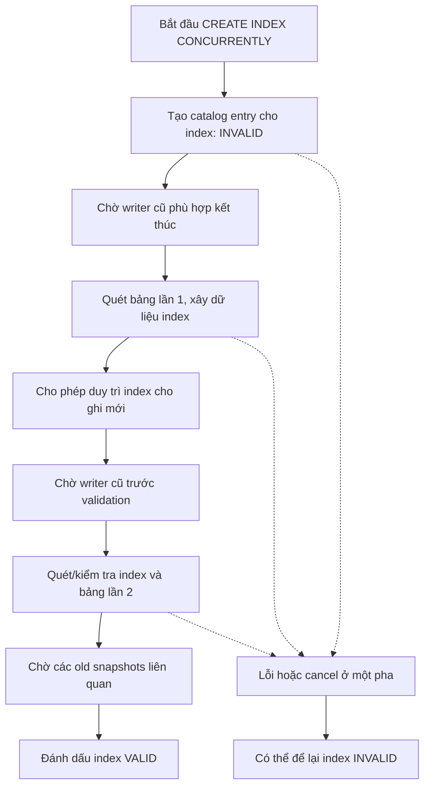

# CREATE INDEX CONCURRENTLY và vòng đời chỉ mục không hợp lệ trong PostgreSQL

Thêm chỉ mục cho một bảng PostgreSQL có hàng chục triệu dòng có thể cải thiện hiệu năng đọc, nhưng cách triển khai chỉ mục cũng có thể ảnh hưởng trực tiếp đến các giao dịch đang hoạt động. Với lệnh `CREATE INDEX` thông thường, PostgreSQL có thể ngăn các thao tác ghi vào bảng trong suốt quá trình dựng chỉ mục. Với **`CREATE INDEX CONCURRENTLY`**, hệ quản trị sử dụng một quy trình nhiều pha để cho phép `INSERT`, `UPDATE` và `DELETE` thông thường tiếp tục trong lúc xây dựng.

Cụm từ *concurrently* dễ khiến người học hiểu lầm rằng thao tác này không có khóa, không phải chờ, luôn thành công hoặc có thể rollback cùng các thay đổi schema khác. Thực tế, `CREATE INDEX CONCURRENTLY` **có thể mất thời gian lâu hơn**, cần nhiều lượt quét bảng, phụ thuộc vào những transaction khác và có thể **để lại một chỉ mục ở trạng thái `INVALID` nếu thất bại**.

Bài học thuộc chương **Chỉ mục**, tập trung vào hai vấn đề liên kết chặt chẽ:

1. **Tạo chỉ mục khi hệ thống vẫn đang hoạt động:** hiểu các giai đoạn, chi phí, lock, snapshot và giới hạn giao dịch của `CREATE INDEX CONCURRENTLY`.
2. **Quản lý vòng đời chỉ mục không hợp lệ:** nhận biết `pg_index.indisvalid`, `indisready`, `indislive`; tìm nguyên nhân; dọn dẹp hoặc xây dựng lại một cách có kiểm soát.

Bên cạnh cú pháp, bài học cung cấp truy vấn giám sát, ví dụ tạo lỗi có chủ đích trên database thực hành, cách phục hồi, lưu ý về unique index, partitioned table, migration tool và quy trình triển khai trên production.

## 1. Vì sao tạo chỉ mục có thể ảnh hưởng ứng dụng?

Giả sử bảng `orders` có hàng triệu đơn hàng và truy vấn thường gặp là:

```sql
SELECT order_id, created_at, total_amount
FROM app.orders
WHERE tenant_id = 42
ORDER BY created_at DESC
LIMIT 20;
```

Một chỉ mục B-tree phù hợp có thể là:

```sql
CREATE INDEX idx_orders_tenant_created
ON app.orders (tenant_id, created_at DESC);
```

Ở môi trường có ít dữ liệu, lệnh có thể hoàn thành rất nhanh. Nhưng trên bảng lớn, PostgreSQL cần quét dữ liệu và xây cấu trúc chỉ mục, đồng thời duy trì những quy tắc nhất quán khi giao dịch khác ghi thêm đơn hàng.

**Vấn đề vận hành:** nếu index build giữ khóa không tương thích với `INSERT`, `UPDATE` hoặc `DELETE`, các request ghi của ứng dụng có thể phải chờ cho đến khi index hoàn tất.

Phiên bản concurrent được thiết kế để giảm rủi ro đó:

```sql
CREATE INDEX CONCURRENTLY idx_orders_tenant_created
ON app.orders (tenant_id, created_at DESC);
```

Lệnh này cho phép hoạt động ghi thông thường tiếp diễn trong lúc index build, nhưng phải thực hiện thêm công việc và đợi những transaction liên quan ở các giai đoạn nhất định. **Ít chặn ghi hơn không có nghĩa không có ảnh hưởng tới độ trễ, CPU, I/O hoặc WAL.**

## 2. So sánh CREATE INDEX thông thường và CONCURRENTLY

| Tiêu chí | `CREATE INDEX` | `CREATE INDEX CONCURRENTLY` |
| --- | --- | --- |
| Cho phép `SELECT` thông thường khi xây index | Thường có | Thường có |
| Khóa chặn `INSERT/UPDATE/DELETE` vào bảng | Thường có trong thời gian build | Không lấy khóa chặn các thao tác ghi thông thường theo cách build chuẩn |
| Lượt quét bảng chính | Thường một | Thường hai, cùng các bước validation |
| Chi phí và thời gian | Có thể nhanh hơn | Có thêm lượt quét, chờ giao dịch và chi phí |
| Chạy trong `BEGIN ... COMMIT` tường minh | Có thể | **Không được** |
| Kết quả khi lỗi ở giai đoạn build | Thường statement rollback cùng cấu trúc vừa tạo | **Có thể còn một index INVALID** |
| Phù hợp triển khai khi có writer liên tục | Phải cân nhắc khóa chặn ghi | Thường đáng cân nhắc hơn |
| Có thể hoàn toàn không gây chờ | Không cam kết | **Cũng không cam kết** |

Điểm quan trọng là **độ trễ của ứng dụng**, không chỉ thời gian chạy DDL. Một index build chuẩn hoàn thành trong 20 giây nhưng giữ writer chờ 20 giây có thể kém phù hợp hơn một concurrent build mất 2 phút nhưng các writer vẫn có thể hoạt động, nếu tải I/O còn nằm trong ngưỡng chấp nhận được.

Ngược lại, với bảng nhỏ trong maintenance window cho phép ngừng ghi, `CREATE INDEX` thông thường có thể đơn giản và ít chi phí hơn.

## 3. Bộ dữ liệu thực hành tự chứa

Tạo schema riêng `index_lab` trên một database PostgreSQL phục vụ học tập. **Không sử dụng các lệnh tạo lỗi index hoặc khóa minh họa trên database production.**

```sql
CREATE SCHEMA IF NOT EXISTS index_lab;

CREATE TABLE index_lab.orders (
    order_id bigint GENERATED ALWAYS AS IDENTITY PRIMARY KEY,
    tenant_id integer NOT NULL,
    customer_email text NOT NULL,
    status text NOT NULL
        CHECK (status IN ('paid', 'pending', 'cancelled')),
    created_at timestamptz NOT NULL,
    total_amount numeric(12, 2) NOT NULL
        CHECK (total_amount >= 0)
);

INSERT INTO index_lab.orders
    (tenant_id, customer_email, status, created_at, total_amount)
SELECT
    (g % 10 + 1)::integer,
    'customer-' || (g % 500)::text || '@example.test',
    CASE
        WHEN g % 10 = 0 THEN 'cancelled'
        WHEN g % 3 = 0 THEN 'pending'
        ELSE 'paid'
    END,
    TIMESTAMPTZ '2025-01-01 00:00:00+00'
        + g * INTERVAL '1 minute',
    ((g % 10000) / 100.0)::numeric(12, 2)
FROM generate_series(1, 50000) AS g;

ANALYZE index_lab.orders;
```

Ví dụ này tạo **50.000 dòng** để người học thử nghiệm cú pháp và quan sát catalog. Trên máy mạnh, việc tạo chỉ mục có thể hoàn tất quá nhanh để kịp nhìn những pha trung gian; điều đó không có nghĩa production cũng sẽ như vậy.

Một truy vấn cần tối ưu:

```sql
EXPLAIN (ANALYZE, BUFFERS)
SELECT order_id, created_at, total_amount
FROM index_lab.orders
WHERE tenant_id = 3
ORDER BY created_at DESC
LIMIT 20;
```

Khi chưa có index phù hợp, planner có thể phải đọc và sắp xếp nhiều dòng hơn; sau khi có chỉ mục, nó có thêm một đường truy cập tiềm năng. **Không có cam kết planner bắt buộc sử dụng chỉ mục**: lựa chọn phụ thuộc thống kê, số hàng, chi phí và khả năng trả dữ liệu từ heap.

## 4. Cú pháp CREATE INDEX CONCURRENTLY

Cú pháp tối giản:

```sql
CREATE INDEX CONCURRENTLY index_name
ON schema_name.table_name (column_name);
```

Ví dụ với khóa lọc và thứ tự:

```sql
CREATE INDEX CONCURRENTLY idx_orders_tenant_created
ON index_lab.orders (tenant_id, created_at DESC);
```

Chỉ mục nhiều cột khác:

```sql
CREATE INDEX CONCURRENTLY idx_orders_status_created
ON index_lab.orders (status, created_at DESC);
```

Có thể sử dụng nhiều thành phần thiết kế chỉ mục quen thuộc, ví dụ:

- `UNIQUE` để kiểm tra tính duy nhất theo định nghĩa index.
- `USING btree` hoặc access method phù hợp.
- `INCLUDE` để lưu thêm cột không thuộc phần khóa index.
- `WHERE` cho partial index.
- Biểu thức như `lower(customer_email)` cho expression index.
- Thứ tự `ASC`/`DESC` và `NULLS FIRST`/`NULLS LAST` đối với access method phù hợp.

Ví dụ index bao phủ một số cột phục vụ truy vấn đọc:

```sql
CREATE INDEX CONCURRENTLY idx_orders_lookup_cover
ON index_lab.orders (tenant_id, created_at DESC)
INCLUDE (status, total_amount);
```

`INCLUDE` không làm hai cột đó thành phần của điều kiện thứ tự/so khớp khóa trong B-tree; chúng là **các cột được lưu kèm** và có thể giúp một số truy vấn đủ điều kiện dùng index-only scan. Thực tế vẫn phụ thuộc visibility map/MVCC và kế hoạch của PostgreSQL.

### 4.1. IF NOT EXISTS chỉ kiểm tra tên, không kiểm tra sức khỏe index

```sql
CREATE INDEX CONCURRENTLY IF NOT EXISTS idx_orders_tenant_created
ON index_lab.orders (tenant_id, created_at DESC);
```

`IF NOT EXISTS` tránh lỗi khi **một relation cùng tên** đã tồn tại trong schema liên quan. Nó **không xác nhận** index hiện có có cùng định nghĩa, đang hợp lệ, có đủ cột hay đang ở trạng thái `INVALID`.

Đây là cảnh báo đặc biệt quan trọng cho các migration có thể chạy lại: một index INVALID còn sót từ lần chạy lỗi có thể khiến câu `CREATE INDEX CONCURRENTLY IF NOT EXISTS ...` được **bỏ qua**, trong khi bạn tưởng lần retry đã tạo index thành công.

**Đúng quy trình:** kiểm tra `pg_index.indisvalid` và định nghĩa index, rồi quyết định sửa chữa; không dùng `IF NOT EXISTS` như một bước kiểm chứng.

### 4.2. UNIQUE CONCURRENTLY

```sql
CREATE UNIQUE INDEX CONCURRENTLY uq_orders_tenant_order
ON index_lab.orders (tenant_id, order_id);
```

Index này yêu cầu cặp `(tenant_id, order_id)` là duy nhất. Trong bộ dữ liệu mẫu, `order_id` đã là khóa chính nên ví dụ chủ yếu minh họa cú pháp; trong ứng dụng thật, chỉ tạo unique index bổ sung khi có bất biến nghiệp vụ rõ ràng.

**Không được giả định** rằng kiểm tra unique chỉ bắt đầu sau khi câu lệnh trả thành công. Unique index concurrent có thể **bắt đầu từ chối ghi trùng** trước khi index được đánh dấu valid, theo phần vòng đời sau.

### 4.3. Partial và expression index

Ví dụ chỉ lập index cho đơn chưa hoàn tất:

```sql
CREATE INDEX CONCURRENTLY idx_orders_pending_tenant_time
ON index_lab.orders (tenant_id, created_at DESC)
WHERE status = 'pending';
```

Và expression index:

```sql
CREATE INDEX CONCURRENTLY idx_orders_lower_email
ON index_lab.orders (lower(customer_email));
```

Một query muốn tận dụng partial index thường phải có predicate mà planner chứng minh được là phù hợp:

```sql
SELECT order_id, created_at
FROM index_lab.orders
WHERE tenant_id = 3
  AND status = 'pending'
ORDER BY created_at DESC
LIMIT 20;
```

Expression index yêu cầu biểu thức phù hợp với các quy tắc độ bất biến của function/index definition. Index kiểu này không làm mọi phép tìm kiếm không phân biệt hoa/thường tự động dùng index; query cần có biểu thức có thể khớp, ví dụ `WHERE lower(customer_email) = lower($1)` theo chiến lược tham số ứng dụng.

## 5. Quy tắc lớn: không chạy trong transaction block tường minh

Khác `CREATE INDEX` thông thường, **`CREATE INDEX CONCURRENTLY` không được chạy trong transaction block**.

Ví dụ **sai**:

```sql
BEGIN;

CREATE INDEX CONCURRENTLY idx_orders_tenant_created
ON index_lab.orders (tenant_id, created_at DESC);

COMMIT;
```

PostgreSQL từ chối vì concurrent build tự dùng nhiều transaction nội bộ để thiết lập vòng đời index và đồng bộ với hoạt động ghi.

Lệnh hợp lệ khi chạy **như một statement riêng**, bên ngoài `BEGIN ... COMMIT` tường minh:

```sql
CREATE INDEX CONCURRENTLY idx_orders_tenant_created
ON index_lab.orders (tenant_id, created_at DESC);
```

Khi dùng `psql` với autocommit mặc định, câu này là một lệnh riêng. Khi dùng migration tool, cần **tắt wrapper transaction cho migration đó theo tính năng được tool/phiên bản đang dùng hỗ trợ**.

### 5.1. Không thể rollback nhiều migration cùng lúc bằng một BEGIN

Một ý tưởng không hợp lệ:

```sql
BEGIN;

ALTER TABLE index_lab.orders ADD COLUMN note text;

CREATE INDEX CONCURRENTLY idx_orders_note
ON index_lab.orders (note);

COMMIT;
```

Không thể đặt concurrent index build vào chuỗi transaction tường minh đó. Nếu cần vừa thêm cột vừa tạo index, hãy tách thành **những bước triển khai riêng** có kiểm soát, xác định điểm có thể retry và cơ chế rollback phù hợp cho từng bước.

### 5.2. Có thể dùng SET LOCAL không?

`SET LOCAL` chỉ có hiệu lực bên trong transaction đang mở. Vì `CREATE INDEX CONCURRENTLY` không chạy trong transaction block tường minh, không nên viết:

```sql
BEGIN;
SET LOCAL lock_timeout = '2s';
CREATE INDEX CONCURRENTLY ...;
COMMIT;
```

Thay vào đó, cấu hình timeout **ở session hoặc vai trò phù hợp** trước statement concurrent:

```sql
SET lock_timeout = '5s';
SET statement_timeout = '0';

CREATE INDEX CONCURRENTLY idx_orders_tenant_created
ON index_lab.orders (tenant_id, created_at DESC);

RESET lock_timeout;
RESET statement_timeout;
```

Đây là ví dụ cách đặt phạm vi session, không phải cấu hình nên sao chép nguyên vào production. `statement_timeout = 0` tắt giới hạn statement trong session đó và có thể dẫn tới lệnh chạy rất lâu; hãy chọn ngưỡng phù hợp với quy trình vận hành và bảo đảm reset trong các nhánh lỗi.

## 6. CREATE INDEX CONCURRENTLY hoạt động qua những pha nào?

Để cho phép writer tiếp tục thay đổi dữ liệu, PostgreSQL không thể chỉ quét bảng một lần rồi tuyên bố index hoàn tất. Nó phải đảm bảo những hàng được thay đổi trong lúc quét cũng được phản ánh phù hợp.

Một cách hiểu vòng đời:



Sơ đồ minh họa **các trạng thái logic**. Chi tiết transaction nội bộ, thứ tự chính xác của thay đổi cờ catalog và các phân đoạn scan/validation được PostgreSQL xử lý; không nên dùng sơ đồ làm cơ sở thao tác thủ công với `pg_catalog`.

### 6.1. Tạo catalog entry ban đầu ở trạng thái invalid

Trước khi index có thể phục vụ query, PostgreSQL cần đăng ký đối tượng index trong system catalog. Trong một concurrent build, index được đưa vào catalog **ở trạng thái chưa valid**.

Điểm này giải thích vì sao một lỗi xảy ra sau đó có thể vẫn để lại một relation index có tên. Đối tượng tồn tại trong catalog **không đồng nghĩa** nó đã được xây dựng đủ và có thể được planner dùng.

### 6.2. Chờ những writer cũ

Trước các giai đoạn quét, PostgreSQL có thể cần chờ những transaction đã sửa bảng kết thúc. Một transaction đã chạy `UPDATE` rồi `idle in transaction` có thể làm index build đứng ở pha chờ dù query UPDATE đã xong từ lâu.

Điều này **không** có nghĩa concurrent index dùng loại khóa chặn mọi writer, mà là nó cần đảm bảo kết quả đọc/ghi qua các snapshot có tính nhất quán.

### 6.3. Quét bảng và ghi các mục chỉ mục

Giai đoạn build duyệt dữ liệu bảng để tạo index entries. Vì writer vẫn hoạt động, PostgreSQL cần cơ chế cập nhật index cho những thay đổi sau một mốc thích hợp.

Tại một số thời điểm, index **chưa valid cho query** nhưng **đã sẵn sàng nhận cập nhật từ các phép ghi tiếp theo**. Đây là nguyên nhân index INVALID có thể vẫn gây overhead ghi, kể cả sau khi lệnh build thất bại.

### 6.4. Kiểm tra lần hai và old snapshots

PostgreSQL thực hiện thêm một lượt quét/validation để bổ sung, kiểm tra những thay đổi liên quan tới quá trình xây dựng. Sau đó nó có thể phải **chờ những transaction đang giữ snapshot cũ** trước khi chuyển index sang trạng thái valid.

Một `SELECT` dài, transaction với snapshot cũ hoặc concurrent index build trên bảng khác trong một số trường hợp có thể kéo dài thời gian chờ. Với partial/expression index, quan hệ snapshot còn có thêm những tình huống cần chú ý.

### 6.5. Khi nào index thực sự dùng được?

Một index chỉ mới xuất hiện ở catalog chưa đủ để planner sử dụng. Nó cần được đánh dấu **valid** và đáp ứng các điều kiện an toàn theo snapshot của truy vấn. Trong những tình huống đặc biệt, ngay cả sau khi DDL trả thành công, một transaction đã bắt đầu trước index build có thể **chưa được phép sử dụng index ngay**.

Đừng dùng việc thấy tên index trong `pg_indexes` làm bằng chứng duy nhất của thành công. Kiểm tra cờ catalog và xem kế hoạch query thực tế khi phù hợp.

## 7. pg_index và ba cờ quan trọng: indisvalid, indisready, indislive

PostgreSQL lưu metadata liên quan index trong `pg_index`, kết hợp với `pg_class` và những catalog khác.

Ba cờ thường được dùng để hiểu vòng đời:

| Cờ | Nếu là `true` | Nếu là `false` |
| --- | --- | --- |
| `indisvalid` | Index hợp lệ về mặt sử dụng cho query (còn phụ thuộc các điều kiện khác) | Index có thể chưa hoàn chỉnh; planner không được sử dụng như index truy vấn bình thường |
| `indisready` | Index sẵn sàng được duy trì bởi thao tác ghi mới | Index chưa được cập nhật bởi `INSERT/UPDATE` theo cơ chế bình thường |
| `indislive` | Index vẫn được xem là một đối tượng đang tồn tại/được xét theo vòng đời | Index đang trong quá trình bị drop; hệ thống bỏ qua nó cho các mục đích liên quan |

Cũng cần hiểu `indcheckxmin`: trong vài trường hợp, PostgreSQL còn phải đảm bảo snapshot của query đủ mới trước khi dùng index, do những liên quan đến HOT chains/MVCC. Vì vậy, **`indisvalid = true` không phải cam kết mọi query ở mọi snapshot lập tức chọn index**.

### 7.1. Trạng thái logic điển hình

| Giai đoạn | `indisvalid` | `indisready` | `indislive` | Ý nghĩa |
| --- | :---: | :---: | :---: | --- |
| Index đã hoàn tất, hoạt động bình thường | true | true | true | Có thể được planner xem xét và được DML duy trì |
| Concurrent build mới tạo catalog entry | false | false | true | Chưa thể dùng cho query, chưa hoàn tất xây dựng |
| Đã qua giai đoạn build đầu, đang validation | false | true | true | Không dùng cho query nhưng đã được duy trì khi ghi |
| Build lỗi sau khi index đã ready | false | true | true | **INVALID, có thể tiếp tục tốn chi phí DML** |
| Index đang được loại bỏ | Có thể thay đổi | Có thể thay đổi | false | Trong quá trình drop; không tự sửa các cờ |

Bảng biểu diễn **những tình huống có thể gặp**, không phải mọi tổ hợp Boolean là một trạng thái độc lập được API cam kết. Không tự chạy `UPDATE pg_index SET ...` để “sửa cờ”: đó là sửa trực tiếp catalog hệ thống, có thể làm hỏng database.

### 7.2. INVALID không đồng nghĩa “index chưa tồn tại”

Khi `indisvalid = false`:

- Index vẫn có thể có tên, OID và dữ liệu vật lý.
- Planner **không nên dùng nó như một đường truy cập tin cậy**.
- Tùy `indisready`, writer vẫn có thể phải cập nhật index.
- Với unique index ở những pha nhất định, **kiểm tra tính duy nhất có thể còn được thực thi**.
- Một lần `CREATE INDEX CONCURRENTLY IF NOT EXISTS` sau đó có thể bị bỏ qua vì trùng tên.

Vì vậy, “index INVALID” là một **trạng thái vận hành cần được xử lý**, không phải một nhãn trang trí.

## 8. Truy vấn kiểm tra trạng thái index trên bảng

Dùng catalog để xem một bảng có những index nào và chúng đang ở trạng thái gì:

```sql
SELECT
    t.oid::regclass AS table_name,
    idx.oid::regclass AS index_name,
    i.indisunique,
    i.indisprimary,
    i.indisvalid,
    i.indisready,
    i.indislive,
    i.indcheckxmin,
    pg_size_pretty(pg_relation_size(idx.oid)) AS index_size,
    pg_get_indexdef(idx.oid) AS definition
FROM pg_index AS i
JOIN pg_class AS idx
    ON idx.oid = i.indexrelid
JOIN pg_class AS t
    ON t.oid = i.indrelid
WHERE t.oid = 'index_lab.orders'::regclass
ORDER BY idx.relname;
```

Truy vấn này cho thấy cả index primary key được PostgreSQL tạo từ `PRIMARY KEY` và những index do bạn tạo trực tiếp.

Một phiên bản chỉ tìm **những index chưa valid** trong một schema:

```sql
SELECT
    t.oid::regclass AS table_name,
    idx.oid::regclass AS index_name,
    i.indisvalid,
    i.indisready,
    i.indislive,
    pg_get_indexdef(idx.oid) AS definition
FROM pg_index AS i
JOIN pg_class AS t
    ON t.oid = i.indrelid
JOIN pg_class AS idx
    ON idx.oid = i.indexrelid
JOIN pg_namespace AS n
    ON n.oid = t.relnamespace
WHERE n.nspname = 'index_lab'
  AND NOT i.indisvalid
ORDER BY t.relname, idx.relname;
```

**Không vội kết luận lỗi khi thấy một index invalid đang được xây dựng.** Trong lúc `CREATE INDEX CONCURRENTLY` đang chạy, `indisvalid = false` có thể là **trạng thái tạm thời hợp lệ của quy trình**. Hãy kết hợp `pg_stat_progress_create_index` và trạng thái hoạt động trước khi quyết định drop.

### 8.1. psql hiển thị INVALID

Trong `psql`, lệnh mô tả bảng:

```text
\d index_lab.orders
```

có thể ghi hậu tố `INVALID` bên cạnh tên index bị lỗi. Đây là dấu hiệu nhanh, nhưng muốn phân tích nên dùng catalog để phân biệt cả `indisready` và những thông tin phụ thuộc.

### 8.2. pg_indexes không đủ để chứng minh index valid

View `pg_indexes` hữu ích để liệt kê tên và định nghĩa:

```sql
SELECT schemaname, tablename, indexname, indexdef
FROM pg_indexes
WHERE schemaname = 'index_lab'
ORDER BY tablename, indexname;
```

Tuy nhiên view này **không hiển thị đầy đủ các cờ `pg_index`**. Một index INVALID vẫn có thể xuất hiện trong danh sách. Để quyết định có dùng cho workload hoặc có cần sửa, đọc `pg_index`.

## 9. Theo dõi quá trình xây dựng bằng pg_stat_progress_create_index

PostgreSQL có view `pg_stat_progress_create_index` dùng để quan sát tiến trình `CREATE INDEX`/`REINDEX` khi chúng còn đang chạy.

```sql
SELECT
    p.pid,
    p.datname,
    p.relid::regclass AS table_name,
    p.index_relid::regclass AS index_name,
    p.command,
    p.phase,
    p.lockers_total,
    p.lockers_done,
    p.current_locker_pid,
    p.blocks_total,
    p.blocks_done,
    p.tuples_total,
    p.tuples_done,
    now() - a.query_start AS elapsed
FROM pg_stat_progress_create_index AS p
LEFT JOIN pg_stat_activity AS a
    ON a.pid = p.pid
WHERE p.datname = current_database()
ORDER BY p.pid;
```

Những giá trị `phase` đáng chú ý:

| Phase | Ý nghĩa |
| --- | --- |
| `initializing` | Chuẩn bị dựng index |
| `waiting for writers before build` | Chờ những transaction writer liên quan kết thúc trước lượt build |
| `building index` | Access method đang xây chỉ mục |
| `waiting for writers before validation` | Chờ writer liên quan trước khi validation |
| `index validation: scanning index` | Quét index để phục vụ validation |
| `index validation: sorting tuples` | Sắp các tuple phục vụ validation |
| `index validation: scanning table` | Quét bảng trong giai đoạn xác thực |
| `waiting for old snapshots` | Chờ snapshot cũ không còn cản trở việc chuyển sang valid |
| `waiting for readers before marking dead` | Pha liên quan `REINDEX CONCURRENTLY` |
| `waiting for readers before dropping` | Pha liên quan `REINDEX CONCURRENTLY` |

Tên phase và những cột tiến độ phụ thuộc phiên bản PostgreSQL. Không phải mọi access method đều cung cấp số block/tuple đủ để tính một phần trăm tiến độ có ý nghĩa.

### 9.1. Hiểu các trường lockers_*

Trong những pha chờ:

- `lockers_total`: số backend/transaction liên quan cần chờ được báo tại pha đó.
- `lockers_done`: số đã hoàn thành theo cơ chế báo tiến độ.
- `current_locker_pid`: PID của backend đang được chờ tại thời điểm quan sát, nếu có.

Không nên coi `lockers_done / lockers_total` là % thời gian hoàn thành toàn bộ index build; đó chỉ là thông tin **của pha chờ hiện tại**.

### 9.2. Khi view không có hàng

Nếu `pg_stat_progress_create_index` không trả hàng, có thể vì:

- Index build đã hoàn tất.
- Index build đã thất bại và backend không còn trong pha tạo index.
- Query đang nhìn database khác hoặc thiếu quyền xem chi tiết phù hợp.
- Statement chưa thực sự bắt đầu ở server.

Để xác định trạng thái cuối, **kiểm tra catalog `pg_index`** và log migration; không dựa duy nhất vào sự vắng mặt của progress row.

## 10. Tìm vì sao index build đang chờ

Một index concurrent có thể đứng lâu ở pha `waiting for writers before build` hoặc `waiting for old snapshots`. Cần xem những transaction còn tồn tại:

```sql
SELECT
    pid,
    usename,
    application_name,
    client_addr,
    state,
    wait_event_type,
    wait_event,
    now() - xact_start AS transaction_age,
    now() - query_start AS query_age,
    backend_xmin,
    pg_blocking_pids(pid) AS blocking_pids,
    left(query, 180) AS query_sample
FROM pg_stat_activity
WHERE datname = current_database()
  AND xact_start IS NOT NULL
ORDER BY xact_start;
```

Hãy kết hợp:

1. `pg_stat_progress_create_index.phase` và `current_locker_pid`.
2. `pg_stat_activity` để thấy transaction lâu, trạng thái `idle in transaction`, query hiện tại.
3. `pg_blocking_pids(pid)` khi backend thật sự đợi một lock và cần tìm blocker.
4. `pg_locks` để phân tích mode/object khóa trong trường hợp thích hợp.

### 10.1. Vì sao một transaction idle có thể kéo dài DDL?

Một transaction khác từng cập nhật bảng nhưng chưa commit có thể khiến concurrent index build chờ ở pha cần writer cũ kết thúc. Ngoài ra, snapshot cũ còn hoạt động ở những transaction nhất định cũng có thể kéo dài pha cuối.

`idle in transaction` không tự chứng minh một phiên đang chặn index build; phải liên hệ phase, PID và snapshot/lock thực tế. Tuy nhiên đây là một nguồn chậm phổ biến cần điều tra.

### 10.2. Không tự terminate mọi transaction lâu

`pg_terminate_backend(pid)` sẽ làm ngắt session và rollback transaction chưa commit, có thể giải phóng tài nguyên nhưng cũng gây gián đoạn nghiệp vụ. Cần xác minh chủ sở hữu, tác động của rollback và quyền vận hành trước khi thực hiện.

Ưu tiên để ứng dụng kết thúc transaction đúng cách. Nếu index build phải chờ quá lâu, có thể lựa chọn **hủy index build có kiểm soát**, chấp nhận khả năng phải dọn invalid index rồi lên lịch chạy lại.

## 11. INVALID index hình thành như thế nào?

Những nguyên nhân thường gặp:

| Nguyên nhân | Điều có thể xảy ra |
| --- | --- |
| `CREATE INDEX CONCURRENTLY` bị hủy do cancel/timeout | Catalog đã tạo index nhưng việc build chưa hoàn tất |
| Deadlock hoặc lỗi chờ lock trong một pha | Lệnh lỗi và có thể còn index invalid |
| `CREATE UNIQUE INDEX CONCURRENTLY` gặp duplicate | Validation/unique build thất bại, index có thể vẫn tồn tại |
| Expression index đánh giá hàm bị lỗi | Build dừng ở một số hàng, index invalid |
| Partial index có lỗi khi đánh giá biểu thức/predicate | Có thể thất bại sau khi đã tạo đối tượng index |
| Không đủ disk hoặc lỗi I/O/hệ thống | Lệnh không hoàn tất, phải đánh giá trạng thái và khả năng phục hồi |
| `REINDEX CONCURRENTLY` bị lỗi giữa chừng | Có thể để lại index tạm dạng `_ccnew` hoặc `_ccold` |
| Partitioned index đang gắn dần partition | Parent index có thể **invalid có chủ đích** tới khi đủ child indexes |

Không phải mọi lệnh DDL lỗi đều để lại index invalid: điều này đặc biệt liên quan đến **cơ chế nhiều transaction của concurrent build**. Nếu lỗi xảy ra trước khi tạo catalog entry, không nhất thiết tồn tại index cần dọn.

### 11.1. Chỉ mục invalid có bị planner dùng nhầm không?

PostgreSQL không được coi một index `indisvalid = false` là nguồn tin cậy để phục vụ query thông thường. Lý do: index có thể thiếu hàng hoặc chưa được kiểm tra hoàn tất.

Nhưng query vẫn có thể nhanh vì dùng index khác hoặc sequential scan. **Một truy vấn nhanh không chứng minh index invalid đã trở thành valid**, và một index valid cũng không bị bắt buộc phải được chọn bởi planner.

### 11.2. Invalid index có thể vẫn gây chi phí ghi

Nếu `indisready = true`, hệ thống vẫn phải duy trì index cho những hàng được INSERT/UPDATE theo cơ chế thích hợp. Khi index chưa được planner dùng, chi phí duy trì đó là **overhead không đem lại lợi ích đọc tương xứng**.

Index invalid còn chiếm dung lượng vật lý, có thể tăng WAL/chi phí index maintenance và làm migration sau đó vướng xung đột tên. Vì vậy không nên để lại lâu khi đã xác định index thật sự bị lỗi và không phục vụ mục đích nào.

## 12. Thực hành: cố ý tạo UNIQUE index thất bại

Mục tiêu là thấy **lỗi dữ liệu có thể để lại index INVALID**. Bài này chỉ chạy trên database học tập.

Tạo bảng có email trùng:

```sql
CREATE TABLE index_lab.email_registry (
    registry_id bigint GENERATED ALWAYS AS IDENTITY PRIMARY KEY,
    email text NOT NULL,
    registered_at timestamptz NOT NULL DEFAULT now()
);

INSERT INTO index_lab.email_registry (email)
VALUES
    ('duplicate@example.test'),
    ('duplicate@example.test'),
    ('unique@example.test');
```

Kiểm tra duplicate trước:

```sql
SELECT email, COUNT(*) AS occurrences
FROM index_lab.email_registry
GROUP BY email
HAVING COUNT(*) > 1;
```

Kết quả có email `duplicate@example.test` xuất hiện hai lần.

Thử xây một unique index:

```sql
-- Cố ý thất bại vì dữ liệu có giá trị trùng.
CREATE UNIQUE INDEX CONCURRENTLY uq_email_registry_email
ON index_lab.email_registry (email);
```

PostgreSQL phát hiện duplicate và báo lỗi. Vì là concurrent build, một index có tên `uq_email_registry_email` **có thể còn ở trạng thái INVALID**.

Kiểm tra ngay:

```sql
SELECT
    idx.relname AS index_name,
    i.indisunique,
    i.indisvalid,
    i.indisready,
    i.indislive,
    pg_get_indexdef(idx.oid) AS definition
FROM pg_index AS i
JOIN pg_class AS idx
    ON idx.oid = i.indexrelid
WHERE i.indrelid = 'index_lab.email_registry'::regclass
ORDER BY idx.relname;
```

Sau lỗi, cũng có thể xem:

```text
\d index_lab.email_registry
```

Nếu index được để lại, `psql` có thể gắn nhãn `INVALID` bên cạnh tên.

### 12.1. Không coi thất bại là rollback toàn bộ vòng đời

Một nhận định sai là: “`CREATE UNIQUE INDEX CONCURRENTLY` bị lỗi, nên chắc chắn database không còn dấu vết index.”

Concurrent build có các giai đoạn đã commit metadata riêng, nên một lỗi muộn có thể để lại đối tượng chưa hợp lệ. Cần **kiểm tra catalog**, không suy từ SQLSTATE lỗi rằng toàn bộ DDL đã biến mất.

### 12.2. Vì sao không chỉ chạy lại IF NOT EXISTS?

```sql
-- Không đủ để sửa một index INVALID còn cùng tên.
CREATE UNIQUE INDEX CONCURRENTLY IF NOT EXISTS uq_email_registry_email
ON index_lab.email_registry (email);
```

Nếu index cùng tên còn tồn tại, lệnh có thể bỏ qua tạo mới. Như vậy bạn vừa có một migration “không báo lỗi vì tồn tại tên” nhưng **chưa có unique index valid** phục vụ yêu cầu.

Cần xử lý dữ liệu trùng và sửa index theo quy trình phục hồi.

## 13. Điểm nguy hiểm: UNIQUE index có thể thực thi quy tắc trước khi valid

Với `CREATE UNIQUE INDEX CONCURRENTLY`, PostgreSQL có thể bắt đầu **kiểm tra tính duy nhất cho những thao tác ghi đồng thời từ khi bắt đầu lượt quét thứ hai**, trước khi câu DDL hoàn tất và index được đánh dấu valid.

Điều này tạo hai tình huống đáng nhớ:

1. Một transaction ứng dụng có thể nhận lỗi duplicate **trong lúc** một unique index concurrent vẫn đang được xây.
2. Nếu lỗi xảy ra ở lượt quét thứ hai, **index INVALID còn sót vẫn có thể tiếp tục thực thi kiểm tra uniqueness** đối với ghi mới.

Vì vậy, một index `indisvalid = false` không được dùng để kết luận “không có ràng buộc nào ảnh hưởng ghi dữ liệu”.

Đồng thời, vì index vẫn invalid, tính duy nhất trên **toàn bộ dữ liệu hiện có** không được PostgreSQL xác nhận hoàn chỉnh chỉ từ việc index tồn tại. Có thể xảy ra trạng thái khó hiểu: một số ghi mới bị từ chối vì unique, nhưng catalog vẫn báo index không hợp lệ.

### 13.1. Cần xử lý business rule riêng

Nếu bạn thêm unique index vào một bảng đã cho phép duplicate suốt nhiều năm:

- Tìm các khóa hiện đang trùng.
- Quyết định chính sách hợp nhất, xóa, sửa hoặc đánh dấu dữ liệu cũ.
- Điều chỉnh writer để ngăn duplicate mới theo quy tắc nghiệp vụ.
- Xây unique index concurrently.
- Xác nhận index valid và hành vi ghi mong muốn.

Không nên tạo unique index rồi hy vọng việc build “tự sửa” dữ liệu trùng.

### 13.2. Partial unique index và phạm vi duy nhất

Ví dụ chỉ yêu cầu email duy nhất đối với những đăng ký chưa bị xóa mềm:

```sql
CREATE TABLE index_lab.accounts (
    account_id bigint GENERATED ALWAYS AS IDENTITY PRIMARY KEY,
    email text NOT NULL,
    deleted_at timestamptz
);

CREATE UNIQUE INDEX CONCURRENTLY uq_accounts_active_email
ON index_lab.accounts (lower(email))
WHERE deleted_at IS NULL;
```

Đây là unique index trên biểu thức, chỉ áp dụng cho tập hàng có `deleted_at IS NULL`. Các hàng đã xóa mềm nằm ngoài predicate theo ngữ nghĩa index. Nhưng quá trình xây dựng vẫn phải xử lý duplicate trong phạm vi được bảo vệ, cũng như những ghi đồng thời thay đổi trạng thái `deleted_at`.

Không thể coi partial unique index là một `UNIQUE CONSTRAINT` đơn giản trên mọi hàng; phạm vi và cách dùng `ON CONFLICT` cần khớp với định nghĩa index.

## 14. Khôi phục cách 1: DROP INDEX CONCURRENTLY rồi tạo lại

Phương án phục hồi phổ biến cho index invalid không có phụ thuộc bắt buộc:

1. Xác nhận index thực sự không còn đang build.
2. Xác định nguyên nhân thất bại.
3. Sửa dữ liệu, thiếu disk hoặc sự cố transaction/lock liên quan.
4. **Drop index invalid** bằng cách phù hợp.
5. **Chạy lại `CREATE INDEX CONCURRENTLY`**.
6. Kiểm tra `indisvalid = true` sau khi thành công.

Trên bài thực hành email, trước hết sửa duplicate:

```sql
UPDATE index_lab.email_registry
SET email = 'duplicate-second@example.test'
WHERE registry_id = (
    SELECT MAX(registry_id)
    FROM index_lab.email_registry
    WHERE email = 'duplicate@example.test'
);
```

Kiểm tra:

```sql
SELECT email, COUNT(*)
FROM index_lab.email_registry
GROUP BY email
HAVING COUNT(*) > 1;
```

Nếu không có duplicate nữa, xử lý index đã lỗi. Khi **đã xác nhận tên/index và không có dependency cấm drop**, chạy mỗi lệnh là statement riêng:

```sql
DROP INDEX CONCURRENTLY IF EXISTS index_lab.uq_email_registry_email;
```

Sau đó:

```sql
CREATE UNIQUE INDEX CONCURRENTLY uq_email_registry_email
ON index_lab.email_registry (email);
```

Và xác nhận:

```sql
SELECT
    idx.relname,
    i.indisunique,
    i.indisvalid,
    i.indisready
FROM pg_index AS i
JOIN pg_class AS idx ON idx.oid = i.indexrelid
WHERE idx.oid = 'index_lab.uq_email_registry_email'::regclass;
```

Kỳ vọng `indisvalid = true`, `indisready = true`.

### 14.1. Những giới hạn của DROP INDEX CONCURRENTLY

`DROP INDEX CONCURRENTLY` có các hạn chế quan trọng:

- **Không được chạy trong transaction block tường minh.**
- Chỉ cho phép **một tên index mỗi lệnh**.
- **Không hỗ trợ `CASCADE`**.
- Không thể dùng để xóa index đang hỗ trợ ràng buộc **PRIMARY KEY** hoặc **UNIQUE** qua constraint dependency.
- Không hỗ trợ dùng trực tiếp như vậy để drop các index trên partitioned table parent theo giới hạn PostgreSQL hiện hành.
- Phải có quyền phù hợp, thường là chủ sở hữu index.
- Có thể vẫn **chờ các transaction** để giảm chặn hoạt động đọc/ghi.

Một unique index độc lập tạo bằng `CREATE UNIQUE INDEX` không nhất thiết đã trở thành index hỗ trợ một `UNIQUE CONSTRAINT`. Tuy nhiên, phải kiểm tra dependency trước khi drop; không chỉ nhìn cờ `indisunique` rồi quyết định.

### 14.2. Nếu index đang phục vụ constraint

Với index của primary key hoặc unique constraint, không tự chạy `DROP INDEX CONCURRENTLY` để “dọn” khi chưa biết mối quan hệ constraint. Việc xóa index có thể đòi hỏi thay đổi ràng buộc hoặc không được phép theo dạng concurrent.

Đối với ràng buộc quan trọng, ưu tiên quy trình sửa chữa do DBA quyết định, có đánh giá khóa/availability. Không làm mất bảo vệ dữ liệu chỉ để giảm dung lượng index.

## 15. Khôi phục cách 2: REINDEX INDEX CONCURRENTLY

PostgreSQL hỗ trợ xây lại index bằng:

```sql
REINDEX INDEX CONCURRENTLY index_lab.uq_email_registry_email;
```

Đây là một lựa chọn khác sau khi sửa nguyên nhân khiến index hỏng. Với một index invalid do `CREATE INDEX CONCURRENTLY` thất bại, **`REINDEX INDEX CONCURRENTLY`** có thể xây lại index đó mà không nhất thiết phải drop tên cũ rồi tạo từ đầu.

Các điểm lưu ý:

- Lệnh không được chạy trong transaction block tường minh.
- `REINDEX CONCURRENTLY` cũng có các pha quét/chờ; không phải thao tác tức thì.
- Nếu unique index vẫn có dữ liệu trùng, quá trình xây lại có thể tiếp tục thất bại.
- Với invalid index, cách concurrent rebuild áp dụng cho `REINDEX INDEX` cụ thể; không mặc định mọi biến thể `REINDEX TABLE/SCHEMA/DATABASE CONCURRENTLY` đều xử lý một invalid index theo cùng cách.
- `REINDEX CONCURRENTLY` có các hạn chế riêng đối với một số đối tượng, ví dụ index của exclusion constraint và system catalog.
- Chọn giữa **drop + create** và **reindex** theo định nghĩa index cần giữ, dependency, phiên bản server và yêu cầu vận hành.

### 15.1. Khi nào nên chọn hướng nào?

| Tình huống | Hướng cân nhắc |
| --- | --- |
| Index mới tạo lỗi, chưa có dependency và có thể tạo lại | `DROP INDEX CONCURRENTLY` rồi `CREATE INDEX CONCURRENTLY` |
| Muốn giữ định nghĩa/tên của index, hỗ trợ rebuild phù hợp | `REINDEX INDEX CONCURRENTLY` |
| Index bị hỏng do duplicate dữ liệu | **Sửa duplicate trước**, rồi chọn cách rebuild |
| Lỗi do transaction/snapshot dài | Giải quyết blocker/khung chạy, rồi retry |
| Lỗi do thiếu disk/WAL capacity | Bổ sung tài nguyên/giảm tải trước khi retry |
| Index liên quan PK/UNIQUE constraint đang bảo vệ dữ liệu | Quy trình có kiểm soát, không drop mù quáng |
| Partitioned index parent invalid vì chưa attach đủ partition | Hoàn tất attach/index con; không coi ngay là build thất bại |

Không nên chọn một lệnh sửa chữa chỉ vì cú pháp ngắn; hãy xem **trạng thái dữ liệu, catalog và dependency** trước.

## 16. INVALID index dạng _ccnew và _ccold sau REINDEX CONCURRENTLY

Khi `REINDEX CONCURRENTLY` chạy, PostgreSQL có thể tạo một bản index mới tạm thời rồi chuyển trạng thái để thay thế index cũ.

Nếu quá trình này thất bại giữa chừng, có thể tồn tại những tên có hậu tố:

- `_ccnew`: bản index **mới** được tạo tạm trong quá trình reindex, nhưng không được hoàn thành.
- `_ccold`: bản index **cũ** sau khi phần xây lại đã thành công, nhưng thao tác dọn bản cũ chưa hoàn tất.

Có thể có số nối sau hậu tố, ví dụ `_ccnew1` hoặc `_ccold2`, để tránh trùng tên.

### 16.1. Hướng xử lý _ccnew

Với `_ccnew`, index mới thường được đánh dấu invalid và không dùng cho query. Sau khi xác nhận đúng tên và trạng thái, hướng phục hồi thường là **drop index tạm này**, xử lý nguyên nhân lỗi rồi thử `REINDEX CONCURRENTLY` lại trên index gốc.

Ví dụ minh họa, không chạy nếu chưa kiểm tra catalog:

```sql
-- Chỉ khi xác minh đúng index tạm không còn hoạt động.
DROP INDEX CONCURRENTLY IF EXISTS index_lab.some_index_ccnew;
```

Đừng xóa theo pattern tên tự động mà không phân biệt index có dependency hoặc tác vụ vẫn đang chạy.

### 16.2. Hướng xử lý _ccold

`_ccold` thường đại diện cho **bản cũ** chưa được dọn sau khi bản rebuild mới đã hoạt động. Sau khi xác minh index thay thế đã valid và được hệ thống dùng đúng, có thể dọn bản cũ.

Cần kiểm tra bảng, definition, constraint/dependency và index đang hoạt động. Nếu không thể dùng DROP CONCURRENTLY vì giới hạn đối tượng, cần một kế hoạch khác; không thử xoá thủ công file index.

**Tuyệt đối không tự rename hoặc drop hai bản index theo cảm tính khi chưa xác nhận bản nào đang valid.**

## 17. Tại sao REINDEX CONCURRENTLY cũng có thể để lại index invalid?

`REINDEX CONCURRENTLY` không chỉ ghi đè index cũ trong một giao dịch nguyên tử duy nhất. Nó cần tạo bản mới, đồng bộ các ghi đang xảy ra, chuyển sang bản mới và loại bản cũ qua những pha phù hợp.

Nếu lệnh bị cancel/timeout hoặc gặp lỗi giữa những pha đó, PostgreSQL có thể để lại trạng thái trung gian của bản mới hoặc bản cũ. Vì vậy, **kiểm tra `pg_index` sau cả CREATE lẫn REINDEX CONCURRENTLY** là một phần của runbook, không phải công việc chỉ thực hiện khi query chậm.

Mặt khác, không nên coi sự tồn tại tạm thời của hai index trong lúc reindex đang chạy là dấu hiệu lỗi. Trong quá trình rebuild, việc có nhiều bản index là một phần thiết kế.

## 18. Những hạn chế khác của CONCURRENTLY

### 18.1. Chỉ một concurrent index build trên một bảng tại một thời điểm

PostgreSQL hạn chế **một concurrent index build trên cùng một bảng** trong một thời điểm. Nếu hai migration độc lập cùng cố xây index concurrently trên cùng bảng, chúng có thể chờ nhau hoặc bị quản lý theo giới hạn của hệ thống.

Đừng tự động tăng số worker migration cùng bảng để “làm index nhanh hơn”. Nhiều index build trên các bảng khác nhau cũng có thể cạnh tranh CPU/I/O/WAL.

### 18.2. Không thay đổi schema bảng trong lúc concurrent build

Một concurrent index build cần phối hợp với các thao tác cấu trúc bảng. Schema modification không phải được phép tự do trong suốt thời gian xây index.

Không lên lịch `ALTER TABLE` lớn, partition attach hoặc thao tác rewrite trên cùng bảng mà bỏ qua việc index build đang chạy; cần biết những lock phụ thuộc theo version.

### 18.3. Temporary table

Với temporary table, chỉ session sở hữu truy cập bảng theo cách thông thường, nên PostgreSQL không dùng cùng lợi ích concurrent build. `CREATE INDEX` thường rẻ và đơn giản hơn; concurrent index build trên temporary table không có ý nghĩa tương tự bảng được nhiều session chia sẻ.

### 18.4. Quá trình vẫn sử dụng tài nguyên lớn

`CONCURRENTLY` không làm index build trở thành metadata-only: trên bảng bình thường nó vẫn cần quét dữ liệu và tạo cấu trúc index.

Các tài nguyên bị ảnh hưởng có thể gồm:

- CPU để tạo key/index entries và sắp xếp.
- I/O khi đọc heap và ghi index.
- WAL và dung lượng disk.
- Memory cho sort/index build theo cấu hình và access method.
- Buffer cache, cạnh tranh với truy vấn nghiệp vụ.
- Các transaction/snapshot cần chờ.
- Index maintenance của writer khi index chuyển sang trạng thái ready.

Trong hệ thống production, nên giám sát **độ trễ ứng dụng, throughput ghi, disk free, WAL/replication lag** chứ không chỉ nhìn % progress.

## 19. Partitioned table: không tạo CONCURRENTLY trực tiếp trên parent

Đối với partitioned table, PostgreSQL không hỗ trợ `CREATE INDEX CONCURRENTLY` trực tiếp trên **partitioned parent index** theo cách dùng cho bảng thường.

Ví dụ ý tưởng không phù hợp:

```sql
-- Không dùng kiểu này cho partitioned parent.
CREATE INDEX CONCURRENTLY idx_events_p_time
ON index_lab.events_partitioned (occurred_at);
```

Một chiến lược được hỗ trợ là:

1. Tạo index trên **từng partition vật lý** bằng `CREATE INDEX CONCURRENTLY`.
2. Tạo **partitioned index metadata** trên parent bằng thao tác non-concurrent, theo cách không quét lại toàn bộ dữ liệu child.
3. Gắn các partition indexes khớp định nghĩa vào parent index.
4. Khi đủ index cho toàn bộ partitions, parent index được đánh dấu valid.

### 19.1. Bộ dữ liệu partition minh họa

```sql
CREATE TABLE index_lab.events_p (
    event_id bigint NOT NULL,
    occurred_at date NOT NULL,
    payload text NOT NULL
) PARTITION BY RANGE (occurred_at);

CREATE TABLE index_lab.events_p_2025
PARTITION OF index_lab.events_p
FOR VALUES FROM ('2025-01-01') TO ('2026-01-01');

CREATE TABLE index_lab.events_p_2026
PARTITION OF index_lab.events_p
FOR VALUES FROM ('2026-01-01') TO ('2027-01-01');
```

### 19.2. Tạo index parent chỉ có metadata

```sql
CREATE INDEX idx_events_p_time
ON ONLY index_lab.events_p (occurred_at);
```

`ONLY` ở đây giúp tạo parent partitioned index **chưa tự dựng child indexes cho mọi partition**. Parent index có thể được đánh dấu invalid **trong giai đoạn chưa attach đủ các partition indexes**.

Tiếp theo, tạo index riêng trên từng partition:

```sql
CREATE INDEX CONCURRENTLY idx_events_p_2025_time
ON index_lab.events_p_2025 (occurred_at);
```

```sql
CREATE INDEX CONCURRENTLY idx_events_p_2026_time
ON index_lab.events_p_2026 (occurred_at);
```

Mỗi lệnh concurrent trên partition được chạy riêng, bên ngoài transaction block tường minh.

### 19.3. Attach index con

Sau khi index ở mỗi partition đã valid và khớp định nghĩa, dùng:

```sql
ALTER INDEX index_lab.idx_events_p_time
ATTACH PARTITION index_lab.idx_events_p_2025_time;
```

```sql
ALTER INDEX index_lab.idx_events_p_time
ATTACH PARTITION index_lab.idx_events_p_2026_time;
```

Khi mọi partition hiện có đều có index tương ứng đã attach, parent index có thể được đánh dấu **valid**.

Ở đây, trạng thái invalid của parent trong lúc đang triển khai là **một trạng thái dự kiến của quy trình**, không nhất thiết do `CREATE INDEX CONCURRENTLY` bị lỗi.

### 19.4. Lưu ý về parent index và các partitions mới

Khi thêm partition sau này, cần hiểu cơ chế tạo/gắn index kế thừa ở thời điểm đó và tác động đến lock. Parent index/constraint còn có những yêu cầu riêng nếu cần `UNIQUE` hoặc `PRIMARY KEY`, ví dụ ràng buộc duy nhất trên partitioned table thường phải bao gồm những cột khóa phân vùng phù hợp.

**Không copy một runbook dành cho bảng thường sang partitioned table mà không xác nhận cấu trúc parent/child và giới hạn của major version.**

## 20. CREATE INDEX CONCURRENTLY và UNIQUE CONSTRAINT

Một unique index độc lập và một unique constraint trong database có quan hệ nhưng **không hoàn toàn giống nhau**.

Một index unique được tạo tường minh:

```sql
CREATE UNIQUE INDEX CONCURRENTLY uq_accounts_active_email
ON index_lab.accounts (lower(email))
WHERE deleted_at IS NULL;
```

cung cấp tính duy nhất theo biểu thức/predicate của index. Nó không tự động biến thành một `UNIQUE CONSTRAINT (email)` thông thường theo mọi nghĩa.

Ngược lại, ràng buộc `UNIQUE` hoặc `PRIMARY KEY` có thể được hỗ trợ bởi index riêng do PostgreSQL quản lý. Việc drop index hỗ trợ constraint có các dependency nghiêm ngặt.

### 20.1. Kết hợp index concurrent với constraint ở các trường hợp hỗ trợ

PostgreSQL có cú pháp dùng index unique đã tồn tại để thêm một số constraint:

```sql
ALTER TABLE some_table
ADD CONSTRAINT some_unique_constraint
UNIQUE USING INDEX existing_unique_index;
```

Tuy nhiên, index cần đáp ứng **các điều kiện**: ví dụ một số constraint không thể dùng partial hoặc expression index theo cách này. Ngoài ra `ALTER TABLE` là DDL riêng và có thể cần khóa bảng nhất định.

Đừng suy rằng tạo unique index concurrently là **đã triển khai xong toàn bộ constraint migration** nếu ứng dụng đòi hỏi constraint có tên, metadata và ngữ nghĩa cụ thể.

### 20.2. Thời điểm DML bắt đầu bị từ chối

Với unique concurrent build, writer có thể gặp lỗi duplicate khi second scan bắt đầu. Nếu ứng dụng đang cho phép dữ liệu trùng trước đó, đây có thể là một **thay đổi hành vi xảy ra trước khi migration báo thành công**.

Vì vậy, cần làm sạch dữ liệu và triển khai quy tắc ghi ở ứng dụng **trước** khi chạy unique index build khi có thể. Sau lỗi, không được tự coi unique enforcement đã biến mất.

## 21. Tính hợp lệ khác hiệu năng và mức sử dụng

Có ba câu hỏi độc lập:

1. **Index có tồn tại không?** Xem catalog/metadata.
2. **Index có valid không?** Xem `pg_index.indisvalid` và các cờ liên quan.
3. **Planner có dùng index cho truy vấn cụ thể không?** Xem `EXPLAIN`/`EXPLAIN ANALYZE` trong bối cảnh dữ liệu.

Ví dụ sau khi index đã valid:

```sql
ANALYZE index_lab.orders;

EXPLAIN (ANALYZE, BUFFERS)
SELECT order_id, created_at, total_amount
FROM index_lab.orders
WHERE tenant_id = 3
ORDER BY created_at DESC
LIMIT 20;
```

Planner có thể chọn `Index Scan`, `Index Only Scan`, `Bitmap Heap Scan`, `Seq Scan` hoặc hình thức phù hợp. Một index valid vẫn có thể **không được dùng** nếu chi phí khác thấp hơn, điều kiện query không khớp hoặc thống kê cho thấy selectivity thấp.

**Không chữa một truy vấn dùng Seq Scan bằng `REINDEX` chỉ vì kỳ vọng “index valid thì phải được dùng”.** Trước hết cần xác định index definition, query predicate, thống kê và cost model.

### 21.1. pg_stat_user_indexes có đủ để thấy index invalid không?

View `pg_stat_user_indexes` có số liệu sử dụng như `idx_scan`, nhưng không hiển thị đầy đủ cờ valid/ready. Một index mới tạo có `idx_scan = 0` không chứng minh nó invalid; có thể chưa có query nào chọn nó.

Kết hợp view thống kê và `pg_index` khi cần:

```sql
SELECT
    s.relname AS table_name,
    s.indexrelname AS index_name,
    s.idx_scan,
    s.idx_tup_read,
    s.idx_tup_fetch,
    i.indisvalid,
    i.indisready
FROM pg_stat_user_indexes AS s
JOIN pg_index AS i
    ON i.indexrelid = s.indexrelid
WHERE s.schemaname = 'index_lab'
ORDER BY s.relname, s.indexrelname;
```

Đừng tự động drop một index chỉ vì `idx_scan = 0`; có thể index phục vụ unique constraint, ít dùng nhưng quan trọng, phục vụ query theo mùa hoặc số liệu thống kê mới reset.

## 22. Bloat, dung lượng và WAL trong quá trình build

Việc xây dựng một index mới đòi hỏi dung lượng đĩa bổ sung. Nếu đồng thời còn giữ index cũ khi `REINDEX CONCURRENTLY`, có thể tồn tại **hai bản index** trong một khoảng thời gian.

Các yếu tố ảnh hưởng:

- Kích thước bảng và số hàng.
- Số cột/key và kích thước giá trị.
- Loại index/access method.
- Dữ liệu được ghi đồng thời và thay đổi trong lúc build.
- WAL và replication retention.
- Workload khác cùng sử dụng disk/cache.
- Những index invalid còn sót từ các lần chạy lỗi.

Theo dõi kích thước một index cụ thể:

```sql
SELECT
    pg_size_pretty(
        pg_relation_size('index_lab.idx_orders_tenant_created'::regclass)
    ) AS index_size;
```

Lệnh trên chỉ chạy khi index thực sự tồn tại với tên đã chỉ định; nếu không, cast `regclass` sẽ báo lỗi.

Nếu muốn tra những index hiện có mà không phụ thuộc index name:

```sql
SELECT
    idx.relname,
    pg_size_pretty(pg_relation_size(idx.oid)) AS size,
    i.indisvalid
FROM pg_index AS i
JOIN pg_class AS idx ON idx.oid = i.indexrelid
WHERE i.indrelid = 'index_lab.orders'::regclass
ORDER BY pg_relation_size(idx.oid) DESC;
```

**Lưu ý:** size chỉ nói dung lượng vật lý. Một index lớn chưa chắc có bloat, và một index nhỏ chưa chắc hữu ích. Đánh giá bloat thường cần thống kê/phương pháp sâu hơn.

## 23. Replication và những giao dịch dài khi xây index

Concurrent index build có thể tạo WAL lớn. Trong hệ thống có streaming replication, replica cần nhận và phát lại thay đổi tương ứng theo cơ chế của PostgreSQL.

Theo dõi trên primary:

```sql
SELECT
    application_name,
    state,
    sync_state,
    sent_lsn,
    write_lsn,
    flush_lsn,
    replay_lsn,
    write_lag,
    flush_lag,
    replay_lag
FROM pg_stat_replication;
```

Cần hiểu rằng các cột lag có thể `NULL` hoặc không phản ánh tất cả khía cạnh backlog. Kết hợp chỉ số WAL, lag thực tế và disk free.

### 23.1. Không chỉ theo dõi thời gian build

Một index build dài có thể hoàn thành tốt nhưng tạo ra hệ quả:

- Replica trễ dữ liệu.
- Disk chứa WAL gần đầy.
- Query đọc bị chậm do cạnh tranh I/O.
- Writer chịu chi phí index maintenance cao hơn sau khi index ready.
- Các migration khác phải chờ hoạt động index.

Cần theo dõi trước, trong và sau khi xây index, không coi thành công của SQL là điều kiện duy nhất để kết thúc sự kiện vận hành.

### 23.2. Dọn invalid index có thể giải phóng dung lượng, nhưng cần quyền và dependency

Khi index invalid không còn cần thiết, thao tác drop đúng cách có thể thu hồi dung lượng của relation đó. Tuy nhiên, một việc drop sai đối tượng có thể làm mất bảo vệ unique hoặc làm hỏng lộ trình query.

Đừng tự động xóa tất cả index `indisvalid = false` bằng một script không phân loại: index có thể đang build, là parent partition chưa attach đủ, hoặc có dependency khác.

## 24. Java/JDBC: chạy DDL concurrent đúng transaction boundary

Một công cụ Java có thể dùng JDBC để chạy `CREATE INDEX CONCURRENTLY` trong một thao tác quản trị riêng, nhưng phải biết transaction state của connection.

Ví dụ minh họa:

```java
import java.sql.Connection;
import java.sql.SQLException;
import java.sql.Statement;
import javax.sql.DataSource;

public class IndexMigration {
    private final DataSource dataSource;

    public IndexMigration(DataSource dataSource) {
        this.dataSource = dataSource;
    }

    public void createTenantIndex() throws SQLException {
        try (Connection connection = dataSource.getConnection()) {
            // Connection riêng cho migration; không có transaction tường minh.
            connection.setAutoCommit(true);

            try (Statement statement = connection.createStatement()) {
                statement.execute("""
                    CREATE INDEX CONCURRENTLY IF NOT EXISTS
                        idx_orders_tenant_created
                    ON index_lab.orders (tenant_id, created_at DESC)
                    """);
            }

            // Sau statement, vẫn phải kiểm tra trạng thái catalog
            // vì IF NOT EXISTS không đảm bảo index valid.
        }
    }
}
```

Ví dụ **không có tham số từ người dùng trong identifier**; tên bảng/index được code quản trị kiểm soát. Không tạo câu DDL bằng cách nối tên bảng do HTTP request gửi vào mà không có allowlist/quoting phù hợp.

### 24.1. Vì sao setAutoCommit(false) gây lỗi?

```java
try (Connection c = dataSource.getConnection()) {
    c.setAutoCommit(false);
    try (Statement s = c.createStatement()) {
        s.execute("""
            CREATE INDEX CONCURRENTLY idx_orders_tenant_created
            ON index_lab.orders (tenant_id, created_at DESC)
            """);
    }
    c.commit();
}
```

Code này tạo transaction context không phù hợp với giới hạn của concurrent index build. PostgreSQL sẽ từ chối khi lệnh chạy bên trong transaction block.

**Không khắc phục bằng cách gọi `commit()` sau lệnh đã lỗi**. Hãy tổ chức migration ở connection/đơn vị thực thi đúng chế độ autocommit và kiểm tra lỗi, rồi cleanup tài nguyên.

### 24.2. Transaction manager của framework

Trong Spring hoặc hệ thống dùng transaction manager, một phương thức đánh dấu `@Transactional` có thể chạy DDL trong transaction do framework mở. Với `CREATE INDEX CONCURRENTLY`, cách bao bọc này không phù hợp.

Cần cấu hình công cụ migration hoặc vùng thực thi DDL **không nằm trong transaction do framework quản lý**. Tùy công cụ và phiên bản, cơ chế có thể khác nhau; hãy kiểm tra quy định chính thức của migration runner đang dùng.

Việc cùng một file migration chứa cả DDL transactional và concurrent DDL cần được thiết kế thành các bước riêng nếu công cụ không hỗ trợ kết hợp.

### 24.3. Xử lý lỗi và điều kiện thành công ở ứng dụng

Sau khi SQL trả về thành công, thực hiện truy vấn xác minh:

```sql
SELECT i.indisvalid, i.indisready
FROM pg_index AS i
WHERE i.indexrelid =
    to_regclass('index_lab.idx_orders_tenant_created');
```

Nếu `to_regclass(...)` là NULL thì truy vấn không trả dòng nào; đó cũng là tình huống cần xử lý. API migration nên kiểm tra **đúng một dòng** và cả hai cờ là true.

Nếu câu DDL lỗi, phải kiểm tra catalog vì index invalid có thể còn lại. Không retry liên tục khi chưa xử lý nguyên nhân; lặp lại `IF NOT EXISTS` có thể không sửa được gì.

## 25. Runbook: triển khai CREATE INDEX CONCURRENTLY trên production

Dưới đây là quy trình tham khảo cho một bảng lớn đang có lưu lượng truy cập.

### Bước 1 — Xác định truy vấn cần index

Thu thập query pattern, điều kiện lọc, thứ tự sort, số hàng và latency. Xác định tại sao index hiện tại không đáp ứng tốt.

Ví dụ:

```sql
EXPLAIN
SELECT order_id, created_at, total_amount
FROM index_lab.orders
WHERE tenant_id = 3
ORDER BY created_at DESC
LIMIT 20;
```

Không tạo index chỉ vì “bảng lớn thì cần thêm index”; mỗi index mới mang theo chi phí lưu trữ và ghi.

### Bước 2 — Kiểm tra đối tượng và index cùng tên

Kiểm tra:

- Bảng có partitioned parent không?
- Index cùng tên có tồn tại không?
- Nếu có, `indisvalid`/`indisready` là gì?
- Index có hỗ trợ constraint nào không?
- Có index gần tương đương đã đủ dùng chưa?
- Có concurrent index build hoặc migration khác đang chạy trên cùng bảng không?

### Bước 3 — Kiểm tra tính duy nhất và chất lượng dữ liệu

Nếu tạo unique index, tìm duplicate theo đúng key/expression/predicate. Không dùng `COUNT(DISTINCT ...)` đơn giản rồi kết luận nếu uniqueness phụ thuộc nhiều cột hoặc xử lý NULL đặc biệt.

Ví dụ:

```sql
SELECT lower(email), COUNT(*)
FROM index_lab.email_registry
GROUP BY lower(email)
HAVING COUNT(*) > 1;
```

Truy vấn trên phát hiện duplicate theo `lower(email)` trong bảng minh họa; nó cần được điều chỉnh nếu index có `WHERE` hoặc nhiều cột.

### Bước 4 — Kiểm tra điều kiện vận hành

Theo dõi disk free, WAL, replica lag, CPU, I/O, transaction lâu, DDL đang chờ và khung triển khai. Chuẩn bị khả năng dừng tác vụ nếu ảnh hưởng ứng dụng.

### Bước 5 — Chạy statement riêng

Ví dụ:

```sql
CREATE INDEX CONCURRENTLY idx_orders_tenant_created
ON index_lab.orders (tenant_id, created_at DESC);
```

Chạy bên ngoài transaction block, qua một kết nối/runner có cấu hình phù hợp. Không để một migration tool tự bọc lệnh bằng `BEGIN`.

### Bước 6 — Theo dõi progress và blocker

Dùng `pg_stat_progress_create_index` và `pg_stat_activity`. Chú ý phase chờ writer hoặc old snapshots.

Không tự terminate transaction vì chỉ thấy nó lâu. Điều tra owner và quyết định theo quy trình vận hành.

### Bước 7 — Xử lý nếu có lỗi

Nếu lệnh bị cancel, timeout, deadlock, unique violation hoặc lỗi hệ thống:

1. Ghi nhận thông báo lỗi và SQLSTATE.
2. Xem index có tồn tại ở catalog không.
3. Nếu có, xem `indisvalid`/`indisready`/`indislive`.
4. Xác nhận không còn index build đang chạy trên cùng đối tượng.
5. Chọn **drop + create** hoặc **REINDEX INDEX CONCURRENTLY** khi thích hợp.
6. Sửa nguyên nhân gốc trước khi retry.

### Bước 8 — Xác minh sau thành công

Kiểm tra:

```sql
SELECT
    idx.oid::regclass AS index_name,
    i.indisvalid,
    i.indisready,
    i.indislive,
    pg_get_indexdef(idx.oid) AS definition
FROM pg_index AS i
JOIN pg_class AS idx ON idx.oid = i.indexrelid
WHERE idx.oid =
    to_regclass('index_lab.idx_orders_tenant_created');
```

Sau đó kiểm tra `EXPLAIN` cho workload đại diện và quan sát latency/throughput. Không chỉ nhìn trạng thái index mà quên mục tiêu ban đầu là **cải thiện truy vấn mà không gây ảnh hưởng không chấp nhận được tới writer**.

### Bước 9 — Ghi nhận migration và dọn dẹp

Ghi lại tên index, định nghĩa, bảng, ngày triển khai, thời gian build, kết quả xác minh và các sự cố đã xử lý. Nếu có index invalid hoặc tên `_ccnew`/`_ccold` còn sót, xác định nguyên nhân và quy trình dọn phù hợp.

Không tự drop index cũ ngay trong lúc các query còn phụ thuộc vào nó hoặc khi rollback plan chưa rõ ràng.

## 26. Những tình huống dễ gây hiểu nhầm

### 26.1. “CONCURRENTLY nghĩa là không có khóa”

Sai. Nó sử dụng chiến lược khóa giảm chặn writer so với build thông thường, nhưng vẫn có các pha chờ và phối hợp với transaction. Tài nguyên CPU/I/O cũng không tự biến mất.

### 26.2. “Chỉ mục có tên là đã tạo thành công”

Sai. Một index có thể có catalog entry nhưng `indisvalid = false`. Xem `pg_index`, không chỉ `pg_indexes` hoặc tên relation.

### 26.3. “Index INVALID là hoàn toàn vô hại”

Sai. Nó có thể tốn disk, overhead ghi và trong trường hợp unique index ở pha phù hợp còn có thể thực thi uniqueness trước/ sau lỗi.

### 26.4. “IF NOT EXISTS sẽ chữa index invalid”

Sai. Nó chủ yếu xử lý việc **trùng tên**. Khi index cùng tên tồn tại nhưng invalid, lệnh có thể bị bỏ qua.

### 26.5. “REINDEX CONCURRENTLY không bao giờ tạo thêm index tạm”

Sai. Quá trình có thể dùng bản index mới và để lại hậu tố `_ccnew`/`_ccold` khi gặp lỗi.

### 26.6. “Index valid thì planner chắc chắn sử dụng”

Sai. Planner cân nhắc cost, thống kê và tính phù hợp của predicate. Trong vài trường hợp snapshot cũ có thể còn phải tuân thủ hạn chế an toàn.

### 26.7. “CREATE INDEX CONCURRENTLY chạy được trong một migration @Transactional”

Sai. PostgreSQL không cho phép câu này bên trong transaction block tường minh. Phải thay đổi transaction boundary của migration.

### 26.8. “Unique index chỉ bắt đầu bảo vệ khi build xong”

Sai. Kiểm tra tính duy nhất có thể bắt đầu từ giai đoạn second scan; lỗi build muộn có thể để index invalid vẫn thực thi uniqueness đối với ghi mới.

### 26.9. “Parent partitioned index INVALID có nghĩa bị hỏng”

Không nhất thiết. Khi dùng `CREATE INDEX ON ONLY parent` rồi attach index cho từng partition, parent invalid có thể là trạng thái trung gian có chủ đích.

### 26.10. “DROP INDEX CONCURRENTLY hỗ trợ mọi index như nhau”

Sai. Có các hạn chế với index hỗ trợ constraint, partitioned index, `CASCADE`, số index mỗi lệnh và transaction block.

## 27. Bảng lỗi và hướng xử lý nhanh

| Hiện tượng | Nguyên nhân có thể | Bước tiếp theo |
| --- | --- | --- |
| `CREATE INDEX CONCURRENTLY cannot run inside a transaction block` | Migration/driver đã mở transaction | Chạy statement riêng ngoài transaction block |
| Lệnh chạy rất lâu nhưng không tăng blocks_done | Đang chờ writer/old snapshot hoặc phase chưa báo blocks | Xem `phase`, `current_locker_pid` và `pg_stat_activity` |
| Lệnh kết thúc bằng unique violation | Dữ liệu nguồn hoặc ghi đồng thời vi phạm uniqueness | Tìm duplicate, sửa dữ liệu/quy tắc writer, kiểm tra invalid index |
| `IF NOT EXISTS` báo bỏ qua nhưng query vẫn không có index | Index cũ trùng tên nhưng invalid/sai định nghĩa | Xem `pg_index` và `pg_get_indexdef` |
| Catalog có `indisvalid=false, indisready=true` sau lỗi | Index invalid có thể vẫn được duy trì khi ghi | Phân loại và sửa/drop có kiểm soát |
| `DROP INDEX CONCURRENTLY` bị từ chối | Transaction block, constraint dependency hoặc giới hạn đối tượng | Chọn quy trình drop/rebuild phù hợp |
| Sau REINDEX xuất hiện `_ccnew` | New replacement index không hoàn tất | Xem valid/dependency, drop index tạm sau xác minh |
| Sau REINDEX xuất hiện `_ccold` | Bản cũ chưa được dọn | Xác minh index mới valid trước khi dọn bản cũ |
| `CREATE INDEX CONCURRENTLY` trên partitioned parent bị từ chối | Chưa hỗ trợ trực tiếp | Xây trên partitions rồi attach parent metadata |
| Query dùng Seq Scan dù index valid | Planner thấy đường khác rẻ hơn hoặc predicate không khớp | Kiểm tra EXPLAIN, thống kê, selectivity |
| Replica lag tăng khi build | WAL/đọc ghi lớn và downstream không theo kịp | Giảm tải, theo dõi WAL/replication |
| Writer chậm dù không bị chặn bởi lock | Cạnh tranh I/O/CPU/index maintenance | Đo latency, disk, buffers và tải hệ thống |

## 28. Bài thực hành

Các bài sử dụng schema `index_lab` đã tạo trong bài. Nếu tên index đã tồn tại vì thực hành trước, dùng tên mới hoặc dọn index trên database học tập sau khi xác định trạng thái.

### Bài 1 — Tạo một index concurrent hợp lệ

```sql
CREATE INDEX CONCURRENTLY idx_orders_tenant_time_ex1
ON index_lab.orders (tenant_id, created_at DESC);
```

Kiểm tra bằng catalog liệu `indisvalid` và `indisready` đã là true chưa. Vì sao việc câu lệnh trả success chưa đủ để biết planner sẽ dùng index cho mọi query?

### Bài 2 — Thử sai transaction block

```sql
BEGIN;

CREATE INDEX CONCURRENTLY idx_orders_status_ex2
ON index_lab.orders (status);

ROLLBACK;
```

Ghi nhận lỗi PostgreSQL. Giải thích vì sao không thể đặt câu concurrent trong một migration có wrapper transaction. Chạy lại bên ngoài transaction block nếu muốn thực sự tạo index.

### Bài 3 — So sánh CREATE INDEX thường và CONCURRENTLY

Tạo hai index khác tên trên các cột có ý nghĩa thử nghiệm, một cái dùng `CREATE INDEX`, một cái dùng `CREATE INDEX CONCURRENTLY`. Quan sát thời gian và chi phí trên database học tập.

Với bảng nhỏ, chênh lệch có thể không đại diện cho production. Giải thích tại sao concurrent build thường làm **nhiều công việc hơn** nhưng vẫn có ích cho hệ thống đang có writer.

### Bài 4 — Kiểm tra cờ catalog

Viết truy vấn từ `pg_index`, `pg_class` và `pg_namespace` để liệt kê tên index, bảng, `indisvalid`, `indisready` và `indislive` của schema `index_lab`.

Vì sao `pg_indexes` không đủ cho nhiệm vụ này?

### Bài 5 — Cố ý tạo unique index invalid

Dùng `index_lab.email_registry` ở phần 12, bảo đảm có email trùng rồi chạy:

```sql
CREATE UNIQUE INDEX CONCURRENTLY uq_email_registry_ex5
ON index_lab.email_registry (email);
```

Lệnh dự kiến lỗi. Kiểm tra index còn sót và cờ `indisvalid`. Không chạy `IF NOT EXISTS` rồi kết luận đã sửa.

### Bài 6 — Sửa dữ liệu rồi tạo lại

Sau bài 5, sửa duplicate theo business key, drop index `uq_email_registry_ex5` đúng cách và tạo lại:

```sql
DROP INDEX CONCURRENTLY IF EXISTS index_lab.uq_email_registry_ex5;
```

```sql
CREATE UNIQUE INDEX CONCURRENTLY uq_email_registry_ex5
ON index_lab.email_registry (email);
```

Xác minh index mới valid. Giải thích vì sao **sửa dữ liệu trước** là điều kiện quan trọng.

### Bài 7 — Chỉ ra rủi ro uniqueness khi index invalid

Mô tả chuỗi sự kiện:

1. Concurrent unique build bắt đầu.
2. Second scan bắt đầu và uniqueness được thực thi đối với ghi đồng thời.
3. Build bị lỗi ở giai đoạn sau.
4. Index còn invalid nhưng vẫn có thể tác động ghi.

Tại sao ứng dụng có thể gặp unique violation trong lúc migration báo thất bại? Cần điều tra những cờ nào?

### Bài 8 — Giám sát progress

Trên bảng thử nghiệm có đủ nhiều hàng, chạy concurrent index build ở session A và ở session B:

```sql
SELECT
    pid,
    command,
    phase,
    lockers_total,
    lockers_done,
    current_locker_pid,
    blocks_total,
    blocks_done
FROM pg_stat_progress_create_index;
```

Nếu index hoàn tất quá nhanh nên không thấy kết quả, giải thích vì sao dữ liệu và tải thực tế quyết định khả năng quan sát.

### Bài 9 — Writer cũ và trạng thái chờ

Ở session A, mở transaction, cập nhật một hàng trên bảng thực hành nhưng chưa commit. Ở session B, khởi chạy index concurrent khác tên. Ở session C, quan sát phase, `xact_start` và PID liên quan.

Khi xong, **rollback/commit mọi transaction thử nghiệm**. Giải thích vì sao một transaction đang `idle in transaction` có thể trì hoãn quá trình index build.

### Bài 10 — REINDEX INDEX CONCURRENTLY

Trên database học tập, chọn một index không hỗ trợ constraint quan trọng, xem định nghĩa và chạy:

```sql
REINDEX INDEX CONCURRENTLY index_lab.idx_orders_tenant_time_ex1;
```

Xem lại cờ catalog. Giải thích sự khác nhau giữa rebuild và tạo thêm một index với định nghĩa mới.

### Bài 11 — Phân biệt _ccnew với _ccold

Giả sử một `REINDEX CONCURRENTLY` thất bại và để lại hai tên:

```text
idx_orders_lookup
idx_orders_lookup_ccnew
```

Tình huống khác:

```text
idx_orders_lookup
idx_orders_lookup_ccold
```

Hãy giải thích tên nào thường đại diện index mới chưa hoàn tất và tên nào thường đại diện index cũ chưa được drop. Vì sao phải xác minh cờ valid trước khi xóa?

### Bài 12 — Parent index của partitioned table

Tạo `index_lab.events_p` cùng hai partitions theo phần 19. Thực hiện:

1. `CREATE INDEX ... ON ONLY` parent.
2. `CREATE INDEX CONCURRENTLY` trên từng partition.
3. `ALTER INDEX ... ATTACH PARTITION` cho từng index con.
4. Kiểm tra `indisvalid` của parent trước và sau khi attach đủ.

Giải thích vì sao parent invalid lúc đầu có thể là trạng thái dự kiến.

### Bài 13 — Partial index và query phù hợp

Tạo index:

```sql
CREATE INDEX CONCURRENTLY idx_orders_pending_ex13
ON index_lab.orders (tenant_id, created_at DESC)
WHERE status = 'pending';
```

So sánh `EXPLAIN` của query có `WHERE status='pending'` với query chỉ lọc `tenant_id`. Tại sao partial index không tự áp dụng cho mọi trạng thái đơn hàng?

### Bài 14 — Thiết kế runbook triển khai

Giả sử bảng 100 triệu hàng đang nhận hàng nghìn `INSERT/UPDATE` mỗi giây. Cần tạo index mới phục vụ truy vấn có SLA thấp.

Hãy viết kế hoạch gồm:

- Định nghĩa index, lý do chọn thứ tự cột.
- Giám sát WAL/replication/disk và latency.
- Transaction boundary của migration runner.
- Cách đọc `pg_stat_progress_create_index`.
- Điều kiện tạm dừng khi chờ writer/old snapshot quá lâu.
- Quy trình xác định và dọn index invalid khi thất bại.
- Kiểm tra `indisvalid`, `indisready`, `EXPLAIN` sau khi hoàn tất.

### Bài 15 — Phân loại các index INVALID

Một dashboard thấy:

| Index | indisvalid | indisready | Ghi chú |
| --- | --- | --- | --- |
| `idx_orders_new` | false | true | CREATE INDEX CONCURRENTLY thất bại hôm qua |
| `idx_orders_building` | false | false | Đang có progress row trong phase initializing |
| `idx_events_parent` | false | true | Partitioned parent chờ attach child indexes |
| `idx_orders_ccold` | false | false | Sau một REINDEX CONCURRENTLY |

Hãy quyết định cần **quan sát tiếp**, **sửa/drop/reindex** hay **hoàn tất attach** cho từng trường hợp. Không dùng cùng một câu `DROP INDEX` cho tất cả các dòng.

### Bài 16 — Thực hành từ Java/JDBC

Viết một công cụ migration nhỏ dùng JDBC:

1. Lấy connection riêng.
2. Bảo đảm không nằm trong transaction block tường minh.
3. Thực thi `CREATE INDEX CONCURRENTLY`.
4. Bắt exception và ghi SQLSTATE.
5. Kiểm tra trạng thái index từ `pg_index` sau lỗi hoặc thành công.
6. Không retry mù với `IF NOT EXISTS` khi còn index invalid.

Giải thích tại sao đoạn code dùng `setAutoCommit(false)` không phù hợp.

## 29. Câu lệnh tham khảo khi xử lý sự cố

### 29.1. Kiểm tra phiên bản

```sql
SHOW server_version;
```

Tính năng và chi tiết catalog có thể khác giữa các major version. Đặc biệt, cách xử lý partitioned table, index types và lựa chọn REINDEX cần được đối chiếu với tài liệu của server đang vận hành.

### 29.2. Tìm index không valid trong schema

```sql
SELECT
    t.oid::regclass AS table_name,
    idx.oid::regclass AS index_name,
    i.indisunique,
    i.indisvalid,
    i.indisready,
    i.indislive,
    pg_get_indexdef(idx.oid) AS ddl
FROM pg_index AS i
JOIN pg_class AS idx ON idx.oid = i.indexrelid
JOIN pg_class AS t ON t.oid = i.indrelid
JOIN pg_namespace AS n ON n.oid = t.relnamespace
WHERE n.nspname = 'index_lab'
  AND i.indisvalid = false
ORDER BY t.relname, idx.relname;
```

### 29.3. Theo dõi concurrent index đang chạy

```sql
SELECT
    pid,
    relid::regclass AS target_table,
    index_relid::regclass AS target_index,
    phase,
    lockers_total,
    lockers_done,
    current_locker_pid,
    blocks_total,
    blocks_done
FROM pg_stat_progress_create_index
WHERE datname = current_database();
```

### 29.4. Tìm transaction lâu

```sql
SELECT
    pid,
    application_name,
    state,
    now() - xact_start AS xact_age,
    backend_xmin,
    left(query, 140) AS query_sample
FROM pg_stat_activity
WHERE datname = current_database()
  AND xact_start < now() - INTERVAL '5 minutes'
ORDER BY xact_start;
```

### 29.5. Kiểm tra một index theo tên không gây lỗi nếu thiếu tên

```sql
SELECT
    idx.oid::regclass AS index_name,
    i.indisvalid,
    i.indisready,
    i.indislive,
    pg_get_indexdef(idx.oid) AS definition
FROM pg_index AS i
JOIN pg_class AS idx ON idx.oid = i.indexrelid
WHERE idx.oid =
    to_regclass('index_lab.idx_orders_tenant_created');
```

Nếu index không tồn tại, truy vấn trả 0 hàng. Không được diễn giải 0 hàng là một index valid.

### 29.6. Cách tham khảo tài liệu chính thức

Những tài liệu PostgreSQL cần đối chiếu theo major version:

- [CREATE INDEX — Building Indexes Concurrently](https://www.postgresql.org/docs/current/sql-createindex.html)
- [System Catalog pg_index](https://www.postgresql.org/docs/current/catalog-pg-index.html)
- [Progress Reporting — CREATE INDEX phases](https://www.postgresql.org/docs/current/progress-reporting.html)
- [REINDEX — Rebuilding Indexes Concurrently](https://www.postgresql.org/docs/current/sql-reindex.html)
- [DROP INDEX — CONCURRENTLY](https://www.postgresql.org/docs/current/sql-dropindex.html)

Khi triển khai ở PostgreSQL 14, 15, 16, 17 hoặc 18, hãy chọn trang tài liệu đúng version thay vì luôn giả định môi trường của bạn là version mới nhất.

## 30. Ghi nhớ cốt lõi

- **`CREATE INDEX CONCURRENTLY` cho phép DML thông thường tiếp tục trong lúc dựng index**, nhưng cần nhiều pha, nhiều lượt quét và có thể chờ những writer hoặc snapshot cũ.
- **Không chạy concurrent build trong `BEGIN ... COMMIT` tường minh**. Migration runner, framework transaction và JDBC phải được cấu hình phù hợp.
- **Index được tạo ở trạng thái chưa valid rồi mới chuyển sang valid**. Nếu quá trình thất bại muộn, một index `INVALID` có thể còn trong catalog.
- **`pg_index.indisvalid`** cho biết khả năng dùng index cho query, **`indisready`** liên quan việc duy trì index bởi ghi mới, **`indislive`** cho biết index có đang trong vòng đời drop không.
- **INVALID không luôn là vô hại.** Một index invalid có thể tốn disk và chi phí DML; unique concurrent index có thể bắt đầu kiểm tra uniqueness trước khi valid và trong vài trường hợp tiếp tục kiểm tra sau lỗi.
- **`IF NOT EXISTS` không xác minh index khỏe mạnh**. Chỉ kiểm tra sự tồn tại tên không đủ để triển khai migration có thể retry.
- **Dùng `pg_stat_progress_create_index` và `pg_stat_activity`** để nhận diện đang build, đang chờ writer hay old snapshots, trước khi kết luận index bị hỏng.
- **Phục hồi thường là sửa nguyên nhân rồi drop + create concurrent hoặc `REINDEX INDEX CONCURRENTLY`** khi điều kiện cho phép. Không tự sửa catalog.
- **`REINDEX CONCURRENTLY` có thể để lại `_ccnew` hoặc `_ccold`**; phải phân biệt bản mới chưa hoàn tất với bản cũ chưa được dọn.
- **Partitioned parent có quy trình riêng**: xây index concurrently trên từng partition rồi tạo/attach parent metadata. Parent invalid trong quá trình attach có thể là trạng thái dự kiến.
- **Một index valid không bắt buộc được planner sử dụng**; đánh giá bằng query, thống kê và `EXPLAIN`.
- **Triển khai production cần runbook**, bao gồm tình trạng disk/WAL/replication, lock waits, timeout, khả năng dừng, phục hồi, xác minh index valid và đo hiệu năng thực tế.

Hiểu `CREATE INDEX CONCURRENTLY` không chỉ là biết thêm một từ khóa vào câu DDL. Đó là khả năng quản lý **toàn bộ vòng đời của một chỉ mục trong hệ thống có giao dịch đồng thời**: từ lúc chưa tồn tại, qua giai đoạn build/validation, khi trở thành valid, tới lúc thất bại và cần phục hồi. Cách tiếp cận này giúp tăng hiệu năng đọc mà vẫn kiểm soát rủi ro khóa, dữ liệu và khả năng vận hành PostgreSQL.
