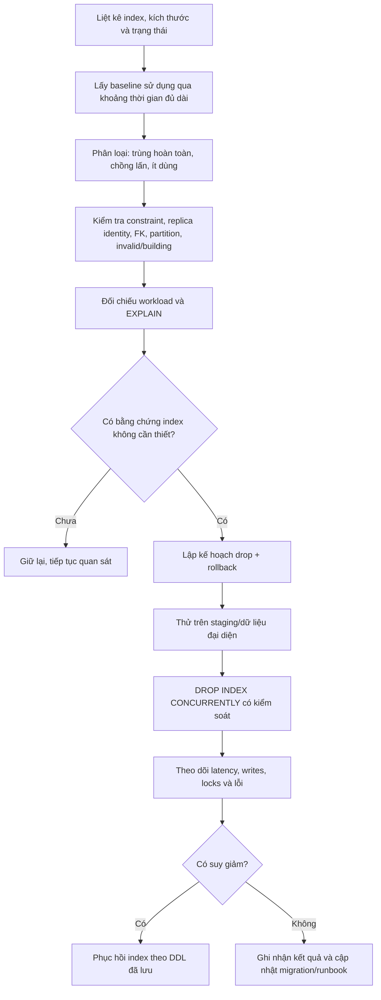

# Đánh giá chỉ mục thừa, ít dùng hoặc trùng lặp trong PostgreSQL

Một chỉ mục (*index*) có thể rút ngắn đáng kể thời gian truy vấn, nhưng nó không miễn phí. PostgreSQL phải lưu trữ và duy trì chỉ mục khi dữ liệu thay đổi. Sau nhiều năm phát triển ứng dụng, một bảng có thể tích lũy hàng chục index: index từ migration cũ, index phục vụ truy vấn không còn sử dụng, index nhiều cột bao phủ index ít cột, hoặc hai index gần như giống hệt do các nhóm triển khai độc lập.

Việc **đánh giá chỉ mục thừa, ít dùng hoặc trùng lặp** không đồng nghĩa tìm những index có `idx_scan = 0` rồi xóa hàng loạt. Một unique index có thể bảo vệ tính toàn vẹn dữ liệu dù ít khi được dùng để đọc. Một index hỗ trợ khóa ngoại có thể chỉ quan trọng khi xóa bản ghi cha. Một index dành cho báo cáo cuối tháng có thể không xuất hiện trong thống kê của vài ngày gần nhất.

Bài học thuộc chương **Chỉ mục** trong PostgreSQL và hướng dẫn cách kết hợp:

- **Thống kê sử dụng** từ `pg_stat_user_indexes` và thời điểm reset thống kê.
- **Định nghĩa/cấu trúc** trong `pg_index`, `pg_class` và `pg_get_indexdef()`.
- **Kích thước và chi phí ghi** khi mỗi `INSERT`, `UPDATE` hoặc `DELETE` phải duy trì index.
- **Vai trò bảo vệ dữ liệu** của primary key, unique/exclusion constraint, foreign key và replica identity.
- **Phân tích trùng lặp/chồng lấn** giữa index một cột, nhiều cột, partial, expression, covering và các access method khác nhau.
- **Đánh giá bằng workload thực tế**, kế hoạch `EXPLAIN`, thống kê theo thời gian và kiểm thử thay đổi.
- **Quy trình loại bỏ có kiểm soát** bằng `DROP INDEX CONCURRENTLY` và phương án tạo lại khi gặp sự cố.

Mục tiêu là **giảm chi phí không cần thiết mà không làm mất khả năng truy vấn hoặc ràng buộc dữ liệu quan trọng**.

## 1. Vì sao quá nhiều index có thể gây hại?

Giả sử bảng `orders` được ghi liên tục và có mười index. Khi thêm một order, PostgreSQL không chỉ ghi một tuple vào heap; nó còn phải duy trì những index mà hàng mới thuộc phạm vi của chúng.

Chi phí tiềm năng:

1. **Dung lượng lưu trữ:** mỗi index có các trang dữ liệu riêng; một index nhiều cột hoặc có `INCLUDE` lớn có thể tốn nhiều không gian.
2. **WAL:** các thao tác tạo/thay đổi trang index thường phát sinh WAL, ảnh hưởng I/O và replication.
3. **Độ trễ ghi:** `INSERT`, `UPDATE` và `DELETE` có thể cần thêm công việc bảo trì index.
4. **Buffer cache:** trang index cạnh tranh với dữ liệu và các index khác để được giữ trong bộ nhớ đệm.
5. **VACUUM và bảo trì:** index cần được xử lý trong các hoạt động dọn dẹp/duy trì theo cách PostgreSQL yêu cầu.
6. **HOT update:** thêm index lên một cột thường được cập nhật có thể làm giảm khả năng một số UPDATE được thực hiện dưới dạng Heap-Only Tuple (HOT).
7. **Migration/backup/restore:** số index nhiều có thể tăng công việc tạo, kiểm tra và quản trị.

Nhưng giảm số index không phải mục tiêu độc lập. Nếu một index tăng chi phí ghi nhỏ nhưng giúp một truy vấn quan trọng từ 5 giây xuống 5 mili-giây, nó có thể rất đáng giữ.

**Nguyên tắc:** đánh giá *lợi ích đọc và bảo vệ dữ liệu* so với *chi phí ghi, dung lượng và bảo trì* trong workload thật.

## 2. Ba khái niệm không giống nhau

| Khái niệm | Dấu hiệu | Có thể xóa ngay không? |
| --- | --- | --- |
| **Chỉ mục ít dùng** | Thống kê ghi nhận số lần index scan thấp trong khoảng quan sát | **Không**: còn phụ thuộc mùa vụ, reset stats, replica, constraint và workload |
| **Chỉ mục trùng lặp** | Hai index có cùng bảng, access method, khóa, biểu thức, sort, predicate, phạm vi uniqueness... | **Chưa**: cần xem dependency, tính hợp lệ, replica identity và kế hoạch loại bỏ |
| **Chỉ mục chồng lấn/thừa một phần** | Một index có thể phục vụ một số kiểu truy vấn của index khác, như B-tree `(a, b)` bao phủ một số truy vấn trên `a` | **Không tự động**: index nhỏ hơn, thứ tự, tính chọn lọc và covering có thể vẫn quan trọng |

Một index có thể ít dùng nhưng **không trùng**; hoặc trùng lặp nhưng **được truy vấn sử dụng rất nhiều** vì planner chọn một trong hai. Ngược lại, hai index có tên giống nhau về mục đích chưa chắc tương đương về ngữ nghĩa.

Ví dụ:

```sql
CREATE INDEX idx_orders_tenant
ON orders (tenant_id);

CREATE INDEX idx_orders_tenant_created
ON orders (tenant_id, created_at DESC);
```

Index thứ hai có thể xử lý điều kiện trên `tenant_id`, nhưng điều đó **không tự chứng minh index thứ nhất vô ích**.

Trong khi đó:

```sql
CREATE INDEX idx_orders_tenant_created_v2
ON orders (tenant_id, created_at DESC);
```

Nếu index này có cùng access method và các thuộc tính ngữ nghĩa như index thứ hai, nó là một **ứng viên trùng lặp rõ ràng**. Ta vẫn cần kiểm tra catalog và các phụ thuộc trước khi quyết định giữ bản nào.

## 3. Một quy trình đánh giá đúng



Đây là **quy trình quyết định**, không phải một script SQL để chạy liên tục. Với index bảo vệ tính toàn vẹn hoặc phục vụ ứng dụng rất quan trọng, kết quả có thể là **không xóa** dù thống kê đọc bằng 0.

## 4. Dữ liệu thực hành

Tạo schema và các bảng mẫu trên database học tập. Các index cố tình có trùng lặp/chồng lấn để người học có thể quan sát. **Không thực hiện lệnh drop minh họa trên bảng production.**

```sql
CREATE SCHEMA IF NOT EXISTS index_audit_lab;

CREATE TABLE index_audit_lab.customers (
    customer_id bigint PRIMARY KEY,
    customer_name text NOT NULL
);

INSERT INTO index_audit_lab.customers (customer_id, customer_name)
SELECT g, 'Customer ' || g::text
FROM generate_series(1, 100) AS g;

CREATE TABLE index_audit_lab.orders (
    order_id bigint GENERATED ALWAYS AS IDENTITY PRIMARY KEY,
    tenant_id integer NOT NULL,
    customer_id bigint NOT NULL
        REFERENCES index_audit_lab.customers(customer_id),
    external_ref text NOT NULL UNIQUE,
    status text NOT NULL
        CHECK (status IN ('paid', 'pending', 'cancelled')),
    created_at timestamptz NOT NULL,
    amount numeric(12, 2) NOT NULL CHECK (amount >= 0)
);

INSERT INTO index_audit_lab.orders
    (tenant_id, customer_id, external_ref, status, created_at, amount)
SELECT
    (g % 10 + 1)::integer,
    (g % 100 + 1)::bigint,
    'ORDER-' || g::text,
    CASE
        WHEN g % 10 = 0 THEN 'cancelled'
        WHEN g % 4 = 0 THEN 'pending'
        ELSE 'paid'
    END,
    TIMESTAMPTZ '2026-01-01 00:00:00+00'
        + g * INTERVAL '1 minute',
    ((g % 10000)::numeric / 100)::numeric(12, 2)
FROM generate_series(1, 40000) AS g;
```

Tạo các index minh họa:

```sql
-- 1. Index một cột: ứng viên chồng lấn theo tiền tố.
CREATE INDEX idx_orders_tenant
ON index_audit_lab.orders (tenant_id);

-- 2. Index nhiều cột phục vụ tenant + thời gian.
CREATE INDEX idx_orders_tenant_created
ON index_audit_lab.orders (tenant_id, created_at DESC);

-- 3. Index cố tình giống index số 2.
CREATE INDEX idx_orders_tenant_created_copy
ON index_audit_lab.orders (tenant_id, created_at DESC);

-- 4. Index theo status, cần kiểm tra mức độ hữu ích.
CREATE INDEX idx_orders_status
ON index_audit_lab.orders (status);

-- 5. Index trên khóa ngoại phía bảng con.
CREATE INDEX idx_orders_customer
ON index_audit_lab.orders (customer_id);

-- 6. Partial index chỉ cho đơn đang chờ.
CREATE INDEX idx_orders_pending_tenant_created
ON index_audit_lab.orders (tenant_id, created_at DESC)
WHERE status = 'pending';

-- 7. Index có thêm cột INCLUDE.
CREATE INDEX idx_orders_tenant_created_include_amount
ON index_audit_lab.orders (tenant_id, created_at DESC)
INCLUDE (amount);

ANALYZE index_audit_lab.orders;
```

Bảng `orders` cũng có index phục vụ `PRIMARY KEY(order_id)` và `UNIQUE(external_ref)` được PostgreSQL tạo từ constraints.

Trong các phần sau:

- `idx_orders_tenant_created` và `idx_orders_tenant_created_copy` là **ứng viên trùng cấu trúc**.
- `idx_orders_tenant` là **ứng viên chồng lấn** với index có khóa đầu `tenant_id`.
- `idx_orders_status` là **ứng viên ít hiệu quả cho nhiều truy vấn** vì status chỉ có vài giá trị, nhưng không phải cứ độ chọn lọc thấp là thừa.
- `idx_orders_customer` không phải index được PostgreSQL tự tạo trên khóa ngoại phía bảng con; nó được tạo có chủ đích để giúp những truy vấn và thao tác liên quan.
- Index `INCLUDE (amount)` có thể tạo đường truy cập *covering* khác với index hai khóa thuần.
- Partial index chỉ dùng cho những hàng `status = 'pending'` nên không tương đương index toàn bảng.

Dữ liệu mẫu 40.000 hàng vẫn quá nhỏ để suy kết luận hiệu năng áp dụng cho bảng hàng trăm triệu hàng.

## 5. Đo kích thước và chi phí lưu trữ

Đầu tiên, đo dung lượng bảng và tổng dung lượng index:

```sql
SELECT
    'index_audit_lab.orders'::regclass AS table_name,
    pg_size_pretty(
        pg_relation_size('index_audit_lab.orders'::regclass)
    ) AS heap_size,
    pg_size_pretty(
        pg_indexes_size('index_audit_lab.orders'::regclass)
    ) AS total_indexes_size,
    pg_size_pretty(
        pg_total_relation_size('index_audit_lab.orders'::regclass)
    ) AS total_relation_size;
```

Ý nghĩa:

| Hàm | Ý nghĩa thường dùng |
| --- | --- |
| `pg_relation_size(table)` | Kích thước dữ liệu relation theo fork mặc định, không tính tổng mọi đối tượng liên quan |
| `pg_indexes_size(table)` | Tổng dung lượng những index của bảng |
| `pg_total_relation_size(table)` | Tổng dung lượng bảng, TOAST và index liên quan |
| `pg_relation_size(index)` | Kích thước vật lý của một index cụ thể |
| `pg_size_pretty(bytes)` | Hiển thị byte ở dạng dễ đọc |

Liệt kê index theo dung lượng giảm dần:

```sql
SELECT
    s.schemaname,
    s.relname AS table_name,
    s.indexrelname AS index_name,
    pg_relation_size(s.indexrelid) AS index_bytes,
    pg_size_pretty(pg_relation_size(s.indexrelid)) AS index_size
FROM pg_stat_user_indexes AS s
WHERE s.schemaname = 'index_audit_lab'
ORDER BY pg_relation_size(s.indexrelid) DESC, s.indexrelname;
```

Một index tốn nhiều GB là **đối tượng đáng ưu tiên điều tra** nếu ít có giá trị, nhưng kích thước lớn không tự chứng minh nó bị bloat hay thừa. Index lớn có thể phục vụ một truy vấn quan trọng hoặc constraint thiết yếu.

### 5.1. Tỷ lệ dung lượng index so với heap

Có thể tính nhanh:

```sql
SELECT
    pg_relation_size('index_audit_lab.orders'::regclass)
        AS heap_bytes,
    pg_indexes_size('index_audit_lab.orders'::regclass)
        AS indexes_bytes,
    ROUND(
        pg_indexes_size('index_audit_lab.orders'::regclass)::numeric
        / NULLIF(
            pg_relation_size('index_audit_lab.orders'::regclass),
            0
        ),
        2
    ) AS index_to_heap_ratio;
```

Nếu tỷ lệ lớn hơn 1, tổng index có dung lượng lớn hơn heap chính. Đây **không phải ngưỡng lỗi**: một bảng hẹp có nhiều index hợp lệ vẫn có thể có tỷ lệ cao. Dùng tỷ lệ để **ưu tiên đánh giá**, không làm luật tự động xóa.

## 6. Đọc thống kê pg_stat_user_indexes

PostgreSQL cung cấp view `pg_stat_user_indexes` để xem thống kê sử dụng index của bảng người dùng.

```sql
SELECT
    schemaname,
    relname AS table_name,
    indexrelname AS index_name,
    idx_scan,
    idx_tup_read,
    idx_tup_fetch
FROM pg_stat_user_indexes
WHERE schemaname = 'index_audit_lab'
ORDER BY relname, idx_scan, indexrelname;
```

Ba chỉ số chính:

| Cột | Ý nghĩa và giới hạn |
| --- | --- |
| `idx_scan` | Số lượt quét/tìm kiếm trên index do bộ đếm thống kê ghi nhận; **không phải số SQL SELECT duy nhất** |
| `idx_tup_read` | Số entry của index được trả trong những lượt quét index theo cơ chế thống kê |
| `idx_tup_fetch` | Số hàng heap còn sống được fetch qua những **simple index scans** sử dụng index đó; không bao gồm mọi dạng truy cập có liên quan |

### 6.1. idx_scan = 0 nói lên điều gì?

`idx_scan = 0` có nghĩa **không có lượt sử dụng được bộ đếm này ghi nhận trong khoảng thống kê hiện tại**. Nó *không* có nghĩa:

- Index chưa từng được dùng trong lịch sử hệ thống.
- Index không bảo vệ unique/primary key.
- Index không cần cho một truy vấn hoặc báo cáo chỉ chạy theo tháng/quý.
- Index không được dùng trên **read replica**.
- Index có thể bị drop mà không ảnh hưởng hiệu năng.
- Mọi traffic có thể thay thế bằng index khác với chi phí như nhau.

Chỉ nên coi giá trị 0 là **tín hiệu cần điều tra**.

### 6.2. Một câu SQL có thể làm tăng idx_scan nhiều hơn một

Bộ đếm `idx_scan` phản ánh **index searches/scans** theo semantics thống kê của PostgreSQL; một execution plan như nested loop có thể thực hiện nhiều index probes trong một câu SQL. Vì vậy, không tính “số request HTTP dùng index” bằng cách lấy trực tiếp `idx_scan`.

Các chi tiết về thời điểm tăng bộ đếm và loại scan còn phụ thuộc phiên bản PostgreSQL. Khi so sánh số liệu giữa các major version, cần đối chiếu định nghĩa bộ đếm tương ứng.

### 6.3. idx_tup_read khác idx_tup_fetch

Một truy vấn `Index Only Scan` có thể đọc index entries mà không fetch heap tuples tương ứng trong một số điều kiện visibility. `Bitmap Index Scan` cũng có cách ghi nhận thống kê khác simple index scan: số heap tuples fetch được tính ở các thống kê bảng, không nhất thiết ở `idx_tup_fetch` của index riêng lẻ.

Vì vậy, không nên kết luận rằng `idx_tup_fetch` thấp chứng minh index vô dụng. Muốn hiểu hiệu quả của query, xem `EXPLAIN (ANALYZE, BUFFERS)` và kế hoạch thực thi.

## 7. Phải biết khoảng thời gian của thống kê

Các bộ đếm không tự mô tả “30 ngày gần nhất”. Chúng phản ánh số liệu tích lũy kể từ khi thống kê được reset hoặc bắt đầu được thu thập theo cơ chế phù hợp.

Kiểm tra mốc reset thống kê cấp database:

```sql
SELECT
    datname,
    stats_reset,
    now() - stats_reset AS stats_age
FROM pg_stat_database
WHERE datname = current_database();
```

Cần thận trọng:

- `stats_reset` cấp database **không phải timestamp sử dụng cuối cùng của từng index**.
- Một index mới tạo giữa kỳ thống kê sẽ có tuổi quan sát ngắn hơn các index cũ.
- Việc reset statistics, sự cố server, nâng cấp hoặc thay đổi topology có thể làm gãy chuỗi số liệu.
- Số liệu của **primary** và **replica** cần được đánh giá theo nơi phát sinh truy vấn; một index có thể chủ yếu phục vụ workload đọc trên replica.
- Một kỳ có traffic bất thường, ít người dùng hoặc thiếu job định kỳ không đại diện cho cả chu kỳ nghiệp vụ.

Đối với báo cáo cuối tháng, ít nhất cần quan sát các mốc mà job chạy. Đối với chức năng chỉ dùng ở kỳ quyết toán năm, vài tuần thống kê có thể vẫn chưa đủ.

### 7.1. So sánh theo chênh lệch, không chỉ số tích lũy

Một index có `idx_scan = 5.000.000` có thể đã được sử dụng nhiều trong quá khứ nhưng **không còn được truy cập** sau khi ứng dụng chuyển sang query mới.

Một cách quan sát hữu ích là lưu baseline:

```sql
CREATE TABLE index_audit_lab.index_usage_baseline AS
SELECT
    clock_timestamp() AS captured_at,
    indexrelid,
    relid,
    idx_scan,
    idx_tup_read,
    idx_tup_fetch
FROM pg_stat_user_indexes
WHERE schemaname = 'index_audit_lab';
```

Sau một khoảng thời gian đủ đại diện, so sánh:

```sql
SELECT
    s.indexrelid::regclass AS index_name,
    b.captured_at,
    clock_timestamp() AS observed_at,
    s.idx_scan - b.idx_scan AS scans_since_baseline,
    s.idx_tup_read - b.idx_tup_read AS entries_since_baseline,
    s.idx_tup_fetch - b.idx_tup_fetch AS fetches_since_baseline
FROM pg_stat_user_indexes AS s
JOIN index_audit_lab.index_usage_baseline AS b
    ON b.indexrelid = s.indexrelid
WHERE s.schemaname = 'index_audit_lab'
ORDER BY scans_since_baseline, index_name;
```

**Giới hạn quan trọng:**

- Nếu statistics bị reset giữa hai lần lấy, phép trừ có thể âm hoặc không còn ý nghĩa.
- Nếu index bị drop/recreate hoặc reindex concurrent khiến OID thay đổi, kết nối theo `indexrelid` cũ không còn phù hợp.
- Snapshot này lưu trên bảng học tập; với hệ thống monitoring thật, nên dùng kho metrics và lưu thông tin phiên bản, OID, tên index, mốc reset cùng topology.
- Baseline của một cửa sổ ngắn có thể không đại diện mùa vụ.

**Không gọi `pg_stat_reset()` trên production chỉ để có “điểm bắt đầu đẹp”** vì nó có thể làm mất dữ liệu giám sát của nhiều nhóm khác.

## 8. Truy vấn audit kết hợp thống kê, kích thước và vai trò index

Từ những nguồn riêng rẽ, ta có thể tạo một danh sách ban đầu để phân loại:

```sql
SELECT
    s.schemaname,
    s.relname AS table_name,
    s.indexrelname AS index_name,
    pg_size_pretty(
        pg_relation_size(s.indexrelid)
    ) AS index_size,
    s.idx_scan,
    s.idx_tup_read,
    s.idx_tup_fetch,
    i.indisprimary,
    i.indisunique,
    i.indisexclusion,
    i.indisvalid,
    i.indisready,
    i.indisreplident,
    EXISTS (
        SELECT 1
        FROM pg_constraint AS c
        WHERE c.conindid = s.indexrelid
          AND c.contype IN ('p', 'u', 'x')
    ) AS supports_pk_unique_or_exclusion_constraint,
    EXISTS (
        SELECT 1
        FROM pg_constraint AS c
        WHERE c.conindid = s.indexrelid
          AND c.contype = 'f'
    ) AS referenced_by_foreign_key,
    pg_get_indexdef(s.indexrelid) AS index_definition
FROM pg_stat_user_indexes AS s
JOIN pg_index AS i
    ON i.indexrelid = s.indexrelid
WHERE s.schemaname = 'index_audit_lab'
ORDER BY
    pg_relation_size(s.indexrelid) DESC,
    s.relname,
    s.indexrelname;
```

Đây là **truy vấn điều tra**, không phải kết luận “xóa index khi tất cả flag là false”.

Các cờ đáng quan tâm:

- `indisprimary`: index của primary key.
- `indisunique`: index có quy tắc unique; có thể là unique index độc lập, không chỉ constraint.
- `indisexclusion`: index dùng cho exclusion constraint.
- `indisvalid`: index đủ điều kiện hợp lệ để planner xem xét theo cơ chế của PostgreSQL.
- `indisready`: index sẵn sàng để DML tiếp tục duy trì.
- `indisreplident`: index được đánh dấu làm replica identity theo cách dùng `USING INDEX`.
- `pg_constraint.conindid`: có thể cho thấy constraint liên quan; đối với foreign key, giá trị này có thể tham chiếu tới index duy nhất ở phía được tham chiếu.

**Quan trọng:** khi bảng dùng `REPLICA IDENTITY DEFAULT`, primary key có thể phục vụ replica identity mà `indisreplident` không phải lúc nào cũng mang ý nghĩa “index PK đang được dùng ở chế độ DEFAULT”. Không dùng duy nhất cờ này để quyết định xóa index.

## 9. Index ít dùng nhưng phải giữ: PRIMARY KEY và UNIQUE

Bảng mẫu có:

```sql
order_id bigint GENERATED ALWAYS AS IDENTITY PRIMARY KEY
```

và:

```sql
external_ref text NOT NULL UNIQUE
```

PostgreSQL tạo chỉ mục phù hợp để thực thi những constraints đó.

Ngay cả khi ứng dụng không có câu `SELECT ... WHERE external_ref = ...` trong một kỳ quan sát, unique index vẫn có vai trò **ngăn trùng giá trị khi ghi dữ liệu**. Việc chỉ nhìn `idx_scan` có thể bỏ qua giá trị quan trọng này.

Cũng cần phân biệt:

- `PRIMARY KEY`: bảo đảm duy nhất và không NULL theo semantics của khóa chính.
- `UNIQUE CONSTRAINT`: bảo đảm tính duy nhất theo cơ chế constraint.
- `CREATE UNIQUE INDEX` độc lập: cũng có thể thực thi uniqueness và có thể được dùng bởi câu `ON CONFLICT`.
- `EXCLUDE USING ...`: bảo vệ bất biến loại trừ, có thể liên quan GiST hoặc access method khác.

Không tự drop một index unique chỉ vì có một index non-unique khác “đọc nhanh tương tự”. Chỉ mục non-unique **không thay thế được quy tắc dữ liệu duy nhất**.

### 9.1. Cần tìm cả upsert và ON CONFLICT

Một ứng dụng có thể ghi:

```sql
INSERT INTO index_audit_lab.orders
    (tenant_id, customer_id, external_ref, status, created_at, amount)
VALUES
    (1, 1, 'ORDER-NEW-123', 'paid', now(), 10.00)
ON CONFLICT (external_ref) DO NOTHING;
```

Nếu ứng dụng dựa trên unique index của `external_ref` để xử lý duplicate, việc thay đổi cấu trúc uniqueness có thể làm chức năng này sai hoặc không thể suy ra conflict arbiter phù hợp.

Do đó, kiểm kê index phải gắn với **contract ghi dữ liệu**, không chỉ `SELECT` và query planner.

### 9.2. Hai unique index có giống nhau không?

Hai unique index cùng bộ khóa có thể gần như trùng nhau, nhưng phải xét:

- `NULLS DISTINCT` hay `NULLS NOT DISTINCT` trên PostgreSQL 15+.
- Collation, operator class và biểu thức.
- Partial predicate.
- Thứ tự/khóa của composite uniqueness.
- Constraint dependency, deferrable/immediate và replica identity.

Không thể dùng quy tắc “tên cột giống nhau thì unique index trùng” cho mọi trường hợp.

## 10. Foreign key: index phía cha và phía con có vai trò khác nhau

PostgreSQL yêu cầu khóa được tham chiếu của một foreign key có quy tắc unique/primary key phù hợp. Index phía bảng **được tham chiếu** giúp database kiểm tra quan hệ đó.

Ngược lại, PostgreSQL **không tự động tạo một index trên cột foreign key ở bảng con** mỗi khi bạn khai báo `REFERENCES`.

Trong bảng mẫu:

```sql
customer_id bigint NOT NULL
    REFERENCES index_audit_lab.customers(customer_id)
```

và index tạo riêng:

```sql
CREATE INDEX idx_orders_customer
ON index_audit_lab.orders (customer_id);
```

Nếu bạn xóa `idx_orders_customer` chỉ vì ít `idx_scan`, một thao tác như:

```sql
DELETE FROM index_audit_lab.customers
WHERE customer_id = 20;
```

có thể phải kiểm tra nhiều hàng `orders` để xác định có hàng con tham chiếu hay không. Trên một bảng con hàng trăm triệu dòng, việc mất index thích hợp có thể gây chi phí lớn hoặc lock wait kéo dài.

Index trên khóa ngoại phía con **không phải bắt buộc cho tính đúng đắn của FK**, nhưng thường quan trọng cho hiệu năng `DELETE`/`UPDATE` khóa ở bảng cha và các truy vấn join.

### 10.1. Đừng chỉ dựa vào pg_constraint để chọn index phía con

`pg_constraint` cho biết những cột tham gia FK và index liên quan ở phía tham chiếu/được tham chiếu theo catalog. Nhưng nó không đơn giản đánh dấu “index tốt nhất để hỗ trợ quét child rows”.

Một index composite có khóa đầu là FK, ví dụ `(customer_id, created_at)`, có thể hỗ trợ kiểm tra theo `customer_id`; index `(created_at, customer_id)` có thứ tự khác và không tương đương.

Vì vậy, trước khi xóa index trên cột có FK, hãy xem:

- Các bảng cha/con và hành động `ON DELETE`/`ON UPDATE`.
- Có index khác với leading key phù hợp không?
- Tần suất/xác suất xóa hoặc cập nhật khóa ở bảng cha.
- Kích thước bảng con và latency của thao tác liên quan.
- Các query join hoặc lọc theo FK.

## 11. Replica identity và luồng logical replication

Trong logical replication, publication/subscription hoặc CDC, hệ thống cần xác định hàng nào được cập nhật/xóa. PostgreSQL có cấu hình `REPLICA IDENTITY` ở cấp bảng.

```sql
SELECT
    oid::regclass AS table_name,
    relreplident
FROM pg_class
WHERE oid = 'index_audit_lab.orders'::regclass;
```

Một số chế độ `relreplident`:

| Giá trị | Ý nghĩa khái quát |
| --- | --- |
| `d` | DEFAULT: thường dùng primary key khi có |
| `i` | Dùng index được chỉ định bằng `USING INDEX` |
| `f` | FULL: sử dụng thông tin hàng phù hợp thay vì chỉ identity index |
| `n` | NOTHING: không ghi identity cho thay đổi tương ứng |

Một index được cấu hình trực tiếp làm replica identity có thể xuất hiện với `pg_index.indisreplident = true`. Không loại bỏ nó như một index “ít dùng” mà không xét luồng replication.

Đặc biệt, primary key có thể được dùng khi chế độ `DEFAULT`. Vì vậy, ngay cả khi không thấy `indisreplident = true`, **index primary key vẫn có thể thiết yếu cho logical replication**.

Khi triển khai CDC, phải phối hợp với nhóm sở hữu pipeline trước khi thay đổi index/constraint.

## 12. Thế nào là hai index trùng lặp hoàn toàn?

Với B-tree thông thường, hai index có thể là ứng viên trùng lặp nếu chúng cùng:

1. **Bảng đích**.
2. **Access method**, chẳng hạn B-tree.
3. **Cùng cột/biểu thức khóa theo cùng thứ tự**.
4. **Operator class và collation** tương ứng.
5. **Thứ tự ASC/DESC và vị trí NULL** phù hợp.
6. **Danh sách INCLUDE** như nhau.
7. **Partial predicate** như nhau hoặc thực sự tương đương.
8. **Ngữ nghĩa unique/exclusion** tương ứng, kể cả `NULLS NOT DISTINCT` và deferrability.
9. **Trạng thái hợp lệ và dependency** cho phép thay thế về mặt vận hành.

Tuy nhiên, định nghĩa cùng ngữ nghĩa không đồng nghĩa các chỉ mục có mọi đặc tính vật lý giống nhau. `tablespace`, `fillfactor`, storage parameters, tình trạng bloat, clustering flag và dung lượng thực tế cũng có thể khác.

### 12.1. Một ví dụ trùng cấu trúc rõ ràng

Hai index mẫu:

```sql
CREATE INDEX idx_orders_tenant_created
ON index_audit_lab.orders (tenant_id, created_at DESC);

CREATE INDEX idx_orders_tenant_created_copy
ON index_audit_lab.orders (tenant_id, created_at DESC);
```

Cả hai có cùng bảng, B-tree mặc định, khóa `tenant_id` rồi `created_at DESC`, không partial predicate, không INCLUDE và không unique. Trên bộ dữ liệu mẫu, đây là **ứng viên loại bớt một bản** sau khi xác nhận không có dependency/tình huống vận hành đặc biệt.

Giữ cái nào? Có thể ưu tiên tên được ứng dụng/migration dùng nhất quán, index có trạng thái valid, phù hợp chính sách tablespace/storage và kế hoạch rollback. Không bắt buộc giữ cái có `idx_scan` cao hơn, vì planner có thể tình cờ dùng một trong hai.

### 12.2. Tên index khác không tạo ra ích lợi mới

Tên `idx_foo_v1` và `idx_foo_v2` không cho biết hai index khác chức năng. Nhưng cũng không nên xóa bằng script chỉ dựa vào quy tắc tên: một version có thể khác INCLUDE, predicate, uniqueness hoặc collation.

Xem định nghĩa thật bằng:

```sql
SELECT
    indexrelid::regclass AS index_name,
    pg_get_indexdef(indexrelid) AS definition
FROM pg_index
WHERE indrelid = 'index_audit_lab.orders'::regclass
ORDER BY index_name;
```

Hãy đọc toàn bộ definition, không chỉ phần danh sách cột trong ngoặc đầu tiên.

## 13. Tìm ứng viên trùng cấu trúc bằng system catalog

Truy vấn sau nhằm **gợi ý các cặp index có metadata rất giống nhau**, không phải hệ thống tự động kết luận có thể xóa.

**Lưu ý phiên bản:** ví dụ dùng `pg_index.indnullsnotdistinct` có ở PostgreSQL **15 trở lên**. Nếu server cũ hơn, cần bỏ điều kiện này và kiểm tra sự khác biệt về null uniqueness theo những đặc điểm version thực tế. Luôn xác nhận `SHOW server_version;`.

```sql
SELECT
    a.indrelid::regclass AS table_name,
    a.indexrelid::regclass AS index_a,
    b.indexrelid::regclass AS index_b,
    pg_size_pretty(pg_relation_size(a.indexrelid)) AS size_a,
    pg_size_pretty(pg_relation_size(b.indexrelid)) AS size_b,
    pg_get_indexdef(a.indexrelid) AS definition_a,
    pg_get_indexdef(b.indexrelid) AS definition_b
FROM pg_index AS a
JOIN pg_index AS b
    ON b.indrelid = a.indrelid
   AND b.indexrelid > a.indexrelid
JOIN pg_class AS ia
    ON ia.oid = a.indexrelid
JOIN pg_class AS ib
    ON ib.oid = b.indexrelid
JOIN pg_class AS t
    ON t.oid = a.indrelid
JOIN pg_namespace AS n
    ON n.oid = t.relnamespace
WHERE n.nspname = 'index_audit_lab'
  AND ia.relam = ib.relam
  AND a.indnkeyatts = b.indnkeyatts
  AND a.indnatts = b.indnatts
  AND a.indkey = b.indkey
  AND a.indclass = b.indclass
  AND a.indcollation = b.indcollation
  AND a.indoption = b.indoption
  AND pg_get_expr(a.indexprs, a.indrelid)
      IS NOT DISTINCT FROM
      pg_get_expr(b.indexprs, b.indrelid)
  AND pg_get_expr(a.indpred, a.indrelid)
      IS NOT DISTINCT FROM
      pg_get_expr(b.indpred, b.indrelid)
  AND a.indisunique = b.indisunique
  AND a.indisexclusion = b.indisexclusion
  AND a.indnullsnotdistinct = b.indnullsnotdistinct
  AND a.indimmediate = b.indimmediate
  AND a.indisvalid
  AND b.indisvalid
ORDER BY table_name, index_a, index_b;
```

Các cột catalog quan trọng:

| Catalog field | Ý nghĩa |
| --- | --- |
| `indrelid` | OID của bảng được index |
| `indexrelid` | OID của index |
| `pg_class.relam` | Access method của index |
| `indkey` | Danh sách cột bảng; vị trí 0 trong thông tin này có thể biểu thị biểu thức |
| `indclass` | Operator classes cho các khóa |
| `indcollation` | Collations của những khóa liên quan |
| `indoption` | Tùy chọn thứ tự/đặc tính khóa theo access method |
| `indnkeyatts` | Số key attributes |
| `indnatts` | Tổng attributes bao gồm INCLUDE |
| `indexprs` | Biểu thức của expression index |
| `indpred` | Predicate của partial index |
| `indisunique` | Tính duy nhất |
| `indnullsnotdistinct` | Ngữ nghĩa uniqueness với NULL, PostgreSQL 15+ |
| `indimmediate` | Tính kiểm tra uniqueness ngay lập tức khi có liên quan |

**Giới hạn của truy vấn:**

- So sánh biểu thức/predicate đã deparse thành text là **heuristic**; các biểu thức khác văn bản có thể tương đương về logic, hoặc tương đồng bề ngoài nhưng có những khác biệt cần xem kỹ.
- Chưa so sánh mọi thuộc tính vật lý như tablespace, reloptions, độ bloat.
- Chưa kiểm tra constraint dependency, replica identity, index attachment, clustered flag, ứng dụng/migration và query workload.
- Hai index đều valid trong kết quả không có nghĩa an toàn khi drop một trong chúng.

Truy vấn chỉ tạo **danh sách kiểm tra thủ công**.

## 14. Index chồng lấn theo tiền tố trái của B-tree

Đối với B-tree nhiều cột, thứ tự cột rất quan trọng.

```sql
CREATE INDEX idx_example_a
ON some_table (a);

CREATE INDEX idx_example_a_b
ON some_table (a, b);
```

Index `(a, b)` có thể hỗ trợ `WHERE a = ...`, nên index `(a)` là ứng viên chồng lấn. Nhưng:

- Index `(a)` thường nhỏ hơn, có thể rẻ hơn cho một số truy vấn chỉ cần `a`.
- Index `(a, b)` có thể phục vụ tốt `WHERE a = ... ORDER BY b`.
- Planner có thể dùng multicolumn B-tree trong những trường hợp khác, nhưng không được giả định hiệu quả giống nhau cho mọi điều kiện chỉ trên `b`.
- Index có `INCLUDE`, partial predicate, operator class hay collation khác có thể không thay thế nhau.
- Một index unique trên `(a)` khác về invariant so với unique trên `(a,b)`.

### 14.1. Thứ tự đảo không phải index trùng

```sql
CREATE INDEX idx_example_a_b
ON some_table (a, b);

CREATE INDEX idx_example_b_a
ON some_table (b, a);
```

Chúng có thể phục vụ các query pattern khác nhau. Không dùng một script sắp xếp tên cột theo alphabet rồi kết luận hai index tương đương.

### 14.2. Thứ tự ASC/DESC cũng cần hiểu theo composite keys

Một B-tree một cột có thể được quét xuôi hoặc ngược, nên một index `(created_at ASC)` và `(created_at DESC)` đôi khi cung cấp khả năng sort tương tự.

Nhưng với index nhiều cột và thứ tự trộn:

```sql
CREATE INDEX idx_mixed
ON some_table (tenant_id ASC, created_at DESC);
```

thì khả năng phục vụ một `ORDER BY tenant_id ASC, created_at DESC` không thể đánh đồng với mọi index chỉ có cùng tên cột nhưng hướng sort khác. `NULLS FIRST/LAST` cũng ảnh hưởng các trường hợp phù hợp.

**Không chỉ so sánh column names; phải so sánh ngữ nghĩa sort/query.**

## 15. Gợi ý các cặp index một cột và nhiều cột có leading key giống nhau

Đây là một heuristic giúp tìm ứng viên chồng lấn trên **B-tree dùng cột bảng thông thường**, không bao gồm đầy đủ expression indexes và những trường hợp phức tạp.

```sql
SELECT
    a.indrelid::regclass AS table_name,
    a.indexrelid::regclass AS one_key_index,
    b.indexrelid::regclass AS multi_key_index,
    pg_get_indexdef(a.indexrelid) AS one_key_definition,
    pg_get_indexdef(b.indexrelid) AS multi_key_definition
FROM pg_index AS a
JOIN pg_index AS b
    ON b.indrelid = a.indrelid
   AND b.indexrelid <> a.indexrelid
JOIN pg_class AS ia
    ON ia.oid = a.indexrelid
JOIN pg_class AS ib
    ON ib.oid = b.indexrelid
JOIN pg_am AS ama
    ON ama.oid = ia.relam
JOIN pg_class AS t
    ON t.oid = a.indrelid
JOIN pg_namespace AS n
    ON n.oid = t.relnamespace
WHERE n.nspname = 'index_audit_lab'
  AND ama.amname = 'btree'
  AND ia.relam = ib.relam
  AND a.indnkeyatts = 1
  AND b.indnkeyatts >= 2
  AND a.indkey[0] > 0
  AND a.indkey[0] = b.indkey[0]
  AND a.indclass[0] = b.indclass[0]
  AND a.indcollation[0] = b.indcollation[0]
  AND a.indexprs IS NULL
  AND b.indexprs IS NULL
  AND a.indpred IS NULL
  AND b.indpred IS NULL
  AND a.indisvalid
  AND b.indisvalid
ORDER BY table_name, one_key_index, multi_key_index;
```

Truy vấn chỉ đưa ra **các cặp có thể chồng lấn**, không khẳng định index một cột có thể drop.

Các giới hạn:

- Index một khóa có thể chứa `INCLUDE`, nên không còn tương đương một index chỉ chứa khóa duy nhất.
- Index thứ hai có thể lớn hơn nhiều và kém hơn cho truy vấn lọc duy nhất theo khóa đầu.
- Truy vấn không kiểm chứng mọi đặc tính sort/NULL, storage và dependency.
- Các index dùng biểu thức hoặc partial predicate được loại khỏi heuristic để tránh suy luận sai.
- `indkey[0]` và các vector catalog sử dụng cú pháp truy cập phần tử của kiểu lưu trữ nội bộ; khi sử dụng giữa những major version nên xác nhận catalog tương ứng.

**Khi câu SQL báo một cặp, hãy xem `EXPLAIN` và workload của từng query trước khi quyết định.**

## 16. Partial index không tương đương full index

Ví dụ bộ dữ liệu:

```sql
CREATE INDEX idx_orders_tenant_created
ON index_audit_lab.orders (tenant_id, created_at DESC);

CREATE INDEX idx_orders_pending_tenant_created
ON index_audit_lab.orders (tenant_id, created_at DESC)
WHERE status = 'pending';
```

Hai index có cùng danh sách key columns, nhưng **khác tập hàng được lưu**.

Partial index chỉ chứa hàng thỏa predicate `status = 'pending'`. Nó có thể nhỏ hơn và đặc biệt hữu ích cho:

```sql
SELECT order_id, created_at
FROM index_audit_lab.orders
WHERE tenant_id = 3
  AND status = 'pending'
ORDER BY created_at DESC
LIMIT 20;
```

Index toàn bảng vẫn có thể cần cho:

```sql
SELECT order_id, created_at
FROM index_audit_lab.orders
WHERE tenant_id = 3
ORDER BY created_at DESC
LIMIT 20;
```

Nếu bỏ full index, partial index không thể phục vụ các hàng `paid`/`cancelled` ngoài predicate.

### 16.1. Partial predicate và tham số hóa

Planner cần có cơ sở để chứng minh điều kiện query phù hợp với predicate của partial index. Một truy vấn tham số hóa:

```sql
SELECT *
FROM index_audit_lab.orders
WHERE tenant_id = $1
  AND status = $2;
```

không nhất thiết được planner xem là phù hợp với partial index `WHERE status='pending'` trong mọi kế hoạch generic/parameterization. Vì vậy, một partial index `idx_scan` thấp có thể phản ánh **khả năng planner suy ra predicate** chứ không chỉ thiếu nhu cầu nghiệp vụ.

Cần xem `EXPLAIN` với phương thức thực thi thực tế của ứng dụng, nhất là prepared statements.

### 16.2. Partial unique index càng không thể xóa chỉ vì giống key

```sql
CREATE UNIQUE INDEX uq_active_email
ON accounts (lower(email))
WHERE deleted_at IS NULL;
```

Index này bảo vệ uniqueness **chỉ cho các tài khoản chưa xóa mềm**. Một index non-unique trên `lower(email)` hoặc một unique index có predicate khác **không tự thay thế** bất biến này.

## 17. INCLUDE và covering index

Hai index:

```sql
CREATE INDEX idx_orders_tenant_created
ON index_audit_lab.orders (tenant_id, created_at DESC);

CREATE INDEX idx_orders_tenant_created_include_amount
ON index_audit_lab.orders (tenant_id, created_at DESC)
INCLUDE (amount);
```

có cùng key columns, nhưng index thứ hai lưu thêm `amount`.

Truy vấn:

```sql
SELECT tenant_id, created_at, amount
FROM index_audit_lab.orders
WHERE tenant_id = 3
ORDER BY created_at DESC
LIMIT 20;
```

có thể được planner phục vụ bằng **index-only scan** khi index chứa đủ cột và visibility map/MVCC cho phép hạn chế heap fetch. Index thứ nhất không có `amount`, vì thế thường phải lấy dữ liệu từ heap nếu dùng nó.

Ngược lại, index có `INCLUDE` có thể lớn hơn và làm tăng chi phí ghi.

**Không dùng quy tắc “cùng key columns thì trùng” nếu một index có INCLUDE.** Cần đánh giá lợi ích giảm heap access so với index size và DML cost.

## 18. Expression index, collation và operator class

Các index sau nhìn bề ngoài đều phục vụ một cột text, nhưng có thể khác hẳn:

```sql
CREATE INDEX idx_email_raw
ON accounts (email);

CREATE INDEX idx_email_lower
ON accounts (lower(email));
```

Index trên `email` không mặc nhiên thay index trên `lower(email)` cho:

```sql
SELECT account_id
FROM accounts
WHERE lower(email) = lower($1);
```

Tương tự, operator class và collation ảnh hưởng phép so sánh/khả năng dùng index. Một B-tree dùng collation mặc định và một B-tree với cấu hình collation khác có thể hỗ trợ những quy tắc sắp xếp khác nhau.

### 18.1. Các access method không thay thế nhau bằng tên cột

Ví dụ ý tưởng:

```sql
CREATE INDEX idx_docs_jsonb_gin
ON documents USING gin (payload);

CREATE INDEX idx_docs_created_brin
ON documents USING brin (created_at);
```

GIN thường phù hợp cho một số phép tìm kiếm trên tập giá trị/phần tử, còn BRIN có mô hình tóm tắt page range, phù hợp với những phân bố dữ liệu nhất định. Chúng **không phải bản sao của một B-tree** trên cùng cột.

GiST, SP-GiST, GIN, BRIN và B-tree có operator classes, chiến lược truy vấn và đặc tính ghi khác nhau. Không gộp chúng vào một nhóm trùng lặp chỉ theo cột.

### 18.2. Cần xét NULL và sort order

Các index có cùng cột nhưng khác `NULLS FIRST/LAST` hoặc đặc tính uniqueness của NULL có thể khác về đường truy cập và invariant. Với PostgreSQL 15+, `UNIQUE NULLS NOT DISTINCT` khác về nghĩa so với unique mặc định cho NULL.

So sánh index phải xét **semantics**, không chỉ tên cột.

## 19. Index valid, invalid và index đang được tạo

Một chỉ mục ở trạng thái `indisvalid = false` có thể do:

- `CREATE INDEX CONCURRENTLY` đang chạy ở pha trung gian.
- Concurrent build đã lỗi và để lại index chưa hoàn chỉnh.
- `REINDEX CONCURRENTLY` tạo index thay thế tạm.
- Parent partitioned index đang chờ attach đủ child indexes.

Index invalid có thể không được planner dùng cho query, nhưng nếu `indisready = true`, nó vẫn có thể được duy trì bởi DML; unique index invalid còn có những trường hợp tác động tới kiểm tra uniqueness.

Kiểm tra:

```sql
SELECT
    i.indrelid::regclass AS table_name,
    i.indexrelid::regclass AS index_name,
    i.indisvalid,
    i.indisready,
    i.indislive,
    i.indisunique
FROM pg_index AS i
JOIN pg_class AS t
    ON t.oid = i.indrelid
JOIN pg_namespace AS n
    ON n.oid = t.relnamespace
WHERE n.nspname = 'index_audit_lab'
  AND NOT i.indisvalid
ORDER BY table_name, index_name;
```

Và xem progress:

```sql
SELECT
    pid,
    relid::regclass AS target_table,
    index_relid::regclass AS target_index,
    phase,
    lockers_total,
    lockers_done
FROM pg_stat_progress_create_index
WHERE datname = current_database();
```

**Đừng nhầm “index invalid cần dọn” với “index ít được dùng”**. Đây là hai nhóm vấn đề khác nhau và có quy trình sửa chữa riêng. Không drop một index invalid nếu nó vẫn đang được build hoặc là parent index chưa attach đủ partition.

## 20. Chỉ mục trên bảng phân vùng (partitioned tables)

Một bảng partitioned có parent index metadata và các index thực tế trên partition. Khi phân tích stats/index size:

- Query trên parent có thể được thực thi qua các index của partition con.
- Parent partitioned index có thể không có dữ liệu index vật lý tương tự một index B-tree trên bảng thường.
- Index của từng partition có thống kê sử dụng và kích thước riêng.
- Một index con có thể đã được attach vào parent index; không tùy tiện drop một index con mà không xem mối quan hệ partition.
- Một index trên partition cũ có `idx_scan` thấp vẫn có thể phục vụ truy vấn retention/audit hiếm hoặc có dependency do cấu trúc phân vùng.

Có thể kiểm tra các quan hệ index-inheritance được catalog ghi nhận:

```sql
SELECT
    child.oid::regclass AS child_index,
    parent.oid::regclass AS parent_index
FROM pg_inherits AS inh
JOIN pg_class AS child
    ON child.oid = inh.inhrelid
JOIN pg_class AS parent
    ON parent.oid = inh.inhparent
WHERE child.relkind IN ('i', 'I')
ORDER BY parent_index, child_index;
```

Trong các hệ thống có hàng trăm partitions, danh sách index cần được tổng hợp **theo index definition và nhóm partitions**, không chỉ bằng top 10 index `idx_scan = 0`.

## 21. Dùng EXPLAIN để hỏi index đang giúp query nào

Số liệu index-level không cho biết trực tiếp **query nghiệp vụ nào cần index đó**. Hãy bắt đầu từ những truy vấn thực tế và xem kế hoạch thực thi:

```sql
EXPLAIN (ANALYZE, BUFFERS)
SELECT order_id, created_at, amount
FROM index_audit_lab.orders
WHERE tenant_id = 3
ORDER BY created_at DESC
LIMIT 20;
```

Khi phân tích:

- `Index Scan` hoặc `Index Only Scan` có dùng index đang xét không?
- `Bitmap Index Scan` có dùng index đó kết hợp index khác không?
- Có `Sort` phải thực hiện nếu thiếu index phù hợp không?
- `actual rows`, `loops`, `Buffers: shared hit/read` và thời gian thực tế là bao nhiêu?
- Truy vấn có `LIMIT` hay pagination đòi hỏi thứ tự phù hợp không?
- Tải thực tế có dùng prepared statements/generic plan khác với query ad-hoc không?

**`EXPLAIN (ANALYZE, BUFFERS)` thực sự thực thi SQL.** Với ví dụ `SELECT` thường an toàn trên database học tập, nhưng có thể gây tải và side effects nếu truy vấn gọi function có tác động; đừng chạy bừa với DML trên production.

### 21.1. Index hiện được dùng nhiều không chắc là index tối ưu

Nếu hai index trùng hệt, planner có thể chọn một bản, khiến bản còn lại có `idx_scan` gần 0. Việc giữ lại index được scan nhiều hơn thường hợp lý về mặt thay đổi ít rủi ro, nhưng **không phải tiêu chí quyết định duy nhất**.

Đánh giá thêm OID/dependency, độ lớn, trạng thái valid, schema ownership, tên được công cụ migration quản lý và các đặc tính vật lý.

### 21.2. Index ít dùng có thể rất quan trọng cho query hiếm

Giả sử một báo cáo kiểm toán chỉ chạy mỗi quý:

```sql
SELECT *
FROM index_audit_lab.orders
WHERE status = 'cancelled'
  AND created_at >= TIMESTAMPTZ '2026-01-01 00:00:00+00'
  AND created_at < TIMESTAMPTZ '2026-04-01 00:00:00+00';
```

Nếu báo cáo này có SLA nghiêm ngặt, một index chuyên biệt có thể vẫn đáng giữ dù `idx_scan` thấp. Cần hỏi **ai sở hữu query, tần suất và mức độ quan trọng**, không chỉ đọc counters.

## 22. pg_stat_statements và mối liên hệ với workload

Nếu extension `pg_stat_statements` được cấu hình và bật đúng cách trên server, bạn có thể tìm những query tốn thời gian để biết workload nào đáng ưu tiên:

```sql
-- Chỉ chạy khi pg_stat_statements đã được cài/cấu hình.
SELECT
    queryid,
    calls,
    total_exec_time,
    mean_exec_time,
    rows,
    left(query, 160) AS query_sample
FROM pg_stat_statements
WHERE query ILIKE '%orders%'
ORDER BY total_exec_time DESC
LIMIT 20;
```

`pg_stat_statements` không tự cung cấp một phép nối hoàn chỉnh “query này phụ thuộc index X” cho mọi plan. Bạn vẫn cần phân tích những query đại diện bằng `EXPLAIN`, APM và metrics thực tế.

Cũng cần nhớ:

- Extension có điều kiện bật/cấu hình; không giả định mọi database đều có.
- Query text có thể chứa thông tin không nên phát tán; quyền xem có giới hạn.
- Query normalization và số liệu tích lũy không tự giải thích mọi plan khác nhau theo tham số.
- Workload có thể khác nhau giữa primary và read replicas.

Một phương pháp tốt là chọn **những truy vấn quan trọng theo latency/calls**, rồi xem index nào hiện phục vụ chúng và index nào có thể thay thế.

## 23. Đánh giá chi phí ghi và tác động HOT

Một index không dùng cho truy vấn đọc vẫn có thể tạo chi phí bảo trì khi bảng bị ghi liên tục.

Xem số thao tác DML và HOT update ở mức bảng:

```sql
SELECT
    schemaname,
    relname,
    n_tup_ins,
    n_tup_upd,
    n_tup_del,
    n_tup_hot_upd,
    n_dead_tup
FROM pg_stat_user_tables
WHERE schemaname = 'index_audit_lab'
ORDER BY relname;
```

Các số liệu này thường là **counter/ước lượng theo cơ chế thống kê**, không thay thế phép đo WAL/độ trễ thực tế.

### 23.1. Vì sao index có thể làm giảm HOT update?

PostgreSQL có thể thực hiện **Heap-Only Tuple (HOT)** update trong điều kiện phù hợp, như có đủ chỗ trên heap page và không thay đổi những giá trị được index theo cách làm mất điều kiện HOT.

Nếu thêm một index trên một cột thường xuyên đổi, các update liên quan tới cột đó có thể cần tạo/cập nhật index entries nhiều hơn và không còn đủ điều kiện HOT như trước.

Ví dụ ứng dụng liên tục cập nhật:

```sql
UPDATE index_audit_lab.orders
SET status = 'paid'
WHERE order_id = 12345;
```

Một index trên `status` hoặc partial index với predicate liên quan `status` có thể ảnh hưởng chi phí ghi. Nhưng không được khẳng định mọi update đều mất HOT chỉ vì bảng có index đó; cần xét cột thực sự thay đổi, index definitions và điều kiện heap page.

### 23.2. Dung lượng giảm không phải lợi ích duy nhất

Nếu bỏ một index thật sự không cần thiết, bạn có thể giảm:

- Disk dùng cho index.
- Số trang cần duy trì khi DML.
- WAL và I/O phát sinh từ index.
- Chi phí bảo trì index trong một số hoạt động.
- Áp lực cache.

Để chứng minh lợi ích, hãy đo p95/p99 latency ghi, throughput, WAL, kích thước và hiệu năng query trước/sau trên workload đại diện. Đừng chỉ nhìn số MB được thu hồi.

## 24. Trọng số ưu tiên: lập danh sách ứng viên kiểm tra

Một bảng phân loại thực dụng:

| Nhóm | Ví dụ | Mức ưu tiên hành động |
| --- | --- | --- |
| **A — Trùng cấu trúc, không phụ thuộc, đã valid** | Hai B-tree cùng định nghĩa trên cùng bảng | Ưu tiên điều tra xóa một bản |
| **B — Chồng lấn theo tiền tố** | `(tenant_id)` và `(tenant_id, created_at)` | Kiểm tra query/cost rồi mới quyết định |
| **C — Gần như không có idx_scan** | Index theo status ít query trực tiếp | Quan sát lâu hơn, xem job hiếm và replica |
| **D — Bảo vệ invariant** | PK, UNIQUE, exclusion, replica identity | **Không auto-drop** chỉ vì ít scan |
| **E — Phục vụ FK phía con** | Index `orders(customer_id)` | Đánh giá tác động DELETE/UPDATE trên bảng cha |
| **F — Partial/expression/covering** | `WHERE status='pending'`, `lower(email)`, `INCLUDE(amount)` | So sánh semantics, không gom như duplicate thuần |
| **G — Invalid hoặc build đang chạy** | `indisvalid=false` | Triage riêng theo tiến độ/build/dependency |
| **H — Index trên partition** | Parent/child index | Kiểm tra attach/inheritance và workload từng partition |

Có thể thêm trọng số định tính:

- **Impact nếu xóa:** mức ảnh hưởng đến SLA, constraints, replication, job mùa vụ.
- **Write cost hiện tại:** bảng có bao nhiêu ghi, cột index có hay thay đổi không?
- **Disk cost:** kích thước từng index và tổng index trên bảng.
- **Độ tin cậy dữ liệu:** stats đã quan sát đủ chu kỳ? có reset?
- **Mức dễ phục hồi:** có DDL gốc, thời gian re-create và đủ disk/WAL không?

Không nhất thiết tạo một công thức số học duy nhất. **Một index thuộc nhóm bảo vệ constraint có thể bị loại khỏi danh sách xóa dù scan rất thấp và dung lượng lớn.**

## 25. Cách xóa index an toàn: DROP INDEX CONCURRENTLY

Trên bảng có traffic, thường nên cân nhắc `DROP INDEX CONCURRENTLY` khi đối tượng và phiên bản PostgreSQL cho phép:

```sql
DROP INDEX CONCURRENTLY
    index_audit_lab.idx_orders_tenant_created_copy;
```

Lệnh này được thiết kế nhằm giảm việc khóa chặn truy cập bảng theo cách drop index thường có thể gây ra. Nhưng nó **không có nghĩa zero-lock hay không cần chờ transaction**.

Một số giới hạn quan trọng:

- Không chạy bên trong `BEGIN ... COMMIT` tường minh.
- Mỗi lần chỉ được chỉ định **một index**.
- Không hỗ trợ `CASCADE` với `CONCURRENTLY`.
- Không dùng để drop index hỗ trợ trực tiếp `PRIMARY KEY`/`UNIQUE CONSTRAINT` theo dependency tương ứng.
- Không dùng trực tiếp cho một số index trên partitioned parent theo giới hạn PostgreSQL.
- Cần quyền sở hữu/đặc quyền phù hợp.
- Có thể phải chờ những transaction khác; quá trình drop cũng có thể phát sinh trạng thái trung gian khi bị gián đoạn.

### 25.1. Tại sao không dùng DROP INDEX đơn giản ngay trên production?

```sql
DROP INDEX index_audit_lab.idx_orders_tenant_created_copy;
```

Lệnh không có `CONCURRENTLY` có thể lấy khóa mạnh ảnh hưởng hoạt động trên bảng; nó có thể hợp lý ở môi trường thử nghiệm hoặc khung bảo trì có kiểm soát.

Không có nghĩa `DROP INDEX CONCURRENTLY` luôn là lựa chọn duy nhất. Phải xem **loại index, dependency và bản chất workload**.

### 25.2. Không thể gộp nhiều DROP CONCURRENTLY trong một transaction

Cách **không hợp lệ**:

```sql
BEGIN;

DROP INDEX CONCURRENTLY index_audit_lab.idx_orders_tenant_created_copy;

DROP INDEX CONCURRENTLY index_audit_lab.idx_orders_status;

COMMIT;
```

Để làm hai việc, phải chạy từng statement concurrent riêng ở phạm vi phù hợp và theo dõi sau mỗi lần. Không dùng một migration mặc định bao toàn bộ bằng transaction tường minh mà không kiểm tra runner hỗ trợ DDL concurrent.

### 25.3. IF EXISTS không phải bảo đảm index đó an toàn để xóa

```sql
DROP INDEX CONCURRENTLY IF EXISTS
    index_audit_lab.idx_orders_tenant_created_copy;
```

`IF EXISTS` chỉ giúp tránh lỗi khi tên không tồn tại. Nó không xác nhận index đã được reviewer phê duyệt, không có dependency hoặc không bị người khác đổi định nghĩa trước lúc chạy.

Với thay đổi quan trọng, nên xác minh **schema, tên, định nghĩa và trạng thái** ngay trước khi drop; không đặt toàn bộ kỳ vọng vào `IF EXISTS`.

## 26. Phương án phục hồi sau khi drop

Trước khi loại bỏ index, hãy lưu câu DDL đúng từ:

```sql
SELECT pg_get_indexdef(
    'index_audit_lab.idx_orders_tenant_created_copy'::regclass
) AS original_index_definition;
```

Khi cần phục hồi:

```sql
CREATE INDEX CONCURRENTLY idx_orders_tenant_created_copy
ON index_audit_lab.orders (tenant_id, created_at DESC);
```

Đây là ví dụ đúng với index mẫu. Trong hệ thống thật, phải khôi phục **đúng access method, keys, expressions, INCLUDE, predicate, collation, opclass, uniqueness, options** tương ứng.

**Lưu ý:** `pg_get_indexdef()` thường cung cấp DDL tạo index, nhưng việc thêm `CONCURRENTLY` hoặc bảo toàn những yếu tố vận hành cần được thiết kế riêng. Với index thuộc constraint, việc tạo lại một index đơn độc có thể **không tái lập đầy đủ metadata và semantics constraint**.

### 26.1. Phục hồi không phải rollback tức thì

Sau khi `DROP INDEX CONCURRENTLY` hoàn tất, không thể gọi `ROLLBACK` của một transaction bao quanh để xuất hiện lại index. Việc tạo lại index có thể mất thời gian, cần thêm disk/WAL và có thể chờ các transaction.

Do đó, phải chuẩn bị trước:

- DDL/phương án tạo lại đã được kiểm tra.
- Dung lượng disk và khả năng WAL/replica.
- Thời gian xây dựng lại dự kiến dựa trên staging/benchmark, không hứa một con số cố định.
- Các query quan trọng có thể chịu được giảm hiệu năng trong thời gian phục hồi hay không?
- Điều kiện dừng rollout nếu p95/p99 hoặc error rate tăng.

Nếu không chấp nhận được rủi ro phục hồi, kết luận đúng có thể là **tiếp tục giữ index**.

### 26.2. Không vội drop cả hai bản index giống nhau

Nếu nghi hai index trùng, hãy chọn **một bản giữ lại valid**. Không xóa cả hai trước khi kiểm tra ứng dụng và dữ liệu. Index trùng có thể được sử dụng luân phiên; việc bỏ một bản nên được theo dõi trước khi có thêm thay đổi.

## 27. Kịch bản thực hành: quyết định bỏ bản index trùng

Ta có:

```sql
idx_orders_tenant_created
idx_orders_tenant_created_copy
```

với cùng định nghĩa B-tree trên `(tenant_id, created_at DESC)`.

Quy trình học tập:

### Bước 1 — Kiểm tra metadata hai index

```sql
SELECT
    i.indexrelid::regclass AS index_name,
    i.indisvalid,
    i.indisready,
    i.indisunique,
    i.indisprimary,
    pg_get_indexdef(i.indexrelid) AS definition
FROM pg_index AS i
WHERE i.indexrelid IN (
    'index_audit_lab.idx_orders_tenant_created'::regclass,
    'index_audit_lab.idx_orders_tenant_created_copy'::regclass
)
ORDER BY index_name;
```

Hai index đều phải được kiểm tra đầy đủ. Query dùng OID theo tên và sẽ báo lỗi nếu một trong hai index không tồn tại; trong môi trường vận hành có thể dùng `to_regclass` và xác nhận kết quả theo số hàng.

### Bước 2 — Quan sát index scan và query plan

```sql
SELECT
    indexrelid::regclass AS index_name,
    idx_scan,
    idx_tup_read,
    idx_tup_fetch
FROM pg_stat_user_indexes
WHERE indexrelid IN (
    'index_audit_lab.idx_orders_tenant_created'::regclass,
    'index_audit_lab.idx_orders_tenant_created_copy'::regclass
);
```

Sau đó:

```sql
EXPLAIN (ANALYZE, BUFFERS)
SELECT order_id, created_at
FROM index_audit_lab.orders
WHERE tenant_id = 3
ORDER BY created_at DESC
LIMIT 20;
```

Không bắt buộc planner chọn bản index nào; hai bản có thể có chi phí gần giống nhau.

### Bước 3 — Chọn index giữ lại

Trên dữ liệu mẫu, nếu không có dependency đặc biệt, chọn giữ `idx_orders_tenant_created` và loại bản `_copy` là hợp lý vì tên gốc đơn giản hơn. Trên production, việc chọn bản giữ lại còn phụ thuộc owner/migration/physical state.

### Bước 4 — Drop đúng một bản trong database thực hành

```sql
DROP INDEX CONCURRENTLY
    index_audit_lab.idx_orders_tenant_created_copy;
```

Chạy statement riêng, **không đặt trong BEGIN**.

### Bước 5 — Kiểm tra lại

```sql
SELECT indexname, indexdef
FROM pg_indexes
WHERE schemaname = 'index_audit_lab'
  AND tablename = 'orders'
ORDER BY indexname;
```

Kiểm tra truy vấn nghiệp vụ vẫn có đường truy cập phù hợp. Nếu môi trường thử nghiệm cho thấy cần giữ lại bản index, tạo lại bằng DDL đã lưu, không sửa `pg_catalog`.

## 28. Trường hợp chồng lấn (tenant_id) và (tenant_id, created_at)

Cặp:

```sql
CREATE INDEX idx_orders_tenant
ON index_audit_lab.orders (tenant_id);

CREATE INDEX idx_orders_tenant_created
ON index_audit_lab.orders (tenant_id, created_at DESC);
```

đáng đánh giá hơn cặp trùng hoàn toàn.

Truy vấn A:

```sql
SELECT COUNT(*)
FROM index_audit_lab.orders
WHERE tenant_id = 3;
```

Truy vấn B:

```sql
SELECT order_id, created_at
FROM index_audit_lab.orders
WHERE tenant_id = 3
ORDER BY created_at DESC
LIMIT 20;
```

Index `(tenant_id, created_at DESC)` có thể phục vụ cả hai theo cấu trúc khóa, nhưng:

- Query A có thể thích index một cột nhỏ hơn.
- Query B thường được hưởng lợi từ khóa thứ hai đúng thứ tự.
- Nếu có nhiều tenant và mức phân bố khác nhau, planner có thể chọn các kế hoạch khác nhau.
- Với `COUNT(*)`, khả năng index-only scan còn phụ thuộc visibility.
- Trong một số workloads, sequential scan/bitmap scan lại rẻ hơn.

**Quyết định:** không xóa `idx_orders_tenant` chỉ vì cột đầu của index composite giống nhau. Đo query A/B và những query khác trên dữ liệu đại diện trước.

## 29. Runbook thực tế cho một đợt giảm index

### Bước 1 — Xác định phạm vi

Chọn bảng/index muốn đánh giá. Ghi nhận owner service, SLA, tần suất ghi, mùa vụ, replica và các migration liên quan. Không tự quét rồi drop index trên toàn cluster chỉ dựa trên một query tìm `idx_scan = 0`.

### Bước 2 — Chụp catalog và dung lượng

Lưu thông tin:

- Tên schema/bảng/index và OID tại thời điểm audit.
- `pg_get_indexdef()` và access method.
- `pg_index` flags.
- Constraint/dependency, FK, replica identity.
- Kích thước index và bảng.
- Index trên partitioned parent/child nếu có.

### Bước 3 — Lấy thống kê trong cửa sổ đại diện

Thu thập `idx_scan`/`idx_tup_read`/`idx_tup_fetch` ở nhiều mốc. Kiểm tra mốc reset stats và việc có read replica. Bao phủ ít nhất những job định kỳ quan trọng.

### Bước 4 — Phân loại ứng viên

Tách **trùng cấu trúc**, **chồng lấn**, **ít dùng**, **invalid/building** và **bảo vệ constraint**. Không gộp vào một nhãn “unused indexes”.

### Bước 5 — Đối chiếu query/workload

Dùng `pg_stat_statements` nếu đã có, log/APM và `EXPLAIN` để biết các query quan trọng có sử dụng index hay không. Kiểm tra cả `INSERT`, `UPDATE`, `DELETE` và tình huống kiểm tra FK.

### Bước 6 — Xem chi phí và tính phục hồi

Ước lượng lợi ích disk/WAL/write latency; đồng thời xác định thời gian/rủi ro tạo lại index nếu phải rollback kế hoạch. Một index lớn trên bảng rất bận có thể mất lâu để phục hồi.

### Bước 7 — Thử trên staging hoặc clone đại diện

Kiểm tra query plan/latency với index bị loại và workload đọc/ghi đặc trưng. Phải mô phỏng kích thước, phân bố dữ liệu và những truy vấn khó; một database 40.000 dòng có thể không tái hiện production.

### Bước 8 — Triển khai từng index một

Dùng `DROP INDEX CONCURRENTLY` nếu điều kiện và dependency cho phép. Theo dõi quá trình chờ lock, không gộp nhiều lệnh trong transaction block.

### Bước 9 — Theo dõi sau thay đổi

Quan sát:

- Latency p50/p95/p99 của query liên quan.
- Throughput và latency ghi.
- WAL, replication lag, disk free.
- Error rate, timeout, lock waits.
- Kế hoạch `EXPLAIN` của một số query quan trọng.
- Những job định kỳ chạy trong thời gian quan sát.

### Bước 10 — Kết thúc bằng quyết định có bằng chứng

Nếu dữ liệu xấu đi, kích hoạt phương án tạo lại. Nếu ổn định qua chu kỳ đủ đại diện, ghi nhận DDL đã drop, kết quả và cập nhật migration/runbook.

**Một đợt tối ưu thành công không nhất thiết phải drop được nhiều index.** Giữ lại những index có giá trị không dễ quan sát cũng là kết quả có cơ sở.

## 30. Tích hợp vào công cụ quản trị Java/JDBC

Một ứng dụng Java có thể tạo báo cáo về index để vận hành, nhưng nên tách **đọc/đánh giá** khỏi **thực thi lệnh drop**.

Ví dụ JDBC đọc kích thước và số scan:

```java
import java.sql.Connection;
import java.sql.PreparedStatement;
import java.sql.ResultSet;
import java.sql.SQLException;
import javax.sql.DataSource;

public class IndexInventory {
    private final DataSource dataSource;

    public IndexInventory(DataSource dataSource) {
        this.dataSource = dataSource;
    }

    public void printIndexUsage(String schemaName) throws SQLException {
        String sql = """
            SELECT
                schemaname,
                relname,
                indexrelname,
                idx_scan,
                pg_relation_size(indexrelid) AS index_bytes
            FROM pg_stat_user_indexes
            WHERE schemaname = ?
            ORDER BY index_bytes DESC, indexrelname
            """;

        try (Connection connection = dataSource.getConnection();
             PreparedStatement ps = connection.prepareStatement(sql)) {
            ps.setString(1, schemaName);

            try (ResultSet rs = ps.executeQuery()) {
                while (rs.next()) {
                    System.out.printf(
                        "%s.%s: scans=%d, bytes=%d%n",
                        rs.getString("schemaname"),
                        rs.getString("indexrelname"),
                        rs.getLong("idx_scan"),
                        rs.getLong("index_bytes")
                    );
                }
            }
        }
    }
}
```

Đây là đoạn **đọc metadata**, không có chức năng xóa. Đối với hệ thống thực:

- Dùng role giám sát có quyền phù hợp thay vì dùng tài khoản superuser cho mọi tác vụ.
- Lưu thời điểm lấy metrics và phiên bản/nguồn database.
- Không diễn giải `idx_scan = 0` thành quyết định drop tự động.
- Nếu triển khai DDL qua JDBC, cần **allowlist tên schema/index** và quoting định danh đúng; placeholder `?` không bind trực tiếp một tên bảng/index như một giá trị.
- `DROP INDEX CONCURRENTLY` không nằm trong transaction block tường minh; migration runner phải tách boundary.
- Ghi audit người phê duyệt, câu DDL, kết quả, phương án khôi phục.

### 30.1. Tại sao không tạo một nút “Delete unused indexes”?

Một nút dựa duy nhất vào số scan có thể xóa:

- Index unique bảo vệ dữ liệu.
- Index hỗ trợ thao tác foreign key hiếm.
- Index trên read replica thường dùng nhưng primary ít scan.
- Index phục vụ báo cáo cuối kỳ.
- Index parent/child của partitioned table.
- Index vừa tạo đang chờ người dùng rollout chức năng mới.

Một công cụ tốt nên hiển thị **“candidate for review”** cùng metadata và bằng chứng, rồi yêu cầu quy trình phê duyệt kỹ thuật trước khi có thao tác DDL.

## 31. Những lỗi hiểu nhầm phổ biến

| Hiểu nhầm | Vì sao sai | Cách xử lý |
| --- | --- | --- |
| `idx_scan = 0` nghĩa là index thừa | Cửa sổ stats có thể quá ngắn, index phục vụ constraint/replica | Quan sát theo thời gian và kiểm tra vai trò |
| `idx_scan` bằng số câu SELECT | Một query có thể tạo nhiều index searches | Đọc như counter index-level, không phải HTTP calls |
| `idx_tup_fetch = 0` chứng minh index không dùng | Index-only/bitmap scans có cơ chế đếm khác | Xem `EXPLAIN` và `idx_tup_read` |
| Index có cùng cột là trùng | Có thể khác thứ tự, collation, opclass, predicate, INCLUDE | So sánh đầy đủ definition/catalog |
| `(a, b)` luôn thay `(a)` mà không mất hiệu năng | Index nhỏ hơn có thể hiệu quả hơn cho query chỉ trên a | Benchmark và xét workload |
| `(a, b)` giống `(b, a)` | Leading key và sort khác | Xem query predicates/ORDER BY |
| Partial index giống full index cùng cột | Phạm vi hàng khác | Kiểm tra predicate |
| Unique index ít dùng có thể drop | Vẫn bảo vệ uniqueness hoặc `ON CONFLICT` | Giữ invariant và dependency |
| PostgreSQL tự tạo index phía con cho mọi FK | Không tự làm như vậy | Xem nhu cầu index child key |
| `indisreplident=false` nghĩa là không dùng cho replication | PK ở chế độ DEFAULT có thể vẫn quan trọng | Xem `relreplident` và pipeline |
| Index INVALID lúc nào cũng lỗi cần drop ngay | Có thể đang build hoặc parent chờ attach | Xem progress và cấu trúc partition |
| Một index lớn nghĩa là bị bloat | Có thể lớn do dữ liệu/INCLUDE hợp lệ | Đánh giá kích thước và phương pháp bloat riêng |
| `pg_indexes` có tên nghĩa index valid | View không đủ thông tin trạng thái | Xem `pg_index` |
| Drop index có thể rollback bằng `ROLLBACK` sau DROP CONCURRENTLY | Lệnh không chạy trong transaction block | Chuẩn bị DDL tạo lại |
| `DROP INDEX CONCURRENTLY` dùng được với mọi index | Có giới hạn constraint/partition và syntax | Kiểm tra dependency/version |
| Một lần EXPLAIN trên 40k hàng quyết định production | Data size/cache/selectivity khác | Thử trên dữ liệu đại diện |
| Xóa càng nhiều index càng tốt | Có thể tăng latency đọc và gây lỗi nghiệp vụ | Tối ưu tổng thể, giữ index có giá trị |

## 32. Bài thực hành

Các bài dưới dùng database học tập và schema `index_audit_lab` từ phần 4. Không chạy lệnh drop trên production. Mỗi bài yêu cầu giải thích **vì sao** kết luận đưa ra là hợp lý, không chỉ chạy được SQL.

### Bài 1 — Liệt kê dung lượng index

```sql
SELECT
    indexrelid::regclass AS index_name,
    pg_size_pretty(pg_relation_size(indexrelid)) AS size,
    idx_scan
FROM pg_stat_user_indexes
WHERE schemaname = 'index_audit_lab'
ORDER BY pg_relation_size(indexrelid) DESC;
```

Chọn ba index lớn nhất. Liệu chỉ dựa vào dung lượng có thể xóa một index không?

### Bài 2 — Tìm index có idx_scan bằng 0

```sql
SELECT
    indexrelid::regclass AS index_name,
    idx_scan,
    idx_tup_read,
    idx_tup_fetch
FROM pg_stat_user_indexes
WHERE schemaname = 'index_audit_lab'
  AND idx_scan = 0
ORDER BY index_name;
```

Liệt kê ít nhất bốn lý do khiến một index có `idx_scan = 0` vẫn cần được giữ. Kiểm tra `stats_reset` trước khi kết luận.

### Bài 3 — Nhận diện hai index trùng rõ ràng

So sánh:

```text
idx_orders_tenant_created
idx_orders_tenant_created_copy
```

Dùng `pg_get_indexdef` và truy vấn catalog phần 13 để xem chúng có cùng key, method, options và trạng thái không. Quyết định **giữ một, loại một** cần thêm những điều kiện gì?

### Bài 4 — Chồng lấn B-tree theo tiền tố

So sánh `idx_orders_tenant` và `idx_orders_tenant_created`. Chạy:

```sql
EXPLAIN (ANALYZE, BUFFERS)
SELECT COUNT(*)
FROM index_audit_lab.orders
WHERE tenant_id = 3;
```

và:

```sql
EXPLAIN (ANALYZE, BUFFERS)
SELECT order_id, created_at
FROM index_audit_lab.orders
WHERE tenant_id = 3
ORDER BY created_at DESC
LIMIT 20;
```

Hai query có cùng index tối ưu không? Vì sao cần xét cả kích thước và sort?

### Bài 5 — Partial index so với full index

Dùng:

```sql
EXPLAIN
SELECT order_id
FROM index_audit_lab.orders
WHERE tenant_id = 3
  AND status = 'pending'
ORDER BY created_at DESC
LIMIT 20;
```

So sánh với query bỏ điều kiện `status = 'pending'`. Tại sao index partial không thể được coi là bản sao của index toàn bảng?

### Bài 6 — INCLUDE và index-only scan

So sánh hai index:

```text
idx_orders_tenant_created
idx_orders_tenant_created_include_amount
```

Chạy `EXPLAIN (ANALYZE, BUFFERS)` cho query cần `amount`. Xem index-only scan có được chọn không và liệu `Heap Fetches` có xuất hiện. Giải thích tại sao INCLUDE có thể có giá trị dù key columns giống nhau.

### Bài 7 — UNIQUE index không phục vụ SELECT

Xem index trên `external_ref` do UNIQUE constraint tạo. Giả sử `idx_scan` thấp, có thể xóa nó hay không? Hãy dùng một `INSERT ... ON CONFLICT (external_ref) DO NOTHING` để giải thích vai trò của unique arbiter.

### Bài 8 — Index trên foreign key

Tìm index `idx_orders_customer`. Giả sử ứng dụng ít query `WHERE customer_id = ...` nhưng thường xuyên xóa khách hàng đã hết hạn, hãy phân tích chi phí kiểm tra FK nếu bỏ index này trên bảng orders lớn.

### Bài 9 — Tính thống kê theo hai thời điểm

Chạy baseline ở phần 7. Sau đó thực hiện một số truy vấn qua bảng orders rồi so sánh `idx_scan` trước/sau.

Tại sao phải kiểm tra mốc reset? Có thể đồng nhất số scan tăng thêm với số lần bạn nhấn Run trong SQL client không?

### Bài 10 — Phân biệt READ workload và WRITE workload

Dùng `pg_stat_user_tables` xem `n_tup_ins`, `n_tup_upd`, `n_tup_hot_upd` của bảng. Giải thích tại sao trên bảng có 10.000 UPDATE/giây, một index không còn lợi ích đọc có thể tạo chi phí đáng kể.

### Bài 11 — Detect duplicate nhưng không auto-drop

Chạy truy vấn `pg_index` phần 13. Lấy mỗi cặp được trả và viết bảng đánh giá có: definition, index size, scan delta, constraint/replica role, quyết định giữ/drop hoặc cần nghiên cứu tiếp.

### Bài 12 — Kiểm tra index trên partitioned tables

Giả sử hệ thống có một parent orders phân vùng theo tháng. Hãy giải thích vì sao chỉ dựa vào số scan của index parent có thể sai. Nêu cách quan sát index con, mối quan hệ attach và nhu cầu báo cáo năm.

### Bài 13 — DROP INDEX CONCURRENTLY trong môi trường học tập

Sau khi xác minh index `idx_orders_tenant_created_copy` thực sự trùng về ngữ nghĩa và không có dependency quan trọng:

```sql
DROP INDEX CONCURRENTLY
    index_audit_lab.idx_orders_tenant_created_copy;
```

Không bọc `BEGIN`. Kiểm tra lại `pg_indexes` và `EXPLAIN`. Mô tả sự khác biệt giữa việc loại bỏ một bản trùng và loại bỏ index duy nhất đang phục vụ `ORDER BY`.

### Bài 14 — Khôi phục

Trên database học tập, tạo lại index đã bỏ:

```sql
CREATE INDEX CONCURRENTLY idx_orders_tenant_created_copy
ON index_audit_lab.orders (tenant_id, created_at DESC);
```

Kiểm tra `pg_index.indisvalid` và `indisready`. Vì sao với index nhiều triệu dòng, tạo lại không thể coi như rollback tức thì?

### Bài 15 — Phân loại ứng viên theo rủi ro

Đánh giá:

| Index | idx_scan gần đây | Đặc điểm |
| --- | ---: | --- |
| `idx_a_copy` | 0 | B-tree trùng hoàn toàn với `idx_a`, không dependency |
| `uq_customer_email` | 0 | Unique index bảo vệ email |
| `idx_orders_customer` | 5 | Index phía con phục vụ FK |
| `idx_report_quarter` | 0 | Báo cáo chỉ chạy mỗi quý |
| `idx_partial_active` | 100 | Partial index theo trạng thái active |

Index nào đáng ưu tiên đánh giá loại bỏ, index nào không nên drop và cần thêm bằng chứng gì?

### Bài 16 — Thiết kế một đợt tối ưu index trên production

Bảng `transactions` có 200 triệu hàng, 15 index, ghi 2.000 bản ghi mỗi giây và đọc trên hai replicas. Hãy xây runbook gồm:

1. Thu thập stats theo từng nguồn primary/replica và kỳ quan sát.
2. Nhận diện duplicate/overlap bằng catalog.
3. Kiểm tra constraints, FK và replica identity.
4. Liên kết index với query latency/`EXPLAIN`.
5. Đánh giá disk, WAL, HOT và write latency.
6. Thử trên staging đại diện.
7. Chọn một index đầu tiên để drop concurrent.
8. Đặt ngưỡng theo dõi, điều kiện dừng và DDL tạo lại.
9. Ghi lại kết quả và kế hoạch review index tiếp theo.

Mục tiêu của bài là lập **quyết định có thể giải thích và phục hồi**, không phải đạt một số lượng index bị xóa.

## 33. Ghi nhớ cốt lõi

- **Chỉ mục thừa, ít dùng và trùng lặp là ba khái niệm khác nhau.** Cần phân loại trước khi hành động.
- **`pg_stat_user_indexes` là điểm khởi đầu**, không phải công cụ tự quyết định index nào cần xóa. `idx_scan = 0` chưa đủ.
- **Hiểu cửa sổ thống kê**: xem `stats_reset`, index mới tạo, lịch chạy job và primary/replica trước khi đánh giá “unused”.
- **So sánh đủ metadata**, không chỉ tên/cột: access method, thứ tự khóa, opclass, collation, predicate, INCLUDE, unique semantics và tính hợp lệ.
- **B-tree leading prefix có thể tạo chồng lấn**, nhưng index một cột nhỏ hơn có thể vẫn hữu ích; `(a,b)` và `(b,a)` không mặc nhiên giống nhau.
- **Partial, expression và covering indexes** có giá trị riêng, không được coi là bản sao chỉ vì cùng vài cột.
- **Không auto-drop index bảo vệ dữ liệu**: PK, UNIQUE, exclusion, `ON CONFLICT`, replica identity và những index hỗ trợ hoạt động FK cần được xem xét trước.
- **Index invalid phải có quy trình riêng**: có thể đang build, đã lỗi hoặc thuộc partitioned parent; không nhầm với index ít scan.
- **Đánh giá cả chi phí ghi**: index tạo thêm dung lượng, WAL và bảo trì; có thể ảnh hưởng HOT update.
- **`EXPLAIN` và workload thực tế** quyết định index đang giúp truy vấn nào; index valid không có nghĩa planner bắt buộc dùng nó.
- **`DROP INDEX CONCURRENTLY`** giúp giảm tác động khóa trong các trường hợp hỗ trợ nhưng không chạy trong transaction block, không áp dụng cho mọi index và có thể chờ transaction.
- **Luôn chuẩn bị phương án tạo lại**, vì drop concurrent đã hoàn tất không thể rollback tức thì như một câu DDL bên trong transaction tường minh.

Một hệ thống PostgreSQL được tối ưu tốt **không phải hệ thống có ít index nhất**, mà là hệ thống có **những index đúng chức năng**, mang lại lợi ích truy vấn và tính toàn vẹn dữ liệu xứng đáng với chi phí lưu trữ, ghi dữ liệu và bảo trì.
