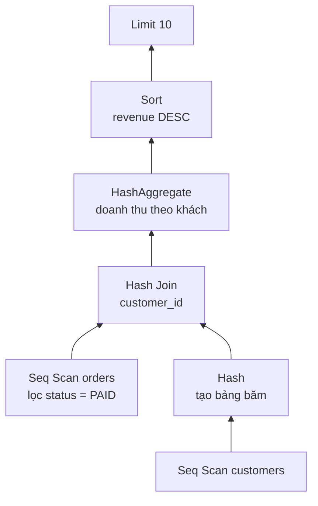

# Đọc cây kế hoạch, chi phí, số hàng và chiều rộng ước tính trong PostgreSQL

Một câu SQL mô tả **kết quả cần lấy**, nhưng không chỉ rõ đầy đủ cách PostgreSQL phải lấy kết quả đó. Khi xử lý truy vấn, PostgreSQL có thể chọn quét tuần tự bảng, dùng chỉ mục, tạo bảng băm để join, sắp xếp, tổng hợp, chạy nhiều worker song song hoặc kết hợp nhiều phương án.

Muốn hiểu database **thực sự định làm gì**, chúng ta đọc **query execution plan – kế hoạch thực thi truy vấn** bằng `EXPLAIN`.

Ví dụ:

```sql
EXPLAIN
SELECT order_id, total_amount
FROM orders
WHERE customer_id = 42;
```

Một kế hoạch minh họa có thể trông như:

```text
Index Scan using idx_orders_customer on orders
  (cost=0.29..84.15 rows=32 width=20)
  Index Cond: (customer_id = 42)
```

Không nên đọc dòng này là “truy vấn chạy mất 84,15 mili giây và trả chính xác 32 hàng”. Đây là cách hiểu sai rất phổ biến.

Ba nhóm số quan trọng nhất có ý nghĩa riêng:

- **`cost=0.29..84.15`**: ước lượng chi phí do **planner** tính, gồm chi phí trước khi bắt đầu trả kết quả và tổng chi phí dự kiến, theo đơn vị quy ước nội bộ; **không phải thời gian mili giây**.
- **`rows=32`**: ước lượng số **hàng node này sẽ xuất ra trong một lần thực thi**, dựa trên thống kê và mô hình chi phí; **không bảo đảm chính xác**.
- **`width=20`**: ước lượng **số byte trung bình của các giá trị hàng đầu ra node này**, hữu ích cho ước lượng chi phí truyền hàng, sắp xếp, hash và lưu trữ trung gian.

Ngoài ba thông số này, **cấu trúc cây** và **quan hệ cha–con giữa các node** mới cho biết dữ liệu di chuyển theo hướng nào. Trên một truy vấn phức tạp, chỉ nhìn dòng đầu tiên hoặc thấy một `Seq Scan` rồi kết luận “query chậm” là không đủ.

Bài học thuộc chương **Kế hoạch truy vấn**, hướng dẫn đọc từ cây đơn giản tới kế hoạch nhiều nhánh, phân biệt số ước lượng với đo thực tế, kiểm tra chỗ planner dự đoán sai và chọn hướng điều tra hiệu năng phù hợp.

## 1. Vì sao cần đọc kế hoạch thay vì đoán từ SQL?

Xem câu:

```sql
SELECT
    c.customer_name,
    COUNT(*) AS order_count,
    SUM(o.total_amount) AS revenue
FROM customers AS c
JOIN orders AS o
  ON o.customer_id = c.customer_id
WHERE o.status = 'PAID'
GROUP BY c.customer_id, c.customer_name
ORDER BY revenue DESC
LIMIT 10;
```

Câu SQL mô tả:

1. Lấy khách hàng và đơn hàng có trạng thái PAID.
2. Ghép theo customer_id.
3. Tính số đơn và tổng tiền mỗi khách.
4. Sắp theo doanh thu giảm dần.
5. Lấy 10 khách đầu tiên.

Nhưng các quyết định quan trọng **không thể đọc ra trực tiếp từ SQL**:

- PostgreSQL đọc `orders` bằng `Seq Scan` hay `Index Scan`?
- Đọc bảng nào trước?
- Dùng `Hash Join`, `Merge Join` hay `Nested Loop`?
- Khi nào dùng `HashAggregate`, khi nào dùng `GroupAggregate`?
- Có cần `Sort` hay có thể lấy thứ tự sẵn từ index?
- Dự đoán bao nhiêu hàng PAID và bao nhiêu khách có kết quả?
- Cần bao nhiêu bộ nhớ để sort/hash?
- Có chạy song song không, và có thực sự launch đủ worker?

Kế hoạch thực thi cung cấp câu trả lời ở mức chiến lược và, nếu dùng `EXPLAIN ANALYZE`, số liệu đo từ lần chạy.

**Mục tiêu đọc plan** không phải “bắt database luôn dùng index”, mà là **hiểu vì sao planner chọn một con đường và chỗ nào thực tế khác với dự đoán**.

## 2. EXPLAIN và EXPLAIN ANALYZE

### 2.1. EXPLAIN: xem kế hoạch dự kiến

```sql
EXPLAIN
SELECT *
FROM pg_class
WHERE relname = 'pg_class';
```

Lệnh này hiển thị **kế hoạch do planner lựa chọn** nhưng không thực thi câu `SELECT` để lấy kết quả cho người dùng. Các số `cost`, `rows`, `width` là **ước lượng**.

### 2.2. EXPLAIN ANALYZE: chạy và đo

```sql
EXPLAIN (ANALYZE)
SELECT *
FROM pg_class
WHERE relname = 'pg_class';
```

Khi có `ANALYZE`, PostgreSQL **thực sự chạy câu lệnh** và bổ sung thông tin:

- `actual time`: mốc thời gian thực tế của node trong lần chạy, theo mili giây.
- `actual rows`: số hàng node thực sự trả.
- `loops`: số lần node được thực thi.
- `Planning Time`, `Execution Time`.

Ví dụ:

```text
Index Scan ... (cost=0.28..8.29 rows=1 width=265)
              (actual time=0.014..0.015 rows=1 loops=1)
```

Ở đây:

- `rows=1` thứ nhất là **planner dự đoán**.
- `rows=1` trong `actual ...` là **đo thực tế**.
- `cost=8.29` không phải `actual time=0.015 ms` được viết bằng đơn vị khác.

### 2.3. Cú pháp thường dùng trong điều tra

```sql
EXPLAIN (ANALYZE, BUFFERS, VERBOSE, SETTINGS)
SELECT ...
FROM ...
WHERE ...;
```

Ý nghĩa:

| Tùy chọn | Tác dụng chính |
| --- | --- |
| `ANALYZE` | Thực thi để thu số hàng, số loops, thời gian thực |
| `BUFFERS` | Thống kê block access của các node, như shared hit/read, temp read/written |
| `VERBOSE` | Hiển thị chi tiết hơn như Output/biểu thức và tên quan hệ |
| `SETTINGS` | Hiển thị những planner-related settings khác mặc định có liên quan |
| `WAL` | Có thể bổ sung thống kê WAL khi được hỗ trợ và dùng cùng ANALYZE |
| `TIMING OFF` | Tắt đo thời gian từng node để giảm overhead trong vài workload; vẫn đo thực thi và số hàng |
| `SUMMARY` | Bật/tắt phần thông tin tổng kết liên quan |
| `FORMAT JSON` | Trả kế hoạch dạng JSON để công cụ phân tích |

Không cần bật mọi tùy chọn trong mọi lần. Khi mục tiêu là **sai lệch cardinality hoặc I/O**, `EXPLAIN (ANALYZE, BUFFERS)` là điểm bắt đầu hữu ích.

### 2.4. Cảnh báo đối với lệnh ghi

`EXPLAIN ANALYZE` **thực thi** `INSERT`, `UPDATE`, `DELETE` và những câu lệnh khác có tác động. Nếu cần đo một lệnh ghi trên môi trường thử nghiệm mà không giữ thay đổi:

```sql
BEGIN;

EXPLAIN (ANALYZE, BUFFERS)
UPDATE some_table
SET value = value + 1
WHERE id = 10;

ROLLBACK;
```

Đây là **mảnh minh họa**, giả định bảng và cột tồn tại. Ngay cả khi ROLLBACK, việc chạy UPDATE vẫn có thể lấy khóa, ghi WAL và thực thi trigger; **side effect ngoài database không tự rollback**. Không chạy EXPLAIN ANALYZE trên câu DELETE/UPDATE production chỉ để xem plan khi chưa hiểu tác động.

## 3. Cây kế hoạch được đọc theo thứ tự nào?

Một plan được trình bày theo **cấu trúc cây**. Thụt đầu dòng và ký hiệu `->` mô tả node con.

Ví dụ minh họa:

```text
Limit
  -> Sort
       Sort Key: total_amount DESC
       -> Seq Scan on orders
            Filter: (status = 'PAID')
```

Đọc theo dòng dữ liệu:

1. **`Seq Scan`** đọc hàng từ bảng và kiểm tra `status = 'PAID'`.
2. **`Sort`** nhận các hàng từ Seq Scan và sắp theo tổng tiền.
3. **`Limit`** lấy số hàng đầu cần trả.

**Dữ liệu đi từ lá lên gốc**, dù plan in node cha trước node con.

### 3.1. Đừng hiểu cây là thứ tự đồng hồ tuyệt đối

Trong một số loại node, executor dùng mô hình “parent yêu cầu một tuple từ child”, gọi xuống các node con theo cơ chế thực thi phù hợp. Với `Nested Loop`, các nhánh có thể được gọi lặp nhiều lần; với `Hash Join`, việc xây dựng hash table và probe tuân theo cách riêng; với `Sort`, có thể cần gom dữ liệu trước khi trả tuple.

Vì thế “đọc từ lá lên” là **cách hiểu quan hệ dữ liệu và phụ thuộc xử lý**, không phải khẳng định mọi node con luôn chạy hoàn tất trước mọi node cha trong từng mili giây.

### 3.2. Dùng sơ đồ cho kế hoạch join



Trong sơ đồ, hai nhánh `orders` và `customers` cung cấp dữ liệu cho join; kết quả join mới được tổng hợp, sắp xếp và giới hạn.

### 3.3. Nhận dạng node cha và con

```text
Nested Loop
  -> Seq Scan on customers
  -> Index Scan using idx_orders_customer on orders
       Index Cond: (customer_id = customers.customer_id)
```

`Nested Loop` có **hai node con**:

- Node ngoài (*outer side*): duyệt `customers`.
- Node trong (*inner side*): có thể tìm các đơn theo `customer_id` của từng khách.

Nếu `customers` có 2.000 hàng, node trong có thể được gọi **hàng nghìn lần**, đây là lý do thông số `loops` rất quan trọng.

## 4. Cấu trúc một dòng EXPLAIN

Một dòng plan phổ biến:

```text
Seq Scan on orders  (cost=0.00..1270.00 rows=42000 width=38)
```

Đọc như sau:

| Thành phần | Ý nghĩa |
| --- | --- |
| `Seq Scan` | Loại plan node |
| `on orders` | Quan hệ được quét |
| `cost=0.00..1270.00` | Startup cost và total cost, đều **ước lượng** |
| `rows=42000` | Số hàng **ước lượng node xuất ra**, không phải số trang bảng |
| `width=38` | Số byte trung bình **ước lượng của hàng đầu ra node** |

Không phải mọi node đều có mọi chi tiết giống nhau. Một số node còn có `Index Cond`, `Hash Cond`, `Join Filter`, `Sort Key`, `Group Key`, `Filter`, `Recheck Cond`, `Rows Removed by Filter`.

### 4.1. Dòng output là bản tóm tắt, không phải toàn bộ nội bộ executor

Một tên node như `Hash Join` không liệt kê trong một dòng mọi cấu trúc bộ nhớ hoặc mọi lần đọc buffer. Khi cần sâu hơn, bật `ANALYZE, BUFFERS` và xem các dòng phụ ngay dưới node.

### 4.2. Không nhân nhầm các số

`cost`, `rows` và `width` không phải ba kích thước của một khối dữ liệu:

- `rows` × `width` có thể cho một **ước lượng thô về byte của tập hàng đầu ra**, hữu ích khi suy luận chi phí sort/hash.
- `cost` không tính bằng số byte và không lấy từ phép nhân đó đơn giản.
- Một plan node có thể trả ít hàng nhưng vẫn đọc cả bảng, ví dụ `COUNT(*)`: `rows=1` ở Aggregate không có nghĩa chỉ scan một hàng nguồn.

## 5. Chi phí: startup cost và total cost

Xét:

```text
Index Scan using idx_orders_customer on orders
  (cost=0.42..109.25 rows=30 width=32)
```

Cặp giá trị có nghĩa:

- **Startup cost = 0.42**: chi phí ước lượng để node có thể **bắt đầu trả hàng đầu tiên**, theo mô hình của planner.
- **Total cost = 109.25**: chi phí ước lượng để node xử lý đến khi **trả hết đầu ra dự kiến**, bao gồm startup.

Với:

```text
Sort (cost=2100.00..2205.00 rows=42000 width=32)
```

startup cost có thể lớn vì node cần thu thập/sắp xếp tập đầu vào trước khi bắt đầu trả hàng.

### 5.1. Cost là đơn vị gì?

PostgreSQL dùng **đơn vị chi phí quy ước (planner cost units)**, được tạo từ các thông số như:

- `seq_page_cost`.
- `random_page_cost`.
- `cpu_tuple_cost`.
- `cpu_index_tuple_cost`.
- `cpu_operator_cost`.
- Các giả định về I/O, CPU và bộ nhớ.

Một số đơn vị được quy chuẩn tương đối với chi phí đọc page tuần tự. Chúng phục vụ mục tiêu **so sánh kế hoạch thay thế**, không phải đồng hồ.

**Không viết:** “cost 1000 nghĩa là truy vấn chạy 1000 ms”. Không có phép đổi cố định từ planner cost sang thời gian thực.

### 5.2. Tại sao cost của parent thường lớn hơn child?

Ví dụ minh họa:

```text
Sort          (cost=1200.00..1225.00 rows=10000 width=24)
  -> Seq Scan (cost=0.00..800.00 rows=10000 width=24)
```

Chi phí Sort **đã tính đến chi phí tạo đầu vào từ Seq Scan** theo mô hình planner. Không cộng `1225 + 800` để ra tổng cost truy vấn.

Tương tự, cost của node join chứa chi phí ước lượng từ các nhánh con và chi phí riêng của join theo mô hình.

### 5.3. Vì sao LIMIT quan tâm startup cost?

```sql
SELECT order_id
FROM index_include_lab.orders
WHERE customer_id = 42
LIMIT 1;
```

Một index scan có thể bắt đầu trả một hàng rất nhanh. Nhưng một seq scan cũng có thể rất nhanh nếu bộ dữ liệu nhỏ và hàng phù hợp sớm xuất hiện. Planner cân nhắc **chi phí bắt đầu trả hàng** và **số hàng dự kiến cần lấy**.

Với `ORDER BY ... LIMIT 10`, index đã có thứ tự có thể tiết kiệm việc sort toàn bộ kết quả. Nhưng một `Sort` kiểu top-N heapsort vẫn có thể hợp lý tùy số hàng, biểu thức sort và index hiện có.

### 5.4. Total cost không phải luôn chi phí đã trả thực tế

Nếu parent chỉ cần 10 hàng, node con có thể **dừng sớm**. Total cost ở node con thường là ước tính cho việc lấy hết hàng đầu ra của node đó theo mô hình planner, chứ không nhất thiết executor đã thực hiện đủ công việc đó trong một plan có LIMIT.

Đó là lý do khi xem kết quả thật cần đọc thêm `actual rows` và `loops`, không dựa vào total cost một mình.

## 6. Ước lượng rows: PostgreSQL dự đoán cardinality ra sao?

`rows=N` là số hàng dự kiến một node **trả tới node cha** trong một lần thực thi, sau các điều kiện được thực hiện ở node đó.

Ví dụ:

```text
Seq Scan on orders
  (cost=0.00..1200.00 rows=6000 width=32)
  Filter: (status = 'PENDING')
```

Nếu bảng có khoảng 60.000 đơn, `rows=6000` có thể đến từ ước lượng khoảng 10% có trạng thái PENDING.

Ước lượng dựa trên:

- Số hàng ước lượng của relation.
- Thống kê cột do `ANALYZE`/autovacuum cập nhật.
- Tỷ lệ NULL, số giá trị phân biệt.
- Most common values, histogram.
- Mô hình selectivity cho toán tử, join và các điều kiện.
- Extended statistics trong những trường hợp phù hợp.

### 6.1. rows không phải LIMIT của bảng

```text
Aggregate  (cost=... rows=1 width=8)
  -> Seq Scan on orders (cost=... rows=60000 width=0)
```

Nếu Aggregate tính `COUNT(*)`, `rows=1` ở node Aggregate chỉ là **một hàng kết quả**. Node con vẫn có thể phải đọc 60.000 hàng.

### 6.2. Rows ở mỗi tầng có nghĩa khác nhau

| Loại node | Ý nghĩa của rows |
| --- | --- |
| Scan | Số hàng còn lại sau điều kiện xử lý tại scan |
| Join | Số hàng dự kiến sau ghép và điều kiện join |
| Filter | Số hàng còn lại sau filter tương ứng |
| Aggregate | Số hàng tổng hợp/nhóm được trả |
| Sort | Thông thường số hàng đi qua sau sort |
| Limit | Số hàng tối đa dự kiến trả theo LIMIT/offset |
| Gather | Số hàng dự kiến sau thu thập từ các worker |

Đừng lấy `rows` ở node gốc để kết luận một node lá chỉ phải đọc bấy nhiêu hàng vật lý.

### 6.3. Sai lệch rows lan truyền qua cả cây

Nếu PostgreSQL nghĩ một filter chỉ trả 10 hàng nhưng thực tế 100.000 hàng, planner có thể chọn Nested Loop hoặc một chiến lược join không phù hợp. Khi đó lỗi không nhất thiết nằm ở node join; nó có thể bắt đầu từ **ước lượng số hàng ở một node con**.

Một kỹ thuật chẩn đoán quan trọng là **tìm node đầu tiên từ dưới lên có khác biệt đáng kể giữa estimated rows và actual rows**, rồi xem nguyên nhân thống kê/điều kiện tại đó.

## 7. Ước lượng width: số byte của hàng đầu ra

`width=N` là **độ rộng trung bình ước tính** của một row được node đưa lên parent, thường tính bằng byte. Nó **không** có nghĩa:

- Kích thước bảng trên đĩa.
- Kích thước page PostgreSQL.
- Tổng kích thước của cả result set.
- Kích thước chính xác từng row ở runtime.
- Số cột của SELECT.

Ví dụ:

```text
Seq Scan on orders (cost=... rows=60000 width=148)
```

Planner ước lượng mỗi hàng output của node khoảng 148 byte. Nếu node chỉ cần truyền `order_id` và `customer_id`, width thường nhỏ hơn khi phải đưa cả `customer_note` dạng text dài lên parent.

### 7.1. Projection thay đổi width

So sánh:

```sql
EXPLAIN
SELECT order_id, total_amount
FROM index_include_lab.orders;
```

với:

```sql
EXPLAIN
SELECT *
FROM index_include_lab.orders;
```

Truy vấn `SELECT *` mang theo nhiều cột hơn; width ước tính của node xuất dữ liệu có thể lớn hơn đáng kể.

**Width là thuộc tính của đầu ra từng node**, nên một node phía dưới có thể chuyển tập cột khác node phía trên do projection, join hoặc aggregate.

### 7.2. Tác động tới Sort và Hash

Nếu một node sắp xếp 100.000 hàng:

```text
rows=100000 width=24
```

thì dữ liệu đầu ra ước tính thô có kích thước khoảng:

```text
100000 × 24 = 2.400.000 byte (chưa tính overhead)
```

Nếu width tăng lên 400:

```text
100000 × 400 = 40.000.000 byte (chưa tính overhead)
```

Chênh lệch có thể ảnh hưởng mạnh đến ước lượng bộ nhớ cho sort/hash, lựa chọn plan và nguy cơ phải ghi temp files.

Không xem phép nhân đơn giản này là công thức chính xác cho memory: executor còn metadata, alignment, tuple headers, hash structures và nhiều overhead khác.

### 7.3. Width không bảo đảm bằng độ dài thực tế

Với `TEXT`/`JSONB`, kích thước giá trị thay đổi theo hàng. Planner dùng thống kê và ước lượng; dữ liệu có phân bố lệch hoặc đã thay đổi nhiều có thể khiến width dự đoán khác thực tế.

Nếu sort/hash bị tràn ra đĩa dù ước lượng width trông nhỏ, hãy kiểm tra dữ liệu thật, biến thiên độ rộng, số hàng thật và các thông số bộ nhớ.

## 8. Đọc EXPLAIN ANALYZE: actual time, rows và loops

Ví dụ minh họa:

```text
Index Scan using idx_orders_customer on orders
  (cost=0.42..110.50 rows=30 width=24)
  (actual time=0.027..0.074 rows=30 loops=1)
```

Đọc:

- `actual time=0.027..0.074`: khoảng từ lúc bắt đầu node tới hàng đầu tiên và tới khi node hoàn tất trong **một lượt chạy trung bình**, theo cách ghi số liệu của EXPLAIN.
- `rows=30` trong nhóm actual: số hàng thực tế node trả **trung bình trên một lần gọi/lặp**.
- `loops=1`: node được thực hiện một lượt.

### 8.1. loops là điểm rất dễ bỏ qua

Ví dụ:

```text
Nested Loop  (actual time=0.10..18.00 rows=900 loops=1)
  -> Seq Scan on customers
       (actual time=0.01..0.35 rows=300 loops=1)
  -> Index Scan on orders
       (actual time=0.01..0.04 rows=3 loops=300)
       Index Cond: (customer_id = customers.customer_id)
```

Node Index Scan:

- Trả **trung bình 3 hàng mỗi lần**.
- Được gọi **300 lần**.
- Tổng số hàng xuất ra qua tất cả lần lặp khoảng **3 × 300 = 900**.

Không kết luận “Index Scan chỉ xử lý ba hàng nên không thể là bottleneck”. Thời gian và I/O nhỏ ở một lượt có thể cộng dồn rất lớn khi loops cao.

### 8.2. Thời gian actual trên node có thể bao gồm child

Node cha có chi phí đo lường phản ánh quá trình thực thi của subtree, không nên **cộng thẳng thời gian của mọi node** như những khoảng hoàn toàn tách biệt.

Ví dụ node Nested Loop 18 ms đã bao gồm thời gian xử lý các nhánh con theo cách EXPLAIN thu thập. Nếu cộng Nested Loop 18 + Seq Scan 0,35 + Index Scan 0,04 × 300 sẽ dễ **đếm trùng**.

### 8.3. TIMING OFF khi cần giảm overhead

```sql
EXPLAIN (ANALYZE, BUFFERS, TIMING OFF)
SELECT COUNT(*)
FROM index_include_lab.orders;
```

`TIMING OFF` giúp giảm overhead thu thời gian từng node, nhưng vẫn giữ số rows/loops/buffers và thời gian tổng kết thực thi. Hữu ích khi muốn chẩn đoán cardinality mà việc đo từng node ảnh hưởng tới query ngắn.

## 9. Thực hành: tạo dữ liệu minh họa

Các bước tiếp theo dùng **database PostgreSQL thử nghiệm riêng**. Script có 2.000 khách và 60.000 đơn giả để có tình huống scan, join, sort, aggregate. Không chạy trong database production.

### 9.1. Schema và bảng khách hàng

```sql
CREATE SCHEMA IF NOT EXISTS plan_tree_lab;

CREATE TABLE plan_tree_lab.customers (
    customer_id INTEGER PRIMARY KEY,
    customer_name TEXT NOT NULL,
    region TEXT NOT NULL,
    tier TEXT NOT NULL
        CHECK (tier IN ('STANDARD', 'VIP'))
);
```

### 9.2. Bảng đơn hàng

```sql
CREATE TABLE plan_tree_lab.orders (
    order_id BIGINT GENERATED ALWAYS AS IDENTITY PRIMARY KEY,
    customer_id INTEGER NOT NULL
        REFERENCES plan_tree_lab.customers (customer_id),
    ordered_at TIMESTAMPTZ NOT NULL,
    status TEXT NOT NULL
        CHECK (status IN ('PAID', 'PENDING', 'CANCELLED')),
    total_amount NUMERIC(12, 2) NOT NULL
        CHECK (total_amount >= 0),
    note TEXT
);
```

### 9.3. Nạp khách hàng

```sql
INSERT INTO plan_tree_lab.customers
    (customer_id, customer_name, region, tier)
SELECT
    g.id,
    'Customer ' || g.id,
    CASE
        WHEN g.id % 3 = 0 THEN 'NORTH'
        WHEN g.id % 3 = 1 THEN 'CENTRAL'
        ELSE 'SOUTH'
    END,
    CASE WHEN g.id % 10 = 0 THEN 'VIP'
         ELSE 'STANDARD'
    END
FROM generate_series(1, 2000) AS g(id);
```

### 9.4. Nạp đơn hàng

```sql
INSERT INTO plan_tree_lab.orders (
    customer_id,
    ordered_at,
    status,
    total_amount,
    note
)
SELECT
    (g.n % 2000) + 1,
    TIMESTAMPTZ '2026-01-01 00:00:00+00'
        + make_interval(mins => g.n),
    CASE
        WHEN g.n % 10 < 7 THEN 'PAID'
        WHEN g.n % 10 < 9 THEN 'PENDING'
        ELSE 'CANCELLED'
    END,
    (100 + g.n % 5000)::numeric(12, 2),
    repeat('Demo note. ', 6)
FROM generate_series(1, 60000) AS g(n);
```

### 9.5. Cập nhật thống kê

```sql
ANALYZE plan_tree_lab.customers;
ANALYZE plan_tree_lab.orders;

SELECT
    (SELECT COUNT(*) FROM plan_tree_lab.customers)
        AS customer_count,
    (SELECT COUNT(*) FROM plan_tree_lab.orders)
        AS order_count;
```

Trên schema mới và chỉ nạp một lần, kết quả là **2.000 khách** và **60.000 đơn**.

Các query EXPLAIN bên dưới có thể cho plan khác nhau trên hai máy dù cùng SQL. Những yếu tố như PostgreSQL version, cache, thống kê, cấu hình và dữ liệu hiện tại đều ảnh hưởng quyết định của planner. **Các ví dụ kế hoạch dạng text trong bài là minh họa cấu trúc; không phải kết quả byte-for-byte bạn bắt buộc phải nhận.**

## 10. Bắt đầu với Seq Scan đơn giản

Chạy:

```sql
EXPLAIN
SELECT
    order_id,
    customer_id,
    total_amount
FROM plan_tree_lab.orders
WHERE status = 'PAID';
```

Với dữ liệu mô phỏng, khoảng **70%** đơn là PAID. Quét phần lớn bảng bằng `Seq Scan` có thể rẻ hơn đọc nhiều heap rows rải rác qua index.

Một kế hoạch minh họa:

```text
Seq Scan on orders
  (cost=0.00..1750.00 rows=42000 width=22)
  Filter: (status = 'PAID'::text)
```

Đọc:

1. Chỉ có một node quét.
2. `cost=0.00`: startup thấp vì có thể bắt đầu duyệt bảng ngay.
3. `total cost=1750.00` là ước lượng chi phí quét/lọc theo mô hình.
4. `rows=42000`: planner dự đoán có khoảng 42.000 hàng PAID.
5. `width=22`: độ rộng đầu ra dự kiến theo các cột được yêu cầu.
6. `Filter`: mỗi tuple được đọc và kiểm tra status.

Không nên vội tạo index chỉ vì xuất hiện `Seq Scan`. Nếu lọc trả 70% bảng, Seq Scan có thể là phương án đúng.

### 10.1. Xem số hàng thực

```sql
EXPLAIN (ANALYZE, BUFFERS)
SELECT order_id, customer_id, total_amount
FROM plan_tree_lab.orders
WHERE status = 'PAID';
```

Quan sát:

- `actual rows` so với `rows` dự kiến.
- `Rows Removed by Filter`.
- `shared hit/read`.
- Thời gian tổng.

Nếu 42.000 hàng đúng nhưng plan vẫn chậm, nguyên nhân có thể nằm ở **lượng dữ liệu phải đọc**, không phải sai cardinality.

### 10.2. Rows Removed by Filter

Ví dụ plan minh họa:

```text
Seq Scan on orders
  (actual time=0.020..7.800 rows=42000 loops=1)
  Filter: (status = 'PAID'::text)
  Rows Removed by Filter: 18000
```

Với 60.000 hàng:

```text
60.000 đầu vào
   42.000 hàng qua Filter
   18.000 hàng bị loại
```

Tương tự `actual rows`, các thống kê loại hàng trong EXPLAIN có thể được biểu diễn theo **trung bình trên mỗi loop**; khi `loops>1`, phải nhân tương ứng để suy luận tổng.

## 11. Index Scan: nhận dạng Index Cond

Tạo index:

```sql
CREATE INDEX idx_plan_orders_customer
ON plan_tree_lab.orders (customer_id);
```

Truy vấn:

```sql
EXPLAIN (ANALYZE, BUFFERS)
SELECT
    order_id,
    customer_id,
    total_amount
FROM plan_tree_lab.orders
WHERE customer_id = 42;
```

Với 60.000 đơn chia đều cho 2.000 khách, khách 42 có khoảng **30 đơn**, tức điều kiện khá chọn lọc.

Plan minh họa:

```text
Index Scan using idx_plan_orders_customer on orders
  (cost=0.29..115.00 rows=30 width=22)
  (actual time=0.025..0.130 rows=30 loops=1)
  Index Cond: (customer_id = 42)
```

### 11.1. Index Cond khác Filter

`Index Cond: (customer_id = 42)` cho biết điều kiện được dùng để truy xuất qua index.

Nếu thêm:

```sql
WHERE customer_id = 42
  AND status = 'PAID'
```

với index chỉ trên `customer_id`, PostgreSQL có thể dùng Index Cond cho customer_id rồi `Filter` status sau khi đọc hàng.

Một kế hoạch có thể:

```text
Index Scan using idx_plan_orders_customer on orders
  Index Cond: (customer_id = 42)
  Filter: (status = 'PAID'::text)
  Rows Removed by Filter: ...
```

**Index Cond** giúp thu hẹp truy cập index; **Filter** loại các hàng không đáp ứng điều kiện sau bước tương ứng. Không phải Filter nào cũng là “lỗi thiết kế”: nhiều filter rẻ và không đáng thêm index.

### 11.2. Index Scan không mặc định nhanh hơn Seq Scan

Nếu truy vấn đòi đọc 80% bảng, dùng index có thể tạo rất nhiều truy cập heap. Planner có thể thích Seq Scan hơn dù tồn tại index.

Mục tiêu là chọn **chi phí thấp nhất theo ước lượng**; kế hoạch phù hợp còn phụ thuộc độ chọn lọc, cache, layout heap và khối lượng dữ liệu.

## 12. Bitmap Index Scan + Bitmap Heap Scan

Nếu điều kiện trả nhiều hàng hơn một Index Scan thông thường, planner có thể chọn:

```text
Bitmap Heap Scan on orders
  Recheck Cond: (customer_id = ANY (...))
  -> Bitmap Index Scan on idx_plan_orders_customer
       Index Cond: (customer_id = ANY (...))
```

Đường đi:

1. **`Bitmap Index Scan`** xác định vị trí hàng từ index.
2. Tạo bitmap giúp biết những heap pages/tuples cần đọc.
3. **`Bitmap Heap Scan`** truy cập heap theo thứ tự block phù hợp để giảm I/O rải rác.
4. Nếu bitmap bị lossy hoặc điều kiện đòi recheck, executor kiểm tra lại khi đọc heap.

### 12.1. Recheck Cond không đồng nghĩa luôn lọc lại mọi tuple

`Recheck Cond` cho biết điều kiện có thể cần xác minh lại. Việc phải recheck thật bao nhiêu phụ thuộc các trang bitmap **exact/lossy**, index method và trạng thái thực thi.

Trong `EXPLAIN ANALYZE`, chú ý các dòng như `Heap Blocks: exact=... lossy=...` khi xuất hiện.

### 12.2. Dùng bitmap khi nào?

Bitmap scans thường có ích khi cần một số lượng hàng trung bình/lớn từ index nhưng đọc heap theo block hiệu quả hơn từng hàng. Không có ngưỡng cố định “trên 1.000 hàng phải dùng Bitmap”: planner chọn theo chi phí.

## 13. Index Only Scan và Heap Fetches

Tạo index chứa các cột cần trả:

```sql
CREATE INDEX idx_plan_orders_customer_cover
ON plan_tree_lab.orders (customer_id)
INCLUDE (order_id, total_amount);
```

Đo:

```sql
EXPLAIN (ANALYZE, BUFFERS)
SELECT order_id, total_amount
FROM plan_tree_lab.orders
WHERE customer_id = 42;
```

Một plan có thể:

```text
Index Only Scan using idx_plan_orders_customer_cover
  Index Cond: (customer_id = 42)
  Heap Fetches: 30
```

`Index Only Scan` nghĩa là index chứa dữ liệu query cần, nhưng có thể vẫn phải đọc heap để kiểm tra tuple visibility.

### 13.1. Vai trò của visibility map

PostgreSQL dùng **visibility map** theo heap page. Khi page được đánh dấu **all-visible**, executor có thể tránh fetch heap để kiểm tra MVCC cho các tuple tương ứng.

Nếu page chưa all-visible, Index Only Scan vẫn có thể phải truy cập heap. Vì vậy:

- `Heap Fetches: 0`: ở lần chạy đó, không cần heap fetch do visibility check tại node.
- `Heap Fetches: 30`: đã có heap fetch, dù node vẫn là Index Only Scan.

### 13.2. VACUUM và phân bố ghi

```sql
VACUUM (ANALYZE) plan_tree_lab.orders;
```

Thực thi **ngoài transaction block** trong lab, rồi đo lại cùng query. VACUUM có thể giúp pages đủ điều kiện all-visible, từ đó giảm heap fetch, nhưng **không bảo đảm** mọi trường hợp đều về 0, nhất là khi có transaction lâu hoặc dữ liệu đang thay đổi.

### 13.3. Đừng tối ưu chỉ để hiện Index Only Scan

Một index có INCLUDE rộng có thể tăng WAL, storage và chi phí UPDATE. Nếu một Index Scan đọc 30 heap tuples trong cache đã rất nhanh, index rộng chưa chắc đem lại lợi ích tổng thể.

## 14. Nested Loop: đọc ước lượng và loops đúng cách

Một truy vấn join:

```sql
EXPLAIN (ANALYZE, BUFFERS)
SELECT
    c.customer_id,
    c.customer_name,
    o.order_id,
    o.total_amount
FROM plan_tree_lab.customers AS c
JOIN plan_tree_lab.orders AS o
  ON o.customer_id = c.customer_id
WHERE c.customer_id BETWEEN 40 AND 50;
```

Vì chỉ có 11 khách, `Nested Loop` với index scan cho từng khách có thể hợp lý.

Plan minh họa:

```text
Nested Loop (cost=... rows=330 width=...)
            (actual time=... rows=330 loops=1)
  -> Index Scan on customers
       Index Cond: ((customer_id >= 40) AND (customer_id <= 50))
       (actual time=... rows=11 loops=1)
  -> Index Scan using idx_plan_orders_customer on orders
       Index Cond: (customer_id = c.customer_id)
       (actual time=... rows=30 loops=11)
```

Đọc:

1. Nhánh ngoài trả 11 khách.
2. Mỗi khách trở thành giá trị tham số cho nhánh trong.
3. Nhánh trong chạy 11 lần, mỗi lần trả khoảng 30 đơn.
4. Node join xuất khoảng `11 × 30 = 330` hàng.

### 14.1. Kết quả thật từ câu SQL không quyết định plan bắt buộc

Planner có thể chọn một join khác nếu thống kê, cost và dữ liệu khác. Không viết unit test dựa vào việc kế hoạch nhất thiết phải có từ khóa Nested Loop khi SQL vẫn trả đúng kết quả.

### 14.2. Nested Loop khi nào nguy hiểm?

Nếu nhánh ngoài thực tế có **100.000 hàng** nhưng planner chỉ ước lượng **10 hàng**, nhánh trong có thể được gọi 100.000 lần, tạo lượng random I/O lớn.

Một chỉ dấu điển hình:

```text
Nested Loop  (... rows=10 ...)
             (actual ... rows=100000 loops=1)
  -> ... (estimated rows=10, actual rows=100000)
  -> Index Scan ... (actual rows=1 loops=100000)
```

Sai lệch ở nhánh ngoài thường là đầu mối điều tra, không phải việc Nested Loop vốn luôn kém.

### 14.3. Memoize và Nested Loop

Ở những kế hoạch PostgreSQL phù hợp, một `Memoize` node có thể cache kết quả của inner side theo khóa tham số, giảm số lần thực thi lặp khi nhiều outer rows có cùng key.

Trong EXPLAIN ANALYZE, có thể thấy `Cache Key`, hits, misses và memory usage. Đừng mặc định có Memoize nếu SQL join có lặp key; planner quyết định theo đặc điểm và phiên bản.

## 15. Hash Join: đọc nhánh build và probe

Truy vấn:

```sql
EXPLAIN (ANALYZE, BUFFERS)
SELECT
    c.region,
    o.status,
    o.total_amount
FROM plan_tree_lab.orders AS o
JOIN plan_tree_lab.customers AS c
  ON c.customer_id = o.customer_id
WHERE o.status = 'PAID';
```

Với nhiều hàng PAID, planner có thể chọn:

```text
Hash Join  (cost=... rows=42000 width=...)
  Hash Cond: (o.customer_id = c.customer_id)
  -> Seq Scan on orders o
       Filter: (status = 'PAID'::text)
  -> Hash
       -> Seq Scan on customers c
```

Đọc từ hai nhánh:

1. Nhánh **customers** được đọc để tạo cấu trúc băm qua node `Hash`.
2. Nhánh **orders** cung cấp các hàng để tìm đối tượng phù hợp trong hash table.
3. `Hash Cond` là điều kiện so key.
4. Hash Join phát ra hàng phù hợp.

### 15.1. Hash node có rows và width riêng

Node Hash nhận output từ scan bảng build side. Ước lượng `rows` và `width` của nhánh Hash giúp planner dự đoán kích thước hash table.

Nếu ước lượng Hash build 2.000 rows nhưng thực tế 2 triệu, memory/batching có thể trở thành vấn đề.

### 15.2. Buckets, Batches, Memory Usage

Khi dùng `ANALYZE`, phần Hash có thể hiện:

```text
Hash
  Buckets: 4096  Batches: 1  Memory Usage: 170kB
```

Các giá trị này là ví dụ. `Batches` lớn hơn 1 có thể cho biết hash phải chia batch do không giữ đủ dữ liệu trong bộ nhớ theo điều kiện thực thi, thường kéo theo I/O bổ sung. Đọc cùng `BUFFERS`, đặc biệt temp activity, và số hàng/width thực tế.

### 15.3. Hash Cond khác Join Filter

`Hash Cond` mô tả điều kiện hash join dùng trực tiếp. Nếu còn điều kiện phụ, plan có thể có `Join Filter` và `Rows Removed by Join Filter`.

Không đồng nhất điều kiện join được dùng để hash với mọi biểu thức trong `ON`/`WHERE` của SQL. Các điều kiện có thể được planner đẩy xuống scan hoặc đánh giá ở node khác.

## 16. Merge Join: dữ liệu cần có thứ tự

Một loại join khác:

```text
Merge Join
  Merge Cond: (o.customer_id = c.customer_id)
  -> Index Scan on orders ...
  -> Index Scan on customers ...
```

`Merge Join` khai thác hai luồng dữ liệu có thứ tự phù hợp theo join keys. Nếu đầu vào chưa được sắp, planner có thể thêm `Sort`.

### 16.1. Vì sao index không đồng nghĩa Merge Join?

Index có thể cung cấp thứ tự theo một số cột, nhưng planner còn tính:

- Số hàng của hai bên.
- Chi phí scan, sort và materialization.
- Selectivity của join.
- Chi phí hash build/probe.
- Các điều kiện và thứ tự đầu ra cần thiết.

Một Hash Join trên hai Seq Scan vẫn có thể rẻ hơn hai Index Scan + Merge Join nếu phần lớn hàng tham gia.

### 16.2. Khi đọc Merge Join

Quan sát:

- `Merge Cond`.
- Có `Sort` ở đầu vào hay không.
- Rows estimates của hai bên.
- Chi phí Sort và Memory/Disk khi có ANALYZE.
- Output row estimate sau join.

## 17. Sort: chi phí startup và bộ nhớ

Query:

```sql
EXPLAIN (ANALYZE, BUFFERS)
SELECT
    order_id,
    customer_id,
    total_amount
FROM plan_tree_lab.orders
ORDER BY total_amount DESC, order_id
LIMIT 100;
```

Nếu không có index thích hợp cho sort, planner có thể:

```text
Limit
  -> Sort
       Sort Key: total_amount DESC, order_id
       -> Seq Scan on orders
```

### 17.1. Sort startup cost

Sort cần thu thập hoặc xử lý một tập đầu vào trước khi trả hàng theo thứ tự. Vì vậy startup cost của Sort có thể cao. Nhưng với `LIMIT 100`, executor có thể dùng thuật toán **top-N heapsort**, không nhất thiết sắp toàn bộ 60.000 hàng thành một mảng đầy đủ.

### 17.2. Sort Method

Một plan thực thi có thể hiện:

```text
Sort Method: top-N heapsort  Memory: 43kB
```

hoặc:

```text
Sort Method: external merge  Disk: 12000kB
```

Ý nghĩa:

- `top-N heapsort`: phương pháp phù hợp để giữ N hàng tốt nhất.
- `quicksort`: một phương án sort trong bộ nhớ ở những trường hợp khác.
- `external merge`: sort sử dụng file tạm trên đĩa khi không đủ memory cho phần việc đó.

Không coi số `Disk` trong một Sort node là tổng kích thước database hoặc bộ nhớ cần cho toàn query. Nó liên quan tới hoạt động sort tại node và số loops/worker phù hợp.

### 17.3. work_mem

`work_mem` ảnh hưởng ngân sách bộ nhớ của các hoạt động như sort/hash theo cơ chế PostgreSQL. Một truy vấn có **nhiều node sort/hash** hoặc nhiều worker có thể dùng nhiều lần mức bộ nhớ đó.

Không tăng `work_mem` toàn server một cách tùy tiện chỉ vì một Sort spill: tổng bộ nhớ của nhiều connection/worker concurrent có thể tăng rất mạnh. Cần đo, tối ưu truy vấn/index và lập kế hoạch giới hạn bộ nhớ.

### 17.4. Incremental Sort

PostgreSQL có thể dùng `Incremental Sort` khi đầu vào đã được sắp theo **một phần** khóa cần thiết.

Ví dụ:

```text
Incremental Sort
  Sort Key: customer_id, total_amount DESC
  Presorted Key: customer_id
  -> Index Scan ...
```

Nó tận dụng sự sắp xếp theo `customer_id` đã có để xử lý từng nhóm con. Không nhất thiết nhanh hơn mọi Sort thông thường; phải đọc actual time, rows và memory theo plan.

## 18. Aggregate: vì sao rows có thể giảm rất mạnh?

Truy vấn:

```sql
EXPLAIN (ANALYZE, BUFFERS)
SELECT
    customer_id,
    COUNT(*) AS order_count,
    SUM(total_amount) AS total_revenue
FROM plan_tree_lab.orders
GROUP BY customer_id;
```

Input có **60.000 đơn**, output tối đa **2.000 khách** trong bộ dữ liệu mẫu.

Planner có thể dùng:

```text
HashAggregate (cost=... rows=2000 width=...)
  Group Key: customer_id
  -> Seq Scan on orders (cost=... rows=60000 width=...)
```

`rows=2000` của HashAggregate nghĩa là **số nhóm dự kiến**, không phải chỉ đọc 2.000 hàng. Node con có thể đọc đủ 60.000 hàng.

### 18.1. HashAggregate

Tổng hợp theo hash key, thường phù hợp khi số nhóm và kích thước hash state được ước lượng vừa phải.

Trong EXPLAIN ANALYZE, có thể có:

```text
Batches: 1  Memory Usage: 400kB
```

Nếu hash aggregate chia nhiều batch và có disk usage, cần kiểm tra số nhóm/width ước lượng, `work_mem`, `hash_mem_multiplier` và tính khả thi của tối ưu dữ liệu.

### 18.2. GroupAggregate

Một kế hoạch khác:

```text
GroupAggregate
  Group Key: customer_id
  -> Sort
       Sort Key: customer_id
       -> Seq Scan on orders
```

`GroupAggregate` có thể tận dụng đầu vào được sắp theo group key hoặc cần Sort. Không xem HashAggregate là luôn thắng GroupAggregate.

### 18.3. Aggregate không GROUP BY

```sql
EXPLAIN
SELECT COUNT(*) FROM plan_tree_lab.orders;
```

Node `Aggregate` thường dự kiến **một hàng**, còn node scan phía dưới vẫn phải đọc các tuple/đường truy cập phù hợp để đếm.

## 19. Một cây nhiều tầng: Join → Aggregate → Sort → Limit

Truy vấn:

```sql
EXPLAIN (ANALYZE, BUFFERS)
SELECT
    c.region,
    COUNT(*) AS paid_orders,
    SUM(o.total_amount) AS revenue
FROM plan_tree_lab.customers AS c
JOIN plan_tree_lab.orders AS o
  ON o.customer_id = c.customer_id
WHERE o.status = 'PAID'
GROUP BY c.region
ORDER BY revenue DESC
LIMIT 2;
```

Một hình dạng plan khả dĩ (các con số giả định chỉ để học cách đọc):

```text
Limit  (cost=2040.22..2040.23 rows=2 width=72)
  -> Sort  (cost=2040.22..2040.23 rows=3 width=72)
       Sort Key: (sum(o.total_amount)) DESC
       -> HashAggregate  (cost=2040.12..2040.16 rows=3 width=72)
            Group Key: c.region
            -> Hash Join  (cost=70.00..1725.12 rows=42000 width=16)
                 Hash Cond: (o.customer_id = c.customer_id)
                 -> Seq Scan on orders o
                      (cost=0.00..1550.00 rows=42000 width=18)
                      Filter: (status = 'PAID'::text)
                 -> Hash
                      -> Seq Scan on customers c
                           (cost=0.00..45.00 rows=2000 width=14)
```

**Cách đọc đúng từng bước:**

1. Quét bảng customers và xây bảng băm cho join.
2. Quét bảng orders, lọc những đơn PAID.
3. Hash Join ghép từng đơn với region của khách.
4. HashAggregate nhóm theo region; trong dữ liệu mẫu có ba region nên có thể trả ba hàng.
5. Sort ba kết quả theo doanh thu giảm dần.
6. Limit lấy hai region dẫn đầu.

**Điểm dễ nhầm:**

- `rows=42000` ở Hash Join là số hàng sau join được dự đoán, không phải số khách.
- `rows=3` ở HashAggregate là số nhóm region, không phải số đơn được đọc.
- `rows=2` ở Limit là số hàng kết quả, không chứng minh toàn query chỉ xử lý hai hàng.
- `width=72` ở Aggregate/Sort phản ánh đầu ra khác với `width=16` ở Join.
- Cost của Limit bao gồm cây dưới theo mô hình ước tính; **không cộng cost từng node**.

### 19.1. Đọc điểm nghẽn thực sự

Nếu runtime chậm, đừng vội tối ưu Sort chỉ vì nó ở gần gốc. Sort ở đây chỉ xử lý ba nhóm. Phần việc lớn nhất có thể nằm ở việc đọc 42.000 đơn và join; nhưng cần đo `actual time`, buffers và cardinality trước khi kết luận.

## 20. Đánh giá sai lệch estimated rows và actual rows

Với `EXPLAIN ANALYZE`, điều quan trọng là xem:

```text
(cost=... rows=100 ...)
(actual ... rows=10000 loops=1)
```

Planner dự đoán 100 hàng nhưng node trả 10.000. Tỷ số thực/ước tính:

```text
10000 / 100 = 100 lần
```

Sai lệch 100 lần **có thể làm đổi lựa chọn scan/join**, đặc biệt khi nhân qua nhiều node.

### 20.1. Không phải mọi sai lệch đều có tác động ngang nhau

Một node ước lượng 1 hàng nhưng thực tế 2 hàng có tỷ số gấp đôi, song tổng dữ liệu rất nhỏ. Một node ước lượng 10.000 nhưng thực tế 1.000.000 hàng có thể làm Sort/Hash tràn disk và Nested Loop lặp quá nhiều.

Hãy đánh giá đồng thời:

- **Tỷ số sai lệch**.
- **Số hàng tuyệt đối**.
- **Loops**.
- **Width**.
- **Bộ nhớ và disk activity**.
- **Node nào nằm trên đường nóng của query**.

### 20.2. Công thức quan sát

Với node được gọi một lần và estimate khác 0:

```text
estimate_ratio = actual_rows / estimated_rows
```

Khi `loops > 1`, `actual rows` được thể hiện theo trung bình mỗi loop, nên cần so với `estimated rows` theo đúng cách thực thi node; để đánh giá tổng công việc, nhân thêm loops.

Khi estimated rows rất nhỏ, planner đôi khi tối thiểu hóa bằng 1 ở những loại node, nên tỷ số có thể lớn mà không nhất thiết mọi số thống kê đều sai nghiêm trọng. Quan trọng là **các quyết định plan đã bị ảnh hưởng ra sao**.

### 20.3. Tìm node đầu tiên từ dưới lên bị lệch

Một quy trình hữu ích:

1. Bắt đầu ở các node lá Scan.
2. So estimated rows và actual rows của Scan sau filters.
3. Theo cây lên Join, xem join estimate có lệch nhiều hơn không.
4. Lên Aggregate, Sort, Limit.
5. Xác định **điểm bắt đầu** của lệch cardinality.
6. Kiểm tra statistics, predicate correlation, parameter và kiểu dữ liệu tại điểm đó.

Sửa index hoặc `work_mem` trước khi tìm nguyên nhân cardinality thường chỉ chữa triệu chứng.

## 21. Vì sao PostgreSQL ước lượng sai số hàng?

Một số nguyên nhân điển hình:

| Nguyên nhân | Ví dụ | Hướng điều tra |
| --- | --- | --- |
| Thống kê cũ | Bảng tăng gấp 20 sau bulk import | `ANALYZE`, autovacuum/analyze config |
| Phân bố dữ liệu lệch | Một khách có 80% đơn | MCV, histogram, parameter values |
| Điều kiện tương quan | region và postal_code có liên hệ | Extended statistics cùng bảng khi phù hợp |
| Giá trị hiếm/biến thiên | Truy vấn tìm một ID không phổ biến | Thống kê, độ chọn lọc theo giá trị |
| Join fan-out khó đoán | Một khách có rất nhiều hàng con | Thống kê hai phía, uniqueness/FK, query shape |
| Kiểu dữ liệu/ép kiểu không thuận lợi | So text với expression không có stats trực tiếp | Chuẩn hóa predicate, expression stats/index |
| Function trong WHERE | `lower(name)`, biểu thức không có thống kê phù hợp | Expression index/statistics khi đáng |
| Prepared statement generic plan | Giá trị tham số cực lệch | Quan sát generic/custom plans |
| Partitioned data | Một partition khác hẳn phần còn lại | Partition pruning và stats từng partition |
| Hàng bị ẩn do row security hoặc điều kiện khác | Planner phải xét policy predicates | Kiểm tra SQL/role/config phù hợp |

**Tối ưu cost mà cardinality sai** có thể không giải quyết vấn đề. Planner đang ra quyết định dựa trên một “bản đồ ước lượng” chưa phản ánh đúng dữ liệu.

## 22. ANALYZE và thống kê cột

Sau khi thêm/sửa nhiều dữ liệu:

```sql
ANALYZE plan_tree_lab.orders;
```

PostgreSQL thu mẫu thống kê phục vụ planner. Với workload lớn, autovacuum có cơ chế auto-analyze theo các ngưỡng và cấu hình tương ứng; không cần gọi ANALYZE sau mỗi INSERT nhỏ.

### 22.1. Xem pg_stats

```sql
SELECT
    schemaname,
    tablename,
    attname,
    null_frac,
    n_distinct,
    correlation,
    most_common_vals,
    most_common_freqs
FROM pg_stats
WHERE schemaname = 'plan_tree_lab'
  AND tablename = 'orders'
  AND attname IN ('customer_id', 'status', 'total_amount')
ORDER BY attname;
```

Ý nghĩa một số cột:

- `null_frac`: tỷ lệ NULL ước lượng.
- `n_distinct`: số distinct hoặc biểu diễn số distinct tương đối theo quy tắc PostgreSQL.
- `most_common_vals` và `most_common_freqs`: giá trị phổ biến cùng tần suất ước lượng.
- `correlation`: mức tương quan giữa thứ tự vật lý của bảng và giá trị cột, có thể ảnh hưởng ước lượng chi phí đọc qua index.

`pg_stats` là một **view** thống kê được trình bày với giới hạn quyền phù hợp; không coi những giá trị này là phép COUNT chính xác tại đúng khoảnh khắc truy vấn.

### 22.2. Statistics target

PostgreSQL cho phép điều chỉnh mục tiêu thống kê cho một cột khi phân bố phức tạp:

```sql
ALTER TABLE plan_tree_lab.orders
ALTER COLUMN customer_id SET STATISTICS 500;

ANALYZE plan_tree_lab.orders;
```

Giá trị 500 là **ví dụ trong lab**, không phải mức nên đặt cho mọi cột production. Statistics target lớn hơn có thể giúp mô hình tốt hơn cho dữ liệu lệch, nhưng tăng chi phí ANALYZE và metadata.

### 22.3. ANALYZE không tự sửa mọi sai lệch

Hai cột phụ thuộc mạnh vào nhau có thể khiến phép nhân selectivity độc lập sai; dữ liệu trên hai bảng có tương quan khó thể hiện bằng stats thông thường. Đó là lúc xem xét **extended statistics** hoặc thiết kế truy vấn/constraint phù hợp.

## 23. Extended statistics: phụ thuộc giữa nhiều cột

Giả sử một bảng có cặp cột `region` và `postal_area` có liên hệ chặt:

```sql
WHERE region = 'NORTH'
  AND postal_area = 'N-001'
```

Ước lượng dựa trên giả định độc lập có thể nhân hai tỷ lệ rồi đánh giá thấp số hàng.

PostgreSQL hỗ trợ extended statistics trên các biểu thức/cột của **cùng bảng**:

```sql
CREATE STATISTICS stats_plan_customer_region_tier
    (dependencies, mcv)
ON region, tier
FROM plan_tree_lab.customers;

ANALYZE plan_tree_lab.customers;
```

Statistics này có thể giúp planner hiểu mối liên hệ giữa `region` và `tier` trong những kiểu predicate được hỗ trợ. Nó **không đảm bảo** plan lập tức tốt hơn, đặc biệt nếu dữ liệu thực tế không có tương quan mạnh.

### 23.1. Types of extended statistics

| Loại | Dùng cho |
| --- | --- |
| `dependencies` | Phụ thuộc hàm giữa các cột trong cùng bảng |
| `mcv` | Các tổ hợp giá trị phổ biến |
| `ndistinct` | Ước lượng số tổ hợp distinct, hữu ích cho GROUP BY |

Đừng tạo extended statistics cho mọi tổ hợp cột vì mỗi bộ có chi phí thu thập và lưu trữ. Chỉ tạo khi có predicate/group cardinality quan trọng bị đánh giá sai có bằng chứng.

### 23.2. Giới hạn: thống kê đa biến không tự giải quyết mọi join

Extended statistics trên một bảng **không tự trở thành thống kê chung trên hai bảng độc lập**. Nếu sai lệch nằm ở mối quan hệ dữ liệu giữa `customers` và `orders`, còn cần đánh giá join keys, phân bố fan-out, constraints, dữ liệu lệch và hình dạng query.

## 24. Mối liên hệ giữa rows, width và lựa chọn join

Planner thường phải quyết định:

```text
Ít outer rows + inner access chọn lọc
       -> Nested Loop có thể rất tốt

Nhiều outer rows + join equality + build side phù hợp
       -> Hash Join có thể rất tốt

Hai đầu vào có thứ tự phù hợp / join thích hợp
       -> Merge Join có thể tốt
```

Rows và width tác động trực tiếp:

- Outer rows lớn làm Nested Loop inner side có thể bị gọi nhiều lần.
- Build-side rows × width ảnh hưởng kích thước hash table.
- Sort rows × width ảnh hưởng memory/disk và startup cost.
- Output cardinality của join ảnh hưởng chi phí Aggregate/Sort phía trên.

**Một sai lệch ước lượng nhỏ tại scan có thể bị khuếch đại lên các node phía trên**. Vì vậy đọc plan phải đọc cả cây thay vì một node bị cho là “chậm”.

## 25. Filter, Index Cond, Hash Cond, Join Filter và Recheck Cond

Các dòng chi tiết dưới node giải thích **điều kiện được thực thi ở đâu**.

| Dòng trong plan | Nơi thường xuất hiện | Ý nghĩa |
| --- | --- | --- |
| `Index Cond` | Index Scan/Index Only/Bitmap Index Scan | Điều kiện index access |
| `Filter` | Scan hoặc node khác | Điều kiện lọc ở node |
| `Hash Cond` | Hash Join | Điều kiện dùng để hash/probe |
| `Merge Cond` | Merge Join | Điều kiện ghép trên dòng có thứ tự |
| `Join Filter` | Join node | Điều kiện join bổ sung ngoài điều kiện chính |
| `Recheck Cond` | Bitmap Heap Scan và trường hợp tương tự | Điều kiện có thể phải xác minh lại |
| `Rows Removed by Filter` | Node có filter | Hàng bị loại ở node |
| `Rows Removed by Join Filter` | Join node | Cặp hàng bị loại bởi join filter |

### 25.1. Predicate pushdown

Planner có thể đẩy một điều kiện xuống node scan:

```sql
WHERE o.status = 'PAID'
```

nên nó xuất hiện dưới `Seq Scan on orders` thay vì như một Filter phía trên Hash Join. Điều đó thường giảm số hàng đi qua join.

### 25.2. Không phải điều kiện ON luôn nằm trong join node

Một điều kiện ở `JOIN ... ON` có thể được áp dụng sớm hơn nếu phép biến đổi là hợp lệ; điều kiện WHERE có thể tham gia join condition trong các trường hợp tương ứng. Đừng xác định “SQL lọc ở đâu” chỉ từ vị trí câu chữ mà không xem plan.

## 26. Materialize, Memoize và việc tránh làm lại công việc

Hai node có thể xuất hiện trong các kế hoạch join:

### 26.1. Materialize

```text
Nested Loop
  -> ...
  -> Materialize
       -> Seq Scan ...
```

`Materialize` có thể lưu kết quả của node con để những lượt dùng sau không phải thực thi lại từ đầu. Nó có thể dùng bộ nhớ và trong một số tình huống ghi temp files.

Đừng hiểu `Materialize` là “query được cache vĩnh viễn” hoặc một bảng vật lý mới được tạo trong schema. Nó là cơ chế executor trong kế hoạch hiện tại.

### 26.2. Memoize

```text
Memoize
  Cache Key: o.customer_id
  Cache Mode: logical
  -> Index Scan ...
```

`Memoize` có thể cache kết quả của inner side phụ thuộc tham số. Trong EXPLAIN ANALYZE có thể thấy hits, misses, evictions và memory usage.

Nếu nhiều outer rows dùng lại một key, Memoize có thể giảm inner scans. Nếu gần như mọi key đều unique, lợi ích có thể hạn chế.

### 26.3. Rows/loops vẫn là chỉ số quan trọng

Khi một node con nằm dưới Materialize/Memoize, số lần thực thi node con **không nhất thiết bằng loops của parent**, vì cache có thể giúp tránh chạy lại. Cần đọc toàn bộ thông số actual thay vì nhân giả định một cách máy móc.

## 27. CTE và kế hoạch: không mặc định luôn materialize

Ví dụ:

```sql
WITH paid_orders AS (
    SELECT customer_id, total_amount
    FROM plan_tree_lab.orders
    WHERE status = 'PAID'
)
SELECT customer_id, SUM(total_amount)
FROM paid_orders
GROUP BY customer_id;
```

Ở PostgreSQL hiện đại, một CTE không có side effect và thỏa điều kiện có thể được **inline/fold** vào query cha. Vì thế EXPLAIN không nhất thiết có node `CTE Scan` hoặc `Materialize` chỉ vì SQL có từ `WITH`.

### 27.1. MATERIALIZED và NOT MATERIALIZED

Ở phiên bản hỗ trợ, có thể dùng:

```sql
WITH paid_orders AS MATERIALIZED (
    SELECT customer_id, total_amount
    FROM plan_tree_lab.orders
    WHERE status = 'PAID'
)
SELECT customer_id, SUM(total_amount)
FROM paid_orders
GROUP BY customer_id;
```

Đây là cách yêu cầu CTE đóng vai trò materialization barrier khi phù hợp, nhưng không nên thêm `MATERIALIZED` chỉ vì thấy nhiều dòng trong EXPLAIN. Nó có thể ngăn các tối ưu như predicate pushdown và làm query chậm hơn.

### 27.2. “Materialize” có nhiều nghĩa trong plan

Node `Materialize` của executor và một CTE `MATERIALIZED` không phải cùng một cú pháp hay cam kết. Cần xem thực tế:

- Có `CTE Scan` không?
- CTE có được inline không?
- Có node `Materialize` riêng vì nhu cầu executor không?
- Có temp I/O và memory đáng kể không?

## 28. Parallel query: đọc Gather và worker

Với bảng lớn và cấu hình phù hợp, PostgreSQL có thể chọn parallel plan:

```text
Finalize Aggregate
  -> Gather
       Workers Planned: 2
       Workers Launched: 2
       -> Partial Aggregate
            -> Parallel Seq Scan on orders
```

Đọc:

1. `Parallel Seq Scan` cho phép nhiều process phối hợp quét.
2. `Partial Aggregate` tạo kết quả cục bộ từ mỗi worker.
3. `Gather` thu kết quả về leader.
4. `Finalize Aggregate` hoàn tất kết quả chung.

### 28.1. Workers Planned khác Workers Launched

- `Workers Planned`: số worker planner dự kiến.
- `Workers Launched`: số worker thực sự khởi chạy trong lần EXPLAIN ANALYZE.

Nếu planned 4 nhưng launched 1, plan thực tế có thể chậm hơn kỳ vọng. Nguyên nhân có thể liên quan tới giới hạn worker/concurrency hoặc cấu hình.

### 28.2. Actual rows trong parallel plan

Khi một node thực thi nhiều lần bởi các worker/leader, `loops` và số hàng từng worker cần được diễn giải theo ngữ nghĩa node. Output của một worker không nhất thiết giống worker khác.

Đừng lấy `actual rows` của một Parallel Seq Scan rồi coi đó là tổng hàng toàn bảng mà bỏ qua `loops` hoặc per-worker details.

### 28.3. Gather Merge

`Gather Merge` thu nhiều luồng dữ liệu **đã có thứ tự phù hợp** mà vẫn giữ thứ tự đầu ra. Khác `Gather` thông thường, nó có trách nhiệm hợp nhất thứ tự giữa worker streams.

Nếu cần `ORDER BY`, planner có thể dùng Gather Merge hoặc Sort phía trên Gather tùy plan. Không nhìn thấy Gather Merge cũng không có nghĩa query bị sai thứ tự; xem node Sort và kế hoạch ở tầng trên.

## 29. Partitioned table và Append

Với một bảng partitioned theo tháng, kế hoạch có thể:

```text
Append
  -> Seq Scan on orders_2026_01
  -> Seq Scan on orders_2026_02
```

`Append` nhận hàng từ nhiều nhánh. Số rows dự kiến ở Append thường phản ánh **tổng output các nhánh được xét**, nhưng không đơn giản suy ra thời gian thực bằng tổng time từng nhánh vì còn runtime behavior.

### 29.1. Partition pruning

Nếu query lọc tháng 2 và cấu trúc partition cho phép, PostgreSQL có thể loại bỏ nhiều partition không liên quan tại planning time hoặc execution time.

Trong plan, có thể thấy ít nhánh hơn, `Subplans Removed` hoặc nhánh `never executed` tùy trường hợp/phiên bản.

### 29.2. Đừng đổ lỗi cho Append chỉ vì nó xuất hiện

Append là cách thực thi tự nhiên trên các quan hệ partitioned hoặc UNION ALL. Điều quan trọng:

- Có bao nhiêu partition thực sự được quét?
- Có pruning đúng không?
- Mỗi nhánh ước lượng/đọc bao nhiêu hàng?
- Có Sort/Gather/Join ở trên gây nhiều chi phí không?

Nếu query đọc 24 partition dù chỉ cần một tháng, hãy xem predicate có khớp partition key hay không trước khi tối ưu một index bất kỳ.

## 30. Rows và width trong kế hoạch JOIN nhiều bảng

Khi join ba bảng, ước lượng số hàng có thể tăng hoặc giảm theo quan hệ dữ liệu.

Giả sử:

```text
customers       2.000 hàng
orders         60.000 hàng
order_items   180.000 hàng
```

Nếu join orders với order_items theo order_id, một đơn có ba items trung bình, output có thể lên 180.000 hàng. Sau đó join customers không làm kết quả tự co về 2.000 hàng.

### 30.1. Fan-out là một nguồn hiểu nhầm

Một query:

```sql
SELECT
    c.customer_id,
    o.order_id,
    i.item_id
FROM customers AS c
JOIN orders AS o
  ON o.customer_id = c.customer_id
JOIN order_items AS i
  ON i.order_id = o.order_id;
```

là **mảnh minh họa**, ba bảng ở đây chưa được tạo trong lab. Mục đích là đọc cardinality:

- Khách → đơn: một-nhiều.
- Đơn → dòng hàng: một-nhiều.
- JOIN output thường theo **số dòng hàng** khi mỗi item khớp một order/customer, không theo số customers.

### 30.2. Width tăng khi join thêm cột

Một join chọn nhiều cột từ cả ba bảng có thể khiến width tăng. Width lớn × nhiều rows làm sort/hash ở tầng sau đắt hơn.

Giải pháp có thể là:

- Chỉ chọn cột cần thiết.
- Tổng hợp đúng grain trước khi join nếu nghiệp vụ yêu cầu.
- Tránh JOIN nhân bội khi chỉ cần `EXISTS`.
- Xem điều kiện/constraint để planner hiểu uniqueness.

**Không tùy ý thêm DISTINCT để chữa fan-out**: nó có thể tạo HashAggregate/Sort lớn và che lỗi join logic.

## 31. LIMIT có thể làm kế hoạch dễ bị hiểu sai

```sql
EXPLAIN (ANALYZE, BUFFERS)
SELECT order_id
FROM plan_tree_lab.orders
WHERE status = 'PAID'
LIMIT 10;
```

Một Seq Scan có thể dừng sau khi tìm đủ 10 hàng PAID. Trên EXPLAIN ANALYZE:

- `actual rows` của scan có thể nhỏ.
- `rows` ước lượng của scan vẫn có thể là hàng chục nghìn vì đó là **ước lượng toàn bộ output tiềm năng của scan nếu chạy đến hết**.
- Không nhất thiết là planner estimate sai.

### 31.1. So sánh với ORDER BY + LIMIT

```sql
EXPLAIN (ANALYZE, BUFFERS)
SELECT order_id, total_amount
FROM plan_tree_lab.orders
WHERE status = 'PAID'
ORDER BY total_amount DESC
LIMIT 10;
```

Nếu không có index trả hàng theo total_amount phù hợp, PostgreSQL phải **xét các hàng đủ điều kiện** để tìm top 10, không được dừng sau 10 hàng đầu thấy trong heap.

Vì vậy `LIMIT 10` không đồng nghĩa query chỉ chạm 10 hàng.

### 31.2. OFFSET và số hàng thực sự xử lý

`OFFSET 10000 LIMIT 10` thường yêu cầu bỏ qua 10.000 hàng đầu sau khi xác định thứ tự; node con có thể phải trả ít nhất 10.010 hàng theo luồng đầu ra, tùy plan. Một index có thứ tự thích hợp giúp nhưng không biến OFFSET lớn thành chi phí không đổi.

Keyset pagination có thể phù hợp hơn cho danh sách dài, miễn thứ tự và token trang được thiết kế đúng.

## 32. So sánh hai kế hoạch: không chỉ so dòng cost cao nhất

Giả sử planner cân nhắc:

**Phương án A:**

```text
Index Scan (cost=0.43..250.00 rows=50 width=40)
```

**Phương án B:**

```text
Seq Scan (cost=0.00..1700.00 rows=50 width=40)
```

A có cost thấp hơn nhiều; nếu không có yếu tố khác, planner có cơ sở chọn A.

Nhưng nếu:

```text
Index Scan (cost=0.43..6000.00 rows=50000 width=40)
Seq Scan   (cost=0.00..1700.00 rows=50000 width=40)
```

thì B có thể hợp lý hơn vì Index Scan đọc quá nhiều heap pages.

### 32.1. Cost dùng để so sánh cùng ngữ cảnh

Cost là ước lượng theo cùng hệ tham số, tương đối có ích để so các phương án **cho cùng truy vấn, trong cùng môi trường thống kê/cấu hình**.

Không dùng cost của truy vấn trên database A để kết luận nó nhanh hơn truy vấn khác ở database B có dữ liệu/IO/cost settings khác.

### 32.2. Runtime đo mới quyết định hiệu năng thực

Nếu planner đánh giá A cost thấp hơn B nhưng `EXPLAIN ANALYZE` cho thấy A chạy chậm, hãy xem:

- Rows ước lượng sai không?
- Heap fetch/random I/O cao?
- Index/table bloat?
- Cache và concurrency khác giữa các lần chạy?
- Filter/Join conditions chưa hiệu quả?

Sau đó mới điều chỉnh statistics, index/query shape hoặc một số tham số planner nếu thật sự cần.

## 33. Cách đọc BUFFERS đúng

Ví dụ:

```text
Index Scan using idx_plan_orders_customer
  Buffers: shared hit=46 read=3
```

Ý nghĩa:

- `shared hit`: block đã ở PostgreSQL shared buffer cache.
- `shared read`: PostgreSQL cần đọc block vào shared buffers.
- Nếu có `shared dirtied`/`written`, liên quan block bị làm bẩn/ghi theo nghĩa thống kê EXPLAIN.
- `temp read`/`temp written`: I/O với temp blocks của một số hoạt động như sort/hash.

### 33.1. Shared read không luôn bằng một physical disk read

OS page cache và các tầng storage khác có thể phục vụ việc đọc, vì vậy không được quy mọi `shared read` thành một I/O đĩa vật lý chậm.

### 33.2. Số liệu BUFFERS ở parent có thể bao gồm child

BUFFERS trong EXPLAIN thường là số liệu **tích lũy theo node/subtree**. Cộng tất cả Buffers của mọi node cha–con có thể đếm lặp cùng hoạt động.

Khi tìm nhánh tạo I/O lớn:

1. Xem tổng ở node gốc.
2. Xem sự phân bố ở các subtree.
3. Không cộng parent + child như các nhóm độc lập.
4. Đối chiếu actual rows/loops và node type.

### 33.3. Sort spill và hash batch

Nếu thấy `temp read/written` cùng `Sort Method: external merge` hoặc Hash Batches tăng, có thể cần kiểm tra:

- Work_mem và số hoạt động concurrent.
- Rows thực so với estimate.
- Width của tuples.
- Index có thể hỗ trợ ORDER BY không?
- Query có mang quá nhiều cột rộng không?

**Không tăng work_mem toàn hệ thống ngay** khi mới thấy một dòng temp written.

## 34. EXPLAIN JSON: hiểu cây bằng cấu trúc dữ liệu

PostgreSQL hỗ trợ:

```sql
EXPLAIN (FORMAT JSON)
SELECT
    customer_id,
    COUNT(*)
FROM plan_tree_lab.orders
GROUP BY customer_id;
```

Kết quả là một cấu trúc JSON gồm kế hoạch với node gốc và danh sách `Plans` cho các node con.

Ví dụ **rút gọn để minh họa**, không phải output đầy đủ của một lần chạy:

```json
[
  {
    "Plan": {
      "Node Type": "Aggregate",
      "Strategy": "Hashed",
      "Startup Cost": 1500.0,
      "Total Cost": 1520.0,
      "Plan Rows": 2000,
      "Plan Width": 12,
      "Plans": [
        {
          "Node Type": "Seq Scan",
          "Relation Name": "orders",
          "Plan Rows": 60000,
          "Plan Width": 4
        }
      ]
    }
  }
]
```

### 34.1. Mapping text ↔ JSON

| Text EXPLAIN | JSON property thường gặp |
| --- | --- |
| `Seq Scan` / `Hash Join` | `Node Type` |
| `cost=a..b` | `Startup Cost`, `Total Cost` |
| `rows=N` | `Plan Rows` |
| `width=N` | `Plan Width` |
| Node con sau `->` | `Plans` array |
| `actual rows=N` | `Actual Rows` nếu có ANALYZE |
| `loops=N` | `Actual Loops` nếu có ANALYZE |

JSON thuận tiện cho công cụ so sánh plan, lưu metric theo node và tạo visualizer. Tuy nhiên, các trường hiện có phụ thuộc loại node và option; parser phải xử lý optional fields.

### 34.2. Không đóng băng dự đoán plan

Một regression test kiểm tra rằng SQL trả đúng kết quả thường bền vững hơn test bắt buộc plan có một node cụ thể. Plan có thể thay đổi hợp lý sau ANALYZE, thay dữ liệu, nâng PostgreSQL hoặc thay cấu hình.

Nếu cần giám sát regression hiệu năng, lưu **thời gian, buffers, estimates và plan shape** theo ngữ cảnh, không chỉ chuỗi text của một lần EXPLAIN.

## 35. Query parameters và generic/custom plan

Ứng dụng Java/JDBC thường gửi câu có tham số:

```sql
SELECT order_id, total_amount
FROM plan_tree_lab.orders
WHERE customer_id = $1;
```

Trong PostgreSQL, prepared statements có thể dùng **custom plan** hoặc **generic plan** theo cơ chế lựa chọn của server.

### 35.1. Giá trị tham số ảnh hưởng selectivity

Nếu customer 1 có 30 đơn nhưng customer 999 có 20 triệu đơn ở hệ thống thật, hai giá trị có độ chọn lọc rất khác. Custom plan có thể dùng thông tin tham số cụ thể; generic plan không dựa vào giá trị cụ thể như vậy.

Khi chẩn đoán SQL ứng dụng, cần xem **kế hoạch nó thực sự dùng**, không chỉ copy câu SQL rồi thay một literal bất kỳ trong psql.

### 35.2. Thí nghiệm với PREPARE SQL statement

```sql
PREPARE list_orders(integer) AS
SELECT order_id, total_amount
FROM plan_tree_lab.orders
WHERE customer_id = $1;

EXPLAIN (ANALYZE, BUFFERS)
EXECUTE list_orders(42);

DEALLOCATE list_orders;
```

Đây là `PREPARE` **câu SQL để thực thi lặp lại**, không phải `PREPARE TRANSACTION` của giao dịch hai pha.

### 35.3. So generic/custom plan trong lab

Một môi trường thử nghiệm có thể dùng:

```sql
BEGIN;
SET LOCAL plan_cache_mode = force_custom_plan;
EXPLAIN EXECUTE list_orders(42);
ROLLBACK;
```

hoặc:

```sql
BEGIN;
SET LOCAL plan_cache_mode = force_generic_plan;
EXPLAIN EXECUTE list_orders(42);
ROLLBACK;
```

Các ví dụ này giả định `list_orders` vẫn đang được chuẩn bị trong **session**; nếu bạn đã `DEALLOCATE`, cần PREPARE lại trước thí nghiệm.

Đây là cơ chế nghiên cứu plan, không phải khuyến nghị bật một chế độ toàn server. Tối ưu phải dựa trên phân bố parameter thật và mức lợi ích tổng thể.

## 36. Vấn đề “tìm cost cao nhất” dễ gây chẩn đoán sai

Giả sử:

```text
Limit  (cost=3000..3000 rows=10 ...)
  -> Sort  (cost=3000..3001 rows=10000 ...)
       -> Hash Join  (cost=70..2500 rows=10000 ...)
            -> Seq Scan ...
            -> Hash ...
```

Không nên nói “Limit có cost 3000 nên nó tốn nhất” hoặc “Sort có cost 3001 nên Sort là nguyên nhân”. Parent cost bao gồm child work.

Cần xem:

1. Node nào **đang thực thi khối lượng lớn**?
2. Node nào có **Rows Removed** lớn?
3. Node nào có nhiều loops?
4. Các nhánh nào tạo nhiều buffers/temp?
5. Startup time có cao do Sort/Hash build không?
6. Có cardinality misestimate làm chọn join sai không?

Chẩn đoán hiệu năng là **theo luồng dữ liệu và đo lường**, không phải xếp hạng node bằng con số cost in trên dòng.

## 37. Lỗi thời gian: actual time không cộng tuyến tính

Xem:

```text
Aggregate (actual time=100.0..100.1 rows=1 loops=1)
  -> Seq Scan (actual time=0.01..80.0 rows=500000 loops=1)
```

Thời gian Aggregate có thể bao gồm việc đọc child Seq Scan, nên không thể kết luận tổng thời gian query là 100.1 + 80.0 = 180.1 ms.

Ngược lại, nếu một inner node có:

```text
actual time=0.01..0.04 rows=2 loops=10000
```

thì thời gian hiển thị là thông tin trung bình theo loop và tổng công việc của node có thể lớn hơn nhiều. Phải nhân loops khi suy luận tổng đóng góp, nhưng vẫn **tránh cộng trùng parent/child**.

### 37.1. Planning Time và Execution Time

- `Planning Time`: thời gian planner lập kế hoạch theo cách EXPLAIN ghi nhận.
- `Execution Time`: thời gian executor thực thi theo cách EXPLAIN đo.

Không tự coi tổng hai số là latency HTTP thực tế: ứng dụng còn network roundtrip, bind parameters, truyền hàng, serialization, connection pool và những tác vụ ngoài DB.

## 38. Kế hoạch không phải cam kết bất biến

Hai lần chạy cùng SQL có thể có plan khác nhau khi:

- Bảng tăng từ 60.000 lên 60 triệu hàng.
- `ANALYZE` cập nhật phân bố mới.
- Tạo/xóa index.
- Thay `work_mem`/cost settings/parallelism.
- Thay giá trị tham số.
- Nâng phiên bản PostgreSQL.
- Query chạy trên partition khác hoặc role với chính sách RLS khác.
- Planner chọn generic/custom plan khác.

Do đó, đừng dựa vào “lần trước có Index Scan” để kết luận mọi lần sau phải có Index Scan.

### 38.1. Thống kê và dữ liệu có tính thời điểm

`EXPLAIN` hiển thị lựa chọn tại thời điểm lập plan, không phải dự báo chắc chắn dữ liệu ở mọi phiên bản tương lai.

Với transaction concurrent, rows actual có thể thay đổi theo snapshot và các thay đổi đã commit.

### 38.2. Server không cố “chạy đúng cost”

Cost giúp chọn kế hoạch, còn runtime bị ảnh hưởng bởi cache, lock waits, I/O, CPU, concurrency và nhiều yếu tố không được mô hình cost dự đoán chính xác từng lần.

Vì vậy, **planner estimate tốt** là một đầu mối, còn **đo runtime** mới cho biết hiệu năng của lần thực thi.

## 39. Thử nghiệm selectivity và index có thứ tự

Tạo index phù hợp với truy vấn lấy các đơn mới nhất của một khách:

```sql
CREATE INDEX idx_plan_orders_customer_recent
ON plan_tree_lab.orders
    (customer_id, ordered_at DESC, order_id DESC);
```

Query:

```sql
EXPLAIN (ANALYZE, BUFFERS)
SELECT order_id, ordered_at, total_amount
FROM plan_tree_lab.orders
WHERE customer_id = 42
ORDER BY ordered_at DESC, order_id DESC
LIMIT 10;
```

Index có thể giúp:

- Tìm vùng customer_id 42.
- Đọc theo thứ tự ordered_at giảm, order_id giảm.
- Trả 10 hàng mà không cần Sort riêng, nếu planner chọn index path.

### 39.1. Không có Sort không có nghĩa chi phí bằng 0

Index scan vẫn phải đi qua B-tree pages và có thể đọc heap. Nếu `total_amount` không ở index, cần heap fetch để lấy giá trị.

### 39.2. Có Sort không phải luôn sai

Nếu khách chỉ có 30 đơn, Sort 30 hàng có thể cực rẻ và không đáng thêm index để loại bỏ. Phải so cost/actual time/buffers với chi phí duy trì index.

## 40. Khi kế hoạch sai lệch vì điều kiện có tương quan

Giả sử một bảng có 1 triệu hàng:

- 80% khách vùng NORTH có loại tài khoản BUSINESS.
- Vùng SOUTH hầu hết dùng PERSONAL.

Một query:

```sql
WHERE region = 'NORTH'
  AND account_type = 'BUSINESS'
```

không nên luôn ước lượng bằng `P(region=NORTH) × P(account_type=BUSINESS)` nếu hai cột phụ thuộc mạnh.

### 40.1. Quan sát cardinality

Ở plan:

```text
Seq Scan ... (rows=10000 ...)
             (actual ... rows=200000 ...)
```

Sai lệch 20 lần có thể khiến join/sort phía trên bị đánh giá thấp.

### 40.2. Cách điều tra

1. Kiểm tra `pg_stats` cho hai cột.
2. Kiểm tra phân bố dữ liệu thật bằng SQL an toàn trên tập phù hợp.
3. Cân nhắc `CREATE STATISTICS (... mcv, dependencies ...)` nếu điều kiện nằm trên cùng bảng và được PostgreSQL hỗ trợ.
4. Chạy `ANALYZE`.
5. Đọc lại estimated rows so với actual rows.
6. Đánh giá lại plan và latency.

Không mặc định mọi cột tương quan đều được giải quyết bằng một index mới.

## 41. Thứ tự tối ưu khi EXPLAIN cho thấy chậm

Một quy trình thực tế:

1. **Lấy SQL thực và bind parameters** từ ứng dụng, bảo vệ thông tin nhạy cảm.
2. **Đo EXPLAIN (ANALYZE, BUFFERS)** trên môi trường có dữ liệu/độ tải đại diện khi an toàn.
3. **Đọc cây từ lá lên**: Scan → Join → Aggregate/Sort → Limit.
4. **Tìm nơi estimate khác actual** nhiều nhất và ảnh hưởng downstream.
5. **Kiểm tra loops** ở Nested Loop/inner scans.
6. **Kiểm tra Filter/Rows Removed** để nhận ra scan thừa.
7. **Kiểm tra BUFFERS và temp I/O** để xác định I/O heavy và sort/hash spills.
8. **Xem width/projection**, bỏ `SELECT *` nếu không cần cột rộng.
9. **Kiểm tra statistics**, chạy ANALYZE hoặc extended stats có căn cứ.
10. **Xem access path**: index phù hợp, composite key, partial index, ordering.
11. **Đánh giá hình dạng SQL**: join fan-out, EXISTS, aggregation grain, CTE materialization.
12. **Đánh giá concurrency/locks** nếu runtime cao mà CPU/I/O trong plan không giải thích đủ.
13. **Benchmark trước/sau** với cùng phân bố dữ liệu, nhiều lần, có tính read/write overhead.
14. **Giữ query semantics**: không đánh đổi tính đúng chỉ để giảm cost.

Kết quả mong đợi không phải “mọi plan dùng index”, mà là **kế hoạch và thời gian thực thi phù hợp với SLA, số hàng thực và chi phí vận hành**.

## 42. Bảng lỗi phổ biến khi đọc kế hoạch

| Cách hiểu sai | Vì sao sai | Cách đọc đúng |
| --- | --- | --- |
| `cost=100` nghĩa là 100 ms | Cost là đơn vị planner tương đối | Đọc runtime ở `actual time` |
| Cost ở parent phải cộng với cost của child | Parent cost đã tính subtree theo mô hình | Không cộng trùng |
| `rows=100` là COUNT(*) thực tế | Là estimate node output | So với `actual rows` |
| `rows=1` ở Aggregate nghĩa chỉ đọc 1 tuple | Aggregate có thể gom nhiều hàng | Đọc rows của node con |
| `width=100` là 100 cột | Width ước lượng byte mỗi hàng | Đọc projection và kiểu dữ liệu |
| Node có cost cao nhất chắc là bottleneck | Cost inclusive và chỉ là estimate | Đọc thời gian, loops, buffers |
| Seq Scan luôn chậm | Có thể đúng với bảng nhỏ/lọc phần lớn | Xem selectivity và I/O |
| Index Scan luôn nhanh | Có thể rất nhiều random heap fetch | Đo buffers/runtime |
| Index Only Scan không bao giờ đọc heap | MVCC vẫn cần visibility check | Đọc `Heap Fetches` |
| Limit 10 nghĩa query chỉ xử lý 10 hàng | Sort/Filter có thể quét nhiều hàng | Đọc subtree/actual rows |
| actual rows=3 loops=100 nghĩa tổng 3 hàng | Actual thường theo trung bình mỗi loop | Tổng khoảng 300 |
| Cộng actual time mọi node là total time | Node cha chứa thời gian con | Không cộng trùng |
| Rows Removed by Filter là lỗi bắt buộc | Filter có thể rẻ và hợp lý | Xem số liệu/tác động |
| Thấy Sort là cần index ngay | Sort vài hàng rất rẻ | Đọc actual input và memory |
| Hash Batches>1 luôn do thiếu index | Có thể rows/width estimate/memory | Xem temp I/O và stats |
| BUFFERS shared read là số disk seeks vật lý | Có OS cache | Diễn giải theo thống kê DB |
| CTE luôn là optimization fence | CTE phù hợp có thể inline | Đọc plan thực tế |
| Parallel plan luôn nhanh hơn | Có overhead, worker availability | Xem Workers Launched/actual |
| ANALYZE một lần chắc chữa mọi estimate | Dữ liệu lệch/correlated/stats limit | Xem pg_stats/extended stats |
| EXPLAIN ANALYZE chỉ “mô phỏng” UPDATE | Nó thực sự thực thi | Chỉ test có kiểm soát |
| Generic plan giống custom plan mọi giá trị | Giá trị tham số có thể ảnh hưởng selectivity | Test plans theo parameter |
| EXPLAIN cố định khi nâng phiên bản | Planner được cải tiến và đổi cost | Đo lại sau nâng cấp |

## 43. Bài tập thực hành

Dùng schema `plan_tree_lab`, chạy trên database thử nghiệm. Các bài về `EXPLAIN ANALYZE` với SELECT có thể thực thi trực tiếp; bài DML phải nằm trong transaction được kiểm soát và kết thúc bằng ROLLBACK nếu chỉ để học.

1. **Cú pháp:** viết `EXPLAIN` cho truy vấn lấy mọi đơn của khách 42. Phân biệt `EXPLAIN` với `EXPLAIN ANALYZE`.
2. **Ba con số:** giải thích `cost=0.29..120.00 rows=30 width=22` mà không dùng từ “mili giây” để diễn giải cost.
3. **Startup:** một `Sort` có startup cost cao. Vì sao nó có thể phải xử lý nhiều hàng trước khi trả hàng đầu tiên?
4. **Total cost:** vì sao không cộng total cost của node Limit và Sort để tính chi phí query?
5. **Seq Scan:** chạy filter `status='PAID'`. Vì sao planner có thể chọn Seq Scan khi 70% hàng phù hợp?
6. **Rows Removed:** với 60.000 đơn và khoảng 42.000 PAID, dự đoán Rows Removed by Filter.
7. **Width:** so `SELECT order_id,total_amount` với `SELECT *`. Width thay đổi vì lý do gì?
8. **Cost vs time:** chạy `EXPLAIN (ANALYZE, BUFFERS)` và chỉ rõ dòng nào là estimate, dòng nào đo runtime.
9. **Index:** tạo index customer_id, xem `Index Cond` khi lọc customer_id=42.
10. **Filter:** lọc thêm status với index chỉ có customer_id. Phân biệt Index Cond và Filter.
11. **Loops:** một Index Scan inner trả trung bình 30 hàng, loops=11. Tổng hàng đi qua inner xấp xỉ bao nhiêu?
12. **Nested Loop:** join khách 40–50 với orders, chỉ ra outer side và inner side trong plan nếu planner chọn Nested Loop.
13. **Hash Join:** join tất cả đơn PAID với customers. Chỉ ra node xây Hash và node probe.
14. **Hash Cond:** phân biệt Hash Cond và Join Filter trong một plan mô phỏng.
15. **Merge Join:** giải thích vì sao Merge Join có thể cần Sort ở cả hai nhánh.
16. **Bitmap:** tìm một truy vấn chọn nhiều customer IDs và kiểm tra PostgreSQL có chọn Bitmap Heap Scan không; nếu không, giải thích dựa trên cost.
17. **Bitmap recheck:** phân biệt `Recheck Cond` với `Filter` và tìm dòng exact/lossy nếu plan có.
18. **Index Only:** tạo index `(customer_id) INCLUDE (order_id,total_amount)`; xem khả năng Index Only Scan.
19. **Heap Fetches:** đo Index Only Scan trước/sau VACUUM và giải thích vì sao không bắt buộc bằng 0.
20. **Aggregate:** GROUP BY customer_id để đếm đơn. Vì sao node Aggregate có rows khoảng 2.000 còn Scan có khoảng 60.000?
21. **GroupAggregate:** mô tả khi nào có GroupAggregate + Sort thay vì HashAggregate.
22. **Sort:** ORDER BY total_amount DESC LIMIT 100, quan sát `Sort Method`.
23. **Memory:** phân biệt top-N heapsort, quicksort và external merge trong EXPLAIN.
24. **Sort spill:** nếu thấy temp read/written, liệt kê ít nhất bốn yếu tố cần xem trước khi tăng work_mem.
25. **Join–Aggregate–Sort:** đọc truy vấn doanh thu theo region ở mục 19, vẽ cây và xác định node lá/gốc.
26. **Startup cost:** trên plan đó, node nào có khả năng phải xử lý toàn bộ input trước khi trả kết quả?
27. **Cardinality:** một Filter ước lượng 100, actual 10.000. Tính tỷ số sai lệch và tác động tới Nested Loop.
28. **Sai lệch từ dưới:** mô tả cách tìm node đầu tiên có ước lượng sai thay vì bắt đầu ở Limit.
29. **Stats:** xem `pg_stats` của cột customer_id/status; giải thích n_distinct và most_common_freqs.
30. **ANALYZE:** thêm nhiều hàng thử nghiệm, chạy ANALYZE và quan sát ước lượng rows thay đổi thế nào.
31. **Extended statistics:** tạo thống kê mcv/dependencies cho region/tier và giải thích khi nào nó có thể hữu ích.
32. **Fan-out:** một khách có 100 đơn, mỗi đơn 5 item. Join khách–đơn–item có thể trả bao nhiêu hàng? Width thay đổi ra sao?
33. **EXISTS:** so một truy vấn kiểm tra khách có đơn với JOIN + DISTINCT; tại sao semi-join có thể tránh nhiều output rows?
34. **LIMIT không ORDER:** đo WHERE status='PAID' LIMIT 10; vì sao scan có thể dừng sớm?
35. **LIMIT có ORDER:** thêm ORDER BY total_amount DESC; vì sao có thể cần đọc nhiều hàng hơn để tìm Top 10?
36. **Index thứ tự:** tạo `(customer_id, ordered_at DESC, order_id DESC)`, quan sát sự xuất hiện/biến mất của Sort trên truy vấn đơn mới nhất.
37. **Parallel plan:** nếu thấy Gather, phân biệt Workers Planned và Workers Launched.
38. **Partitioning:** vẽ một Append với ba partition; mô tả pruning khi query lọc đúng một tháng.
39. **CTE:** viết một CTE tổng hợp và quan sát có node CTE Scan không; vì sao không thể khẳng định luôn materialize?
40. **Memoize:** trên một plan có Nested Loop, mô tả điều kiện khiến Memoize hữu ích và cách đọc Cache Hits/Misses.
41. **Buffers:** so shared hit/read trước/sau chạy query nhiều lần, giải thích vì sao shared read không trực tiếp là disk seek vật lý.
42. **Cost comparison:** nêu vì sao cost 1.000 ở server A không thể quy đổi tuyệt đối sang thời gian hoặc so trực tiếp với cost khác server.
43. **Generic/custom:** dùng PREPARE list_orders, xem EXPLAIN EXECUTE rồi thảo luận tác động của tham số rất lệch.
44. **FORMAT JSON:** chạy EXPLAIN FORMAT JSON và tìm `Plan Rows`, `Plan Width`, `Startup Cost`, `Plans`.
45. **DML an toàn:** trong lab, bọc EXPLAIN ANALYZE UPDATE trong BEGIN/ROLLBACK và giải thích vì sao vẫn có side effects nội bộ.
46. **Chẩn đoán tổng hợp:** một plan Nested Loop actual loops=200.000, HashAggregate spills, width=600. Hãy đề xuất trình tự điều tra từ statistics/cardinality tới projection/index/memory.

## 44. Checklist khi đọc bất kỳ plan PostgreSQL nào

Đặt kế hoạch trước mặt và trả lời theo thứ tự:

1. **Node gốc là gì?** Limit, Sort, Aggregate, Join hay Scan?
2. **Các node lá đọc bảng nào?** Seq/Index/Bitmap/Index Only/Parallel Scan?
3. **Luồng dữ liệu lên cây thế nào?** Nhánh join, aggregate, sort, limit?
4. **Mỗi node dự kiến trả bao nhiêu hàng?** `rows` là output estimate của node.
5. **Độ rộng đầu ra node là bao nhiêu?** `width` tác động sort/hash/memory ra sao?
6. **Startup và total cost cho biết gì?** Không nhầm với runtime.
7. **Actual rows/loops có khớp estimate không?** Nếu không, sai từ node nào?
8. **Điều kiện chạy ở đâu?** Index Cond/Filter/Hash Cond/Merge Cond/Recheck?
9. **Có node được gọi rất nhiều loops không?** Đặc biệt inner scans.
10. **Buffers có nhiều không?** Shared reads/hits, temp I/O, heap fetches?
11. **Có Sort/Hash spill ra disk không?** Memory/Disk/Batches?
12. **Có parallelism hoặc partition pruning không?** Worker và Append branches?
13. **Thống kê có mới không?** pg_stats, ANALYZE, extended stats, parameter distribution?
14. **Query có mang quá nhiều hàng/cột không?** JOIN fan-out, SELECT *, GROUP BY grain?
15. **Có phương án thay thế đáng thử không?** Index, query rewrite, stats, cấu hình có căn cứ?
16. **Benchmark xác nhận lợi ích chưa?** Runtime nhiều lần và tác động tới workload ghi.

## 45. Tổng kết

Một dòng EXPLAIN:

```text
Index Scan on orders
  (cost=0.42..109.25 rows=30 width=24)
```

không nói “chạy trong 109,25 ms”. Nó nói:

```text
cost=0.42..109.25
  -> startup cost và total cost do planner ƯỚC LƯỢNG

rows=30
  -> số hàng đầu ra node ƯỚC LƯỢNG (mỗi lần node chạy)

width=24
  -> số byte trung bình của hàng đầu ra ƯỚC LƯỢNG
```

Khi thêm `ANALYZE`:

```text
actual time=... rows=... loops=...
  -> thời gian và số hàng thực từ lần chạy
  -> loops cho biết node được lặp bao nhiêu lần
```

Những nguyên tắc quan trọng nhất:

- **Đọc cây theo luồng dữ liệu từ các node lá lên node gốc.** Parent nhận kết quả từ child, nên phải xem cả subtree.
- **Cost là số mô hình, không phải milliseconds.** Startup và total cost giúp planner so phương án.
- **Rows là cardinality estimate đầu ra node, không phải COUNT(*) của bảng.** Sai rows ở tầng dưới có thể khiến planner chọn join/sort không phù hợp ở tầng trên.
- **Width là byte trung bình ước lượng mỗi hàng đầu ra.** Nó ảnh hưởng memory, sort, hash và chi phí trung gian.
- **Trong EXPLAIN ANALYZE, phân biệt estimated rows và actual rows; luôn xét loops.** Node trả 3 hàng mỗi lượt × 1.000 loops có thể tạo 3.000 hàng và rất nhiều công việc.
- **Không cộng bừa cost hoặc actual time của parent và child.** Các giá trị ở parent có thể bao gồm chi phí/thời gian của subtree.
- **Seq Scan, Index Scan, Hash Join, Nested Loop, Sort, Aggregate không tốt hay xấu tuyệt đối.** Phải xét số hàng, độ chọn lọc, điều kiện, bộ nhớ và runtime.
- **BUFFERS, Heap Fetches, Sort Method, Hash Batches và Workers Launched** giúp diễn giải việc thực thi thực tế thay vì chỉ đọc tên node.
- **Đọc sai số hàng từ dưới lên, kiểm tra thống kê và cấu trúc query trước khi chỉnh cost settings.** Index hoặc bộ nhớ mới chỉ hữu ích khi giải quyết được nguyên nhân thật.

Khi hiểu **cây thực thi, ý nghĩa cost, cardinality rows và byte width**, bạn có thể biến một bản EXPLAIN nhiều dòng thành câu chuyện rõ ràng: PostgreSQL đọc gì, ghép như thế nào, xử lý bao nhiêu dữ liệu, dự đoán sai ở đâu và cần đo/điều chỉnh phần nào để truy vấn vừa đúng vừa hiệu quả.
