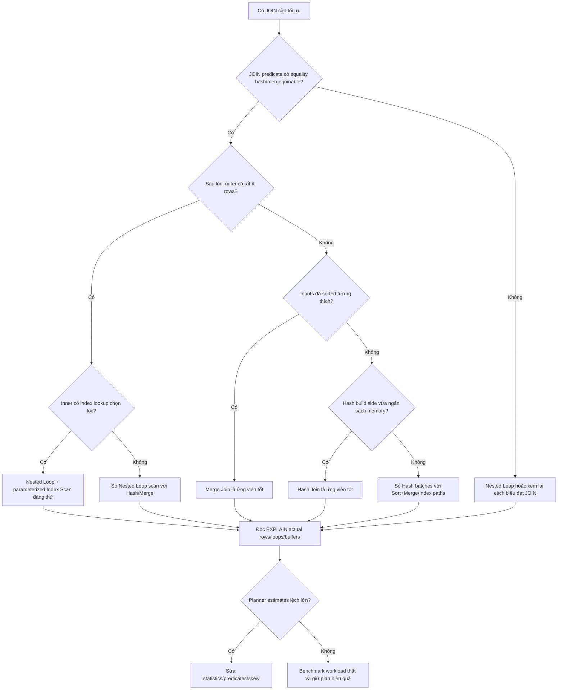

# Nested loop, hash join, merge join và điều kiện lựa chọn trong PostgreSQL

Một câu SQL `JOIN` mô tả **những hàng nào phải được kết hợp**, chứ không ra lệnh PostgreSQL phải kết hợp chúng theo một thuật toán duy nhất. Đối với truy vấn:

```sql
SELECT c.customer_id, c.full_name, o.order_id, o.total_amount
FROM customers AS c
JOIN orders AS o
  ON o.customer_id = c.customer_id
WHERE c.customer_id = 42;
```

PostgreSQL có thể dùng **Nested Loop**, **Hash Join** hoặc **Merge Join** tùy số hàng, thống kê, chỉ mục, phân phối dữ liệu, điều kiện lọc và chi phí ước tính. Một thuật toán tốt ở bộ dữ liệu 100 hàng chưa chắc tốt ở 100 triệu hàng; cùng một query với tham số khác cũng có thể dẫn đến plan khác.

Bài học thuộc chương **Kế hoạch truy vấn** của module *Database Engine Relational PostgreSQL*. Trọng tâm không chỉ là định nghĩa ba thuật toán, mà là **điều kiện PostgreSQL có thể chọn chúng, cách đọc bằng chứng trong EXPLAIN và cách cải thiện kế hoạch khi ước lượng sai**.

Ba ý cần giữ ngay từ đầu:

- **Nested Loop:** với mỗi hàng của nhánh ngoài, tìm những hàng tương ứng ở nhánh trong. Rất hiệu quả khi số lần lặp nhỏ và lookup đầu trong rẻ, đặc biệt nhờ parameterized index scan.
- **Hash Join:** xây hash table từ một phía, dò phía còn lại bằng khóa băm. Thường hữu ích cho các phép nối equality trên lượng dữ liệu tương đối lớn, nhưng cần bộ nhớ và có thể chia batch/ghi tạm ra đĩa.
- **Merge Join:** đọc hai luồng đã được sắp theo join keys rồi ghép các hàng cùng khóa. Đáng cân nhắc khi đầu vào đã có thứ tự hoặc chi phí sort được bù bởi chi phí join.

**Không có quy tắc “bảng nhỏ luôn Nested Loop”, “bảng lớn luôn Hash Join”, “có index luôn Merge Join”.** PostgreSQL chọn kế hoạch toàn cục từ những phương án hợp lệ dựa trên mô hình chi phí.

## 1. JOIN trong SQL khác với thuật toán thực thi

`INNER JOIN`, `LEFT JOIN`, `RIGHT JOIN`, `FULL JOIN`, `CROSS JOIN`, `EXISTS` và `NOT EXISTS` biểu đạt ý nghĩa SQL. `Nested Loop`, `Hash Join` và `Merge Join` là những **plan nodes/algorithms** mà executor có thể sử dụng để thực thi các mối quan hệ đó.

Ví dụ:

```sql
SELECT c.customer_id, o.order_id
FROM customers c
JOIN orders o ON o.customer_id = c.customer_id;
```

Hai kết quả có thể đến từ các plan khác nhau nhưng vẫn phải thỏa cùng ngữ nghĩa kết quả SQL.

```text
             SQL declarative JOIN
                      │
                      ▼
              Parser / Rewriter
                      │
                      ▼
             Planner / Optimizer
            /          |           \
           ▼           ▼            ▼
      Nested Loop   Hash Join    Merge Join
           \           |            /
            \          |           /
                      ▼
                  Executor
                      │
                      ▼
                Result rows
```

Planner không chỉ chọn join algorithm; nó còn chọn **join order**, index/scan paths, pushdown filters, sort, aggregate, parallel workers và thứ tự phục vụ `ORDER BY`/`LIMIT`.

### 1.1. Trước khi hỏi loại JOIN, hỏi những câu này

1. **Truy vấn cần trả bao nhiêu hàng?** Một khách và sáu đơn hàng hay toàn bộ lịch sử?
2. **Join predicate là gì?** `=`, khoảng `<`/`>`, hay một điều kiện phức tạp?
3. **Đã lọc được mỗi phía bao nhiêu hàng?** `WHERE`/partition pruning có làm tập đầu vào nhỏ đi không?
4. **Có index hỗ trợ probe theo join key không?** Nhất là ở nhánh trong Nested Loop.
5. **Dữ liệu đã có thứ tự cần thiết chưa?** Index scans hoặc sorted upstream có thể giúp Merge Join.
6. **Hash table có vừa bộ nhớ không?** Tập build lớn có thể khiến Hash Join phải batch/spill.
7. **Kết quả có cần sort, group, limit không?** Một join plan cung cấp thứ tự có thể có lợi ở bước sau.
8. **Ước lượng hàng có đúng không?** Sai cardinality thường dẫn đến chọn join algorithm sai.

## 2. Bảng so sánh nhanh

| Đặc điểm | Nested Loop | Hash Join | Merge Join |
|---|---|---|---|
| Ý tưởng | Lặp hàng ngoài, tìm hàng trong | Build hash table rồi probe | Duyệt hai luồng theo thứ tự khóa |
| Điều kiện join | Linh hoạt, kể cả non-equality | Cần ít nhất một điều kiện hash-joinable, thường `=` | Cần ít nhất một điều kiện merge-joinable, thường `=` |
| Index hữu ích | Index ở phía trong rất giá trị | Không bắt buộc | Index cung cấp thứ tự có thể hữu ích |
| Cần sắp xếp input | Không bắt buộc | Không | Có thứ tự tương thích ở hai phía |
| Chi phí chuẩn bị | Nhỏ nếu probe rẻ | Xây hash table | Sort nếu chưa sắp |
| Số hàng phía ngoài nhỏ | Thường phù hợp | Có overhead build | Có overhead sort/merge |
| Hai đầu vào lớn, equality | Có thể đắt nếu probe lặp nhiều | Thường là ứng viên tốt | Thường là ứng viên nếu thứ tự rẻ |
| Hash memory và batches | Không áp dụng | Quan trọng | Không dựng hash table |
| Sort memory/temp I/O | Có thể cần cho bước khác | Có thể cần cho bước khác | Có thể cần để chuẩn bị input |
| Khai thác thứ tự cho ORDER BY | Không cung cấp thứ tự key theo bản chất | Không | Có thể giữ pathkeys hữu ích |
| Non-equi/cross join | Có thể hỗ trợ | Không nếu thiếu hash-joinable condition | Không nếu thiếu merge-joinable condition |
| FULL OUTER JOIN | Không dùng Nested Loop thông thường | Có thể | Có thể |

Bảng nêu xu hướng, **không phải bảng luật cứng**. Với một phần join keys phù hợp, PostgreSQL có thể sử dụng Hash/Merge cho điều kiện equality rồi kiểm tra thêm các điều kiện khác bằng `Join Filter`.

## 3. Phạm vi dữ liệu lab

Tạo ba bảng minh họa trong schema riêng:

- `customer`: khách hàng.
- `sales_order`: đơn hàng, mỗi đơn thuộc một khách.
- `payment`: thanh toán, một số đơn có bản ghi thanh toán.

Mục tiêu là có bộ dữ liệu đủ lớn để so sánh plan mà không dựa vào schema của dự án khác. Tất cả SQL tác động dữ liệu trong bài chỉ nên chạy trên **database thử nghiệm**.

```sql
CREATE SCHEMA IF NOT EXISTS demo_join_plan;

CREATE TABLE demo_join_plan.customer (
    customer_id INTEGER PRIMARY KEY,
    full_name TEXT NOT NULL,
    region_code TEXT NOT NULL,
    active BOOLEAN NOT NULL
);

CREATE TABLE demo_join_plan.sales_order (
    order_id BIGINT PRIMARY KEY,
    customer_id INTEGER NOT NULL REFERENCES demo_join_plan.customer(customer_id),
    order_status TEXT NOT NULL,
    ordered_at TIMESTAMPTZ NOT NULL,
    total_amount NUMERIC(12, 2) NOT NULL CHECK (total_amount >= 0)
);

CREATE TABLE demo_join_plan.payment (
    payment_id BIGINT PRIMARY KEY,
    order_id BIGINT NOT NULL UNIQUE REFERENCES demo_join_plan.sales_order(order_id),
    payment_status TEXT NOT NULL,
    paid_amount NUMERIC(12, 2) NOT NULL CHECK (paid_amount >= 0)
);
```

Các khóa chính và unique constraint tạo index thích hợp. Foreign key từ `sales_order.customer_id` đến `customer.customer_id` **không tự tạo index ở cột tham chiếu**; ta sẽ thêm index riêng cho các ví dụ Nested Loop.

### 3.1. Sinh dữ liệu khách

```sql
INSERT INTO demo_join_plan.customer
    (customer_id, full_name, region_code, active)
SELECT
    g,
    'Customer ' || g::text,
    CASE g % 4
        WHEN 0 THEN 'HN'
        WHEN 1 THEN 'HCM'
        WHEN 2 THEN 'DN'
        ELSE 'CT'
    END,
    g % 9 <> 0
FROM generate_series(1, 20000) AS g;
```

Có 20.000 khách, chia tương đối đều theo bốn vùng để minh họa. Dữ liệu không phải phân phối thị trường thật.

### 3.2. Sinh đơn hàng

```sql
INSERT INTO demo_join_plan.sales_order
    (order_id, customer_id, order_status, ordered_at, total_amount)
SELECT
    g::bigint,
    ((g - 1) % 20000) + 1,
    CASE g % 3
        WHEN 0 THEN 'PAID'
        WHEN 1 THEN 'NEW'
        ELSE 'CANCELLED'
    END,
    TIMESTAMPTZ '2026-01-01 00:00:00+00'
        + (g % 250) * INTERVAL '1 day',
    (10 + g % 900)::numeric(12, 2)
FROM generate_series(1, 120000) AS g;
```

Với schema sạch, mỗi khách có khoảng sáu đơn. Số hàng được chọn có chủ đích để lab chạy được trên máy học tập; không dùng các số đo từ lab để suy ra latency production.

### 3.3. Sinh thanh toán

```sql
INSERT INTO demo_join_plan.payment
    (payment_id, order_id, payment_status, paid_amount)
SELECT
    order_id,
    order_id,
    'SUCCESS',
    total_amount
FROM demo_join_plan.sales_order
WHERE order_id % 3 = 0;
```

Khoảng một phần ba đơn có payment. Dữ liệu cố ý mang quan hệ chặt giữa `order_status` và việc có payment, tạo cơ hội bàn về ước lượng cardinality và tương quan.

### 3.4. Index phục vụ lookup và thứ tự

```sql
CREATE INDEX idx_order_customer_id
ON demo_join_plan.sales_order (customer_id);

CREATE INDEX idx_order_customer_time
ON demo_join_plan.sales_order (customer_id, ordered_at DESC);

CREATE INDEX idx_order_status
ON demo_join_plan.sales_order (order_status);

ANALYZE demo_join_plan.customer;
ANALYZE demo_join_plan.sales_order;
ANALYZE demo_join_plan.payment;
```

Hai index `idx_order_customer_id` và `idx_order_customer_time` có prefix key gần nhau; trong lab giữ để quan sát. Trên production phải xem có cần cả hai không, vì index dư làm tăng chi phí ghi/WAL.

### 3.5. Kiểm tra số hàng

```sql
SELECT
    (SELECT COUNT(*) FROM demo_join_plan.customer) AS customers,
    (SELECT COUNT(*) FROM demo_join_plan.sales_order) AS orders,
    (SELECT COUNT(*) FROM demo_join_plan.payment) AS payments;
```

Trong bộ dữ liệu mới: 20.000 khách, 120.000 đơn và 40.000 payment. Nếu số khác, kiểm tra bạn có lặp setup hoặc đã cập nhật bảng trong những bài tập trước.

## 4. Nested Loop: lặp hàng ngoài, tra cứu hàng trong

Nested Loop có mô hình cơ bản:

```text
for each outer_row in outer_input:
    for each inner_row matching outer_row in inner_input:
        if join_condition(outer_row, inner_row):
            emit joined_row
```

Một mô hình ngây thơ có thể so mọi cặp hàng, tốn rất nhiều lần đánh giá. Nhưng PostgreSQL không nhất thiết scan lại toàn bộ inner table. Nhánh trong có thể là **Index Scan nhận tham số từ hàng ngoài**, giúp mỗi lần lặp chỉ lấy vài ứng viên.

### 4.1. Hình dung Nested Loop có Index Scan

```text
Outer: customer_id=42 (1 row)
               │
               ▼
         Nested Loop
               │
               ├── Outer customer row
               │
               └── Inner Index Scan
                    order.customer_id = 42
                              │
                              ▼
                       ~6 order rows

1 outer row × 1 small indexed lookup.
```

Với 1 khách và khoảng 6 đơn, Nested Loop có thể rất hiệu quả.

### 4.2. SQL minh họa

```sql
EXPLAIN (ANALYZE, BUFFERS)
SELECT c.customer_id, c.full_name, o.order_id, o.total_amount
FROM demo_join_plan.customer AS c
JOIN demo_join_plan.sales_order AS o
  ON o.customer_id = c.customer_id
WHERE c.customer_id = 42;
```

Một plan **có thể** trông như:

```text
Nested Loop
  -> Index Scan using customer_pkey on customer c
       Index Cond: (customer_id = 42)
  -> Index Scan using idx_order_customer_id on sales_order o
       Index Cond: (customer_id = c.customer_id)
```

Đây là sơ đồ giả định, không phải một output bảo đảm cho mọi phiên bản/trạng thái thống kê.

## 5. Parameterized Index Scan: điểm mạnh của Nested Loop

Một *parameterized path* là đường truy cập phía trong có điều kiện phụ thuộc giá trị lấy từ phía ngoài.

```text
Outer row 1: customer_id=42
    → inner index probe WHERE customer_id=42
Outer row 2: customer_id=43
    → inner index probe WHERE customer_id=43
Outer row 3: customer_id=44
    → inner index probe WHERE customer_id=44
```

Mỗi probe có thể dùng B-tree index trên `sales_order(customer_id)` để lấy đúng những đơn liên quan.

### 5.1. Có index trên inner không đồng nghĩa chắc chắn dùng index

Một Index Scan cần có điều kiện indexable và chi phí hợp lý. Nếu outer có 100.000 rows và mỗi probe làm random heap reads lớn, tổng chi phí có thể vượt Hash Join quét tuần tự hai bảng.

Ngược lại, nếu outer chỉ có một hàng, chi phí khởi tạo hash table của toàn `customer` hay `sales_order` có thể không hợp lý.

### 5.2. Số vòng lặp thật rất quan trọng

Đọc `loops` trong EXPLAIN:

```text
Nested Loop
  -> ... outer ... (actual rows=100 loops=1)
  -> Index Scan ... (actual rows=6 loops=100)
```

Với sơ đồ này, inner scan chạy **100 lần**. `actual rows=6` ở inner là mức trung bình mỗi lần node thực thi theo cách EXPLAIN báo, không phải 6 hàng tổng cộng.

Để hiểu lượng công việc, phải xét `actual rows × loops` (và đặc điểm phép làm tròn/parallel execution), không chỉ nhìn riêng `rows`.

### 5.3. Nested Loop có thể dùng Memoize

Các PostgreSQL phiên bản hiện đại hỗ trợ node `Memoize` trong một số parameterized Nested Loop plans. Nếu nhiều outer rows có cùng join key, PostgreSQL có thể cache kết quả inner probe để giảm số lookup lặp.

```text
Nested Loop
  -> Outer Scan
  -> Memoize
       Cache Key: outer.customer_id
       -> Index Scan ...
```

Đọc `Hits`, `Misses`, `Evictions`, `Memory Usage` khi node này xuất hiện. Không coi Memoize là mặc định của mọi Nested Loop và không nhầm cache kết quả lookup với một index mới.

## 6. Nested Loop không bắt buộc điều kiện bằng

Nested Loop có thể đánh giá nhiều dạng predicate, ví dụ:

```sql
SELECT a.order_id, b.order_id
FROM demo_join_plan.sales_order AS a
JOIN demo_join_plan.sales_order AS b
  ON a.total_amount < b.total_amount
WHERE a.order_id <= 3
  AND b.order_id <= 100;
```

Điều kiện `a.total_amount < b.total_amount` không phải equality. Nested Loop có thể đánh giá từng cặp ứng viên với `Join Filter` nếu không có một phương án chuyên biệt tốt hơn.

Hash Join và Merge Join thông thường cần ít nhất một điều kiện equality thuộc loại hash-joinable/merge-joinable để sử dụng làm khóa cốt lõi.

### 6.1. CROSS JOIN và phép ghép mọi cặp

```sql
SELECT a.customer_id, b.customer_id
FROM demo_join_plan.customer AS a
CROSS JOIN demo_join_plan.customer AS b
WHERE a.customer_id <= 3
  AND b.customer_id <= 4;
```

Kết quả có 3 × 4 = 12 cặp trong ví dụ. Không có join key để hash/merge theo equality; Nested Loop là một cách thực thi tự nhiên.

**Đừng dùng CROSS JOIN không điều kiện lọc trên hai bảng lớn** rồi ngạc nhiên vì hàng kết quả tăng theo tích số lượng hàng.

## 7. Khi Nested Loop trở nên đắt

Giả sử:

- Outer có 50.000 rows.
- Mỗi lần tìm trong inner tốn một số index/heap page accesses.
- Truy vấn phải thực hiện hàng chục nghìn lookup riêng.

Tổng chi phí có thể bị thống trị bởi số vòng lặp và random I/O.

```text
Outer: 50,000 rows
        │
        ▼
Nested Loop
        │
        └── 50,000 parameterized probes
                  │
                  ▼
              Random heap I/O
```

Số lần truy cập không bằng chính xác số outer rows vì index cache, visibility, heap layout và Memoize có thể thay đổi cost. Nhưng **outer cardinality nhân chi phí inner path** là hướng tư duy đúng.

### 7.1. Nested Loop trên tập lớn không luôn sai

Nếu inner probe nằm hoàn toàn trong cache, trả rất ít rows hoặc giá trị outer lặp lại và được Memoize, Nested Loop vẫn có thể cạnh tranh.

Trái lại, Nested Loop trên tập nhỏ có thể vẫn tệ nếu inner không có điều kiện indexable và bị scan lại toàn bảng.

### 7.2. Materialize ở inner

Planner có thể thêm `Materialize` để tránh thực thi lại một nhánh inner đắt tiền và lưu đầu ra cho các lần lặp:

```text
Nested Loop
  -> Outer Scan
  -> Materialize
       -> Seq Scan on inner_table
```

Materialize không nhất thiết đồng nghĩa kết quả luôn vừa RAM; node có thể dùng temp storage theo nhu cầu. Nó cũng không biến Nested Loop thành Hash Join.

## 8. Nested Loop với LATERAL: Top-N theo từng nhóm

Một trường hợp Nested Loop thường tự nhiên là truy vấn *mỗi khách lấy ba đơn mới nhất*:

```sql
EXPLAIN (ANALYZE, BUFFERS)
SELECT
    c.customer_id,
    c.full_name,
    o.order_id,
    o.ordered_at
FROM demo_join_plan.customer AS c
LEFT JOIN LATERAL (
    SELECT
        so.order_id,
        so.ordered_at
    FROM demo_join_plan.sales_order AS so
    WHERE so.customer_id = c.customer_id
    ORDER BY so.ordered_at DESC, so.order_id DESC
    LIMIT 3
) AS o ON TRUE
WHERE c.customer_id BETWEEN 1 AND 20
ORDER BY c.customer_id, o.ordered_at DESC;
```

Nhánh `LATERAL` phụ thuộc `c.customer_id`. Index `(customer_id, ordered_at DESC)` giúp tra cứu theo khách và thời gian; PostgreSQL có thể cần xử lý tiebreaker `order_id` thêm tùy đường truy cập.

### 8.1. Vì sao TOP-N có lợi cho Nested Loop?

Nếu chỉ 20 khách, ta có thể làm 20 index probes và lấy tối đa 3 đơn mỗi người. Không cần phải đọc 120.000 đơn rồi tính row_number cho tất cả khách trong mọi kế hoạch.

Nếu chọn **toàn bộ 20.000 khách**, phải cân nhắc số index probes và phương án xử lý toàn bộ dữ liệu. Kỹ thuật tốt với 20 khách không phải bảo đảm tốt với 20 triệu khách.

### 8.2. LATERAL không luôn buộc đúng một plan

`LATERAL` thể hiện phụ thuộc trong SQL; PostgreSQL có thể tối ưu/rewrite trong một số dạng có thể giải tương đương. Nhưng mẫu correlated Top-N với `ORDER BY ... LIMIT` là ví dụ trực quan cho parameterized inner path.

## 9. Hash Join: build rồi probe

Hash Join thường có hai pha logic:

1. **Build:** đọc một nhánh, tính hash của join keys và xây hash table chứa thông tin cần thiết.
2. **Probe:** đọc nhánh còn lại, tính hash tương ứng và tra các ứng viên trong hash table, rồi xác nhận điều kiện join.

```text
           Hash Join on o.customer_id = c.customer_id

Customers (~20k)                          Orders (~120k)
      │                                         │
      ▼                                         ▼
 Build hash table                           Probe keys
      │                                         │
      └────────────► Hash Join ◄────────────────┘
                             │
                             ▼
                        Joined rows
```

Bên build thường được chọn theo chi phí/kích thước ước tính, không nhất thiết là bảng xuất hiện bên trái hay bên phải của câu SQL. Plan cho biết nhánh nào đi qua node `Hash`.

### 9.1. SQL phù hợp

```sql
EXPLAIN (ANALYZE, BUFFERS)
SELECT c.region_code, COUNT(*) AS paid_order_count
FROM demo_join_plan.sales_order AS o
JOIN demo_join_plan.customer AS c
  ON c.customer_id = o.customer_id
WHERE o.order_status = 'PAID'
GROUP BY c.region_code
ORDER BY c.region_code;
```

Vì cần nối nhiều đơn với khách và equality key có hash operator thích hợp, Hash Join thường là một phương án đáng cân nhắc.

Plan **minh họa**:

```text
HashAggregate
  Group Key: c.region_code
  -> Hash Join
       Hash Cond: (o.customer_id = c.customer_id)
       -> Seq Scan on sales_order o
            Filter: (order_status = 'PAID')
       -> Hash
            -> Seq Scan on customer c
```

Planner thực tế còn có thể dùng `GroupAggregate`, `Index Scan` hoặc một join algorithm khác tùy điều kiện và thống kê.

## 10. Hash Join có cần Hash index không?

**Không.** Đây là phân biệt bắt buộc:

- **Hash index:** object tồn tại lâu dài trong database, tạo qua `CREATE INDEX ... USING hash`, hỗ trợ equality lookup trên một index key.
- **Hash Join:** thuật toán executor xây hash table tạm trong phạm vi query, dùng để kết hợp hai tập dữ liệu.

```sql
-- Hash Join vẫn có thể được chọn dù không có index này:
CREATE INDEX idx_customer_id_hash
ON demo_join_plan.customer
USING hash (customer_id);
```

Trong lab, câu DDL trên chỉ là minh họa, **không cần chạy** vì `customer_id` đã là PK B-tree. Thêm Hash index trùng mục đích có thể chỉ tăng write overhead.

```text
Hash Join plan:
   Hash
      -> Seq Scan on customer

Không có node "Index Scan using ...hash_index".
```

Đừng kết luận “tôi cần CREATE HASH INDEX để Hash Join chạy nhanh”. Hash Join thường chạy trên **Seq Scan** hay các scan paths khác, xây một hash table mới để phục vụ query đó.

### 10.1. HashAggregate cũng khác Hash Join

`HashAggregate` dùng hash table để nhóm/tổng hợp dữ liệu, không phải thuật toán ghép hai quan hệ. Một plan có cả `Hash Join` và `HashAggregate` là hai pha riêng.

## 11. Điều kiện để Hash Join có thể được chọn

Thông thường phải có ít nhất một điều kiện join dùng toán tử **hash-joinable equality**, ví dụ:

```sql
ON o.customer_id = c.customer_id
```

Các kiểu dữ liệu cần có semantics equality/hash tương thích với operator family. PostgreSQL có catalog đánh dấu toán tử phù hợp, không phải mọi toán tử tự định nghĩa đều hashjoinable.

Nếu chỉ có:

```sql
ON a.amount < b.amount
```

không có khóa equality để hash theo cách thông thường.

### 11.1. Equality kèm điều kiện khác

```sql
SELECT o.order_id, p.payment_id
FROM demo_join_plan.sales_order AS o
JOIN demo_join_plan.payment AS p
  ON p.order_id = o.order_id
 AND p.paid_amount <= o.total_amount;
```

`p.order_id = o.order_id` có thể làm `Hash Cond`. `p.paid_amount <= o.total_amount` có thể được áp qua `Join Filter` sau khi tìm cặp cùng khóa.

```text
Hash Join
  Hash Cond: (p.order_id = o.order_id)
  Join Filter: (p.paid_amount <= o.total_amount)
```

Plan chỉ minh họa. `Join Filter` khác `Filter` trên riêng một input: nó được đánh giá trên **cặp hàng join ứng viên**.

### 11.2. IS NOT DISTINCT FROM cần xác minh

`IS NOT DISTINCT FROM` dùng semantics bằng nhau có xét NULL, nhưng không nên giả định planner luôn nhận dạng nó là hashjoinable equality tương đương `=` trong mọi phiên bản/kiểu dữ liệu. Đọc `EXPLAIN` của query thật.

## 12. Hash table có thể tốn nhiều bộ nhớ

Một Hash Join cần dung lượng cho hash table. Nếu dữ liệu build nhỏ, có thể vừa trong bộ nhớ. Nếu quá lớn, executor có thể chia **batches** và dùng temp files để xử lý.

Các tham số thường liên quan:

```sql
SHOW work_mem;
SHOW hash_mem_multiplier;
```

Trong PostgreSQL hiện đại, giới hạn bộ nhớ cho hoạt động hash thường liên quan đến:

\[
\text{hash memory budget} \approx
\texttt{work\_mem} \times \texttt{hash\_mem\_multiplier}
\]

Đây là cách tư duy về ngân sách, **không phải một bảo đảm hash table luôn sử dụng đúng một lượng byte** hay mỗi query chỉ có một hash table.

### 12.1. Cách đọc Buffers, Buckets, Batches

Một plan có thể báo:

```text
Hash
  Buckets: 32768  Batches: 1  Memory Usage: 1600kB
```

- `Buckets`: số bucket của hash table.
- `Batches: 1`: không phải chia nhiều batches trong ví dụ.
- `Memory Usage`: thống kê bộ nhớ của node theo phiên bản/đường chạy.

Nếu `Batches > 1`, có thể có xử lý dữ liệu thành nhiều đợt và temp I/O. Xem `Buffers: temp read/written` cùng node/plan để xác minh tác động.

### 12.2. Nâng work_mem không phải thuốc chữa chung

Tăng `work_mem` có thể giảm spill cho một join/sort cụ thể, nhưng:

- Một query có thể có nhiều hash/sort nodes.
- Nhiều query chạy đồng thời có thể nhân tổng nhu cầu RAM.
- Parallel workers cũng tác động đến tài nguyên.
- Một số truy vấn vẫn spill vì đầu vào quá lớn hoặc phân phối lệch.
- Planner có thể thay plan khi thông số chi phí/bộ nhớ thay đổi.

Không đặt `work_mem = '1GB'` toàn hệ thống chỉ để chữa một Hash Join. Kiểm thử session-local/công việc cụ thể và quan sát memory/throughput toàn hệ thống.

## 13. Hash Join và dữ liệu lệch/skew

Nếu join key phân phối không đều, ví dụ hàng triệu đơn đều thuộc vài khách rất lớn, một số hash buckets có thể đông ứng viên.

Hash Join cần kiểm tra cặp khóa thực sự phù hợp, không thể coi cùng bucket nghĩa là chắc chắn bằng nhau.

Một giá trị join key xuất hiện nhiều lần ở cả hai phía sẽ tạo nhiều **duplicate matches**, có thể làm kết quả phát nở mạnh:

```text
Phía A: 1000 hàng có key='X'
Phía B: 500 hàng có key='X'

INNER JOIN trên key
  → 1000 × 500 = 500.000 cặp hàng
```

Đây là vấn đề **join cardinality**, không phải chỉ hash collision. Đổi sang Merge hay Nested Loop cũng không làm biến mất 500.000 hàng kết quả đúng theo SQL.

### 13.1. Kiểm tra phân phối khóa

```sql
SELECT customer_id, COUNT(*) AS order_count
FROM demo_join_plan.sales_order
GROUP BY customer_id
ORDER BY order_count DESC
LIMIT 20;
```

Nếu dữ liệu thật có skew lớn, cần xem thống kê MCV, độ chính xác estimates, index và việc query có cần tất cả các hàng kết quả không.

### 13.2. Hai bên cùng duplicate không thể “JOIN nhanh như lookup duy nhất”

Trước khi tối ưu thuật toán, hãy hỏi business rule có thực sự cần nối tất cả cặp không, hay chỉ cần:

- Có tồn tại hay không (`EXISTS`).
- Đếm số đơn.
- Lấy bản ghi mới nhất theo mỗi khách.
- Lấy một bản ghi được chọn rõ.

Viết lại query đúng nghĩa nghiệp vụ có thể giảm cardinality đáng kể hơn việc đổi join algorithm.

## 14. Parallel Hash Join

Với dữ liệu lớn và điều kiện cho phép parallelism, PostgreSQL có thể chọn **Parallel Hash Join** hoặc các kế hoạch parallel khác.

Một plan minh họa:

```text
Gather
  Workers Planned: 2
  -> Parallel Hash Join
       Hash Cond: (...)
       -> Parallel Seq Scan on ...
       -> Parallel Hash
            -> Parallel Seq Scan on ...
```

Parallel Hash cho phép workers phối hợp xây/đọc hash table theo cơ chế phù hợp; không phải mọi `Hash Join` xuất hiện dưới `Gather` đều là cùng một loại parallel hash implementation.

### 14.1. Không chỉ nhìn số workers

Hiệu quả còn phụ thuộc:

- Số hàng/bytes mỗi worker xử lý.
- Tốc độ đọc disk, cache.
- Hash build/probe cost.
- Sự mất cân bằng do skew.
- Chi phí `Gather`.
- Giới hạn parallel workers và tài nguyên toàn cluster.
- Truy vấn có hàm/operation `PARALLEL SAFE` không.

`EXPLAIN (ANALYZE, BUFFERS)` có thể hiển thị `Workers Planned` và `Workers Launched`; hai số không nhất thiết bằng nhau nếu tài nguyên hạn chế.

## 15. Merge Join: hai luồng đã sắp theo join key

Merge Join tận dụng **thứ tự tương thích** của hai input streams.

```text
Customers (sorted customer_id)   Orders (sorted customer_id)
           1                              1
           2                              1
           3                              2
           4                              2
           5                              4
           │                              │
           ▼                              ▼
          Merge: advance key nhỏ hơn,
          ghép các hàng khi key bằng nhau.
                        │
                        ▼
                   Joined rows
```

Đọc theo thứ tự giúp tránh dò từng cặp không cần thiết. Nhưng **phải có thứ tự phù hợp** trước hoặc planner phải tạo sort.

### 15.1. SQL phù hợp

```sql
EXPLAIN (ANALYZE, BUFFERS)
SELECT c.customer_id, o.order_id
FROM demo_join_plan.customer AS c
JOIN demo_join_plan.sales_order AS o
  ON o.customer_id = c.customer_id
ORDER BY c.customer_id, o.order_id;
```

PostgreSQL có thể cân nhắc Merge Join vì equality trên khóa có B-tree và kết quả yêu cầu thứ tự có liên quan. Nhưng `ORDER BY c.customer_id, o.order_id` yêu cầu thứ tự thứ cấp `order_id` mà một Merge Join trên `customer_id` **không tự cung cấp đầy đủ**, nên có thể vẫn cần sort/incremental sort.

### 15.2. Plan minh họa

```text
Merge Join
  Merge Cond: (o.customer_id = c.customer_id)
  -> Index Scan using idx_order_customer_id on sales_order o
  -> Index Scan using customer_pkey on customer c
```

Trong plan này, hai nhánh đã có thứ tự theo `customer_id` từ B-tree scans. Nếu điều kiện khác, planner có thể chọn `Sort` trên một hoặc cả hai phía.

Không mặc định output ở trên chắc chắn xảy ra; PostgreSQL có thể thấy Hash Join + Sort rẻ hơn.

## 16. Điều kiện để Merge Join có thể được chọn

Cần một phép join dùng toán tử có ngữ nghĩa phù hợp với **merge join** và một cách tạo hai input **sorted theo cùng join keys/collations/opfamilies tương thích**.

Với:

```sql
ON a.join_key = b.join_key
```

PostgreSQL thường có thể dùng Merge Join trên các kiểu dữ liệu B-tree-sortable thông dụng.

Nếu chỉ có:

```sql
ON a.x < b.x
```

không có khóa equality mergejoinable tương ứng để thực hiện Merge Join thông thường.

### 16.1. Sort keys phải tương thích

Không đủ để mỗi phía “đã sắp theo một thứ gì đó”. Thứ tự phải phù hợp với join equality semantics, operator families và collation. Với text, collation của query/index có thể ảnh hưởng khả năng dùng sorted path.

### 16.2. Dữ liệu đã sorted từ đâu?

- B-tree Index Scan có thứ tự phù hợp.
- Sort node.
- Một bước upstream cung cấp pathkeys thích hợp.
- Một số kế hoạch tổ hợp đã duy trì thứ tự trên join keys.

Không có yêu cầu **phải có B-tree index** để Merge Join. PostgreSQL có thể quét bảng rồi Sort hai phía trước khi merge.

### 16.3. Merge Join có lợi nếu chi phí Sort được chia sẻ

Nếu query sau join còn:

```sql
ORDER BY c.customer_id
```

thì kế hoạch Merge Join có thể cung cấp thứ tự hữu ích và tránh một phần Sort cuối, tùy các keys và join semantics.

Nếu kết quả không cần thứ tự và hai phía đều chưa sorted, Hash Join có thể rẻ hơn vì không phải sort toàn bộ dữ liệu. Nhưng đây chỉ là xu hướng, **không phải bất đẳng thức chi phí cố định**.

## 17. Chi phí Sort trong Merge Join

Khi input chưa có thứ tự, planner có thể tạo:

```text
Merge Join
  Merge Cond: (...)
  -> Sort
       Sort Key: a.key
       -> Seq Scan on a
  -> Sort
       Sort Key: b.key
       -> Seq Scan on b
```

`Sort` có thể chạy trong bộ nhớ hoặc spill sang temp files.

Đọc EXPLAIN:

```text
Sort Method: quicksort  Memory: ...
```

hoặc:

```text
Sort Method: external merge  Disk: ...
```

Nếu Sort spill, xem `Buffers: temp read/written` và workload. Không tự kết luận Merge Join sai chỉ vì thấy Sort; cần so với Hash/Nested Loop và những sort có thể phải chạy **sau** join ở các phương án khác.

### 17.1. work_mem tác động cả Sort

`work_mem` thường quyết định ngân sách cho mỗi sort operation. Nó cũng liên quan Hash Join qua `hash_mem_multiplier`. Nếu tăng `work_mem` để cải thiện một Merge Join, phải xem nhiều sort/hash nodes và mức concurrency, không nhân giá trị này theo một query duy nhất.

### 17.2. Incremental Sort

Một số phiên bản PostgreSQL có `Incremental Sort` khi dữ liệu đã sorted theo prefix nhưng cần thêm keys. Điều này có thể giảm chi phí sort so với sắp toàn bộ, tùy phân phối nhóm.

`Incremental Sort` là node sắp xếp, không phải “Merge Join version mới”. Nó có thể xuất hiện trước/sau join theo pathkeys của query.

## 18. Duplicates trong Merge Join

Merge Join không chỉ ghép đúng một hàng mỗi key. Nếu cùng key xuất hiện nhiều lần ở cả hai bên, executor phải trả **mọi cặp phù hợp** theo SQL.

Ví dụ:

```text
A: (key=7, id=A1), (key=7, id=A2)
B: (key=7, id=B1), (key=7, id=B2), (key=7, id=B3)

INNER JOIN:
  A1-B1, A1-B2, A1-B3,
  A2-B1, A2-B2, A2-B3
= 6 hàng
```

Merge Join có cơ chế đánh dấu/quay lại trong những trường hợp cần để tạo đầy đủ cặp duplicate. Một plan có thể có `Materialize` để hỗ trợ rescanning input phù hợp.

**Merge Join không làm mất duplicate** hoặc tự chọn đại diện. Nếu business rule chỉ muốn một record mỗi key, phải viết SQL tương ứng.

## 19. Merge Join và Index Scan: không phải lúc nào dùng index cũng rẻ hơn

B-tree index trên `(customer_id, order_id)` có thể cung cấp thứ tự cần thiết, nhưng Index Scan có thể phải đọc heap theo thứ tự rải rác và tốn random I/O.

Đôi khi:

```text
Seq Scan → Sort → Merge Join
```

rẻ hơn:

```text
Index Scan → Merge Join
```

Đặc biệt khi cần đọc phần lớn bảng. Planner ước tính chi phí path hoàn chỉnh, không chỉ số node.

### 19.1. Có index nhưng không chắc Merge Join

```sql
SELECT c.customer_id, o.order_id
FROM demo_join_plan.customer AS c
JOIN demo_join_plan.sales_order AS o
  ON c.customer_id = o.customer_id;
```

Hai bảng đều có index theo `customer_id`, nhưng Hash Join vẫn có thể được chọn vì build 20.000 customers và scan 120.000 orders hiệu quả hơn các ordered heap scans.

## 20. So sánh mô hình chi phí định tính

Để hình dung, gọi:

- `N`: số hàng đầu ngoài.
- `M`: số hàng đầu trong.
- `P`: chi phí một lần parameterized inner lookup.
- `S(X)`: chi phí sort X hàng.
- `H(X)`: chi phí build/probe hash trên X hàng.

Một Nested Loop **scan toàn bộ inner** có thể tốn xấp xỉ số phép xét cặp:

\[
O(N \times M)
\]

Nếu có index probe chọn lọc, chi phí có thể gần:

\[
\text{cost}_{NL} \approx
\text{cost}_{outer} + N \times P
\]

Hash Join lý tưởng ở dữ liệu vừa bộ nhớ thường có xu hướng tuyến tính theo tổng input rows:

\[
O(N + M)
\]

nhưng còn hash collisions, output rows, cache và temp I/O khi spill.

Merge Join với **input đã sorted** cũng có pha duyệt gần tuyến tính theo input và output. Nếu phải sort cả hai phía, chi phí sơ bộ có thể gồm:

\[
S(N) + S(M) + O(N+M+\text{output})
\]

Đây là các mô hình tư duy, **không phải công thức chi phí chính xác của PostgreSQL planner**. PostgreSQL dùng nhiều cost parameters, row width, selectivity, startup/total cost và các phương án access path phức tạp.

### 20.1. Output có thể lớn hơn input

Một join nhiều-nhiều tạo `N×M` cặp ở một key duy nhất dù dùng Hash hay Merge. Vì vậy mô hình độ phức tạp phải tính đến **số hàng kết quả phải phát ra**; không thể tạo 1 tỷ output rows trong O(1).

## 21. Startup cost và total cost

EXPLAIN hiển thị chi phí dự kiến:

```text
(cost=STARTUP..TOTAL rows=EST_WIDTH width=...)
```

Ý nghĩa:

- **Startup cost:** chi phí trước khi node có thể bắt đầu phát hàng đầu tiên.
- **Total cost:** chi phí ước tính để xử lý toàn bộ đầu ra của node.
- **rows:** số hàng planner dự đoán.
- **width:** độ rộng trung bình ước tính của hàng tại node.

Nested Loop parameterized có thể có startup cost thấp cho vài hàng đầu. Hash Join cần xây hash table trước khi phát đầu ra thông thường. Merge Join có thể cần Sort đầu vào, kéo startup cost lên.

### 21.1. LIMIT có thể đổi lựa chọn algorithm

```sql
SELECT c.customer_id, o.order_id
FROM demo_join_plan.customer AS c
JOIN demo_join_plan.sales_order AS o
  ON o.customer_id = c.customer_id
LIMIT 5;
```

Planner có thể ưu tiên plan phát vài hàng đầu nhanh mà không cần xử lý toàn bộ quan hệ. Nhưng **không có ORDER BY thì 5 hàng nào được trả không được bảo đảm**.

Thêm `ORDER BY` thay đổi nghĩa và có thể làm planner phải xử lý/sort nhiều hơn trước khi trả 5 hàng.

### 21.2. Đọc chi phí trong bối cảnh

Một Hash Join có total cost thấp hơn Nested Loop nhưng startup cost cao hơn có thể hợp cho báo cáo tổng, trong khi một request `LIMIT 1` có thể chuộng đường phát kết quả sớm hơn.

Đừng so total cost của hai node con khác plan như thể chúng có cùng cardinality và chức năng.

## 22. Cardinality estimation: gốc rễ nhiều plan sai

Planner cần ước lượng:

1. Mỗi base relation có bao nhiêu hàng.
2. Mỗi predicate lọc giữ lại tỷ lệ nào.
3. Join keys có phân phối thế nào.
4. Sau join còn bao nhiêu hàng.
5. Những phép group/sort/limit phía trên cần bao nhiêu tài nguyên.

Nếu planner nghĩ outer có 10 hàng nhưng thực tế có 1 triệu, nó có thể chọn Nested Loop với inner index probe và chịu số lần lặp lớn ngoài dự kiến.

### 22.1. Quan sát Estimated vs Actual rows

```sql
EXPLAIN (ANALYZE, BUFFERS)
SELECT o.order_id
FROM demo_join_plan.sales_order AS o
JOIN demo_join_plan.customer AS c
  ON c.customer_id = o.customer_id
WHERE c.region_code = 'HN';
```

Tại các node, đối chiếu:

```text
rows=5000           -- Planner estimate
actual rows=30000   -- Observed in this run
```

Các số là ví dụ minh họa. Khi chênh lệch lớn, hãy tìm **node đầu tiên** bắt đầu lệch mạnh, không vội quy lỗi cho join algorithm ở cấp cao.

### 22.2. Vì sao estimates có thể sai?

- Statistics chưa được ANALYZE sau nhập/xóa/cập nhật lớn.
- Dữ liệu phân phối lệch, MCV không đại diện.
- Các predicates tương quan trên cùng bảng.
- Tương quan giữa hai bảng mà stats thông thường khó nắm bắt.
- Query dùng expression/function phức tạp.
- Parameters khác nhau qua các lần thực thi.
- Điều kiện join giữa các cột không có thống kê phù hợp.
- Có skew hoặc nhiều-to-many cardinality lớn.
- RLS/partition predicates và các biến thể plan.

**Tối ưu thường bắt đầu từ sửa estimates**, không phải lập tức “bắt PostgreSQL dùng Hash Join”.

## 23. ANALYZE và thống kê cột

Chạy:

```sql
ANALYZE demo_join_plan.customer;
ANALYZE demo_join_plan.sales_order;
ANALYZE demo_join_plan.payment;
```

`ANALYZE` lấy mẫu và lưu thống kê phục vụ planner, không thay đổi dữ liệu nghiệp vụ.

### 23.1. Xem pg_stats

```sql
SELECT
    schemaname,
    tablename,
    attname,
    n_distinct,
    null_frac,
    most_common_vals,
    most_common_freqs,
    correlation
FROM pg_stats
WHERE schemaname = 'demo_join_plan'
  AND tablename IN ('customer', 'sales_order')
  AND attname IN ('customer_id', 'region_code', 'order_status');
```

- `n_distinct` giúp ước lượng số giá trị phân biệt.
- `most_common_vals/freqs` mô tả những giá trị xuất hiện nhiều.
- `null_frac` liên quan tỷ lệ NULL.
- `correlation` giúp ước lượng chi phí index access theo thứ tự vật lý.

Kết quả phụ thuộc mẫu thống kê và thực tế, không phải danh sách giá trị bảo đảm bao quát toàn bộ cột.

### 23.2. Tăng statistics target có điều kiện

```sql
ALTER TABLE demo_join_plan.sales_order
ALTER COLUMN customer_id SET STATISTICS 500;

ANALYZE demo_join_plan.sales_order;
```

Tăng target có thể giúp thống kê chi tiết hơn trên phân phối phức tạp, nhưng cũng tăng thời gian/bộ nhớ lưu stats và planning overhead. Không đặt 10000 cho mọi cột chỉ vì có một query chậm.

### 23.3. Extended statistics không giải quyết mọi join estimate

PostgreSQL hỗ trợ `CREATE STATISTICS` cho tương quan/MCV/n-distinct giữa **các cột trong một bảng**:

```sql
CREATE STATISTICS st_order_status_customer
    (dependencies, mcv, ndistinct)
ON order_status, customer_id
FROM demo_join_plan.sales_order;

ANALYZE demo_join_plan.sales_order;
```

Extended statistics hữu ích ở những trường hợp phù hợp, nhưng **không phải thống kê đa bảng tổng quát tự mô hình hóa mọi tương quan qua JOIN**. Cần kiểm chứng planner có sử dụng loại stats đó cho predicate cụ thể không.

## 24. Join order quan trọng không kém join algorithm

Với ba bảng:

```sql
SELECT
    c.region_code,
    COUNT(*)
FROM demo_join_plan.customer AS c
JOIN demo_join_plan.sales_order AS o
  ON o.customer_id = c.customer_id
JOIN demo_join_plan.payment AS p
  ON p.order_id = o.order_id
WHERE p.payment_status = 'SUCCESS'
  AND c.active
GROUP BY c.region_code;
```

Planner có thể cân nhắc nối `orders ↔ payments` trước, hoặc `customers ↔ orders` trước, rồi nối bảng thứ ba; mỗi phương án có số hàng trung gian khác nhau.

```text
   Plan A                          Plan B
orders ⋈ payment               customer ⋈ orders
       │                              │
       ⋈ customer                     ⋈ payment
       │                              │
       ▼                              ▼
   GROUP BY                        GROUP BY
```

Nếu một điều kiện lọc rất chọn lọc, đặt nó sớm có thể giảm cardinality của các join sau. Tuy nhiên optimizer cần tôn trọng semantics outer joins, lateral dependencies và ràng buộc reorder.

### 24.1. SQL FROM order không luôn là execution join order

Với inner joins, PostgreSQL thường được quyền reorder các joins dựa trên equivalence transformations và cost. Việc viết bảng `customer` đầu tiên trong SQL không chứng minh nó là outer input của Nested Loop hoặc build side của Hash Join.

Đọc plan từ **những node thực tế**.

### 24.2. Search space và GEQO

Các tham số liên quan:

```sql
SHOW join_collapse_limit;
SHOW from_collapse_limit;
SHOW geqo_threshold;
```

Với nhiều bảng, số join orders có thể tăng rất nhanh. PostgreSQL có các cơ chế giới hạn không gian tìm kiếm và **Genetic Query Optimizer (GEQO)** cho những truy vấn nhiều quan hệ.

Điều chỉnh các setting này là kỹ thuật nâng cao. Không thay chúng chỉ để chữa một query hai bảng sai estimates.

## 25. INNER JOIN và ba thuật toán

`INNER JOIN` chỉ trả những cặp hàng phù hợp.

```sql
SELECT o.order_id, c.customer_id
FROM demo_join_plan.sales_order o
INNER JOIN demo_join_plan.customer c
  ON o.customer_id = c.customer_id;
```

Với equality có operator phù hợp, cả ba thuật toán đều là ứng viên hợp lệ:

- Nested Loop dò từng order/customer pair theo input access paths.
- Hash Join build/probe theo `customer_id`.
- Merge Join dùng input sorted theo `customer_id`.

Kết quả logic phải tương đương (trừ khi query không có `ORDER BY` thì **thứ tự hàng không được bảo đảm**). Không dùng thứ tự output để suy ngược join algorithm nếu không đọc EXPLAIN.

## 26. LEFT JOIN và vị trí điều kiện ON/WHERE

`LEFT JOIN` phải giữ hàng từ phía trái kể cả không có match bên phải, chèn NULL cho phía phải khi không match.

```sql
SELECT c.customer_id, o.order_id
FROM demo_join_plan.customer AS c
LEFT JOIN demo_join_plan.sales_order AS o
  ON o.customer_id = c.customer_id;
```

PostgreSQL có thể dùng Nested Loop Left Join, Hash Left Join hoặc Merge Left Join trong điều kiện phù hợp.

### 26.1. Lọc ở ON khác lọc ở WHERE

```sql
-- Giữ tất cả khách, chỉ ghép đơn PAID nếu có:
SELECT c.customer_id, o.order_id
FROM demo_join_plan.customer c
LEFT JOIN demo_join_plan.sales_order o
  ON o.customer_id = c.customer_id
 AND o.order_status = 'PAID';
```

Khác:

```sql
-- WHERE loại các hàng có o.order_status NULL:
SELECT c.customer_id, o.order_id
FROM demo_join_plan.customer c
LEFT JOIN demo_join_plan.sales_order o
  ON o.customer_id = c.customer_id
WHERE o.order_status = 'PAID';
```

Câu thứ hai có thể được optimizer biến đổi thành inner join vì `WHERE` loại những khách không match, theo semantics của predicate.

**Đừng đổi vị trí predicate chỉ để ép Hash Join hay Nested Loop nếu nó làm thay đổi kết quả.** Luôn giữ đúng nghĩa OUTER JOIN trước khi tối ưu.

### 26.2. RIGHT JOIN có thể được biến đổi hướng

Planner có thể biểu diễn `RIGHT JOIN` theo hướng `LEFT JOIN` tương đương khi xây kế hoạch. Đừng xem việc plan hiển thị `Hash Left Join` là lỗi nếu SQL viết `RIGHT JOIN` nhưng kết quả logic đúng.

## 27. FULL OUTER JOIN và giới hạn Nested Loop

`FULL OUTER JOIN` phải giữ những hàng không khớp ở **cả hai phía**. Với PostgreSQL, `Hash Full Join` và `Merge Full Join` là những phương án có thể được dùng khi điều kiện join hỗ trợ.

```sql
SELECT
    c.customer_id,
    o.order_id
FROM demo_join_plan.customer AS c
FULL OUTER JOIN demo_join_plan.sales_order AS o
  ON o.customer_id = c.customer_id;
```

**Nested Loop thông thường không phải phương án cho FULL JOIN** trong planner PostgreSQL. Vì vậy nếu FULL JOIN không có điều kiện equality hỗ trợ hash/merge, có thể gặp hạn chế hoặc phải viết lại logic; không giả định PostgreSQL sẽ đơn giản dùng Nested Loop bằng mọi giá.

### 27.1. FULL JOIN và điều kiện non-equality

Một FULL JOIN với chỉ điều kiện `a.x < b.x` không có hashjoinable/mergejoinable key là trường hợp cần xem xét kỹ khả năng thực thi. PostgreSQL có thể báo rằng FULL JOIN chỉ hỗ trợ merge-joinable/hash-joinable join conditions.

Đây là **giới hạn của dạng kế hoạch được hỗ trợ**, không phải bằng chứng SQL thiếu keyword.

## 28. SEMI JOIN: EXISTS không cần nhân mọi hàng trùng

`EXISTS` thường diễn đạt “có ít nhất một hàng phù hợp”:

```sql
SELECT c.customer_id
FROM demo_join_plan.customer AS c
WHERE EXISTS (
    SELECT 1
    FROM demo_join_plan.sales_order AS o
    WHERE o.customer_id = c.customer_id
      AND o.order_status = 'PAID'
);
```

Planner có thể biến dạng này thành **Semi Join**. Một Semi Join không cần trả mọi cặp hàng trong quan hệ 1-nhiều; mỗi outer row chỉ cần biết có match hay không.

EXPLAIN có thể hiển thị:

```text
Nested Loop Semi Join
Hash Semi Join
Merge Semi Join
```

Tùy query và thống kê.

### 28.1. Vì sao không dùng JOIN + DISTINCT theo thói quen?

```sql
SELECT DISTINCT c.customer_id
FROM demo_join_plan.customer AS c
JOIN demo_join_plan.sales_order AS o
  ON o.customer_id = c.customer_id
WHERE o.order_status = 'PAID';
```

Đây có thể tương đương về tập khách, nhưng yêu cầu loại trùng sau join và có thể tạo nhiều hàng trung gian. Nếu mục tiêu đúng là **tồn tại**, `EXISTS` thường biểu đạt rõ hơn để optimizer cân nhắc semi join.

Không mặc định PostgreSQL luôn chạy `JOIN + DISTINCT` chậm hơn; cần xem plan. Điểm chính là **chọn ngữ nghĩa đúng** để mở đường cho tối ưu.

## 29. ANTI JOIN: NOT EXISTS và vấn đề NULL

`NOT EXISTS` diễn đạt “không có hàng phù hợp”:

```sql
SELECT c.customer_id
FROM demo_join_plan.customer AS c
WHERE NOT EXISTS (
    SELECT 1
    FROM demo_join_plan.sales_order AS o
    WHERE o.customer_id = c.customer_id
);
```

Planner có thể dùng `Hash Anti Join`, `Merge Anti Join` hoặc `Nested Loop Anti Join` nếu phù hợp.

### 29.1. Không đổi bừa thành NOT IN

```sql
WHERE c.customer_id NOT IN (
    SELECT o.customer_id FROM demo_join_plan.sales_order AS o
)
```

`NOT IN` có ngữ nghĩa đặc biệt khi subquery có NULL. Trong lab `sales_order.customer_id NOT NULL`, nhưng với schema khác có NULL, kết quả có thể khó lường nếu thay thế máy móc.

`NOT EXISTS` thường rõ cho anti-membership query có điều kiện tương quan; tối ưu phải giữ semantics NULL.

### 29.2. NOT EXISTS vẫn cần cost-based choice

Nếu outer rất nhỏ và có index ở inner, Nested Loop Anti Join với probe dừng khi thấy match có thể tốt. Nếu cần kiểm tra hàng triệu outer keys, Hash Anti Join có thể hợp hơn. Không chọn theo tên `NOT EXISTS` một cách cứng nhắc.

## 30. Hash Cond, Merge Cond, Join Filter, Filter khác nhau

Một trong những kỹ năng quan trọng nhất là đọc đúng **dòng điều kiện trong EXPLAIN**.

Ví dụ logic:

```sql
SELECT o.order_id, p.payment_id
FROM demo_join_plan.sales_order AS o
JOIN demo_join_plan.payment AS p
  ON o.order_id = p.order_id
 AND p.paid_amount <= o.total_amount
WHERE o.order_status = 'PAID';
```

Các dòng plan có thể gồm:

- `Hash Cond: (o.order_id = p.order_id)` — điều kiện chính cho Hash Join.
- `Merge Cond: (o.order_id = p.order_id)` — điều kiện chính cho Merge Join.
- `Join Filter: (p.paid_amount <= o.total_amount)` — kiểm tra thêm trên cặp hàng join.
- `Filter: (o.order_status = 'PAID')` — lọc một nhánh bảng.
- `Index Cond: (o.customer_id = c.customer_id)` — điều kiện dùng index ở một parameterized Nested Loop inner scan.

### 30.1. Join Filter đặt ở đâu?

Với OUTER JOIN, vị trí/filter application còn quyết định **hàng unmatched có được giữ**. Không chuyển `Join Filter` sang `WHERE` chỉ để thấy kế hoạch có vẻ ngắn hơn nếu nó làm mất hàng NULL-extended.

### 30.2. Đọc Rows Removed by Join Filter

Khi plan có:

```text
Rows Removed by Join Filter: 500000
```

nghĩa là nhiều cặp ứng viên join bị loại bởi điều kiện bổ sung. Hãy tìm:

- Join predicate thiếu điều kiện khóa nào không?
- Có điều kiện filter nào có thể pushdown hợp lệ?
- Cardinality của equality join có bị ước lượng sai?
- Có duplicate keys tạo rất nhiều cặp không?

Không luôn giải quyết bằng đổi thuật toán: nếu query đúng phải xét nhiều cặp, cần thay **dữ liệu/index/query semantics** phù hợp.

## 31. So sánh ba kế hoạch trên một truy vấn

Dùng một query chuẩn:

```sql
SELECT c.customer_id, o.order_id, o.total_amount
FROM demo_join_plan.customer AS c
JOIN demo_join_plan.sales_order AS o
  ON o.customer_id = c.customer_id
WHERE c.region_code = 'HN';
```

Tùy thống kê, plan có thể:

**Phương án A — Nested Loop**

```text
Nested Loop
  -> Seq Scan on customer
       Filter: (region_code = 'HN')
  -> Index Scan on sales_order
       Index Cond: (customer_id = c.customer_id)
```

**Phương án B — Hash Join**

```text
Hash Join
  Hash Cond: (o.customer_id = c.customer_id)
  -> Seq Scan on sales_order o
  -> Hash
       -> Seq Scan on customer c
            Filter: (region_code = 'HN')
```

**Phương án C — Merge Join**

```text
Merge Join
  Merge Cond: (o.customer_id = c.customer_id)
  -> Index Scan on sales_order o
  -> Sort
       Sort Key: c.customer_id
       -> Seq Scan on customer c
            Filter: (region_code = 'HN')
```

Tất cả các plan là sơ đồ minh họa. Chúng có tổng I/O, CPU, sort/hash memory và startup cost khác nhau. Không suy ra plan nào thắng từ một dòng node name.

## 32. Dùng enable_* để nghiên cứu alternative plans

PostgreSQL có các planner switches:

```sql
SHOW enable_nestloop;
SHOW enable_hashjoin;
SHOW enable_mergejoin;
```

Để thử nghiệm **trong transaction lab** và hoàn nguyên tự động:

```sql
BEGIN;

SET LOCAL enable_hashjoin = off;
SET LOCAL enable_mergejoin = off;

EXPLAIN (ANALYZE, BUFFERS)
SELECT c.customer_id, o.order_id
FROM demo_join_plan.customer AS c
JOIN demo_join_plan.sales_order AS o
  ON c.customer_id = o.customer_id
WHERE c.customer_id BETWEEN 1 AND 100;

ROLLBACK;
```

Cách này **khuyến khích** planner tránh Hash/Merge để quan sát những phương án còn lại.

### 32.1. Thử Hash Join

```sql
BEGIN;

SET LOCAL enable_nestloop = off;
SET LOCAL enable_mergejoin = off;

EXPLAIN (ANALYZE, BUFFERS)
SELECT c.customer_id, o.order_id
FROM demo_join_plan.customer AS c
JOIN demo_join_plan.sales_order AS o
  ON c.customer_id = o.customer_id
WHERE c.customer_id BETWEEN 1 AND 100;

ROLLBACK;
```

### 32.2. Thử Merge Join

```sql
BEGIN;

SET LOCAL enable_nestloop = off;
SET LOCAL enable_hashjoin = off;

EXPLAIN (ANALYZE, BUFFERS)
SELECT c.customer_id, o.order_id
FROM demo_join_plan.customer AS c
JOIN demo_join_plan.sales_order AS o
  ON c.customer_id = o.customer_id
WHERE c.customer_id BETWEEN 1 AND 100;

ROLLBACK;
```

### 32.3. Các switch không phải hard ban tuyệt đối

Một số đường truy vấn không có alternative khả thi. PostgreSQL có thể vẫn dùng Nested Loop nếu đó là cách thực thi được hỗ trợ, dù `enable_nestloop=off`; planner switches chủ yếu **discourage** các loại plan.

**Không đưa các lệnh enable_* = off vào cấu hình global production** chỉ để “chữa” một báo cáo. Chúng là công cụ chẩn đoán/benchmark để hiểu vì sao cost-based planner có lựa chọn khác.

### 32.4. Đo đúng khi ép plan

Nếu ép Hash Join mà query nhanh hơn nhiều, hãy hỏi *tại sao planner đánh giá khác*:

- Sai row estimates?
- `random_page_cost`/`effective_cache_size` không phản ánh hệ thống?
- Statistics stale?
- Kế hoạch có temp spill?
- Cache/lần đo làm lệch kết quả?
- Có LIMIT làm startup cost quan trọng hơn?
- Prepared statement generic plan khác literal query?

Chỉnh nguyên nhân thay vì duy trì ép plan tùy tiện.

## 33. Các cost parameters ảnh hưởng lựa chọn

Một số tham số thường cần biết:

```sql
SHOW seq_page_cost;
SHOW random_page_cost;
SHOW cpu_tuple_cost;
SHOW cpu_index_tuple_cost;
SHOW cpu_operator_cost;
SHOW effective_cache_size;
SHOW work_mem;
SHOW hash_mem_multiplier;
```

Ý nghĩa định tính:

| Tham số | Vai trò trong chi phí |
|---|---|
| `seq_page_cost` | Giá ước tính một page đọc tuần tự |
| `random_page_cost` | Giá ước tính truy cập page ngẫu nhiên, tác động Index Scan |
| `cpu_tuple_cost` | Chi phí CPU xử lý tuple |
| `cpu_index_tuple_cost` | Chi phí CPU xử lý index tuple |
| `cpu_operator_cost` | Chi phí CPU mỗi phép toán |
| `effective_cache_size` | Gợi ý về bộ nhớ cache có thể hữu ích cho planner, **không cấp phát bộ nhớ** |
| `work_mem` | Ngân sách bộ nhớ cho sort/hash operations mỗi node |
| `hash_mem_multiplier` | Hệ số ngân sách bộ nhớ cho hash operations |

Không thay tất cả cùng lúc. Các cost values là **đơn vị tương đối** trong mô hình chi phí, không phải số mili giây đo được.

### 33.1. SSD có tự đồng nghĩa random_page_cost=1 không?

Không. SSD giảm độ chênh I/O ngẫu nhiên và tuần tự, nhưng giá trị phù hợp còn phụ thuộc cache, block size, concurrent workload và storage thực tế. Việc giảm `random_page_cost` có thể khiến planner ưu tiên index probes hơn, nhưng **không sửa estimates sai**.

### 33.2. effective_cache_size không phải work_mem

`effective_cache_size` giúp planner ước lượng khả năng cache khi đánh giá index paths. Nó không dành ngay lượng RAM đó cho query. `work_mem` mới liên quan ngân sách các hash/sort operations.

Nhầm hai tham số có thể gây quyết định vận hành không đúng và memory overcommit.

## 34. Khi EXPLAIN cho thấy Nested Loop thật sự tệ

Ví dụ dấu hiệu:

```text
Nested Loop
  -> Seq Scan on customer
       (actual rows=100000 loops=1)
  -> Seq Scan on sales_order
       (actual rows=10 loops=100000)
```

Đây là mô hình giả định: inner Seq Scan chạy 100.000 lần. Với bảng trong lớn, tình huống có thể cực tốn I/O/CPU.

Cách chẩn đoán:

1. Outer thực tế bao nhiêu hàng?
2. Planner ước lượng outer bao nhiêu?
3. Tại sao inner không có parameterized Index Scan?
4. Join predicate có cast/function làm mất khả năng dùng index không?
5. Có index phù hợp trên inner key không?
6. Predicate có lọc được sớm hơn không?
7. Hash/Merge alternative có hợp lệ không?
8. Có LATERAL/correlation làm giảm khả năng reorder không?

**Đừng tạo index một cách mù quáng.** Trước hết xác định đúng join key, kiểu dữ liệu, filter và khối lượng thực tế.

## 35. Khi Hash Join spill nhiều batches

Một plan có thể hiển thị:

```text
Hash
  Buckets: 131072  Batches: 32  Memory Usage: ...
Buffers: temp read=... written=...
```

Đây là dấu hiệu có thể phải xử lý dữ liệu thành nhiều batches, sử dụng temp I/O. Hãy xem:

- Build side có quá lớn không?
- Row width có chứa payload/JSONB không cần thiết không?
- Có thể filter/projection trước khi build không?
- Join order có làm build tập lớn không?
- Statistics có đánh giá sai số hàng/width không?
- `work_mem` và `hash_mem_multiplier` có đủ cho workload này không?
- Có nhiều hash joins chạy đồng thời gây tổng memory pressure không?

### 35.1. Projection có thể giúp nhưng không phải phép màu

```sql
SELECT c.customer_id, o.order_id
FROM demo_join_plan.customer AS c
JOIN demo_join_plan.sales_order AS o
  ON c.customer_id = o.customer_id;
```

Đừng thêm `SELECT c.* , o.*` nếu không cần: row width có thể tăng đáng kể. Planner thường có thể loại các cột không cần qua projection, nhưng dữ liệu được query thực sự yêu cầu vẫn ảnh hưởng memory và network.

Nếu filter có thể được push xuống scan, số hàng vào hash table giảm. Kiểm tra EXPLAIN để xác nhận, thay vì giả định mọi CTE/subquery luôn chặn pushdown.

### 35.2. Tăng bộ nhớ chỉ sau khi đo

Nếu một query analytics chạy ban đêm và thường spill vài GB, cấp `work_mem` phù hợp ở session/job có thể giúp. Nhưng trong API có hàng trăm concurrent connections, nâng global `work_mem` quá cao có thể gây cạn RAM.

## 36. Khi Merge Join tốn nhiều Sort

Dấu hiệu:

```text
Merge Join
  Merge Cond: (...)
  -> Sort
       Sort Key: a.key
       Sort Method: external merge  Disk: ...
  -> Sort
       Sort Key: b.key
       Sort Method: external merge  Disk: ...
```

Hãy hỏi:

- Hai phía có index B-tree trả thứ tự cần thiết không?
- Dùng index có rẻ hơn Seq Scan + Sort không?
- Có phải đọc gần hết bảng?
- Có cần kết quả sorted phía trên join không?
- Có thể loại bớt dữ liệu/columns trước sort không?
- Hash Join alternative có ít temp I/O hơn không?
- `work_mem` có đủ và tổng concurrent memory có an toàn không?

**Đừng tạo index chỉ vì thấy Sort**. Index Scan theo thứ tự có thể tốn random heap reads hơn quét và sort.

## 37. Join trên text, collation và kiểu dữ liệu

Hai cột join cần semantics equality tương thích. Nếu một phía là integer, phía kia text, tự ép kiểu/cast có thể ảnh hưởng plan và thậm chí khiến SQL lỗi nếu giá trị text không phải số.

Ví dụ thiết kế không nên:

```sql
-- Giả định một bảng legacy lưu customer_id bằng text:
ON o.customer_id::text = legacy.customer_id_text
```

Ép kiểu có thể làm index trên `o.customer_id` không còn được tận dụng trực tiếp theo cách bạn mong muốn, và làm thay đổi khả năng hash/merge join theo operator phù hợp.

### 37.1. Chuẩn hóa kiểu join keys

Tốt nhất, hai bảng dùng cùng kiểu logic:

```text
customer.customer_id  INTEGER
sales_order.customer_id INTEGER
```

Thống nhất type/collation trước khi tối ưu. Không xây expression index chỉ để che đi một mismatch schema kéo dài nếu có thể sửa thiết kế dữ liệu.

### 37.2. Collation ảnh hưởng text joins

Với text, lựa chọn deterministic/nondeterministic collation có thể thay đổi equivalence của giá trị và các operator/hash/merge capabilities theo phiên bản. Hai biểu thức `COLLATE` xung đột có thể báo lỗi.

Không giả định Java `String.compareTo` hoặc `equalsIgnoreCase` luôn có semantics giống PostgreSQL ICU collation. Khi nhiều service cùng dùng join key text, phải định nghĩa canonical policy chung.

## 38. Join condition không phải WHERE filter

Một lỗi cơ bản nhưng tác động performance cực lớn:

```sql
SELECT *
FROM demo_join_plan.customer c
JOIN demo_join_plan.sales_order o
  ON TRUE;
```

Đây về bản chất là ghép mọi cặp nếu không có filter hạn chế, có thể tạo 20.000 × 120.000 = **2,4 tỷ hàng** trước các bước giới hạn tương ứng.

Không có join key để Hash/Merge theo equality. Tình huống có thể khiến Nested Loop tốn khổng lồ dù cả hai bảng riêng lẻ không quá lớn.

### 38.1. Kiểm tra join predicate trước khi chỉnh cost

Khi query tạo hàng nhiều bất thường, hỏi có quên:

```sql
ON c.customer_id = o.customer_id
```

không. Một predicate thiếu là **lỗi logic**, không phải vấn đề “planner chọn join algorithm kém”.

### 38.2. Không dùng DISTINCT để sửa JOIN sai theo thói quen

`DISTINCT` có thể làm kết quả cuối nhìn có vẻ đúng nhưng phải xử lý lượng dữ liệu trung gian khổng lồ. Hãy viết join keys chính xác và xác định cardinality mong muốn thay vì dedupe hậu kỳ.

## 39. Join elimination và vai trò constraints

Không phải JOIN nào xuất hiện trong SQL cũng cần có node JOIN trong plan. Nếu planner chứng minh rằng một join là dư thừa đối với kết quả theo constraints và semantics, một số join có thể được loại bỏ hoặc giản lược.

Ví dụ với foreign key/unique constraints và các cột được sử dụng, optimizer có thể có những quy tắc biến đổi phù hợp trong phiên bản cụ thể.

Nhưng **không mặc định PostgreSQL loại bỏ mọi JOIN chỉ vì có foreign key**. Khả năng join removal phụ thuộc dạng join, cột sử dụng, uniqueness, NULL semantics và phiên bản.

### 39.1. PK/FK cung cấp tính đúng trước hết

Constraint bảo vệ tính toàn vẹn dữ liệu. Một kế hoạch join tốt là lợi ích có thể có thêm, không phải lý do duy nhất tạo constraint.

### 39.2. Cột foreign key không tự có index

Ở PostgreSQL, khai báo:

```sql
customer_id INTEGER REFERENCES demo_join_plan.customer(customer_id)
```

không tự tạo index trên bảng `sales_order` cho `customer_id`. Nếu query/UPDATE/DELETE ở parent cần lookup child, tạo index theo workload có thể quan trọng cho cả Nested Loop và kiểm tra FK.

## 40. CTE, subquery và join strategy

CTE không mặc định đồng nghĩa materialized barrier trong mọi phiên bản PostgreSQL hiện đại. Từ PostgreSQL 12, một số non-recursive, side-effect-free CTE có thể được inline/fold theo quy tắc planner.

Ví dụ:

```sql
WITH paid_orders AS (
    SELECT order_id, customer_id
    FROM demo_join_plan.sales_order
    WHERE order_status = 'PAID'
)
SELECT c.customer_id, p.order_id
FROM demo_join_plan.customer c
JOIN paid_orders p
  ON p.customer_id = c.customer_id;
```

Planner có thể push predicate/reorder join phù hợp với CTE được fold. Nếu cố dùng `MATERIALIZED`, có thể tạo một optimization fence ở các phiên bản hỗ trợ, thay đổi khả năng tối ưu join.

**Không tự thêm MATERIALIZED chỉ để “Hash Join xây nhanh hơn”**. Đó là quyết định có trade-off riêng với predicates, memory và số lần tính biểu thức.

## 41. ORDER BY, LIMIT và thứ tự kết quả

Các thuật toán JOIN có đặc điểm về thứ tự:

- Nested Loop có thể giữ một số path order từ outer input, nhưng không mặc nhiên bảo đảm `ORDER BY` tùy ý.
- Hash Join **không cung cấp thứ tự join key** được SQL bảo đảm.
- Merge Join làm việc trên ordered streams và có thể đem lại useful pathkeys trong plan, nhưng output không được phép coi là đã có thứ tự SQL nếu không có `ORDER BY`.

### 41.1. Luôn dùng ORDER BY khi cần thứ tự

```sql
SELECT c.customer_id, o.order_id
FROM demo_join_plan.customer c
JOIN demo_join_plan.sales_order o
  ON o.customer_id = c.customer_id
ORDER BY c.customer_id, o.order_id;
```

Dù plan dùng Merge Join hôm nay, ngày mai planner có thể dùng Hash Join. Không đặt phụ thuộc ứng dụng vào thứ tự quan sát tình cờ.

### 41.2. Keyset pagination dùng cùng quy tắc

Nếu phân trang theo `(customer_id, order_id)`, điều kiện cursor phải dùng cùng thứ tự và kiểu/collation. Việc đổi join algorithm không được làm thay đổi tập hàng nếu SQL định nghĩa chính xác.

## 42. EXPLAIN ANALYZE: đọc actual rows, loops, buffers

Dùng:

```sql
EXPLAIN (ANALYZE, BUFFERS, VERBOSE, SETTINGS)
SELECT c.customer_id, o.order_id
FROM demo_join_plan.customer AS c
JOIN demo_join_plan.sales_order AS o
  ON c.customer_id = o.customer_id
WHERE c.region_code = 'HN';
```

Các phần quan trọng:

| Trường | Cách hiểu |
|---|---|
| `cost=startup..total` | Dự toán của planner, không phải thời gian thực |
| `rows` | Số hàng **ước tính** của node |
| `width` | Độ rộng hàng ước tính |
| `actual time` | Thời gian thực tại node, cần xem loops/parallel |
| `actual rows` | Số hàng trung bình mỗi lần chạy node |
| `loops` | Số lượt thực thi node |
| `Buffers: shared hit/read` | Truy cập buffer và đọc page |
| `Buffers: temp read/written` | I/O dữ liệu tạm (sort/hash spill, v.v.) |
| `Sort Method` | Phương pháp sort, RAM/disk |
| `Buckets/Batches/Memory Usage` | Hash table details |
| `Hash Cond/Merge Cond/Join Filter` | Cách các điều kiện được áp dụng |
| `Workers Planned/Launched` | Parallel execution khi có |
| `Planning Time` | Thời gian lập plan |
| `Execution Time` | Thời gian thực thi đo được của statement |

### 42.1. Đừng cộng mọi actual time của node

Thời gian của parent node thường bao gồm công việc của child nodes theo cách instrumentation báo. Cộng đơn giản mọi node times dễ **double-count**. Tập trung đường chạy nóng, loops, số rows, buffers và sự sai lệch estimate.

### 42.2. EXPLAIN ANALYZE chạy query thật

Với SELECT lab, ít side effect. Với DML, `EXPLAIN ANALYZE` thực thi INSERT/UPDATE/DELETE, có thể thay đổi dữ liệu và gây WAL/triggers. Không dùng trên production DML chỉ để ngắm plan khi chưa có transaction/bảo vệ phù hợp.

### 42.3. JIT và parallel có thể làm thời gian khác kỳ vọng

Truy vấn phức tạp có thể dùng JIT compilation hoặc parallel workers. Chênh lệch thời gian không nhất thiết do join algorithm riêng. Đọc toàn plan, môi trường cache và chi phí các bước chuẩn bị.

## 43. Bài lab chẩn đoán 1: một khách, ít đơn

```sql
EXPLAIN (ANALYZE, BUFFERS)
SELECT c.customer_id, o.order_id, o.total_amount
FROM demo_join_plan.customer c
JOIN demo_join_plan.sales_order o
  ON o.customer_id = c.customer_id
WHERE c.customer_id = 42;
```

Câu hỏi:

1. Outer input thực tế có bao nhiêu hàng?
2. Inner lookup có `Index Cond: (customer_id = c.customer_id)` không?
3. Nếu là Nested Loop, inner `loops` bằng bao nhiêu?
4. Nếu query chỉ trả 6 đơn, Hash Join build cả bảng có đáng không?
5. Nếu bỏ `idx_order_customer_id`, index `idx_order_customer_time` còn có thể giúp lookup theo prefix `customer_id` không?

**Gợi ý:** B-tree `(customer_id, ordered_at DESC)` có prefix `customer_id`, nên có thể giúp equality lookup theo customer_id. Không nhất thiết cần cả index đơn cột khi workload chỉ như vậy.

## 44. Bài lab chẩn đoán 2: tất cả đơn đã thanh toán

```sql
EXPLAIN (ANALYZE, BUFFERS)
SELECT c.region_code, SUM(o.total_amount) AS revenue
FROM demo_join_plan.sales_order o
JOIN demo_join_plan.customer c
  ON c.customer_id = o.customer_id
WHERE o.order_status = 'PAID'
GROUP BY c.region_code;
```

Câu hỏi:

- Bao nhiêu orders qua điều kiện status?
- Planner có hash build từ customer hay order không?
- Có `HashAggregate` không? Nó có phải một Hash Join khác không?
- Có thể filter orders trước khi join không?
- Nếu thay `PAID` bằng trạng thái cực hiếm, liệu Nested Loop có cạnh tranh hơn không?

Đáp án: không có một algorithm cố định; cần xem selectivity và các access paths của từng phía. `HashAggregate` là node tổng hợp, không phải join algorithm.

## 45. Bài lab chẩn đoán 3: join ba bảng

```sql
EXPLAIN (ANALYZE, BUFFERS)
SELECT
    c.region_code,
    COUNT(*) AS payment_count,
    SUM(p.paid_amount) AS paid_total
FROM demo_join_plan.payment p
JOIN demo_join_plan.sales_order o
  ON o.order_id = p.order_id
JOIN demo_join_plan.customer c
  ON c.customer_id = o.customer_id
WHERE p.payment_status = 'SUCCESS'
GROUP BY c.region_code
ORDER BY c.region_code;
```

Câu hỏi:

1. Planner nối hai bảng nào trước?
2. Join algorithm ở mỗi tầng có giống nhau không?
3. Có một Hash Join kết hợp với Nested Loop/Merge Join khác không?
4. Có sort nào phục vụ `ORDER BY` sau GroupAggregate không?
5. Số rows thực của mỗi join so với dự đoán thế nào?

**Gợi ý:** một plan có thể gồm **nhiều join nodes dùng những thuật toán khác nhau**. Query-level “thuật toán JOIN” không phải luôn là một lựa chọn duy nhất cho cả truy vấn.

## 46. Bài lab chẩn đoán 4: buộc alternative trong lab

Dùng từng block thử nghiệm `SET LOCAL enable_*` ở mục 32, đo cùng query với cùng dữ liệu và thống kê.

Ghi bảng kết quả:

| Phương án | Execution time | shared hit/read | temp read/write | Estimated vs actual | Ghi chú |
|---|---:|---:|---:|---|---|
| Planner mặc định | Điền | Điền | Điền | Điền | Plan thực |
| Discourage Hash/Merge | Điền | Điền | Điền | Điền | Quan sát Nested Loop |
| Discourage NL/Merge | Điền | Điền | Điền | Điền | Quan sát Hash |
| Discourage NL/Hash | Điền | Điền | Điền | Điền | Quan sát Merge |

**Không điền số liệu giả như benchmark thật.** Lặp nhiều lần, tránh so lần đầu cache lạnh với lần thứ hai cache nóng, và ghi phiên bản PostgreSQL, máy, settings.

## 47. Bài tập 1: chọn thuật toán theo tình huống

Một API nhận `customer_id` đã xác thực và cần đúng sáu đơn của khách đó. Có B-tree index `sales_order(customer_id)`.

**Câu hỏi:** thuật toán nào đáng kỳ vọng?

**Đáp án định hướng:** Nested Loop với outer customer có một hàng và inner index lookup là ứng viên rất mạnh. Hash Join vẫn có thể là kế hoạch hợp lệ nhưng overhead build thường khó cạnh tranh cho đầu vào cực nhỏ.

## 48. Bài tập 2: join toàn bộ bảng lớn

Hai bảng có hàng triệu rows, nối bằng `a.key=b.key`; không có filter chọn lọc. Phía nhỏ hơn có thể build hash table vừa bộ nhớ.

**Đáp án định hướng:** Hash Join thường đáng cân nhắc vì quét mỗi phía rồi build/probe theo equality. Nhưng Merge Join có thể cạnh tranh khi input đã sorted, và output cardinality/row width vẫn là yếu tố lớn.

Không trả lời “Hash chắc chắn nhanh nhất”.

## 49. Bài tập 3: input đã sắp theo khóa

Hai quan hệ được đọc bằng index scans phù hợp `join_key`; query sau đó cũng yêu cầu `ORDER BY join_key`.

**Đáp án định hướng:** Merge Join là ứng viên tự nhiên vì có thể tận dụng thứ tự hai phía và giữ pathkeys hữu ích. Tuy nhiên, Index Scan có thể tốn random heap I/O, nên Hash Join + Sort vẫn có thể rẻ hơn.

## 50. Bài tập 4: non-equi JOIN

```sql
SELECT a.order_id, b.order_id
FROM demo_join_plan.sales_order a
JOIN demo_join_plan.sales_order b
  ON a.total_amount < b.total_amount
WHERE a.order_id <= 10
  AND b.order_id <= 50;
```

**Câu hỏi:** Hash Join trên điều kiện `<` có phải ứng viên thông thường không?

**Đáp án:** không; không có hashjoinable equality key. Nested Loop có thể đánh giá cặp ứng viên với join filter. Một điều kiện equality khác nếu được thêm hợp lệ có thể mở đường cho Hash/Merge kết hợp Join Filter.

## 51. Bài tập 5: Hash Join không cần Hash index

Một EXPLAIN có:

```text
Hash Join
  -> Seq Scan ...
  -> Hash
       -> Seq Scan ...
```

**Câu hỏi:** có phải tạo `CREATE INDEX ... USING hash` để tối ưu?

**Đáp án:** không. Hash Join đang xây hash table tạm. Index Hash persistent là một phương pháp truy cập khác; cần xem các scan/filter và memory/temp I/O trước khi đề xuất index.

## 52. Bài tập 6: đọc loops

```text
Nested Loop
  -> Outer Scan (actual rows=1000 loops=1)
  -> Index Scan (actual rows=3 loops=1000)
```

**Câu hỏi:** inner scan trả tổng cộng khoảng bao nhiêu hàng qua các lần chạy?

**Đáp án:** khoảng 3 × 1000 = 3000, nếu `actual rows` là trung bình 3 mỗi loop theo EXPLAIN. Số phép lookup là 1000, không phải 3.

## 53. Bài tập 7: Hash Batches > 1

```text
Hash
  Buckets: 65536  Batches: 16
Buffers: temp read=... written=...
```

**Câu hỏi:** điều gì cần điều tra?

**Đáp án:** Hash Join phải chia dữ liệu để xử lý vì build data/memory budget; kiểm tra build size, row width, temp I/O, `work_mem` và `hash_mem_multiplier` trong bối cảnh concurrency, thống kê và khả năng pushdown filter. Không tăng RAM vô hạn.

## 54. Bài tập 8: Merge Join có Sort

```text
Merge Join
  -> Sort -> Seq Scan A
  -> Sort -> Seq Scan B
```

**Hỏi:** Có phải query bị lỗi vì chưa có B-tree index?

**Đáp án:** không. Sort + Merge Join là kế hoạch hợp lệ. Index có thể cung cấp thứ tự, nhưng tổng chi phí Index Scan có thể lớn hơn Seq Scan + Sort. Cần benchmark alternatives.

## 55. Bài tập 9: SQL left join bị biến thành inner

```sql
SELECT c.customer_id, o.order_id
FROM demo_join_plan.customer c
LEFT JOIN demo_join_plan.sales_order o
  ON o.customer_id = c.customer_id
WHERE o.order_status = 'PAID';
```

**Câu hỏi:** các khách không có đơn PAID có được giữ không?

**Đáp án:** không. `WHERE o.order_status='PAID'` loại những hàng có cột phải NULL, có thể làm query tương đương một inner join trong ngữ cảnh này. Muốn giữ mọi khách, đặt điều kiện vào `ON` và xác định output mong muốn.

## 56. Bài tập 10: EXISTS hay JOIN + DISTINCT?

Nghiệp vụ: chỉ cần biết khách có ít nhất một đơn không, không cần danh sách đơn.

**Đáp án định hướng:** `EXISTS` thể hiện ngữ nghĩa rõ và mở đường cho Semi Join để tránh nhân toàn bộ hàng rồi DISTINCT. PostgreSQL có thể chọn Nested Loop/Hash/Merge Semi Join tùy size/index.

## 57. Bài tập 11: tránh plan sai do thống kê

Một query bị Nested Loop và chạy chậm, EXPLAIN có:

```text
Outer estimated rows=10
Outer actual rows=800000
```

**Câu hỏi:** ưu tiên làm gì?

**Đáp án:** xác định predicate/scan node gây lệch cardinality, cập nhật ANALYZE, xem skew/correlation/parameters/extended stats và thay đổi dữ liệu. Chỉ sau đó đánh giá index/algorithm mới. Planner chọn Nested Loop theo **ước lượng** 10 rows, không theo 800.000 rows chưa được biết.

## 58. Bài tập 12: nested loop không phải lỗi khi query nhanh

Một truy vấn có `Nested Loop`, thực thi 2 ms, đọc rất ít buffers, trả đúng 4 rows.

**Câu hỏi:** có cần “tối ưu” thành Hash Join vì bảng có 100 triệu rows?

**Đáp án:** không. Filter chọn lọc và index có thể làm Nested Loop là kế hoạch tốt nhất. Tối ưu theo actual latency/workload, không theo danh tiếng algorithm.

## 59. Bài tập 13: join key sai kiểu

Một bảng dùng `INTEGER`, bảng kia dùng `TEXT` lưu cùng ID dưới dạng chữ. Query phải cast mỗi lần join.

**Gợi ý:** sửa schema hoặc có chiến lược normalization type; xác nhận index compatibility và operator. Không chỉ tạo thêm index tùy tiện nếu lỗi gốc là thiết kế join keys không thống nhất.

## 60. Bài tập 14: PostgreSQL đã chọn Hash Join nhưng vẫn chậm

Plan có Hash Join không spill, Hash Memory Usage thấp, nhưng output 300 triệu rows.

**Đáp án định hướng:** bottleneck có thể là cardinality kết quả và row materialization/network. Kiểm tra duplicate keys, join predicate, có thật sự cần mọi cặp không và khả năng dùng EXISTS/aggregation. Đổi Merge Join không loại bỏ hàng kết quả hợp lệ.

## 61. Bài tập 15: prepared statements

Cùng câu SQL `WHERE c.customer_id = ?`:

- Tham số A chọn một khách.
- Tham số B trong một query khác chọn cả một region rất lớn.

**Câu hỏi:** plan có luôn giống nhau không?

**Đáp án:** không nhất thiết. Giá trị tham số và custom/generic plan có thể ảnh hưởng selectivity, số hàng, join order/algorithm. Với prepared statements, cần benchmark chính xác cách ứng dụng bind/execute.

## 62. Bài tập 16: không có ORDER BY

Một query JOIN từng trả rows theo `customer_id` vì PostgreSQL chọn Merge Join. Sau ANALYZE, query dùng Hash Join và hàng ra thứ tự khác.

**Câu hỏi:** đây có phải bug PostgreSQL không?

**Đáp án:** không. SQL không có `ORDER BY` thì không bảo đảm thứ tự hàng. Nếu ứng dụng cần thứ tự, khai báo ORDER BY và tiebreaker rõ ràng.

## 63. Bài tập 17: full outer join với inequality

Một query muốn `FULL JOIN ... ON a.score < b.score` và PostgreSQL báo join condition không hỗ trợ Hash/Merge Full Join.

**Đáp án định hướng:** FULL JOIN không có Nest Loop alternative thông thường trong PostgreSQL; cần xem lại semantics, tìm cách biểu đạt nghiệp vụ bằng những truy vấn hợp lệ khác. Không đổi sang CROSS JOIN rồi lọc nếu chưa chứng minh tương đương và đánh giá output explosion.

## 64. Bài tập 18: hai thuật toán trong một query

Một query ba bảng có plan:

```text
Hash Join
  -> Nested Loop
       -> Index Scan A
       -> Index Scan B
  -> Hash
       -> Seq Scan C
```

**Câu hỏi:** PostgreSQL có đang “dùng sai vì trộn thuật toán” không?

**Đáp án:** không. Mỗi join node giải một phép nối con với input sizes/costs khác nhau. Trộn thuật toán thường là kết quả bình thường của tối ưu toàn query.

## 65. Checklist chẩn đoán JOIN chậm

Trước khi thay index hoặc parameter, kiểm tra:

1. **JOIN keys đúng nghiệp vụ chưa?** Có thiếu predicate gây Cartesian explosion không?
2. **Có duplicate keys tạo nhiều-một hoặc nhiều-nhiều ngoài dự kiến không?**
3. **INNER/LEFT/RIGHT/FULL semantics và ON/WHERE đã đúng chưa?**
4. **JOIN cần equality, inequality hay một điều kiện phức tạp?**
5. **Có thể dùng EXISTS/NOT EXISTS thay JOIN + DISTINCT không?**
6. **Mỗi scan thực tế đọc bao nhiêu hàng?**
7. **Estimated rows và actual rows lệch ở node nào đầu tiên?**
8. **Stats có được cập nhật sau import/update lớn không?**
9. **Có skew/MCV/correlation ảnh hưởng selectivity không?**
10. **Outer của Nested Loop có ít không? Inner có parameterized index path không?**
11. **Nested Loop inner `loops` lớn không? Có Memoize/Materialize không?**
12. **Hash Join build side có vừa memory không? `Batches` và temp I/O bao nhiêu?**
13. **Merge Join phải Sort bao nhiêu? Sort có spill không?**
14. **Có ORDER BY/LIMIT cần startup cost hay thứ tự không?**
15. **Join order có hợp lý với predicates chọn lọc không?**
16. **Có index B-tree composite phù hợp điều kiện thường gặp không?**
17. **Có implicit casts/functions/collation mismatch trên join keys không?**
18. **Prepared statements dùng generic plan và tham số đại diện chưa?**
19. **Parallel workers có được launched không? Có skew giữa workers không?**
20. **work_mem/hash_mem_multiplier có phù hợp mà vẫn an toàn tổng concurrency không?**
21. **Có quá nhiều rows/columns được trả về gây network/mapping bottleneck không?**
22. **Có DML/locks khác ảnh hưởng thời gian không?**
23. **Đã so p50/p95/p99, buffers và plan trên dữ liệu đại diện chưa?**
24. **Các `enable_*` switches chỉ dùng để chẩn đoán, đã được hoàn nguyên chưa?**
25. **Tối ưu có giữ kết quả và thứ tự SQL cần thiết không?**

Một query JOIN chậm có thể bắt đầu từ sai cardinality, index thiếu, join filter quá rộng hoặc dữ liệu không được chuẩn hóa. Thuật toán chỉ là **một phần** của toàn bộ đường thực thi.

## 66. Ma trận quyết định theo workload

| Tình huống | Phương án thường đáng thử | Cảnh báo |
|---|---|---|
| Một khách → vài đơn, có index child FK | Nested Loop + Index Scan | Outer tăng mạnh có thể làm nhiều probes |
| Hàng triệu đơn ↔ vài chục nghìn khách, equality | Hash Join | Hash memory/batches và output size |
| Hai tập lớn đã sorted theo join key | Merge Join | Đảm bảo thứ tự compatible |
| Hai tập chưa sorted, yêu cầu output sorted | Merge hoặc Hash + Sort | So tổng cost, không chỉ JOIN node |
| Điều kiện chỉ `<`, `>` | Nested Loop/paths phù hợp | Không có Hash/Merge equality key |
| FULL OUTER JOIN theo equality | Hash Full hoặc Merge Full | Không có Nested Loop Full thông thường |
| EXISTS một match là đủ | Semi Join | Không cần nhân mọi cặp |
| NOT EXISTS | Anti Join | Chú ý NULL nếu chuyển sang NOT IN |
| Outer có nhiều khóa trùng, inner lookup được parameterized | Nested Loop + Memoize có thể tốt | Cache hits và memory |
| Hash build lớn hơn work_mem budget | Hash batches/spill hoặc lựa chọn khác | Tránh tăng global memory quá mức |
| Inner index probe gây nhiều random I/O | Hash/Merge có thể tốt hơn | Xem estimates và cache |
| Query chỉ lấy ít rows với LIMIT | Plan startup thấp có thể lợi | LIMIT không đảm bảo hàng nào nếu thiếu ORDER BY |
| Query output hàng tỷ rows do duplicate | Xem lại nghiệp vụ/query | Đổi algorithm không giảm output đúng |

## 67. Sơ đồ quyết định



Sơ đồ này là **hướng chẩn đoán**, không phải code của PostgreSQL planner. Planner có thể chọn kết quả khác khi output order, startup cost, parallelism hoặc index paths thay đổi.

## 68. Tổng kết

**Nested Loop, Hash Join và Merge Join không phải ba cấp độ nhanh–chậm cố định.** Chúng là ba phương án thực thi có điều kiện phù hợp khác nhau, được PostgreSQL chọn trong kế hoạch tổng thể.

Năm nguyên tắc quan trọng:

1. **Nested Loop mạnh khi outer nhỏ và inner lookup rẻ.** Index Scan được tham số hóa bởi outer key có thể làm hàng trăm phép tìm trở nên hợp lý; ngược lại số `loops` quá lớn có thể làm query chậm.
2. **Hash Join mạnh với equality và lượng dữ liệu lớn khi build/probe hiệu quả.** Nó **không yêu cầu Hash index**. Đọc `Buckets`, `Batches`, `Memory Usage` và temp I/O để hiểu giới hạn bộ nhớ.
3. **Merge Join mạnh khi hai phía có thứ tự join key phù hợp hoặc chi phí sort được bù.** B-tree indexes có thể tạo sorted paths, nhưng không phải điều kiện bắt buộc và không phải lúc nào nhanh hơn scan + sort.
4. **Điều kiện JOIN, join order và cardinality estimates thường quyết định plan nhiều hơn tên thuật toán.** Sai predicate, duplicate keys, thống kê cũ hay implicit cast có thể làm kế hoạch lẫn dữ liệu đầu ra xấu.
5. **EXPLAIN (ANALYZE, BUFFERS) là nguồn bằng chứng chính.** So estimated/actual rows, `loops`, join conditions, buffer activity, temp spill và chi phí toàn plan. Dùng `enable_*` ở session lab để khám phá alternatives, không ép thuật toán global.

Một quy trình tối ưu thực tế bắt đầu bằng ba câu hỏi: **“Sau filter có bao nhiêu hàng phải join?”, “Có index hay thứ tự nào làm đường truy cập rẻ hơn?”, và “EXPLAIN cho thấy planner dự đoán sai ở bước nào?”** Khi trả lời bằng dữ liệu thật, PostgreSQL có thể tự chọn giữa Nested Loop, Hash Join và Merge Join theo chi phí, thay vì ứng dụng phỏng đoán một thuật toán duy nhất cho mọi truy vấn.
