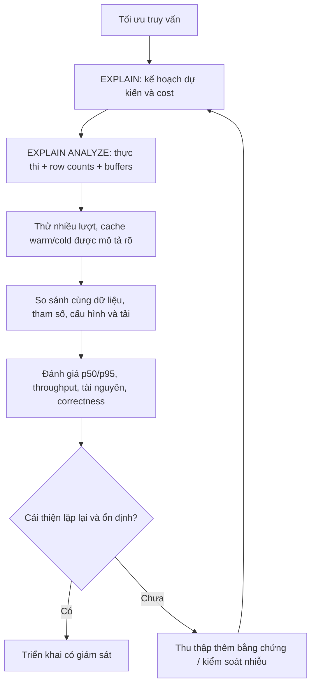
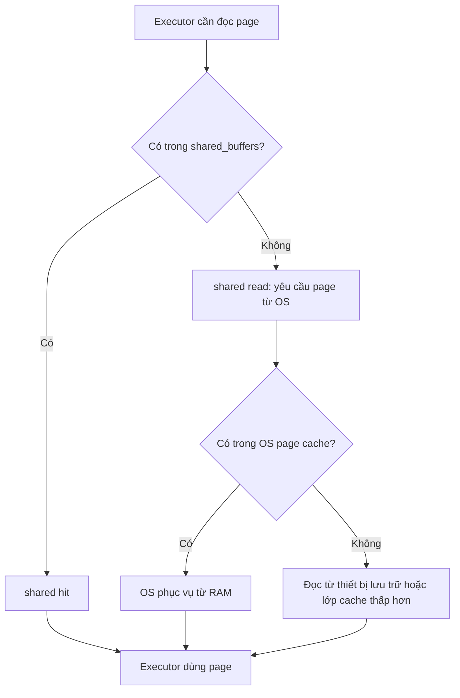

# Chi phí đo đạc, bộ nhớ đệm và cách so sánh kế hoạch công bằng trong PostgreSQL

Một câu `EXPLAIN (ANALYZE, BUFFERS)` có thể cho thấy kế hoạch truy vấn, số hàng thực tế, thời gian và số lần truy cập buffer. Tuy nhiên, kết quả đo **không phải sự thật tuyệt đối về hiệu năng**. Công cụ đo có overhead; lần chạy đầu có thể phải nạp trang dữ liệu vào cache; lần chạy sau thường hưởng lợi từ cache; một lần checkpoint, autovacuum hay một phiên khác đang ghi dữ liệu có thể làm thời gian thay đổi rõ rệt.

Ví dụ, cùng một truy vấn được chạy hai lần:

- Lần 1 mất 180 ms và ghi nhận nhiều `shared read`.
- Lần 2 mất 24 ms và phần lớn là `shared hit`.

Không thể lập tức kết luận PostgreSQL đã đổi sang một thuật toán tốt hơn. Có thể **kế hoạch không đổi**, chỉ trạng thái bộ nhớ đệm đã khác. Ngược lại, một kế hoạch dùng ít buffer hơn chưa chắc nhanh hơn nếu nó làm nhiều phép tính CPU hoặc sinh ra kết quả qua mạng tốn thời gian hơn.

Bài học thuộc chương **Kế hoạch truy vấn**, với mục tiêu:

1. Hiểu `cost` ước lượng của planner khác gì thời gian thực thi và chi phí đo.
2. Biết cách dùng `EXPLAIN`, `ANALYZE`, `BUFFERS`, `TIMING OFF`, `WAL` và các tùy chọn khác mà không đọc sai số liệu.
3. Phân biệt PostgreSQL shared buffers, bộ nhớ đệm hệ điều hành (OS page cache), temp files và truy cập thiết bị lưu trữ.
4. Thiết kế phép so sánh **A/B công bằng**, từ dữ liệu/parameter/config cho tới trạng thái cache, concurrency và cách tổng hợp nhiều lượt đo.
5. Kết hợp kết quả `EXPLAIN` với metrics vận hành, `pg_stat_statements`, JDBC và `pgbench`.
6. Tránh những thay đổi rủi ro chỉ nhằm “làm benchmark đẹp”, như xóa OS cache trên máy production hoặc tắt toàn bộ cơ chế của planner.

Điểm cốt lõi: **kế hoạch thực thi là một giả thuyết về cách làm, còn benchmark có kiểm soát là bằng chứng về chi phí của cách làm trong workload cụ thể**.

## 1. Ba lớp câu hỏi cần tách biệt

Khi truy vấn chậm, hãy tách ba loại câu hỏi:

| Câu hỏi | Công cụ phù hợp | Ví dụ kết luận |
| --- | --- | --- |
| **Planner định làm gì?** | `EXPLAIN` | Dự kiến `Seq Scan` và `Hash Join` |
| **Executor thật sự làm gì, đọc bao nhiêu, mất bao lâu?** | `EXPLAIN (ANALYZE, BUFFERS)` | Duyệt nhiều hàng hơn ước lượng và spill sort ra temp |
| **Ứng dụng có thực sự nhanh hơn không?** | Benchmark nhiều lượt, APM, `pg_stat_statements`, latency end-to-end | p95 request giảm trong tải đồng thời |

Ba câu trả lời có thể khác nhau:

- Planner cho rằng `Index Scan` rẻ hơn vì selectivity ước lượng thấp, nhưng dữ liệu thực tế trả rất nhiều hàng.
- `EXPLAIN ANALYZE` báo 10 ms, nhưng API mất 80 ms vì truyền kết quả, chuyển object hoặc gọi dịch vụ khác.
- Một benchmark đơn lẻ báo 5 ms, nhưng dưới 100 client đồng thời p95 tăng lên 300 ms do tranh chấp I/O và CPU.

Không dùng một số đo duy nhất để thay thế mọi tầng.



Sơ đồ là quy trình tư duy, không có nghĩa phải dùng `EXPLAIN ANALYZE` trên mọi truy vấn production.

## 2. Cost của planner là đơn vị ước lượng, không phải mili-giây

Một kế hoạch minh họa:

```text
Seq Scan on orders  (cost=0.00..1715.00 rows=4000 width=48)
  Filter: (tenant_id = 7)
```

Các thành phần:

- `cost=0.00..1715.00` là **startup cost..total cost** theo thang chi phí planner.
- `rows=4000` là số hàng **ước lượng được node trả ra**, không phải hàng thực tế.
- `width=48` là kích thước trung bình **ước lượng** mỗi hàng kết quả, tính bằng byte.
- `Seq Scan` là cách planner dự kiến đọc bảng.

Cost được tính từ nhiều giả định: số trang, số hàng, thống kê phân bố, độ chọn lọc, chi phí đọc trang tuần tự/ngẫu nhiên, chi phí CPU cho tuple/operator và các tham số cấu hình.

**Sai lầm:** kế hoạch cost 100 không có nghĩa sẽ chạy trong 100 ms. Cost 100 và cost 200 cũng không cam kết một kế hoạch nhanh gấp đôi kế hoạch kia.

### 2.1. Startup cost và total cost

Với những truy vấn có `LIMIT` hoặc pipeline trả hàng sớm, chi phí khởi động có thể đặc biệt quan trọng.

```sql
SELECT order_id, created_at
FROM plan_bench.orders
WHERE tenant_id = 7
ORDER BY created_at DESC
LIMIT 20;
```

Một đường truy cập qua index có thể đưa ra 20 hàng đầu tiên nhanh hơn một kế hoạch phải đọc và sort nhiều hàng. Planner cân nhắc startup/total cost theo nhu cầu lấy kết quả.

Nếu ứng dụng cần **toàn bộ** tập dữ liệu, kế hoạch tối ưu cho `LIMIT 20` chưa chắc tối ưu cho query không có LIMIT.

### 2.2. Cost chỉ có ý nghĩa khi giả định so sánh tương đương

Không nên lấy hai con số cost ở hai môi trường khác:

- Khác dữ liệu, statistics, database version.
- Khác `random_page_cost`, `seq_page_cost`, `cpu_tuple_cost`.
- Khác `effective_cache_size`, parallelism hoặc cấu hình khác.
- Khác phân bố tham số.
- Khác kiểu query hoặc số hàng trả về.

Cost phù hợp để **hiểu quyết định của planner trong một bối cảnh**, không phải KPI tuyệt đối để so sánh PostgreSQL ở hai server.

## 3. EXPLAIN và EXPLAIN ANALYZE khác nhau

```sql
EXPLAIN
SELECT *
FROM plan_bench.orders
WHERE tenant_id = 7;
```

`EXPLAIN` thông thường lấy kế hoạch dự kiến mà **không thực thi toàn bộ câu truy vấn theo executor**. Nó cho thấy estimates và cấu trúc plan, nhưng không cung cấp thời gian thực thi hay hàng thực tế.

```sql
EXPLAIN (ANALYZE)
SELECT *
FROM plan_bench.orders
WHERE tenant_id = 7;
```

`ANALYZE` khiến PostgreSQL **thực sự chạy truy vấn** và gắn thông tin runtime vào các node:

- `actual time`.
- `actual rows`.
- `loops`.
- Tổng `Planning Time` và `Execution Time` khi được báo.
- Các thống kê node khác theo loại operation.

Đổi lại, **executor được instrument**, nên thời gian ghi nhận có thể khác thời gian chạy bình thường.

### 3.1. Cẩn thận với DML

`EXPLAIN (ANALYZE) INSERT/UPDATE/DELETE/MERGE` **thực sự ghi dữ liệu** theo semantics statement đó.

```sql
-- Chỉ trên database học tập, không chạy bừa trên production.
BEGIN;

EXPLAIN (ANALYZE, BUFFERS, WAL)
UPDATE plan_bench.orders
SET status = 'pending'
WHERE order_id = 42;

ROLLBACK;
```

`ROLLBACK` hoàn tác các thay đổi transactional trong ví dụ. Nhưng không phải mọi side effect đều rollback được: sequence có thể tiêu thụ giá trị, function có thể tương tác bên ngoài hoặc phát sinh tác động phi giao dịch.

Vì thế, **không coi BEGIN/ROLLBACK là hàng rào tuyệt đối cho một DML có side effects**. Thử DML trên database test với dữ liệu riêng và hiểu trigger/function trước khi chạy.

### 3.2. EXPLAIN ANALYZE SELECT cũng có thể gây tải

Một `SELECT` chỉ đọc dữ liệu vẫn có thể:

- Đọc hàng GB dữ liệu vào cache.
- Dùng CPU và I/O lớn.
- Sinh temp files khi sort/hash spill.
- Gây cạnh tranh tài nguyên với phiên khác.
- Gọi function có side effect nếu SQL không thuần đọc.

Không chạy một query vốn chậm hàng giờ trên production chỉ để có số `Execution Time`.

## 4. Chi phí đo đạc (instrumentation overhead) là gì?

Để cung cấp số hàng, thời gian và các thống kê khác theo từng node, `EXPLAIN ANALYZE` phải bổ sung thao tác theo dõi khi executor chạy.

Ví dụ một nested loop thực hiện hàng trăm nghìn lần một node nhỏ. Nếu PostgreSQL phải lấy timestamp trước/sau rất nhiều lần gọi node, overhead của chính phép đo có thể tương đối lớn so với thời gian xử lý dữ liệu.

Các yếu tố làm overhead khác nhau:

- Số node và số lần gọi/`loops`.
- Độ dài mỗi lần thực thi node.
- Chi phí đọc đồng hồ hệ thống.
- Có bật đo buffer/I/O hay không.
- Kiểu executor và worker song song.
- CPU/OS/hypervisor và phiên bản PostgreSQL.

Một câu `EXPLAIN ANALYZE` chạy chậm hơn câu SQL thường **không tự chứng minh plan tệ**.

### 4.1. TIMING OFF để giảm overhead đồng hồ theo node

Câu lệnh hữu ích:

```sql
EXPLAIN (ANALYZE, BUFFERS, TIMING OFF)
SELECT order_id
FROM plan_bench.orders
WHERE tenant_id = 7;
```

Với `TIMING OFF`:

- PostgreSQL không thu **thời gian riêng cho từng node** theo cách thông thường.
- Vẫn thu số hàng thực tế và số loops; `BUFFERS` nếu bật vẫn được báo.
- **Thời gian thực thi tổng thể của statement vẫn được đo**.
- Chi phí instrumentation có thể giảm, đặc biệt khi node bị gọi rất nhiều lần.
- Nó **không** khiến toàn bộ overhead của `EXPLAIN ANALYZE` biến mất.

Đây là lựa chọn tốt khi bạn cần kiểm tra **ước lượng hàng và buffer accesses** nhiều hơn thời gian chi tiết của từng node.

### 4.2. Khi nào giữ TIMING ON?

Dùng timing theo node khi cần định vị nơi mất thời gian tương đối lớn, ví dụ:

- Sort/Hash nhiều thời gian.
- Subquery bị thực thi lặp.
- Nested loop có inner node tốn kém.
- Một node scan có I/O cao.
- Aggregate hoặc JIT có overhead rõ rệt.

Nhưng hãy xem node timing như **bằng chứng chẩn đoán**, không phải stopwatch hoàn hảo cho từng operator.

### 4.3. Không cộng tất cả actual time của các node

Nhiều số thời gian của node là **inclusive**: thời gian node cha có thể bao gồm thời gian node con. Nếu cộng mọi dòng `actual time` trong plan sẽ dễ **đếm trùng**.

Với node có `loops > 1`, giá trị `actual time` và `actual rows` thường là **trung bình mỗi lần thực thi node**. Muốn ước lượng tổng số lần/khối lượng, cần xét hệ số `loops`.

```text
Nested Loop  (actual time=0.020..8.000 rows=100 loops=1)
  -> Seq Scan ... (actual time=0.010..0.200 rows=100 loops=1)
  -> Index Scan ... (actual time=0.005..0.060 rows=1 loops=100)
```

Đây là số liệu minh họa, **không phải kết quả đo từ database của bài**. Inner `Index Scan` có thể có thời gian khoảng `0.060 ms × 100 loops`, nhưng không được cộng thẳng với toàn bộ thời gian của `Nested Loop` như hai phần độc lập.

## 5. Chọn các chế độ EXPLAIN theo câu hỏi

| Mục tiêu | Câu lệnh khởi đầu | Lưu ý |
| --- | --- | --- |
| Xem plan mà không chạy query | `EXPLAIN SELECT ...` | Chỉ có estimates |
| Kiểm tra actual rows và thời gian | `EXPLAIN (ANALYZE) SELECT ...` | Có overhead đo |
| Xem cache/buffer | `EXPLAIN (ANALYZE, BUFFERS) ...` | Read không chắc là physical disk I/O |
| Giảm per-node clock overhead | `EXPLAIN (ANALYZE, BUFFERS, TIMING OFF) ...` | Vẫn có tổng execution time |
| So sánh cấu hình planner được báo | `EXPLAIN (ANALYZE, SETTINGS) ...` | Chỉ hiển thị những setting liên quan theo quy tắc của version |
| Xem WAL do statement sinh ra | `EXPLAIN (ANALYZE, WAL) ...` | Thực thi query; đặc biệt cẩn thận DML |
| Tự động lưu/so sánh cấu trúc | `EXPLAIN (FORMAT JSON) ...` | Có thể dùng `ANALYZE` để có runtime |
| Xem dữ liệu node dưới dạng có thể parse | `EXPLAIN (ANALYZE, BUFFERS, FORMAT JSON) ...` | Khác một số chi tiết text giữa versions |
| Xem chi phí tuần tự hóa output | `EXPLAIN (ANALYZE, SERIALIZE TEXT) ...` trên version hỗ trợ | Không đo network transfer tới client |

**Khả năng của tùy chọn `SERIALIZE` và một số option khác tùy major version.** Kiểm tra `SHOW server_version;` và tài liệu `EXPLAIN` của server đang chạy.

### 5.1. SUMMARY và thời gian tổng

```sql
EXPLAIN (
    ANALYZE,
    BUFFERS,
    TIMING OFF,
    SUMMARY ON
)
SELECT COUNT(*)
FROM plan_bench.orders
WHERE tenant_id = 7;
```

`SUMMARY` hiển thị thông tin tổng như planning/execution time theo định dạng. Khi dùng `ANALYZE`, summary thường đã được bật mặc định.

**`Planning Time` và `Execution Time` là hai con số khác nhau.** Với truy vấn cực ngắn gọi hàng nghìn lần, planning overhead có thể đáng kể; với truy vấn xử lý dữ liệu lớn, execution cost có thể chiếm ưu thế.

### 5.2. WAL trong EXPLAIN

```sql
BEGIN;

EXPLAIN (ANALYZE, BUFFERS, WAL, TIMING OFF)
UPDATE plan_bench.orders
SET amount = amount
WHERE order_id = 42;

ROLLBACK;
```

Ví dụ này cho thấy cú pháp, không phải bài đo ghi tối ưu: PostgreSQL có thể thực hiện UPDATE thực sự dù giá trị logic không đổi, đồng thời có trigger hoặc cơ chế lưu trữ ảnh hưởng WAL. WAL được sinh ra không mặc nhiên biến mất vì `ROLLBACK`.

Các trường `WAL` có thể gồm records, full-page images và bytes, tùy phiên bản. Đừng sử dụng `EXPLAIN WAL` như số liệu đầy đủ của mọi ghi nền trên server; nó mô tả công việc được đo theo statement.

## 6. Tạo dữ liệu thực hành có thể tái lập

Tạo một schema riêng cho benchmark. Không sử dụng các thao tác nạp dữ liệu mẫu này trên hệ thống production hoặc bảng đã có dữ liệu người dùng.

```sql
CREATE SCHEMA IF NOT EXISTS plan_bench;

CREATE TABLE plan_bench.customers (
    customer_id integer PRIMARY KEY,
    customer_name text NOT NULL
);

INSERT INTO plan_bench.customers (customer_id, customer_name)
SELECT g, 'Customer ' || g::text
FROM generate_series(1, 1000) AS g;

CREATE TABLE plan_bench.orders (
    order_id bigint PRIMARY KEY,
    tenant_id integer NOT NULL,
    customer_id integer NOT NULL
        REFERENCES plan_bench.customers(customer_id),
    status text NOT NULL
        CHECK (status IN ('paid', 'pending', 'cancelled')),
    created_at timestamptz NOT NULL,
    amount numeric(12, 2) NOT NULL CHECK (amount >= 0),
    payload text NOT NULL
);

INSERT INTO plan_bench.orders
    (order_id, tenant_id, customer_id, status, created_at, amount, payload)
SELECT
    g::bigint,
    CASE
        WHEN g % 2 = 0 THEN 1
        ELSE (g % 20 + 2)::integer
    END,
    (g % 1000 + 1)::integer,
    CASE
        WHEN g % 20 = 0 THEN 'cancelled'
        WHEN g % 5 = 0 THEN 'pending'
        ELSE 'paid'
    END,
    TIMESTAMPTZ '2025-01-01 00:00:00+00'
        + g * INTERVAL '1 minute',
    ((g % 100000)::numeric / 100)::numeric(12, 2),
    repeat(md5(g::text), 3)
FROM generate_series(1, 80000) AS g;

CREATE INDEX idx_orders_tenant_created
ON plan_bench.orders (tenant_id, created_at DESC);

CREATE INDEX idx_orders_customer
ON plan_bench.orders (customer_id);

ANALYZE plan_bench.customers;
ANALYZE plan_bench.orders;
```

Đặc điểm có chủ ý:

- **80.000 đơn hàng** với `order_id` xác định, không dùng dữ liệu ngẫu nhiên.
- `tenant_id = 1` xuất hiện ở khoảng **một nửa số hàng**, trong khi các tenant khác có tập nhỏ hơn. Đây là **phân bố lệch**, giúp minh họa ảnh hưởng của parameter selectivity.
- `payload` dài hơn các cột số để quan sát chi phí lấy/truyền/sắp xếp dữ liệu rộng.
- Index `(tenant_id, created_at DESC)` có thể phục vụ truy vấn phân trang theo tenant.
- Câu `ANALYZE` giúp planner cập nhật statistics trước khi thử nghiệm.

Không chạy lại lệnh `INSERT` trên cùng bảng đã có khóa chính nếu muốn giữ số hàng và dữ liệu mẫu; nên tạo database/schema học tập mới hoặc reset có kiểm soát.

### 6.1. Xác định kích thước và phân bố

```sql
SELECT
    COUNT(*) AS total_orders,
    COUNT(*) FILTER (WHERE tenant_id = 1) AS tenant_1_orders,
    MIN(created_at) AS first_order,
    MAX(created_at) AS last_order
FROM plan_bench.orders;

SELECT
    tenant_id,
    COUNT(*) AS order_count
FROM plan_bench.orders
GROUP BY tenant_id
ORDER BY order_count DESC, tenant_id;
```

Một benchmark đáng tin bắt đầu bằng việc **biết dữ liệu đầu vào**. Nếu tenant 1 có 40.000 đơn nhưng tenant 7 có vài nghìn, so sánh hai query đó là so sánh workload khác nhau, không chỉ hai kế hoạch SQL.

### 6.2. Ghi baseline môi trường

```sql
SELECT version();

SHOW server_version;
SHOW shared_buffers;
SHOW work_mem;
SHOW effective_cache_size;
SHOW random_page_cost;
SHOW seq_page_cost;
SHOW max_parallel_workers_per_gather;
SHOW jit;
SHOW track_io_timing;
SHOW plan_cache_mode;
```

Một số cấu hình có thể khác về khả năng hỗ trợ/ý nghĩa giữa các major versions. Không chỉnh hàng loạt các tham số chỉ để benchmark nếu chưa biết tác động.

Để so sánh hai phiên đo, tối thiểu ghi **server version, cấu hình liên quan, số hàng, index definitions và mốc statistics**.

## 7. Đọc kế hoạch và actual rows trong thực hành

```sql
EXPLAIN (ANALYZE, BUFFERS, TIMING OFF)
SELECT order_id, created_at, amount
FROM plan_bench.orders
WHERE tenant_id = 7
ORDER BY created_at DESC
LIMIT 20;
```

Có thể thấy `Index Scan` dùng `idx_orders_tenant_created`, nhưng **không bắt buộc**: planner quyết định theo statistics và môi trường.

Cần nhìn:

1. Node truy cập dữ liệu: `Index Scan`, `Bitmap Heap Scan` hay `Seq Scan`?
2. Điều kiện lọc xuất hiện ở `Index Cond` hay `Filter`?
3. Số `rows` ước lượng so với số `actual rows`?
4. Có `Sort` hay index trả thứ tự đã phù hợp?
5. `Buffers: shared hit/read` và tổng `Execution Time`?
6. Nếu có `loops`, node bị lặp bao nhiêu lần?

### 7.1. Sai lệch ước lượng hàng thường quan trọng hơn sai lệch cost thô

Ví dụ giả định:

```text
Hash Join  (cost=... rows=100 ...)
  (actual rows=250000 loops=1)
```

Một planner dự đoán 100 hàng nhưng thực tế sinh 250.000 hàng có thể chọn join strategy, memory plan hoặc scan không phù hợp.

Thay vì chỉ hỏi “cost có thấp không?”, hãy tìm **node đầu tiên nơi estimated cardinality lệch nhiều**. Kiểm tra statistics, correlation, parameter, predicate, join selectivity và các biến đổi dữ liệu.

### 7.2. Số rows tại node không luôn là số hàng toàn bảng

`rows` của `Index Scan` là ước lượng số hàng **node trả ra**; `actual rows` là số hàng node thực trả trung bình mỗi loop. Nó khác tổng row count của bảng.

Nếu query có `LIMIT 20`, một node có thể dừng sớm. Vì thế, số hàng đã đọc trong benchmark có thể khác truy vấn cùng `WHERE` nhưng **không có LIMIT**.

## 8. BUFFERS: shared hit/read/dirtied/written là gì?

Dùng:

```sql
EXPLAIN (ANALYZE, BUFFERS)
SELECT order_id, amount
FROM plan_bench.orders
WHERE tenant_id = 7;
```

Bạn có thể gặp những số liệu như:

```text
Buffers: shared hit=350 read=25 dirtied=0 written=0
```

Đây là **giá trị giả định để giải thích cách đọc**, không phải kết quả đo đã chạy trên dữ liệu mẫu.

| Nhãn | Nghĩa khái quát | Điều KHÔNG được suy ra |
| --- | --- | --- |
| `shared hit` | Truy cập một page đã có trong PostgreSQL shared buffer cache | Không phải số page **duy nhất**; một page có thể được truy cập nhiều lần |
| `shared read` | Page cần được đọc vào shared buffers từ tầng lưu trữ bên dưới | Không mặc định là một physical disk read; OS cache có thể phục vụ |
| `shared dirtied` | Page trước đó chưa dirty được thao tác đo làm dirty | Không phải tổng số page được ghi xuống disk ngay lập tức |
| `shared written` | Page dirty được backend ghi ra khi xử lý theo thống kê báo | Không đại diện mọi background write/checkpoint của server |
| `local hit/read/...` | Truy cập local buffers, thường cho temporary relations | Không giống `temp read/written` của temp files |
| `temp read/written` | Truy cập block thuộc các temporary files của executor như sort/hash spill | Không phải số row trong bảng tạm |

Trong build PostgreSQL phổ biến, block là **8 KiB**, nhưng kích thước page có thể khác theo build. Không tự đổi từ blocks sang MB bằng 8 KiB nếu chưa biết `block_size` thực tế:

```sql
SHOW block_size;
```

### 8.1. Hit/read là số lượt truy cập block, không phải tập page duy nhất

Nếu một vòng nested loop truy cập cùng index leaf page 10.000 lần, số hit có thể tăng nhiều dù tập page vật lý rất nhỏ.

Do đó, `shared hit = 100000` không có nghĩa query đã cần 100.000 page **khác nhau** trong cache. Đó là phép đo hoạt động buffer theo cơ chế của PostgreSQL.

### 8.2. Buffers ở node cha có thể bao gồm node con

Tương tự thời gian node, một dòng `Buffers` của node cha thường **bao gồm hoạt động của các node con**.

Đừng cộng `shared hit` của toàn bộ các dòng trong tree rồi diễn giải là tổng page accesses; bạn có thể tính lặp nhiều lần.

### 8.3. Shared read không đồng nghĩa SSD/HDD đã làm I/O

Khi PostgreSQL cần một page chưa nằm trong `shared_buffers`, nó gọi cơ chế đọc dữ liệu của hệ điều hành. **OS page cache** có thể vẫn giữ page đó.

Như vậy:

- `shared read > 0`: PostgreSQL không có page trong shared buffers tại thời điểm tra cứu.
- **Không đủ bằng chứng** để khẳng định page phải đi tới SSD/HDD.
- `shared read = 0`: các page dữ liệu PostgreSQL yêu cầu trong phép đo có thể đã nằm trong shared buffers, nhưng query vẫn có thể tốn CPU/JIT/temp I/O hoặc chờ tài nguyên khác.

Đây là lý do phải phân biệt **buffer miss của PostgreSQL** với **physical disk read**.

## 9. Các tầng cache trong đường đọc dữ liệu



Đây là mô hình khái niệm phổ biến; cấu hình I/O, filesystem, direct I/O, virtualization và phiên bản PostgreSQL có thể ảnh hưởng đường đi chi tiết. Điểm quan trọng là **PostgreSQL buffer miss không tự động bằng physical device miss**.

### 9.1. shared_buffers

`shared_buffers` là lượng bộ nhớ PostgreSQL dự kiến dùng cho shared buffer cache, được quản lý ở mức instance.

```sql
SHOW shared_buffers;
```

Nó **không phải** toàn bộ RAM máy chủ và không chứa mọi kiểu bộ nhớ cần cho sort/hash/connection.

Khi dữ liệu hay index page đã có trong `shared_buffers`, executor thường có thể tái sử dụng page mà không yêu cầu đọc lại từ OS.

### 9.2. OS page cache

Hệ điều hành thường giữ page của file database đã được đọc gần đây. Ngay cả khi PostgreSQL phải tăng `shared read`, OS có thể cung cấp dữ liệu từ RAM.

Cache của OS cũng có thể bị thay thế do workload của những tiến trình khác. Vì thế hai benchmark giống hệt có thể khác nhau nếu máy đang xử lý workload khác.

### 9.3. Cache của storage/ảo hóa

SSD, controller, remote storage và tầng ảo hóa có thể có những cơ chế cache/prefetch riêng. Đây là lý do chỉ dựa trên một cột `shared read` không thể suy ra chính xác thời gian physical I/O của thiết bị.

Nếu cần trả lời “đã đọc bao nhiêu dữ liệu từ disk thật?”, cần dùng thêm metrics ở OS/cloud/storage layer và hiểu cấu hình I/O.

### 9.4. effective_cache_size không cấp phát cache

`effective_cache_size` là **giả định của planner** về lượng cache có thể dùng cho một query khi đánh giá đường truy cập. Nó **không tự cấp phát bộ nhớ** và cũng không làm page “được warm” khi chỉnh giá trị.

```sql
SHOW effective_cache_size;
```

Thay `effective_cache_size` có thể khiến planner chọn index scan/seq scan khác vì thay đổi ước lượng cost. Điều đó **khác hẳn** việc tăng `shared_buffers` thực tế.

## 10. Warm cache và cold cache

Một phép đo với **warm cache** có dữ liệu/index page liên quan thường đã nằm trong các tầng cache. **Cold cache** cố mô tả trường hợp dữ liệu chưa nằm trong cache, nhưng định nghĩa “cold” phải rõ:

- Cold đối với **PostgreSQL shared buffers**?
- Cold đối với **OS page cache**?
- Cold đối với **storage cache**?
- Cold đối với **một query cụ thể**, không phải toàn bộ server?

### 10.1. Cùng kế hoạch, thời gian khác vì cache

Lần đầu:

```sql
EXPLAIN (ANALYZE, BUFFERS)
SELECT SUM(amount)
FROM plan_bench.orders
WHERE tenant_id = 7;
```

Sau đó chạy lại cùng truy vấn.

Nếu lần hai có nhiều `shared hit` hơn, ít `shared read` hơn và nhanh hơn, có thể do cache. Nhưng còn có thể có:

- OS cache được warm.
- JIT compilation đã hoặc chưa được kích hoạt tùy kế hoạch.
- Checkpoint/autovacuum/backup tác động khác thời điểm.
- CPU scheduling, background I/O thay đổi.
- Thống kê hoặc kế hoạch đã thay đổi.
- Query khác đã làm nóng hoặc đẩy page ra khỏi cache.

**Chỉ hai lần chạy không đủ để kết luận** cải thiện đến từ index hay SQL rewrite.

### 10.2. Warm-up có chủ đích

Với mục tiêu đo **warm-cache steady state**, hãy:

1. Chọn query và tập tham số đại diện.
2. Chạy một số lượt warm-up không đưa vào thống kê chính.
3. Giữ một chế độ tải tương tự trong cả hai phương án.
4. Đo nhiều lượt và báo phân bố thời gian.
5. Ghi buffer hit/read để biết kết quả có phụ thuộc cache không.

Không giả định cứ chạy ba lần là chắc chắn warm đầy đủ; workload lớn hơn cache có thể liên tục đẩy page cũ ra.

### 10.3. Không “clear cache” bừa trên production

Các thao tác như restart PostgreSQL hoặc yêu cầu hệ điều hành xóa page cache sẽ làm thay đổi trạng thái toàn bộ hệ thống, có thể gây:

- Tăng I/O đột ngột.
- Tăng latency cho những ứng dụng không liên quan.
- Ảnh hưởng HA, pool và transaction.
- Mất nhiều phút để hệ thống trở lại trạng thái cache ổn định.

**Không xóa OS cache trên máy chung/production để thử một query.** Muốn đo cold-start thật, hãy dùng một môi trường benchmark riêng, quy trình được phép, và mô tả rõ tầng cache nào đã được làm lạnh.

### 10.4. DISCARD và CHECKPOINT không phải “clear data cache”

- `DISCARD ALL` dọn nhiều trạng thái ở **session hiện tại**, không phải lệnh xóa toàn bộ `shared_buffers` hoặc OS page cache.
- `CHECKPOINT` thúc đẩy ghi những buffer dirty theo cơ chế checkpoint; nó **không có nghĩa các page đọc sẽ bị loại khỏi cache**.
- `DEALLOCATE`/`DISCARD PLANS` liên quan prepared plans/session state, không phải reset shared data cache.

Đừng dùng những lệnh này như cách mặc định để “chuẩn hóa cold-cache benchmark”.

## 11. pg_prewarm: hỗ trợ làm nóng dữ liệu khi thích hợp

PostgreSQL có extension `pg_prewarm` trên những môi trường cung cấp tính năng này. Nó có thể được dùng để nạp/warm những relation page theo các chế độ hỗ trợ.

Ví dụ minh họa khi extension đã được cài và người dùng có quyền:

```sql
-- Chỉ trên môi trường benchmark được phép cài extension.
CREATE EXTENSION IF NOT EXISTS pg_prewarm;

SELECT pg_prewarm(
    'plan_bench.orders'::regclass
);
```

**Lưu ý:**

- `pg_prewarm` không bắt buộc có trên mọi deployment.
- Việc gọi prewarm tạo I/O và ảnh hưởng cache của workload khác.
- Cơ chế nạp vào cache và chế độ `mode` có thể khác; cần kiểm tra tài liệu của version.
- Prewarm một bảng không bảo đảm mọi index hay mọi dữ liệu cần cho query đã nằm trong cache.
- Cần ghi rõ cả A và B đều có điều kiện warm tương đương, tránh prewarm riêng một phương án.

Không bật extension chỉ vì một benchmark nhỏ nếu quyền vận hành không cho phép.

## 12. track_io_timing và thời gian chờ I/O

`BUFFERS` đếm các hoạt động buffer, nhưng không tự cho biết mỗi lần đọc mất bao lâu.

PostgreSQL có tham số:

```sql
SHOW track_io_timing;
```

Khi bật trong cấu hình cho phép, PostgreSQL có thể ghi thêm thời gian thực hiện các thao tác I/O liên quan. Trong `EXPLAIN (ANALYZE, BUFFERS)` có thể có `I/O Timings` phù hợp.

Ví dụ output minh họa:

```text
Buffers: shared hit=240 read=80
I/O Timings: shared read=12.600
```

**Không diễn giải `12.600 ms` là “80 lần đọc SSD vật lý mất đúng 12,6 ms”**: các lớp OS cache/I/O và cách instrument quyết định ý nghĩa cụ thể.

### 12.1. Bật đo I/O cũng có overhead

Gọi clock để đo I/O có chi phí, dù mức độ ảnh hưởng tùy hệ thống. Vì vậy, hãy ghi trạng thái `track_io_timing` trong benchmark.

Không nên so sánh A với `track_io_timing = off` và B với `track_io_timing = on` rồi quy toàn bộ chênh lệch cho SQL/index.

### 12.2. Xem số liệu ở mức database

```sql
SELECT
    datname,
    blks_read,
    blks_hit,
    blk_read_time,
    blk_write_time,
    stats_reset
FROM pg_stat_database
WHERE datname = current_database();
```

`blks_read`/`blks_hit` là counter tích lũy cấp database; `blk_read_time`/`blk_write_time` được báo theo cơ chế `track_io_timing` nếu bật. Các số liệu cấp database bao gồm nhiều session và query, không riêng câu bạn vừa chạy.

Muốn đánh giá một query, `EXPLAIN BUFFERS` thường dễ liên hệ với plan hơn; để đánh giá tải toàn hệ thống, metrics tích lũy hữu ích khi lấy **delta theo khoảng thời gian**.

### 12.3. pg_stat_io trên phiên bản hỗ trợ

Trên các phiên bản PostgreSQL có view `pg_stat_io` (được giới thiệu từ PostgreSQL 16), có thể theo dõi I/O theo backend type, object và context.

```sql
-- Chỉ trên server có pg_stat_io.
SELECT *
FROM pg_stat_io
LIMIT 20;
```

Đây là **thống kê cấp hệ thống**, không phải profile chính xác của một SQL duy nhất. Các cột và loại hoạt động có thể thay đổi qua major versions. Để tính rate/throughput, phải lấy delta giữa hai mốc cùng cách đo và xét workload khác.

## 13. Temp files: sort/hash spill không phải cache miss thông thường

Một query có thể có tất cả dữ liệu đọc từ shared buffers nhưng vẫn chậm do Sort hoặc Hash không đủ bộ nhớ và phải spill ra temporary files.

```sql
EXPLAIN (ANALYZE, BUFFERS)
SELECT order_id, amount, payload
FROM plan_bench.orders
WHERE tenant_id = 1
ORDER BY payload, order_id;
```

Các node có thể báo:

```text
Sort Method: external merge  Disk: 4096kB
Buffers: shared hit=..., temp read=..., temp written=...
```

Đây là ví dụ định dạng giả định, không phải một kết quả đo được bảo đảm trên dữ liệu mẫu.

### 13.1. Phân biệt ba loại buffer

- **`shared`:** buffer pool cho những relation thông thường.
- **`local`:** buffer cho local temporary relations, có ngữ nghĩa riêng.
- **`temp`:** block I/O của temporary files mà executor dùng cho việc như sort/hash spill.

`temp written` tăng không nhất thiết nghĩa là bảng tạm được ghi bởi `CREATE TEMP TABLE`; nó có thể do sort hoặc hash join phải đẩy dữ liệu ra đĩa.

### 13.2. work_mem là giới hạn cho operator, không phải ngân sách toàn query

`work_mem` ảnh hưởng lượng bộ nhớ mà một số thao tác sort/hash có thể dùng trước khi chuyển sang thao tác trên disk; chi tiết còn phụ thuộc operator và các tham số liên quan như `hash_mem_multiplier`.

```sql
SHOW work_mem;
SHOW hash_mem_multiplier;
```

Không hiểu `work_mem = '64MB'` nghĩa toàn bộ query chỉ có 64 MB RAM. Một plan có thể có **nhiều sort/hash nodes** và nhiều parallel workers; mức tiêu thụ cộng lại có thể lớn hơn nhiều.

Vì vậy, tăng `work_mem` quá cao cho toàn server có thể gây áp lực RAM khi nhiều query chạy đồng thời.

### 13.3. So sánh thử hai work_mem bằng SET LOCAL

Trên database thực hành:

```sql
BEGIN;
SET LOCAL work_mem = '1MB';

EXPLAIN (ANALYZE, BUFFERS, TIMING OFF)
SELECT order_id, amount, payload
FROM plan_bench.orders
WHERE tenant_id = 1
ORDER BY payload, order_id;

ROLLBACK;
```

Phương án thứ hai:

```sql
BEGIN;
SET LOCAL work_mem = '64MB';

EXPLAIN (ANALYZE, BUFFERS, TIMING OFF)
SELECT order_id, amount, payload
FROM plan_bench.orders
WHERE tenant_id = 1
ORDER BY payload, order_id;

ROLLBACK;
```

Chỉ thay **một biến `work_mem`**. Chạy nhiều lượt trong điều kiện cache/tải tương đương, so sánh:

- Sort Method (in-memory hay external).
- Temp read/written.
- Tổng execution time.
- Mức tiêu thụ RAM và ảnh hưởng concurrency.
- Có plan khác xuất hiện hay không.

Với dữ liệu thực hành và phần cứng khác nhau, có thể cả hai phương án đều không spill hoặc planner chọn plan khác. Đừng coi một kết quả giả định là bắt buộc.

## 14. Planning Time, Execution Time và thời gian ứng dụng

Một query end-to-end có thể đi qua các pha:

```text
Ứng dụng tạo tham số / chờ connection
  → Network gửi request
  → Parse / plan / lấy cached plan
  → Executor đọc dữ liệu và tính toán
  → Chuyển kết quả sang định dạng trả về
  → Network truyền các hàng
  → JDBC map ResultSet / xử lý nghiệp vụ
  → HTTP response
```

`EXPLAIN ANALYZE` chủ yếu đo hoạt động ở phía PostgreSQL trong phép thực thi được instrument, **không truyền các hàng kết quả như query thường**.

### 14.1. Vì sao EXPLAIN nhanh nhưng JDBC nhận dữ liệu chậm?

Giả sử:

```sql
SELECT order_id, payload
FROM plan_bench.orders
WHERE tenant_id = 1;
```

Truy vấn có thể trả **hàng chục nghìn hàng rộng**. `EXPLAIN ANALYZE` thực thi và thu thống kê nhưng **không gửi toàn bộ result rows về client**. Một ứng dụng thực sự lấy hết hàng phải:

- Serialize/format dữ liệu.
- Truyền dữ liệu qua network.
- Decode trong driver.
- Phân bổ object/collection trong Java.
- Có thể thêm xử lý JSON và ghi HTTP response.

Do vậy, thời gian API lớn hơn `Execution Time` không mặc nhiên là “network lỗi” hoặc “PostgreSQL đo sai”; chúng là các phạm vi khác nhau.

### 14.2. EXPLAIN SERIALIZE trên version hỗ trợ

Ở các phiên bản PostgreSQL có tùy chọn `SERIALIZE`, bạn có thể yêu cầu đo thêm chi phí **chuyển output của query sang dạng text/binary**:

```sql
-- Chỉ chạy khi version hỗ trợ tùy chọn SERIALIZE.
EXPLAIN (ANALYZE, SERIALIZE TEXT, BUFFERS)
SELECT order_id, payload
FROM plan_bench.orders
WHERE tenant_id = 1;
```

Điều này giúp hiểu một phần chi phí xuất kết quả ở server. Tuy nhiên, PostgreSQL **vẫn không thực sự gửi các hàng output cho client** dưới dạng query thường; network và tốc độ tiêu thụ dữ liệu ở client không được benchmark đầy đủ bằng tùy chọn này.

Nếu server không hỗ trợ `SERIALIZE`, hãy bỏ option đó và đo end-to-end bằng ứng dụng/psql theo cách độc lập.

### 14.3. \timing của psql và JDBC wall time

Trong `psql`:

```text
\timing on
```

Sau đó chạy query thường. Thời gian psql báo có phạm vi đo khác `Execution Time`: nó bao gồm việc client nhận/làm việc với kết quả theo cách psql chạy, và chịu ảnh hưởng network.

Trong Java, nên đo tổng thời gian từ trước `executeQuery()` đến sau **đã đọc hết ResultSet** nếu mục tiêu là latency mà API thực sự trải qua. Chỉ đo `executeQuery()` có thể bỏ sót nhiều thời gian fetch còn lại.

## 15. JIT compilation: overhead một lần và chi phí thực thi

PostgreSQL có thể bật **Just-in-Time compilation (JIT)** cho một số truy vấn, tùy version, build và cấu hình.

```sql
SHOW jit;
SHOW jit_above_cost;
SHOW jit_inline_above_cost;
SHOW jit_optimize_above_cost;
```

JIT có thể giúp những truy vấn tính toán lớn, nhưng chi phí tạo/biên dịch mã có thể đáng kể đối với query ngắn.

Khi `EXPLAIN ANALYZE` có phần `JIT`, hãy đọc riêng:

- JIT có thực sự được kích hoạt không?
- Thời gian generation/inlining/optimization/emission được báo thế nào?
- Thời gian tổng của query có đủ lớn để bù compilation không?
- Truy vấn chạy thường xuyên với các plan/parameter tương tự không?

### 15.1. Benchmark JIT phải nêu rõ điều kiện

Không công bằng nếu A chạy với JIT tắt, B bật và người đo chỉ so sánh thời gian executor mà bỏ qua compilation.

Nếu muốn đánh giá JIT, đó chính là **biến thử nghiệm**. Giữ mọi yếu tố khác ổn định, thử nhiều lượt với cùng query/parameters và ghi rõ server version cùng setting.

Không tắt JIT trên production chỉ vì một benchmark ngắn nếu không có bằng chứng về workload tổng thể.

## 16. Parallel query: cùng SQL có thể không cùng số workers

Planner có thể dùng `Gather` hoặc `Gather Merge` và những node parallel scan/join/aggregate để giảm latency của truy vấn lớn.

```sql
SHOW max_parallel_workers_per_gather;
SHOW max_parallel_workers;
SHOW parallel_setup_cost;
SHOW parallel_tuple_cost;
```

Những yếu tố ảnh hưởng:

- Bảng và query đủ điều kiện parallel.
- Planner estimates/cost.
- Workers thực tế có thể khởi tạo tại thời điểm chạy.
- Số tài nguyên còn sẵn khi hệ thống đang bận.
- Parallel-safe functions và các hạn chế khác.

### 16.1. Workers Planned khác Workers Launched

Trong `EXPLAIN ANALYZE`, một plan có thể báo:

```text
Workers Planned: 2
Workers Launched: 1
```

Nó có nghĩa planner dự kiến hai workers nhưng thực tế chỉ một worker được khởi động. Một lượt benchmark có đủ workers còn lượt khác không đủ thì không phải môi trường tương đương, dù SQL và cached pages giống nhau.

Ghi cả workers planned/launched và mức load đồng thời khi so sánh.

### 16.2. Tổng CPU và latency khác nhau

Một parallel plan có thể có **wall-clock latency thấp** nhưng tiêu tốn **tổng CPU nhiều hơn**. Trên hệ thống phục vụ nhiều request đồng thời, plan dùng nhiều workers không phải lúc nào cho throughput/p95 tổng thể tốt hơn.

Do đó, ngoài một lần `Execution Time`, nên đo cả throughput và tài nguyên khi có workload đồng thời.

## 17. Prepared statements: generic plan và custom plan

Ứng dụng Java/JDBC thường gửi query có parameters. PostgreSQL có thể sử dụng **custom plan** dựa trên giá trị parameters hoặc **generic plan** tái sử dụng được, tùy cơ chế prepared statement và cấu hình.

Ví dụ:

```sql
PREPARE orders_by_tenant (integer) AS
SELECT order_id, created_at, amount
FROM plan_bench.orders
WHERE tenant_id = $1
ORDER BY created_at DESC
LIMIT 20;
```

Thử hai giá trị:

```sql
EXPLAIN (ANALYZE, BUFFERS, TIMING OFF)
EXECUTE orders_by_tenant(1);

EXPLAIN (ANALYZE, BUFFERS, TIMING OFF)
EXECUTE orders_by_tenant(7);
```

Vì dữ liệu mẫu bị lệch, tenant 1 có rất nhiều hàng và tenant 7 ít hơn. Planner có thể thích các chiến lược khác nhau tùy giá trị/kiểu plan; **không so sánh thời gian hai tenant rồi kết luận một cấu hình nhanh hơn**, vì lượng dữ liệu khác nhau.

### 17.1. plan_cache_mode khi cần khảo sát

PostgreSQL có `plan_cache_mode`, với những lựa chọn như `auto`, `force_generic_plan` và `force_custom_plan` trên các phiên bản hỗ trợ.

```sql
SHOW plan_cache_mode;
```

Thử generic trong transaction riêng:

```sql
BEGIN;

SET LOCAL plan_cache_mode = force_generic_plan;

EXPLAIN (ANALYZE, BUFFERS, TIMING OFF)
EXECUTE orders_by_tenant(7);

ROLLBACK;
```

Thử custom:

```sql
BEGIN;

SET LOCAL plan_cache_mode = force_custom_plan;

EXPLAIN (ANALYZE, BUFFERS, TIMING OFF)
EXECUTE orders_by_tenant(7);

ROLLBACK;
```

`PREPARE` tồn tại trong session sau hai transaction ví dụ, trừ khi được deallocate hoặc session kết thúc:

```sql
DEALLOCATE orders_by_tenant;
```

Khi so sánh generic/custom, **dùng cùng giá trị tenant cho cả hai**. Nếu muốn đánh giá mọi tenant, thử **tập parameters đại diện** rồi tổng hợp kết quả có trọng số theo workload thực tế.

### 17.2. Generic plan không đồng nghĩa lỗi

Generic plan có thể giúp giảm overhead planning và hoạt động ổn định trong nhiều tình huống. Custom plan có thể tốt hơn khi phân bố dữ liệu rất lệch và lựa chọn plan nhạy với parameters.

Câu hỏi đúng không phải “generic hay custom luôn nhanh hơn?”, mà là **tổng planning+execution latency và throughput** trong tập parameters thật của ứng dụng.

## 18. Statistics và tình trạng dữ liệu phải tương đương

Planner dựa vào thống kê từ `ANALYZE`. Sau khi nhập/xóa/sửa nhiều dữ liệu, histogram, most-common-values và row count ước lượng có thể khác thực tế.

```sql
ANALYZE plan_bench.orders;
```

Lệnh `ANALYZE` là thao tác bảo trì thường dùng, nhưng nó có thể làm planner chọn plan khác. Vì vậy, không công bằng nếu:

- Phương án A đo khi statistics rất cũ.
- Bạn chạy `ANALYZE`.
- Phương án B đo với statistics mới.
- Sau đó kết luận B nhanh hơn do chỉ mục mới.

Nếu mục tiêu là đo tác dụng index, **cả A và B cần có statistics hợp lệ và quy trình thu thập tương đương**; nếu mục tiêu là đo tác dụng `ANALYZE` thì nó phải được công khai là biến đang thử.

### 18.1. Data skew làm average latency gây hiểu nhầm

Trong dữ liệu mẫu, tenant 1 chiếm phần lớn đơn hàng. Một số tenant khác ít dữ liệu.

Một benchmark chỉ dùng tenant 7 rồi triển khai cho API có 80% request đến tenant 1 có thể cho kết luận sai.

Hãy chọn tập parameters:

| Nhóm | Ví dụ | Vai trò |
| --- | --- | --- |
| Hot/large tenant | `tenant_id = 1` | Đại diện query có nhiều hàng |
| Small tenant | `tenant_id = 7` | Đại diện query có ít hàng |
| Boundary | Tenant có rất ít/không có dữ liệu | Kiểm tra đường đi hiếm |
| Thời gian | Khoảng mới/cũ của `created_at` | Kiểm tra correlation/cache |
| Kiểu request | `LIMIT 20` so với xuất đầy đủ | Đánh giá startup/total cost |

Tần suất nhóm có thể khác workload thực. Không tính average đơn giản giữa các nhóm nếu production có phân bố rất lệch; cần **trọng số theo lượng request thực tế**.

## 19. Một thử nghiệm A/B công bằng cần khóa những biến nào?

Trước khi đo, phải mô tả:

| Thành phần | Yêu cầu khi không phải biến thử |
| --- | --- |
| Logic SQL và kết quả | Hai phương án phải trả **cùng dữ liệu/ngữ nghĩa** |
| Số hàng và phân bố | Cùng snapshot hoặc dataset tương đương |
| Tham số đầu vào | Cùng parameter set và tỷ trọng |
| Phiên bản PostgreSQL | Cùng major version, patch level nếu có thể |
| Schema/index | Chỉ khác index/thiết kế được tuyên bố là biến thử |
| Statistics | Đều đủ mới, cùng cách thu thập |
| Planner settings | Giống nhau, trừ thiết lập đang thử |
| Cache state | Cùng chế độ warm/cold được định nghĩa |
| Transaction/isolation | Cùng semantics và trạng thái giao dịch |
| Connection/driver | Cùng đường đi prepared/generic/custom nếu không phải biến thử |
| Client/server network | Tương đương hoặc đo riêng |
| Concurrent workload | Cùng mức tải và hỗn hợp request |
| Resources | CPU/RAM/I/O/disk pressure và parallel worker availability tương đương |
| Measurement mode | Cùng `ANALYZE/BUFFERS/TIMING` và các lựa chọn instrumentation |
| Time window | Tránh so sánh peak và off-peak nếu đó không phải mục tiêu |

**Không thể kiểm soát mọi nhiễu tuyệt đối** trong production. Mục tiêu là giảm và ghi lại nguồn nhiễu, đo nhiều lượt, và tránh khẳng định nhân quả mạnh hơn bằng chứng.

## 20. Thiết kế luân phiên A/B thay vì chạy toàn A rồi toàn B

Giả sử A là query ban đầu, B là phiên bản viết lại cho kết quả giống nhau.

Đo kiểu:

```text
A A A A A  ... rồi B B B B B
```

rất dễ gây lệch:

- A có thể làm nóng cache cho B.
- Workload trong server thay đổi giữa hai pha.
- Autovacuum hoặc checkpoint xảy ra đúng một phía.
- OS cache bị các query khác thay thế.
- JIT/connection pool/prepared plan state khác nhau.

Một cách cân bằng hơn trong môi trường benchmark phù hợp:

```text
Warm-up A/B
A B B A
B A A B
A B B A
...
```

Đây là ví dụ **cân bằng thứ tự**, không phải phương pháp thống kê duy nhất. Có thể randomize hoặc ghép cặp các lượt theo thời gian, nhưng phải ghi đủ context và không biến một lần đo thành chứng minh.

### 20.1. Không so sánh hai truy vấn trả kết quả khác nhau

Ví dụ A:

```sql
SELECT order_id, created_at
FROM plan_bench.orders
WHERE tenant_id = 7
ORDER BY created_at DESC
LIMIT 20;
```

B:

```sql
SELECT order_id, created_at
FROM plan_bench.orders
WHERE tenant_id = 7
LIMIT 20;
```

B bỏ `ORDER BY` nên có thể nhanh hơn nhưng **không còn cùng yêu cầu nghiệp vụ**. Hai truy vấn không có quan hệ A/B hợp lệ cho một phép tối ưu giữ nguyên semantics.

Tương tự, bỏ `DISTINCT`, thay `LEFT JOIN` thành `INNER JOIN` hoặc đổi điều kiện thời gian có thể giảm thời gian nhờ **làm ít công việc hơn nhưng trả kết quả sai**.

### 20.2. Thử cùng tham số thay vì tham số thuận lợi

Nếu A chạy tenant 1 và B chạy tenant 7, thì số hàng/độ chọn lọc khác nhau. Benchmark phải so **A(1) với B(1)**, **A(7) với B(7)**, rồi tổng hợp theo tỷ trọng workload.

### 20.3. Chọn biến thử rõ ràng

Các thay đổi hợp lệ để nghiên cứu độc lập:

- **Index:** có/không có index hoặc hai index definitions.
- **SQL rewrite:** hai dạng SQL tương đương về kết quả.
- **work_mem:** dung lượng bộ nhớ operator.
- **JIT:** bật/tắt cho workload tương ứng.
- **Generic/custom plan:** plan caching với cùng parameters.
- **Parallelism:** giới hạn worker khác nhau.

Trong một vòng thử, hạn chế thay nhiều biến cùng lúc nếu muốn biết *vì sao* nhanh hơn.

## 21. Kế hoạch thử nghiệm A/B cho một câu SQL được viết lại

Giả sử câu gốc A là:

```sql
SELECT
    c.customer_id,
    COUNT(o.order_id) AS order_count
FROM plan_bench.customers AS c
LEFT JOIN plan_bench.orders AS o
    ON o.customer_id = c.customer_id
WHERE c.customer_id BETWEEN 1 AND 200
GROUP BY c.customer_id
ORDER BY c.customer_id;
```

Một phương án B dùng tổng hợp trước:

```sql
WITH totals AS (
    SELECT
        customer_id,
        COUNT(*) AS order_count
    FROM plan_bench.orders
    WHERE customer_id BETWEEN 1 AND 200
    GROUP BY customer_id
)
SELECT
    c.customer_id,
    COALESCE(t.order_count, 0::bigint) AS order_count
FROM plan_bench.customers AS c
LEFT JOIN totals AS t
    ON t.customer_id = c.customer_id
WHERE c.customer_id BETWEEN 1 AND 200
ORDER BY c.customer_id;
```

Với dữ liệu/schema mẫu, hai query hướng tới cùng số đơn của 200 khách:

- A dùng `COUNT(o.order_id)` để không đếm hàng null-extended của `LEFT JOIN`.
- B dùng `COUNT(*)` trên orders, sau đó `COALESCE` về 0 cho khách không có order.
- Cả hai trả cùng cột và thứ tự `customer_id` trong phạm vi yêu cầu.

**Cần đối chiếu correctness trước benchmark**; nếu thay schema, điều kiện lọc hoặc join, tính tương đương có thể không còn đúng.

### 21.1. Kiểm chứng kết quả bằng EXCEPT ALL

Trên database học tập:

```sql
WITH
a AS (
    SELECT
        c.customer_id,
        COUNT(o.order_id) AS order_count
    FROM plan_bench.customers AS c
    LEFT JOIN plan_bench.orders AS o
        ON o.customer_id = c.customer_id
    WHERE c.customer_id BETWEEN 1 AND 200
    GROUP BY c.customer_id
),
b AS (
    SELECT
        c.customer_id,
        COALESCE(t.order_count, 0::bigint) AS order_count
    FROM plan_bench.customers AS c
    LEFT JOIN (
        SELECT customer_id, COUNT(*) AS order_count
        FROM plan_bench.orders
        WHERE customer_id BETWEEN 1 AND 200
        GROUP BY customer_id
    ) AS t
        ON t.customer_id = c.customer_id
    WHERE c.customer_id BETWEEN 1 AND 200
)
SELECT 'only_in_a' AS side, x.*
FROM (SELECT * FROM a EXCEPT ALL SELECT * FROM b) AS x
UNION ALL
SELECT 'only_in_b', y.*
FROM (SELECT * FROM b EXCEPT ALL SELECT * FROM a) AS y;
```

Nếu truy vấn trả **0 hàng**, A và B tạo cùng tập kết quả kể cả số lần xuất hiện trong phạm vi data snapshot đã kiểm tra. Nó không phải chứng minh toán học cho mọi dataset có thể tồn tại, nhưng là một bước kiểm tra thực tế.

### 21.2. Đo cùng chế độ

```sql
EXPLAIN (ANALYZE, BUFFERS, TIMING OFF)
SELECT
    c.customer_id,
    COUNT(o.order_id) AS order_count
FROM plan_bench.customers AS c
LEFT JOIN plan_bench.orders AS o
    ON o.customer_id = c.customer_id
WHERE c.customer_id BETWEEN 1 AND 200
GROUP BY c.customer_id
ORDER BY c.customer_id;
```

Dùng cùng `ANALYZE/BUFFERS/TIMING OFF` cho B. Chạy nhiều lượt sau warm-up, luân phiên thứ tự, ghi toàn bộ plan khi cần.

Tập dữ liệu mẫu nhỏ có thể khiến planner chọn cùng một cấu trúc hoặc B không nhanh hơn. **Bài học là phương pháp so sánh, không phải lời hứa một SQL rewrite luôn tốt hơn.**

## 22. So sánh index A/B phải tính tác động tới toàn workload

Nếu A là không có index và B là có index, nên xem:

- Query mục tiêu có nhanh hơn không?
- Các query khác có chịu regression không?
- `INSERT`/`UPDATE`/`DELETE` có chậm đi vì duy trì index mới không?
- WAL/disk và replication lag có tăng không?
- Planner có đổi kế hoạch của các truy vấn liên quan không?
- Có ảnh hưởng tới constraint/unique/foreign key không?

Một index làm truy vấn đọc giảm 30 ms nhưng tăng write latency 10 ms cho một đường ghi có lưu lượng cao có thể không phải trade-off tốt.

### 22.1. Không thể chỉ kiểm tra index bằng enable_seqscan=off rồi kết luận

```sql
BEGIN;

SET LOCAL enable_seqscan = off;

EXPLAIN (ANALYZE, BUFFERS)
SELECT order_id
FROM plan_bench.orders
WHERE tenant_id = 7;

ROLLBACK;
```

Thiết lập này có thể hữu ích **để khám phá một đường truy cập khác**, nhưng nó **thay đổi cách planner ước lượng/chọn plan** và không bảo đảm seq scan tuyệt đối bị loại trong mọi trường hợp.

Không dùng một phép đo với `enable_seqscan=off` làm bằng chứng production sẽ nhanh hơn sau khi thêm index. Benchmark cuối phải phản ánh **cấu hình thật**, với plan mà planner sẽ tự chọn.

### 22.2. Tạo index cũng làm thay đổi trạng thái cache

Ngay sau `CREATE INDEX`, hệ thống có thể đã đọc nhiều trang dữ liệu và tạo những trang index mới; cache/I/O khác trước khi tạo. Nếu đo A trước khi tạo index và B ngay sau đó, chênh lệch có thể bị trộn với tác động warm cache.

Nên dùng môi trường clone/benchmark độc lập hoặc thiết kế đo lặp có kiểm soát; không có một câu SQL đơn lẻ có thể “xóa nhiễu” hoàn toàn.

## 23. Dùng nhiều lần đo và phân bố thống kê

Một phép đo chất lượng nên ghi nhiều quan sát:

| Lượt | Phương án | Param | Cache mode | Execution Time | shared hit/read | Ghi chú |
| ---: | --- | --- | --- | --- | --- | --- |
| 1 | A | tenant 7 | warm | 18 ms | 500/8 | Số liệu giả định |
| 2 | B | tenant 7 | warm | 14 ms | 390/4 | Số liệu giả định |
| 3 | B | tenant 7 | warm | 16 ms | 400/4 | Số liệu giả định |
| 4 | A | tenant 7 | warm | 19 ms | 505/7 | Số liệu giả định |

Bảng trên **chỉ minh họa cách ghi chép**, không phải kết quả thực thi. Không suy ra % cải thiện thực từ những số này.

### 23.1. Median, p95 và độ phân tán

- **Median/p50:** thời gian điển hình, ít nhạy với vài outlier hơn mean.
- **p95/p99:** quan trọng khi yêu cầu ổn định ở các request chậm; cần đủ mẫu để percentile có ý nghĩa.
- **Mean:** hữu ích cho tổng chi phí nhưng có thể bị vài lượt chậm kéo lên.
- **Độ lệch/độ phân tán:** cho biết hiệu năng có ổn định hay không.
- **Throughput:** cần khi hệ thống phục vụ nhiều request đồng thời.

Nếu chỉ có 3–5 mẫu, báo “p99 chính xác” là không có ý nghĩa vững chắc. Với query rất nhanh, chênh lệch vài microsecond có thể nhỏ hơn nhiễu đo.

### 23.2. Khoảng tin cậy và hiệu ứng

Khi một thay đổi giảm median từ 10,0 ms xuống 9,9 ms nhưng dao động mỗi lượt ±2 ms, chưa đủ bằng chứng để kết luận cải thiện thực.

Không nhất thiết áp dụng công cụ thống kê phức tạp cho mọi query. Nhưng nên yêu cầu **cải thiện lặp lại và lớn hơn nhiễu thông thường**, đặc biệt trước khi làm migration khó rollback.

### 23.3. Báo cả chi phí tuyệt đối và tương đối

Một cải thiện 50% từ 2 ms xuống 1 ms có thể ít quan trọng hơn cải thiện 10% từ 3 giây xuống 2,7 giây đối với một báo cáo rất nặng.

Hãy báo:

- Thời gian tuyệt đối trước/sau.
- Phần trăm thay đổi khi hợp lý.
- Số lượt và khoảng đo.
- Tập tham số/điều kiện cache.
- Kết quả correctness.
- Tác động toàn workload.

Không biến phần trăm cải thiện thành mục tiêu duy nhất.

## 24. Đo hiệu năng một session khác tải đồng thời

Một lần `EXPLAIN ANALYZE` có thể cho thấy query B nhanh hơn 20% khi chạy riêng. Nhưng trên production, các query cạnh tranh:

- CPU và scheduler.
- Buffer cache.
- Disk I/O.
- WAL/checkpoint.
- Parallel worker slots.
- Row/table locks.
- Connection pool.
- Memory cho sort/hash.

Do vậy, cần hai lớp đánh giá:

1. **Microbenchmark:** một query cụ thể, tập tham số và cache được kiểm soát. Giúp hiểu plan.
2. **Load benchmark:** hỗn hợp request và concurrency giống thực tế. Giúp đánh giá throughput, p95/p99 và tác động các query khác.

Đừng dùng kết quả microbenchmark đơn lẻ để công bố SLA production.

### 24.1. pgbench cho workload ở mức database

`pgbench` là công cụ benchmark đi kèm hệ sinh thái PostgreSQL. Nó có thể chạy một script SQL theo nhiều clients, với thời gian và concurrency được chọn.

Ví dụ nội dung file script `read_orders.sql` (chỉ là ví dụ trong tài liệu; không tạo file riêng trong STEP 4):

```text
\set tenant_id random(1, 20)
SELECT order_id, created_at, amount
FROM plan_bench.orders
WHERE tenant_id = :tenant_id
ORDER BY created_at DESC
LIMIT 20;
```

Một lệnh minh họa trên **database benchmark riêng**:

```bash
pgbench -n -c 4 -j 2 -T 60 -f read_orders.sql benchmark_db
```

Ý nghĩa gần đúng:

- `-n`: không thực hiện vacuum mặc định dành cho bộ bảng benchmark chuẩn.
- `-c 4`: 4 clients.
- `-j 2`: 2 worker threads phía công cụ.
- `-T 60`: đo trong 60 giây.
- `-f`: sử dụng script tùy chỉnh.

**Không có giá trị concurrency/TPS chuẩn cho mọi hệ thống.** Tham số trong lệnh chỉ là ví dụ. Chọn workload, thời lượng warm-up và số client theo mục tiêu thử nghiệm; không chạy benchmark tải trên production nếu chưa có phê duyệt vận hành.

### 24.2. Tập tham số phải phản ánh hot tenants

Ví dụ pgbench chọn tenant ngẫu nhiên 1..20 với phân phối đều, trong khi dữ liệu mẫu có tenant 1 lớn hơn hẳn. Nếu production có 70% request thuộc tenant 1, script uniform sẽ không phản ánh thực tế.

Một workload chất lượng cần tham số hóa **theo phân phối tần suất thực** (hoặc báo rõ đang thử phân phối nhân tạo để stress một trường hợp).

## 25. pg_stat_statements: bổ sung góc nhìn qua nhiều executions

Khi `pg_stat_statements` đã được cài đặt/cấu hình, nó có thể tổng hợp các thống kê query theo statement fingerprint.

Ví dụ trên server đã bật extension:

```sql
SELECT
    queryid,
    calls,
    total_plan_time,
    total_exec_time,
    mean_exec_time,
    stddev_exec_time,
    rows,
    shared_blks_hit,
    shared_blks_read,
    temp_blks_read,
    temp_blks_written,
    left(query, 160) AS query_sample
FROM pg_stat_statements
ORDER BY total_exec_time DESC
LIMIT 20;
```

**Lưu ý cấu hình/phiên bản:** thống kê planning time có thể phụ thuộc `pg_stat_statements.track_planning`; một số field/đặc điểm còn thay đổi theo major version. Nếu extension chưa bật thì view không sẵn có.

### 25.1. Khi nào hữu ích hơn một lần EXPLAIN?

- Query chạy hàng nghìn hoặc hàng triệu lần.
- Cần biết mean/stddev và tổng thời gian.
- Muốn ưu tiên những query gây tổng tải lớn.
- Cần xem tích lũy shared blocks/temporary I/O.
- Muốn so sánh trước/sau một thay đổi trong khoảng giám sát.

Nhưng `pg_stat_statements` không thay `EXPLAIN`: nó **không cung cấp toàn bộ cây plan tương ứng từng execution** và có thể gộp những query khác tham số, đôi khi dẫn đến nhiều kế hoạch trong cùng fingerprint.

### 25.2. Không reset thống kê tùy tiện

Không gọi `pg_stat_statements_reset` hoặc `pg_stat_reset` trên một hệ thống dùng chung chỉ để có số liệu “sạch”. Điều đó có thể làm mất dữ liệu giám sát hoặc tác động tới những cơ chế khác.

Một giải pháp thực tế là lấy **baseline snapshot**, sau đó so sánh delta trong cùng chu kỳ dữ liệu và ghi nhận mọi reset đã xảy ra.

## 26. pg_statio_user_tables và phép đo cấp bảng

View `pg_statio_user_tables` cung cấp những số liệu I/O liên quan tới bảng và index theo phạm vi thống kê.

```sql
SELECT
    schemaname,
    relname,
    heap_blks_read,
    heap_blks_hit,
    idx_blks_read,
    idx_blks_hit,
    toast_blks_read,
    toast_blks_hit
FROM pg_statio_user_tables
WHERE schemaname = 'plan_bench'
ORDER BY relname;
```

Chúng giúp quan sát xu hướng cache/buffer theo bảng trong nhiều statement, nhưng **không phải đo per-query**. Trong môi trường nhiều client, delta có thể bao gồm công việc của các truy vấn khác.

### 26.1. Đừng tính “cache hit rate = 99%” rồi kết luận query tối ưu

Một tỷ lệ cao:

```text
shared hit / (shared hit + shared read)
```

có thể báo cache warming, nhưng một query scan toàn bảng khổng lồ nhiều lần vẫn có thể có hit rate cao và tiêu tốn CPU/bandwidth đáng kể.

Ngược lại, một query mới chạy lần đầu có hit rate thấp nhưng rất hiệu quả về tổng số trang cần đọc.

Hãy xem **tổng work, latency và plan**, không chỉ tỷ lệ hit.

## 27. EXPLAIN FORMAT JSON để lưu và so sánh kế hoạch

`EXPLAIN` hỗ trợ output định dạng máy đọc được:

```sql
EXPLAIN (FORMAT JSON)
SELECT order_id, created_at
FROM plan_bench.orders
WHERE tenant_id = 7
ORDER BY created_at DESC
LIMIT 20;
```

Với runtime:

```sql
EXPLAIN (
    ANALYZE,
    BUFFERS,
    TIMING OFF,
    FORMAT JSON
)
SELECT order_id, created_at
FROM plan_bench.orders
WHERE tenant_id = 7
ORDER BY created_at DESC
LIMIT 20;
```

JSON giúp lưu các trường như:

- Node Type.
- Relation Name, Index Name.
- Join Type.
- Plan Rows và Actual Rows.
- Startup/Total Cost.
- Actual Loops.
- Shared/Temp Blocks theo schema version.
- Planning Time và Execution Time.

### 27.1. So sánh cấu trúc trước khi so thời gian

Hai plan có thể khác:

- `Seq Scan` sang `Index Scan`.
- `Hash Join` sang `Nested Loop`.
- Có/không `Sort`.
- Có/không `Gather` và số parallel workers.
- Có/không aggregate spilling.
- Estimated rows thay đổi rõ rệt.

Những khác biệt này giải thích *tại sao* thời gian có thể thay đổi. Nhưng một plan giống hệt vẫn có thời gian khác do cache và tải; một plan khác cũng không bảo đảm cải thiện.

### 27.2. Đừng diff raw JSON rồi coi mọi thay đổi là regression

Output JSON có thể chứa runtime counters/timing thay đổi ở mỗi lượt; sự khác nhau về số liệu động không phải lúc nào là khác biệt logic plan.

Một công cụ so sánh nên tách:

1. **Kế hoạch cấu trúc:** node types, join methods, keys, index names.
2. **Ước lượng:** cost, rows, width.
3. **Quan sát runtime:** time, rows, buffers, temp, workers.
4. **Metadata môi trường:** schema, stats, version, GUC, cache regime.

Không ép mọi trường trong JSON phải giống hệt qua các executions.

## 28. Nguyên nhân nhiễu thường gặp và cách kiểm soát

| Nguồn nhiễu | Biểu hiện | Cách xử lý |
| --- | --- | --- |
| PostgreSQL shared cache | Lần đầu shared read nhiều, lần sau shared hit cao | Warm-up, báo riêng cache mode |
| OS page cache | Shared read vẫn có thể rất nhanh | Không kết luận physical I/O từ shared read |
| Query khác | Latency dao động dù plan không đổi | Thử trên môi trường ít nhiễu hoặc đo workload đồng thời |
| Autovacuum/ANALYZE | CPU/I/O và statistics thay đổi | Ghi thời điểm, không tắt tùy tiện trên production |
| Checkpoint/WAL | Spikes I/O, ghi nền | Theo dõi metrics và lặp đo |
| JIT | Compilation làm query ngắn chậm | Ghi setting và phần JIT |
| Parallel workers | Workers Launched thay đổi | Ghi concurrency và workers |
| Prepared plan | Generic/custom khác theo tham số | Dùng đường chạy thật và cùng parameters |
| Dữ liệu thay đổi | Row count/selectivity khác | Snapshot/dataset tương đương, đối soát |
| Connection pool | Chờ connection không nằm trong EXPLAIN | Đo APM/pool riêng |
| Network/client | EXPLAIN không truyền result rows | Đo cả end-to-end |
| work_mem/spill | Temp read/written tăng | So sort/hash method và memory pressure |
| VM/container resource | CPU throttling, noisy neighbor | Theo dõi CPU quota và workload nền |
| Index vừa tạo | Cache và statistics có thể khác | Warm-up và đo nhiều lượt sau rollout |
| OS/storage prefetch | Đọc tuần tự có pattern khác ngẫu nhiên | So cả I/O time và latency |
| Instrumentation | EXPLAIN ANALYZE làm query chậm hơn | TIMING OFF, đối chiếu wall time thật |

Trong production, không có phép đo nào hoàn toàn “sạch”. Cần **giữ những nhiễu quan trọng tương đương hoặc báo rõ chúng khác nhau**.

## 29. Kết luận sai thường gặp khi đọc kế hoạch

### 29.1. “Cost thấp hơn 40% nghĩa thời gian giảm 40%”

Sai. Cost là ước lượng theo thang đơn vị planner; thời gian thực tế phụ thuộc dữ liệu, cache và tài nguyên.

### 29.2. “Shared read bằng số lần đọc SSD”

Sai. Một `shared read` có thể được phục vụ từ OS page cache hoặc tầng lưu trữ khác mà không cần physical disk access.

### 29.3. “Hit rate cao nghĩa truy vấn tốt”

Sai. Một truy vấn có thể đọc quá nhiều page đã ở cache và vẫn chiếm CPU/băng thông bộ nhớ lớn.

### 29.4. “Chạy lần hai nhanh hơn là do SQL rewrite”

Sai nếu SQL chưa đổi. Thường phải nghi cache và trạng thái môi trường trước khi quy kết.

### 29.5. “EXPLAIN ANALYZE là thời gian thật ứng dụng nhìn thấy”

Chưa đủ. Có overhead đo và không gửi result rows theo cách query bình thường.

### 29.6. “Bật TIMING OFF khiến EXPLAIN không có execution time”

Sai. Nó loại bỏ việc đo thời gian theo node thông thường; thời gian tổng vẫn được đo.

### 29.7. “Cộng Buffers của mọi node ra tổng I/O”

Sai. Các số liệu của node cha có thể đã bao gồm node con.

### 29.8. “Tổng actual time của các node là execution time”

Sai. Node timing có tính inclusive; các node còn có `loops` và có thể chạy song song.

### 29.9. “Mỗi run phải có cùng plan mới được benchmark”

Không nhất thiết. Khi thử index/SQL rewrite, **sự thay đổi plan là một phần kết quả**. Điều bắt buộc là query có cùng ngữ nghĩa và điều kiện so sánh được kiểm soát.

### 29.10. “Một lần đo trong staging đủ quyết định production”

Sai. Kích thước, phân bố, concurrent load, cache, I/O và connection mode thường khác.

### 29.11. “DISCARD ALL làm lạnh cache PostgreSQL”

Sai. Nó chủ yếu tác động session state, không xóa toàn bộ shared/OS data cache.

### 29.12. “SET enable_seqscan=off chứng minh index sẽ tốt hơn”

Sai. Đó là công cụ thăm dò plan; không phải chứng minh planner trong cấu hình thật nên chọn index.

### 29.13. “EXPLAIN ANALYZE UPDATE trong ROLLBACK luôn vô hại”

Sai. WAL vẫn có thể sinh, sequence không rollback và function/trigger có thể có side effects ngoài transaction.

### 29.14. “Chỉ cần trung bình latency”

Thiếu. Với API có SLA, cần xem p95/p99, throughput, variance và ảnh hưởng concurrency.

## 30. Runbook benchmark kế hoạch truy vấn

Trước một đợt tối ưu, nên chuẩn bị một runbook có thể tái hiện.

**Bước 1 — Nêu giả thuyết.** Ví dụ: index `(tenant_id, created_at DESC)` giúp giảm sort và số page phải đọc cho trang đơn hàng mới nhất.

**Bước 2 — Xác định query và correctness.** Lưu SQL/parameters, thứ tự hàng cần đảm bảo, kết quả kỳ vọng, số hàng và các điều kiện phân quyền.

**Bước 3 — Ghi môi trường.** PostgreSQL version, cấu hình quan trọng, data size, row count, stats age, index definitions, primary/replica, CPU/RAM/storage.

**Bước 4 — Chọn phân phối đầu vào.** Tập tham số hot/cold/edge cases; trọng số theo traffic thực, không chỉ một giá trị thuận lợi.

**Bước 5 — Chọn cách đo.** `EXPLAIN` để xem plan; `EXPLAIN (ANALYZE, BUFFERS, TIMING OFF)` để xem work; client wall time và load test để xem end-to-end.

**Bước 6 — Xác định chế độ cache.** Warm-cache hoặc cold-start có định nghĩa rõ; không reset cache trên production.

**Bước 7 — Warm-up và luân phiên.** Chạy các lượt làm nóng không tính vào số liệu chính; đo A/B nhiều lượt theo thứ tự cân bằng.

**Bước 8 — Giữ điều kiện đồng nhất.** Không đổi statistics, GUC, version, dữ liệu, concurrency nếu chúng không phải biến thử.

**Bước 9 — Thu thập đầy đủ.** Lưu plan, estimates, actual rows, loops, buffers, temp, WAL nếu thích hợp, execution time, p50/p95, throughput và I/O metrics.

**Bước 10 — Phân tích khác biệt.** Tách thay đổi plan, cache, data cardinality, JIT, parallel workers, spills và nhiễu runtime.

**Bước 11 — Đánh giá toàn workload.** SQL B có thể nhanh hơn query mục tiêu nhưng chậm các write transactions hoặc làm tăng WAL.

**Bước 12 — Quyết định và theo dõi.** Triển khai với rollback plan, đo latency thực sau rollout; không tuyên bố thắng chỉ từ một lượt `EXPLAIN`.

### 30.1. Mẫu biên bản benchmark

```text
Tên thử nghiệm:
Mục tiêu nghiệp vụ:
SQL A / SQL B:
Tính tương đương kết quả:
PostgreSQL version / schema / indexes:
Data size / row count / stats:
Parameter groups và tỷ trọng:
Cache regime:
Connection / prepared plan mode:
Instrumentation options:
Concurrency và workload nền:
Warm-up protocol:
Số lượt đo và thứ tự A/B:
p50 / p95 / p99 / throughput:
Planning Time / Execution Time:
Actual Rows / Loops / Buffers / Temp / WAL:
Workers / JIT / sort memory:
Ảnh hưởng các query/ghi khác:
Kết luận, mức tin cậy, điều kiện rollback:
```

Biên bản giúp lần sau không phải nhớ lại những yếu tố vô hình đã làm kết quả nhanh hơn/chậm hơn.

## 31. Bài thực hành

Dùng `plan_bench` từ phần 6, trên database học tập. Không chạy load test hoặc thao tác reset cache trên production.

### Bài 1 — Phân biệt cost và time

```sql
EXPLAIN
SELECT order_id
FROM plan_bench.orders
WHERE tenant_id = 7;

EXPLAIN (ANALYZE, BUFFERS)
SELECT order_id
FROM plan_bench.orders
WHERE tenant_id = 7;
```

Ghi lại estimated cost, estimated rows, actual rows và execution time. Vì sao cost không thể đổi trực tiếp sang ms?

### Bài 2 — So sánh TIMING ON/OFF

Chạy nhiều lượt:

```sql
EXPLAIN (ANALYZE, BUFFERS, TIMING ON)
SELECT COUNT(*)
FROM plan_bench.orders;

EXPLAIN (ANALYZE, BUFFERS, TIMING OFF)
SELECT COUNT(*)
FROM plan_bench.orders;
```

Giữ môi trường tương đương và luân phiên thứ tự. Những thông tin nào mất khi `TIMING OFF`, những thông tin nào còn?

### Bài 3 — Warm-cache effect

Chạy cùng một `SELECT` nhiều lần với `BUFFERS`. Ghi `shared hit`, `shared read` và execution time. Có chắc `shared read` ở lần đầu đồng nghĩa physical disk read không?

### Bài 4 — Shared/local/temp

Tạo một query có Sort lớn và quan sát `temp read/written`. Giải thích sự khác biệt giữa:

- `shared read`.
- `local read`.
- `temp read`.

Tại sao temp I/O không nhất thiết liên quan temp table do người dùng tạo?

### Bài 5 — work_mem và sort spill

Thử query sort ở phần 13 với `work_mem='1MB'` và `'64MB'`. Chạy nhiều lần trên cùng tập dữ liệu, xem `Sort Method`, `Disk`, `Buffers` và latency.

Giải thích tại sao tăng work_mem có thể giúp một query nhưng gây áp lực RAM khi nhiều workers/query cùng chạy.

### Bài 6 — Parameter skew

So sánh các kế hoạch `tenant_id = 1` và `tenant_id = 7`, kiểm tra số hàng thực tế.

Sau đó giải thích vì sao không được dùng thời gian tenant 7 của B để chứng minh B nhanh hơn A ở tenant 1.

### Bài 7 — Generic vs custom plan

Dùng `PREPARE orders_by_tenant` phần 17 rồi thử `force_generic_plan` và `force_custom_plan` với **cùng tenant**.

Ghi số liệu nhiều lượt và cả planning overhead nếu phù hợp. Khi nào custom plan có thể tốt hơn cho dữ liệu lệch?

### Bài 8 — So sánh SQL A/B tương đương

Dùng hai query `LEFT JOIN` và pre-aggregate ở phần 21. Đầu tiên xác nhận kết quả bằng `EXCEPT ALL`, sau đó `EXPLAIN (ANALYZE, BUFFERS, TIMING OFF)` nhiều lượt.

Nếu kế hoạch và thời gian gần như giống nhau, điều đó nói lên điều gì về khả năng tối ưu của planner?

### Bài 9 — Điểm đếm trùng trong plan

Tìm một plan có ít nhất ba tầng node. Ghi `Buffers` ở node cha và con, giải thích vì sao không cộng tất cả số hit/read.

### Bài 10 — loops và thời gian node

Tìm plan có `loops > 1` (ví dụ nested loop). Giải thích cách tính số hàng và thời gian trên toàn bộ lượt khi `actual rows/time` là trung bình theo loop.

### Bài 11 — Planning Time vs Execution Time

Chọn một query trả vài hàng và một query aggregate toàn bảng. So sánh tỷ lệ planning/execution.

Nếu một query được gọi hàng trăm nghìn lần, planning overhead có thể quan trọng thế nào?

### Bài 12 — EXPLAIN JSON

```sql
EXPLAIN (ANALYZE, BUFFERS, TIMING OFF, FORMAT JSON)
SELECT order_id, created_at
FROM plan_bench.orders
WHERE tenant_id = 7
ORDER BY created_at DESC
LIMIT 20;
```

Tìm các trường `Node Type`, `Plan Rows`, `Actual Rows` và buffer counters. Đề xuất cách lưu plan cùng version/stats/parameters để so sánh lần sau.

### Bài 13 — Server time và client time

Trong `psql` bật `\timing on`, chạy một query trả nhiều hàng rộng; so với `EXPLAIN ANALYZE`. Giải thích vì sao hai thời gian có thể lệch.

Nếu version có `EXPLAIN SERIALIZE`, dùng nó để phân tách chi phí chuyển kết quả sang text/binary với network transfer.

### Bài 14 — Query ít đọc nhưng CPU nhiều

Chọn query có biểu thức tính toán trên nhiều hàng. Giả sử `shared read` thấp nhưng execution time cao, những nguyên nhân nào ngoài I/O cần điều tra? Nêu JIT, CPU/operator, loops và concurrency.

### Bài 15 — Phân tích một benchmark sai

Một nhóm báo:

```text
A trước khi CREATE INDEX: 180 ms, shared read=3000
B ngay sau CREATE INDEX: 20 ms, shared hit=2990
=> Index làm query nhanh hơn đúng 9 lần.
```

Hãy chỉ ra ít nhất năm yếu tố khiến kết luận nhân quả đó chưa vững và đề xuất thiết kế đo lại công bằng.

### Bài 16 — Giám sát bằng pg_stat_statements

Nếu extension đã bật, lấy `calls`, `mean_exec_time`, `stddev_exec_time`, `shared_blks_hit/read` của query liên quan trước/sau một giai đoạn tải.

Tại sao vẫn cần `EXPLAIN` để hiểu plan và tại sao không nên reset thống kê toàn hệ thống chỉ để bắt đầu benchmark?

### Bài 17 — Thử tải nhiều clients

Trên môi trường benchmark riêng, dùng `pgbench` với script query theo tenant ở phần 24. So sánh một client với nhiều clients, ghi throughput và latency.

Tại sao một plan nhanh nhất khi chạy riêng chưa chắc có throughput cao nhất dưới tải đồng thời?

### Bài 18 — Viết runbook có thể tái hiện

Giả sử cần quyết định nên thêm index mới cho bảng có 200 triệu hàng và hai read replicas. Hãy lập kế hoạch:

1. Query/parameters và correctness.
2. Baseline cấu hình và statistics.
3. Warm-cache regime.
4. Thử index A/B không làm thay đổi dữ liệu nghiệp vụ.
5. Số lượt, thứ tự A/B, p50/p95/throughput.
6. Buffers, temp, WAL/replication và tác động writes.
7. Đánh giá kết quả trên replica.
8. Điều kiện rollback sau rollout.

Bản kế hoạch phải giải thích vì sao **một số cost thấp hơn hoặc một lần execution time đẹp hơn chưa đủ để đưa ra quyết định**.

## 32. Những nguyên tắc cần nhớ

- **`cost` của planner không đo bằng mili-giây.** Nó là ước lượng theo mô hình chi phí và statistics.
- **`EXPLAIN ANALYZE` thực sự thực thi câu SQL** và có instrumentation overhead. Với DML, phải xét dữ liệu và side effects.
- **`TIMING OFF` giảm overhead lấy thời gian theo node** nhưng vẫn có actual rows, loops và tổng execution time.
- **Không cộng time/buffers của tất cả node** như các số độc lập; node cha có thể bao gồm node con, và `loops` làm giá trị trung bình theo lần chạy.
- **`shared hit` và `shared read` mô tả PostgreSQL buffer cache**; shared read không chứng minh physical disk I/O vì còn OS page cache.
- **Warm cache và cold cache phải được định nghĩa**, không dùng một lần chạy trước/sau tùy tiện để chứng minh index hoặc rewrite nhanh hơn.
- **`DISCARD ALL` và `CHECKPOINT` không phải lệnh xóa toàn bộ data cache.** Không thao tác OS cache của production để chạy benchmark.
- **Temp spill, work_mem, JIT, parallel workers và prepared plans** có thể làm hai lượt cùng SQL khác nhau đáng kể.
- **Benchmark A/B phải giữ logic kết quả và điều kiện so sánh tương đương**, thử cùng parameter sets và phân bố workload.
- **Đo nhiều lượt, luân phiên thứ tự A/B, báo p50/p95 và độ phân tán**; đừng vội kết luận từ một số đo.
- **Kết hợp EXPLAIN với metrics end-to-end và workload đồng thời**: server execution time không bao gồm toàn bộ network/ResultSet/HTTP processing.
- **Theo dõi cả chi phí ghi, WAL và replication** khi tối ưu bằng index, không chỉ latency của một `SELECT`.
- **Giữ biên bản có thể tái hiện**: version, cấu hình, data, stats, cache, params, plan, timing, buffers và noise.

Kế hoạch truy vấn chỉ thực sự giúp tối ưu khi chúng ta **đọc đúng giới hạn của công cụ đo**. Một phép so sánh công bằng không nhất thiết luôn cho kết luận “B tốt hơn A”; đôi khi nó cho thấy sự khác biệt chỉ đến từ cache hoặc nhiễu. Tránh kết luận sai như vậy cũng là một kết quả tối ưu quan trọng, giúp PostgreSQL được điều chỉnh dựa trên bằng chứng và vẫn ổn định dưới tải thực tế.

## 33. Tài liệu PostgreSQL nên đối chiếu

- [EXPLAIN — cú pháp, ANALYZE, BUFFERS, TIMING, WAL và các tùy chọn](https://www.postgresql.org/docs/current/sql-explain.html)
- [Using EXPLAIN — cost, actual rows, loops, Buffers và đọc kế hoạch](https://www.postgresql.org/docs/current/using-explain.html)
- [Planner Cost Constants — seq_page_cost, random_page_cost và các giả định](https://www.postgresql.org/docs/current/runtime-config-query.html)
- [Resource Consumption — shared_buffers, work_mem và I/O](https://www.postgresql.org/docs/current/runtime-config-resource.html)
- [Monitoring Statistics — pg_stat_database, pg_stat_io và các số liệu tích lũy](https://www.postgresql.org/docs/current/monitoring-stats.html)
- [pg_stat_statements — thống kê query](https://www.postgresql.org/docs/current/pgstatstatements.html)
- [pgbench — tạo workload benchmark](https://www.postgresql.org/docs/current/pgbench.html)

Các trang `current` có thể thay đổi theo bản PostgreSQL mới nhất. Với hệ thống sử dụng một major version cụ thể, nên mở tài liệu đúng version đó trước khi áp dụng những tùy chọn EXPLAIN, view thống kê và tham số cấu hình.
